# 2.0.7

* [cxbox/demo 2.0.7 git](https://github.com/CX-Box/cxbox-demo/tree/v.2.0.7), [примечания к релизу](https://github.com/CX-Box/cxbox-demo/releases/tag/v.2.0.7)

* [cxbox/core 4.0.0-M10 git](https://github.com/CX-Box/cxbox/tree/cxbox-4.0.0-M10), [примечания к релизу](https://github.com/CX-Box/cxbox/releases/tag/cxbox-4.0.0-M10), [maven](https://central.sonatype.com/artifact/org.cxbox/cxbox-starter-parent/4.0.0-M10)

* [cxbox-ui/core 2.4.0 git](https://github.com/CX-Box/cxbox-ui/tree/2.4.0), [примечания к релизу](https://github.com/CX-Box/cxbox-ui/releases/tag/2.4.0), [npm](https://www.npmjs.com/package/@cxbox-ui/core/v/2.4.0)  

* [cxbox/code-samples 2.0.7 git](https://github.com/CX-Box/cxbox-code-samples/tree/v.2.0.7), [примечания к релизу](https://github.com/CX-Box/cxbox-code-samples/releases/tag/v.2.0.7)

## **Ключевые обновления октября 2024** { #key-updates-october-2024 }

### CXBOX ([Демо](https://demo.cxbox.org)) { #cxbox-demo }

#### Изменено: виджет Grouping Hierarchy — компактный вид { #changed-grouping-hierarchy-widget-compact-look }

Иерархии теперь раскрываются компактнее. Если поля группировки пусты или содержат один элемент, иерархия по умолчанию отображается раскрытой, что сокращает лишние клики.

=== "После"
    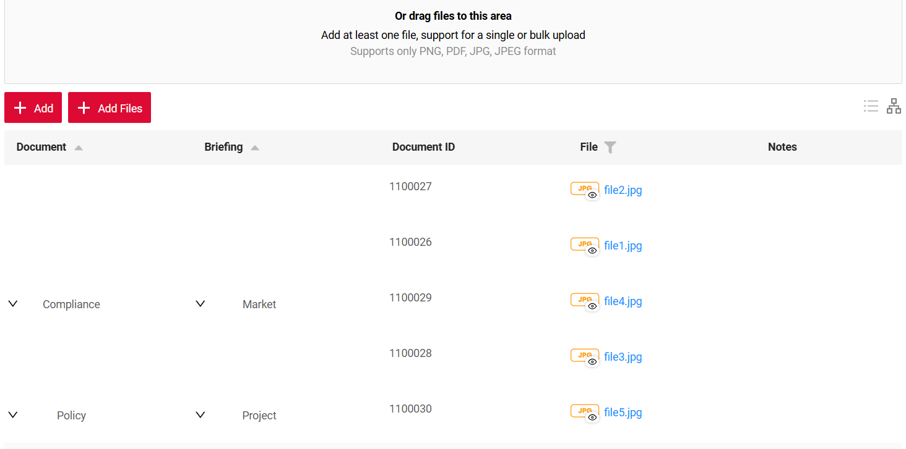

=== "До"
    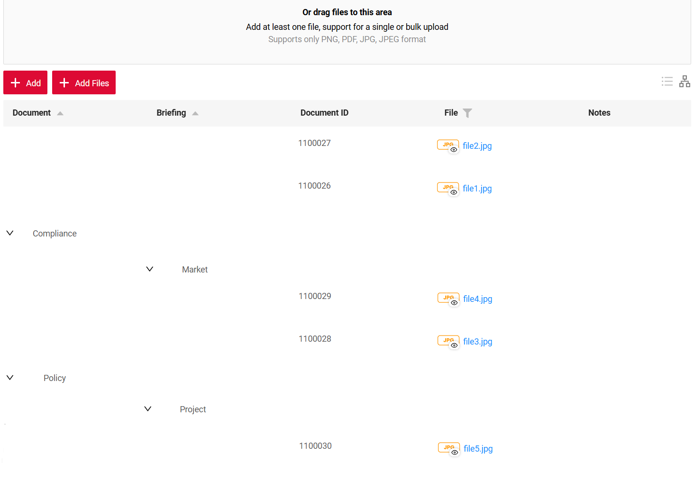 

#### Добавлено: виджет Grouping Hierarchy — иерархия по умолчанию { #added-grouping-hierarchy-widget-default-hierarchy }
Теперь можно (необязательно) задать структуру иерархии по умолчанию, которая отображается даже тогда, когда у виджета нет данных

=== "После: с иерархией по умолчанию"
    
=== "До: без иерархии по умолчанию"
    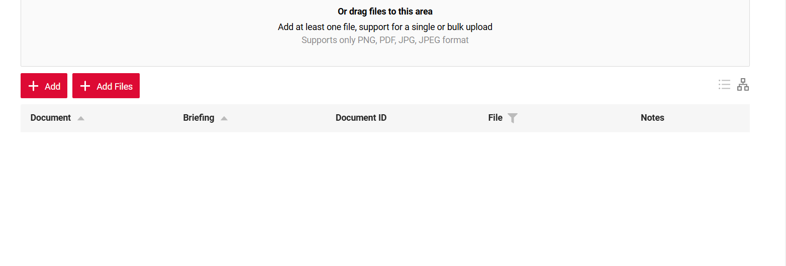

Если данные поступают с бэкенда, фронтенд объединяет их с иерархией по умолчанию. Иерархия по умолчанию и все данные с бэкенда гарантированно отображаются

=== "После: иерархия по умолчанию и данные с бэкенда"
    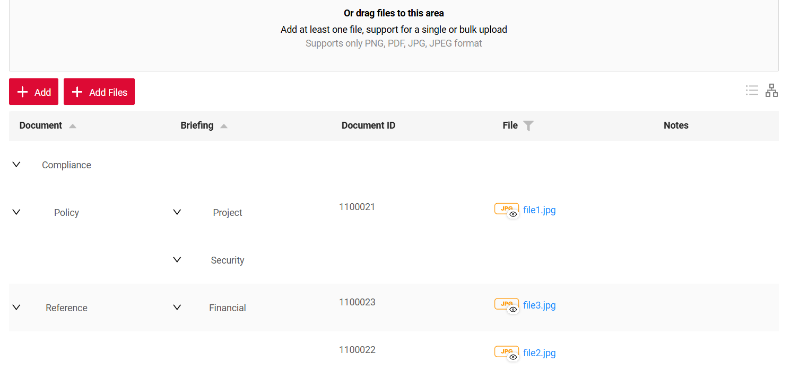
=== "До: только данные с бэкенда"
    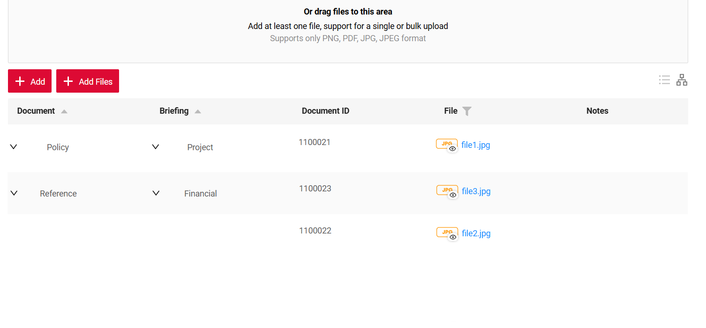


#### Добавлено: виджет Info — режим заголовков полей { #added-info-widget-field-title-mode }

Обновлены параметры отображения виджета Info для одноколоночной и многоколоночной компоновки. Теперь в настройках можно задать `titleMode`
`left` или `top`. По умолчанию `left` для обратной совместимости

=== "Заголовок слева (по умолчанию)"
    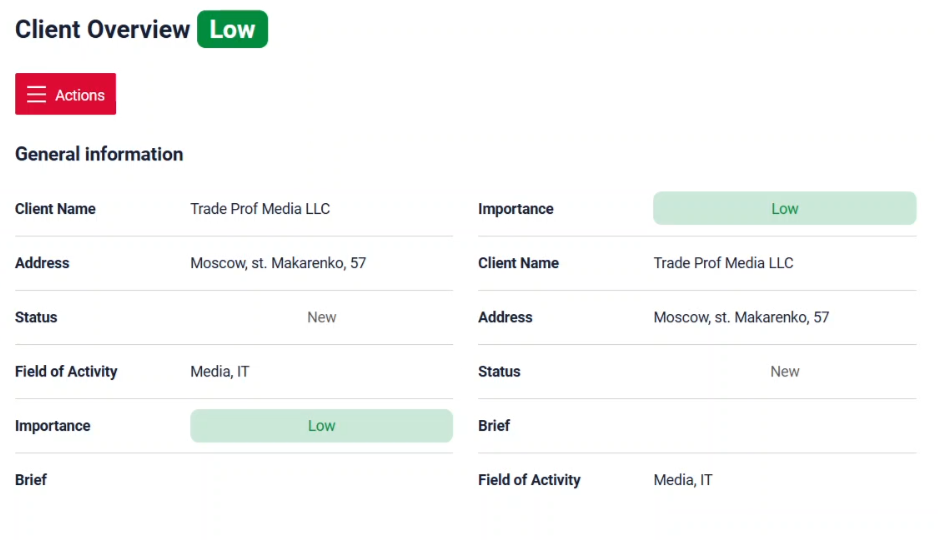
=== "Заголовок сверху"
    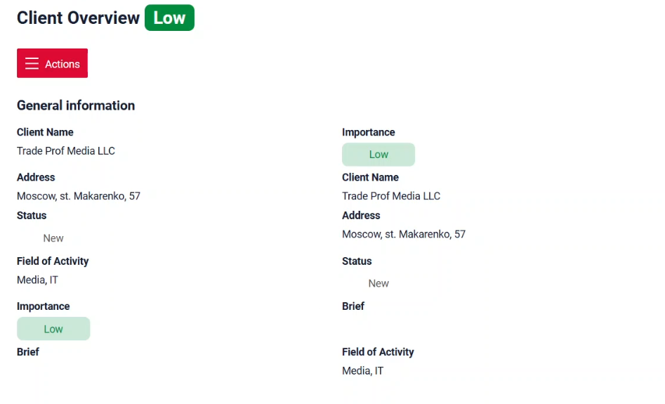

#### Добавлено: поле [Money](/ru/widget_field_money) — поддержка [валюты](/ru/widget_field_money/#currency) { #added-money-field-currency-support }

Поле [Money](/ru/widget_field_money) теперь поддерживает валюту. В этом релизе поддерживается постоянное значение валюты для поля виджета. Поддержка динамического и редактируемого значения валюты будет добавлена в следующих релизах

=== "После"
    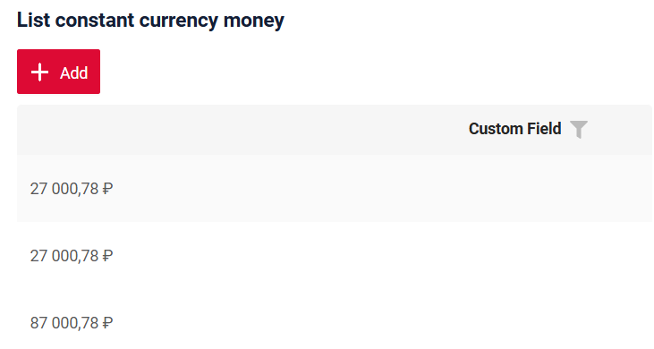
=== "До"
    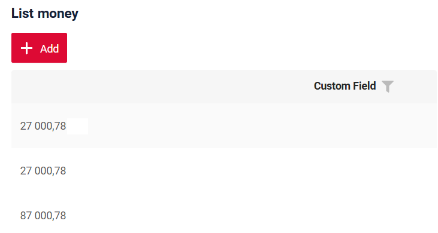

#### Добавлено: поле Checkbox — поддержка placeholder { #added-checkbox-field-placeholder-support }

Для checkbox добавлена поддержка placeholder. Значение placeholder отображается справа от самого флажка. Обратите внимание, что оно не исчезает после нажатия на флажок.

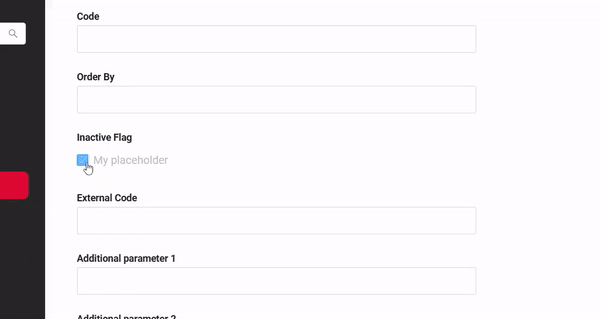

#### Добавлено: виджет [FormPopup](/ru/widget_type_form_popup) — поддержка нескольких всплывающих окон { #added-formpopup-widget-multiple-popups-support }

Теперь для разных кнопок одного bc/виджета можно задать разные виджеты [FormPopup](/ru/widget_type_form_popup).

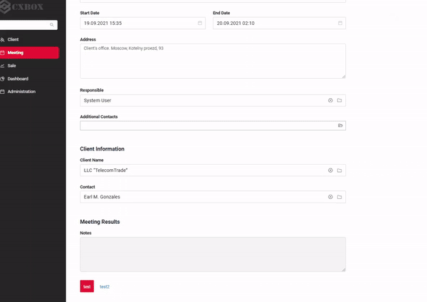  

#### Изменено: поле Checkbox — единообразный вид { #changed-checkbox-field-uniformed-look }

Улучшен внешний вид checkbox — он приведён в соответствие с другими типами полей

#### Прочие изменения { #other-changes }
см. [журнал изменений cxbox-demo](https://github.com/CX-Box/cxbox-demo/releases/tag/v.2.0.7)

### CXBOX ([Core Ui](https://github.com/CX-Box/cxbox-ui/releases/tag/2.4.0))

#### Изменено: логика действий при незаполненных обязательных полях { #changed-actions-logic-when-required-fields-are-left-empty }

Скорректирована логика действий с `withoutAutoSaveBefore()` при незаполненных обязательных полях. Теперь появляется всплывающее уведомление о несохранённых изменениях.

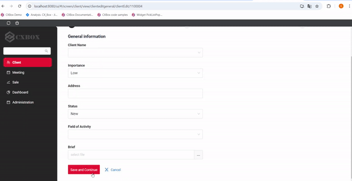

#### Изменено: улучшена логика загрузки данных для дочерних компонентов со `hidden` родителем { #changed-improved-data-loading-logic-for-child-components-with-hidden-parent }

Скорректирована логика загрузки данных в дочерние бизнес-компоненты, когда их родительский виджет `hidden`

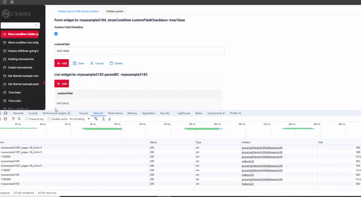  

#### Прочие изменения { #other-changes_1 }
см. [журнал изменений cxbox-ui](https://github.com/CX-Box/cxbox-ui/releases/tag/2.4.0)

### CXBOX 4.0.0-M10 ([Core](https://github.com/CX-Box/cxbox/tree/cxbox-4.0.0-M10))  

#### Добавлено: класс FieldMetaBuilder — поддержка метода `getParentField()` { #added-fieldmetabuilder-class-getparentfield-method-support }

В этом обновлении метод `getParentField()` стал доступен в FieldMetaBuilder. Также добавлен новый метод `getBc()` в FieldMetaBuilder и классах `*ResponseService`

#### Добавлено: класс FieldMetaBuilder — поддержка метода `defaultGroupingHierarchy` { #added-fieldmetabuilder-class-defaultgroupinghierarchy-method-support }
Пример 1: <strong>явно</strong> заданное дерево иерархии по умолчанию (группировка по двум Enum-полям: <strong>document</strong>, затем <strong>briefing</strong>):
```java
fields.defaultGroupingHierarchy(
MeetingDocumentsDTO_.document,
MeetingDocumentsDTO_.briefing,
lvl -> lvl
  .add(
    Documents.POLICY,
    lvl2 -> lvl2
      .add(Briefings.PROJECT)
      .add(Briefings.SECURITY)
   )
  .add(
    Documents.COMPLIANCE
  )
);
```

Пример 2: <strong>динамически</strong> заданное дерево иерархии по умолчанию. Удобно, когда структура иерархии по умолчанию настраивается через админку и её нужно загружать из БД/микросервиса:
```java
Map<Documents, Set<Briefings>> external = Map.of(
 Documents.REFERENCE, Set.of(Briefings.FINANCIAL, Briefings.PROJECT),
 Documents.POLICY, new HashSet<>()
);
fields.defaultGroupingHierarchy(
 MeetingDocumentsDTO_.document,
 MeetingDocumentsDTO_.briefing,
 lvl1 -> external.entrySet().stream().collect(Hierarchy.toHierarchy(
   Entry::getKey,
   (doc, lvl2) -> doc.getValue().stream().collect(Hierarchy.toHierarchy(brief -> brief))
  )
 )
);
```
#### Прочие изменения { #other-changes_2 }
см. [журнал изменений cxbox](https://github.com/CX-Box/cxbox/releases/tag/cxbox-4.0.0-M10)
 
### CXBOX [документация](https://doc.cxbox.org/ru/) { #cxbox-documentation }

#### Добавлено: виджет [PickListPopup](/ru/widget_type_pick_list_popup) — статья документации { #added-picklistpopup-widget-documentation-article }

Добавлено описание [PickListPopup](/ru/widget_type_pick_list_popup).

#### Добавлено: виджеты List, Form, Info — статья о showCondition { #added-list-form-info-widgets-showcondition-documentation-article }

Добавлено полное описание [Show Condition](https://doc.cxbox.org/ru/widget/type/property/showcondition/showcondition/) и параметра showCondition для трёх основных виджетов ([Form](https://doc.cxbox.org/ru/widget/type/form/form/#show-condition), [Info](https://doc.cxbox.org/ru/widget/type/info/info.md/#show-condition), [List](https://doc.cxbox.org/ru/widget/type/list/list/#show-condition)).

#### Добавлено: поле Money — раздел о свойстве currency { #added-money-field-currency-property-section }

В описание поля Money добавлено описание свойства [currency](https://doc.cxbox.org/ru/widget/fields/field/money/money/#currency).

