# 2.0.8

* [cxbox/demo 2.0.8 git](https://github.com/CX-Box/cxbox-demo/tree/v.2.0.8), [примечания к релизу](https://github.com/CX-Box/cxbox-demo/releases/tag/v.2.0.8)

* [cxbox/core 4.0.0-M11 git](https://github.com/CX-Box/cxbox/tree/cxbox-4.0.0-M11), [примечания к релизу](https://github.com/CX-Box/cxbox/releases/tag/cxbox-4.0.0-M11), [maven](https://central.sonatype.com/artifact/org.cxbox/cxbox-starter-parent/4.0.0-M11)

* [cxbox-ui/core 2.4.1 git](https://github.com/CX-Box/cxbox-ui/tree/2.4.1), [примечания к релизу](https://github.com/CX-Box/cxbox-ui/releases/tag/2.4.1), [npm](https://www.npmjs.com/package/@cxbox-ui/core/v/2.4.1)

* [cxbox/code-samples 2.0.8 git](https://github.com/CX-Box/cxbox-code-samples/tree/v.2.0.8), [примечания к релизу](https://github.com/CX-Box/cxbox-code-samples/releases/tag/v.2.0.8)

## **Ключевые обновления ноября 2024** { #key-updates-november-2024 }

### CXBOX ([Демо](https://demo.cxbox.org)) { #cxbox-demo }

#### Добавлено: виджет GroupingHierarchy — счётчик { #added-groupinghierarchy-widget-counter }

Для полей группировки добавлен счётчик, отображающий количество вложенных строк с данными. Настраивается через `counterMode` (возможные значения: `always`, `collapsed` и по умолчанию `none`)

=== "None"
    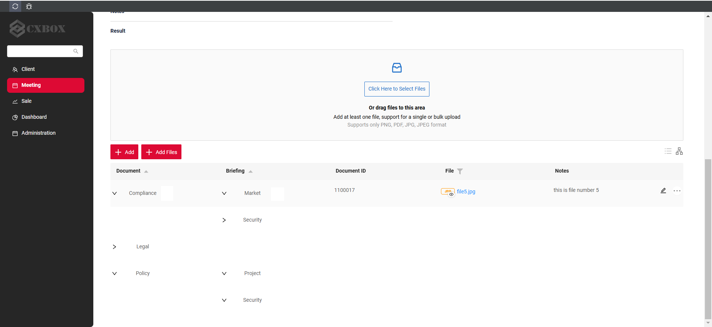
=== "Collapsed"  
    
=== "Always"  
      

#### Добавлено: виджет GroupingHierarchy — узлы, раскрытые по умолчанию { #added-groupinghierarchy-widget-nodes-expanded-by-default }

Теперь можно настроить раскрытие узлов виджета GroupingHierarchy по умолчанию (`defaultExpanded` = `true`)

=== "defaultExpanded: false/ null"  
    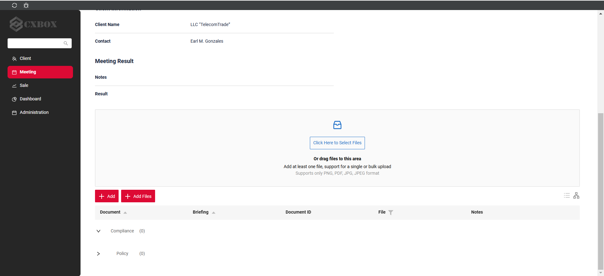  
=== "defaultExpanded: true"  
    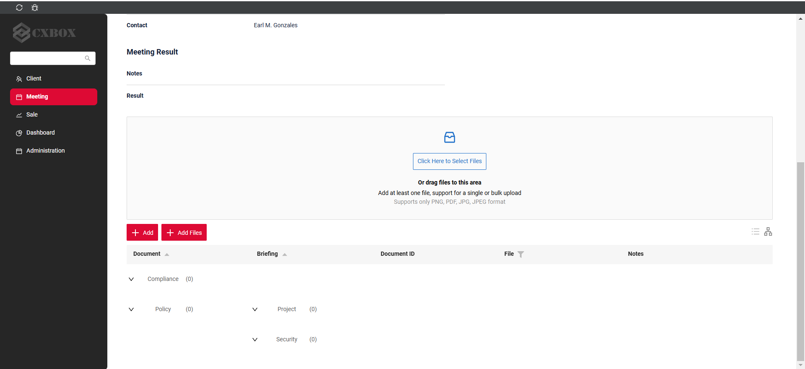

_Примечание!_ Чтобы сократить количество кликов, мы всегда раскрываем группы, которые в раскрытом виде займут только 1 строку. Поэтому, когда `defaultExpanded` равен `false` или `null`, узлы по умолчанию «умно» свёрнуты:

* группы с 1 или 0 элементов раскрыты
* группы с более чем 1 элементом свёрнуты.

#### Изменено: виджет Additional Info — стиль { #changed-additional-info-widget-style }

Обновлён стиль виджета Additional Info.

=== "После"
    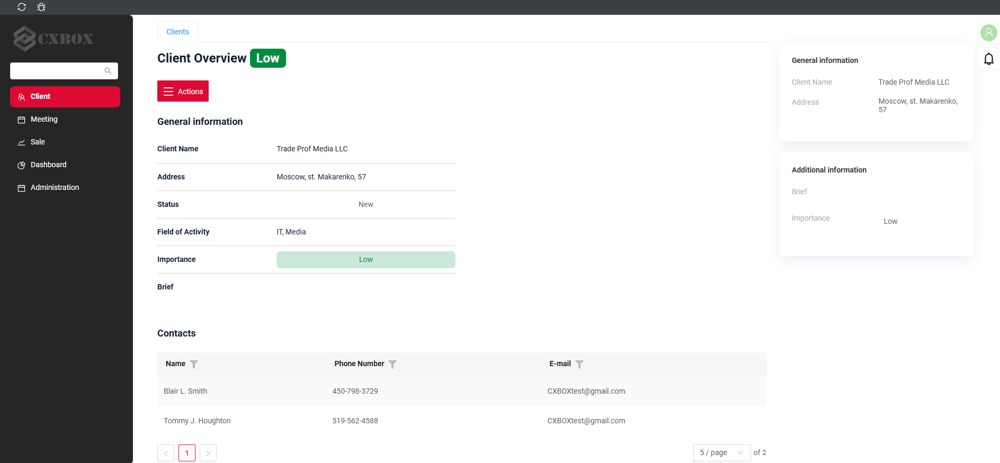
=== "До"
    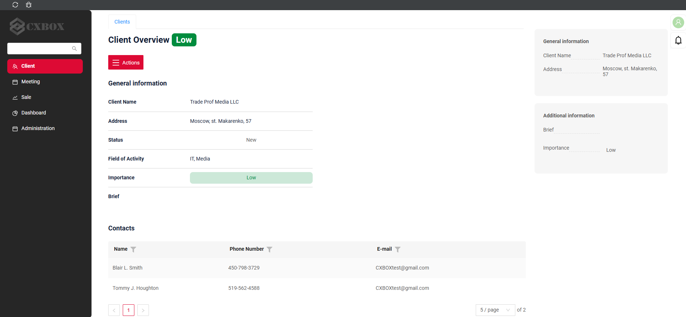

#### Добавлено: виджет Additional List — новый тип виджета! { #added-additional-list-widget-new-widget-type }

Добавлен новый тип виджета `AdditionalList`, который может отображать несколько строк данных

* В этом релизе: нужно указать параметр `.widget.json -> options -> read`, указывающий на виджет `AdditionalInfo`, используемый для отображения каждой строки данных
* В следующих релизах: параметр `.widget.json -> options -> read` можно будет не указывать, например отображать строки `AdditionalList` в стиле `List` по умолчанию

=== "После"
    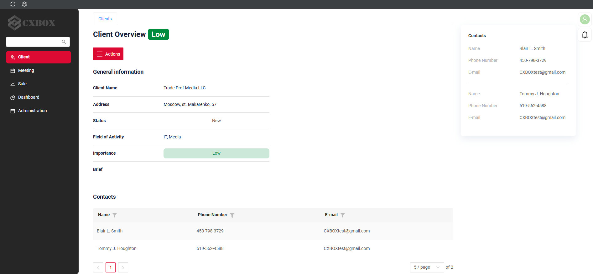
=== "До"
    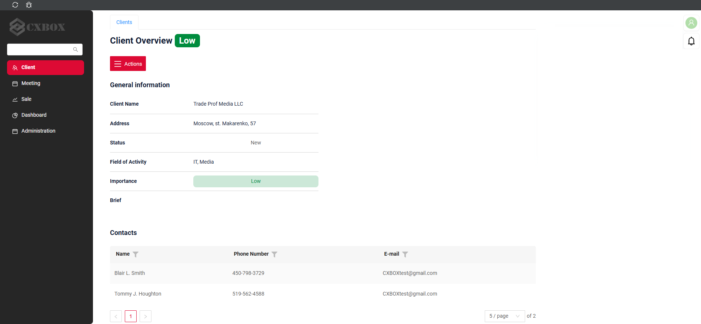  

#### Добавлено: поле Dictionary — поддержка иконок { #added-dictionary-field-icon-support }

Теперь для поля `dictionary` можно задать иконку. С помощью параметра `mode` можно выбрать `default` (отображаются иконка и текст) или `icon` (отображается только иконка).
Кроме того, при наведении на иконку всегда появляется подсказка.

=== "Иконка задана (по умолчанию)"
    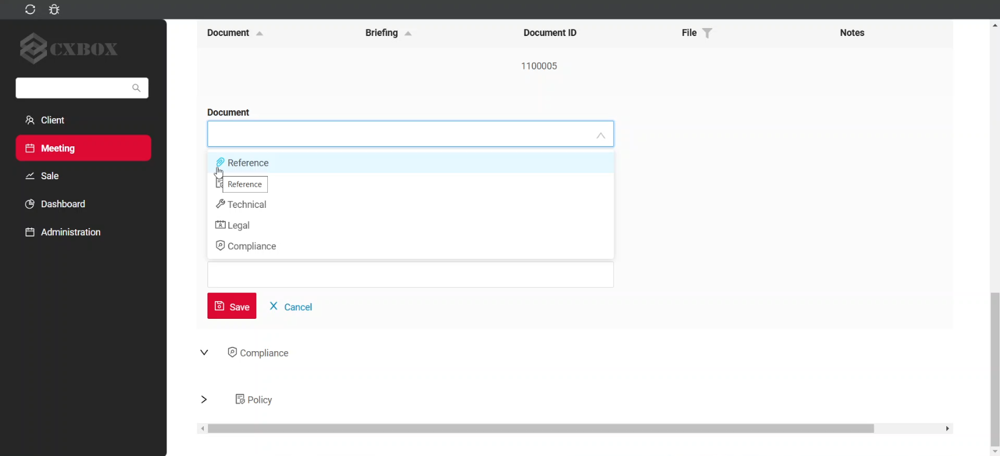
=== "Иконка задана (mode=icon)"
    
=== "Иконка не задана"
    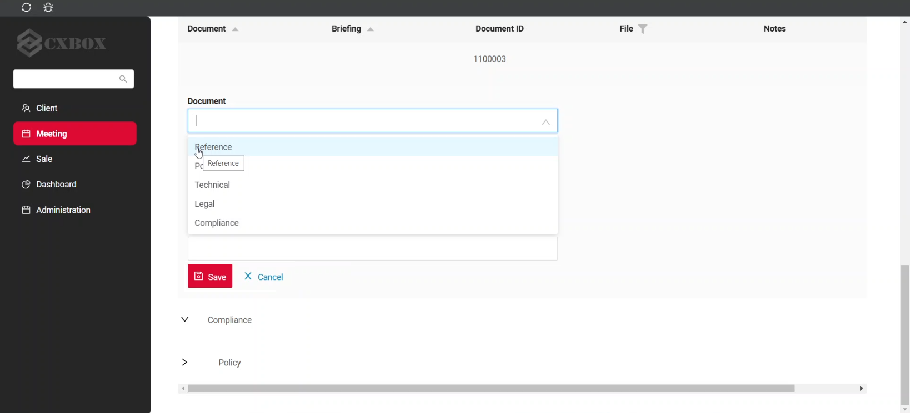  

#### Добавлено: View — поддержка групп виджетов { #added-view-widget-groups-support }

Теперь несколько виджетов можно объединить в группу и сворачивать или разворачивать её. Первый виджет группы получает иконку для управления сворачиванием. В свёрнутом состоянии все виджеты группы скрыты, кроме заголовка первого виджета. По умолчанию группа виджетов отображается развёрнутой.

=== "Развёрнуто (по умолчанию)"
    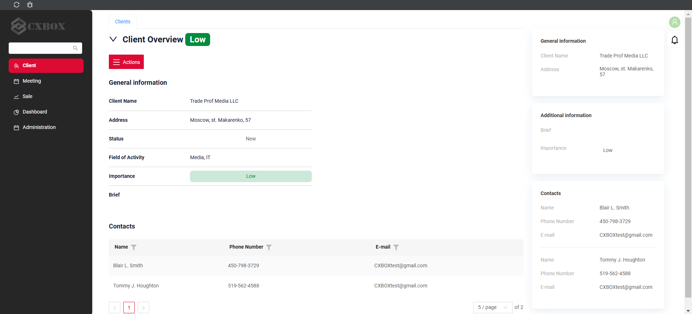
=== "Collapsed"
    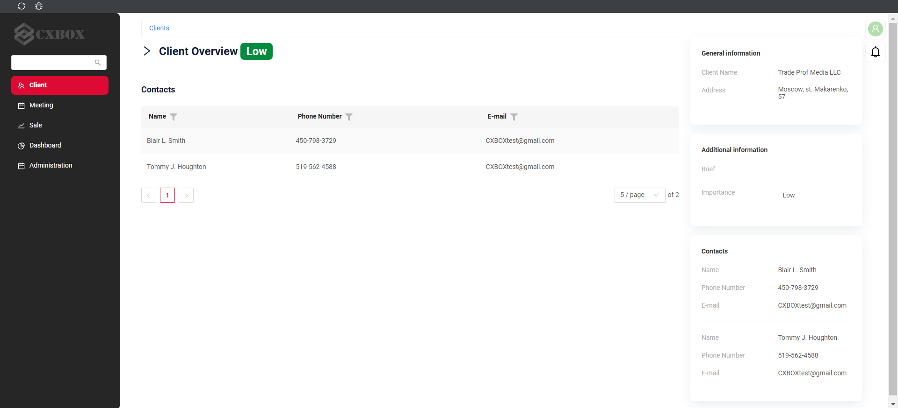

#### Прочие изменения { #other-changes }
см. [журнал изменений cxbox-demo](https://github.com/CX-Box/cxbox-demo/releases/tag/v.2.0.8)

### CXBOX ([Core Ui](https://github.com/CX-Box/cxbox-ui/releases/tag/2.4.1))  

#### Добавлено: параметр отображения иконки в полях dictionary { #added-parameter-for-displaying-icon-in-dictionary-fields }

Для поля Dictionary добавлена поддержка иконок через новый тег `allValues`. Каждая запись в `allValues` содержит атрибут `icon`, позволяющий настроить иконку (ANT или собственную) и её цвет в соответствии со значением.

#### Прочие изменения { #other-changes_1 }
см. [журнал изменений cxbox-ui](https://github.com/CX-Box/cxbox-ui/releases/tag/2.4.1)

### CXBOX 4.0.0-M11 ([Core](https://github.com/CX-Box/cxbox/tree/cxbox-4.0.0-M11))  

#### Изменено: методы работы с иконками для полей dictionary { #changed-icon-handling-methods-for-dictionary-fields }

Методы `setIconWithValue()` и `setFilterValuesWithIcons()` теперь помечены как `@Deprecated`. Их заменил новый метод `setAllValuesWithIcons()`, применимый как для LOV, так и для Enum

#### Добавлено: параметр управления режимом отображения по умолчанию для Default Grouping Hierarchy { #added-parameter-for-managing-default-display-mode-for-default-grouping-hierarchy }

Добавлен новый Boolean-параметр `defaultExpanded`.

#### Прочие изменения { #other-changes_2 }
см. [журнал изменений cxbox](https://github.com/CX-Box/cxbox/releases/tag/cxbox-4.0.0-M11)

### CXBOX [документация](https://doc.cxbox.org/ru/) { #cxbox-documentation }

#### Добавлено: [Dictionary](/ru/widget_field_dictionary) — раздел об иконках { #added-dictionary-icon-section }

Добавлено полное описание [иконок](https://doc.cxbox.org/ru/widget/fields/field/dictionary/dictionary/#icon) в поле Dictionary.

