# 2.0.9

* [cxbox/demo 2.0.9 git](https://github.com/CX-Box/cxbox-demo/tree/v.2.0.9), [примечания к релизу](https://github.com/CX-Box/cxbox-demo/releases/tag/v.2.0.9)

* [cxbox/core 4.0.0-M12 git](https://github.com/CX-Box/cxbox/tree/cxbox-4.0.0-M12), [примечания к релизу](https://github.com/CX-Box/cxbox/releases/tag/cxbox-4.0.0-M12), [maven](https://central.sonatype.com/artifact/org.cxbox/cxbox-starter-parent/4.0.0-M12)  

* [cxbox-ui/core 2.4.2 git](https://github.com/CX-Box/cxbox-ui/tree/2.4.2), [примечания к релизу](https://github.com/CX-Box/cxbox-ui/releases/tag/2.4.2), [npm](https://www.npmjs.com/package/@cxbox-ui/core/v/2.4.2)

* [cxbox/code-samples 2.0.9 git](https://github.com/CX-Box/cxbox-code-samples/tree/v.2.0.9), [примечания к релизу](https://github.com/CX-Box/cxbox-code-samples/releases/tag/v.2.0.9)

## **Ключевые обновления ноября, декабря 2024** { #key-updates-november-december-2024 }

### CXBOX ([Демо](https://demo.cxbox.org)) { #cxbox-demo }

#### Добавлено: виджет AdditionalList — новый режим отображения { #added-additionallist-widget-new-display-mode }

Теперь виджет Additional List поддерживает два режима отображения.

* (НОВОЕ) По умолчанию: каждая строка Additional List отображается в стиле List по умолчанию.
* (СТАРОЕ) Если в `options -> read` указано имя виджета AdditionalInfo: каждая строка отображается как указанный виджет AdditionalInfo.

=== "По умолчанию"
    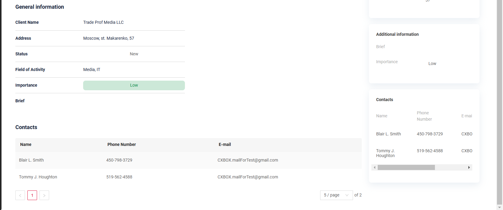
=== "С параметром read"
    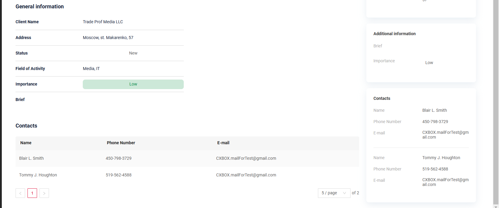

#### Добавлено: уведомления — drilldown к объектам { #added-notifications-drilldown-to-objects }

Всплывающее окно уведомлений теперь поддерживает несколько ссылок drilldown.

* Баннер уведомления теперь отображает количество ссылок:

=== "После"
    
=== "До"
    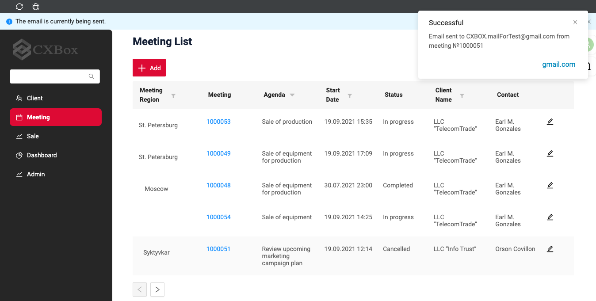

* При нажатии на иконку колокольчика открывается всплывающее окно уведомлений со списком всех гиперссылок на связанные объекты.

=== "После"
    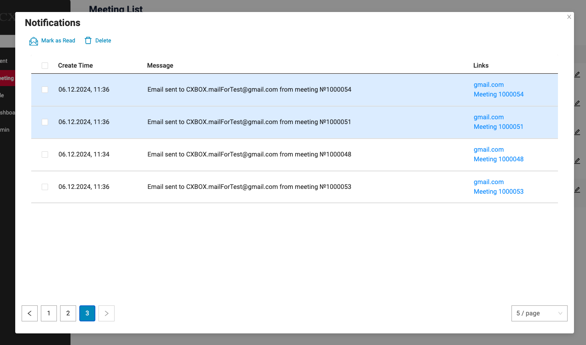  
=== "До"
    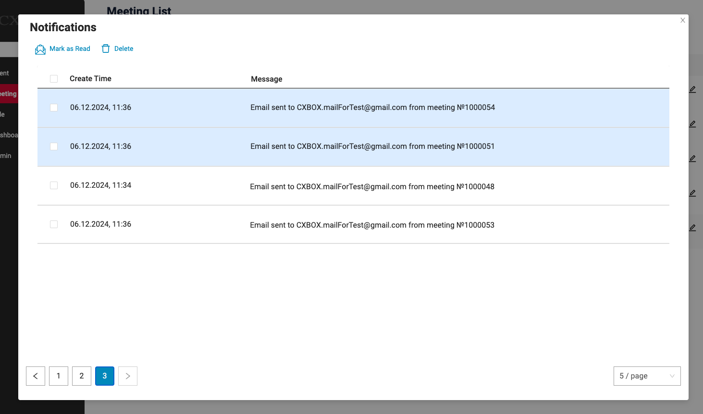  

#### Добавлено: виджет FormPopup — поддержка gridWidth { #added-formpopup-widget-gridwidth-support }

Теперь для [FormPopup](https://doc.cxbox.org/ru/widget/type/formpopup/formpopup/) поддерживается `gridWidth`. Ширину можно указать напрямую через `view.json -> widgets -> gridWidth`, и теперь она динамически подстраивается в зависимости от следующих факторов:

* Состояние меню (свёрнуто или развёрнуто)

=== "gridWidth12, меню развёрнуто"
    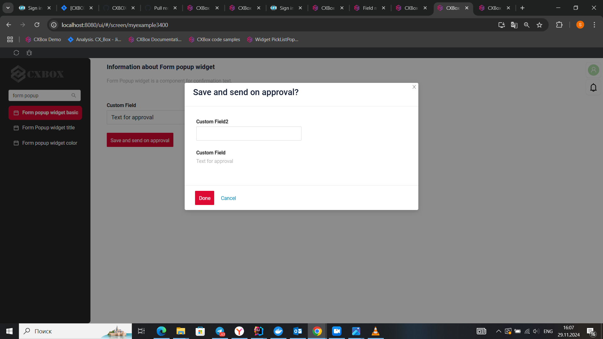   
=== "gridWidth, меню свёрнуто"
    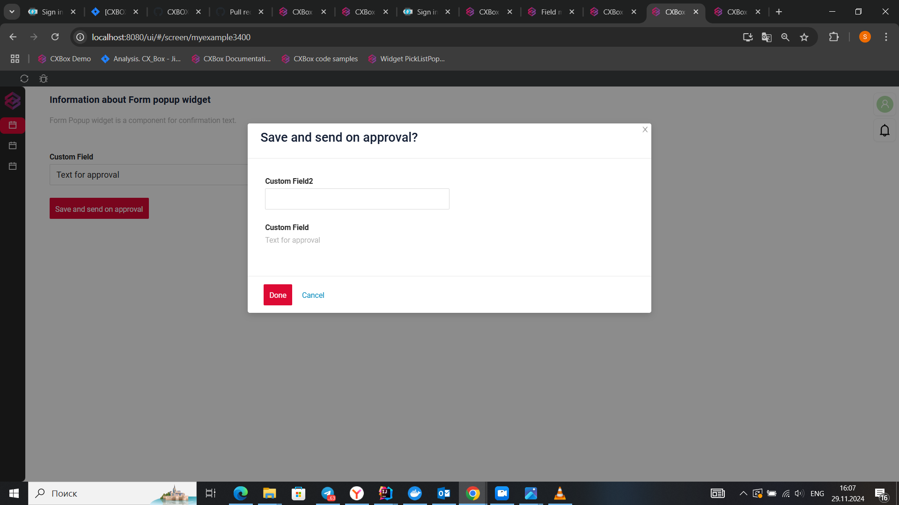  

* Наличие или отсутствие дополнительного виджета на view.

=== "gridWidth12 без Additional"
      
=== "gridWidth12 с Additional"
    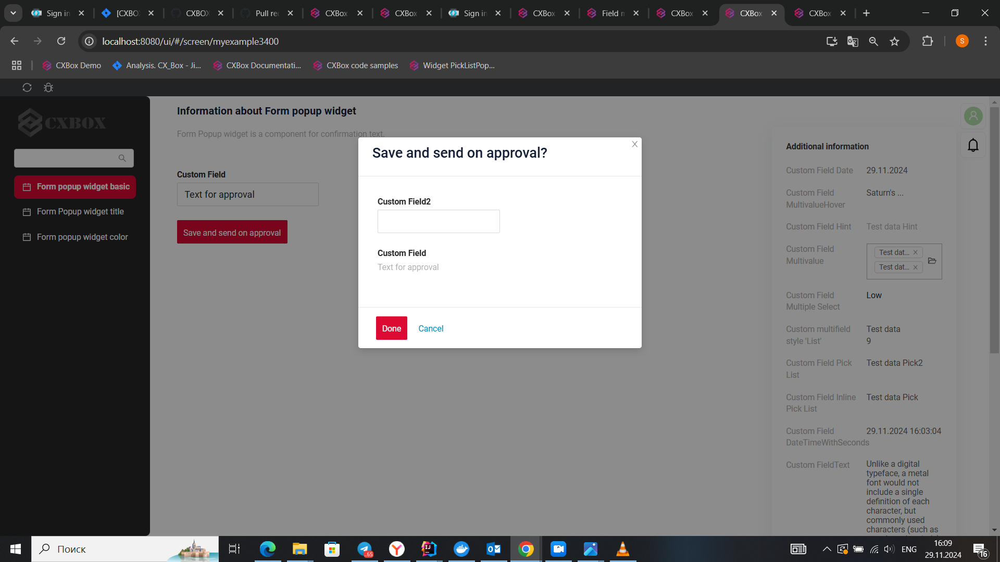

Эти изменения гарантируют, что параметр `gridWidth` для обычного виджета и для виджета FormPopup имеет одинаковый смысл (то есть даёт виджеты одинаковой ширины).

**Внимание!** До этого релиза значение `gridWidth` игнорировалось, то есть размер всплывающего виджета был постоянным. После релиза можно задать `gridWidth = 9`, чтобы сохранить прежние размеры окон.

Подробное описание см. в обновлённой статье о [formPopup](https://doc.cxbox.org/ru/widget/type/formpopup/formpopup/#widget-size).

#### Добавлено: поле Dictionary — интерфейс администрирования { #added-dictionary-field-administration-ui }

* В UI добавлен новый экран администрирования, позволяющий настраивать `dictionaries` прямо из интерфейса
* Изменения, внесённые через UI, применяются мгновенно через `Clear Cache` (экспериментальная функция, не поддерживает кластер)
* Теперь данные справочников можно экспортировать в CSV-файл с помощью `Export`. Формат экспортируемого файла совпадает с форматом миграции Liquibase (см. следующий абзац), что упрощает миграцию без ручных правок
* Новая CSV-миграция с Liquibase обеспечивает простое предварительное заполнение и перенос данных между окружениями (готово для продакшена)

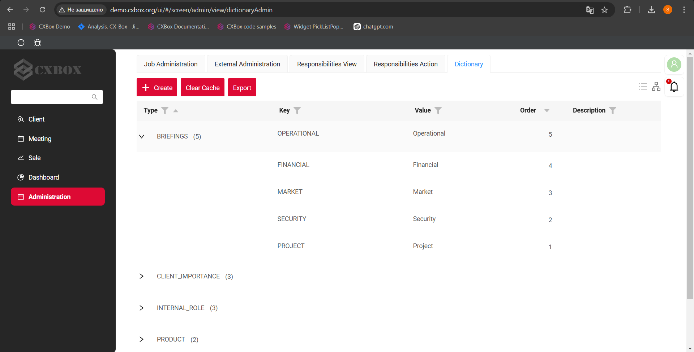  

Подробности см. в обновлённой статье о Dictionary:

* раздел [Администрирование справочников](https://doc.cxbox.org/ru/widget/fields/field/dictionary/dictionary/#administration-dictionary)
* разделы `How to add?` в этой статье теперь содержат примеры с использованием `Dictionary` (вместо устаревшего `LOV`)

#### Добавлено: ролевая модель — поддержка нескольких ролей { #added-role-based-model-multirole-support }

ДО (`multi-role-enabled: false`):

* Поведение при входе. Бэкенд возвращал параметр activeRole с активной ролью пользователя (например, "activeRole": "CXBOX_USER").
* Поведение UI. UI отображал флажок активной роли, и пользователи могли переключать роли.

ПОСЛЕ (`multi-role-enabled: true`):

* Поведение при входе. Бэкенд передаёт activeRole: null, и UI игнорирует это значение. Все доступные пользователю роли передаются в списке roles. В ответах присутствуют все views, доступные любой из ролей пользователя. Если view доступен хотя бы одной роли, он доступен пользователю в режиме нескольких ролей.
* Поведение UI. Флажки всех ролей отображаются, но недоступны, что исключает переключение ролей. Запросы к бэкенду на переключение ролей больше не отправляются.

=== "После"
    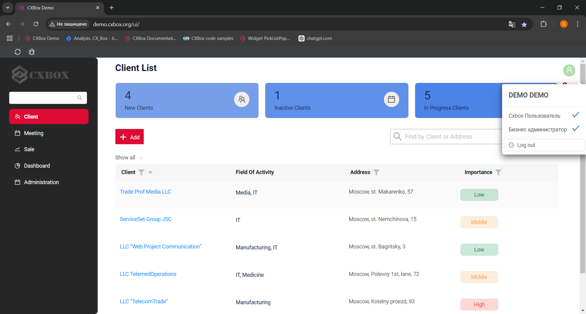
=== "До"
    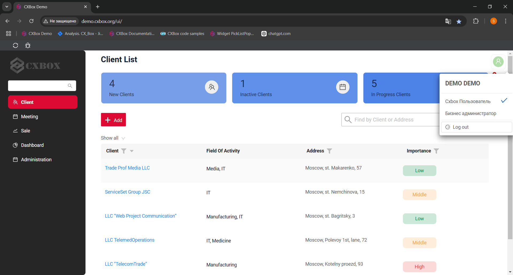  

#### Добавлено: ролевая модель — интерфейс администрирования полномочий на views { #added-role-based-model-view-responsibilities-administration-ui }

ДО (`view-allowed-roles-enabled: true`):

* `view responsibilities` настраиваются в `view.json -> rolesAllowed`.
* Управлять таблицей Responsibilities в базе данных можно только через `view.json`.

ПОСЛЕ (`view-allowed-roles-enabled: false`):

* В UI добавлен новый экран администрирования для настройки полномочий на views
* Любые изменения в UI применяются мгновенно через `Clear Cache` (экспериментальная функция, не поддерживает кластер)
* Теперь данные `view responsibilities` можно экспортировать в CSV-файл с помощью `Export`. Формат экспортируемого файла совпадает с форматом миграции Liquibase (см. следующий абзац), что упрощает миграцию без ручных правок
* Новая CSV-миграция с Liquibase обеспечивает простое предварительное заполнение и перенос данных между окружениями (готово для продакшена)

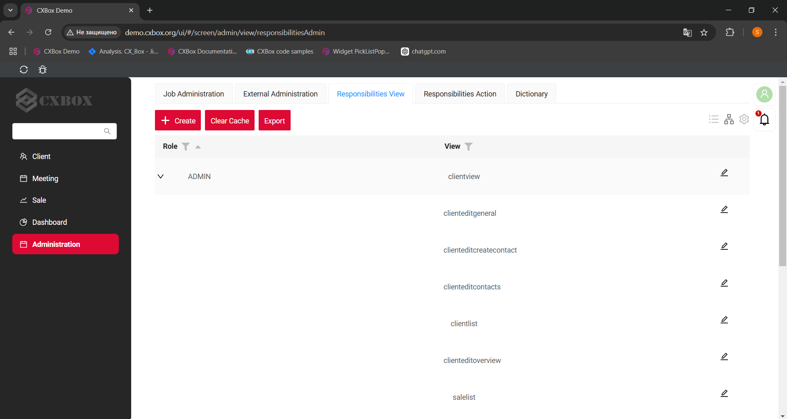

#### Добавлено: ролевая модель — поддержка полномочий на действия { #added-role-based-model-action-responsibilities-support }

ДО (соответствует `widget-action-groups-enabled: true`):

* Уровень UI: видимость действий (например, кнопок на виджетах) управляется в `widget.json  -> actionGroups -> include`.

ПОСЛЕ (`widget-action-groups-enabled: false`)

* В UI теперь есть экран администрирования для прямой настройки полномочий на действия. Кроме того, добавлена таблица базы данных (responsibilities_action) для хранения данных о полномочиях на действия.
* Любые изменения в UI применяются мгновенно через `Clear Cache` (экспериментальная функция, не поддерживает кластер)
* Теперь данные `action responsibilities` можно экспортировать в CSV-файл с помощью `Export`. Формат экспортируемого файла совпадает с форматом миграции Liquibase (см. следующий абзац), что упрощает миграцию без ручных правок
* Новая CSV-миграция с Liquibase обеспечивает простое предварительное заполнение и перенос данных между окружениями (готово для продакшена)

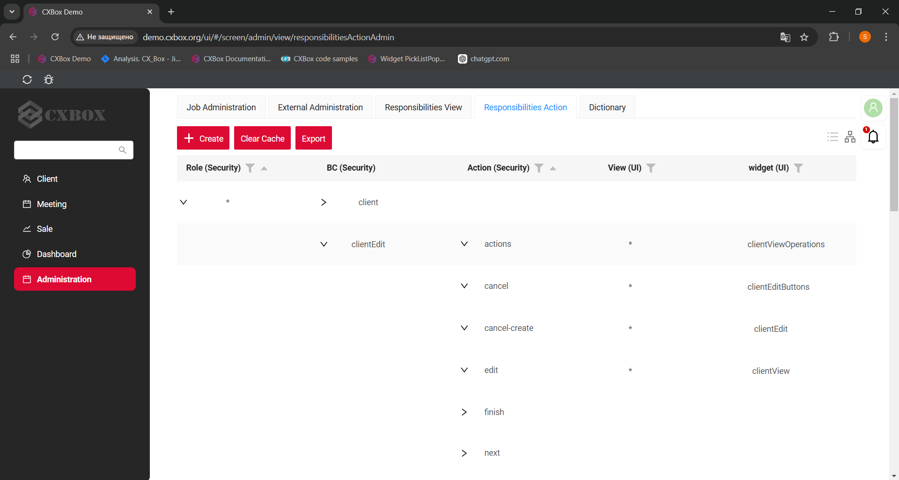

Добавлена автоматическая миграция конфигурации `widget.json -> actionGroups -> include` в `responsibilities_action`. При запуске приложение заполняет таблицу на основе информации о виджетах, если `widget-action-groups-enabled: true`. Поддерживается только `widget.json -> actionGroups -> include` — при использовании `widget.json -> actionGroups -> exclude` миграцию нужно выполнить вручную

Также добавлены два режима миграции

=== "COMPACT (widget-action-groups-compact: true)"  
    Если указать `widget-action-groups-compact: true`, данные `responsibilities_action` заполняются компактно. В этом режиме звёздочка (*) означает, что полномочие действует для всех ролей и всех views. Это особенно удобно при миграции: не нужно разбираться с множеством строк данных, они отображаются в свёрнутом виде.
    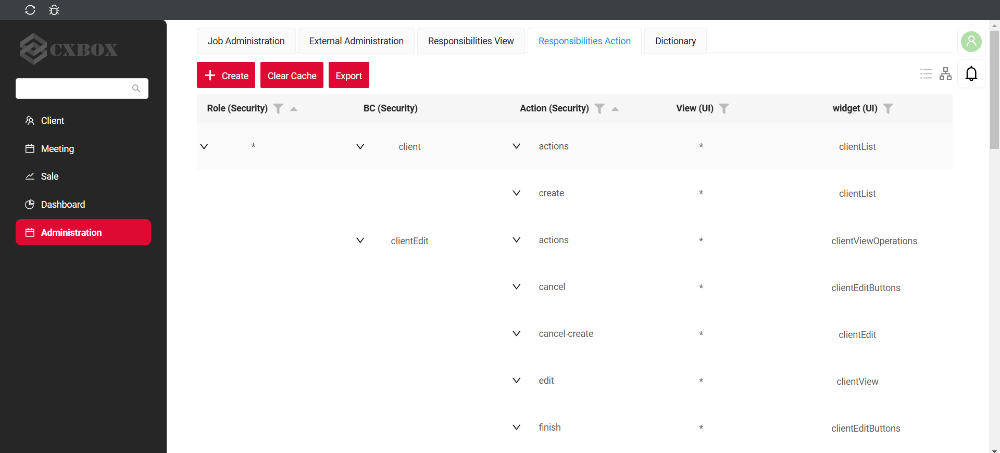  
=== "FULL (widget-action-groups-compact: false)"  
    Если указать `widget-action-groups-compact: false`, данные заполняются отдельно для каждой роли и каждого view.
    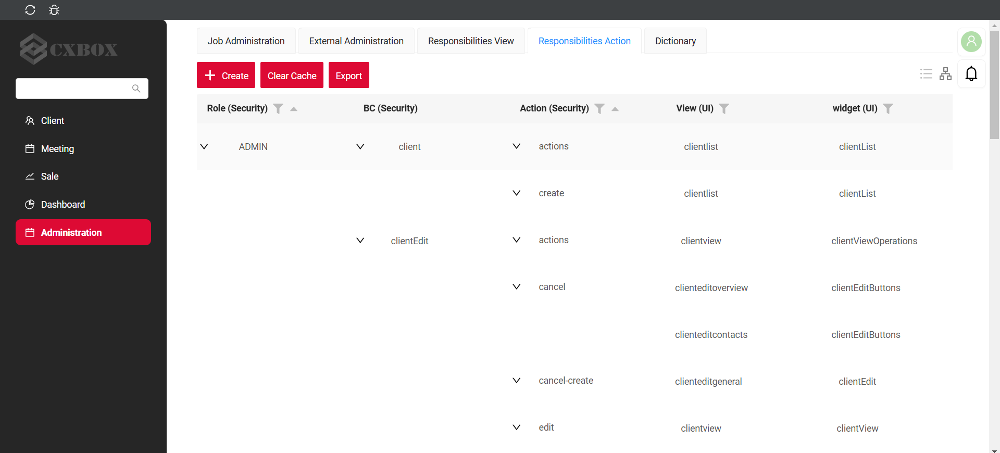  

#### Добавлено: поле suggestionPickList — запрос к бэкенду по клику { #added-suggestionpicklist-field-backend-query-on-click }

Оптимизирована работа `suggestionPickList`: убрано ограничение на количество символов для запросов к бэкенду. Теперь при клике на поле запрос сразу отправляется на бэкенд и отображаются все доступные данные без необходимости вводить символы.

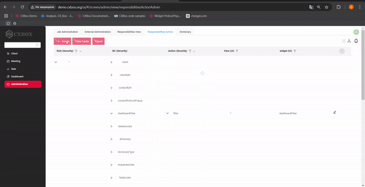{width="900"}  

#### Добавлено: уведомления — аутентификация по Bearer-токену для WebSocket { #added-notifications-bearer-token-authentication-for-websockets }

Добавлена поддержка аутентификации по Bearer-токену при подключении к WebSocket-эндпоинтам уведомлений. Теперь Bearer-токен включается в заголовок запроса для защищённого доступа к эндпоинтам `/api/v1/websocketnotification/` и `/api/v1/notification`.

#### Добавлено: drilldown — всплывающая подсказка { #added-drilldown-tooltip }

У `drilldown` теперь есть всплывающая подсказка при наведении с двумя вариантами:

* Open in a New Tab: открыть ссылку `drilldown` в новой вкладке браузера.
* Copy Link Address: скопировать ссылку `drilldown` в буфер обмена.

Функцию можно включить с помощью `cxbox.ui.drill-down-tooltip: newAndCopy`.
=== "После"
    
=== "До"
    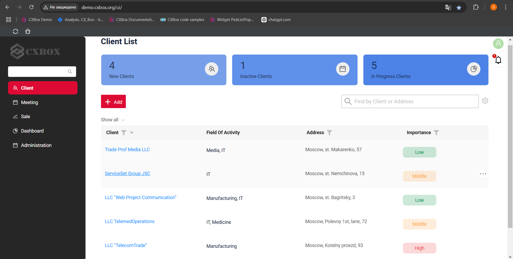

*Ограничения*:

* `drilldowns` типа [to-view-with-fields-filtration](https://doc.cxbox.org/ru/features/element/drilldown/drilldown/?h=drill#to-view-with-fields-filtration) пока не поддерживают вариант "Open in a New Tab".
* подсказка пока не поддерживается для виджета Stats Block.

#### Добавлено: виджет FormPopup — forceActive { #added-formpopup-widget-forceactive }

Для [FormPopup](https://doc.cxbox.org/ru/widget/type/formpopup/formpopup/) добавлена функция `forceActive`, позволяющая выполнить запрос к бэкенду перед открытием модального окна. Это гарантирует, что данные во всплывающем окне динамически обновляются перед отображением и пользователь видит самую актуальную информацию.

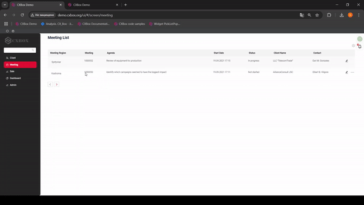{width="900"}  

#### Исправлено: виджет List — улучшена логика inline-создания { #fixed-list-widget-improved-inline-create-logic }

Улучшено поведение inline-создания в виджетах List. Новая строка теперь автоматически открывается в режиме редактирования, и пользователь может сразу вводить данные без лишних кликов.

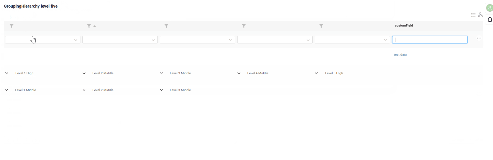  

#### Прочие изменения { #other-changes }
см. [журнал изменений cxbox-demo](https://github.com/CX-Box/cxbox-demo/releases/tag/v.2.0.9)

### CXBOX ([Core Ui](https://github.com/CX-Box/cxbox-ui/releases/tag/2.4.2))  

Выпущена новая версия CORE UI (2.4.2).

#### Прочие изменения { #other-changes_1 }
см. [журнал изменений cxbox-ui](https://github.com/CX-Box/cxbox-ui/releases/tag/2.4.2)

### CXBOX 4.0.0-M12 ([Core](https://github.com/CX-Box/cxbox/tree/cxbox-4.0.0-M12))   

#### Добавлено: класс Dictionary — замена LOV (устаревшего). { #added-dictionary-class-lov-deprecated-replacement }

LOV заменён строго типизированным классом Dictionary для работы с настраиваемыми справочниками. Новый класс Dictionary использует отдельные подклассы для представления разных типов справочников. Он также обеспечивает единообразную работу со справочниками на уровнях Entity и DTO с проверкой на этапе компиляции. Кроме того, в подклассах можно хранить константы для удобного использования в бизнес-логике.

Все подробности приведены в обновлённой статье о [Dictionary](https://doc.cxbox.org/ru/widget/fields/field/dictionary/dictionary/) (см. вкладки "Dictionary" во всех примерах).

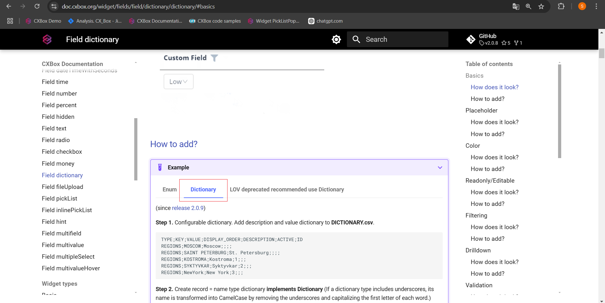  

#### Прочие изменения { #other-changes_2 }
Появились критические изменения! См. [журнал изменений cxbox](https://github.com/CX-Box/cxbox/releases/tag/cxbox-4.0.0-M12)

### CXBOX [документация](https://doc.cxbox.org/ru/) { #cxbox-documentation }

#### Added: [Grouping Hierarchy](https://doc.cxbox.org/widget/type/groupinghierarchy/groupinghierarchy/)  
Добавлено полное описание Grouping Hierarchy.

#### Добавлено: [Экспорт в Excel](https://doc.cxbox.org/ru/widget/type/property/export/excel/excel/) { #added-export-excel }
Добавлено подробное описание функции экспорта в Excel.

#### Добавлено: [Лимит записей на странице](https://doc.cxbox.org/ru/widget/type/property/defaultlimitpage/defaultlimitpage/) { #added-page-limit }
В статье описан лимит записей на странице по умолчанию (доступен для List и Grouping Hierarchy).

#### Добавлено: [Checkbox — placeholder](https://doc.cxbox.org/ru/widget/fields/field/checkbox/checkbox/?h=check#placeholder) { #added-checkbox-placeholder }
Все подробности о placeholder для Checkbox — в обновлённой статье.

#### Добавлено: [Настройка отображаемых колонок](https://doc.cxbox.org/ru/widget/type/list/list/#customization-of-displayed-columns) { #added-customization-of-displayed-columns }
Описан процесс настройки отображаемых колонок.
