# 3.0.1

* [cxbox/demo 3.0.1 git](https://github.com/CX-Box/cxbox-demo/tree/v.3.0.1), [примечания к релизу](https://github.com/CX-Box/cxbox-demo/releases/tag/v.3.0.1)

* [cxbox/core 5.0.2 git](https://github.com/CX-Box/cxbox/tree/cxbox-5.0.2), [примечания к релизу](https://github.com/CX-Box/cxbox/releases/tag/cxbox-5.0.2), [maven](https://central.sonatype.com/artifact/org.cxbox/cxbox-starter-parent/5.0.2)

* [cxbox/code-samples 3.0.1 git](https://github.com/CX-Box/cxbox-code-samples/tree/v.3.0.1), [примечания к релизу](https://github.com/CX-Box/cxbox-code-samples/releases/tag/v.3.0.1)

## **Ключевые обновления августа 2026** { #key-updates-august-2026 }

### CXBOX ([Демо](https://demo.cxbox.org)) { #cxbox-demo }

#### Добавлено: Tree — НОВЫЙ тип виджета! { #added-tree-new-widget-type }
<!-- CXBOX-1341 -->  

Добавлен новый виджет [Tree](https://doc.cxbox.org/ru/widget/type/tree/tree/) для отображения данных в виде дерева.

Виджет предназначен для работы с большими наборами данных и поддерживает любое количество уровней вложенности. Данные загружаются по требованию (ленивая загрузка), поэтому весь набор данных не нужно загружать сразу. Сначала загружаются только строки корневого уровня. При раскрытии узлов загружаются дочерние строки. Вариант More позволяет загрузить следующую страницу строк.

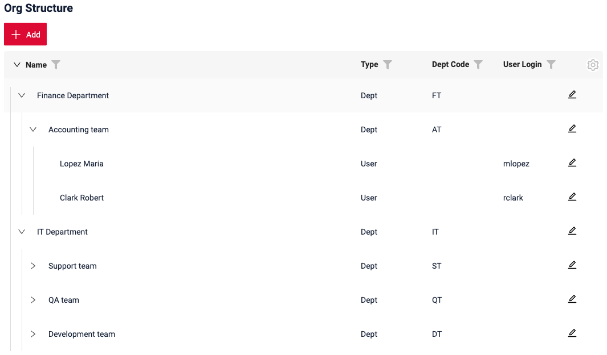

Виджет Tree поддерживает основную функциональность виджета List, включая:

* действия
* фильтрацию
* пагинацию
* связь родитель-потомок
* поиск

Результаты поиска и фильтрации могут отображаться в двух режимах:

* Collapse — подсвечиваются и отображаются только подходящие строки, при этом пользователь может перемещаться по дереву и раскрывать узлы.
* Hide — подсвечиваются и отображаются только подходящие строки, навигация по дереву не поддерживается.

=== "collapse" 
    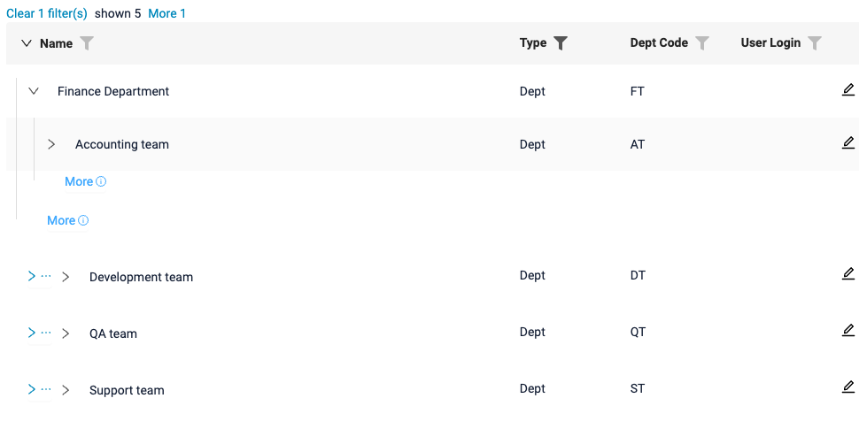
=== "hide"  
    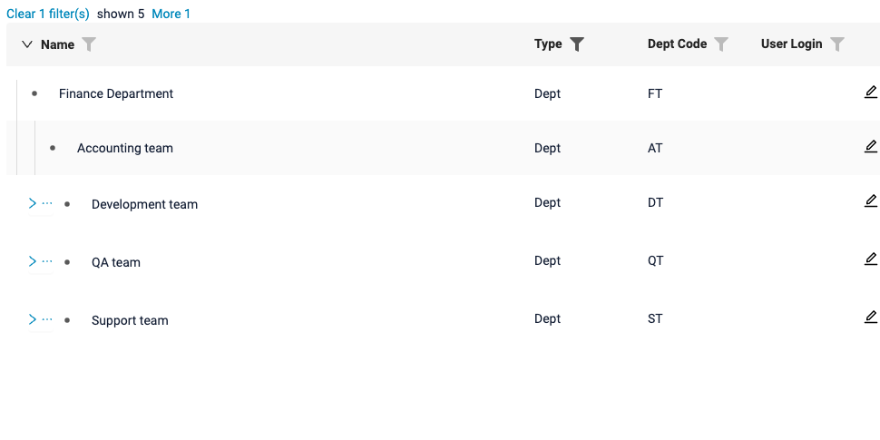

Когда подходящие строки находятся глубоко в дереве, путь может отображаться не полностью (для компактности). Количество отображаемых родительских узлов настраивается, а верхние узлы можно подгрузить при необходимости, чтобы увидеть весь путь.

<!--TODO>> path not fully restored picture -->

!!! info
    См. документацию виджета [Tree](https://doc.cxbox.org/ru/widget/type/tree/tree/).

#### <a id="pickTree">Добавлено: pickTree — НОВЫЙ тип поля!</a>
<!-- CXBOX-1341 -->  

Добавлен новый тип поля [pickTree](https://doc.cxbox.org/ru/widget/fields/field/pickTree/pickTree/) для выбора одного значения из древовидных данных. Новый тип поля открывает новый виджет PickTreePopup.

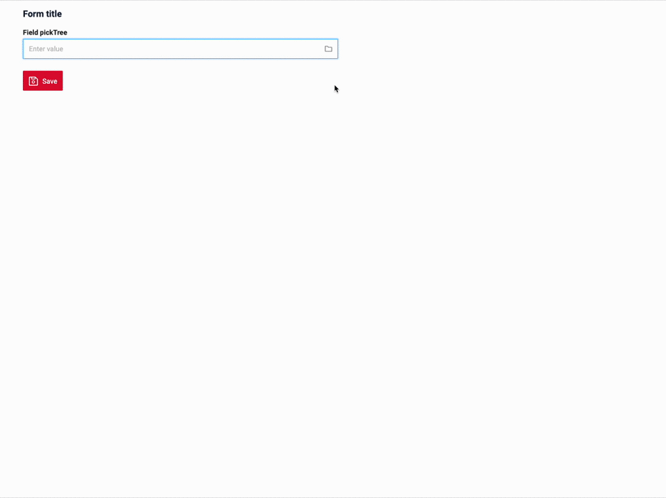

Подробнее о виджете PickTreePopup см. в разделе о виджете [PickTreePopup](#PickTreePopup).

!!! info
    См. документацию поля [pickTree](https://doc.cxbox.org/ru/widget/fields/field/pickTree/pickTree/).

####  <a id="PickTreePopup">Добавлено: PickTreePopup — НОВЫЙ тип виджета!</a>
<!-- CXBOX-1341 -->  

Добавлен новый виджет [PickTreePopup](https://doc.cxbox.org/ru/widget/type/picktreepopup/picktreepopup/) для выбора одного значения из данных, отображаемых в виде дерева.

PickTreePopup — древовидная альтернатива существующему [PickListPopup](https://doc.cxbox.org/ru/widget/type/picklistpopup/picklistpopup/).

PickTreePopup поддерживает любое количество уровней вложенности и ленивую загрузку, что делает его подходящим для работы с большими наборами данных.
Как и в новом виджете Tree, сначала загружаются строки корневого уровня, а дочерние строки — когда пользователь раскрывает узел. Следующие страницы данных можно загрузить с помощью варианта More.

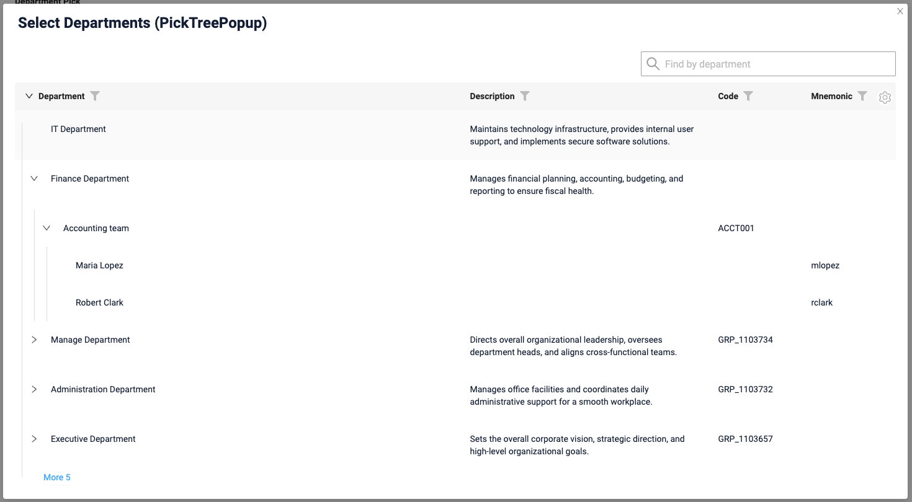

Виджет поддерживает:

* выбор одной строки
* действия
* фильтрацию
* поиск
* пагинацию
* связи родитель-потомок
* ленивую загрузку

Поведение выбора настраивается в зависимости от сценария. Пользователю можно разрешить выбирать:

* только узлы
* только листовые строки
* и узлы, и листовые строки

Как и в виджете Tree, результаты поиска и фильтрации могут отображаться в двух режимах: collapse и hide.

Виджет PickTreePopup открывается из нового поля [pickTree](#pickTree).

!!! info
    См. документацию виджета [PickTreePopup](https://doc.cxbox.org/ru/widget/type/picktreepopup/picktreepopup/).

#### <a id="multivalueTree">Добавлено: multivalueTree — НОВЫЙ тип поля!</a>
<!-- CXBOX-1341 -->  

Добавлено новое поле [multivalueTree](https://doc.cxbox.org/ru/widget/fields/field/multivalueTree/multivalueTree/) для выбора нескольких значений из древовидных данных.

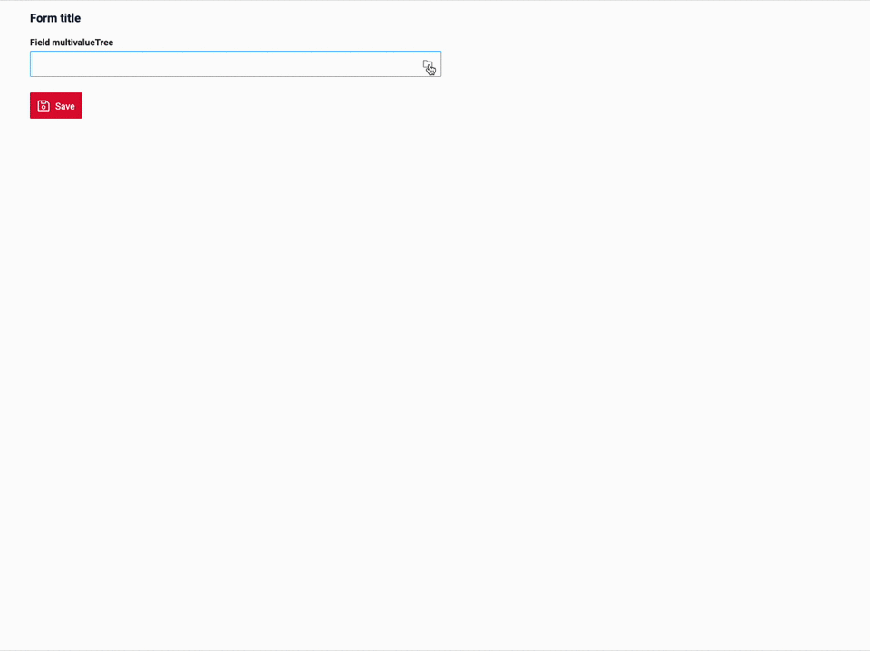

Оно работает аналогично существующему полю multivalue, но открывает новый виджет [AssocTreePopup](#AssocTreePopup), в котором пользователь перемещается по дереву и выбирает несколько значений с помощью флажков.

!!! info
    См. документацию поля [multivalueTree](https://doc.cxbox.org/ru/widget/fields/field/multivalueTree/multivalueTree/).

#### <a id="AssocTreePopup">Добавлено: AssocTreePopup — НОВЫЙ тип виджета!</a>

Добавлен новый виджет [AssocTreePopup](https://doc.cxbox.org/ru/widget/type/assoctreepopup/assoctreepopup/) для выбора нескольких значений из данных, отображаемых в виде дерева.

AssocTreePopup — древовидная альтернатива существующему AssocListPopup. Он позволяет выбирать несколько строк с помощью флажков, сохраняя видимой структуру дерева.

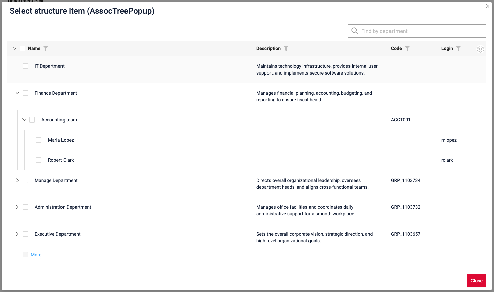

Виджет поддерживает:

* множественный выбор с помощью флажков
* действия
* фильтрация и сортировка
* поиск
* пагинацию
* связи родитель-потомок
* ленивую загрузку
* выбор узлов/листовых строк/и тех и других

Выбранные значения отображаются в верхней части всплывающего окна.

Результаты поиска и фильтрации могут отображаться в двух режимах: collapse и hide.

Виджет AssocTreePopup открывается из нового поля [multivalueTree](#multivalueTree).

!!! info
    См. документацию виджета [AssocTreePopup](https://doc.cxbox.org/ru/widget/type/assoctreepopup/assoctreepopup/).

#### Добавлено: поля text и richText — настраиваемая высота { #added-text-and-richtext-fields-configurable-height }
<!-- CXBOX-1350 -->  

Добавлена поддержка настройки высоты полей text и richText на виджетах.

Минимальное и максимальное количество строк теперь можно задать отдельно для просмотра и редактирования, что упрощает подгонку полей под содержимое и компоновку экрана.
=== "Виджет List"
    
=== "Виджет Info"
    
=== "Виджет Form"
    

#### Добавлено: группа фильтров — НОВАЯ возможность сделать её фильтром по умолчанию { #added-filter-group-new-ability-to-make-it-default }
<!-- CXBOX-1382 -->  
Теперь для сохранённой группы (`filter group`) можно настроить фильтр по умолчанию.
Настроенный фильтр автоматически применяется при инициализации и обновлении страницы.

Фильтр по умолчанию отмечен **звёздочкой ★**.


#### Добавлено: фильтрация — НОВАЯ кнопка 'To default filter(s)' { #added-filtration-new-button-to-default-filterss }
<!-- CXBOX-1382 --> 
Рядом с кнопкой **`Clear N filter(s)`** добавлена кнопка **`To default filter(s)`**.

Кнопка **`To default filter(s)`** позволяет вернуть фильтры к значениям по умолчанию, заданным разработчиком.

При сбросе фильтров применяется следующий приоритет:

1. **`bc_property`** — фильтры, заданные через `bc_property`;
2. **`default filter group`** — фильтры, заданные в группе фильтров по умолчанию.

Кнопка **`To default filter(s)`** отображается, только если для страницы настроены фильтры по умолчанию.


#### Исправлено: richText — форматирование сохраняется в самых распространённых случаях { #fixed-richtext-formatting-is-preserved-in-the-most-common-cases }
<!-- CXBOX-1364 -->  

Поле richText хранит содержимое в Markdown — том же формате, что использует Яндекс Вики. В Markdown нельзя выразить некоторые сочетания форматирования, и лидеры рынка, такие как Яндекс Вики, в этих случаях тоже ошибаются. Поэтому мы не создаём собственный редактор, а добавляем небольшие патчи в базовую библиотеку и исправляем самые распространённые случаи, приближая редактор к лидерам рынка.

Сводка поддерживаемого форматирования: ✅ поддерживается, ⚠️ поддерживается с оговоркой, ❌ не поддерживается, — не проверялось.

**Основы**

| #  | Возможность                                    | До | После | Яндекс Вики | Пример Markdown              |
|----|------------------------------------------------|:------:|:-----:|:-----------:|------------------------------|
| 1  | Полужирный                                     | ✅ | ✅ | ✅ | `**bold**`                   |
| 2  | Курсив                                         | ✅ | ✅ | ✅ | `*italic*`                   |
| 3  | Подчёркнутый                                   | ✅ | ✅ | ✅ | `++under++`                  |
| 4  | Зачёркнутый                                    | ✅ | ✅ | ✅ | `~~strike~~`                 |
| 5  | Встроенный код                                 | ✅ | ✅ | ✅ | `` `code` ``                 |
| 6  | Цвет текста                                    | ✅ | ✅ | ✅ | `{red}(text)`                |
| 7  | Ссылка                                         | ✅ | ✅ | ✅ | `[text](url)`                |
| 8  | Заголовки H1–H6                                | ✅ | ✅ | ✅ | `# Head` … `###### Head`     |
| 9  | Маркированный / нумерованный список            | ✅ | ✅ | ✅ | `- item` / `1. item`         |
| 10 | Цитата                                         | ✅ | ✅ | ✅ | `> quote`                    |
| 11 | Блок кода                                      | ✅ | ✅ | ✅ | ` ```\ncode\n``` `           |
| 12 | Абзац (Enter) / перенос строки (Shift+Enter)   | ✅ | ✅ | ✅ | `a\n\nb` / `a  \nb`          |
| 13 | Текст, начинающийся с 4 пробелов или табуляции, остаётся обычным текстом | ❌ | ✅ | — | `    text` был блоком кода |

**Сочетания и перекрытия**

| #  | Возможность                                          | До | После | Яндекс Вики | Пример Markdown                    |
|----|------------------------------------------------------|:------:|:-----:|:-----------:|------------------------------------|
| 14 | Сочетание двух и более стилей                        | ✅ | ✅ | ✅ | `***x***`, `{red}(**x**)`          |
| 15 | Стили внутри заголовка / списка / цитаты             | ✅ | ✅ | ✅ | `# **b** head`, `- {red}(c) item`  |
| 16 | Три и более стиля, перекрывающихся «лесенкой»        | ❌ | ✅ | ✅ | `++abc**def**++**gh~~ij~~**~~kl~~` |
| 17 | Стиль через перенос строки (Shift+Enter)             | ❌ | ✅ | ✅ | `**a**  \n**b**`                   |
| 18 | Полужирный и курсив, перекрывающие друг друга        | ❌ | ⚠️ | — | в месте их стыка вставляется невидимый разделитель |
| 19 | Полужирный или курсив вплотную к скобке              | ❌ | ❌ | ❌ | `abc*def)*ghi` — невозможно записать в Markdown; панель инструментов отключает такое форматирование |

**Цвет текста**

| #  | Возможность                                          | До | После | Яндекс Вики | Пример Markdown                    |
|----|------------------------------------------------------|:------:|:-----:|:-----------:|------------------------------------|
| 20 | Цвет для текста со скобками                          | ❌ | ✅ | ✅ | `{red}(Hello \(world\))`           |
| 21 | Цвет через переносы строк (Shift+Enter)              | ❌ | ✅ | ✅ | `{red}(a)  \n{red}(b)`             |
| 22 | Цвет для встроенного кода                            | ⚠️ | ⚠️ | — | невозможно — встроенный код исключает другие стили |

Случаи ниже исправлены в этом релизе.

**Цвет текста для текста со скобками** (20)
=== "После"
    В редакторе: `Hello (world) and more` окрашено в красный.
      
    После сохранения: цвет сохраняется.
    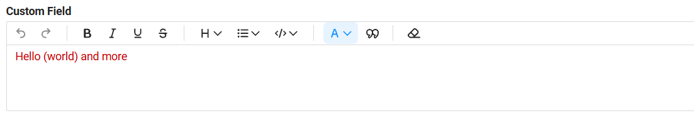  
    Сохранённый Markdown — скобки экранированы, поэтому цветовой фрагмент закрывается в правильном месте:
    ```
    {red}(Hello \(world\) and more)
    ```
=== "До"
    В редакторе: `Hello (world) and more` окрашено в красный.
    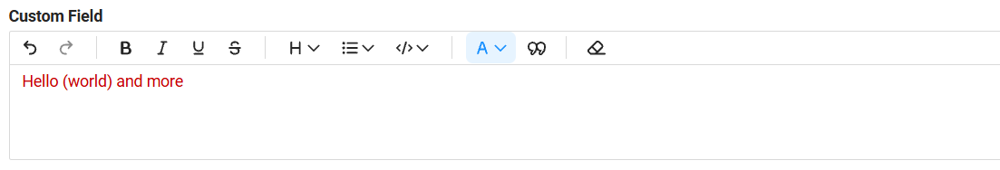  
    После сохранения: цвет заканчивается на первой `)`, а сама скобка переместилась в конец текста.
    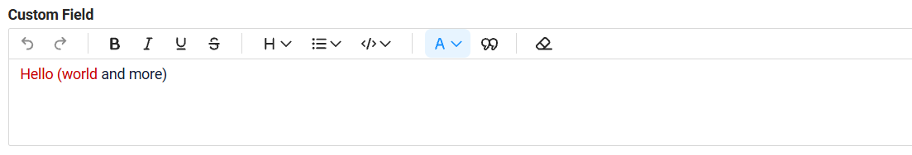  
    Сохранённый Markdown — первая `)` закрывала цветовой фрагмент слишком рано:
    ```
    {red}(Hello (world) and more)
    ```

**Перекрывающееся форматирование** (16)
=== "После"
    В редакторе: подчёркивание на `abcdefgh`, полужирный на `ghijkl`, зачёркивание на `klmnop`.
      
    После сохранения: всё форматирование сохраняется.
    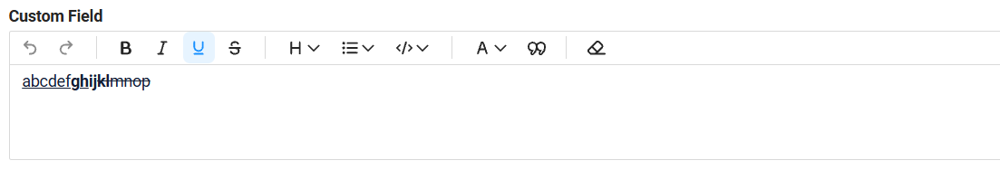  
    Сохранённый Markdown — каждый стиль закрывается и заново открывается тегами Markdown:
    ```
    ++abcdef**gh**++**ij~~kl~~**~~mnop~~
    ```
=== "До"
    В редакторе: подчёркивание на `abcdefgh`, полужирный на `ghijkl`, зачёркивание на `klmnop`.
    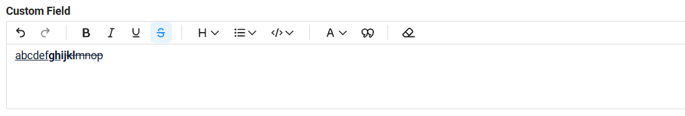  
    После сохранения: полужирный смещается, и `~~` появляется как обычный текст.
    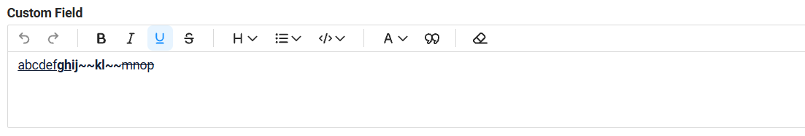  
    Сохранённый Markdown — редактор переходил на сырые HTML-теги, которые не восстанавливаются при повторном открытии:
    ```
    ++abcdef**gh**++<strong>ij~~kl~~</strong>~~mnop~~
    ```

**Текст, начинающийся с пробелов** (13)
=== "После"
    В редакторе: строка, начинающаяся с 4 пробелов.
    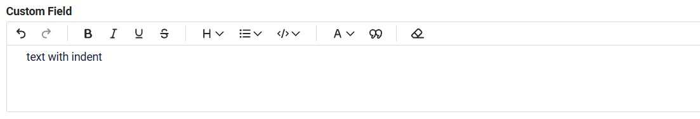  
    После сохранения: текст остаётся обычным текстом.
      
=== "До"
    В редакторе: строка, начинающаяся с 4 пробелов.
      
    После сохранения: текст превращался в блок кода.
    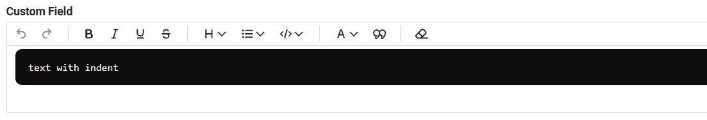  
    Сохранённый Markdown — в Markdown 4 ведущих пробела означают блок кода:
    ```
        text with indent
    ```

**Полужирный или курсив вплотную к скобке** (19)
=== "После"
    Панель инструментов отключает полужирный, курсив, подчёркивание, зачёркивание и встроенный код, когда выделение начинается или заканчивается на скобке, — так же, как в Яндекс Вики. Цвет текста остаётся доступным.
    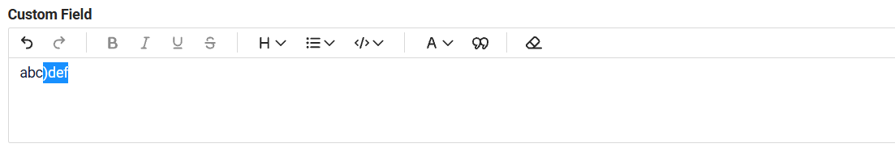  
=== "До"
    В редакторе: `)def` выделено и сделано полужирным.
    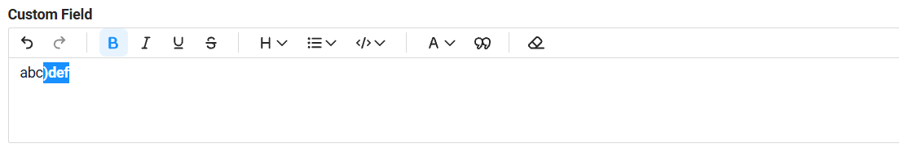  
    После сохранения: полужирный терялся, и `**` появлялось как текст.
    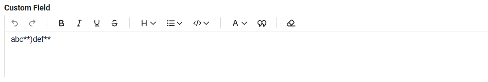  
    Сохранённый Markdown — `**` сразу после `)` не распознаётся как полужирный в Markdown (и в Яндекс Вики тоже):
    ```
    abc**)def**
    ```

Также добавлены автотесты для richText в [cxbox/code-samples](https://github.com/CX-Box/cxbox-code-samples): пример **RichText basic** и [регрессионный набор](https://github.com/CX-Box/cxbox-code-samples/blob/main/src/test/java/application/Samples/Form/RichTextOnFormTest.java), который проверяет каждый случай из таблицы после ввода пользователя, после сохранения и после повторного открытия записи. Известные ограничения тоже зафиксированы в тестах, поэтому любое изменение их поведения будет обнаружено.

!!! info  
    Технические подробности по каждому случаю приведены в [README_RICHTEXT.md](https://github.com/CX-Box/cxbox-demo/blob/768218b2db63ec05e1363a532302ff71dd962b4c/README_RICHTEXT.md).

#### Исправлено: `encryptAndSign` для отсоединённых подписей { #fixed-encryptandsign-for-detached-signatures }
<!-- CXBOX-1383 --> 
Исправлена проблема с операцией `encryptAndSign` при создании отсоединённой подписи.

Для отсоединённых подписей убрано дополнительное кодирование Base64. Раньше подписи, созданные с помощью `encryptAndSign` в режиме detached, не проходили проверку сервисом проверки подписей Госуслуг.

Теперь отсоединённые подписи успешно проходят проверку на Госуслугах.


#### Прочие изменения { #other-changes }
см. [журнал изменений cxbox-demo](https://github.com/CX-Box/cxbox-demo/releases/tag/v.3.0.1)

### CXBOX 5.0.2 ([Core](https://github.com/CX-Box/cxbox/tree/cxbox-5.0.2))
Выпущена новая версия CORE 5.0.2.

#### Исправлено: проверка уникальности при сохранении имени фильтра { #fixed-uniqueness-check-when-saving-a-filter-name }
<!-- CXBOX-1361 --> 
Исправлена проблема, из-за которой ограничение уникальности не определялось корректно при использовании локали `ru_RU.UTF-8`.
Теперь проверка уникальности выполняется корректно независимо от системной локали.

#### Исправлено: совместимость с миграцией на CIB seven { #fixed-cib-seven-migration-compatibility }
<!-- CXBOX-1362 --> 

Если вы планируете миграцию с **Camunda 7 Community Edition на CIB seven**, потому что финальный релиз **Camunda 7 Community Edition 7.24** не поддерживает **Spring Boot 4**, ядро было обновлено, чтобы упростить процесс миграции.

Раньше использование `@EnableWebMvc` приводило к созданию Spring `WebMvcConfigurationSupport`, что не давало применить `WebMvcAutoConfiguration`. Это могло потребовать дополнительной настройки при миграции.

Ядро обновлено, чтобы устранить эту проблему, и миграция на CIB seven стала проще.

### CXBOX [документация](https://doc.cxbox.org/ru/) { #cxbox-documentation }

#### Добавлено: описание виджета Tree { #added-description-tree-widget }
<!-- CXBOX-1341 -->
Добавлено описание [виджета Tree](https://doc.cxbox.org/ru/widget/type/tree/tree/): контракт данных (`parentId`, `isLeaf`, `options.tree`), ленивая загрузка, действия с обновлением узла, режимы поиска и пагинация с кнопкой `More`.

#### Добавлено: описание виджетов PickTreePopup и AssocTreePopup { #added-description-picktreepopup-and-assoctreepopup-widgets }
<!-- CXBOX-1341 -->
Добавлены описания виджетов [PickTreePopup](https://doc.cxbox.org/ru/widget/type/picktreepopup/picktreepopup/) и [AssocTreePopup](https://doc.cxbox.org/ru/widget/type/assoctreepopup/assoctreepopup/). Статьи повторяют структуру [PickListPopup](https://doc.cxbox.org/ru/widget/type/picklistpopup/picklistpopup/) и [AssocListPopup](https://doc.cxbox.org/ru/widget/type/assoclistpopup/assoclistpopup/) и добавляют особенности дерева: `options.tree`, ленивую загрузку, режимы поиска, режимы выбора.

#### Добавлено: описание полей pickTree и multivalueTree { #added-description-picktree-and-multivaluetree-fields }
<!-- CXBOX-1341 -->
Добавлены описания полей [pickTree](https://doc.cxbox.org/ru/widget/fields/field/pickTree/pickTree/) и [multivalueTree](https://doc.cxbox.org/ru/widget/fields/field/multivalueTree/multivalueTree/) на виджетах List, Form и Info, построенные так же, как [pickList](https://doc.cxbox.org/ru/widget/fields/field/pickList/pickList/) и [multivalue](https://doc.cxbox.org/ru/widget/fields/field/multivalue/multivalue/).

#### Обновлено: описание виджета PickListPopup { #updated-description-picklistpopup-widget }
<!-- CXBOX-1341 -->
Статья о [PickListPopup](https://doc.cxbox.org/ru/widget/type/picklistpopup/picklistpopup/) приведена в соответствие с PickTreePopup: те же разделы Create, Edit, Delete, Save и Cancel-create, у каждого свой пример.

Все изображения и GIF этих статей создаются автотестами [cxbox/code-samples](https://github.com/CX-Box/cxbox-code-samples) (пакеты `application.Samples.Tree` и `application.Samples.Popup`), поэтому всегда соответствуют текущему поведению.
