# 3.0.2

* [cxbox/demo 3.0.2 git](https://github.com/CX-Box/cxbox-demo/tree/v.3.0.2), [release notes](https://github.com/CX-Box/cxbox-demo/releases/tag/v.3.0.2)

* [cxbox/core 5.0.2 git](https://github.com/CX-Box/cxbox/tree/cxbox-5.0.2), [release notes](https://github.com/CX-Box/cxbox/releases/tag/cxbox-5.0.2), [maven](https://central.sonatype.com/artifact/org.cxbox/cxbox-starter-parent/5.0.2)

* [cxbox-ui/core 2.8.2 git](https://github.com/CX-Box/cxbox-ui/tree/2.8.2), [release notes](https://github.com/CX-Box/cxbox-ui/releases/tag/2.8.2), [npm](https://www.npmjs.com/package/@cxbox-ui/core/v/2.8.2)

## **Key updates September 2026**

### CXBOX ([Demo](https://demo.cxbox.org))

#### <a id="signInAgain">Added: Authorization - "Sign in again" popup</a>
<!-- CXBOX-1384 -->
<!-- CXBOX-1250 -->

When the session has expired (`401`) or the user has no roles (`403`), the user now sees a clear popup with the buttons **Sign in again** and **Sign out**. If the identity provider (OIDC/Keycloak) still has the user's session, signing in again does not ask for a password and returns the user to the same screen.

**Session has expired**  
=== "After"
    A popup is shown, every widget stays as it was.  
    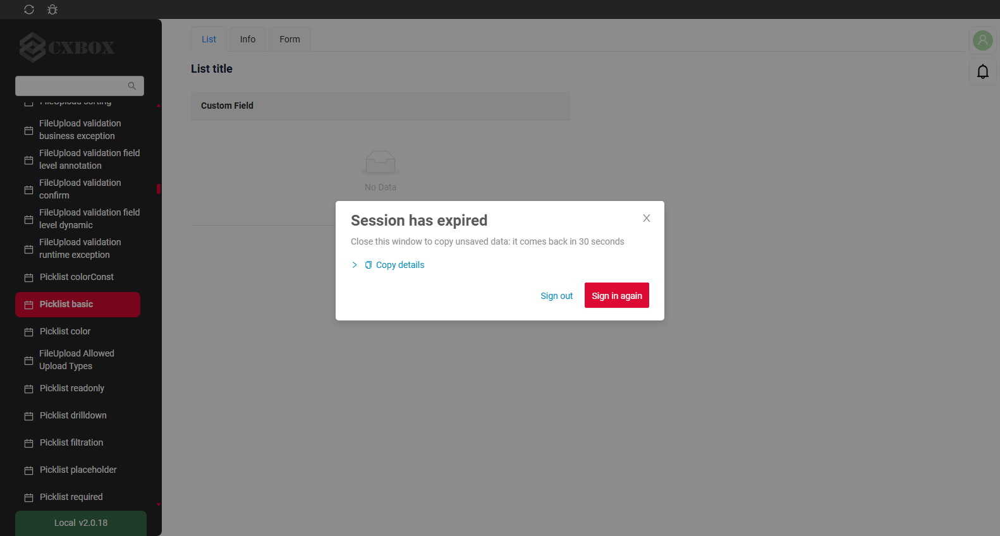
=== "Before"
    Widgets were left empty and nothing explained what happened.  
    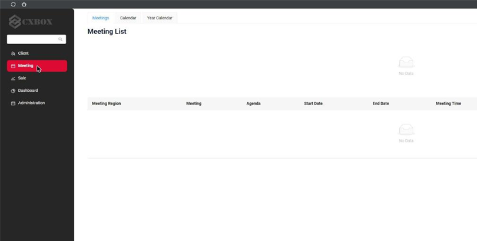

**The user has no roles**  
=== "After"
    The popup names the reason.  
    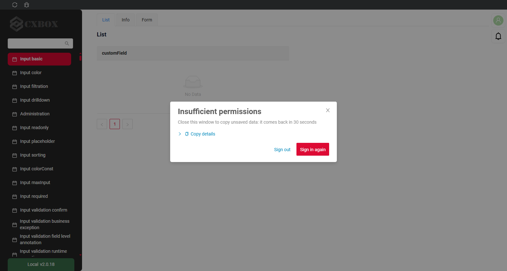
=== "Before"
    An empty "Error" popup without any text.  
    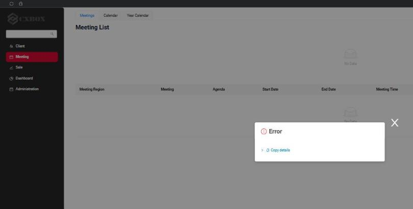

**A user without roles signs in**  
=== "After"
    The popup is shown on the start page: **Sign out** lets the user sign in as someone else.  
    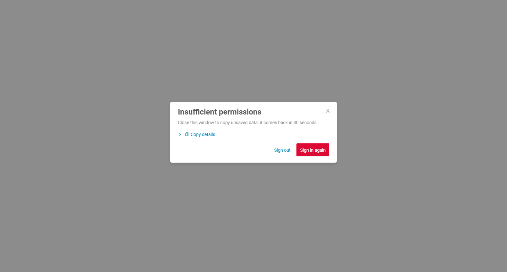
=== "Before"
    The application stayed on the loading spinner forever.  
    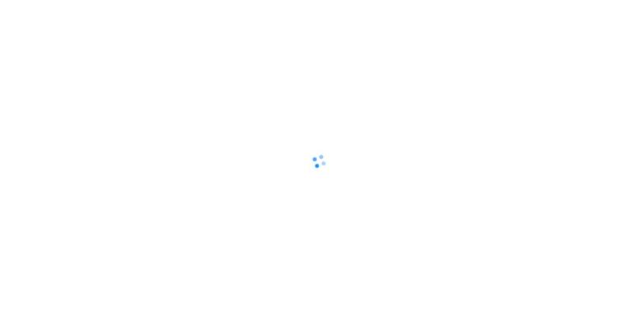

!!! info
    See the [Keycloak authorization](/features/element/authorization/keycloak/keycloakauthorization/#signInAgain) documentation: the behavior of the buttons, the settings (`AUTH_ERROR_MODE` and others) and how to bring the changes to an existing project.

#### <a id="tokenRenewal">Fixed: Authorization - session lost in several tabs</a>
<!-- CXBOX-1384 -->
<!-- CXBOX-1250 -->

Before - identity providers with refresh token rotation (Keycloak *Revoke Refresh Token*, Auth0, Okta and others) allow to renew the session with a token only once. If the application was open in several tabs, or the user pressed F5 at the moment of renewal, the same token was sent twice. The provider took it for theft and closed the session: the user saw `401` errors and empty widgets, and only clearing the browser cache helped.

After - the application sends each token once for all tabs of the browser, also after F5. If a renewal failed, the session is continued through the identity provider without a password; in the worst case the user sees the new [Sign in again popup](#signInAgain).

!!! info
    See [Keycloak authorization - token renewal](/features/element/authorization/keycloak/keycloakauthorization/#tokenRenewal): how it works, what the user sees in each case, the recommended settings of the identity provider. Return to the old behavior with the constant `USER_MANAGER` = `original`.

#### <a id="rolesSync">Fixed: Authorization - returned roles stay inactive</a>
<!-- CXBOX-1384 -->
<!-- CXBOX-1250 -->

Before - when a user lost all roles in the identity provider, the roles were deactivated in the application. When the roles were returned in the identity provider, they stayed inactive, and the user could not work.

After - returned roles are activated again at the next login.

!!! info
    See [Keycloak authorization - roles synchronization](/features/element/authorization/keycloak/keycloakauthorization/#rolesSync).

#### Added: Mass signing and encryption
<!-- CXBOX-1401 -->

Mass signing and encrypting is a mass operation that signs and encrypts the files of all selected rows with CryptoPro in one go. All types of Signing and encrypting are available: signing, encrypting, signing and encrypting, encrypting and signing. The user sees the progress of the rows (`done / total`) and can stop the processing.

This function is available for widgets:

* List
* GroupingHierarchy

=== "List"
    [:material-play-circle: Live Sample]({{ external_links.code_samples }}/ui/#/screen/myexample3712/view/myexample3712massencryptsignlist){:target="_blank"}
    [:fontawesome-brands-github: GitHub]({{ external_links.github_ui }}/{{ external_links.github_branch }}/src/main/java/org/demo/documentation/feature/encryptsign/encryptsign/mass){:target="_blank"}
    <video controls width="800">
    <source src="/widget/type/property/massoperations/sign/07_encrypt_sign_list_3712.mp4" type="video/mp4">
    </video>
=== "GroupingHierarchy"
    [:material-play-circle: Live Sample]({{ external_links.code_samples }}/ui/#/screen/myexample3712/view/myexample3712massencryptsigngh){:target="_blank"}
    [:fontawesome-brands-github: GitHub]({{ external_links.github_ui }}/{{ external_links.github_branch }}/src/main/java/org/demo/documentation/feature/encryptsign/encryptsign/mass){:target="_blank"}
    <video controls width="800">
    <source src="/widget/type/property/massoperations/sign/08_encrypt_sign_gh_3712.mp4" type="video/mp4">
    </video>

!!! info
    See the [Mass operations - signing and encrypting](/widget/type/property/massoperations/sign/) documentation.

#### Added: CryptoPro - large files and clear errors
<!-- CXBOX-1428 -->

Signing and encryption with CryptoPro now work with large files, both in the signing popup and in mass operations.

Before - the whole file was given to the CryptoPro plugin at once. The plugin handles files of only 10-60 MB depending on the computer; on a larger file it could hang without an error, and the browser extension had to be restarted.

After:

* a **detached signature** and **encryption** work with a file of any size: the file is processed in parts;
* an **attached signature** (the file inside the signature) works up to 30 MB. A larger file is rejected at once with a clear message that shows the file size and the limit. The limit can be removed with the setting `REACT_APP_CRYPTOPRO_ATTACHED_ASSEMBLY`;
* when the plugin fails, the user sees a short title, advice what to do and the details: PIN dialog cancelled, certificate expired, plugin not found or outdated, file too large and others;
* a signature that the plugin returned empty is no longer shown as "signed".

!!! info
    See [Signing and encrypting - file size](/features/sign/sign/#file_size) for the limits and [settings and constants](/features/sign/sign/#constants).

#### Fixed: CryptoPro popup closes before signing ends
<!-- CXBOX-1390 -->

After - the user presses the button to sign or encrypt, the popup stays open and the button shows a spinner until CryptoPro has finished and the result is uploaded. The popup cannot be closed meanwhile, so the user cannot leave the form and lose the result.

Before - the popup closed at once, signing went on in the background without any sign of progress. With a long signing the user did not know if it was going on and could leave the form in the middle of it.

The search of the certificates in CryptoPro has also become faster.

=== "After"
    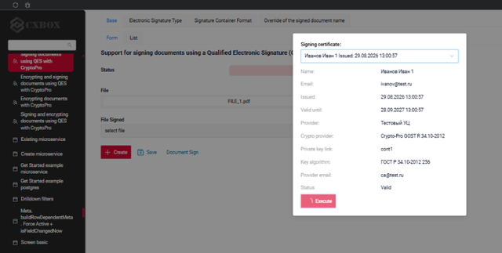 
=== "Before"
    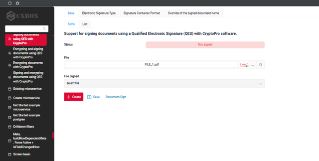

#### <a id="copyDetails">Added: Error popup - "Copy details"</a>
<!-- CXBOX-1384 -->
<!-- CXBOX-1250 -->

Every error popup now has a **Copy details** row. One click copies everything the support team needs to find the request in the server log: session id, screen and view, request, status, time of the request and the answer of the server. The arrow shows the same details right in the popup, so a screenshot is enough to start the investigation.

=== "After"
    The details row is always visible.  
    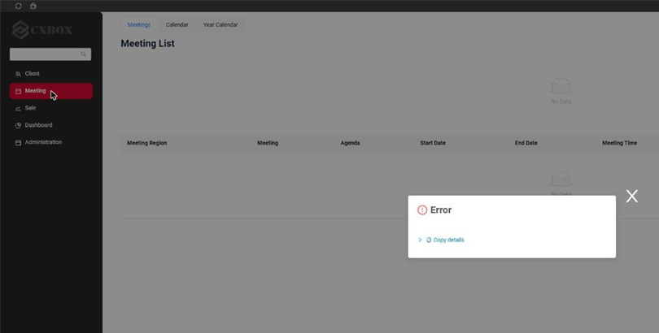
=== "Before"
    The same error: an empty popup, nothing to copy or to show on a screenshot.  
    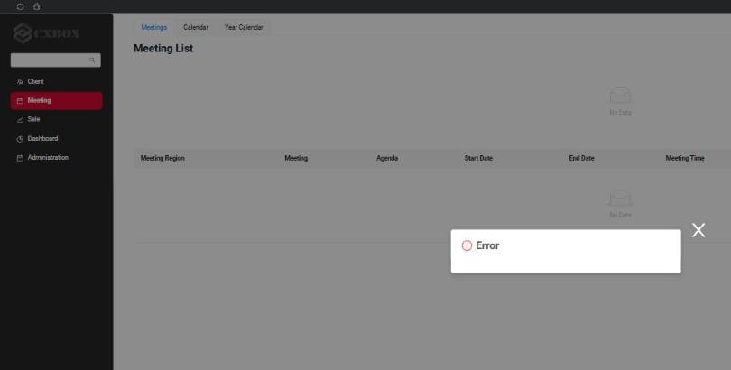

=== "System error - After"
    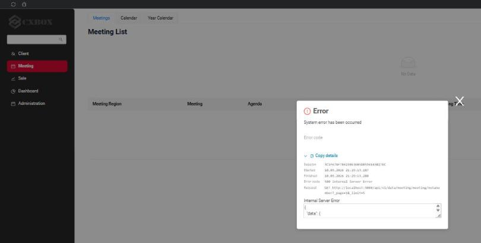
=== "System error - Before"
    Only the response body was available under "Details".  
    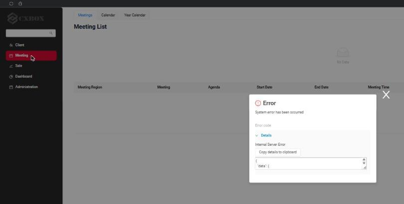

??? info "Technical details: what is copied"
    * **Copy details** copies the details as JSON: session id (the same value is written to the [SIEM](/features/element/siem/siem/) log as `session: ...`), current screen, view and browser URL, request method and URL, HTTP status, request start and finish time, response headers and body. The last lines say what the token renewal stands on in this browser (`webLocks`, `indexedDb`) and the three [authorization constants](/features/element/authorization/keycloak/keycloakauthorization/#signInAgain) it runs with.
    * The arrow expands the same details on screen: session id, start and finish time, error code and request. Opening the details copies them as well.

    Example of the copied JSON:

    ```json
    {
      "sessionId": "3C1F67AF784230E3EB5DB594EA3B27EC",
      "clientId": 1789057000000,
      "login": "DEMO",
      "location": "http://localhost:3000/#/screen/meeting",
      "screen": "meeting",
      "view": "meetinglist",
      "statusCode": 403,
      "statusText": "Forbidden",
      "method": "GET",
      "url": "http://localhost:3000/api/v1/data/meeting/meetingStats?_page=1&_limit=5",
      "startedAt": "2026-09-10T18:26:00.410Z",
      "finishedAt": "2026-09-10T18:26:00.757Z",
      "responseHeaders": { "www-authenticate": "Bearer error=\"insufficient_scope\"" },
      "responseBody": null,
      "userAgent": "Mozilla/5.0 ...",
      "webLocks": true,
      "indexedDb": true,
      "userManager": "rotationSafe",
      "authErrorMode": "soft",
      "signInCallbackDetection": "oidcResponse"
    }
    ```

#### <a id="devPanel">Added: Dev panel - runtime errors</a>
<!-- CXBOX-1110 -->

Before - when a widget was not shown on a view (for example, it has a type the core does not know), the developer saw an empty place and had to look for the reason in the server log and in the browser console.

After - the dev panel has a new indicator **Runtime errors** with the number of errors and warnings of the current view. A click opens the list of problems of the backend (meta validation) and of the frontend (errors of the browser), and in Debug mode the widget with a problem gets a colored frame.

=== "After"
    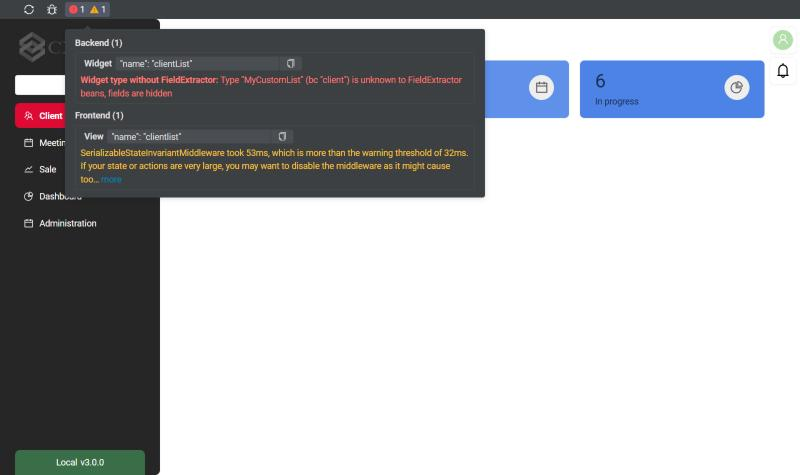
=== "Before"
    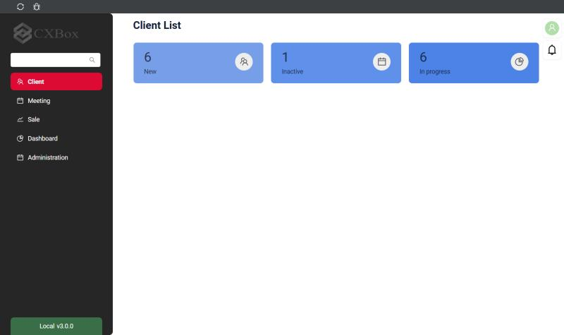

??? info "Technical details: what the list shows and how to turn it on"
    The **Runtime errors** indicator is next to **Refresh meta** and **Debug mode**. It shows the number of errors (red) and warnings (yellow) of the current view. A click opens a list:

    * **Backend** - problems found by the [meta validation](#metaValidation) of the core. Each problem shows the check, the widget or the view it belongs to, and the text, for example `Type "MyCustomList" (bc "client") is unknown to FieldExtractor beans, fields are hidden`. The name of the widget can be copied.
    * **Failed validators** - checks that failed themselves: their problems are unknown, see the server log.
    * **Frontend** - `console.error` and `console.warn`, uncaught errors and unhandled promise rejections of the browser. The same messages are counted, not repeated.

    Only the problems of the current view are shown. Frontend messages are cleared when the user goes to another view and at logout.

    In **Debug mode** the widget with a problem gets a red (error) or yellow (warning) frame, and the screen/view label of the debug panel is colored the same way when the view itself has problems.

    Turn the dev panel and the meta validation on in `application.yml` (in cxbox-demo they are on by default):

    ```yaml
    cxbox:
      meta:
        dev-panel-enabled: ${DEV_PANEL_ENABLED:true}
        validation:
          enabled: ${META_VALIDATION_ENABLED:true}
          log-level: ${META_VALIDATION_LOG_LEVEL:error}
    ```

    The results are given to the frontend in `LoginServiceImpl`:

    ```java
    .devPanelEnabled(metaConfigurationProperties.isDevPanelEnabled())
    .metaValidation(metaHotReloadService.validateMeta())
    ```

#### Added: radio - vertical layout and row limit
<!-- CXBOX-1422 -->

The [radio](/widget/fields/field/radio/radio/) field is used to choose one of a few options, and in real projects these options are often long phrases. Before, a long value took as many rows as it needed, and one field could stretch a row of a list or a form to half of the screen.

Now you can set how the options are arranged and how much space each of them takes:

* **[Display Mode](/widget/fields/field/radio/radio/#displayMode)** - the options are in a row (`horizontal`, as before) or each option is on its own line (`vertical`).
* **[Value height](/widget/fields/field/radio/radio/#height)** - the number of rows of each value, separately for view and edit mode. A cut value ends with **...**, the full text is shown in a tooltip.

=== "horizontal"
    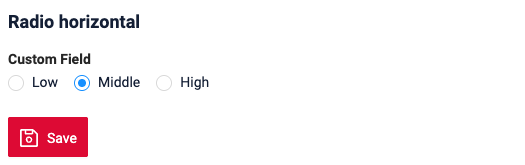
=== "vertical"
    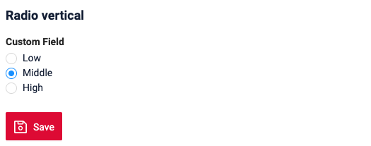

=== "View mode"
    The value takes one row.  
    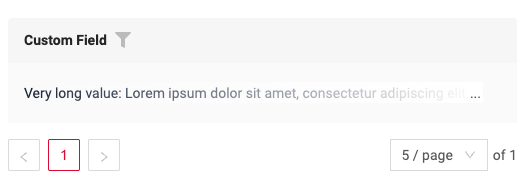
=== "Edit mode"
    Each option takes up to 3 rows.  
    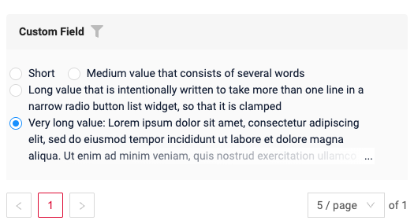

#### Fixed: Multi-upload - drop zone when adding is not allowed
<!-- CXBOX-1218 -->

After - when adding files is not allowed (for example, the task is closed), the "Add Files" button is hidden and the drag-and-drop zone is gray and does not accept files. While the screen is loading the zone is gray too and becomes active when it is known that adding is allowed.

Before - the button was hidden, but the zone stayed active: the user could drop a file and start an upload that is not allowed.

=== "After"
    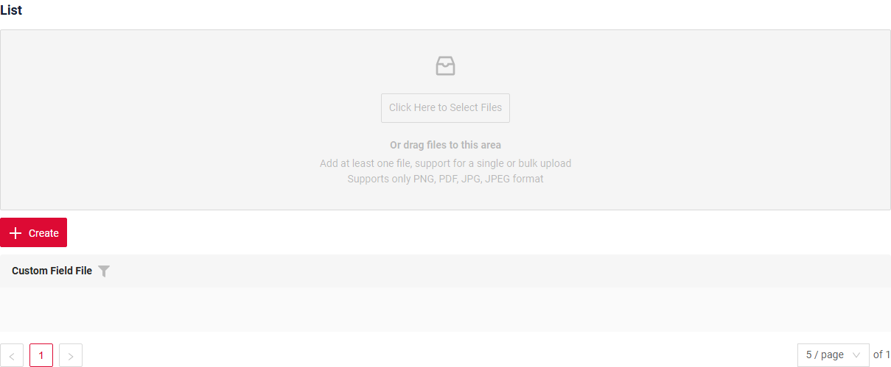
=== "Before"
    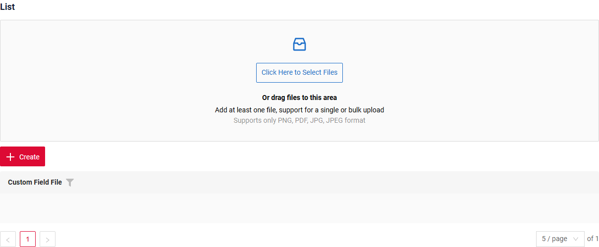

!!! info
    See [Multi-upload files - Availability](/widget/type/property/multiupload/multiupload/#availability). Nothing has to be configured: the zone follows the availability of its action.

#### Fixed: File upload - error reason for each file
<!-- CXBOX-1038 -->

After - when a file is not uploaded, the tooltip of its line in the **Upload progress** window shows the reason received from the server. Each file of a multi-upload gets its own text. The same works for a single file of a [fileUpload](/widget/fields/field/fileUpload/fileUpload/) field.

Before - every failed file showed the same text, "Error. File not loaded and no new row created", and it was not possible to tell why the file was not uploaded.

=== "After"
    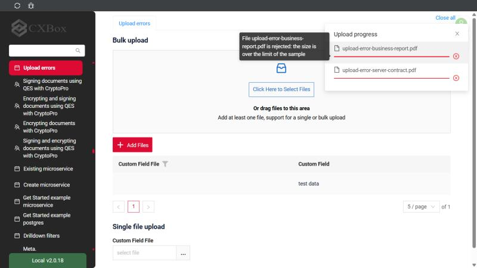
=== "Before"
    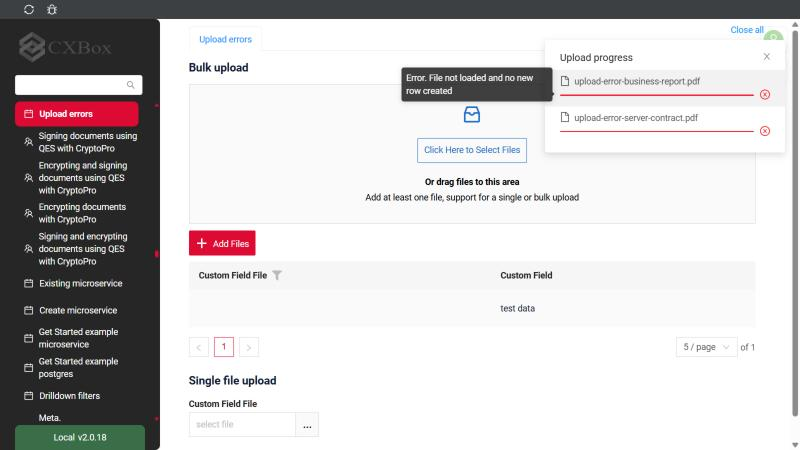

!!! info
    See [Multi-upload files - Upload errors](/widget/type/property/multiupload/multiupload/#upload_errors).

#### Fixed: File download - one automatic retry
<!-- CXBOX-1438 -->

Before - sometimes downloading or opening a file ended with the error `502 Bad Gateway`, although the file was in place, and the second attempt worked.

After - the application repeats the request once by itself, the user gets the file and does not see the error. If the second attempt fails too, the error is shown as before.

!!! info
    See [FileStorage - one automatic retry](/features/element/filestorage/fileStorage/#download_retry).

#### Fixed: FormPopup - no "jumping" on forceActive fields
<!-- CXBOX-1433 -->

After - the user changes a `forceActive` field in a [FormPopup](/widget/type/formpopup/formpopup/) or in the confirmation of a mass operation with a form. The form stays on screen with the typed values, and a spinner is shown over it until the data is refreshed.

Before - after each change of such a field the whole form was replaced by a loading skeleton and drawn again. The popup "jumped", the user lost the place in the form and the focus.

=== "After"
    <video controls width="800">
    <source src="/new/v3.0.2/CXBOX-1433-after.mp4" type="video/mp4">
    </video>
=== "Before"
    <video controls width="800">
    <source src="/new/v3.0.2/CXBOX-1433-before.mp4" type="video/mp4">
    </video>

??? info "Technical details: how it works"
    The behavior is the same as on List, Form and Info: while the meta of the row is refreshed after a change of a `forceActive` field, the form stays on screen and a spinner is shown over it. The loading skeleton is shown only when the popup opens and there is nothing to show yet. The same works in the confirmation of a [mass operation](/widget/type/property/massoperations/massoperations/) with a form.

    See also [FormPopup](/widget/type/formpopup/formpopup/).

#### Fixed: Tree - a saved row keeps its place
<!-- CXBOX-1462 -->

After - the user changes a row of a [Tree](/widget/type/tree/tree/) and presses **Save**: the row stays where it was, as in a [List](/widget/type/list/list/).

Before - the saved row moved to the top of its node (to the end with `insertPosition: end`), and only F5 put it back in its place.

#### Fixed: showCondition by forceActive - data at once
<!-- CXBOX-1432 -->

After - the user changes a `forceActive` field of the parent, a child widget hidden by a `showCondition` becomes visible and shows its records at once.

Before - the child widget appeared empty, and the records came only after the user pressed Save.

#### Fixed: hint filter - search by part of the value
<!-- CXBOX-1281 -->

After - when the user enters a part of the value in the filter of a [hint](/widget/fields/field/hint/hint/#filtering) field, the records that contain it are shown.

Before - only records with exactly the same value were found, so a partial value showed nothing.

=== "After"
    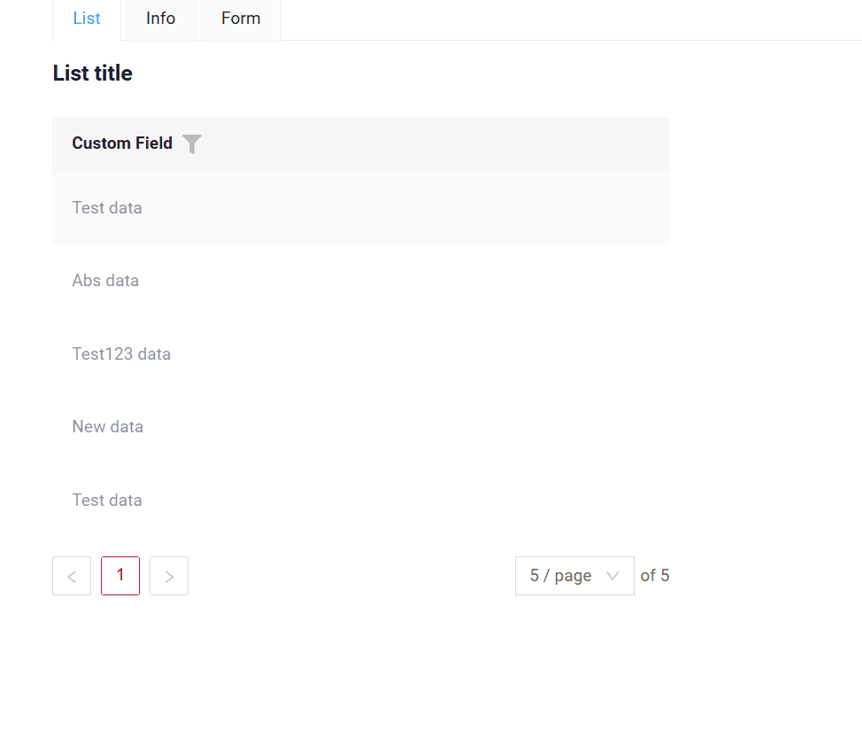
=== "Before"
    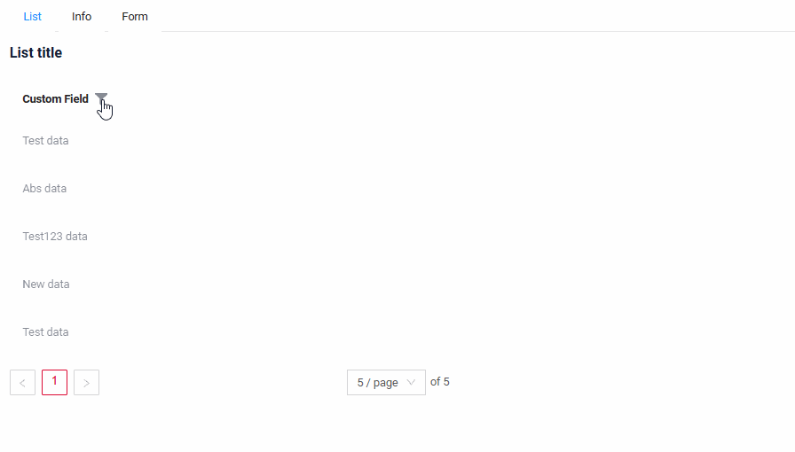

#### Added: pickList, pickTree - number of selected records
<!-- CXBOX-252 -->

When a filter chosen in the popup of a [pickList](/widget/fields/field/pickList/pickList/) or [pickTree](/widget/fields/field/pickTree/pickTree/) is applied, the "..." badge shows the number of selected records.

=== "After" 
    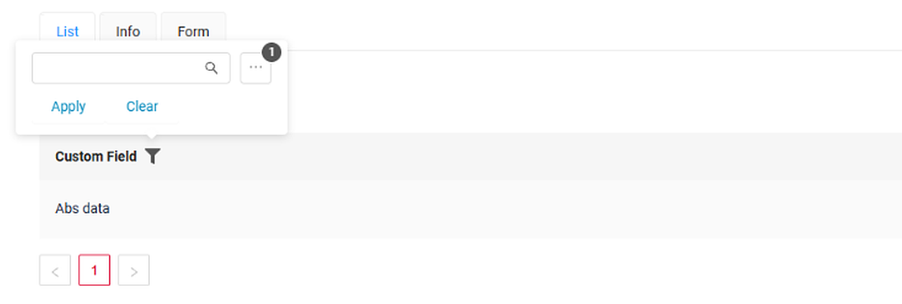
=== "Before"
    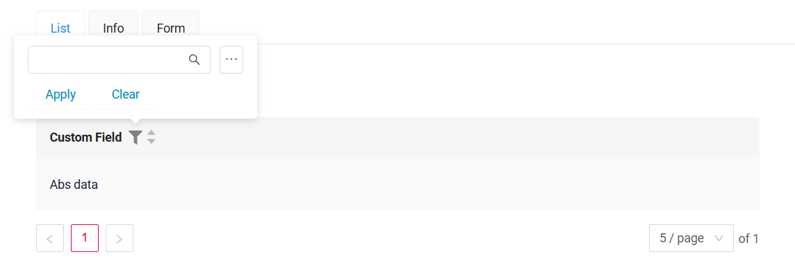

#### Added: dictionary, multipleSelect - list width
<!-- CXBOX-150 -->

The drop-down list of a [dictionary](/widget/fields/field/dictionary/dictionary/) and a [multipleSelect](/widget/fields/field/multipleSelect/multipleSelect/) field now adapts to the longest value, and a very long value is shortened with "..." and shown in a tooltip.

=== "dictionary"
    === "After"
        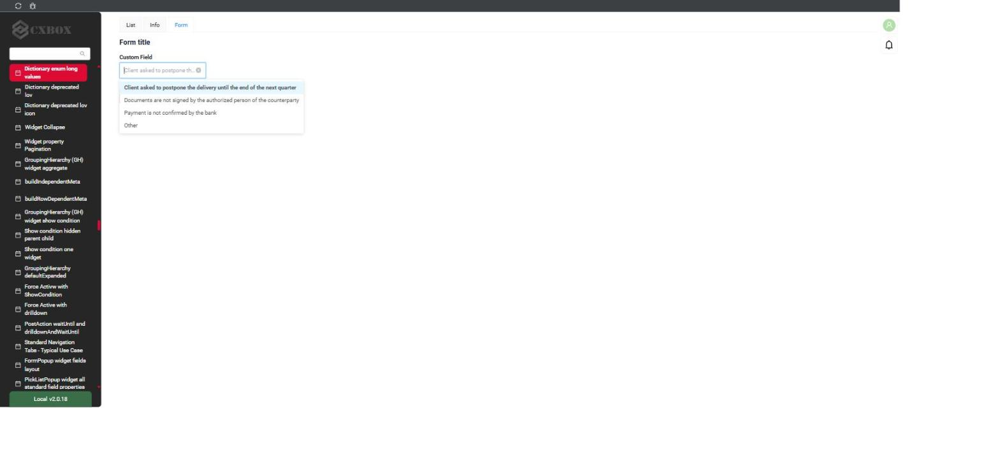
    === "Before"
        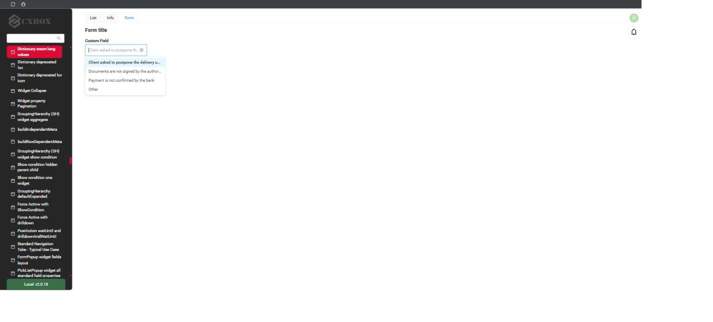
=== "multipleSelect"
    === "After"
        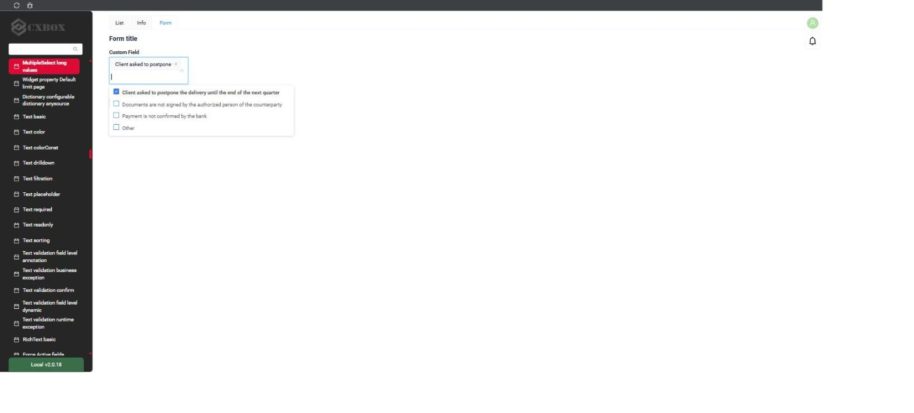
    === "Before"
        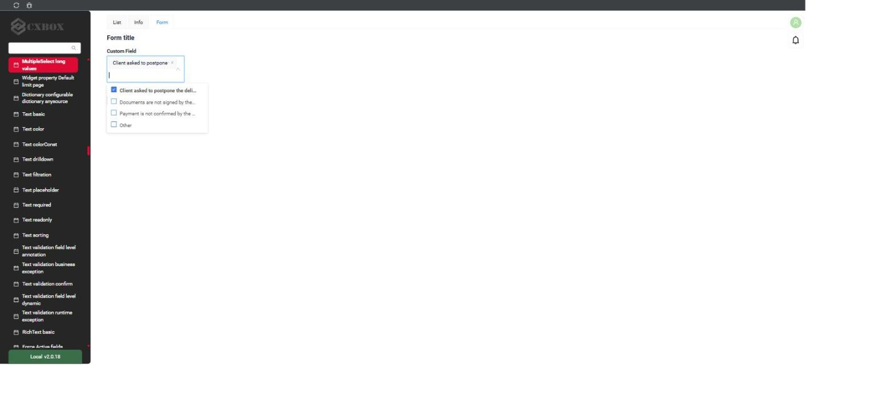

#### Fixed: Full text search - empty search on clear
<!-- CXBOX-325 -->

Before - when the user cleared the full text search field, the application searched by the text "null".

After - clearing the field removes the search, and the list shows all records again.

=== "After"
    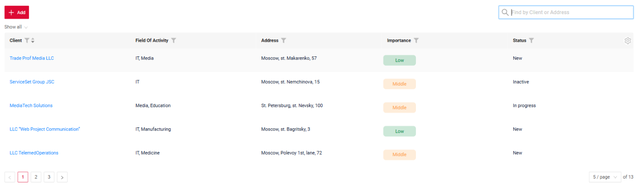 
=== "Before"
    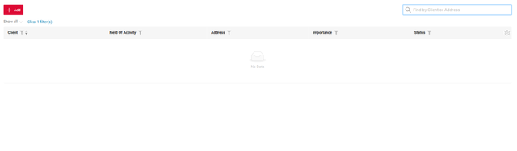

#### Fixed: Tooltips and calendar richText toolbar
<!-- CXBOX-1358 -->

* Before - the tooltip with the full value of a `text` field shortened by [`text_maxDisplayed`](/widget/fields/field/text/text/?h=textmaxrows#support-for-truncating-long-values) could be cut off by the borders of the widget. After - it is shown over the widget.

=== "After"
    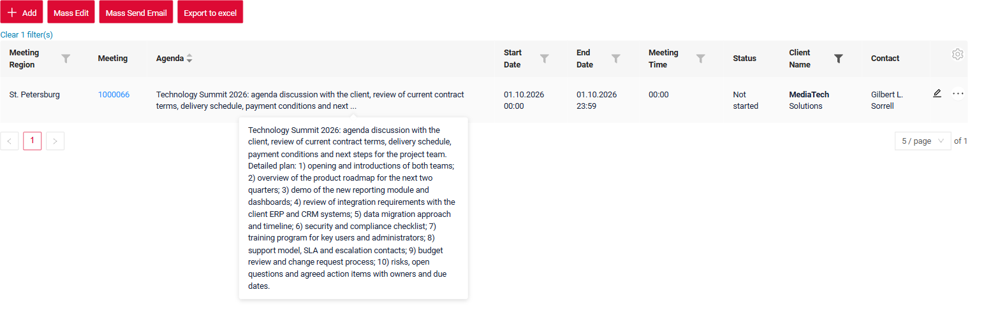
=== "Before"
    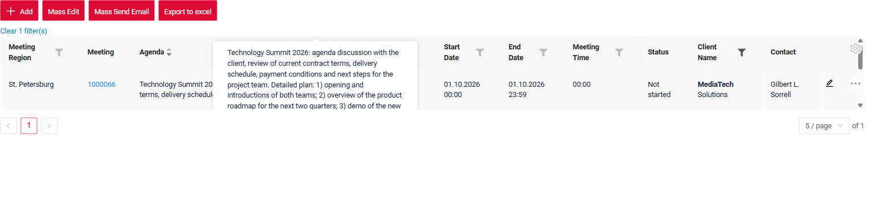

* Before - in the inline form of [CalendarList](/widget/type/calendarlist/calendarlist/) and [CalendarYearList](/widget/type/calendaryearlist/calendaryearlist/) the drop-down lists of the `richText` toolbar (headings, text color) were cut off by the form, and the event popup could close. After - the lists are shown over the form.

=== "After"
    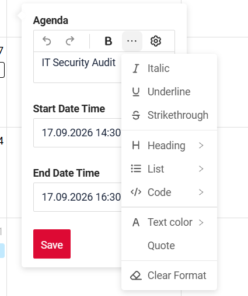
=== "Before"
    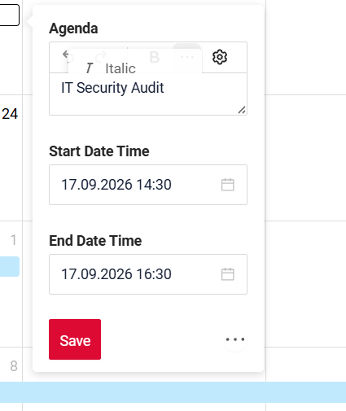

#### Fixed: AdditionalInfo - full width when hidden
<!-- CXBOX-318 -->

When all [AdditionalInfo](/widget/type/additionalinfo/additionalinfo/) widgets on the right are hidden by a show condition, the other widgets of the view take the whole width.

=== "widgets with AdditionalInfo"
    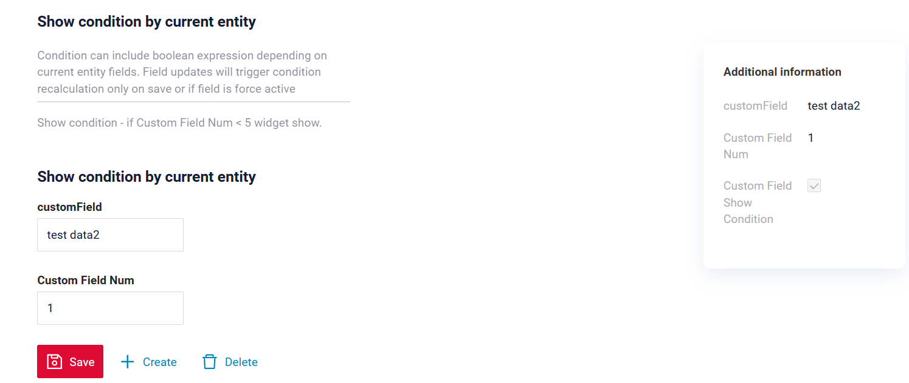
=== "widget with hidden AdditionalInfo"
    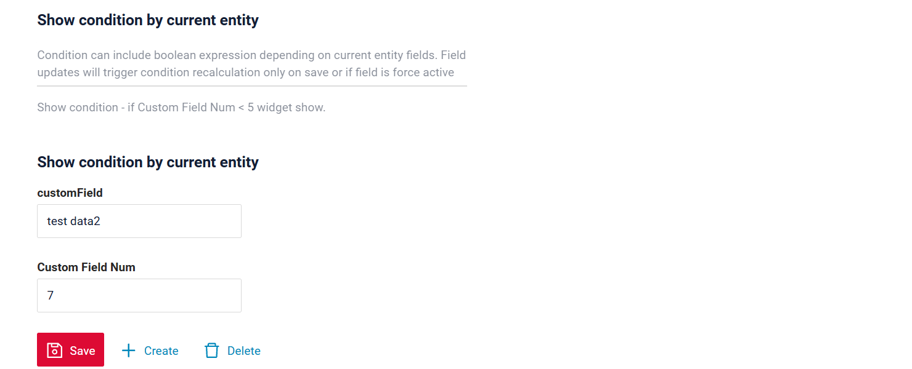

#### Fixed: Notifications - "Close all" always visible
<!-- CXBOX-1384 -->

Before - the **Close all** button in the top right corner was visible even when there were no notifications.

After - the button is hidden until a notification appears.


#### Other Changes
see [cxbox-demo changelog](https://github.com/CX-Box/cxbox-demo/releases/tag/v.3.0.2)


### CXBOX 5.0.3 ([Core](https://github.com/CX-Box/cxbox/tree/cxbox-5.0.3))

#### Added: Drilldown filter by hint
<!-- CXBOX-1281 -->

A drilldown from a [hint](/widget/fields/field/hint/hint/#drilldown) field can now open the target view already filtered by the value of this field. The filter works by a part of the value and ignores case, the same way as the [filter of the field](/widget/fields/field/hint/hint/#filtering) and the `input` field.

??? info "Technical details: how to add"
    Use the new method `fb.hint(...)` in the filter builder of `setDrilldownWithFilter`:

    ```java
    fields.setDrilldownWithFilter(
            MyExampleDTO_.customFieldHint, DrillDownType.INNER, "/screen/MyExample/view/MyExamplelist/", fc ->
            fc.add(
                    CxboxMyExampleController.myexample,
                    MyExampleDTO.class,
                    fb -> fb.hint(MyExampleDTO_.customFieldHint, fields.getCurrentValue(MyExampleDTO_.customFieldHint).orElse(null))
            )
    );
    ```

    See also [DrillDown](/features/element/drilldown/drilldown/).

#### Added: Mass operations - row values and failed rows
<!-- CXBOX-1401 -->

For [mass signing and encryption](/widget/type/property/massoperations/sign/) the frontend does a part of the work itself (CryptoPro signs or encrypts the files in the browser) and sends the result of each row to the backend. The core now accepts this result:

* **Values of a row** - the backend receives the ids and names of the files created for each row.
* **Rows that failed on the frontend** - if the browser could not process a row (for example, it could not sign the file), the user sees this row with the reason in the result of the mass operation. The project can also react to such rows, for example write a log.

??? info "Technical details: how to read the values and the errors"
    * **Values of a row.** `MassDTO` has a new map `options`: the frontend sends with each row, for example, the ids and names of the signature and encrypted files. They are read with `mass.getOption(...)`. The platform keys are in `MassOptionType` (`SIGNATURE_FILE_ID`, `SIGNATURE_FILE_NAME`, `ENCRYPTED_FILE_ID`, `ENCRYPTED_FILE_NAME`); a project can add its own keys with an enum that implements `MassOptionTypeSpecifier`.
    * **Rows that failed on the frontend.** If the browser could not process a row, the frontend sends it with `success = false` and the reason in `errorMessage`.
        * `getMassIds_()` now returns only the rows that the backend has to process.
        * The new `getMassErrors_()` returns the rows that failed on the frontend, so the project can react to them, for example write a log.
        * The core adds these rows to the result of the action with the message from the frontend, so the user sees them in the result of the mass operation. The handler does not have to do anything; to show another message, return your own `MassDTO` with the id of the row.

    ```java
    String signatureFileId = mass.getOption(MassOptionType.SIGNATURE_FILE_ID);
    ```

    See [Mass operations - signing and encrypting](/widget/type/property/massoperations/sign/).

#### <a id="metaValidation">Added: Meta validation - unknown widgets</a>
<!-- CXBOX-1110 -->

Before - when a project added its own widget type and did not register a `FieldExtractor` for it, the widget was shown empty and nothing explained why.

After - the core checks the meta at startup and on every meta refresh, writes such widgets to the log and, when the dev panel is on, shows them in the [dev panel](#devPanel). A project can add its own checks.

??? info "Technical details: how the check works"
    * The check runs at startup and on every meta refresh, if it is turned on. Problems are written to the log; meta loading is not stopped.
    * The built-in check `WidgetFieldExtractorValidator` (title `Widget type without FieldExtractor`) reports every widget with a `bc` whose type no `FieldExtractor` supports. The log also gets a hint: change the type to a known one or register a `FieldExtractor` bean for the custom type.
    * When the dev panel is on, the results are also sent to the frontend at login: `MetaHotReloadService.validateMeta()` returns a list of `MetaValidationResult` (check, title, message, views, widgets, `executionFailed`), and `LoggedUser` has the new field `metaValidation`. The frontend shows them in the [dev panel](#devPanel).
    * A project can add its own checks: a Spring bean that implements `MetaValidator`. A check that fails itself is written to the log as a warning and does not stop the other checks.

    ```yaml
    cxbox:
      meta:
        validation:
          enabled: true     # default false: the check is off
          log-level: ERROR  # default ERROR; OFF - do not write problems to the log
    ```


### CXBOX [documentation](https://doc.cxbox.org/)

#### Added: Chart widgets
<!-- CXBOX-1405 -->
<!-- CXBOX-1406 -->
<!-- CXBOX-1407 -->
<!-- CXBOX-1273 -->
We have provided descriptions of the widgets [Pie1D](/widget/type/pie1d/pie1d/), [Column2D](/widget/type/column2d/column2d/), [Line2D](/widget/type/line2d/line2d/), [DualAxes2D](/widget/type/dualaxes2d/dualaxes2d/) and [RelationGraph](/widget/type/relationgraph/relationgraph/). Examples of the charts have been added to the [Filtration](/widget/type/property/filtration/filtration/), [Sorting](/widget/type/property/sorting/sorting/) and [Pagination](/widget/type/property/pagination/pagination/) articles.

#### Added: Calendar widgets
<!-- CXBOX-1360 -->
<!-- CXBOX-1273 -->
We have provided descriptions of the widgets [CalendarList](/widget/type/calendarlist/calendarlist/) (events of a month, a week, a day) and [CalendarYearList](/widget/type/calendaryearlist/calendaryearlist/) (events of a whole day: holidays, deadlines, reports).

#### Added: File widgets
<!-- CXBOX-1409 -->
<!-- CXBOX-1410 -->
<!-- CXBOX-1411 -->
We have provided descriptions of the widgets [CardList](/widget/type/cardlist/cardlist/), [CardCarouselList](/widget/type/cardcarousellist/cardcarousellist/) and [FilePreview](/widget/type/filepreview/filepreview/). Examples of the cards have been added to the Filtration, Pagination, [Default page limit](/widget/type/property/defaultlimitpage/defaultlimitpage/) and [Multi-upload](/widget/type/property/multiupload/multiupload/) articles.

#### Added: DashboardList and collapse
<!-- CXBOX-1408 -->
<!-- CXBOX-716 -->
<!-- CXBOX-449 -->
We have provided descriptions of the [DashboardList](/widget/type/dashboardlist/dashboardlist/) widget (deprecated) and of the [collapse](/widget/type/property/collapse/collapse/) widget group: widgets of a view are combined into a group that can be collapsed and expanded.

#### Added: richText and hint fields
<!-- CXBOX-1402 -->
<!-- CXBOX-1281 -->
We have provided a description of the [richText](/widget/fields/field/richtext/richtext/) field (formatting, storage, content size) and extended the [hint](/widget/fields/field/hint/hint/) article with the color, readonly, filtering and drilldown sections. The Placeholder sections of all field articles say that the placeholder is shown for a read-only field as well.

#### Added: Drilldown tooltip
<!-- CXBOX-645 -->
<!-- CXBOX-778 -->
We have provided a description of the [drilldown tooltip](/features/element/drilldown/drilldown/#drilldown_tooltip): hovering over a `drilldown` field shows the buttons **Open link in new tab** and **Copy link address**.

#### Added: Filtration - filter groups
<!-- CXBOX-1382 -->
<!-- CXBOX-603 -->
<!-- CXBOX-245 -->
<!-- CXBOX-1431 -->
The [Filtration](/widget/type/property/filtration/filtration/) article describes the [default filter group](/widget/type/property/filtration/filtration/#default_filter_group), the priority of the filters, deleting a personal filter group and [how the personal filter group works with the full text search](/widget/type/property/filtration/filtration/#personal_filter_group_with_fulltextsearch). The filter group sections have "How does it look" and "How to add" for every widget that supports them.

#### Added: Pagination - page limits
<!-- CXBOX-951 -->
The [Pagination](/widget/type/property/pagination/pagination/#limitrules) article explains the difference between `availableLimitsList` (options in the dropdown) and `PAGE_LIMIT` (the default page limit).

#### Fixed: StatsBlock, List, HeaderWidget
<!-- CXBOX-317 -->
<!-- CXBOX-1063 -->
<!-- CXBOX-390 -->
The [StatsBlock](/widget/type/statblocks/statblocks/), [List](/widget/type/list/list/) and [HeaderWidget](/widget/type/headerwidget/headerwidget/) articles describe the show condition by parent entity and the properties of the title fields. The Title Color sections of the widget articles list pickList and inlinePickList among the applicable fields.
