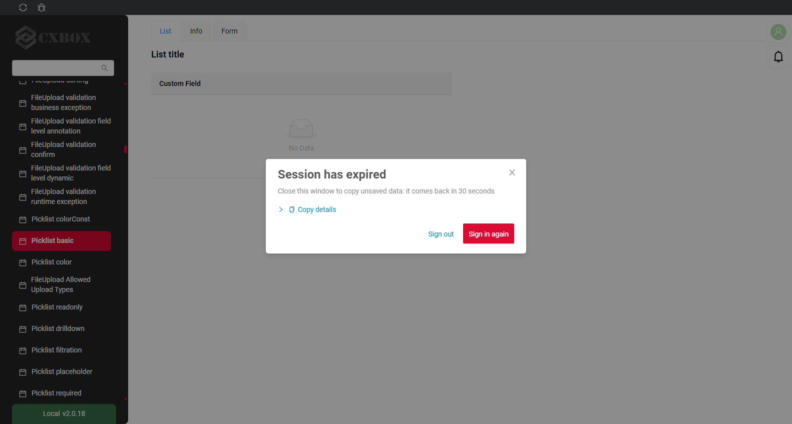
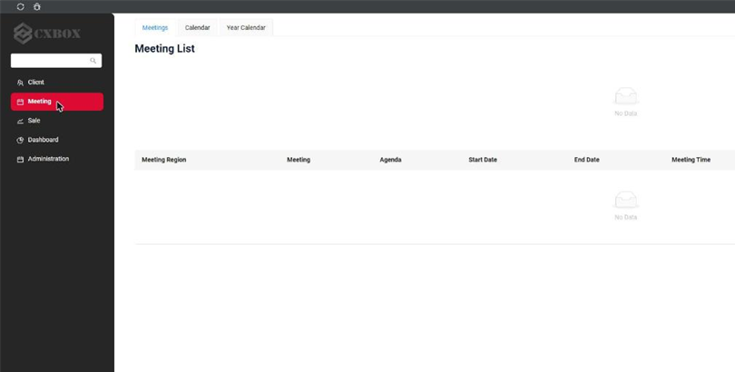
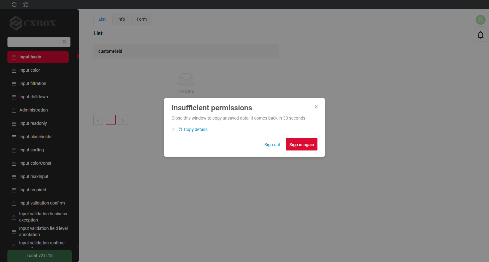
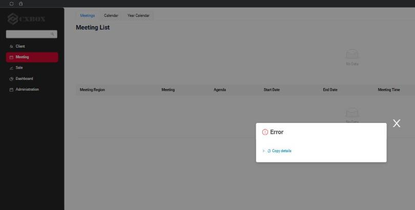
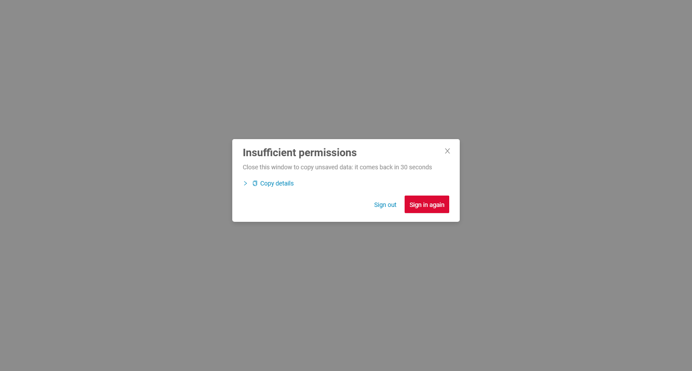
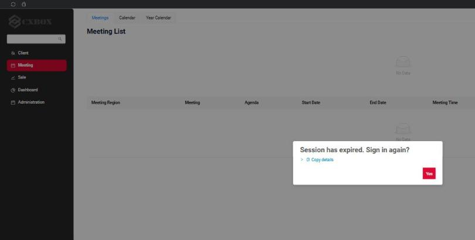
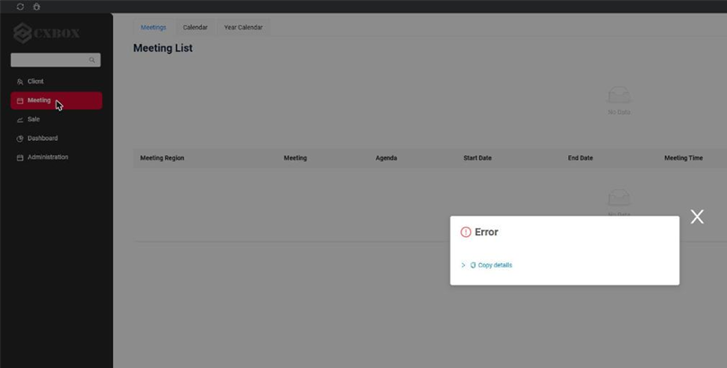
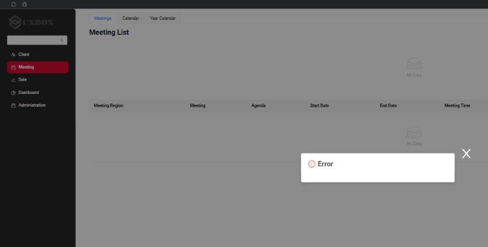
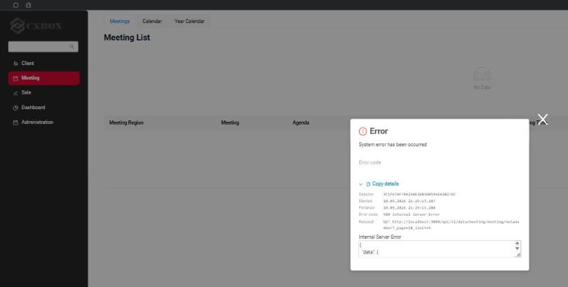
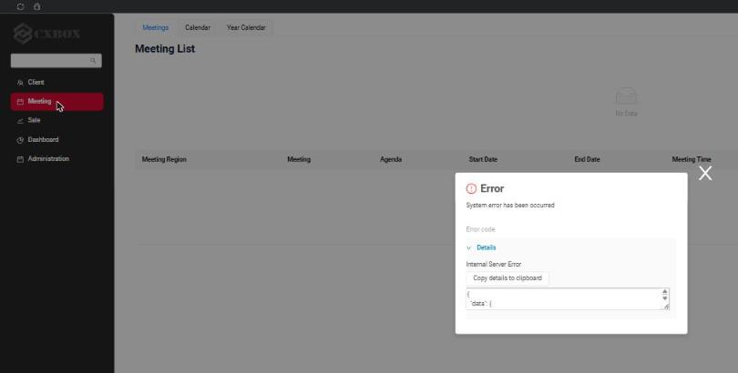

# 3.0.2

* [cxbox/demo 3.0.2 git](https://github.com/CX-Box/cxbox-demo/tree/v.3.0.2), [release notes](https://github.com/CX-Box/cxbox-demo/releases/tag/v.3.0.2)

* [cxbox/core 5.0.2 git](https://github.com/CX-Box/cxbox/tree/cxbox-5.0.2), [release notes](https://github.com/CX-Box/cxbox/releases/tag/cxbox-5.0.2), [maven](https://central.sonatype.com/artifact/org.cxbox/cxbox-starter-parent/5.0.2)

* [cxbox-ui/core 2.8.2 git](https://github.com/CX-Box/cxbox-ui/tree/2.8.2), [release notes](https://github.com/CX-Box/cxbox-ui/releases/tag/2.8.2), [npm](https://www.npmjs.com/package/@cxbox-ui/core/v/2.8.2)

## **Key updates September 2026**

### CXBOX ([Demo](https://demo.cxbox.org))

#### <a id="signInAgain">Added: Authorization - NEW popup on expired session/insufficient roles</a>
<!-- CXBOX-1384 -->

When the backend answers `401 Unauthorized` (the session has expired) or `403 Forbidden` (the user has no roles), the user now sees a popup instead of empty widgets and endless spinners.

The popup has two buttons and a cross:

* **Sign in again** goes to the OIDC provider and back to the same screen. While the SSO session of the provider is alive, no password is asked. If it is over, the login page opens.
* **Sign out** does the same as the **Log out** button in the user menu.
* The cross closes the popup, so the user can copy unsaved data. The popup does not come back for 30 seconds (`AUTH_ERROR_SNOOZE_SECONDS`), even if more requests fail.
* If the OIDC provider is not reachable, both buttons leave the popup open and it says so. What the user has typed is not lost, and the user can try again.

**Session has expired (401)**  
=== "After"
    A popup is shown, every widget stays as it was.  
    
=== "Before"
    The request silently failed, widgets were left empty and nothing explained what happened.  
    

**Insufficient permissions (403)**  
=== "After"
    The popup names the reason.  
    
=== "Before"
    An empty "Error" popup without any text.  
    

**Sign in of a user without roles**  
The same popup is shown when a user without roles signs in. The application has not loaded yet at this point, so there is nothing behind the popup but the empty start page.  
=== "After"
    The popup on the empty start page: **Sign out** lets the user sign in as someone else.  
    
=== "Before"
    The application stayed on the loading spinner forever.  
    

**Configuration**

Three constants in `ui/src/constants/index.ts`. They do not depend on each other, and the application works with any combination. The second and the third are the way back to the old behavior if something goes wrong at your OIDC provider.

| Constant                     | Values                                                                                                                                                                                                                                                                  |
|------------------------------|-------------------------------------------------------------------------------------------------------------------------------------------------------------------------------------------------------------------------------------------------------------------------|
| `AUTH_ERROR_MODE`            | `soft` (default): the popup can be closed with the cross. <br> `strict`: no cross, the user either signs in again or signs out.                                                                                                                                          |
| `USER_MANAGER`               | `rotationSafe` (default): `RotationSafeUserManager`, see [token renewal](#tokenRenewal). <br> `original`: `UserManager` of oidc-client-ts with the settings as before 3.0.2. The token is renewed only in the background, in every tab. A request with an expired token opens the popup. |
| `SIGN_IN_CALLBACK_DETECTION` | How the page learns at load that the OIDC provider returned the browser to it. <br> `oidcResponse` (default): by the response of the provider in the URL, `state` with `code` or `error`. <br> `signInCallbackParam`: by our `sign_in_callback` parameter from `redirect_uri`, as before 3.0.2. It stands after `#`, and a provider may drop it.  |

`USER_MANAGER` and `SIGN_IN_CALLBACK_DETECTION` can also be switched for one browser, without a rebuild: the autotests compare the two values of each this way, and the support team can switch one user. Reload the page after it; `removeItem()` brings the build constant back.

```js
localStorage.setItem('cxbox.userManager', 'original')
localStorage.setItem('cxbox.signInCallbackDetection', 'signInCallbackParam')
```

=== "soft"
    The popup with the cross.  
    
=== "strict"
    The popup without the cross.  
    

#### <a id="tokenRenewal">Fixed: Authorization - IMPROVED access token renewal: a refresh token is sent once, for all tabs and through F5</a>
<!-- CXBOX-1384 -->

All tabs of the application in one browser share the stored user and therefore one refresh token (`localStorage`). With refresh token rotation in the OIDC provider (Keycloak *Revoke Refresh Token*, Blitz, Auth0, Okta; recommended by [RFC 9700](https://www.rfc-editor.org/rfc/rfc9700)) a refresh token works once. A second use looks like theft: the provider rejects it and can close the whole session. The user sees 401 errors, and clearing the browser cache "helps".

`oidc-client-ts` does not protect against this. The issue is open since 2022: [oidc-client-ts #430](https://github.com/authts/oidc-client-ts/issues/430), the fix [PR #434](https://github.com/authts/oidc-client-ts/pull/434) was never merged, the same within one tab: [#1618](https://github.com/authts/oidc-client-ts/issues/1618). Keycloak considers it the client's job: [keycloak #16081](https://github.com/keycloak/keycloak/issues/16081).

* Before 3.0.2 the same refresh token was sent twice:
    * by two tabs at the same moment: the background timer of `oidc-client-ts` fires in every tab;
    * after F5 or a closed tab in the middle of a renewal: the new page sent the token that was already on its way;
    * by the websocket of notifications, which called `signinSilent()` on its own before every reconnect;
    * and an expired token was sent as is, because `getUser()` does not renew anything: the backend answered 401 and the widgets were left empty.
* Since 3.0.2 the new class `RotationSafeUserManager` (`ui/src/auth/rotationSafeUserManager`) is used instead of `UserManager`. It extends `UserManager`, overrides its methods and adds none. The folder depends only on `oidc-client-ts` and can be copied to any project as it is; see `README.md` in the folder.
    * **The invariant.** Each refresh token is sent to the provider at most once: for all tabs, after any page reload.
    * **The guard.** Before a tab sends a refresh token, it writes a lock for this token to IndexedDB. The write is atomic for all tabs and survives F5 and a browser crash. A tab that finds the token locked sends nothing and takes the tokens that the sender stored.
    * **A burnt token.** The token was sent, but no new tokens came: a refusal, a timeout, a lost answer, F5, a closed tab. Nobody knows if the provider used it, so it is never sent again. The session goes on with the SSO cookie of the provider, see the table below.
    * `getUser()` renews a token that expires within 5 seconds before it returns it, the way `keycloak.updateToken(5)` did before `oidc-client-ts`. The request interceptor and the websocket take the token through it, nobody calls `signinSilent()` on its own.
    * The renewal ahead of expiry (60 seconds before) still starts in every tab, but the token is sent once.
    * A [Web Lock](https://developer.mozilla.org/docs/Web/API/Web_Locks_API) only lets a tab wait for the tab that is renewing. It is not the guard: without Web Locks (plain http) the token is still never sent twice.
    * The websocket reconnects without a limit, the delay doubles after every failure up to 30 seconds (`maxReconnectDelay` in `ui/src/constants/notification.ts`). Without a valid token no handshake is sent: the popup is shown with the websocket request in its details, and the client tries again after the delay.
    * When a renewal fails, the browser console gets a warning, and the reasons go to **Copy details** of the popup, for example `Refresh token: invalid_grant. Hidden iframe: IFrame timed out without a response`.

What the user sees:

| Scenario                                                        | The provider shares the site with the application (the hidden iframe works) | The provider is on another site                                                                       |
|-----------------------------------------------------------------|-------------------------------------------------------------------------------|-------------------------------------------------------------------------------------------------------|
| Two tabs renew at the same time                                 | One tab sends the token, the other takes the result. Nothing is seen.         | The same.                                                                                             |
| The provider is slow, the user presses F5 or closes the tab during a renewal | The token is burnt, the renewal goes through the hidden iframe. Nothing is seen. | The token is burnt. When the access token expires, the popup opens. **Sign in again** needs no password. |
| A network failure or a lost answer during a renewal             | The same as above.                                                            | The same as above.                                                                                    |
| F5 during the sign in, while the code is exchanged for tokens   | The sign in restarts by itself, no password. After 2 restarts in a row the popup opens, so a broken provider does not cause endless redirects. Before 3.0.2: an endless spinner. | The same.                                                                                             |
| The browser has no IndexedDB                                    | The application creates the `original` `UserManager` for this browser, whatever `USER_MANAGER` says: the locks of `RotationSafeUserManager` live in IndexedDB. **Copy details** shows it as `indexedDb: false`. | The same.                                                                                             |

Nothing in the application is switched off to test any of this. The UI tests in `cxbox-code-samples` provoke the races from the outside and read the refresh tokens out of the requests the browser really sent: the network of a tab is held or slowed down, a tab is frozen the way a browser freezes a background tab, the page is reloaded in the middle of a renewal, a refresh token is spent from the test itself. The same scenario runs with both values of `USER_MANAGER` and of `SIGN_IN_CALLBACK_DETECTION`, and the expected result of each value is written in the test (`TokenRenewalAcrossTabsTest`, `SignInAgainPopupTest`, `WebSocketSessionTest`).

**Timings.** Their ratio matters when a project tunes its OIDC provider:

* The token is renewed ahead of expiry 60 seconds before it expires (`accessTokenExpiringNotificationTimeInSeconds`, the library default).
* `getUser()` renews a token that expires within 5 seconds.
* A request with the refresh token waits for the answer up to 50 seconds (`SILENT_REQUEST_TIMEOUT_SECONDS`), so it ends before the token expires. The other requests to the provider wait up to 60 seconds (`OIDC_REQUEST_TIMEOUT_SECONDS`). A renewal that ends by this timeout burns the token, so a stand with a slow provider may make both longer through `app.oidc` (`silentRequestTimeoutInSeconds`, `requestTimeoutInSeconds`), but cannot remove them.
* The hidden iframe is given 30 seconds: it loads the page of the provider and then the application itself at `silent_redirect_uri`. Where the provider forbids frames no answer comes at all.
* The closed popup stays closed for 30 seconds (`AUTH_ERROR_SNOOZE_SECONDS`).

Recommended limits for the OIDC provider (Keycloak names in brackets):

* Access token lifetime (*Access Token Lifespan*, demo containers: 2 minutes, demo.cxbox.org: 5 minutes): not less than 2 minutes. It has to stay well above the 60 second renewal margin, otherwise every freshly renewed token is already "expiring" and is renewed in a loop.
* Idle timeout of the session (*SSO Session Idle*, demo: 30 minutes) and the refresh token lifetime derived from it: longer than the access token lifetime. It is the time a user may stay idle before the next request ends in the popup.
* Refresh token rotation (*Revoke Refresh Token*, on in the demo containers): allowed, this release is about it.
* Signing keys of the realm (*Realm settings - Keys*): the realm needs an HMAC key for HS512, and not only the HS256 an older export may carry. Keycloak signs the cookie that restarts a login with it, and when the key is missing it makes one at the first sign in - several first sign ins at once each start making their own, the cookie signed in one state is verified against another, and the log fills with `cookie_not_found` and `invalid_code` while the sign in hangs until its timeout. It cost the demo containers exactly that until the key was added to the realm export.

**How to merge into a project**

| What                                                                                                   | How                                                                                                                                                                         |
|--------------------------------------------------------------------------------------------------------|-----------------------------------------------------------------------------------------------------------------------------------------------------------------------------|
| `ui/src/auth/rotationSafeUserManager/`, `ui/src/auth/platformSession.ts`, `ui/src/components/AuthErrorPopup/`, `ui/src/components/ui/RequestErrorDetails/`, `ui/src/utils/requestErrorInfo.ts` | New files: copy.                                                                                                                                                            |
| `ui/src/auth/index.ts`                                                                                 | `Auth.init` builds one `UserManager` for callers that start together; `USER_MANAGER` chooses the class. The settings of the provider are as before.                          |
| `ui/src/api/index.ts`                                                                                  | The request interceptor is `platformSession.authorizeRequest`.                                                                                                              |
| `ui/src/epics/session.ts`                                                                              | `ssoAuthEpic` and `logoutEpic` call `platformSession`. New `httpError401Epic` and `httpErrorDefaultEpic` open the popup on 401 and 403.                                     |
| `useNotificationClient.ts`                                                                             | The handshake token comes from `platformSession.authorizeWebSocketUrl`.                                                                                                     |
| `AppLayout.tsx`, `constants/index.ts`, `actions`, `reducers/session.ts`, `reducers/view.ts`, `ErrorPopup`, i18n | The popup is mounted, its state and texts, the three constants.                                                                                                             |
| Project code that calls `Auth.getInstance().getUser()` or `signinSilent()`                             | Keeps working: the methods are overridden, not replaced. ESLint warns about an import of `oidc-client-ts` outside `src/auth`: a `UserManager` created by hand has no guard. |

#### Fixed: Authorization - IMPROVED user_roles db sync to roles from Keycloak/OIDC
<!-- CXBOX-1384 -->

When a user lost all roles in the OIDC provider, the roles were deactivated in the database on the next request, as before. But when the roles were returned in the OIDC provider, they stayed inactive in the database, because the comparison of token roles with database roles ignored the `active` flag. Now only active database roles take part in the comparison, so the roles are reactivated on the next login.

#### Added: Error popup - IMPROVED button 'Copy details'
<!-- CXBOX-1384 -->

Every error popup (the new 401/403 popup as well as the generic popup for business, system and network errors) now has a **Copy details** row:

* **Copy details** copies a JSON with everything the support team needs to find the request in the server log: session id (the same value is written to the SIEM log as `session: ...`), current screen, view and browser URL, request method and URL, HTTP status, request start and finish time, response headers and body. The last lines say what the token renewal stands on in this browser (`webLocks`, `indexedDb`) and the three [authorization constants](#signInAgain) it runs with.
* The arrow expands the same details on screen, so a screenshot is enough to start the investigation: session id, start and finish time, error code and request. Opening the details copies them as well.

**Generic error popup (a `400` response)**  
=== "After"
    The details row is always visible.  
    
=== "Before"
    The same error: an empty popup, nothing to copy or to show on a screenshot.  
    

**System error (a `500` response)**  
=== "After"
    The details are expanded.  
    
=== "Before"
    System error: only the response body was available under "Details".  
    

The same **Copy details** row is present on the new [popup for 401 and 403](#signInAgain), see the before/after screenshots above.

Example of the copied JSON:

```json
{
  "sessionId": "3C1F67AF784230E3EB5DB594EA3B27EC",
  "clientId": 1789057000000,
  "login": "DEMO",
  "location": "http://localhost:3000/#/screen/meeting",
  "screen": "meeting",
  "view": "meetinglist",
  "statusCode": 403,
  "statusText": "Forbidden",
  "method": "GET",
  "url": "http://localhost:3000/api/v1/data/meeting/meetingStats?_page=1&_limit=5",
  "startedAt": "2026-09-10T18:26:00.410Z",
  "finishedAt": "2026-09-10T18:26:00.757Z",
  "responseHeaders": { "www-authenticate": "Bearer error=\"insufficient_scope\"" },
  "responseBody": null,
  "userAgent": "Mozilla/5.0 ...",
  "webLocks": true,
  "indexedDb": true,
  "userManager": "rotationSafe",
  "authErrorMode": "soft",
  "signInCallbackDetection": "oidcResponse"
}
```

#### Fixed: Notifications - "Close all" button was always visible
<!-- CXBOX-1384 -->

The **Close all** button in the top right corner was visible even when there were no notifications: the stylesheet of the notifications container is loaded before the antd stylesheet, so the antd button style overrode the rule that hides the button. The rule is now more specific and the button is hidden until a notification appears.

#### Other Changes
see [cxbox-demo changelog](https://github.com/CX-Box/cxbox-demo/releases/tag/v.3.0.2)


### CXBOX 5.0.3 ([Core](https://github.com/CX-Box/cxbox/tree/cxbox-5.0.3))

#### Added: Drilldowns with field-based filter – hint field
<!-- CXBOX-1281 -->
The drilldown filter builder has a new method `fb.hint` for fields having `"type": "hint"` in *.widget.json.
It filters the target view by part of the value, case-insensitive (same as for `input`).

`buildRowDependentMeta`

```java
fields.setDrilldownWithFilter(
        MyExampleDTO_.customFieldHint, DrillDownType.INNER, "/screen/MyExample/view/MyExamplelist/", fc ->
        fc.add(
                CxboxMyExampleController.myexample,
                MyExampleDTO.class,
                fb -> fb.hint(MyExampleDTO_.customFieldHint, fields.getCurrentValue(MyExampleDTO_.customFieldHint).orElse(null))
        )
);
```

### CXBOX [documentation](https://doc.cxbox.org/)

#### Added: Description Pie1D widget
<!-- CXBOX-1405 -->
We have provided a description of the [Pie1D widget](https://doc.cxbox.org/widget/type/pie1d/pie1d/): a ring chart where every record is a segment and the total can be shown in the center.
The [Filtration](https://doc.cxbox.org/widget/type/property/filtration/filtration/) and [Sorting](https://doc.cxbox.org/widget/type/property/sorting/sorting/) articles got Pie1D examples (they work in the table mode only) with Live Samples, and a "How does it look" and "How to add" section for every widget.

#### Added: Description Column2D widget
<!-- CXBOX-1406 -->
We have provided a description of the [Column2D widget](https://doc.cxbox.org/widget/type/column2d/column2d/): a column chart with one bar per category, grouping of the bars by a field and switching the chart to a table.
Column2D examples have been added to the Filtration, Sorting and [Pagination](https://doc.cxbox.org/widget/type/property/pagination/pagination/) articles, placed the same way as for Pie1D.

#### Added: Description Line2D widget
<!-- CXBOX-1407 -->
We have provided a description of the [Line2D widget](https://doc.cxbox.org/widget/type/line2d/line2d/): a line chart with one value per category, several lines when the records are grouped by a field, switching the chart to a table. Line2D examples have been added to the Filtration and Sorting articles.

#### Added: Description DualAxes2D widget
<!-- CXBOX-1273 -->
We have provided descriptions of the widget [DualAxes2D](https://doc.cxbox.org/widget/type/dualaxes2d/dualaxes2d/) - two 2D charts (Column2D and Line2D, or two charts of the same type) in one area with a shared X axis and own Y axes;

#### Added: Description  RelationGraph widget
<!-- CXBOX-1273 -->
We have provided descriptions of the widget [RelationGraph](https://doc.cxbox.org/widget/type/relationgraph/relationgraph/) - the records of a business component as a graph of nodes connected by arrows;

#### Added: Description CalendarYearList widgets
<!-- CXBOX-1273 -->
We have provided descriptions of the widgets [CalendarYearList](https://doc.cxbox.org/widget/type/calendaryearlist/calendaryearlist/) - a year calendar for the events of a whole day: holidays, deadlines, reports.

#### Added: Description CalendarList widget
<!-- CXBOX-1360 -->
We have provided a description of the [CalendarList widget](https://doc.cxbox.org/widget/type/calendarlist/calendarlist/) by analogy with List: `options.calendar`, title, color, show condition, create and edit with an inline form and with a view, filtration, periods (month, week, day).

#### Added: Description CardList widget
<!-- CXBOX-1409 -->
We have provided a description of the [CardList widget](https://doc.cxbox.org/widget/type/cardlist/cardlist/): records as file cards in rows with a preview, a title, a description and a status. Create and edit are described the same way as for List.
CardList examples have been added to the Filtration, Pagination, [Default page limit](https://doc.cxbox.org/widget/type/property/defaultlimitpage/defaultlimitpage/) and [Multi-upload](https://doc.cxbox.org/widget/type/property/multiupload/multiupload/) articles.

#### Added: Description CardCarouselList widget
<!-- CXBOX-1410 -->
We have provided a description of the [CardCarouselList widget](https://doc.cxbox.org/widget/type/cardcarousellist/cardcarousellist/): file cards in one horizontal strip scrolled with arrows; open, edit and delete files right on the cards. An example has been added to the Multi-upload article.

#### Added: Description FilePreview widget
<!-- CXBOX-1411 -->
We have provided a description of the [FilePreview widget](https://doc.cxbox.org/widget/type/filepreview/filepreview/): the file of the current record is shown right on the page and stays in view while the user fills in the form.

#### Added: Description DashboardList widget
<!-- CXBOX-1408 -->
We have provided a description of the [DashboardList widget](https://doc.cxbox.org/widget/type/dashboardlist/dashboardlist/) (deprecated).

#### Added: Description collapse widget group
<!-- CXBOX-716 -->
We have provided a description of the [collapse widget group](https://doc.cxbox.org/widget/type/property/collapse/collapse/): widgets of a view are combined into a group that can be collapsed and expanded, `collapsedCondition` sets the initial state. Supported for List, Form, Info, GroupingHierarchy, Tree, CardList, CardCarouselList, HeaderWidget, AdditionalInfo, AdditionalList and StatsBlock.

#### Added: Description richText field
<!-- CXBOX-1402 -->
We have provided a description of the [richText field](https://doc.cxbox.org/widget/fields/field/richtext/richtext/): the toolbar formatting, storage as Markdown, the content size up to 8,000 characters. The [text field](https://doc.cxbox.org/widget/fields/field/text/text/) article describes the configurable height.

#### Added: Description hint field
<!-- CXBOX-1281 -->
The [hint field](https://doc.cxbox.org/widget/fields/field/hint/hint/) article has got the color, readonly, filtering and drilldown sections; all screenshots are made by the autotests.

#### Added: Drilldown tooltip - open in a new tab and copy link
<!-- CXBOX-645 -->
We have provided a description of the [drilldown tooltip](https://doc.cxbox.org/features/element/drilldown/drilldown/#drilldown_tooltip): when `cxbox.ui.drill-down-tooltip: newAndCopy` is set in `application.yml`, hovering over a `drilldown` field shows the buttons **Open link in new tab** and **Copy link address**. Supported for List, AdditionalList, Info, AdditionalInfo, Form and links in notifications.

#### Added: Filtration - default filter group, reset filters, delete personal filter group
<!-- CXBOX-1382 -->
The [Filtration](https://doc.cxbox.org/widget/type/property/filtration/filtration/#default_filter_group) article describes the default filter group (`default_filter` = `true` in **BC_FILTER_GROUPS**) and the priority of the filters, the link "To default filter(s)" and deleting a personal filter group. The List, Tree, AdditionalList and AssocTreePopup articles link to these sections.

#### Added: Filtration - personal filter group with full text search
<!-- CXBOX-245 -->
We have described how the [personal filter group works with the full text search](https://doc.cxbox.org/widget/type/property/filtration/filtration/#personal_filter_group_with_fulltextsearch): the search text is saved in the group together with the column filters (`_fullTextSearch`) and is searched again when the group is applied.

#### Updated: Filtration - filter group for every widget
<!-- CXBOX-1431 -->
The filter group and personal filter group sections now have "How does it look" and "How to add" for every widget that supports them: List, AdditionalList, GroupingHierarchy, Tree, PickListPopup, AssocListPopup, PickTreePopup, AssocTreePopup, CardList, CardCarouselList, FilePreview, Pie1D, Column2D, Line2D.

#### Added: pickList and pickTree - column filter by text and by records
<!-- CXBOX-252 -->
The [pickList](https://doc.cxbox.org/widget/fields/field/pickList/pickList/) and [pickTree](https://doc.cxbox.org/widget/fields/field/pickTree/pickTree/) articles describe the two modes of the column filter: `By text` (contains) and `By records` (records chosen in the popup, the **...** button shows their number).

#### Added: dictionary and multipleSelect - width of the drop-down list
<!-- CXBOX-150 -->
The [dictionary](https://doc.cxbox.org/widget/fields/field/dictionary/dictionary/) and [multipleSelect](https://doc.cxbox.org/widget/fields/field/multipleSelect/multipleSelect/) articles describe the width of the drop-down list: it grows with the longest value up to a frontend constant (`dictionary_dropDownMaxCols`, default 5, and `multipleSelect_dropDownMaxCols`, default 1.3, in field widths), long values are shortened with an ellipsis and shown in a tooltip.

#### Added: Placeholder for a read-only field
<!-- CXBOX-1404 -->
The Placeholder sections of all field articles say that the placeholder is shown for a `Readonly` field as well, with samples and pictures.

#### Added: AdditionalInfo - show condition
<!-- CXBOX-318 -->
The [AdditionalInfo](https://doc.cxbox.org/widget/type/additionalinfo/additionalinfo/) article has got a show condition section with a sample and a GIF. When all widgets on the right are hidden, the other widgets of the view take the whole width.

#### Fixed: StatsBlock and List - show condition by parent entity
<!-- CXBOX-317 -->
The [StatsBlock](https://doc.cxbox.org/widget/type/statblocks/statblocks/) article describes the show condition by parent entity (by current entity is not recommended). In the [List](https://doc.cxbox.org/widget/type/list/list/) article the show condition by parent entity is shown again, each item leads to its own sample.

#### Fixed: HeaderWidget - title fields
<!-- CXBOX-1063 -->
The [HeaderWidget](https://doc.cxbox.org/widget/type/headerwidget/headerwidget/) article: `bgColorKey` and other properties of the title fields work without other widgets of the business component. The field used in `title` as `${customField}` is added to `fields` with the `hidden` type.

#### Fixed: Title Color - pickList and inlinePickList
<!-- CXBOX-390 -->
The Title Color sections of the widget articles list pickList and inlinePickList among the applicable fields; Live Sample links and code have been fixed.

#### Added: Pagination - available options and default page limit
<!-- CXBOX-951 -->
The [Pagination](https://doc.cxbox.org/widget/type/property/pagination/pagination/#limitrules) article explains the difference between `availableLimitsList` (options in the dropdown) and `PAGE_LIMIT` (the default page limit), with a table of combinations.

#### Added: Mass operations - signing and encryption
<!-- CXBOX-1401 -->
<!-- CXBOX-1428 -->
The [Mass operations](https://doc.cxbox.org/widget/type/property/massoperations/massoperations/) article has been split into a hub page and the articles: without confirmation, with confirmation, mass delete and mass signing and encryption (List and GroupingHierarchy samples, "Interrupt and next", file preview during the operation).
The [Signing](https://doc.cxbox.org/features/sign/sign/) article: the attached signature limit of 30 MB, `REACT_APP_CRYPTOPRO_ATTACHED_ASSEMBLY`, the time stamp service without a default address.
