# 3.0.2

* [cxbox/demo 3.0.2 git](https://github.com/CX-Box/cxbox-demo/tree/v.3.0.2), [примечания к релизу](https://github.com/CX-Box/cxbox-demo/releases/tag/v.3.0.2)

* [cxbox/core 5.0.2 git](https://github.com/CX-Box/cxbox/tree/cxbox-5.0.2), [примечания к релизу](https://github.com/CX-Box/cxbox/releases/tag/cxbox-5.0.2), [maven](https://central.sonatype.com/artifact/org.cxbox/cxbox-starter-parent/5.0.2)

* [cxbox-ui/core 2.8.2 git](https://github.com/CX-Box/cxbox-ui/tree/2.8.2), [примечания к релизу](https://github.com/CX-Box/cxbox-ui/releases/tag/2.8.2), [npm](https://www.npmjs.com/package/@cxbox-ui/core/v/2.8.2)

## **Ключевые обновления сентября 2026** { #key-updates-september-2026 }

### CXBOX ([Демо](https://demo.cxbox.org)) { #cxbox-demo }

#### <a id="signInAgain">Добавлено: авторизация — НОВОЕ всплывающее окно при истёкшей сессии/недостаточных ролях</a>
<!-- CXBOX-1384 -->

Когда бэкенд отвечает `401 Unauthorized` (сессия истекла) или `403 Forbidden` (у пользователя нет ролей), пользователь теперь видит всплывающее окно вместо пустых виджетов и бесконечных индикаторов загрузки.

Во всплывающем окне две кнопки и крестик:

* **Sign in again** переходит к OIDC-провайдеру и обратно на тот же экран. Пока SSO-сессия провайдера жива, пароль не запрашивается. Если она завершилась, открывается страница входа.
* **Sign out** делает то же, что кнопка **Log out** в меню пользователя.
* Крестик закрывает окно, чтобы пользователь мог скопировать несохранённые данные. Окно не появляется снова в течение 30 секунд (`AUTH_ERROR_SNOOZE_SECONDS`), даже если другие запросы завершаются ошибкой.
* Если OIDC-провайдер недоступен, обе кнопки оставляют окно открытым, и в нём об этом сообщается. Введённые пользователем данные не теряются, и можно попробовать снова.

**Сессия истекла (401)**
=== "После"
    Отображается всплывающее окно, все виджеты остаются как были.
    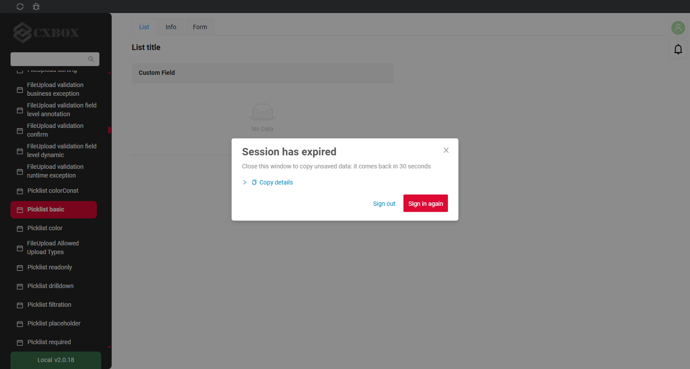
=== "До"
    Запрос молча завершался ошибкой, виджеты оставались пустыми, и ничего не объясняло, что произошло.
    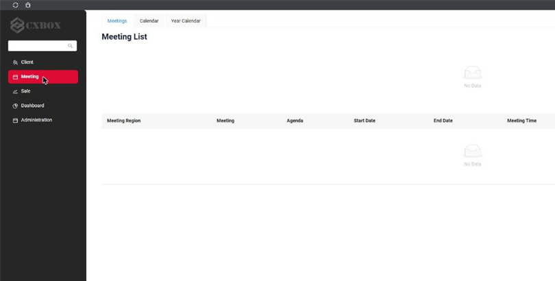

**Недостаточно прав (403)**
=== "После"
    Во всплывающем окне указана причина.
    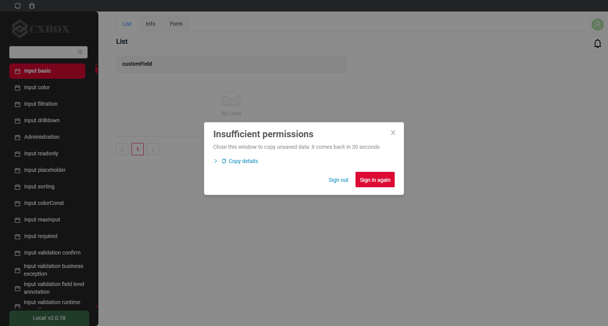
=== "До"
    Пустое всплывающее окно "Error" без текста.
    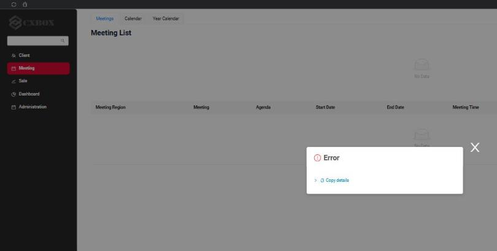

**Вход пользователя без ролей**
То же окно отображается при входе пользователя без ролей. В этот момент приложение ещё не загружено, поэтому за окном нет ничего, кроме пустой стартовой страницы.
=== "После"
    Окно на пустой стартовой странице: **Sign out** позволяет войти под другим пользователем.
    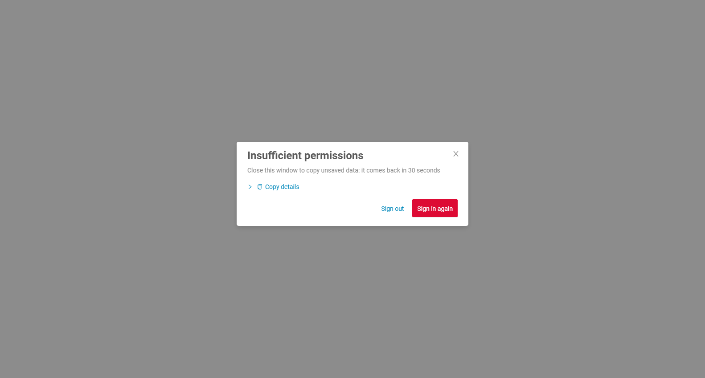
=== "До"
    Приложение навсегда оставалось на индикаторе загрузки.
    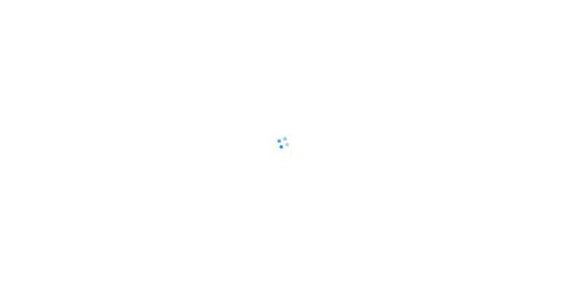

**Настройка**

Три константы в `ui/src/constants/index.ts`. Они не зависят друг от друга, и приложение работает с любым их сочетанием. Вторая и третья позволяют вернуться к старому поведению, если что-то пойдёт не так у вашего OIDC-провайдера.

| Константа                    | Значения                                                                                                                                                                                                                                                                |
|------------------------------|-------------------------------------------------------------------------------------------------------------------------------------------------------------------------------------------------------------------------------------------------------------------------|
| `AUTH_ERROR_MODE`            | `soft` (по умолчанию): окно можно закрыть крестиком. <br> `strict`: крестика нет, пользователь либо входит снова, либо выходит.                                                                                                                                          |
| `USER_MANAGER`               | `rotationSafe` (по умолчанию): `RotationSafeUserManager`, см. [обновление токена](#tokenRenewal). <br> `original`: `UserManager` из oidc-client-ts с настройками как до 3.0.2. Токен обновляется только в фоне, в каждой вкладке. Запрос с истёкшим токеном открывает всплывающее окно. |
| `SIGN_IN_CALLBACK_DETECTION` | Как страница при загрузке узнаёт, что OIDC-провайдер вернул на неё браузер. <br> `oidcResponse` (по умолчанию): по ответу провайдера в URL, `state` с `code` или `error`. <br> `signInCallbackParam`: по нашему параметру `sign_in_callback` из `redirect_uri`, как до 3.0.2. Он стоит после `#`, и провайдер может его отбросить.  |

`USER_MANAGER` и `SIGN_IN_CALLBACK_DETECTION` можно также переключить для одного браузера без пересборки: так автотесты сравнивают два значения каждой константы, а служба поддержки может переключить одного пользователя. После этого перезагрузите страницу; `removeItem()` возвращает константу сборки.

```js
localStorage.setItem('cxbox.userManager', 'original')
localStorage.setItem('cxbox.signInCallbackDetection', 'signInCallbackParam')
```

=== "soft"
    Всплывающее окно с крестиком.
    
=== "strict"
    Всплывающее окно без крестика.
    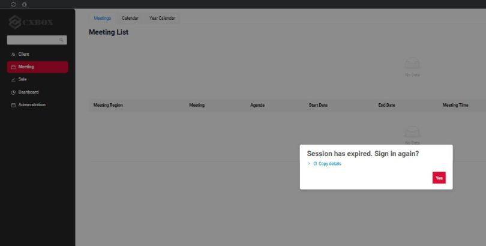

#### <a id="tokenRenewal">Исправлено: авторизация — УЛУЧШЕНО обновление access-токена: refresh-токен отправляется один раз, для всех вкладок и через F5</a>
<!-- CXBOX-1384 -->

Все вкладки приложения в одном браузере используют общего сохранённого пользователя и, следовательно, один refresh-токен (`localStorage`). При ротации refresh-токенов в OIDC-провайдере (Keycloak *Revoke Refresh Token*, Blitz, Auth0, Okta; рекомендуется [RFC 9700](https://www.rfc-editor.org/rfc/rfc9700)) refresh-токен работает один раз. Повторное использование выглядит как кража: провайдер отклоняет его и может закрыть всю сессию. Пользователь видит ошибки 401, а очистка кеша браузера «помогает».

`oidc-client-ts` от этого не защищает. Проблема открыта с 2022 года: [oidc-client-ts #430](https://github.com/authts/oidc-client-ts/issues/430), исправление [PR #434](https://github.com/authts/oidc-client-ts/pull/434) так и не было влито, то же в пределах одной вкладки: [#1618](https://github.com/authts/oidc-client-ts/issues/1618). Keycloak считает это задачей клиента: [keycloak #16081](https://github.com/keycloak/keycloak/issues/16081).

* До 3.0.2 один и тот же refresh-токен отправлялся дважды:
    * двумя вкладками одновременно: фоновый таймер `oidc-client-ts` срабатывает в каждой вкладке;
    * после F5 или закрытия вкладки посреди обновления: новая страница отправляла токен, который уже был в пути;
    * веб-сокетом уведомлений, который сам вызывал `signinSilent()` перед каждым переподключением;
    * а истёкший токен отправлялся как есть, потому что `getUser()` ничего не обновляет: бэкенд отвечал 401, и виджеты оставались пустыми.
* Начиная с 3.0.2 вместо `UserManager` используется новый класс `RotationSafeUserManager` (`ui/src/auth/rotationSafeUserManager`). Он наследует `UserManager`, переопределяет его методы и не добавляет новых. Папка зависит только от `oidc-client-ts` и может быть скопирована в любой проект как есть; см. `README.md` в папке.
    * **Инвариант.** Каждый refresh-токен отправляется провайдеру не более одного раза: для всех вкладок, после любой перезагрузки страницы.
    * **Защита.** Перед отправкой refresh-токена вкладка записывает блокировку этого токена в IndexedDB. Запись атомарна для всех вкладок и переживает F5 и сбой браузера. Вкладка, обнаружившая заблокированный токен, ничего не отправляет и берёт токены, сохранённые отправителем.
    * **Сгоревший токен.** Токен был отправлен, но новые токены не пришли: отказ, таймаут, потерянный ответ, F5, закрытая вкладка. Никто не знает, использовал ли его провайдер, поэтому он больше никогда не отправляется. Сессия продолжается по SSO-cookie провайдера, см. таблицу ниже.
    * `getUser()` обновляет токен, истекающий в течение 5 секунд, прежде чем вернуть его, — как раньше делал `keycloak.updateToken(5)` до `oidc-client-ts`. Перехватчик запросов и веб-сокет получают токен через него, никто не вызывает `signinSilent()` сам по себе.
    * Упреждающее обновление (за 60 секунд до истечения) по-прежнему запускается в каждой вкладке, но токен отправляется один раз.
    * [Web Lock](https://developer.mozilla.org/docs/Web/API/Web_Locks_API) лишь позволяет вкладке дождаться вкладки, выполняющей обновление. Это не защита: без Web Locks (обычный http) токен всё равно никогда не отправляется дважды.
    * Веб-сокет переподключается без ограничений, задержка удваивается после каждой неудачи до 30 секунд (`maxReconnectDelay` в `ui/src/constants/notification.ts`). Без действительного токена рукопожатие не отправляется: отображается всплывающее окно с запросом веб-сокета в подробностях, и клиент повторяет попытку после задержки.
    * Когда обновление не удаётся, в консоль браузера выводится предупреждение, а причины попадают в **Copy details** всплывающего окна, например `Refresh token: invalid_grant. Hidden iframe: IFrame timed out without a response`.

Что видит пользователь:

| Сценарий                                                        | Провайдер на одном сайте с приложением (скрытый iframe работает)              | Провайдер на другом сайте                                                                             |
|-----------------------------------------------------------------|-------------------------------------------------------------------------------|-------------------------------------------------------------------------------------------------------|
| Две вкладки обновляют одновременно                              | Одна вкладка отправляет токен, другая берёт результат. Ничего не заметно.     | То же самое.                                                                                          |
| Провайдер медленный, пользователь нажимает F5 или закрывает вкладку во время обновления | Токен сгорает, обновление идёт через скрытый iframe. Ничего не заметно. | Токен сгорает. Когда access-токен истекает, открывается всплывающее окно. **Sign in again** не требует пароля. |
| Сбой сети или потерянный ответ во время обновления              | То же, что выше.                                                              | То же, что выше.                                                                                      |
| F5 во время входа, пока код обменивается на токены              | Вход перезапускается сам, без пароля. После 2 перезапусков подряд открывается всплывающее окно, чтобы неисправный провайдер не вызывал бесконечных перенаправлений. До 3.0.2: бесконечный индикатор загрузки. | То же самое.                                                                                          |
| В браузере нет IndexedDB                                        | Приложение создаёт для этого браузера `original` `UserManager` независимо от `USER_MANAGER`: блокировки `RotationSafeUserManager` хранятся в IndexedDB. **Copy details** показывает это как `indexedDb: false`. | То же самое.                                                                                          |

Для проверки ничего в приложении не отключается. UI-тесты в `cxbox-code-samples` провоцируют гонки извне и читают refresh-токены из запросов, реально отправленных браузером: сеть вкладки задерживается или замедляется, вкладка замораживается так, как браузер замораживает фоновую вкладку, страница перезагружается посреди обновления, refresh-токен тратится из самого теста. Один и тот же сценарий выполняется с обоими значениями `USER_MANAGER` и `SIGN_IN_CALLBACK_DETECTION`, а ожидаемый результат для каждого значения прописан в тесте (`TokenRenewalAcrossTabsTest`, `SignInAgainPopupTest`, `WebSocketSessionTest`).

**Тайминги.** Их соотношение важно, когда проект настраивает свой OIDC-провайдер:

* Токен обновляется заранее, за 60 секунд до истечения (`accessTokenExpiringNotificationTimeInSeconds`, значение библиотеки по умолчанию).
* `getUser()` обновляет токен, истекающий в течение 5 секунд.
* Запрос с refresh-токеном ждёт ответа до 50 секунд (`SILENT_REQUEST_TIMEOUT_SECONDS`), поэтому завершается до истечения токена. Остальные запросы к провайдеру ждут до 60 секунд (`OIDC_REQUEST_TIMEOUT_SECONDS`). Обновление, завершившееся по этому таймауту, сжигает токен, поэтому стенд с медленным провайдером может увеличить оба значения через `app.oidc` (`silentRequestTimeoutInSeconds`, `requestTimeoutInSeconds`), но не может их убрать.
* Скрытому iframe отводится 30 секунд: он загружает страницу провайдера, а затем само приложение по `silent_redirect_uri`. Если провайдер запрещает фреймы, ответа нет вообще.
* Закрытое всплывающее окно остаётся закрытым 30 секунд (`AUTH_ERROR_SNOOZE_SECONDS`).

Рекомендуемые ограничения для OIDC-провайдера (в скобках — названия в Keycloak):

* Время жизни access-токена (*Access Token Lifespan*, демо-контейнеры: 2 минуты, demo.cxbox.org: 5 минут): не менее 2 минут. Оно должно быть заметно больше 60-секундного запаса на обновление, иначе каждый только что обновлённый токен уже «истекает» и обновляется по кругу.
* Таймаут простоя сессии (*SSO Session Idle*, демо: 30 минут) и производное от него время жизни refresh-токена: больше времени жизни access-токена. Это время, которое пользователь может бездействовать, прежде чем следующий запрос закончится всплывающим окном.
* Ротация refresh-токенов (*Revoke Refresh Token*, включена в демо-контейнерах): разрешена, этот релиз как раз о ней.
* Ключи подписи realm (*Realm settings - Keys*): realm нужен HMAC-ключ для HS512, а не только HS256, который может быть в старом экспорте. Keycloak подписывает им cookie, перезапускающий вход, и при отсутствии ключа создаёт его при первом входе — несколько одновременных первых входов создают каждый свой ключ, cookie, подписанный в одном состоянии, проверяется по другому, и лог заполняется `cookie_not_found` и `invalid_code`, а вход зависает до таймаута. Именно это происходило с демо-контейнерами, пока ключ не добавили в экспорт realm.

**Как перенести в проект**

| Что                                                                                                    | Как                                                                                                                                                                         |
|--------------------------------------------------------------------------------------------------------|-----------------------------------------------------------------------------------------------------------------------------------------------------------------------------|
| `ui/src/auth/rotationSafeUserManager/`, `ui/src/auth/platformSession.ts`, `ui/src/components/AuthErrorPopup/`, `ui/src/components/ui/RequestErrorDetails/`, `ui/src/utils/requestErrorInfo.ts` | Новые файлы: скопировать.                                                                                                                                                   |
| `ui/src/auth/index.ts`                                                                                 | `Auth.init` создаёт один `UserManager` для вызывающих, стартующих одновременно; `USER_MANAGER` выбирает класс. Настройки провайдера — как раньше.                             |
| `ui/src/api/index.ts`                                                                                  | Перехватчик запросов — `platformSession.authorizeRequest`.                                                                                                                  |
| `ui/src/epics/session.ts`                                                                              | `ssoAuthEpic` и `logoutEpic` вызывают `platformSession`. Новые `httpError401Epic` и `httpErrorDefaultEpic` открывают всплывающее окно при 401 и 403.                          |
| `useNotificationClient.ts`                                                                             | Токен рукопожатия берётся из `platformSession.authorizeWebSocketUrl`.                                                                                                       |
| `AppLayout.tsx`, `constants/index.ts`, `actions`, `reducers/session.ts`, `reducers/view.ts`, `ErrorPopup`, i18n | Монтирование всплывающего окна, его состояние и тексты, три константы.                                                                                                      |
| Код проекта, вызывающий `Auth.getInstance().getUser()` или `signinSilent()`                            | Продолжает работать: методы переопределены, а не заменены. ESLint предупреждает об импорте `oidc-client-ts` вне `src/auth`: у созданного вручную `UserManager` нет защиты.     |

#### Исправлено: авторизация — УЛУЧШЕНА синхронизация user_roles в БД с ролями из Keycloak/OIDC { #fixed-authorization-improved-userroles-db-sync-to-roles-from-keycloakoidc }
<!-- CXBOX-1384 -->

Когда пользователь терял все роли в OIDC-провайдере, роли деактивировались в базе данных при следующем запросе, как и раньше. Но когда роли возвращались в OIDC-провайдере, в базе данных они оставались неактивными, потому что при сравнении ролей токена с ролями в БД игнорировался флаг `active`. Теперь в сравнении участвуют только активные роли из БД, поэтому роли реактивируются при следующем входе.

#### Добавлено: всплывающее окно ошибки — УЛУЧШЕНА кнопка 'Copy details' { #added-error-popup-improved-button-copy-details }
<!-- CXBOX-1384 -->

В каждом всплывающем окне ошибки (новом окне 401/403, а также общем окне бизнес-, системных и сетевых ошибок) теперь есть строка **Copy details**:

* **Copy details** копирует JSON со всем, что нужно службе поддержки для поиска запроса в логе сервера: id сессии (то же значение записывается в лог SIEM как `session: ...`), текущий экран, view и URL браузера, метод и URL запроса, HTTP-статус, время начала и окончания запроса, заголовки и тело ответа. Последние строки показывают, на чём основано обновление токена в этом браузере (`webLocks`, `indexedDb`), и три [константы авторизации](#signInAgain), с которыми оно работает.
* Стрелка разворачивает те же подробности на экране, поэтому для начала расследования достаточно скриншота: id сессии, время начала и окончания, код ошибки и запрос. При открытии подробностей они также копируются.

**Общее всплывающее окно ошибки (ответ `400`)**
=== "После"
    Строка подробностей всегда видна.
    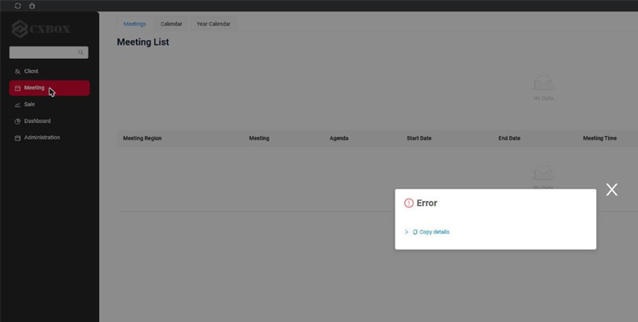
=== "До"
    Та же ошибка: пустое окно, нечего скопировать или показать на скриншоте.
    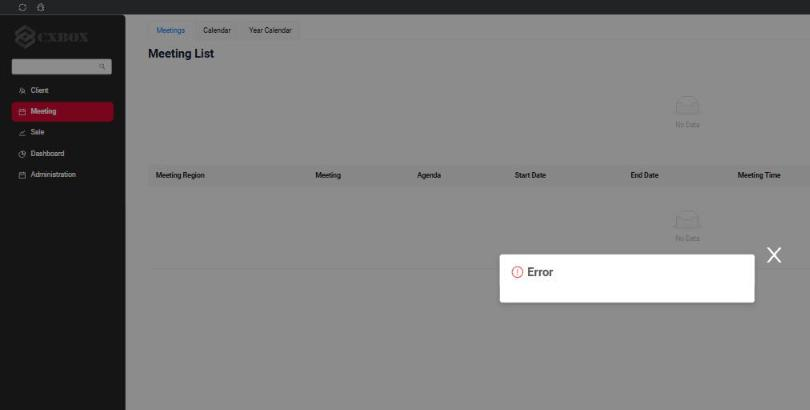

**Системная ошибка (ответ `500`)**
=== "После"
    Подробности развёрнуты.
    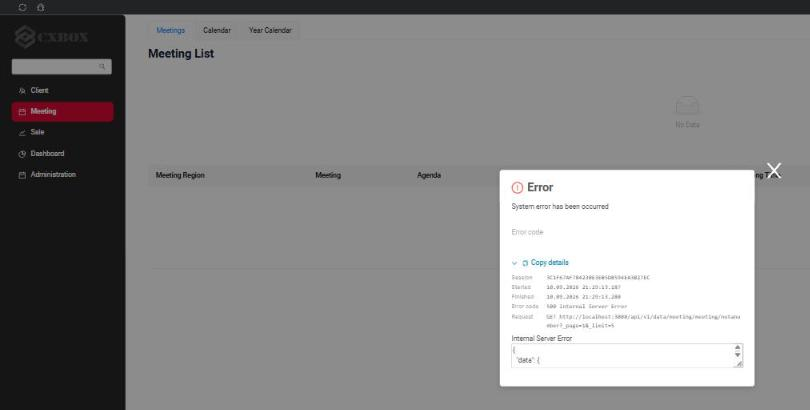
=== "До"
    Системная ошибка: в "Details" было доступно только тело ответа.
    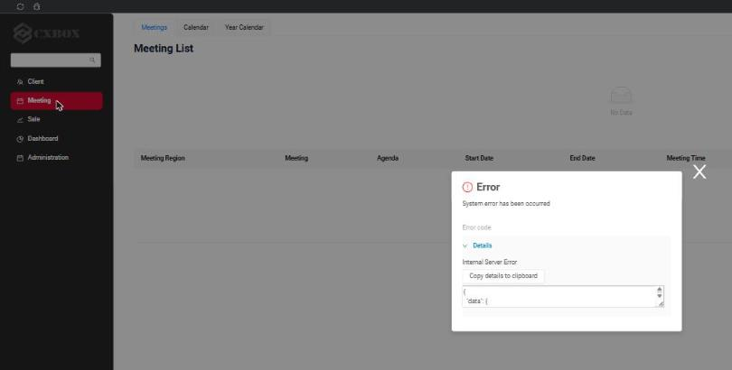

Такая же строка **Copy details** есть в новом [всплывающем окне для 401 и 403](#signInAgain), см. скриншоты до/после выше.

Пример скопированного JSON:

```json
{
  "sessionId": "3C1F67AF784230E3EB5DB594EA3B27EC",
  "clientId": 1789057000000,
  "login": "DEMO",
  "location": "http://localhost:3000/#/screen/meeting",
  "screen": "meeting",
  "view": "meetinglist",
  "statusCode": 403,
  "statusText": "Forbidden",
  "method": "GET",
  "url": "http://localhost:3000/api/v1/data/meeting/meetingStats?_page=1&_limit=5",
  "startedAt": "2026-09-10T18:26:00.410Z",
  "finishedAt": "2026-09-10T18:26:00.757Z",
  "responseHeaders": { "www-authenticate": "Bearer error=\"insufficient_scope\"" },
  "responseBody": null,
  "userAgent": "Mozilla/5.0 ...",
  "webLocks": true,
  "indexedDb": true,
  "userManager": "rotationSafe",
  "authErrorMode": "soft",
  "signInCallbackDetection": "oidcResponse"
}
```

#### Исправлено: уведомления — кнопка "Close all" была видна всегда { #fixed-notifications-close-all-button-was-always-visible }
<!-- CXBOX-1384 -->

Кнопка **Close all** в правом верхнем углу была видна, даже когда уведомлений не было: таблица стилей контейнера уведомлений загружается до таблицы стилей antd, поэтому стиль кнопки antd переопределял правило, скрывающее кнопку. Теперь правило более специфичное, и кнопка скрыта, пока не появится уведомление.

#### Прочие изменения { #other-changes }
см. [журнал изменений cxbox-demo](https://github.com/CX-Box/cxbox-demo/releases/tag/v.3.0.2)


### CXBOX 5.0.3 ([Core](https://github.com/CX-Box/cxbox/tree/cxbox-5.0.3))

#### Добавлено: drilldown с фильтром по полям — поле hint { #added-drilldowns-with-field-based-filter-hint-field }
<!-- CXBOX-1281 -->
В builder фильтра drilldown добавлен новый метод `fb.hint` для полей с `"type": "hint"` в *.widget.json.
Он фильтрует целевой view по части значения без учёта регистра (так же, как для `input`).

`buildRowDependentMeta`

```java
fields.setDrilldownWithFilter(
        MyExampleDTO_.customFieldHint, DrillDownType.INNER, "/screen/MyExample/view/MyExamplelist/", fc ->
        fc.add(
                CxboxMyExampleController.myexample,
                MyExampleDTO.class,
                fb -> fb.hint(MyExampleDTO_.customFieldHint, fields.getCurrentValue(MyExampleDTO_.customFieldHint).orElse(null))
        )
);
```