# CheckBox

`Field CheckBox` позволяет пользователю сделать бинарный выбор.

## Основы { #basics }
[:material-play-circle: Живой пример]({{ external_links.code_samples }}/ui/#/screen/myexample82){:target="_blank"} ·
[:fontawesome-brands-github: GitHub]({{ external_links.github_ui }}/{{ external_links.github_branch }}/src/main/java/org/demo/documentation/fields/checkbox/basic){:target="_blank"}

### Как это выглядит? { #how-does-it-look }

=== "Виджет List"
    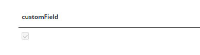
=== "Виджет Info"
    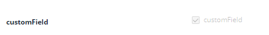
=== "Виджет Form"
    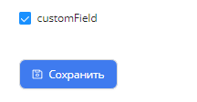

### Как добавить? { #how-to-add }
??? Example "Пример"

    === "С плагином (рекомендуется)"
        **Шаг 1** Скачайте плагин
            [скачать плагин для IntelliJ](https://doc.cxbox.org/ru/plugin/plugininstalling)
    
        **Шаг 2** Добавьте существующее поле в существующий виджет формы

        

    === "Пример написания кода"
        **Шаг 1** Добавьте поле **Boolean** в соответствующий **BaseEntity**.
    
        ```java
        --8<--
        {{ external_links.github_raw_doc }}/fields/checkbox/basic/MyEntity82.java
        --8<--
        ```
    
        **Шаг 2** Добавьте поле **Boolean** в соответствующий **DataResponseDTO**.
    
        ```java
        --8<--
        {{ external_links.github_raw_doc }}/fields/checkbox/basic/MyExample82DTO.java
        --8<--
        ```
    
        === "Виджет List"
            **Шаг 3** Добавьте в **_.widget.json_**.
    
            ```json
            --8<--
            {{ external_links.github_raw_doc }}/fields/checkbox/basic/MyExample82List.widget.json
            --8<--
            ```
        === "Виджет Info"
            **Шаг 3** Добавьте в **_.widget.json_**.
            
            ```json
            --8<--
            {{ external_links.github_raw_doc }}/fields/checkbox/basic/MyExample82Info.widget.json
            --8<--
            ```
    
        === "Виджет Form"
    
            **Шаг 3** Добавьте в **_.widget.json_**.
    
            ```json
            --8<--
            {{ external_links.github_raw_doc }}/fields/checkbox/basic/MyExample82Form.widget.json
            --8<--
            ```     
    
        [:material-play-circle: Живой пример]({{ external_links.code_samples }}/ui/#/screen/myexample82){:target="_blank"} ·
        [:fontawesome-brands-github: GitHub]({{ external_links.github_ui }}/{{ external_links.github_branch }}/src/main/java/org/demo/documentation/fields/checkbox/basic){:target="_blank"}

## Placeholder
[:material-play-circle: Живой пример]({{ external_links.code_samples }}/ui/#/screen/myexample74){:target="_blank"} ·
[:fontawesome-brands-github: GitHub]({{ external_links.github_ui }}/{{ external_links.github_branch }}/src/main/java/org/demo/documentation/fields/checkbox/placeholder){:target="_blank"}
 
`Placeholder` позволяет задать краткую подсказку об ожидаемом значении. Подсказка отображается до ввода пользователем. Её можно вычислять на основе бизнес-логики приложения.

### Как это выглядит? { #how-does-it-look_1 }
=== "Виджет List"
    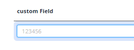
=== "Виджет Info"
    _неприменимо_
=== "Виджет Form"
    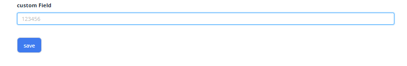

### Как добавить? { #how-to-add_1 }
??? Example "Пример"

    Добавьте **fields.setPlaceholder** в соответствующий **FieldMetaBuilder**.
    
    ```java
    --8<--
    {{ external_links.github_raw_doc }}/fields/checkbox/placeholder/MyExample74Meta.java:buildRowDependentMeta
    --8<--
    ```   

    === "Виджет List"
        **Работает для List.**
    === "Виджет Info"
        **_неприменимо_**
    === "Виджет Form"
        **Работает для Form.**

    [:material-play-circle: Живой пример]({{ external_links.code_samples }}/ui/#/screen/myexample74){:target="_blank"} ·
    [:fontawesome-brands-github: GitHub]({{ external_links.github_ui }}/{{ external_links.github_branch }}/src/main/java/org/demo/documentation/fields/checkbox/placeholder){:target="_blank"}

## Цвет { #color }
**_неприменимо_**

## Только чтение/Редактирование { #readonlyeditable }

`Readonly/Editable` указывает, можно ли редактировать поле. Это можно вычислять на основе бизнес-логики приложения

`Editable`
[:material-play-circle: Живой пример]({{ external_links.code_samples }}/ui/#/screen/myexample82){:target="_blank"} ·
[:fontawesome-brands-github: GitHub]({{ external_links.github_ui }}/{{ external_links.github_branch }}/src/main/java/org/demo/documentation/fields/checkbox/basic){:target="_blank"}

`Readonly`
[:material-play-circle: Живой пример]({{ external_links.code_samples }}/ui/#/screen/myexample79){:target="_blank"} ·
[:fontawesome-brands-github: GitHub]({{ external_links.github_ui }}/{{ external_links.github_branch }}/src/main/java/org/demo/documentation/fields/checkbox/ro){:target="_blank"}


### Как это выглядит? { #how-does-it-look_2 }
=== "Редактирование"
    === "Виджет List"
        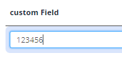
    === "Виджет Info"
        _неприменимо_
    === "Виджет Form"
        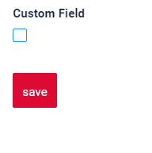
=== "Редактирование"
    === "Виджет List"
        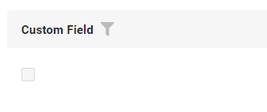
    === "Виджет Info"
        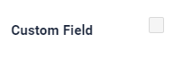
    === "Виджет Form"
        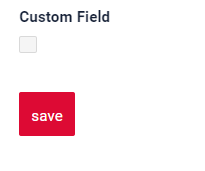

### Как добавить? { #how-to-add_2 }
??? Example "Пример"
    === "Редактирование"

        **Шаг 1** Добавьте маппинг DTO->entity в соответствующий **VersionAwareResponseService**.
        ```java
        --8<--
        {{ external_links.github_raw_doc }}/fields/checkbox/basic/MyExample82Service.java:doUpdateEntity
        --8<--
        ```            
        **Шаг 2** Добавьте **fields.setEnabled** в соответствующий **FieldMetaBuilder**.
        ```java
        --8<--
        {{ external_links.github_raw_doc }}/fields/checkbox/basic/MyExample82Meta.java:buildRowDependentMeta
        --8<--
        ```
        === "Виджет List"
            **Работает для List.**
        === "Виджет Info"
            **_неприменимо_**
        === "Виджет Form"
            **Работает для Form.**

        [:material-play-circle: Живой пример]({{ external_links.code_samples }}/ui/#/screen/myexample82){:target="_blank"} ·
        [:fontawesome-brands-github: GitHub]({{ external_links.github_ui }}/{{ external_links.github_branch }}/src/main/java/org/demo/documentation/fields/checkbox/basic){:target="_blank"}

    === "Только чтение"

        **Вариант 1** Включено по умолчанию.
        ```java
        --8<--
        {{ external_links.github_raw_doc }}/fields/checkbox/ro/MyExample79Meta.java:buildRowDependentMeta
        --8<--
        ```

        **Вариант 2** `Не рекомендуется.` Свойство fields.setDisabled() переопределяет доступность поля, если используется после свойства fields.setEnabled.

        === "Виджет List"
            **Работает для List.**
        === "Виджет Info"
            **Работает для Info.**
        === "Виджет Form"
            **Работает для Form.**

        [:material-play-circle: Живой пример]({{ external_links.code_samples }}/ui/#/screen/myexample79){:target="_blank"} ·
        [:fontawesome-brands-github: GitHub]({{ external_links.github_ui }}/{{ external_links.github_branch }}/src/main/java/org/demo/documentation/fields/checkbox/ro){:target="_blank"}

## Фильтрация { #filtering }
[:material-play-circle: Живой пример]({{ external_links.code_samples }}/ui/#/screen/myexample53){:target="_blank"} ·
[:fontawesome-brands-github: GitHub]({{ external_links.github_ui }}/{{ external_links.github_branch }}/src/main/java/org/demo/documentation/fields/checkbox/filtration){:target="_blank"}
 
`Filtering` позволяет искать данные по критериям. Поиск использует оператор `in`.
### Как это выглядит? { #how-does-it-look_3 }
=== "Виджет List"
    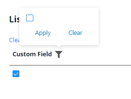
=== "Виджет Info"
    _неприменимо_
=== "Виджет Form"
    _неприменимо_


### Как добавить? { #how-to-add_3 }
??? Example "Пример"
    === "Виджет List"
        **Шаг 1** Добавьте **@SearchParameter** в соответствующий **DataResponseDTO**. (Расширенная настройка [SearchParameter](/ru/advancedCustomization/element/searchparameter/searchparameter))
        ```java
        --8<--
        {{ external_links.github_raw_doc }}/fields/checkbox/filtration/MyExample53DTO.java
        --8<--
        ```
        **Шаг 2**  Добавьте **fields.enableFilter** в соответствующий **FieldMetaBuilder**.
        ```java
        --8<--
        {{ external_links.github_raw_doc }}/fields/checkbox/filtration/MyExample53Meta.java:buildIndependentMeta
        --8<--
        ```

        [:material-play-circle: Живой пример]({{ external_links.code_samples }}/ui/#/screen/myexample53){:target="_blank"} ·
        [:fontawesome-brands-github: GitHub]({{ external_links.github_ui }}/{{ external_links.github_branch }}/src/main/java/org/demo/documentation/fields/checkbox/filtration){:target="_blank"}

    === "Виджет Info"
        _неприменимо_
    === "Виджет Form"
        _неприменимо_


## Drilldown
**_неприменимо_**


## Валидация { #validation }
`Validation` позволяет проверять любые бизнес-правила для введённого пользователем значения. Типы валидации:

1) Exception: отображает сообщение, уведомляющее пользователя о технических или бизнес-ошибках.

   `Business Exception`:
   [:material-play-circle: Живой пример]({{ external_links.code_samples }}/ui/#/screen/myexample77){:target="_blank"} ·
   [:fontawesome-brands-github: GitHub]({{ external_links.github_ui }}/{{ external_links.github_branch }}/src/main/java/org/demo/documentation/fields/checkbox/validationbusinessex){:target="_blank"}

   `Runtime Exception`:
   [:material-play-circle: Живой пример]({{ external_links.code_samples }}/ui/#/screen/myexample80){:target="_blank"} ·
   [:fontawesome-brands-github: GitHub]({{ external_links.github_ui }}/{{ external_links.github_branch }}/src/main/java/org/demo/documentation/fields/checkbox/validationruntimeex){:target="_blank"}
   
2) Confirm: показывает диалог с необязательным сообщением, требующий от пользователя подтверждения или отмены перед продолжением.

   [:material-play-circle: Живой пример]({{ external_links.code_samples }}/ui/#/screen/myexample78){:target="_blank"} ·
   [:fontawesome-brands-github: GitHub]({{ external_links.github_ui }}/{{ external_links.github_branch }}/src/main/java/org/demo/documentation/fields/checkbox/validationconfirm){:target="_blank"}

3) Валидация на уровне полей: показывает ошибку рядом со всеми полями, не прошедшими проверку

   `Option 1`:
   [:material-play-circle: Живой пример]({{ external_links.code_samples }}/ui/#/screen/myexample168){:target="_blank"} ·
   [:fontawesome-brands-github: GitHub]({{ external_links.github_ui }}/{{ external_links.github_branch }}/src/main/java/org/demo/documentation/fields/checkbox/validationannotation){:target="_blank"}

   `Option 2`:
   [:material-play-circle: Живой пример]({{ external_links.code_samples }}/ui/#/screen/myexample289){:target="_blank"} ·
   [:fontawesome-brands-github: GitHub]({{ external_links.github_ui }}/{{ external_links.github_branch }}/src/main/java/org/demo/documentation/fields/checkbox/validationdynamic){:target="_blank"}


### Как это выглядит? { #how-does-it-look_4 }
=== "Виджет List"
    === "BusinessException"
        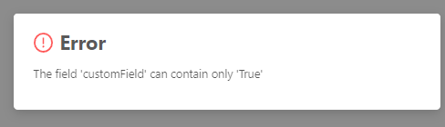
    === "RuntimeException"
        
    === "Confirm"
        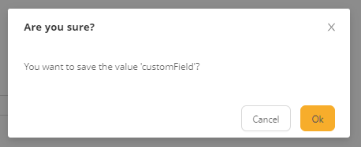
    === "Валидация на уровне полей"
        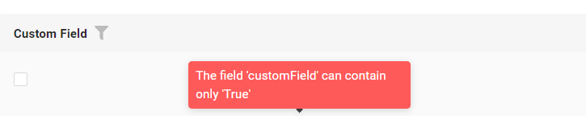
=== "Виджет Info"
    _неприменимо_
=== "Виджет Form"
    === "BusinessException"
        
    === "RuntimeException"
        
    === "Confirm"
        
    === "Валидация на уровне полей"
        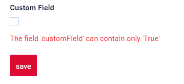
### Как добавить? { #how-to-add_4 }
??? Example "Пример"
    === "BusinessException"
        `BusinessException` описывает ошибку в рамках бизнес-процесса.

        Добавьте **BusinessException** в соответствующий **VersionAwareResponseService**.
        ```java
        --8<--
        {{ external_links.github_raw_doc }}/fields/checkbox/validationbusinessex/MyExample77Service.java:doUpdateEntity
        --8<--
        ```
        === "Виджет List"
            **Работает для List.**
        === "Виджет Info"
            **_неприменимо_**
        === "Виджет Form"
            **Работает для Form.**

        [:material-play-circle: Живой пример]({{ external_links.code_samples }}/ui/#/screen/myexample77){:target="_blank"} ·
        [:fontawesome-brands-github: GitHub]({{ external_links.github_ui }}/{{ external_links.github_branch }}/src/main/java/org/demo/documentation/fields/checkbox/validationbusinessex){:target="_blank"}

    === "RuntimeException"

        `RuntimeException` описывает техническую ошибку в рамках бизнес-процесса.
        
        Добавьте **RuntimeException** в соответствующий **VersionAwareResponseService**.
        ```java
        --8<--
        {{ external_links.github_raw_doc }}/fields/checkbox/validationruntimeex/MyExample80Service.java:doUpdateEntity
        --8<--
        ```        
        === "Виджет List"
            **Работает для List.**
        === "Виджет Info"
            **_неприменимо_**
        === "Виджет Form"
            **Работает для Form.**

        [:material-play-circle: Живой пример]({{ external_links.code_samples }}/ui/#/screen/myexample80){:target="_blank"} ·
        [:fontawesome-brands-github: GitHub]({{ external_links.github_ui }}/{{ external_links.github_branch }}/src/main/java/org/demo/documentation/fields/checkbox/validationruntimeex){:target="_blank"}

    === "Confirm"
        Добавьте [PreAction.confirm](/ru/advancedCustomization_validation) в соответствующий **VersionAwareResponseService**.
        ```java
        --8<--
        {{ external_links.github_raw_doc }}/fields/checkbox/validationconfirm/MyExample78Service.java:getActions
        --8<--
        ```
        === "Виджет List"
            **Работает для List.**
        === "Виджет Info"
            **_неприменимо_**
        === "Виджет Form"
            **Работает для Form.**

        [:material-play-circle: Живой пример]({{ external_links.code_samples }}/ui/#/screen/myexample78){:target="_blank"} ·
        [:fontawesome-brands-github: GitHub]({{ external_links.github_ui }}/{{ external_links.github_branch }}/src/main/java/org/demo/documentation/fields/checkbox/validationconfirm){:target="_blank"}

    === "Валидация на уровне полей"
        === "Вариант 1"
            Используйте, если:

            Нужна простая проверка полей (javax validation)
            ```java
            --8<--
            {{ external_links.github_raw_doc }}/fields/checkbox/validationannotation/MyExample168DTO.java
            --8<--
            ```
            === "Виджет List"
                **Работает для List.**
            === "Виджет Info"
                **_неприменимо_**
            === "Виджет Form"
                **Работает для Form.**

            [:material-play-circle: Живой пример]({{ external_links.code_samples }}/ui/#/screen/myexample168){:target="_blank"} ·
            [:fontawesome-brands-github: GitHub]({{ external_links.github_ui }}/{{ external_links.github_branch }}/src/main/java/org/demo/documentation/fields/checkbox/validationannotation){:target="_blank"}


        === "Вариант 2"
            Создайте собственный сервис для проверки бизнес-логики.

            Используйте, если:

            Для полей требуется проверка бизнес-логики

            `Шаг 1`  Создайте собственный метод проверки.
            ```java
            --8<--
            {{ external_links.github_raw_doc }}/fields/checkbox/validationdynamic/MyExample289Service.java:validateFields
            --8<--
            ```
            `Шаг 2` Добавьте собственный метод проверки в соответствующий **VersionAwareResponseService**.
            ```java
            --8<--
            {{ external_links.github_raw_doc }}/fields/checkbox/validationdynamic/MyExample289Service.java:doUpdateEntity
            --8<--
            ```

            [:material-play-circle: Живой пример]({{ external_links.code_samples }}/ui/#/screen/myexample289){:target="_blank"} ·
            [:fontawesome-brands-github: GitHub]({{ external_links.github_ui }}/{{ external_links.github_branch }}/src/main/java/org/demo/documentation/fields/checkbox/validationdynamic){:target="_blank"}
 
## Сортировка { #sorting }
[:material-play-circle: Живой пример]({{ external_links.code_samples }}/ui/#/screen/myexample76){:target="_blank"} ·
[:fontawesome-brands-github: GitHub]({{ external_links.github_ui }}/{{ external_links.github_branch }}/src/main/java/org/demo/documentation/fields/checkbox/sorting){:target="_blank"}

`Sorting` позволяет сортировать данные по возрастанию или убыванию.

### Как это выглядит? { #how-does-it-look_5 }
=== "Виджет List"
    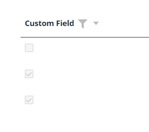
=== "Виджет Info"
    _неприменимо_
=== "Виджет Form"
    _неприменимо_
### Как добавить? { #how-to-add_5 }
??? Example "Пример"
    === "Виджет List"
        подробнее см. [Сортировка](/ru/widget/type/property/sorting/sorting)
 
        **Шаг 1**  Добавьте **fields.enableSort** в соответствующий **FieldMetaBuilder**.
        ```java
        --8<--
        {{ external_links.github_raw_doc }}/fields/checkbox/sorting/MyExample76Meta.java:buildIndependentMeta
        --8<--
        ```
 
        [:material-play-circle: Живой пример]({{ external_links.code_samples }}/ui/#/screen/myexample76){:target="_blank"} ·
        [:fontawesome-brands-github: GitHub]({{ external_links.github_ui }}/{{ external_links.github_branch }}/src/main/java/org/demo/documentation/fields/checkbox/sorting){:target="_blank"}

    === "Виджет Info"
        _неприменимо_
    === "Виджет Form"
        _неприменимо_

## Обязательность { #required }
[:material-play-circle: Живой пример]({{ external_links.code_samples }}/ui/#/screen/myexample75){:target="_blank"} ·
[:fontawesome-brands-github: GitHub]({{ external_links.github_ui }}/{{ external_links.github_branch }}/src/main/java/org/demo/documentation/fields/checkbox/required){:target="_blank"}

`Required` позволяет указать, что поле обязательно должно иметь значение.

### Как это выглядит? { #how-does-it-look_6 }
=== "Виджет List"
    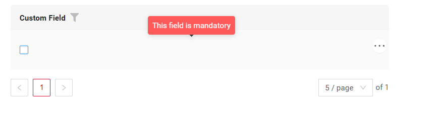
=== "Виджет Info"
    _неприменимо_
=== "Виджет Form"
    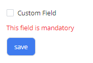
### Как добавить? { #how-to-add_6 }
??? Example "Пример"
    Добавьте **fields.setRequired** в соответствующий **FieldMetaBuilder**.
    ```java
    --8<--
    {{ external_links.github_raw_doc }}/fields/checkbox/required/MyExample75Meta.java:buildRowDependentMeta
    --8<--
    ```
    === "Виджет List"
        **Работает для List.**
    === "Виджет Info"
        **_неприменимо_**
    === "Виджет Form"
        **Работает для Form.**
