# DateTimeWithSeconds
`DateTimeWithSeconds` — компонент для редактирования даты со временем. Используется для редактирования и отображения дат со временем и секундами.

## Основы { #basics }
[:material-play-circle: Живой пример]({{ external_links.code_samples }}/ui/#/screen/DateTimeWithSeconds){:target="_blank"} ·
[:fontawesome-brands-github: GitHub]({{ external_links.github_ui }}/{{ external_links.github_branch }}/src/main/java/org/demo/documentation/fields/datetimewithseconds/basic){:target="_blank"}

### Как это выглядит? { #how-does-it-look }

=== "Виджет List"
    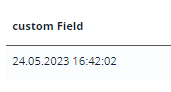
=== "Виджет Info"
    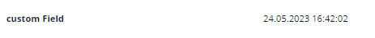
=== "Виджет Form"
    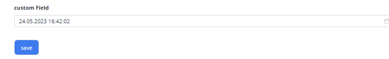


### Как добавить? { #how-to-add }
??? Example "Пример"
    **Шаг 1** Добавьте поле **LocalDateTimeWithSeconds** в соответствующий **BaseEntity**.

    ```java
    --8<--
    {{ external_links.github_raw_doc }}/fields/datetimewithseconds/basic/DateTimeWithSecondsEntity.java
    --8<--
    ```

    **Шаг 2** Добавьте поле **LocalDateTimeWithSeconds** в соответствующий **DataResponseDTO**.
   
    ```java
    --8<--
    {{ external_links.github_raw_doc }}/fields/datetimewithseconds/basic/DateTimeWithSecondsDTO.java
    --8<--
    ```

    === "Виджет List"
        **Шаг 3** Добавьте в **_.widget.json_**.

        ```json
        --8<--
        {{ external_links.github_raw_doc }}/fields/datetimewithseconds/basic/DateTimeWithSecondsList.widget.json
        --8<--
        ```
    === "Виджет Info"
        **Шаг 3** Добавьте в **_.widget.json_**.
        
        ```json
        --8<--
        {{ external_links.github_raw_doc }}/fields/datetimewithseconds/basic/DateTimeWithSecondsInfo.widget.json
        --8<--
        ```

    === "Виджет Form"

        **Шаг 3** Добавьте в **_.widget.json_**.

        ```json
        --8<--
        {{ external_links.github_raw_doc }}/fields/datetimewithseconds/basic/DateTimeWithSecondsForm.widget.json
        --8<--
        ```    

    [:material-play-circle: Живой пример]({{ external_links.code_samples }}/ui/#/screen/DateTimeWithSeconds){:target="_blank"} ·
    [:fontawesome-brands-github: GitHub]({{ external_links.github_ui }}/{{ external_links.github_branch }}/src/main/java/org/demo/documentation/fields/datetimewithseconds/basic){:target="_blank"}

## Placeholder
[:material-play-circle: Живой пример]({{ external_links.code_samples }}/ui/#/screen/DateTimeWithSecondsPlaceholder){:target="_blank"} ·
[:fontawesome-brands-github: GitHub]({{ external_links.github_ui }}/{{ external_links.github_branch }}/src/main/java/org/demo/documentation/fields/datetimewithseconds/placeholder){:target="_blank"}

`Placeholder` позволяет задать краткую подсказку об ожидаемом значении. Подсказка отображается до ввода пользователем. Её можно вычислять на основе бизнес-логики приложения. Она отображается и для поля `Readonly`.
### Как это выглядит? { #how-does-it-look_1 }
=== "Виджет List"
    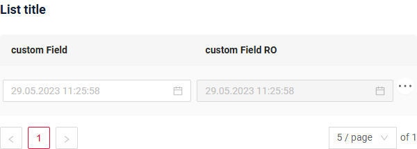
=== "Виджет Info"
    _неприменимо_
=== "Виджет Form"
    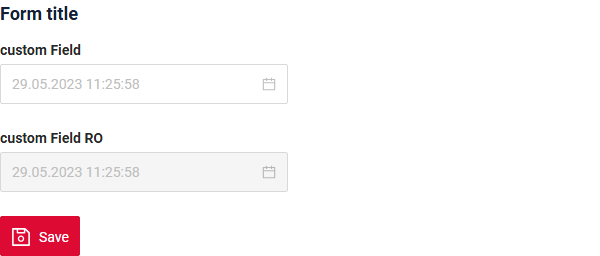

### Как добавить? { #how-to-add_1 }
??? Example "Пример"

    Добавьте **fields.setPlaceholder** в соответствующий **FieldMetaBuilder**.
    
    ```java
    --8<--
    {{ external_links.github_raw_doc }}/fields/datetimewithseconds/placeholder/DateTimeWithSecondsPlaceholderMeta.java:buildRowDependentMeta
    --8<--
    ```
    === "Виджет List"
        **Работает для List.**
    === "Виджет Info"
        **_неприменимо_**
    === "Виджет Form"
        **Работает для Form.**

    [:material-play-circle: Живой пример]({{ external_links.code_samples }}/ui/#/screen/DateTimeWithSecondsPlaceholder){:target="_blank"} ·
    [:fontawesome-brands-github: GitHub]({{ external_links.github_ui }}/{{ external_links.github_branch }}/src/main/java/org/demo/documentation/fields/datetimewithseconds/placeholder){:target="_blank"}

## Цвет { #color }
`Color` позволяет задать цвет поля. Его можно вычислять на основе бизнес-логики приложения

**Вычисляемый цвет**

[:material-play-circle: Живой пример]({{ external_links.code_samples }}/ui/#/screen/DateTimeWithSecondsColor){:target="_blank"} ·
[:fontawesome-brands-github: GitHub]({{ external_links.github_ui }}/{{ external_links.github_branch }}/src/main/java/org/demo/documentation/fields/datetimewithseconds/color){:target="_blank"}

**Постоянный цвет**

[:material-play-circle: Живой пример]({{ external_links.code_samples }}/ui/#/screen/DateTimeWithSecondsColorConst){:target="_blank"} ·
[:fontawesome-brands-github: GitHub]({{ external_links.github_ui }}/{{ external_links.github_branch }}/src/main/java/org/demo/documentation/fields/datetimewithseconds/colorconst){:target="_blank"}

### Как это выглядит? { #how-does-it-look_2 }
=== "Виджет List"
    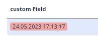

=== "Виджет Info"
    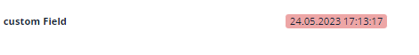

=== "Виджет Form"
    _неприменимо_


### Как добавить? { #how-to-add_2 }
??? Example "Пример"
    === "Вычисляемый цвет"
    
        **Шаг 1**   Добавьте `собственное поле для цвета` в соответствующий **DataResponseDTO**. Поле может содержать цвет в формате HEX или быть null.
    
        ```java
        --8<--
        {{ external_links.github_raw_doc }}/fields/datetimewithseconds/color/DateTimeWithSecondsColorDTO.java
        --8<--
        ```
        === "Виджет List"
            **Шаг 2** Добавьте **"bgColorKey"** :  `собственное поле для цвета` в .widget.json.
            ```json
            --8<--
            {{ external_links.github_raw_doc }}/fields/datetimewithseconds/color/DateTimeWithSecondsColorList.widget.json
            --8<--
            ```
        === "Виджет Info"
            **Шаг 2** Добавьте **"bgColorKey"** :  `собственное поле для цвета` в .widget.json.
            ```json
            --8<--
            {{ external_links.github_raw_doc }}/fields/datetimewithseconds/color/DateTimeWithSecondsColorInfo.widget.json
            --8<--
            ```
        === "Виджет Form"
            _неприменимо_

        [:material-play-circle: Живой пример]({{ external_links.code_samples }}/ui/#/screen/DateTimeWithSecondsColor){:target="_blank"} ·
        [:fontawesome-brands-github: GitHub]({{ external_links.github_ui }}/{{ external_links.github_branch }}/src/main/java/org/demo/documentation/fields/datetimewithseconds/color){:target="_blank"}

    === "Постоянный цвет"
        === "Виджет List"
            Добавьте **"bgColor"** :  `цвет HEX` в .widget.json.
            
            ```json
            --8<--
            {{ external_links.github_raw_doc }}/fields/datetimewithseconds/colorconst/DateTimeWithSecondsColorConstList.widget.json
            --8<--
            ```

        === "Виджет Info"
            Добавьте **"bgColor"** :  `цвет HEX` в .widget.json.

            ```json
            --8<--
            {{ external_links.github_raw_doc }}/fields/datetimewithseconds/colorconst/DateTimeWithSecondsColorConstInfo.widget.json
            --8<--
            ```

        === "Виджет Form"
            _неприменимо_

        [:material-play-circle: Живой пример]({{ external_links.code_samples }}/ui/#/screen/DateTimeWithSecondsColorConst){:target="_blank"} ·
        [:fontawesome-brands-github: GitHub]({{ external_links.github_ui }}/{{ external_links.github_branch }}/src/main/java/org/demo/documentation/fields/datetimewithseconds/colorconst){:target="_blank"}

## Только чтение/Редактирование { #readonlyeditable }
`Readonly/Editable` указывает, можно ли редактировать поле. Это можно вычислять на основе бизнес-логики приложения

`Editable`
[:material-play-circle: Живой пример]({{ external_links.code_samples }}/ui/#/screen/DateTimeWithSeconds){:target="_blank"} ·
[:fontawesome-brands-github: GitHub]({{ external_links.github_ui }}/{{ external_links.github_branch }}/src/main/java/org/demo/documentation/fields/datetimewithseconds/basic){:target="_blank"}

`Readonly`
[:material-play-circle: Живой пример]({{ external_links.code_samples }}/ui/#/screen/DateTimeWithSecondsCreateEdit){:target="_blank"} ·
[:fontawesome-brands-github: GitHub]({{ external_links.github_ui }}/{{ external_links.github_branch }}/src/main/java/org/demo/documentation/fields/datetimewithseconds/ro){:target="_blank"}

### Как это выглядит? { #how-does-it-look_3 }
=== "Редактирование"
    === "Виджет List"
        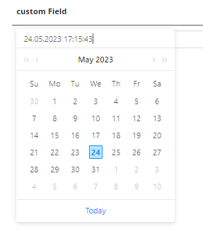
    === "Виджет Info"
        _неприменимо_
    === "Виджет Form"
        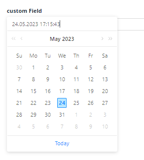
=== "Только чтение"
    === "Виджет List"
        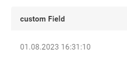
    === "Виджет Info"
        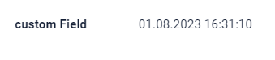
    === "Виджет Form"
        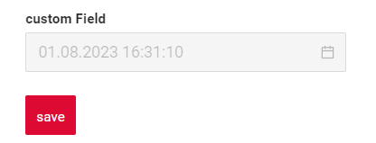


### Как добавить? { #how-to-add_3 }
??? Example "Пример"
    === "Редактирование"
        **Шаг 1** Добавьте маппинг DTO->entity в соответствующий **VersionAwareResponseService**.
        ```java
        --8<--
        {{ external_links.github_raw_doc }}/fields/datetimewithseconds/basic/DateTimeWithSecondsService.java:doUpdateEntity
        --8<--
        ```

        **Шаг 2** Добавьте **fields.setEnabled** в соответствующий **FieldMetaBuilder**.
        ```java
        --8<--
        {{ external_links.github_raw_doc }}/fields/datetimewithseconds/basic/DateTimeWithSecondsMeta.java:buildRowDependentMeta
        --8<--
        ```    

        === "Виджет List"
            **Работает для List.**
        === "Виджет Info"
            **_неприменимо_**
        === "Виджет Form"
            **Работает для Form.**

        [:material-play-circle: Живой пример]({{ external_links.code_samples }}/ui/#/screen/DateTimeWithSeconds){:target="_blank"} ·
        [:fontawesome-brands-github: GitHub]({{ external_links.github_ui }}/{{ external_links.github_branch }}/src/main/java/org/demo/documentation/fields/datetimewithseconds/basic){:target="_blank"}
           
    === "Только чтение"
    
        **Вариант 1** Включено по умолчанию.
 
        ```java
        --8<--
        {{ external_links.github_raw_doc }}/fields/datetimewithseconds/ro/DateTimeWithSecondsCreateEditMeta.java:buildRowDependentMeta
        --8<--
        ```  
    
        **Вариант 2** `Не рекомендуется.` Свойство fields.setDisabled() переопределяет доступность поля, если используется после свойства fields.setEnabled.
        === "Виджет List"
            **Работает для List.**
        === "Виджет Info"
            **Работает для Info.**
        === "Виджет Form"
            **Работает для Form.**

        [:material-play-circle: Живой пример]({{ external_links.code_samples }}/ui/#/screen/DateTimeWithSecondsCreateEdit){:target="_blank"} ·
        [:fontawesome-brands-github: GitHub]({{ external_links.github_ui }}/{{ external_links.github_branch }}/src/main/java/org/demo/documentation/fields/datetimewithseconds/ro){:target="_blank"}

## Фильтрация { #filtering }
[:material-play-circle: Живой пример]({{ external_links.code_samples }}/ui/#/screen/DateTimeWithSecondsFiltration){:target="_blank"} ·
[:fontawesome-brands-github: GitHub]({{ external_links.github_ui }}/{{ external_links.github_branch }}/src/main/java/org/demo/documentation/fields/datetimewithseconds/filtration){:target="_blank"}

`Filtering` позволяет искать данные по критериям.

Поиск использует (формат данных YYYY-MM-DD HH:MM):

* операторы `greaterOrEqualThan`(>=) и `lessOrEqualThan`(<=). При первой установке даты в поле фильтра время будет 00:00:00 или 23:59:59 в зависимости от поля даты.
* оператор `equals` (=). Поиск выполняется в интервале от 00:00:00 до 23:59:59.

### Как это выглядит? { #how-does-it-look_4 }
=== "Виджет List"
    === "По диапазону"
        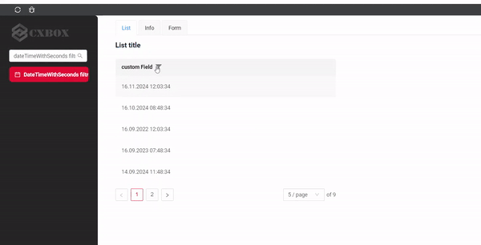
    === "Равно"
        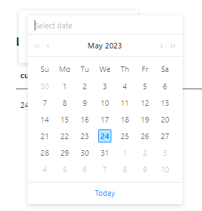
=== "Виджет Info"
    _неприменимо_
=== "Виджет Form"
    _неприменимо_

### Как добавить? { #how-to-add_4 }
??? Example "Пример"
    === "Виджет List"

        !!! info  
            По умолчанию фильтрация выполняется **по диапазону**. Чтобы отключить её, укажите `cxbox.widget.fields.filter-by-range-enabled-default: false` в meta.
            [подробнее](/ru/features/element/applicationparams/applicationparams)
        **Шаг 1** Добавьте **@SearchParameter** в соответствующий **DataResponseDTO**. (Расширенная настройка [SearchParameter](/ru/advancedCustomization/element/searchparameter/searchparameter))

        ```java
        --8<--
        {{ external_links.github_raw_doc }}/fields/datetimewithseconds/filtration/DateTimeWithSecondsFiltrationDTO.java
        --8<--
        ```

        **Шаг 2**  Добавьте **fields.enableFilter** в соответствующий **FieldMetaBuilder**.
        ```java
        --8<--
        {{ external_links.github_raw_doc }}/fields/datetimewithseconds/filtration/DateTimeWithSecondsFiltrationMeta.java:buildIndependentMeta
        --8<--
        ``` 

        [:material-play-circle: Живой пример]({{ external_links.code_samples }}/ui/#/screen/DateTimeWithSecondsFiltration){:target="_blank"} ·
        [:fontawesome-brands-github: GitHub]({{ external_links.github_ui }}/{{ external_links.github_branch }}/src/main/java/org/demo/documentation/fields/datetimewithseconds/filtration){:target="_blank"}

    === "Виджет Info"
        _неприменимо_
    === "Виджет Form"
        _неприменимо_

## Drilldown
[:material-play-circle: Живой пример]({{ external_links.code_samples }}/ui/#/screen/DateTimeWithSecondsDrillDown){:target="_blank"} ·
[:fontawesome-brands-github: GitHub]({{ external_links.github_ui }}/{{ external_links.github_branch }}/src/main/java/org/demo/documentation/fields/datetimewithseconds/drilldown){:target="_blank"}

`DrillDown` позволяет перейти в другое представление простым нажатием. Целевое представление и другие части drill-down можно вычислять на основе бизнес-логики приложения

Также при необходимости можно отфильтровать данные целевого представления до его открытия, `подробнее см.` [DrillDown](/ru/features/element/drilldown/drilldown)


### Как это выглядит? { #how-does-it-look_5 }
=== "Виджет List"
    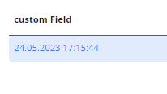
=== "Виджет Info"
    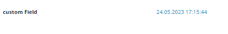
=== "Виджет Form"
    _неприменимо_

### Как добавить? { #how-to-add_5 }
??? Example "Пример"

    **Вариант 1**

    `Шаг 1` Добавьте [fields.setDrilldown](/ru/features/element/drilldown/drilldown) в соответствующий **FieldMetaBuilder**.
    ```java
    --8<--
    {{ external_links.github_raw_doc }}/fields/datetimewithseconds/drilldown/DateTimeWithSecondsDrillDownMeta.java:buildRowDependentMeta
    --8<--
    ``` 

    === "Виджет List"
        `Шаг 2` Добавьте **"drillDown": "true"** в .widget.json.
        ```json
        --8<--
        {{ external_links.github_raw_doc }}/fields/datetimewithseconds/drilldown/DateTimeWithSecondsDrillDownList.widget.json
        --8<--
        ```

        **Вариант 2**
           Добавьте **"drillDownKey"** :  `собственное поле` в .widget.json. Подробнее см. [Drilldown](/ru/features/element/drilldown/drilldown)
 
    === "Виджет Info"

        `Шаг 2` Добавьте **"drillDown": "true"** в .widget.json.

        ```json
        --8<--
        {{ external_links.github_raw_doc }}/fields/datetimewithseconds/drilldown/DateTimeWithSecondsDrillDownInfo.widget.json
        --8<--
        ```
        **Вариант 2**
           Добавьте **"drillDownKey"** :  `собственное поле` в .widget.json. Подробнее см. [Drilldown](/ru/features/element/drilldown/drilldown)
 
    === "Виджет Form"
        _неприменимо_

    [:material-play-circle: Живой пример]({{ external_links.code_samples }}/ui/#/screen/DateTimeWithSecondsDrillDown){:target="_blank"} ·
    [:fontawesome-brands-github: GitHub]({{ external_links.github_ui }}/{{ external_links.github_branch }}/src/main/java/org/demo/documentation/fields/datetimewithseconds/drilldown){:target="_blank"}

[Расширенная настройка](/ru/features/element/drilldown/drilldown)

## Валидация { #validation }
`Validation` позволяет проверять любые бизнес-правила для введённого пользователем значения. Типы валидации:

1) Exception: отображает сообщение, уведомляющее пользователя о технических или бизнес-ошибках.

   `Business Exception`:
   [:material-play-circle: Живой пример]({{ external_links.code_samples }}/ui/#/screen/myexample300){:target="_blank"} ·
   [:fontawesome-brands-github: GitHub]({{ external_links.github_ui }}/{{ external_links.github_branch }}/src/main/java/org/demo/documentation/fields/datetimewithseconds/validationbusinessex){:target="_blank"}

   `Runtime Exception`:
   [:material-play-circle: Живой пример]({{ external_links.code_samples }}/ui/#/screen/DateTimeWithSecondsValidationRuntimeExEntity){:target="_blank"} ·
   [:fontawesome-brands-github: GitHub]({{ external_links.github_ui }}/{{ external_links.github_branch }}/src/main/java/org/demo/documentation/fields/datetimewithseconds/validationruntimeex){:target="_blank"}
   
2) Confirm: показывает диалог с необязательным сообщением, требующий от пользователя подтверждения или отмены перед продолжением.

   [:material-play-circle: Живой пример]({{ external_links.code_samples }}/ui/#/screen/DateTimeWithSecondsValidationBusinessEx){:target="_blank"} ·
   [:fontawesome-brands-github: GitHub]({{ external_links.github_ui }}/{{ external_links.github_branch }}/src/main/java/org/demo/documentation/fields/datetimewithseconds/validationconfirm){:target="_blank"}

3) Валидация на уровне полей: показывает ошибку рядом со всеми полями, не прошедшими проверку

   `Option 1`:
   [:material-play-circle: Живой пример]({{ external_links.code_samples }}/ui/#/screen/myexample167){:target="_blank"} ·
   [:fontawesome-brands-github: GitHub]({{ external_links.github_ui }}/{{ external_links.github_branch }}/src/main/java/org/demo/documentation/fields/datetimewithseconds/validationannotation){:target="_blank"}

   `Option 2`:
   [:material-play-circle: Живой пример]({{ external_links.code_samples }}/ui/#/screen/myexample322){:target="_blank"} ·
   [:fontawesome-brands-github: GitHub]({{ external_links.github_ui }}/{{ external_links.github_branch }}/src/main/java/org/demo/documentation/fields/datetimewithseconds/validationdynamic){:target="_blank"}

### Как это выглядит? { #how-does-it-look_6 }
=== "Виджет List"
    === "BusinessException"
        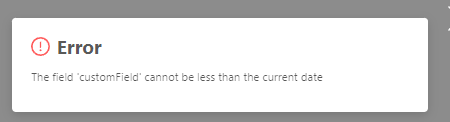
    === "RuntimeException"
        
    === "Confirm"
        
    === "Валидация на уровне полей"
        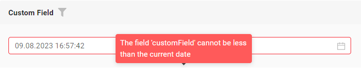
=== "Виджет Info"
    _неприменимо_
=== "Виджет Form"
    === "BusinessException"
        
    === "RuntimeException"
        
    === "Confirm"
        
    === "Валидация на уровне полей"
        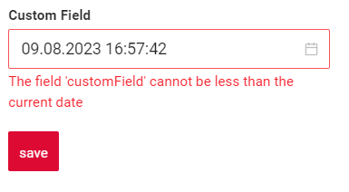


### Как добавить? { #how-to-add_6 }
??? Example "Пример"
    === "BusinessException"
        `BusinessException` описывает ошибку в рамках бизнес-процесса.
        
        Добавьте **BusinessException** в соответствующий **VersionAwareResponseService**.
        ```java
        --8<--
        {{ external_links.github_raw_doc }}/fields/datetimewithseconds/validationbusinessex/MyExample300Service.java:doUpdateEntity
        --8<--
        ```

        === "Виджет List"
            **Работает для List.**
        === "Виджет Info"
            **_неприменимо_**
        === "Виджет Form"
            **Работает для Form.**

        [:material-play-circle: Живой пример]({{ external_links.code_samples }}/ui/#/screen/myexample300){:target="_blank"} ·
        [:fontawesome-brands-github: GitHub]({{ external_links.github_ui }}/{{ external_links.github_branch }}/src/main/java/org/demo/documentation/fields/datetimewithseconds/validationbusinessex){:target="_blank"}

    === "RuntimeException"

        `RuntimeException` описывает техническую ошибку в рамках бизнес-процесса.
        
        Добавьте **RuntimeException** в соответствующий **VersionAwareResponseService**.
        ```java
        --8<--
        {{ external_links.github_raw_doc }}/fields/datetimewithseconds/validationruntimeex/DateTimeWithSecondsValidationRuntimeExEntityService.java:doUpdateEntity
        --8<--
        ```        
        === "Виджет List"
            **Работает для List.**
        === "Виджет Info"
            **_неприменимо_**
        === "Виджет Form"
            **Работает для Form.**

        [:material-play-circle: Живой пример]({{ external_links.code_samples }}/ui/#/screen/DateTimeWithSecondsValidationRuntimeExEntity){:target="_blank"} ·
        [:fontawesome-brands-github: GitHub]({{ external_links.github_ui }}/{{ external_links.github_branch }}/src/main/java/org/demo/documentation/fields/datetimewithseconds/validationruntimeex){:target="_blank"}

    === "Confirm"
        Добавьте `PreAction.confirm` в соответствующий **VersionAwareResponseService**.
        ```java
        --8<--
        {{ external_links.github_raw_doc }}/fields/datetimewithseconds/validationconfirm/DateTimeWithSecondsValidationBusinessExService.java:getActions
        --8<--
        ```

        === "Виджет List"
            **Работает для List.**
        === "Виджет Info"
            **_неприменимо_**
        === "Виджет Form"
            **Работает для Form.**
        
        [:material-play-circle: Живой пример]({{ external_links.code_samples }}/ui/#/screen/DateTimeWithSecondsValidationBusinessEx){:target="_blank"} ·
        [:fontawesome-brands-github: GitHub]({{ external_links.github_ui }}/{{ external_links.github_branch }}/src/main/java/org/demo/documentation/fields/datetimewithseconds/validationconfirm){:target="_blank"}

    === "Валидация на уровне полей"
        === "Вариант 1"
            Добавьте javax.validation в соответствующий **DataResponseDTO**.

            Используйте, если:

            Нужна простая проверка полей (javax validation)
            ```java
            --8<--
            {{ external_links.github_raw_doc }}/fields/datetimewithseconds/validationannotation/MyExample167DTO.java
            --8<--
            ```

            === "Виджет List"
                **Работает для List.**
            === "Виджет Info"
                **_неприменимо_**
            === "Виджет Form"
                **Работает для Form.**
            
            [:material-play-circle: Живой пример]({{ external_links.code_samples }}/ui/#/screen/myexample167){:target="_blank"} ·
            [:fontawesome-brands-github: GitHub]({{ external_links.github_ui }}/{{ external_links.github_branch }}/src/main/java/org/demo/documentation/fields/datetimewithseconds/validationannotation){:target="_blank"}

        === "Вариант 2"
            Создайте собственный сервис для проверки бизнес-логики.

            Используйте, если:

            Для полей требуется проверка бизнес-логики

            `Шаг 1`  Создайте собственный метод проверки.
            ```java
            --8<--
            {{ external_links.github_raw_doc }}/fields/datetimewithseconds/validationdynamic/MyExample322Service.java:validateFields
            --8<--
            ```
 
            `Шаг 2` Добавьте собственный метод проверки в соответствующий **VersionAwareResponseService**.
            ```java
            --8<--
            {{ external_links.github_raw_doc }}/fields/datetimewithseconds/validationdynamic/MyExample322Service.java:doUpdateEntity
            --8<--
            ```

            [:material-play-circle: Живой пример]({{ external_links.code_samples }}/ui/#/screen/myexample322){:target="_blank"} ·
            [:fontawesome-brands-github: GitHub]({{ external_links.github_ui }}/{{ external_links.github_branch }}/src/main/java/org/demo/documentation/fields/datetimewithseconds/validationdynamic){:target="_blank"}

## Сортировка { #sorting }
[:material-play-circle: Живой пример]({{ external_links.code_samples }}/ui/#/screen/DateTimeWithSecondsSorting){:target="_blank"} ·
[:fontawesome-brands-github: GitHub]({{ external_links.github_ui }}/{{ external_links.github_branch }}/src/main/java/org/demo/documentation/fields/datetimewithseconds/sorting){:target="_blank"}

`Sorting` позволяет сортировать данные по возрастанию или убыванию.

### Как это выглядит? { #how-does-it-look_7 }
=== "Виджет List"
    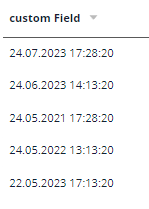
=== "Виджет Info"
    _неприменимо_
=== "Виджет Form"
    _неприменимо_
### Как добавить? { #how-to-add_7 }
??? Example "Пример"
    === "Виджет List"
        подробнее см. [Сортировка](/ru/widget/type/property/sorting/sorting)

        **Шаг 1**  Добавьте **fields.enableSort** в соответствующий **FieldMetaBuilder**.
        ```java
        --8<--
        {{ external_links.github_raw_doc }}/fields/datetimewithseconds/sorting/DateTimeWithSecondsSortingMeta.java:buildIndependentMeta
        --8<--
        ```
 
        [:material-play-circle: Живой пример]({{ external_links.code_samples }}/ui/#/screen/DateTimeWithSecondsSorting){:target="_blank"} ·
        [:fontawesome-brands-github: GitHub]({{ external_links.github_ui }}/{{ external_links.github_branch }}/src/main/java/org/demo/documentation/fields/datetimewithseconds/sorting){:target="_blank"}

    === "Виджет Info"
        _неприменимо_
    === "Виджет Form"
        _неприменимо_

## Обязательность { #required }
[:material-play-circle: Живой пример]({{ external_links.code_samples }}/ui/#/screen/DateTimeWithSecondsRequred){:target="_blank"} ·
[:fontawesome-brands-github: GitHub]({{ external_links.github_ui }}/{{ external_links.github_branch }}/src/main/java/org/demo/documentation/fields/datetimewithseconds/required){:target="_blank"}

`Required` позволяет указать, что поле обязательно должно иметь значение.
### Как это выглядит? { #how-does-it-look_8 }
=== "Виджет List"
    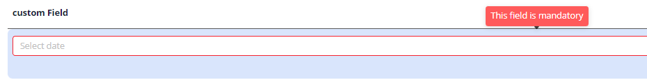
=== "Виджет Info"
    _неприменимо_
=== "Виджет Form"
    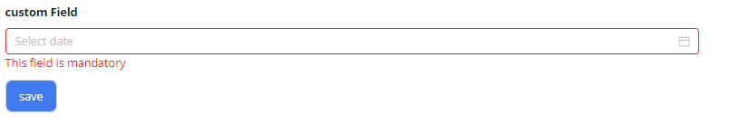
### Как добавить? { #how-to-add_8 }
??? Example "Пример"
    Добавьте **fields.setRequired** в соответствующий **FieldMetaBuilder**.
    ```java
    --8<--
    {{ external_links.github_raw_doc }}/fields/datetimewithseconds/required/DateTimeWithSecondsRequredMeta.java:buildRowDependentMeta
    --8<--
    ```

    === "Виджет List"
        **Работает для List.**
    === "Виджет Info"
        **_неприменимо_**
    === "Виджет Form"
        **Работает для Form.**

    [:material-play-circle: Живой пример]({{ external_links.code_samples }}/ui/#/screen/DateTimeWithSecondsRequred){:target="_blank"} ·
    [:fontawesome-brands-github: GitHub]({{ external_links.github_ui }}/{{ external_links.github_branch }}/src/main/java/org/demo/documentation/fields/datetimewithseconds/required){:target="_blank"}
