# Dictionary

`Dictionary` — компонент, позволяющий выбрать одно значение из выпадающего списка.

!!! tips "Совет"
    Используйте для справочников или медленно растущих сущностей, например не более 1000 значений (все значения загружаются в память). В противном случае используйте [inlinePickList](/ru/widget/fields/field/inlinePickList/inlinePickList)

## Основы { #basics }
[:material-play-circle: Живой пример]({{ external_links.code_samples }}/ui/#/screen/myexample70){:target="_blank"} ·
[:fontawesome-brands-github: GitHub]({{ external_links.github_ui }}/{{ external_links.github_branch }}/src/main/java/org/demo/documentation/fields/dictionary/basic){:target="_blank"}

Dictionary можно настроить через:

* Enum
* Dictionary (начиная с [релиза 2.0.9](https://doc.cxbox.org/ru/new/version209/"))
* `Не рекомендуется.` LOV — устарел (начиная с [релиза 2.0.9](https://doc.cxbox.org/ru/new/version209/"))

`Dictionary` позволяет добавлять, удалять и изменять значения через административный интерфейс, поэтому он должен оставаться независимым от бизнес-логики.

Если справочник связан с бизнес-логикой, рекомендуется использовать `Enum`, чтобы исключить изменение или удаление через панель администрирования.

### Как это выглядит? { #how-does-it-look }

=== "Виджет List"
    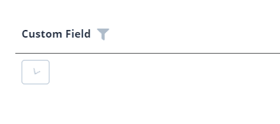
=== "Виджет Info"
    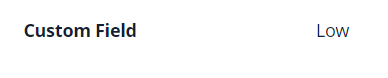
=== "Виджет Form"
    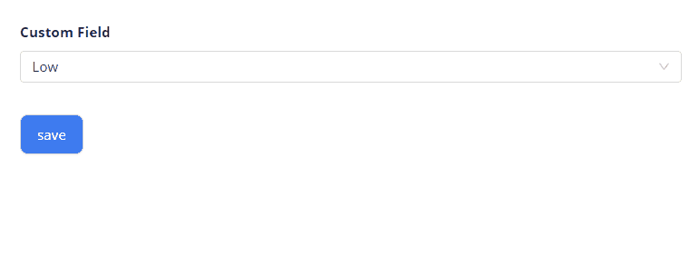


### <a id="basics_how_to_add">Как добавить?</a>
??? Example "Пример"
    === "Enum"
        === "С плагином (рекомендуется)"
            **Шаг 1** Скачайте плагин
                [скачать плагин для IntelliJ](https://doc.cxbox.org/ru/plugin/plugininstalling)
        
            **Шаг 2** Добавьте поле dictionary в существующий виджет формы
                

        === "Пример написания кода"
            Добавьте поле в **_.widget.json_**.

            - **Шаг 1** Создайте Enum. Рекомендуемая практика: хранить в базе данных имя enum и использовать отдельное поле для значений, отображаемых в UI
                ```java
                --8<--
                {{ external_links.github_raw_doc }}/fields/dictionary/basic/enums/CustomFieldEnum.java
                --8<--
                ```
            - **Шаг 2** Добавьте поле **Enum** в соответствующий **BaseEntity**.
        
            ```java
                --8<--
                {{ external_links.github_raw_doc }}/fields/dictionary/basic/MyEntity70.java
                --8<--
            ```
       
            - **Шаг 3** Добавьте поле **Enum** в соответствующий **DataResponseDTO**.
        
            ```java
                --8<--
                {{ external_links.github_raw_doc }}/fields/dictionary/basic/MyExample70DTO.java
                --8<--
            ```
    
            - **Шаг 4** Используйте **fields.setEnumValues** в соответствующем **FieldMetaBuilder**, чтобы фронтенд получал список значений в методе **/row-meta**
                в теге **"values"**.
                
                Если список значений зависит от родительского поля, используйте fields.setEnumValues в методе buildRowDependentMeta,
                чтобы задавать его динамически на основе родителя.

            ```java
            --8<--
            {{ external_links.github_raw_doc }}/fields/dictionary/basic/MyExample70Meta.java:buildIndependentMeta
            --8<--
            ```
    
            === "Виджет List"
                - **Шаг 5** Добавьте в **_.widget.json_**.
    
                ```json
                --8<--
                {{ external_links.github_raw_doc }}/fields/dictionary/basic/MyExample70List.widget.json
                --8<--
                ```
    
                [:material-play-circle: Живой пример]({{ external_links.code_samples }}/ui/#/screen/myexample70){:target="_blank"} ·
                [:fontawesome-brands-github: GitHub]({{ external_links.github_ui }}/{{ external_links.github_branch }}/src/main/java/org/demo/documentation/fields/dictionary/basic){:target="_blank"}
    
            === "Виджет Info"
                - **Шаг 5** Добавьте в **_.widget.json_**.
            
                ```json
                --8<--
                {{ external_links.github_raw_doc }}/fields/dictionary/basic/MyExample70Info.widget.json
                --8<--
                ```
    
                [:material-play-circle: Живой пример]({{ external_links.code_samples }}/ui/#/screen/myexample70){:target="_blank"} ·
                [:fontawesome-brands-github: GitHub]({{ external_links.github_ui }}/{{ external_links.github_branch }}/src/main/java/org/demo/documentation/fields/dictionary/basic){:target="_blank"}
        
            === "Виджет Form"
        
                - **Шаг 5** Добавьте в **_.widget.json_**.
            
                ```json
                --8<--
                {{ external_links.github_raw_doc }}/fields/dictionary/basic/MyExample70Form.widget.json
                --8<--
                ```  
    
                [:material-play-circle: Живой пример]({{ external_links.code_samples }}/ui/#/screen/myexample70){:target="_blank"} ·
                [:fontawesome-brands-github: GitHub]({{ external_links.github_ui }}/{{ external_links.github_branch }}/src/main/java/org/demo/documentation/fields/dictionary/basic){:target="_blank"}
    
    === "Dictionary" 
        (начиная с [релиза 2.0.9](https://doc.cxbox.org/ru/new/version209/"))

        **Шаг 1.**  Настраиваемый справочник. Добавьте описание и значения справочника в **DICTIONARY.csv**.

        ```csv
        TYPE;KEY;VALUE;DISPLAY_ORDER;DESCRIPTION;ACTIVE;ID
        REGIONS;MOSCOW;Moscow;;;;
        REGIONS;SAINT PETERBURG;St. Petersburg;;;;
        REGIONS;KOSTROMA;Kostroma;1;;;
        REGIONS;SYKTYVKAR;Syktyvkar;2;;;
        REGIONS;NewYork;New York;3;;;
        ```
 
        **Шаг 2.**  Создайте record с именем типа справочника, **реализующий Dictionary** (если тип справочника содержит подчёркивания,
                его имя преобразуется в CamelCase: подчёркивания удаляются, а первая буква каждого слова делается заглавной.)
        
        ```java
        --8<--
        {{ external_links.github_raw_doc }}/fields/dictionary/dictionarydictionary/basic/Regions.java
        --8<--
        ```
        
        **Шаг 3.** Добавьте поле с новым record в соответствующий **BaseEntity**.
        
        ```java
        --8<--
        {{ external_links.github_raw_doc }}/fields/dictionary/dictionarydictionary/basic/MyEntity352.java
        --8<--
        ```
        
        **Шаг 4.** Добавьте поле с новым record в соответствующий **DataResponseDTO**.

        !!! info
            если ваш микросервис использует hibernate, добавьте зависимость, которая позволит использовать org.cxbox.dictionary.hibernate.DictionaryType для колонки сущности, например @Type(DictionaryType.class):
            ```xml            
            <dependency>  
                <groupId>org.cxbox</groupId> 
                <artifactId>cxbox-dictionary-hibernate</artifactId> 
            </dependency>
            ```

            Также можно включить автоматическую регистрацию типов, задав org.cxbox.dictionary.enable_types_contributor=true в свойствах hibernate, например в spring:
            ```xml   
            <dependency>   
                <groupId>org.cxbox</groupId> 
                <artifactId>cxbox-dictionary-api</artifactId> 
            </dependency>
            ```

            ```
            spring: 
              jpa:   
                properties:  
                  org:       
                    cxbox:        
                      dictionary:         
                        enable_types_contributor: true
            ```

            тогда @Type(DictionaryType.class) для колонки можно не указывать, так как система зарегистрирует тип для всех реализаций Dictionary.
            функция enable_types_contributor экспериментальная — в качестве запасного варианта используйте @Type(DictionaryType.class) для колонки сущности

        ```java
        --8<--
        {{ external_links.github_raw_doc }}/fields/dictionary/dictionarydictionary/basic/MyExample352DTO.java
         --8<--
        ```
            
        **Шаг 5.** Используйте **fields.setDictionaryValues** в соответствующем **FieldMetaBuilder**, чтобы фронтенд получал список значений в методе **/row-meta**
                в теге **"values"**.

        Если список значений зависит от родительского поля, используйте fields.setEnumValues в методе buildRowDependentMeta,
                чтобы задавать его динамически на основе родителя.

        ```java
        --8<--
        {{ external_links.github_raw_doc }}/fields/dictionary/dictionarydictionary/basic/MyExample352Meta.java:buildRowDependentMeta
        --8<--
        ```
            
        **Шаг 6.** Добавьте **fields.setDictionaryFilterValues** в соответствующий **FieldMetaBuilder**.
        
        Фронтенду нужно передать все данные справочника в теге values метода /row-meta.
        Если список значений зависит от родителя, для этого следует использовать метод buildIndependentMeta.

        ```java
        --8<--
        {{ external_links.github_raw_doc }}/fields/dictionary/dictionarydictionary/basic/MyExample352Meta.java:buildIndependentMeta
        --8<--
        ```
        === "Виджет List"
            **Шаг 7.** Добавьте в **_.widget.json_**.
        
            ```json
            --8<--
            {{ external_links.github_raw_doc }}/fields/dictionary/dictionarydictionary/basic/MyExample352List.widget.json
            --8<--
            ```
        
            [:material-play-circle: Живой пример]({{ external_links.code_samples }}/ui/#/screen/myexample352){:target="_blank"} ·
            [:fontawesome-brands-github: GitHub]({{ external_links.github_ui }}/{{ external_links.github_branch }}/src/main/java/org/demo/documentation/fields/dictionary/dictionarydictionary/basic){:target="_blank"}
        
        === "Виджет Info"
            **Шаг 7.** Добавьте в **_.widget.json_**.
        
            ```json
            --8<--
            {{ external_links.github_raw_doc }}/fields/dictionary/dictionarydictionary/basic/MyExample352Info.widget.json
            --8<--
            ```
        
            [:material-play-circle: Живой пример]({{ external_links.code_samples }}/ui/#/screen/myexample352){:target="_blank"} ·
            [:fontawesome-brands-github: GitHub]({{ external_links.github_ui }}/{{ external_links.github_branch }}/src/main/java/org/demo/documentation/fields/dictionary/dictionarydictionary/basic){:target="_blank"}
         
        === "Виджет Form"
        
            **Шаг 7.** Добавьте в **_.widget.json_**.
        
            ```json
            --8<--
            {{ external_links.github_raw_doc }}/fields/dictionary/dictionarydictionary/basic/MyExample352Form.widget.json
            --8<--
            ```  
        
            [:material-play-circle: Живой пример]({{ external_links.code_samples }}/ui/#/screen/myexample352){:target="_blank"} ·
            [:fontawesome-brands-github: GitHub]({{ external_links.github_ui }}/{{ external_links.github_branch }}/src/main/java/org/demo/documentation/fields/dictionary/dictionarydictionary/basic){:target="_blank"}
        
        **Шаг 8.**  Добавьте bean DictionaryProvider. Подключите его в приложение один раз.

        ```java
        import java.util.Collection;
        import lombok.NonNull;
        import org.cxbox.api.data.dictionary.DictionaryCache;
        import org.cxbox.api.data.dictionary.SimpleDictionary;
        import org.cxbox.dictionary.Dictionary;
        import org.cxbox.dictionary.DictionaryProvider;
        import org.springframework.context.annotation.Bean;
        import org.springframework.context.annotation.Configuration;
        
        @Configuration
        public class DictionaryConfig {
        
            @Bean
            public DictionaryProvider dictionaryProvider() {
                return new DictionaryProvider() {
        
                    @Override
                    public <T extends Dictionary> T lookupName(@NonNull Class<T> type, @NonNull DictionaryValue value) {
                        var dictTmp = Dictionary.of(type, "");
                        var lov = DictionaryCache.dictionary().lookupName(value.getValue(), dictTmp.getDictionaryType());
                        return Dictionary.of(type, lov.getKey());
                    }
        
                    @Override
                    public <T extends Dictionary> SimpleDictionary lookupValue(@NonNull T dictionary) {
                        return DictionaryCache.dictionary().get(dictionary.getDictionaryType(), dictionary.key());
                    }
        
                    @Override
                    public <T extends Dictionary> Collection<T> getAll(@NonNull Class<T> dictionaryType) {
                        return DictionaryCache.dictionary().getAll(Dictionary.of(dictionaryType, "").getDictionaryType())
                                .stream()
                                .map(e -> Dictionary.of(dictionaryType, e.getKey()))
                                .toList();
                    }
                };
            }
        
        }
        ```

    === "LOV устарел, рекомендуется Dictionary"

        - **Шаг 1. LOV** Создайте LOV

            +  **Шаг 1.1** Добавьте тип LOV в **CXBOX-DICTIONARY_TYPE.csv**.
 
                ```csv
                ID;TYPE;TYPE_DESC
                200;REGIONS;Regions
                ```
            +  **Шаг 1.2** Добавьте описание и значения LOV в **CXBOX-DICTIONARY_ITEM.csv**.

                ```csv
                "300";200;"REGIONS";"MOSCOW";"Moscow";true;0;null
                "301";200;"REGIONS";"SAINT PETERBURG";"St. Petersburg";true;1;null
                "302";200;"REGIONS";"KOSTROMA";"Kostroma";true;2;null
                "303";200;"REGIONS";"SYKTYVKAR";"Syktyvkar";true;3;null
                ```
            +  **Шаг 1.3** Добавьте соответствующий язык в управление изменениями базы данных **DICTIONARY_ITEM_TR**.
            
                  ```xml
                  <changeSet id="ADD LANGUAGE DICTIONARY_ITEM_TR" author="initial">
                    <sql>
                      insert into DICTIONARY_ITEM_TR (ID, LANGUAGE, VALUE)
                      select ID, 'en' as LANGUAGE, VALUE as VALUE
                      from DICTIONARY_ITEM;
                    </sql>
                    <sql>
                      insert into DICTIONARY_ITEM_TR (ID, LANGUAGE, VALUE)
                      select ID, 'ru' as LANGUAGE, VALUE as VALUE
                      from DICTIONARY_ITEM;
                    </sql>
                  </changeSet>
                  ```
            +  **Шаг 1.4** Добавьте в проект AdministeredDictionary
    
                ```java
                --8<--
                {{ external_links.github_raw_doc }}/fields/dictionary/dictionarydictionary/old/AdministeredDictionaryOld.java
                --8<--
                ```
            +  **Шаг 1.5**  Добавьте в проект AdministeredDictionaryType
    
                ```java
                @Getter
                @RequiredArgsConstructor
                public enum AdministeredDictionaryType implements Serializable, IDictionaryType {
                
                    @Override
                    public LOV lookupName(String val) {
                        return dictionary().lookupName(val, this);
                    }
                
                    @Override
                    public String lookupValue(LOV lov) {
                        return dictionary().lookupValue(lov, this);
                    }
                
                    @Override
                    public String getName() {
                        return name();
                    }
                
                    public boolean containsKey(String key) {
                        return dictionary().containsKey(key, this);
                    }
                
                }
                ```
            + **Шаг 1.6**  Добавьте **LOV** (REGIONS) в AdministeredDictionaryType
                ```java
                @Getter
                @RequiredArgsConstructor
                public enum AdministeredDictionaryType implements Serializable, IDictionaryType {
                
                    REGIONS;
    
                    @Override
                    public LOV lookupName(String val) {
                        return dictionary().lookupName(val, this);
                    }
                
                    @Override
                    public String lookupValue(LOV lov) {
                        return dictionary().lookupValue(lov, this);
                    }
                
                    @Override
                    public String getName() {
                        return name();
                    }
                
                    public boolean containsKey(String key) {
                        return dictionary().containsKey(key, this);
                    }
                
                }
                ```

        - **Шаг 2**  Добавьте поле **LOV** в соответствующий **BaseEntity**.
    
        ```java
        --8<--
        {{ external_links.github_raw_doc }}/fields/dictionary/dictionarydictionary/old/basic/MyEntity350.java
        --8<--
        ```
    
        - **Шаг 3** Добавьте поле **String** в соответствующий **DataResponseDTO**.
    
        ```java
        --8<--
        {{ external_links.github_raw_doc }}/fields/dictionary/dictionarydictionary/old/basic/MyExample350DTO.java
        --8<--
        ```

        - **Шаг 4** Добавьте **fields.setDictionaryTypeWithAllValues** в соответствующий **FieldMetaBuilder**.

        Фронтенду нужно передать все данные справочника в теге values метода /row-meta.
        Если список значений зависит от родителя, для этого следует использовать метод buildRowDependentMeta.

        ```java
        --8<--
        {{ external_links.github_raw_doc }}/fields/dictionary/dictionarydictionary/old/basic/MyExample350Meta.java:buildIndependentMeta
        --8<--
        ```
    
        === "Виджет List"
            - **Шаг 5** Добавьте в **_.widget.json_**.

            ```json
                --8<--
                {{ external_links.github_raw_doc }}/fields/dictionary/dictionarydictionary/old/basic/MyExample350List.widget.json
                --8<--
            ```

            [:material-play-circle: Живой пример]({{ external_links.code_samples }}/ui/#/screen/myexample350){:target="_blank"} ·
            [:fontawesome-brands-github: GitHub]({{ external_links.github_ui }}/{{ external_links.github_branch }}/src/main/java/org/demo/documentation/fields/dictionary/dictionarydictionary/old/basic){:target="_blank"}
     
        === "Виджет Info"
            - **Шаг 5** Добавьте в **_.widget.json_**.
        
            ```json
            --8<--
            {{ external_links.github_raw_doc }}/fields/dictionary/dictionarydictionary/old/basic/MyExample350Info.widget.json
            --8<--
            ```

            [:material-play-circle: Живой пример]({{ external_links.code_samples }}/ui/#/screen/myexample350){:target="_blank"} ·
            [:fontawesome-brands-github: GitHub]({{ external_links.github_ui }}/{{ external_links.github_branch }}/src/main/java/org/demo/documentation/fields/dictionary/dictionarydictionary/old/basic){:target="_blank"}
         
        === "Виджет Form"
    
            - **Шаг 5** Добавьте в **_.widget.json_**.
        
            ```json
            --8<--
            {{ external_links.github_raw_doc }}/fields/dictionary/dictionarydictionary/old/basic/MyExample350Form.widget.json
            --8<--
            ```  

            [:material-play-circle: Живой пример]({{ external_links.code_samples }}/ui/#/screen/myexample350){:target="_blank"} ·
            [:fontawesome-brands-github: GitHub]({{ external_links.github_ui }}/{{ external_links.github_branch }}/src/main/java/org/demo/documentation/fields/dictionary/dictionarydictionary/old/basic){:target="_blank"}

    Как отсортировать значения в выпадающем списке или для фильтрации?
    
    см. [Сортировка](#sort)

## Placeholder
[:material-play-circle: Живой пример]({{ external_links.code_samples }}/ui/#/screen/myexample88){:target="_blank"} ·
[:fontawesome-brands-github: GitHub]({{ external_links.github_ui }}/{{ external_links.github_branch }}/src/main/java/org/demo/documentation/fields/dictionary/placeholder){:target="_blank"}

`Placeholder` позволяет задать краткую подсказку об ожидаемом значении. Подсказка отображается до ввода пользователем. Её можно вычислять на основе бизнес-логики приложения. Она отображается и для поля `Readonly`.
### Как это выглядит? { #how-does-it-look_1 }
=== "Виджет List"
    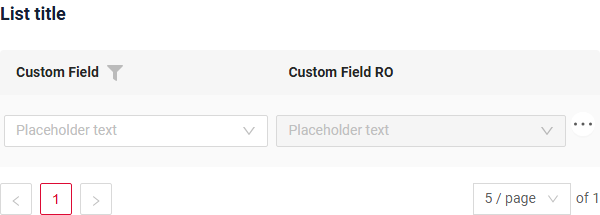
=== "Виджет Info"
    _неприменимо_
=== "Виджет Form"
    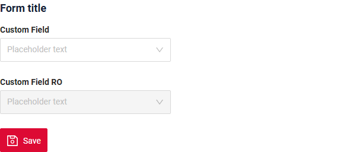
### Как добавить? { #how-to-add }
??? Example "Пример"
    Добавьте **fields.setPlaceholder** в соответствующий **FieldMetaBuilder**.

    ```java
    --8<--
    {{ external_links.github_raw_doc }}/fields/dictionary/placeholder/MyExample88Meta.java:buildRowDependentMeta
    --8<--
    ```  
    === "Виджет List"
        **Работает для List.**

        [:material-play-circle: Живой пример]({{ external_links.code_samples }}/ui/#/screen/myexample88){:target="_blank"} ·
        [:fontawesome-brands-github: GitHub]({{ external_links.github_ui }}/{{ external_links.github_branch }}/src/main/java/org/demo/documentation/fields/dictionary/placeholder){:target="_blank"}
    === "Виджет Info"
        **_неприменимо_**
    === "Виджет Form"
        **Работает для Form.**

        [:material-play-circle: Живой пример]({{ external_links.code_samples }}/ui/#/screen/myexample88){:target="_blank"} ·
        [:fontawesome-brands-github: GitHub]({{ external_links.github_ui }}/{{ external_links.github_branch }}/src/main/java/org/demo/documentation/fields/dictionary/placeholder){:target="_blank"}


## Цвет { #color }
`Color` позволяет задать цвет поля. Его можно вычислять на основе бизнес-логики приложения

**Вычисляемый цвет**

[:material-play-circle: Живой пример]({{ external_links.code_samples }}/ui/#/screen/myexample71){:target="_blank"} ·
[:fontawesome-brands-github: GitHub]({{ external_links.github_ui }}/{{ external_links.github_branch }}/src/main/java/org/demo/documentation/fields/dictionary/color){:target="_blank"}

**Постоянный цвет**

[:material-play-circle: Живой пример]({{ external_links.code_samples }}/ui/#/screen/myexample84){:target="_blank"} ·
[:fontawesome-brands-github: GitHub]({{ external_links.github_ui }}/{{ external_links.github_branch }}/src/main/java/org/demo/documentation/fields/dictionary/colorconst){:target="_blank"}

### Как это выглядит? { #how-does-it-look_2 }
=== "Виджет List"
    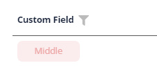
=== "Виджет Info"
    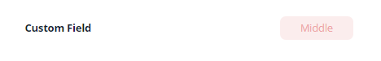
=== "Виджет Form"
    _неприменимо_


### Как добавить? { #how-to-add_1 }
??? Example "Пример"
    === "Вычисляемый цвет"
   
        **Шаг 1**   Добавьте `собственное поле для цвета` в соответствующий **DataResponseDTO**. Поле может содержать цвет в формате HEX или быть null.
        ```java
        --8<--
        {{ external_links.github_raw_doc }}/fields/dictionary/color/MyExample71DTO.java
        --8<--
        ```    
 
        === "Виджет List"
            **Шаг 2** Добавьте **"bgColorKey"** :  `собственное поле для цвета` в .widget.json.
            ```json
            --8<--
            {{ external_links.github_raw_doc }}/fields/dictionary/color/MyExample71List.widget.json
            --8<--
            ```

            [:material-play-circle: Живой пример]({{ external_links.code_samples }}/ui/#/screen/myexample71){:target="_blank"} ·
            [:fontawesome-brands-github: GitHub]({{ external_links.github_ui }}/{{ external_links.github_branch }}/src/main/java/org/demo/documentation/fields/dictionary/color){:target="_blank"}

        === "Виджет Info"
            **Шаг 2** Добавьте **"bgColorKey"** :  `собственное поле для цвета` в .widget.json.
            ```json
            --8<--
            {{ external_links.github_raw_doc }}/fields/dictionary/color/MyExample71Info.widget.json
            --8<--
            ```

            [:material-play-circle: Живой пример]({{ external_links.code_samples }}/ui/#/screen/myexample71){:target="_blank"} ·
            [:fontawesome-brands-github: GitHub]({{ external_links.github_ui }}/{{ external_links.github_branch }}/src/main/java/org/demo/documentation/fields/dictionary/color){:target="_blank"}

        === "Виджет Form"
            _неприменимо_
    === "Постоянный цвет"
        === "Виджет List"
            Добавьте **"bgColor"** :  `цвет HEX` в .widget.json.
            ```json
            --8<--
            {{ external_links.github_raw_doc }}/fields/dictionary/colorconst/MyExample84List.widget.json
            --8<--
            ```

            [:material-play-circle: Живой пример]({{ external_links.code_samples }}/ui/#/screen/myexample84){:target="_blank"} ·
            [:fontawesome-brands-github: GitHub]({{ external_links.github_ui }}/{{ external_links.github_branch }}/src/main/java/org/demo/documentation/fields/dictionary/colorconst){:target="_blank"}

        === "Виджет Info"

            Добавьте **"bgColor"** :  `цвет HEX` в .widget.json.
            ```json
            --8<--
            {{ external_links.github_raw_doc }}/fields/dictionary/colorconst/MyExample84Info.widget.json
            --8<--
            ```

            [:material-play-circle: Живой пример]({{ external_links.code_samples }}/ui/#/screen/myexample84){:target="_blank"} ·
            [:fontawesome-brands-github: GitHub]({{ external_links.github_ui }}/{{ external_links.github_branch }}/src/main/java/org/demo/documentation/fields/dictionary/colorconst){:target="_blank"}

        === "Виджет Form"
            _неприменимо_

## Только чтение/Редактирование { #readonlyeditable }
`Readonly/Editable` указывает, можно ли редактировать поле. Это можно вычислять на основе бизнес-логики приложения

`Editable`
[:material-play-circle: Живой пример]({{ external_links.code_samples }}/ui/#/screen/myexample70){:target="_blank"} ·
[:fontawesome-brands-github: GitHub]({{ external_links.github_ui }}/{{ external_links.github_branch }}/src/main/java/org/demo/documentation/fields/dictionary/basic){:target="_blank"}

`Readonly`
[:material-play-circle: Живой пример]({{ external_links.code_samples }}/ui/#/screen/myexample85){:target="_blank"} ·
[:fontawesome-brands-github: GitHub]({{ external_links.github_ui }}/{{ external_links.github_branch }}/src/main/java/org/demo/documentation/fields/dictionary/ro){:target="_blank"}


### Как это выглядит? { #how-does-it-look_3 }
=== "Редактирование"
    === "Виджет List"
        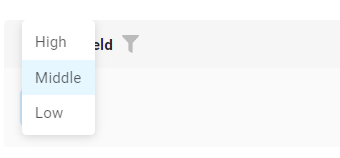
    === "Виджет Info"
        _неприменимо_
    === "Виджет Form"
        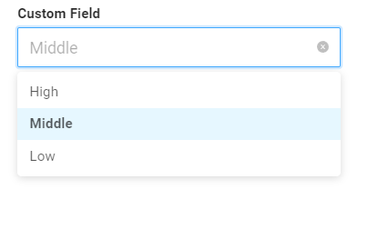
=== "Только чтение"
    === "Виджет List"
        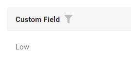
    === "Виджет Info"
        
    === "Виджет Form"
        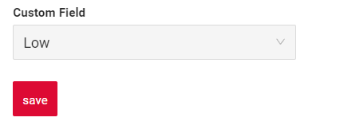


### Как добавить? { #how-to-add_2 }
??? Example "Пример"
    === "Редактирование"
        **Шаг 1** Добавьте маппинг DTO->entity в соответствующий **VersionAwareResponseService**.
        ```java
        --8<--
        {{ external_links.github_raw_doc }}/fields/dictionary/basic/MyExample70Service.java:doUpdateEntity
        --8<--
        ```

        **Шаг 2** Добавьте **fields.setEnabled** в соответствующий **FieldMetaBuilder**.
        ```java
        --8<--
        {{ external_links.github_raw_doc }}/fields/dictionary/basic/MyExample70Meta.java:buildRowDependentMeta
        --8<--
        ```
        === "Виджет List"
            **Работает для List.**

            [:material-play-circle: Живой пример]({{ external_links.code_samples }}/ui/#/screen/myexample70){:target="_blank"} ·
            [:fontawesome-brands-github: GitHub]({{ external_links.github_ui }}/{{ external_links.github_branch }}/src/main/java/org/demo/documentation/fields/dictionary/basic){:target="_blank"}
        === "Виджет Info"
            **_неприменимо_**
        === "Виджет Form"
            **Работает для Form.**

            [:material-play-circle: Живой пример]({{ external_links.code_samples }}/ui/#/screen/myexample70){:target="_blank"} ·
            [:fontawesome-brands-github: GitHub]({{ external_links.github_ui }}/{{ external_links.github_branch }}/src/main/java/org/demo/documentation/fields/dictionary/basic){:target="_blank"}

   
    === "Только чтение"
    
        **Вариант 1** Включено по умолчанию.
    
        ```java
        --8<--
        {{ external_links.github_raw_doc }}/fields/dictionary/ro/MyExample85Meta.java:buildRowDependentMeta
        --8<--
        ```
    
        **Вариант 2** `Не рекомендуется.` Свойство fields.setDisabled() переопределяет доступность поля, если используется после свойства fields.setEnabled.
        === "Виджет List"
            **Работает для List.**

            [:material-play-circle: Живой пример]({{ external_links.code_samples }}/ui/#/screen/myexample85){:target="_blank"} ·
            [:fontawesome-brands-github: GitHub]({{ external_links.github_ui }}/{{ external_links.github_branch }}/src/main/java/org/demo/documentation/fields/dictionary/ro){:target="_blank"}

        === "Виджет Info"
            **Работает для Info.**

            [:material-play-circle: Живой пример]({{ external_links.code_samples }}/ui/#/screen/myexample85){:target="_blank"} ·
            [:fontawesome-brands-github: GitHub]({{ external_links.github_ui }}/{{ external_links.github_branch }}/src/main/java/org/demo/documentation/fields/dictionary/ro){:target="_blank"}

        === "Виджет Form"
            **Работает для Form.**

            [:material-play-circle: Живой пример]({{ external_links.code_samples }}/ui/#/screen/myexample85){:target="_blank"} ·
            [:fontawesome-brands-github: GitHub]({{ external_links.github_ui }}/{{ external_links.github_branch }}/src/main/java/org/demo/documentation/fields/dictionary/ro){:target="_blank"}

##  Фильтрация { #filtering }
**Enum**
[:material-play-circle: Живой пример]({{ external_links.code_samples }}/ui/#/screen/myexample87){:target="_blank"} ·
[:fontawesome-brands-github: GitHub]({{ external_links.github_ui }}/{{ external_links.github_branch }}/src/main/java/org/demo/documentation/fields/dictionary/filtration){:target="_blank"}

**Dictionary**
[:material-play-circle: Живой пример]({{ external_links.code_samples }}/ui/#/screen/myexample358){:target="_blank"} ·
[:fontawesome-brands-github: GitHub]({{ external_links.github_ui }}/{{ external_links.github_branch }}/src/main/java/org/demo/documentation/fields/dictionary/dictionarydictionary/filtration){:target="_blank"}


`Filtering` позволяет искать данные по критериям. Поиск использует оператор `in`.

Компонент фильтра отображает поле текстового поиска и полосу прокрутки в зависимости от количества доступных значений фильтра.
(начиная с [релиза 2.0.13](https://doc.cxbox.org/ru/new/version2013/"))

- Поле поиска и полоса прокрутки появляются, только когда количество значений для фильтрации превышает
  7 элементов (количество элементов по умолчанию — настраивается константой фронтенда).

- Кнопка Apply показывает счётчик выбранных элементов (например, `Apply (5)`).
- Если выбрано больше 7 элементов, отображается `Apply (N+)` (например, `Apply (9+)`).
 

### Как это выглядит? { #how-does-it-look_4 }
=== "Виджет List"
    === "< количества элементов по умолчанию"
        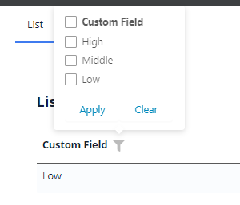
    === "> количества элементов по умолчанию"
        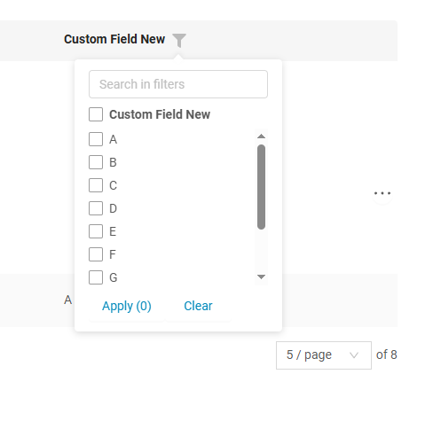
=== "Виджет Info"
    _неприменимо_
=== "Виджет Form"
    _неприменимо_

### <a id="filtering_how_to_add">Как добавить?</a>
??? Example "Пример"
    === "Enum"
        === "Виджет List"
            **Шаг 1** Добавьте **@SearchParameter** в соответствующий **DataResponseDTO**. (Расширенная настройка [SearchParameter](/ru/advancedCustomization/element/searchparameter/searchparameter))
            ```java
            --8<--
            {{ external_links.github_raw_doc }}/fields/dictionary/filtration/MyExample87DTO.java
            --8<--
            ```
    
            **Шаг 2**  Добавьте **fields.enableFilter** в соответствующий **FieldMetaBuilder**.
    
            Добавьте **fields.setEnumFilterValues** в соответствующий **FieldMetaBuilder**.
    
            Фронтенду нужно передать все данные справочника в теге **`filterValues`** метода */row-meta*.
    
            ```java
            --8<--
            {{ external_links.github_raw_doc }}/fields/dictionary/filtration/MyExample87Meta.java:buildIndependentMeta
            --8<--
            ```
    
            **Как отсортировать значения в выпадающем списке или для фильтрации?**
            
            см. [Сортировка](#sort)

            [:material-play-circle: Живой пример]({{ external_links.code_samples }}/ui/#/screen/myexample87){:target="_blank"} ·
            [:fontawesome-brands-github: GitHub]({{ external_links.github_ui }}/{{ external_links.github_branch }}/src/main/java/org/demo/documentation/fields/dictionary/filtration){:target="_blank"}
    
        === "Виджет Info"
            _неприменимо_
        === "Виджет Form"
            _неприменимо_

    === "Dictionary"
        === "Виджет List"
            **Шаг 1** Добавьте **@SearchParameter** в соответствующий **DataResponseDTO**. (Расширенная настройка [SearchParameter](/ru/advancedCustomization/element/searchparameter/searchparameter))
            ```java
            --8<--
            {{ external_links.github_raw_doc }}/fields/dictionary/dictionarydictionary/filtration/MyExample358DTO.java
            --8<--
            ```
    
            **Шаг 2**  Добавьте **fields.enableFilter** в соответствующий **FieldMetaBuilder**.
    
            Добавьте **fields.setDictionaryFilterValues** в соответствующий **FieldMetaBuilder**.
    
            Фронтенду нужно передать все данные справочника в теге **`filterValues`** метода */row-meta*.
    
            ```java
            --8<--
            {{ external_links.github_raw_doc }}/fields/dictionary/dictionarydictionary/filtration/MyExample358Meta.java:buildIndependentMeta
            --8<--
            ```
   
            [:material-play-circle: Живой пример]({{ external_links.code_samples }}/ui/#/screen/myexample358){:target="_blank"} ·
            [:fontawesome-brands-github: GitHub]({{ external_links.github_ui }}/{{ external_links.github_branch }}/src/main/java/org/demo/documentation/fields/dictionary/dictionarydictionary/filtration){:target="_blank"}
    
        === "Виджет Info"
            _неприменимо_
        === "Виджет Form"
            _неприменимо_

    **Как отсортировать значения в выпадающем списке или для фильтрации?**
    
    см. [Сортировка](#sort)

    **Настройка количества элементов по умолчанию**

    - Расположение: `\ui\src\constants\filter.ts`
    - Переменные:

        - `checkboxFilterMaxVisibleItems` — определяет, когда появляются прокрутка/поиск.
        - `checkboxFilterCounterLimit` — задаёт максимальное число, после которого используется запись с `+`.

## Drilldown
[:material-play-circle: Живой пример]({{ external_links.code_samples }}/ui/#/screen/myexample86){:target="_blank"} ·
[:fontawesome-brands-github: GitHub]({{ external_links.github_ui }}/{{ external_links.github_branch }}/src/main/java/org/demo/documentation/fields/dictionary/drilldown){:target="_blank"}

`DrillDown` позволяет перейти в другое представление простым нажатием. Целевое представление и другие части drill-down можно вычислять на основе бизнес-логики приложения

Также при необходимости можно отфильтровать данные целевого представления до его открытия, `подробнее см.` [DrillDown](/ru/features/element/drilldown/drilldown)


### Как это выглядит? { #how-does-it-look_5 }
=== "Виджет List"
    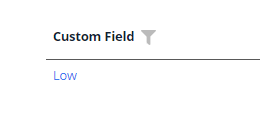
=== "Виджет Info"
    
=== "Виджет Form"
    _неприменимо_

### Как добавить? { #how-to-add_3 }
??? Example "Пример"

    **Вариант 1**

    `Шаг 1` Добавьте [fields.setDrilldown](/ru/features/element/drilldown/drilldown) в соответствующий **FieldMetaBuilder**.
    ```java
    --8<--
    {{ external_links.github_raw_doc }}/fields/dictionary/drilldown/MyExample86Meta.java:buildRowDependentMeta
    --8<--
    ```
    === "Виджет List"
        `Шаг 2` Добавьте **"drillDown": "true"** в .widget.json.
        ```json
        --8<--
        {{ external_links.github_raw_doc }}/fields/dictionary/drilldown/MyExample86List.widget.json
        --8<--
        ```
    
        **Вариант 2**
           Добавьте **"drillDownKey"** :  `собственное поле` в .widget.json. Подробнее см. [Drilldown](/ru/features/element/drilldown/drilldown)

        [:material-play-circle: Живой пример]({{ external_links.code_samples }}/ui/#/screen/myexample86){:target="_blank"} ·
        [:fontawesome-brands-github: GitHub]({{ external_links.github_ui }}/{{ external_links.github_branch }}/src/main/java/org/demo/documentation/fields/dictionary/drilldown){:target="_blank"}

    === "Виджет Info"

        `Шаг 2` Добавьте **"drillDown": "true"** в .widget.json.
        ```json
        --8<--
        {{ external_links.github_raw_doc }}/fields/dictionary/drilldown/MyExample86Info.widget.json
        --8<--
        ```
        **Вариант 2**
           Добавьте **"drillDownKey"** :  `собственное поле` в .widget.json. Подробнее см. [Drilldown](/ru/features/element/drilldown/drilldown)

        [:material-play-circle: Живой пример]({{ external_links.code_samples }}/ui/#/screen/myexample86){:target="_blank"} ·
        [:fontawesome-brands-github: GitHub]({{ external_links.github_ui }}/{{ external_links.github_branch }}/src/main/java/org/demo/documentation/fields/dictionary/drilldown){:target="_blank"}

    === "Виджет Form"
        _неприменимо_
[Расширенная настройка](/ru/features/element/drilldown/drilldown)

## Валидация { #validation }
`Validation` позволяет проверять любые бизнес-правила для введённого пользователем значения. Типы валидации:

1) Exception: отображает сообщение, уведомляющее пользователя о технических или бизнес-ошибках.

   `Business Exception`:
   [:material-play-circle: Живой пример]({{ external_links.code_samples }}/ui/#/screen/myexample91){:target="_blank"} ·
   [:fontawesome-brands-github: GitHub]({{ external_links.github_ui }}/{{ external_links.github_branch }}/src/main/java/org/demo/documentation/fields/dictionary/validationbusinessex){:target="_blank"}

   `Runtime Exception`:
   [:material-play-circle: Живой пример]({{ external_links.code_samples }}/ui/#/screen/myexample93){:target="_blank"} ·
   [:fontawesome-brands-github: GitHub]({{ external_links.github_ui }}/{{ external_links.github_branch }}/src/main/java/org/demo/documentation/fields/dictionary/validationruntimeex){:target="_blank"}
   
2) Confirm: показывает диалог с необязательным сообщением, требующий от пользователя подтверждения или отмены перед продолжением.

   [:material-play-circle: Живой пример]({{ external_links.code_samples }}/ui/#/screen/myexample92){:target="_blank"} ·
   [:fontawesome-brands-github: GitHub]({{ external_links.github_ui }}/{{ external_links.github_branch }}/src/main/java/org/demo/documentation/fields/dictionary/validationconfirm){:target="_blank"}

3) Валидация на уровне полей: показывает ошибку рядом со всеми полями, не прошедшими проверку

   [:material-play-circle: Живой пример]({{ external_links.code_samples }}/ui/#/screen/myexample323){:target="_blank"} ·
   [:fontawesome-brands-github: GitHub]({{ external_links.github_ui }}/{{ external_links.github_branch }}/src/main/java/org/demo/documentation/fields/dictionary/validationdynamic){:target="_blank"}


### Как это выглядит? { #how-does-it-look_6 }
=== "Виджет List"
    === "BusinessException"
        
    === "RuntimeException"
        
    === "Confirm"
        
    === "Валидация на уровне полей"
        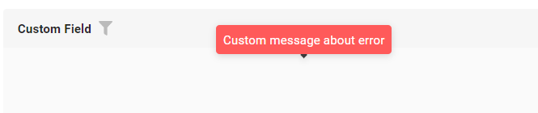
=== "Виджет Info"
    _неприменимо_
=== "Виджет Form"
    === "BusinessException"
        
    === "RuntimeException"
        
    === "Confirm"
        
    === "Валидация на уровне полей"
        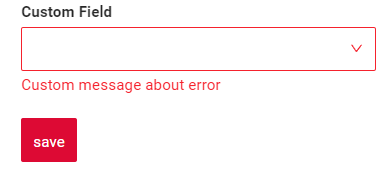


### Как добавить? { #how-to-add_4 }
??? Example "Пример"
    === "BusinessException"
        `BusinessException` описывает ошибку в рамках бизнес-процесса.
        
        Добавьте **BusinessException** в соответствующий **VersionAwareResponseService**.
        ```java
        --8<--
        {{ external_links.github_raw_doc }}/fields/dictionary/validationbusinessex/MyExample91Service.java:doUpdateEntity
        --8<--
        ```

        === "Виджет List"
            **Работает для List.**

            [:material-play-circle: Живой пример]({{ external_links.code_samples }}/ui/#/screen/myexample91){:target="_blank"} ·
            [:fontawesome-brands-github: GitHub]({{ external_links.github_ui }}/{{ external_links.github_branch }}/src/main/java/org/demo/documentation/fields/dictionary/validationbusinessex){:target="_blank"}

        === "Виджет Info"
            **_неприменимо_**
        === "Виджет Form"
            **Работает для Form.**

            [:material-play-circle: Живой пример]({{ external_links.code_samples }}/ui/#/screen/myexample91){:target="_blank"} ·
            [:fontawesome-brands-github: GitHub]({{ external_links.github_ui }}/{{ external_links.github_branch }}/src/main/java/org/demo/documentation/fields/dictionary/validationbusinessex){:target="_blank"}

    === "RuntimeException"

        `RuntimeException` описывает техническую ошибку в рамках бизнес-процесса.
        
        Добавьте **RuntimeException** в соответствующий **VersionAwareResponseService**.
        ```java
        --8<--
        {{ external_links.github_raw_doc }}/fields/dictionary/validationruntimeex/MyExample93Service.java:doUpdateEntity
        --8<--
        ```       
     
        === "Виджет List"
            **Работает для List.**

            [:material-play-circle: Живой пример]({{ external_links.code_samples }}/ui/#/screen/myexample93){:target="_blank"} ·
            [:fontawesome-brands-github: GitHub]({{ external_links.github_ui }}/{{ external_links.github_branch }}/src/main/java/org/demo/documentation/fields/dictionary/validationruntimeex){:target="_blank"}
        === "Виджет Info"
            **_неприменимо_**
        === "Виджет Form"
            **Работает для Form.**

            [:material-play-circle: Живой пример]({{ external_links.code_samples }}/ui/#/screen/myexample93){:target="_blank"} ·
            [:fontawesome-brands-github: GitHub]({{ external_links.github_ui }}/{{ external_links.github_branch }}/src/main/java/org/demo/documentation/fields/dictionary/validationruntimeex){:target="_blank"}
    === "Confirm"
        Добавьте [PreAction.confirm](/ru/advancedCustomization_validation) в соответствующий **VersionAwareResponseService**.
        ```java
        --8<--
        {{ external_links.github_raw_doc }}/fields/dictionary/validationconfirm/MyExample92Service.java:getActions
        --8<--
        ```
        === "Виджет List"
            **Работает для List.**

            [:material-play-circle: Живой пример]({{ external_links.code_samples }}/ui/#/screen/myexample92){:target="_blank"} ·
            [:fontawesome-brands-github: GitHub]({{ external_links.github_ui }}/{{ external_links.github_branch }}/src/main/java/org/demo/documentation/fields/dictionary/validationconfirm){:target="_blank"}
        === "Виджет Info"
            **_неприменимо_**
        === "Виджет Form"
            **Работает для Form.**

            [:material-play-circle: Живой пример]({{ external_links.code_samples }}/ui/#/screen/myexample92){:target="_blank"} ·
            [:fontawesome-brands-github: GitHub]({{ external_links.github_ui }}/{{ external_links.github_branch }}/src/main/java/org/demo/documentation/fields/dictionary/validationconfirm){:target="_blank"}

    === "Валидация на уровне полей"
        Создайте собственный сервис для проверки бизнес-логики.
        
        Используйте, если:
        
        Для полей требуется проверка бизнес-логики
        
        `Шаг 1`  Создайте собственный метод проверки.
        ```java
        --8<--
        {{ external_links.github_raw_doc }}/fields/dictionary/validationdynamic/MyExample323Service.java:validateFields
        --8<--
        ```
        
        `Шаг 2` Добавьте собственный метод проверки в соответствующий **VersionAwareResponseService**.
        ```java
        --8<--
        {{ external_links.github_raw_doc }}/fields/dictionary/validationdynamic/MyExample323Service.java:doUpdateEntity
        --8<--
        ```

        [:material-play-circle: Живой пример]({{ external_links.code_samples }}/ui/#/screen/myexample323){:target="_blank"} ·
        [:fontawesome-brands-github: GitHub]({{ external_links.github_ui }}/{{ external_links.github_branch }}/src/main/java/org/demo/documentation/fields/dictionary/validationdynamic){:target="_blank"}

## <a id="sort">Сортировка</a>
`Enum`
[:material-play-circle: Живой пример]({{ external_links.code_samples }}/ui/#/screen/myexample90){:target="_blank"} ·
[:fontawesome-brands-github: GitHub]({{ external_links.github_ui }}/{{ external_links.github_branch }}/src/main/java/org/demo/documentation/fields/dictionary/sorting){:target="_blank"}

`Dictionary`
[:material-play-circle: Живой пример]({{ external_links.code_samples }}/ui/#/screen/myexample106){:target="_blank"} ·
[:fontawesome-brands-github: GitHub]({{ external_links.github_ui }}/{{ external_links.github_branch }}/src/main/java/org/demo/documentation/fields/dictionary/dictionarydictionary/sorting){:target="_blank"}

`Sorting` позволяет сортировать данные по возрастанию или убыванию.

**Сортировка данных**:
Сортировка выполняется по значениям, хранящимся в базе данных, а не по отображаемым в интерфейсе.

!!! info
    После добавления или обновления записей сортировка не сработает, пока страница не будет обновлена.

**Сортировка значений выпадающего списка или списка значений для фильтра**:
Значения в выпадающем списке или в списке значений для фильтра также можно расположить в нужном порядке.
Для `Enum` можно задать порядок значений для фильтра, отличный от порядка значений выпадающего списка.

### Как это выглядит? { #how-does-it-look_7 }
=== "Сортировка данных"
    === "Виджет List"
        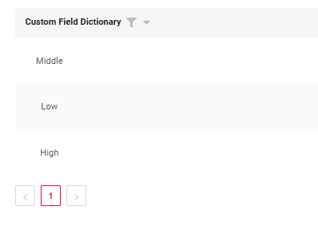
    === "Виджет Info"
        _неприменимо_
    === "Виджет Form"
        _неприменимо_

=== "Список значений для фильтра"
    === "Виджет List"
        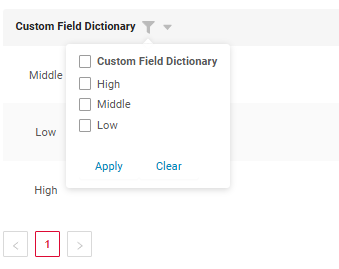
    === "Виджет Info"
        _неприменимо_
    === "Виджет Form"
        _неприменимо_
=== "Выпадающий список"
    === "Виджет List"
        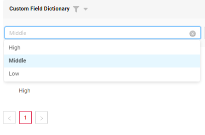
    === "Виджет Info"
        _неприменимо_
    === "Виджет Form"
        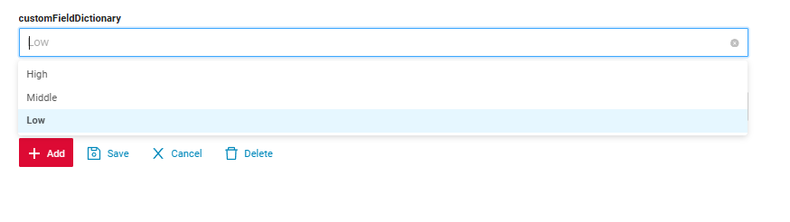

### Как добавить? { #how-to-add_5 }
??? Example "Пример"
    === "Виджет List"
        === "Enum"
            === "Сортировка данных"
                подробнее см. [Сортировка](/ru/widget/type/property/sorting/sorting)

                Сортировка выполняется по значениям, хранящимся в базе данных, а не по отображаемым в интерфейсе, с использованием лексикографической сортировки.

                **Шаг 1**  Добавьте **fields.enableSort** в соответствующий **FieldMetaBuilder**.
                ```java
                --8<--
                {{ external_links.github_raw_doc }}/fields/dictionary/sorting/MyExample90Meta.java:buildIndependentMeta
                --8<--
                ```

            === "Выпадающий список"
                Порядок значений выпадающего списка определяется порядком, заданным разработчиком в методе.

                **Шаг 1**  Добавьте **fields.setEnumValues** в соответствующий **FieldMetaBuilder**.
                Передавайте значения в правильном порядке, чтобы получить нужную сортировку.

                ```java
                --8<--
                {{ external_links.github_raw_doc }}/fields/dictionary/sorting/MyExample90Meta.java:buildRowDependentMeta
                --8<--
                ```
 
            === "Список значений для фильтра"
                Порядок значений выпадающего списка определяется порядком, заданным разработчиком в методе.
                 
                **Шаг 1**  Добавьте **fields.setEnumFilterValues** в соответствующий **FieldMetaBuilder**.
                Передавайте значения в правильном порядке, чтобы получить нужную сортировку.

                ```java
                --8<--
                {{ external_links.github_raw_doc }}/fields/dictionary/sorting/MyExample90Meta.java:buildIndependentMeta
                --8<--
                ```
    
            [:material-play-circle: Живой пример]({{ external_links.code_samples }}/ui/#/screen/myexample90){:target="_blank"} ·
            [:fontawesome-brands-github: GitHub]({{ external_links.github_ui }}/{{ external_links.github_branch }}/src/main/java/org/demo/documentation/fields/dictionary/sorting){:target="_blank"}

        === "Dictionary"
            === "Сортировка данных"
                подробнее см. [Сортировка](/ru/widget/type/property/sorting/sorting)

                Сортировка выполняется по значениям, хранящимся в базе данных, а не по отображаемым в интерфейсе.

                **Шаг 1**  Добавьте **fields.enableSort** в соответствующий **FieldMetaBuilder**.
                ```java
                --8<--
                {{ external_links.github_raw_doc }}/fields/dictionary/dictionarydictionary/sorting/MyExample106Meta.java:buildIndependentMeta
                --8<--
                ```
 
            === "Выпадающий список и список значений для фильтра"
                Если вы используете DictionaryProvider.getAll(Class), который делегирует org.cxbox.api.data.dictionary.DictionaryCache, значения выпадающего списка сортируются по display_order, затем по key (display_order может быть null)
                ```java
                @Configuration
                public class DictionaryConfig {
                
                    @Bean
                    public DictionaryProvider dictionaryProvider() {
                        return new DictionaryProvider() {
                
                            @Override
                            public <T extends Dictionary> T lookupName(@NonNull Class<T> type, @NonNull DictionaryValue value) {
                                var dictTmp = Dictionary.of(type, "");
                                var lov = DictionaryCache.dictionary().lookupName(value.getValue(), dictTmp.getDictionaryType());
                                return Dictionary.of(type, lov.getKey());
                            }
                
                            @Override
                            public <T extends Dictionary> SimpleDictionary lookupValue(@NonNull T dictionary) {
                                return DictionaryCache.dictionary().get(dictionary.getDictionaryType(), dictionary.key());
                            }
                
                            @Override
                            public <T extends Dictionary> Collection<T> getAll(@NonNull Class<T> dictionaryType) {
                
                                if (dictionaryType == CustomDictionarySortingExample.class) {
                                    return DictionaryCache.dictionary().getAll(Dictionary.of(dictionaryType, "").getDictionaryType())
                                            .stream()
                                            .sorted(Comparator.comparing(SimpleDictionary::getKey))
                                            .map(e -> Dictionary.of(dictionaryType, e.getKey()))
                                            .toList();
                                }
                
                                return DictionaryCache.dictionary().getAll(Dictionary.of(dictionaryType, "").getDictionaryType())
                                        .stream()
                                        .map(e -> Dictionary.of(dictionaryType, e.getKey()))
                                        .toList();
                            }
                        };
                    }
                
                }
                ```
            [:material-play-circle: Живой пример]({{ external_links.code_samples }}/ui/#/screen/myexample106){:target="_blank"} ·
            [:fontawesome-brands-github: GitHub]({{ external_links.github_ui }}/{{ external_links.github_branch }}/src/main/java/org/demo/documentation/fields/dictionary/dictionarydictionary/sorting){:target="_blank"}

    === "Виджет Info"
        _неприменимо_
    === "Виджет Form"
        === "Enum"
            === "Сортировка данных"
                _неприменимо_
            === "Выпадающий список"
                Порядок значений выпадающего списка определяется порядком, заданным разработчиком в методе.

                **Шаг 1**  Добавьте **fields.setEnumValues** в соответствующий **FieldMetaBuilder**.
                Передавайте значения в правильном порядке, чтобы получить нужную сортировку.

                ```java
                --8<--
                {{ external_links.github_raw_doc }}/fields/dictionary/sorting/MyExample90Meta.java:buildRowDependentMeta
                --8<--
                ```
 
            === "Список значений для фильтра"
                _неприменимо_
        === "Dictionary"
            === "Сортировка данных"
                _неприменимо_
            === "Выпадающий список"
                Если вы используете DictionaryProvider.getAll(Class), который делегирует org.cxbox.api.data.dictionary.DictionaryCache, значения выпадающего списка сортируются по display_order, затем по key (display_order может быть null)
                ```java
                @Configuration
                public class DictionaryConfig {

                    @Bean
                    public DictionaryProvider dictionaryProvider() {
                        return new DictionaryProvider() {
                
                            @Override
                            public <T extends Dictionary> T lookupName(@NonNull Class<T> type, @NonNull DictionaryValue value) {
                                var dictTmp = Dictionary.of(type, "");
                                var lov = DictionaryCache.dictionary().lookupName(value.getValue(), dictTmp.getDictionaryType());
                                return Dictionary.of(type, lov.getKey());
                            }
                
                            @Override
                            public <T extends Dictionary> SimpleDictionary lookupValue(@NonNull T dictionary) {
                                return DictionaryCache.dictionary().get(dictionary.getDictionaryType(), dictionary.key());
                            }
                
                            @Override
                            public <T extends Dictionary> Collection<T> getAll(@NonNull Class<T> dictionaryType) {
                
                                if (dictionaryType == CustomDictionarySortingExample.class) {
                                    return DictionaryCache.dictionary().getAll(Dictionary.of(dictionaryType, "").getDictionaryType())
                                            .stream()
                                            .sorted(Comparator.comparing(SimpleDictionary::getKey))
                                            .map(e -> Dictionary.of(dictionaryType, e.getKey()))
                                            .toList();
                                }
                
                                return DictionaryCache.dictionary().getAll(Dictionary.of(dictionaryType, "").getDictionaryType())
                                        .stream()
                                        .map(e -> Dictionary.of(dictionaryType, e.getKey()))
                                        .toList();
                            }
                        };
                    }
                
                }
                ```
            === "Список значений для фильтра"
                _неприменимо_

## Обязательность { #required }
[:material-play-circle: Живой пример]({{ external_links.code_samples }}/ui/#/screen/myexample89){:target="_blank"} ·
[:fontawesome-brands-github: GitHub]({{ external_links.github_ui }}/{{ external_links.github_branch }}/src/main/java/org/demo/documentation/fields/dictionary/required){:target="_blank"}

`Required` позволяет указать, что поле обязательно должно иметь значение.

### Как это выглядит? { #how-does-it-look_8 }
=== "Виджет List"
    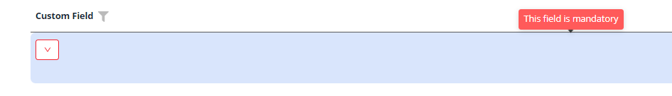
=== "Виджет Info"
    _неприменимо_
=== "Виджет Form"
    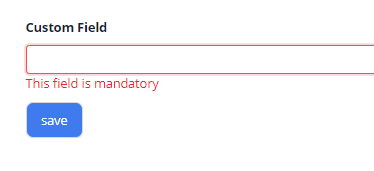
### Как добавить? { #how-to-add_6 }
??? Example "Пример"
    Добавьте **fields.setRequired** в соответствующий **FieldMetaBuilder**.
    ```java
    --8<--
    {{ external_links.github_raw_doc }}/fields/dictionary/required/MyExample89Meta.java:buildRowDependentMeta
    --8<--
    ```

    === "Виджет List"
        **Работает для List.**

        [:material-play-circle: Живой пример]({{ external_links.code_samples }}/ui/#/screen/myexample89){:target="_blank"} ·
        [:fontawesome-brands-github: GitHub]({{ external_links.github_ui }}/{{ external_links.github_branch }}/src/main/java/org/demo/documentation/fields/dictionary/required){:target="_blank"}

    === "Виджет Info"
        **_неприменимо_**
    === "Виджет Form"
        **Работает для Form.**

        [:material-play-circle: Живой пример]({{ external_links.code_samples }}/ui/#/screen/myexample89){:target="_blank"} ·
        [:fontawesome-brands-github: GitHub]({{ external_links.github_ui }}/{{ external_links.github_branch }}/src/main/java/org/demo/documentation/fields/dictionary/required){:target="_blank"}

## Дополнительные свойства { #additional-properties }
### <a id="icon">Иконка</a>
(начиная с [релиза 2.0.8](https://doc.cxbox.org/ru/new/version208/"))

[:material-play-circle: Живой пример]({{ external_links.code_samples }}/ui/#/screen/myexample3011){:target="_blank"} ·
[:fontawesome-brands-github: GitHub]({{ external_links.github_ui }}/{{ external_links.github_branch }}/src/main/java/org/demo/documentation/fields/dictionary/icon){:target="_blank"}

Иконки — небольшие графические символы в пользовательском интерфейсе, наглядно обозначающие определённые действия, поля или типы данных, что делает интерфейс понятнее и удобнее для навигации. Они служат визуальными подсказками, помогая быстро определить назначение поля без чтения заголовка.

#### Основы { #basic }

!!! tips "Совет"
    Не рекомендуем использовать длинные значения в полях value, так как при фильтрации на бэкенд отправляется строка со значением, длина которой может быть ограничена.

Есть два типа отображения иконок:

* [`Standard icons`](#standard_icons)
* [`Custom icons`](#custom_icons)

Есть два режима отображения:

* [`Default Mode`](#default_mode) (иконка и текст)
* [`Icon-Only Mode`](#icon_mode) (только иконка)

#### Режимы { #modes }
##### <a id="default_mode">Режим по умолчанию (Default Mode)</a>
Всегда отображаются и иконка, и текст.

Применяется к:

* Выпадающий справочник
* Режим редактирования/создания
* Фильтрация

###### Как это выглядит? { #how-does-it-look_9 }
=== "Виджет List"
    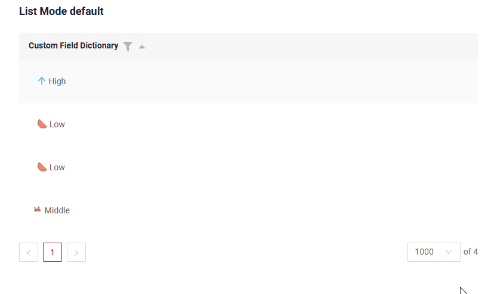
=== "Виджет Info"
    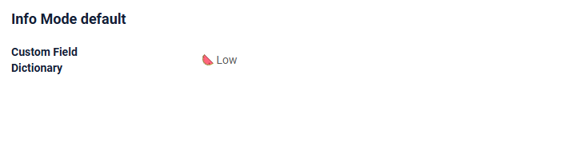
=== "Виджет Form"
    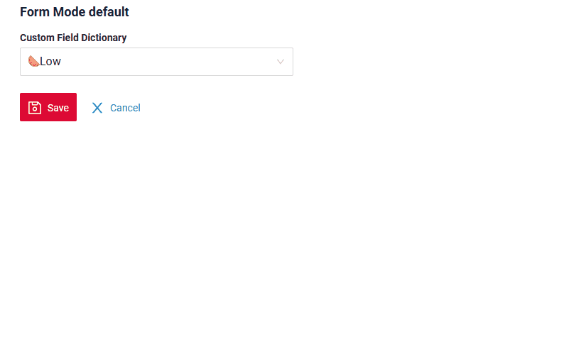
=== "Виджет AdditionalInfo"
    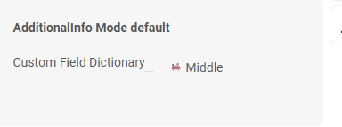
=== "Виджет GroupingHierarchy"
    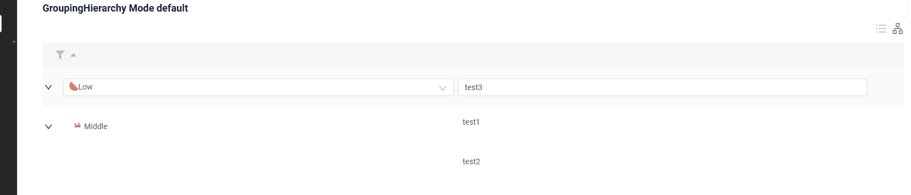

###### Как добавить? { #how-to-add_7 }
??? Example "Пример"

    Механизм отображения иконок на фронтенде работает так:
    
    Сопоставление значений иконок: фронтенду нужно иметь все вхождения значений иконок в общей коллекции тегов (allValues).

    Получение иконки: затем он берёт указанное значение из values (подробнее см. [how_to_add](#basics_how_to_add))/filterValues (подробнее см. [how_to_add](#filtering_how_to_add)) и ищет соответствующее значение иконки в allValues.
    Этот процесс гарантирует, что иконки отображаются на основе указанных значений иконок.

    === "Enum"
        `Шаг 1` Добавьте **fields.setEnumIcons** в buildIndependentMeta соответствующего **FieldMetaBuilder**.
        ```java
        --8<--
        {{ external_links.github_raw_doc }}/fields/dictionary/icon/MyExample3011Meta.java:buildIndependentMeta
        --8<--
        ``` 

        `Шаг 2` (необязательно)

        Отсутствие тега mode = "mode": "default
    
        Добавьте **"mode": "default"** в соответствующий **widget.json**.

        ```json
        --8<--
        {{ external_links.github_raw_doc }}/fields/dictionary/icon/list/MyExample3011List.widget.json
        --8<--
        ```  

    === "Dictionary"

        `Шаг 1` Добавьте **fields.setDictionaryIcons** в соответствующий **FieldMetaBuilder**.
        ```java
        --8<--
        {{ external_links.github_raw_doc }}/fields/dictionary/dictionarydictionary/icon/MyExample355Meta.java:buildIndependentMeta
        --8<--
        ``` 
 
        `Шаг 2` (необязательно)

        Отсутствие тега mode = "mode": "default
    
        Добавьте **"mode": "default"** в соответствующий **widget.json**.

        ```json
        --8<--
        {{ external_links.github_raw_doc }}/fields/dictionary/dictionarydictionary/icon/MyExample355List.widget.json
        --8<--
        ```

    === "LOV устарел, рекомендуется Dictionary"

        `Шаг 1` Добавьте **fields.setDictionaryTypeWithAllValues** в соответствующий **FieldMetaBuilder**.
        ```java
        --8<--
        {{ external_links.github_raw_doc }}/fields/dictionary/dictionarydictionary/old/icon/MyExample351Meta.java:buildIndependentMeta
        --8<--
        ``` 
 
        `Шаг 2 ` Отсутствие тега mode = "mode": "default
    
        Добавьте **"mode": "default"** в соответствующий **widget.json**.
        ```json
        --8<--
        {{ external_links.github_raw_doc }}/fields/dictionary/dictionarydictionary/old/icon/MyExample351List.widget.json
        --8<--
        ```

    [:material-play-circle: Живой пример]({{ external_links.code_samples }}/ui/#/screen/myexample3011){:target="_blank"} ·
    [:fontawesome-brands-github: GitHub]({{ external_links.github_ui }}/{{ external_links.github_branch }}/src/main/java/org/demo/documentation/fields/dictionary/icon){:target="_blank"}

##### <a id="icon_mode">Режим иконки (Icon Mode)</a>
[:material-play-circle: Живой пример]({{ external_links.code_samples }}/ui/#/screen/myexample3011){:target="_blank"} ·
[:fontawesome-brands-github: GitHub]({{ external_links.github_ui }}/{{ external_links.github_branch }}/src/main/java/org/demo/documentation/fields/dictionary/icon){:target="_blank"}


Отображается только иконка.

При наведении на иконку появляется подсказка с текстом, взятым из значения.

Применяется к:

* Выпадающий справочник
* Режим редактирования/создания
* При фильтрации **всегда отображаются иконка и текст**.

###### Как это выглядит? { #how-does-it-look_10 }
=== "Виджет List"
    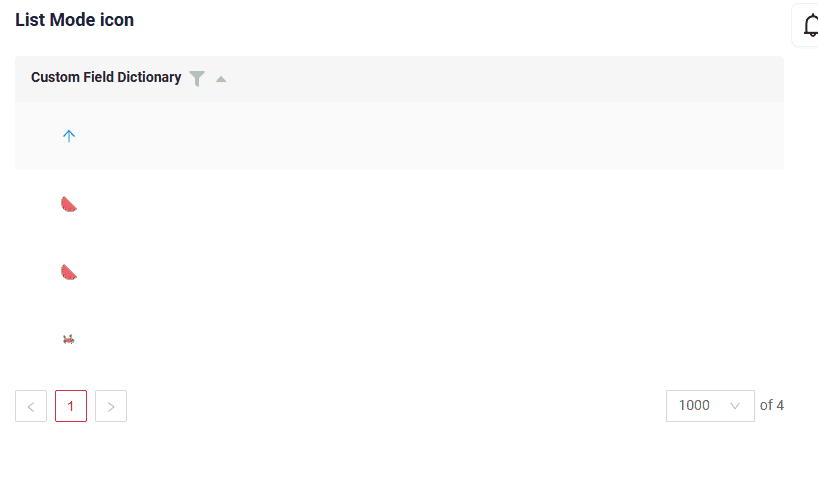
=== "Виджет Info"
    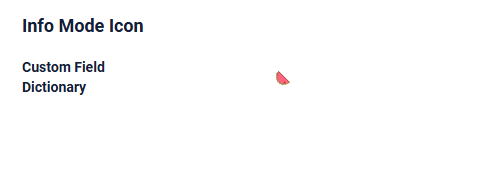    
=== "Виджет Form"
    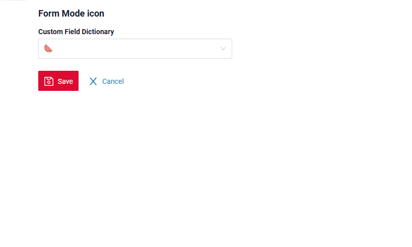
=== "Виджет AdditionalInfo"
    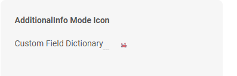
=== "Виджет GroupingHierarchy"
    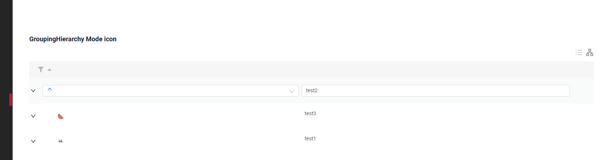

###### Как добавить? { #how-to-add_8 }
??? Example "Пример"

    Механизм отображения иконок на фронтенде работает так:
         Тег `allValues` заполняется значениями из справочника соответствия иконок и значений.
    Затем значение берётся из values (см. [how_to_add](#basics_how_to_add)) или filterValues (см. [how_to_add](#filtering_how_to_add))
    и в allValues ищется соответствующая иконка.
    === "Enum"
        `Шаг 1` Добавьте **fields.setEnumIcons** в соответствующий **FieldMetaBuilder**.
        ```java
        --8<--
        {{ external_links.github_raw_doc }}/fields/dictionary/icon/MyExample3011Meta.java:buildIndependentMeta
        --8<--
        ``` 
        `Шаг 2 ` Добавьте **"mode": "icon"** в соответствующий **widget.json**.
        ```json
        --8<--
        {{ external_links.github_raw_doc }}/fields/dictionary/icon/list/MyExample3011ListIconMode.widget.json
        --8<--
        ```  
    === "Dictionary"
        `Шаг 1` Добавьте **fields.setDictionaryIcons** в соответствующий **FieldMetaBuilder**.
        ```java
        --8<--
        {{ external_links.github_raw_doc }}/fields/dictionary/dictionarydictionary/icon/MyExample355Meta.java:buildIndependentMeta
        --8<--
        ``` 

        `Шаг 2 ` Добавьте **"mode": "icon"** в соответствующий **widget.json**.
        ```json
        --8<--
        {{ external_links.github_raw_doc }}/fields/dictionary/dictionarydictionary/icon/MyExample355ListOnlyIcon.widget.json
        --8<--
        ```  

    === "LOV устарел, рекомендуется Dictionary"
        `Шаг 1` Добавьте **fields.setDictionaryTypeWithAllValues** в соответствующий **FieldMetaBuilder**.
        ```java
        --8<--
        {{ external_links.github_raw_doc }}/fields/dictionary/dictionarydictionary/old/icon/MyExample351Meta.java:buildIndependentMeta
        --8<--
        ``` 

        `Шаг 2 ` Добавьте **"mode": "icon"** в соответствующий **widget.json**.
        ```json
        --8<--
        {{ external_links.github_raw_doc }}/fields/dictionary/dictionarydictionary/old/icon/MyExample351ListModeIcon.widget.json
        --8<--
        ```  

    [:material-play-circle: Живой пример]({{ external_links.code_samples }}/ui/#/screen/myexample3011){:target="_blank"} ·
    [:fontawesome-brands-github: GitHub]({{ external_links.github_ui }}/{{ external_links.github_branch }}/src/main/java/org/demo/documentation/fields/dictionary/icon){:target="_blank"}

#### Типы иконок { #types-icons }
Логика работы: сначала имя иконки ищется в папке пользовательских иконок.
Если иконка найдена, она берётся оттуда; если нет, поиск продолжается в стандартной папке иконок Ant.

Логика выбора иконки:

* Поиск по имени иконки в папке пользовательских иконок.
* Если найдена — используется пользовательская иконка.
* Если не найдена — поиск в стандартной папке иконок Ant и использование иконки оттуда.

##### <a id="standard_icons">Стандартные иконки</a>
Cxbox-ui уже включает эту библиотеку иконок.

[Иконки Ant Design](https://3x.ant.design/components/icon/)
Цвет стандартной иконки можно изменить с помощью HEX-кода цвета.

###### Как это выглядит? { #how-does-it-look_11 }
=== "Базовый"
    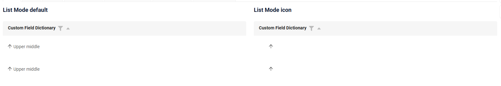
=== "С цветом"
    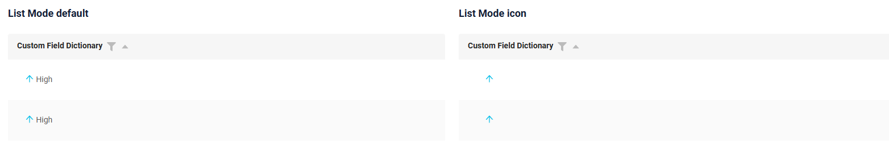

###### Как добавить? { #how-to-add_9 }
??? Example "Пример"
    === "Базовый"
        Просто скопируйте имя иконки и передайте его в метод — больше ничего не нужно.
        Например, добавьте [<Icon type="arrow-up" />](https://3x.ant.design/components/icon/)

        === "Enum"
            Добавьте стандартную иконку в соответствующий **Icon**.
            **ARROW_UP("arrow-up")**
            ```java
            --8<--
            {{ external_links.github_raw_doc }}/fields/dictionary/icon/enums/IconsEnum.java
            --8<--
            ```
         
            [:material-play-circle: Живой пример]({{ external_links.code_samples }}/ui/#/screen/myexample3011){:target="_blank"} ·
            [:fontawesome-brands-github: GitHub]({{ external_links.github_ui }}/{{ external_links.github_branch }}/src/main/java/org/demo/documentation/fields/dictionary/icon/enums){:target="_blank"}

        === "Dictionary"
            `Шаг 1` Добавьте стандартную иконку в соответствующий **Enum** с иконками.
            **ARROW_UP("arrow-up")**
            ```java
            --8<--
            {{ external_links.github_raw_doc }}/fields/dictionary/dictionarydictionary/icon/enums/IconsEnum.java
            --8<--
            ```
         
            [:material-play-circle: Живой пример]({{ external_links.code_samples }}/ui/#/screen/myexample355){:target="_blank"} ·
            [:fontawesome-brands-github: GitHub]({{ external_links.github_ui }}/{{ external_links.github_branch }}/src/main/java/org/demo/documentation/fields/dictionary/dictionarydictionary/icon/enums){:target="_blank"}

        === "LOV устарел, рекомендуется Dictionary"
            `Шаг 1` Добавьте стандартную иконку в соответствующий **Enum** с иконками.
            **ARROW_UP("arrow-up")**
            ```java
            --8<--
            {{ external_links.github_raw_doc }}/fields/dictionary/dictionarydictionary/old/icon/enums/IconsEnum.java
            --8<--
            ```
 
            [:material-play-circle: Живой пример]({{ external_links.code_samples }}/ui/#/screen/myexample351){:target="_blank"} ·
            [:fontawesome-brands-github: GitHub]({{ external_links.github_ui }}/{{ external_links.github_branch }}/src/main/java/org/demo/documentation/fields/dictionary/dictionarydictionary/old/icon/enums){:target="_blank"}

    === "С цветом"
        === "Enum"
            Добавьте стандартную иконку и HEX-код цвета в соответствующий **Icon**.

            Например, добавьте [<Icon type="arrow-up" />](https://3x.ant.design/components/icon/)

            **ARROW_UP_BLUE("arrow-up #0cbfe9")**

            ```java
            --8<--
            {{ external_links.github_raw_doc }}/fields/dictionary/icon/enums/IconsEnum.java
            --8<--
            ```
         
            [:material-play-circle: Живой пример]({{ external_links.code_samples }}/ui/#/screen/myexample3011){:target="_blank"} ·
            [:fontawesome-brands-github: GitHub]({{ external_links.github_ui }}/{{ external_links.github_branch }}/src/main/java/org/demo/documentation/fields/dictionary/icon/enums){:target="_blank"}

        === "Dictionary"
            `Шаг 1` Добавьте стандартную иконку и HEX-код цвета в соответствующий **Enum** с иконками.

            Например, добавьте [<Icon type="arrow-up" />](https://3x.ant.design/components/icon/)

            **ARROW_UP_BLUE("arrow-up #0cbfe9")**

            ```java
            --8<--
            {{ external_links.github_raw_doc }}/fields/dictionary/dictionarydictionary/icon/enums/IconsEnum.java
            --8<--
            ```

            [:material-play-circle: Живой пример]({{ external_links.code_samples }}/ui/#/screen/myexample355){:target="_blank"} ·
            [:fontawesome-brands-github: GitHub]({{ external_links.github_ui }}/{{ external_links.github_branch }}/src/main/java/org/demo/documentation/fields/dictionary/dictionarydictionary/icon/enums){:target="_blank"}

        === "LOV устарел, рекомендуется Dictionary"
            `Шаг 1` Добавьте стандартную иконку и HEX-код цвета в соответствующий **Enum** с иконками.

            Например, добавьте [<Icon type="arrow-up" />](https://3x.ant.design/components/icon/)

            **ARROW_UP_BLUE("arrow-up #0cbfe9")**

            ```java
            --8<--
            {{ external_links.github_raw_doc }}/fields/dictionary/dictionarydictionary/old/icon/enums/IconsEnum.java
            --8<--
            ```

            [:material-play-circle: Живой пример]({{ external_links.code_samples }}/ui/#/screen/myexample351){:target="_blank"} ·
            [:fontawesome-brands-github: GitHub]({{ external_links.github_ui }}/{{ external_links.github_branch }}/src/main/java/org/demo/documentation/fields/dictionary/dictionarydictionary/old/icon/enums){:target="_blank"}

##### <a id="custom_icons">Пользовательские иконки</a>
[:material-play-circle: Живой пример]({{ external_links.code_samples }}/ui/#/screen/myexample3011){:target="_blank"} ·
[:fontawesome-brands-github: GitHub]({{ external_links.github_ui }}/{{ external_links.github_branch }}/src/main/java/org/demo/documentation/fields/dictionary/icon/enums){:target="_blank"}

Можно загружать собственные иконки. Иконки нужно загружать в формате SVG.

###### Как это выглядит? { #how-does-it-look_12 }
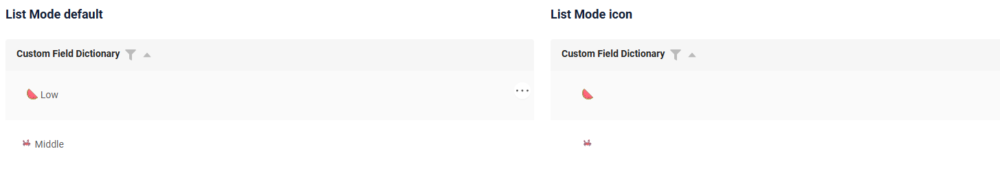

###### Как добавить? { #how-to-add_10 }
??? Example "Пример"

    `Шаг 1` Добавьте иконку (watermelon.svg) в папку ui/src/assets/icons/dictionaryCustomIcons

    [:fontawesome-brands-github: GitHub]({{ external_links.github_ui }}/{{ external_links.github_branch }}/ui/src/assets/icons/dictionaryCustomIcons){:target="_blank"}

    `Шаг 2` Создайте ссылку на файл иконки, добавив ссылку в ui/src/assets/icons/dictionaryCustomIcons/index.ts

    [:fontawesome-brands-github: GitHub]({{ external_links.github_ui }}/{{ external_links.github_branch }}/ui/src/assets/icons/dictionaryCustomIcons/index.ts){:target="_blank"}

    ```java
        export { ReactComponent as watermelon } from './watermelon.svg'
    ```

    `Step 3`
    Добавьте пользовательскую иконку в соответствующий **Icon**.
    **WATERMELON("watermelon")**
    ```java
    --8<--
    {{ external_links.github_raw_doc }}/fields/dictionary/icon/enums/IconsEnum.java
    --8<--
    ```
    
    [:material-play-circle: Живой пример]({{ external_links.code_samples }}/ui/#/screen/myexample3011){:target="_blank"} ·
    [:fontawesome-brands-github: GitHub]({{ external_links.github_ui }}/{{ external_links.github_branch }}/src/main/java/org/demo/documentation/fields/dictionary/icon/enums){:target="_blank"}


### Ширина выпадающего списка { #width-of-the-drop-down-list }
Выпадающий список справочника никогда не бывает уже поля и расширяется под самое длинное значение, но не шире
предела, заданного константой фронтенда (значение по умолчанию 5, в ширинах поля).

* Если значение не помещается в получившуюся ширину, оно сокращается с многоточием (...).
* При наведении на вариант полное значение показывается во всплывающей подсказке.
* Каким бы ни было значение константы, список никогда не занимает больше 70% представления, поэтому не может перекрыть меню.

#### Как это выглядит? { #how-does-it-look_13 }
=== "Виджет List"
    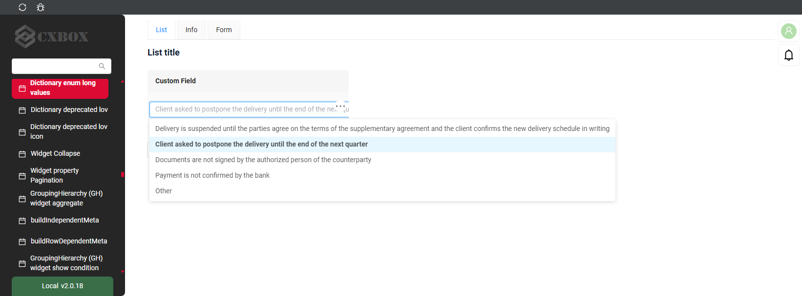
=== "Виджет Info"
    _неприменимо_
=== "Виджет Form"
    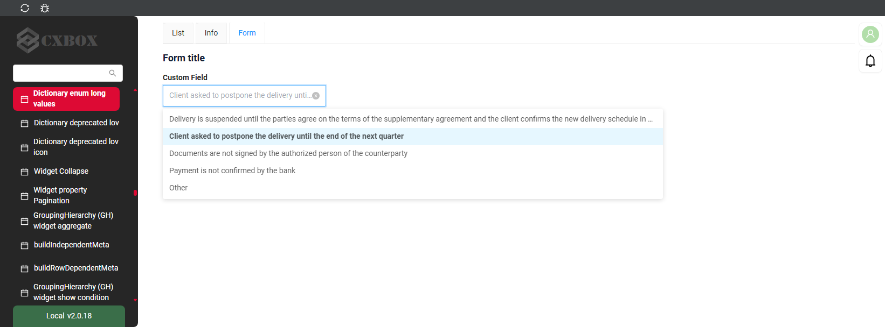

#### Как добавить? { #how-to-add_11 }
??? Example "Пример"
    Измените константу **dictionary_dropDownMaxCols** .
    ```
    ui/src/fields/Dictionary/constants.ts
    ```

    === "Виджет List"
        **Работает для List.**
    === "Виджет Info"
        **_неприменимо_**, у значения только для чтения нет выпадающего списка.
    === "Виджет Form"
        **Работает для Form.**

    [:material-play-circle: Живой пример]({{ external_links.code_samples }}/ui/#/screen/myexample3359){:target="_blank"} ·
    [:fontawesome-brands-github: GitHub]({{ external_links.github_ui }}/{{ external_links.github_branch }}/src/main/java/org/demo/documentation/fields/dictionary/longvalues){:target="_blank"}


## Администрирование справочников { #administration-dictionary }
(начиная с [релиза 2.0.9](https://doc.cxbox.org/ru/new/version209/"))

cxbox/core 4.0.0-M12

[:material-play-circle: Живой пример]({{ external_links.code_samples }}/ui/#/screen/myexample357){:target="_blank"}
[:fontawesome-brands-github: GitHub]({{ external_links.github_ui }}/{{ external_links.github_branch }}/src/main/java/org/demo/documentation/fields/dictionary/dictionarydictionary/dictionary){:target="_blank"}

Этот экран позволяет редактировать и создавать справочники.

Чтобы применить изменения, нажмите кнопку "Clear Cache" на экране администрирования и обновите страницу на экране пользователя, чтобы повторно запросить данные.

### Как это выглядит? { #how-does-it-look_14 }
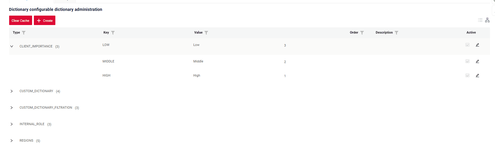

### Как добавить? { #how-to-add_12 }
??? Example "Пример"

    - **Шаг 1.** Проверьте наличие и актуальность файлов из демо-проекта в папке `conf/cxbox/customization/dictionary`.

    - **Шаг 2.** Проверьте наличие и актуальность файлов из демо-проекта в папке `/resources/meta/core/dictionary`.

    [:material-play-circle: Живой пример]({{ external_links.code_samples }}/ui/#/screen/myexample357){:target="_blank"}
    [:fontawesome-brands-github: GitHub]({{ external_links.github_ui }}/{{ external_links.github_branch }}/src/main/java/org/demo/documentation/fields/dictionary/dictionarydictionary/dictionary){:target="_blank"}

## Релиз { #release }

Чтобы изменения, внесённые пользователями, не потерялись при релизе, выполните следующие шаги:

* Кнопка экспорта:
Получите файл с текущими справочниками с окружения (стенда), на которое будет устанавливаться релиз.

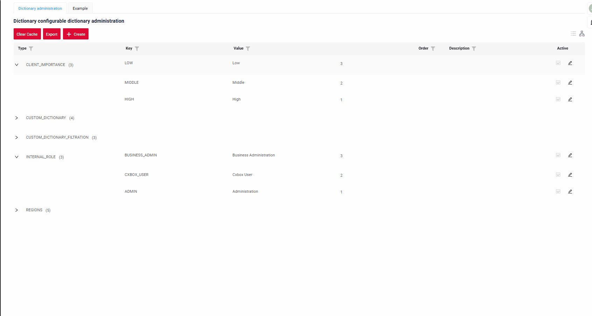

* Сопоставьте файлы:
Сравните скачанный файл справочников с файлом релиза, чтобы убедиться в согласованности и выявить расхождения. Это поможет сохранить изменения пользователей.

* Выполните релиз:
Убедившись, что файлы корректно согласованы, продолжите установку, сохраняя изменения пользователей в обновлённой системе.
