# FileUpload

`FileUpload` — компонент, позволяющий просматривать и прикреплять один файл.

**Поддерживается визуализация следующих типов:**: .webp,.svg,.png,.gif,.jpg,.jpeg,.jfif,.bmp,.dpg,.ico,.heic,.heif,.pdf,.mp3,.wav,.m4a

!!! info
    * При выборе файла он сразу сохраняется в системе хранения, которая формирует уникальный "ID файла". При нажатии кнопки сохранения на бэкенд отправляется только этот "ID файла"
    * Если выбран новый файл, он сохраняется в хранилище как новый файл. Предыдущий файл остаётся нетронутым (например, можно реализовать собственную логику удаления)

 
## Основы { #basics }
[:material-play-circle: Живой пример]({{ external_links.code_samples }}/ui/#/screen/myexample94){:target="_blank"} ·
[:fontawesome-brands-github: GitHub]({{ external_links.github_ui }}/{{ external_links.github_branch }}/src/main/java/org/demo/documentation/fields/fileupload/basic){:target="_blank"}

### Как это выглядит? { #how-does-it-look }

=== "Виджет List"
    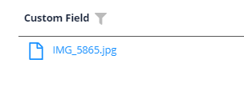
=== "Виджет Info"
    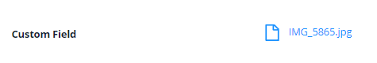
=== "Виджет Form"
    


### Как добавить? { #how-to-add }

??? Example "Пример"
    Для всего приложения нужно определить одно решение для хранения файлов. В этом примере файловое хранилище — minio.

    **Шаг 1 FileStorage** Добавьте файловое хранилище. `подробнее см.` [FileStorage](/ru/features/element/filestorage/fileStorage/)
 
    === "С плагином (рекомендуется)"
        **Шаг 2** Скачайте плагин
            [скачать плагин для IntelliJ](https://doc.cxbox.org/ru/plugin/plugininstalling)
    
        **Шаг 3** Добавьте существующее поле в существующий виджет формы

        

    === "Пример написания кода"
        **Шаг 2** Добавьте такие же поля **String** в соответствующий **BaseEntity**.
    
        ```java
        --8<--
        {{ external_links.github_raw_doc }}/fields/fileupload/basic/MyEntity94.java
        --8<--
        ```
    
        **Шаг 3** Добавьте два поля **String** (для имени и id файла) в соответствующий **DataResponseDTO**.
    
        ```java
        --8<--
        {{ external_links.github_raw_doc }}/fields/fileupload/basic/MyExample94DTO.java
        --8<--
        ```
     
        === "Виджет List"
            **Шаг 4** Добавьте в **_.widget.json_**.
    
            ```json
            --8<--
            {{ external_links.github_raw_doc }}/fields/fileupload/basic/MyExample94List.widget.json
            --8<--
            ```
        === "Виджет Info"
            **Шаг 4** Добавьте в **_.widget.json_**.
            
            ```json
            --8<--
            {{ external_links.github_raw_doc }}/fields/fileupload/basic/MyExample94Info.widget.json
            --8<--
            ```
    
        === "Виджет Form"
    
            **Шаг 4** Добавьте в **_.widget.json_**.
    
            ```json
            --8<--
            {{ external_links.github_raw_doc }}/fields/fileupload/basic/MyExample94Form.widget.json
            --8<--
            ```    
    
        [:material-play-circle: Живой пример]({{ external_links.code_samples }}/ui/#/screen/myexample94){:target="_blank"} ·
        [:fontawesome-brands-github: GitHub]({{ external_links.github_ui }}/{{ external_links.github_branch }}/src/main/java/org/demo/documentation/fields/fileupload/basic){:target="_blank"}

## Placeholder
[:material-play-circle: Живой пример]({{ external_links.code_samples }}/ui/#/screen/myexample100){:target="_blank"} ·
[:fontawesome-brands-github: GitHub]({{ external_links.github_ui }}/{{ external_links.github_branch }}/src/main/java/org/demo/documentation/fields/fileupload/placeholder){:target="_blank"}

`Placeholder` позволяет задать краткую подсказку об ожидаемом значении. Подсказка отображается до ввода пользователем. Её можно вычислять на основе бизнес-логики приложения. Она отображается и для поля `Readonly`.
### Как это выглядит? { #how-does-it-look_1 }
=== "Виджет List"
    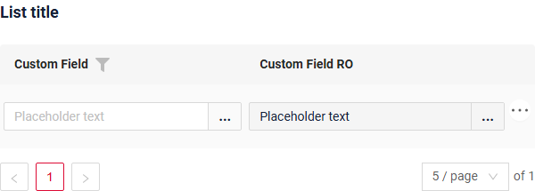
=== "Виджет Info"
    _неприменимо_
=== "Виджет Form"
    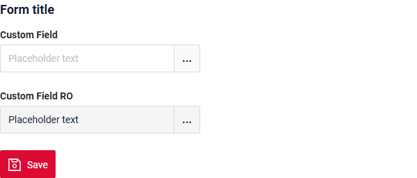
### Как добавить? { #how-to-add_1 }
??? Example "Пример"
    Добавьте **fields.setPlaceholder** в соответствующий **FieldMetaBuilder**.

    ```java
    --8<--
    {{ external_links.github_raw_doc }}/fields/fileupload/placeholder/MyExample100Meta.java:buildRowDependentMeta
    --8<--
    ```  
    === "Виджет List"
        **Работает для List.**
    === "Виджет Info"
        **_неприменимо_**
    === "Виджет Form"
        **Работает для Form.**

    [:material-play-circle: Живой пример]({{ external_links.code_samples }}/ui/#/screen/myexample100){:target="_blank"} ·
    [:fontawesome-brands-github: GitHub]({{ external_links.github_ui }}/{{ external_links.github_branch }}/src/main/java/org/demo/documentation/fields/fileupload/placeholder){:target="_blank"}

## Цвет { #color }
**_неприменимо_**

## Только чтение/Редактирование { #readonlyeditable }
`Readonly/Editable` указывает, можно ли редактировать поле. Это можно вычислять на основе бизнес-логики приложения

`Editable`
[:material-play-circle: Живой пример]({{ external_links.code_samples }}/ui/#/screen/myexample94){:target="_blank"} ·
[:fontawesome-brands-github: GitHub]({{ external_links.github_ui }}/{{ external_links.github_branch }}/src/main/java/org/demo/documentation/fields/fileupload/basic){:target="_blank"}

`Readonly`
[:material-play-circle: Живой пример]({{ external_links.code_samples }}/ui/#/screen/myexample97){:target="_blank"} ·
[:fontawesome-brands-github: GitHub]({{ external_links.github_ui }}/{{ external_links.github_branch }}/src/main/java/org/demo/documentation/fields/fileupload/ro){:target="_blank"}


### Как это выглядит? { #how-does-it-look_2 }
=== "Редактирование"
    === "Виджет List"
        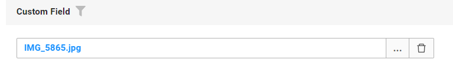
    === "Виджет Info"
        _неприменимо_
    === "Виджет Form"
        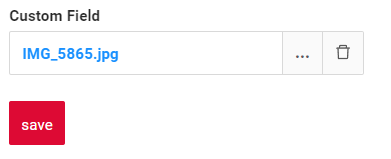
=== "Только чтение"
    === "Виджет List"
        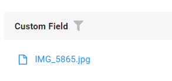
    === "Виджет Info"
        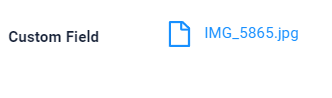
    === "Виджет Form"
        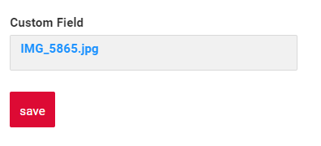

### Как добавить? { #how-to-add_2 }
??? Example "Пример"
    === "Редактирование"
        **Шаг 1** Добавьте маппинг DTO->entity в соответствующий **VersionAwareResponseService**.
        ```java
        --8<--
        {{ external_links.github_raw_doc }}/fields/fileupload/basic/MyExample94Service.java:doUpdateEntity
        --8<--
        ```

        **Шаг 2** Добавьте **fields.setEnabled** в соответствующий **FieldMetaBuilder**.
        ```java
        --8<--
        {{ external_links.github_raw_doc }}/fields/fileupload/basic/MyExample94Meta.java:buildRowDependentMeta
        --8<--
        ```
        === "Виджет List"
            **Работает для List.**
        === "Виджет Info"
            **_неприменимо_**
        === "Виджет Form"
            **Работает для Form.**

        [:material-play-circle: Живой пример]({{ external_links.code_samples }}/ui/#/screen/myexample94){:target="_blank"} ·
        [:fontawesome-brands-github: GitHub]({{ external_links.github_ui }}/{{ external_links.github_branch }}/src/main/java/org/demo/documentation/fields/fileupload/basic){:target="_blank"}

    === "Только чтение"
    
        **Вариант 1** Включено по умолчанию.
        ```java
        --8<--
        {{ external_links.github_raw_doc }}/fields/fileupload/ro/MyExample97Meta.java:buildRowDependentMeta
        --8<--
        ```

        **Вариант 2** `Не рекомендуется.` Свойство fields.setDisabled() переопределяет доступность поля, если используется после свойства fields.setEnabled.
        === "Виджет List"
            **Работает для List.**
        === "Виджет Info"
            **Работает для Info.**
        === "Виджет Form"
            **Работает для Form.**

        [:material-play-circle: Живой пример]({{ external_links.code_samples }}/ui/#/screen/myexample97){:target="_blank"} ·
        [:fontawesome-brands-github: GitHub]({{ external_links.github_ui }}/{{ external_links.github_branch }}/src/main/java/org/demo/documentation/fields/fileupload/ro){:target="_blank"}

## Фильтрация { #filtering }
[:material-play-circle: Живой пример]({{ external_links.code_samples }}/ui/#/screen/myexample99){:target="_blank"} ·
[:fontawesome-brands-github: GitHub]({{ external_links.github_ui }}/{{ external_links.github_branch }}/src/main/java/org/demo/documentation/fields/fileupload/filtration){:target="_blank"}

`Filtering` позволяет искать данные по критериям.
Для `FileUpload field` фильтрация нечувствительна к регистру и находит записи, содержащие указанное значение в любой позиции имени файла (аналогично SQL ```Like %value%``` ).

### Как это выглядит? { #how-does-it-look_3 }
=== "Виджет List"
    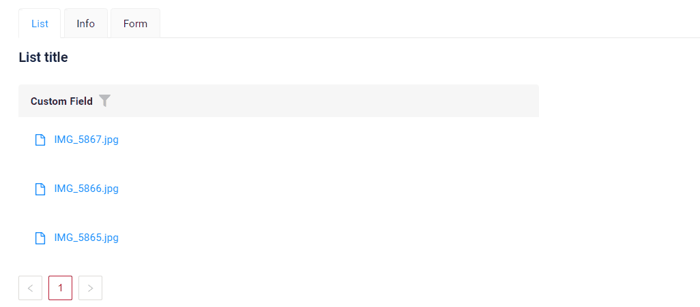
=== "Виджет Info"
    _неприменимо_
=== "Виджет Form"
    _неприменимо_

### Как добавить? { #how-to-add_3 }
??? Example "Пример"
    === "Виджет List"
        **Шаг 1** Добавьте **@SearchParameter** в соответствующий **DataResponseDTO**. (Расширенная настройка [SearchParameter](/ru/advancedCustomization/element/searchparameter/searchparameter))
        ```java
        --8<--
        {{ external_links.github_raw_doc }}/fields/fileupload/filtration/MyExample99DTO.java
        --8<--
        ```


        **Шаг 2**  Добавьте **fields.enableFilter** в соответствующий **FieldMetaBuilder**.
        ```java
        --8<--
        {{ external_links.github_raw_doc }}/fields/fileupload/filtration/MyExample99Meta.java:buildIndependentMeta
        --8<--
        ```

    === "Виджет Info"
        _неприменимо_
    === "Виджет Form"
        _неприменимо_

    [:material-play-circle: Живой пример]({{ external_links.code_samples }}/ui/#/screen/myexample99){:target="_blank"} ·
    [:fontawesome-brands-github: GitHub]({{ external_links.github_ui }}/{{ external_links.github_branch }}/src/main/java/org/demo/documentation/fields/fileupload/filtration){:target="_blank"}

## Drilldown
**_неприменимо_**

## Валидация { #validation }
`Validation` позволяет проверять любые бизнес-правила для введённого пользователем значения. Типы валидации:

1) Exception: отображает сообщение, уведомляющее пользователя о технических или бизнес-ошибках.

   `Business Exception`:
   [:material-play-circle: Живой пример]({{ external_links.code_samples }}/ui/#/screen/myexample103){:target="_blank"} ·
   [:fontawesome-brands-github: GitHub]({{ external_links.github_ui }}/{{ external_links.github_branch }}/src/main/java/org/demo/documentation/fields/fileupload/validationbusinessex){:target="_blank"}

   `Runtime Exception`:
   [:material-play-circle: Живой пример]({{ external_links.code_samples }}/ui/#/screen/myexample105){:target="_blank"} ·
   [:fontawesome-brands-github: GitHub]({{ external_links.github_ui }}/{{ external_links.github_branch }}/src/main/java/org/demo/documentation/fields/fileupload/validationruntimeex){:target="_blank"}
   
2) Confirm: показывает диалог с необязательным сообщением, требующий от пользователя подтверждения или отмены перед продолжением.

   [:material-play-circle: Живой пример]({{ external_links.code_samples }}/ui/#/screen/myexample104){:target="_blank"} ·
   [:fontawesome-brands-github: GitHub]({{ external_links.github_ui }}/{{ external_links.github_branch }}/src/main/java/org/demo/documentation/fields/fileupload/validationconfirm){:target="_blank"}

3) Валидация на уровне полей: показывает ошибку рядом со всеми полями, не прошедшими проверку

   `Option 1`:
   [:material-play-circle: Живой пример]({{ external_links.code_samples }}/ui/#/screen/myexample170){:target="_blank"} ·
   [:fontawesome-brands-github: GitHub]({{ external_links.github_ui }}/{{ external_links.github_branch }}/src/main/java/org/demo/documentation/fields/fileupload/validationannotation){:target="_blank"}

   `Option 2`:
   [:material-play-circle: Живой пример]({{ external_links.code_samples }}/ui/#/screen/myexample324){:target="_blank"} ·
   [:fontawesome-brands-github: GitHub]({{ external_links.github_ui }}/{{ external_links.github_branch }}/src/main/java/org/demo/documentation/fields/fileupload/validationdynamic){:target="_blank"}


### Как это выглядит? { #how-does-it-look_4 }
=== "Виджет List"
    === "BusinessException"
        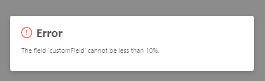
    === "RuntimeException"
        
    === "Confirm"
        
    === "Валидация на уровне полей"
        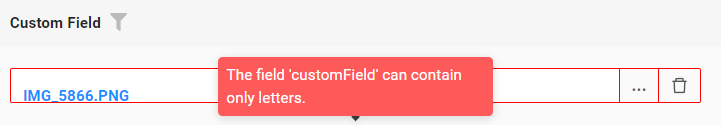
=== "Виджет Info"
    _неприменимо_
=== "Виджет Form"
    === "BusinessException"
        
    === "RuntimeException"
        
    === "Confirm"
        
    === "Валидация на уровне полей"
        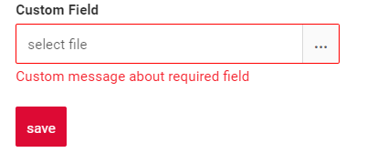
### Как добавить? { #how-to-add_4 }
??? Example "Пример"
    === "BusinessException"
        `BusinessException` описывает ошибку в рамках бизнес-процесса.

        Добавьте **BusinessException** в соответствующий **VersionAwareResponseService**.
        ```java
        --8<--
        {{ external_links.github_raw_doc }}/fields/fileupload/validationbusinessex/MyExample103Service.java:doUpdateEntity
        --8<--
        ```
        === "Виджет List"
            **Работает для List.**
        === "Виджет Info"
            **_неприменимо_**
        === "Виджет Form"
            **Работает для Form.**

        [:material-play-circle: Живой пример]({{ external_links.code_samples }}/ui/#/screen/myexample103){:target="_blank"} ·
        [:fontawesome-brands-github: GitHub]({{ external_links.github_ui }}/{{ external_links.github_branch }}/src/main/java/org/demo/documentation/fields/fileupload/validationbusinessex){:target="_blank"}

    === "RuntimeException"

        `RuntimeException` описывает техническую ошибку в рамках бизнес-процесса.
        
        Добавьте **RuntimeException** в соответствующий **VersionAwareResponseService**.
        ```java
        --8<--
        {{ external_links.github_raw_doc }}/fields/fileupload/validationruntimeex/MyExample105Service.java:doUpdateEntity
        --8<--
        ```
    
        === "Виджет List"
            **Работает для List.**
        === "Виджет Info"
            **_неприменимо_**
        === "Виджет Form"
            **Работает для Form.**

        [:material-play-circle: Живой пример]({{ external_links.code_samples }}/ui/#/screen/myexample105){:target="_blank"} ·
        [:fontawesome-brands-github: GitHub]({{ external_links.github_ui }}/{{ external_links.github_branch }}/src/main/java/org/demo/documentation/fields/fileupload/validationruntimeex){:target="_blank"}

    === "Confirm"
        Добавьте [PreAction.confirm](/ru/advancedCustomization_validation) в соответствующий **VersionAwareResponseService**.
        ```java
        --8<--
        {{ external_links.github_raw_doc }}/fields/fileupload/validationconfirm/MyExample104Service.java:getActions
        --8<--
        ```
        === "Виджет List"
            **Работает для List.**
        === "Виджет Info"
            **_неприменимо_**
        === "Виджет Form"
            **Работает для Form.**

        [:material-play-circle: Живой пример]({{ external_links.code_samples }}/ui/#/screen/myexample104){:target="_blank"} ·
        [:fontawesome-brands-github: GitHub]({{ external_links.github_ui }}/{{ external_links.github_branch }}/src/main/java/org/demo/documentation/fields/fileupload/validationconfirm){:target="_blank"}

    === "Валидация на уровне полей"
        === "Вариант 1"
            Добавьте javax.validation в соответствующий **DataResponseDTO**.

            Используйте, если:

            Нужна простая проверка полей (javax validation)
            ```java
            --8<--
            {{ external_links.github_raw_doc }}/fields/fileupload/validationannotation/MyExample170DTO.java
            --8<--
            ```
	 
            === "Виджет List"
                **Работает для List.**
            === "Виджет Info"
                **_неприменимо_**
            === "Виджет Form"
                **Работает для Form.**

            [:material-play-circle: Живой пример]({{ external_links.code_samples }}/ui/#/screen/myexample170){:target="_blank"} ·
            [:fontawesome-brands-github: GitHub]({{ external_links.github_ui }}/{{ external_links.github_branch }}/src/main/java/org/demo/documentation/fields/fileupload/validationannotation){:target="_blank"}

        === "Вариант 2"
            Создайте собственный сервис для проверки бизнес-логики.

            Используйте, если:

            Для полей требуется проверка бизнес-логики

            `Шаг 1`  Создайте собственный метод проверки.
            ```java
            --8<--
            {{ external_links.github_raw_doc }}/fields/fileupload/validationdynamic/MyExample324Service.java:validateFields
            --8<--
            ```
 
            `Шаг 2` Добавьте собственный метод проверки в соответствующий **VersionAwareResponseService**.
            ```java
            --8<--
            {{ external_links.github_raw_doc }}/fields/fileupload/validationdynamic/MyExample324Service.java:doUpdateEntity
            --8<--
            ```
            
            [:material-play-circle: Живой пример]({{ external_links.code_samples }}/ui/#/screen/myexample324){:target="_blank"} ·
            [:fontawesome-brands-github: GitHub]({{ external_links.github_ui }}/{{ external_links.github_branch }}/src/main/java/org/demo/documentation/fields/fileupload/validationdynamic){:target="_blank"}

## Сортировка { #sorting }
[:material-play-circle: Живой пример]({{ external_links.code_samples }}/ui/#/screen/myexample102){:target="_blank"} ·
[:fontawesome-brands-github: GitHub]({{ external_links.github_ui }}/{{ external_links.github_branch }}/src/main/java/org/demo/documentation/fields/fileupload/sorting){:target="_blank"}

`Sorting` позволяет сортировать данные по возрастанию или убыванию.
`FileUpload field` — текстовое поле, поэтому для него используется лексикографическая сортировка

### Как это выглядит? { #how-does-it-look_5 }
=== "Виджет List"
    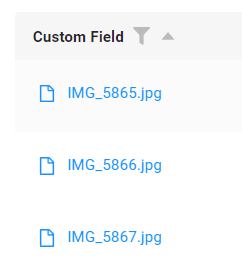
=== "Виджет Info"
    _неприменимо_
=== "Виджет Form"
    _неприменимо_
### Как добавить? { #how-to-add_5 }
??? Example "Пример"
    === "Виджет List"
        подробнее см. [Сортировка](/ru/widget/type/property/sorting/sorting)

        **Шаг 1**  Добавьте **fields.enableSort** в соответствующий **FieldMetaBuilder**.
        ```java
        --8<--
        {{ external_links.github_raw_doc }}/fields/fileupload/sorting/MyExample102Meta.java:buildIndependentMeta
        --8<--
        ```

        [:material-play-circle: Живой пример]({{ external_links.code_samples }}/ui/#/screen/myexample102){:target="_blank"} ·
        [:fontawesome-brands-github: GitHub]({{ external_links.github_ui }}/{{ external_links.github_branch }}/src/main/java/org/demo/documentation/fields/fileupload/sorting){:target="_blank"}

    === "Виджет Info"
        _неприменимо_
    === "Виджет Form"
        _неприменимо_


## Обязательность { #required }
[:material-play-circle: Живой пример]({{ external_links.code_samples }}/ui/#/screen/myexample101){:target="_blank"} ·
[:fontawesome-brands-github: GitHub]({{ external_links.github_ui }}/{{ external_links.github_branch }}/src/main/java/org/demo/documentation/fields/fileupload/required){:target="_blank"}

`Required` позволяет указать, что поле обязательно должно иметь значение.

### Как это выглядит? { #how-does-it-look_6 }
=== "Виджет List"
    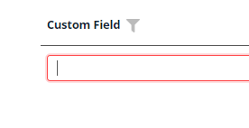
=== "Виджет Info"
    _неприменимо_
=== "Виджет Form"
    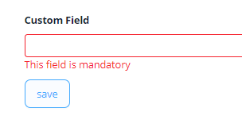
### Как добавить? { #how-to-add_6 }
??? Example "Пример"
    Добавьте **fields.setRequired** в соответствующий **FieldMetaBuilder**.
    ```java
    --8<--
    {{ external_links.github_raw_doc }}/fields/fileupload/required/MyExample101Meta.java:buildRowDependentMeta
    --8<--
    ```
    === "Виджет List"
        **Работает для List.**
    === "Виджет Info"
        **_неприменимо_**
    === "Виджет Form"
        **Работает для Form.**

    [:material-play-circle: Живой пример]({{ external_links.code_samples }}/ui/#/screen/myexample101){:target="_blank"} ·
    [:fontawesome-brands-github: GitHub]({{ external_links.github_ui }}/{{ external_links.github_branch }}/src/main/java/org/demo/documentation/fields/fileupload/required){:target="_blank"}

## Дополнительные свойства { #additional-properties }
### Множественная загрузка файлов { #multi-upload-files }
Реализована множественная загрузка файлов. Для выбора файлов можно использовать специальную зону drag-and-drop или стандартную кнопку.

подробнее см. [Множественная загрузка файлов](/ru/widget/type/property/multiupload/multiupload)

### Ограничение допустимых типов загружаемых файлов { #regulating-the-allowed-upload-types }
[:material-play-circle: Живой пример]({{ external_links.code_samples }}/ui/#/screen/myexample107){:target="_blank"} ·
[:fontawesome-brands-github: GitHub]({{ external_links.github_ui }}/{{ external_links.github_branch }}/src/main/java/org/demo/documentation/fields/fileupload/types){:target="_blank"}

Можно выбрать, какие типы файлов разрешено загружать.

#### Как это выглядит? { #how-does-it-look_7 }
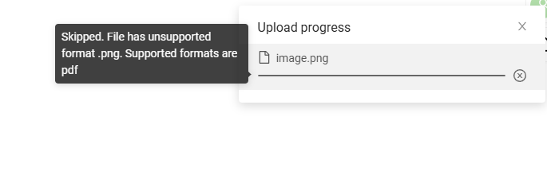 

#### Как добавить? { #how-to-add_7 }
??? Example "Пример"
    Добавьте **fields.setFileAccept** с допустимыми типами загрузки в соответствующий **FieldMetaBuilder**.
    ```java
    --8<--
    {{ external_links.github_raw_doc }}/fields/fileupload/types/MyExample107Meta.java:buildIndependentMeta
    --8<--
    ```    

    [:material-play-circle: Живой пример]({{ external_links.code_samples }}/ui/#/screen/myexample107){:target="_blank"} ·
    [:fontawesome-brands-github: GitHub]({{ external_links.github_ui }}/{{ external_links.github_branch }}/src/main/java/org/demo/documentation/fields/fileupload/types){:target="_blank"}
