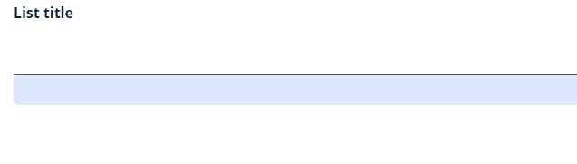
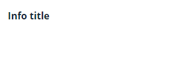
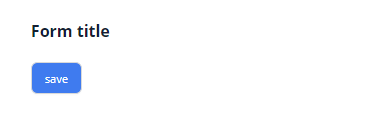

# Hidden
`Hidden` — невидимый технический компонент, позволяющий передать значение поля на фронтенд
## Основы { #basics }
[:material-play-circle: Живой пример]({{ external_links.code_samples }}/ui/#/screen/HiddenBasic){:target="_blank"} ·
[:fontawesome-brands-github: GitHub]({{ external_links.github_ui }}/{{ external_links.github_branch }}/src/main/java/org/demo/documentation/fields/hidden/basic){:target="_blank"}

### Как это выглядит? { #how-does-it-look }

=== "Виджет List"
    
=== "Виджет Info"
    
=== "Виджет Form"
    


### Как добавить? { #how-to-add }
??? Example "Пример"
    **Шаг 1** Добавьте поле **String** в соответствующий **BaseEntity**.

    ```java
    --8<--
    {{ external_links.github_raw_doc }}/fields/hidden/basic/HiddenBasic.java
    --8<--
    ```

    **Шаг 2** Добавьте поле **String** в соответствующий **DataResponseDTO**.

    ```java
    --8<--
    {{ external_links.github_raw_doc }}/fields/hidden/basic/HiddenBasicDTO.java
    --8<--
    ```

    === "Виджет List"
        **Шаг 3** Добавьте в **_.widget.json_**.

        ```json
        --8<--
        {{ external_links.github_raw_doc }}/fields/hidden/basic/HiddenBasicList.widget.json
        --8<--
        ```
    === "Виджет Info"
        **Шаг 3** Добавьте в **_.widget.json_**.
        
        ```json
        --8<--
        {{ external_links.github_raw_doc }}/fields/hidden/basic/HiddenBasicInfo.widget.json
        --8<--
        ```

    === "Виджет Form"

        **Шаг 3** Добавьте в **_.widget.json_**.

        ```json
        --8<--
        {{ external_links.github_raw_doc }}/fields/hidden/basic/HiddenBasicForm.widget.json
        --8<--
        ```      

    [:material-play-circle: Живой пример]({{ external_links.code_samples }}/ui/#/screen/HiddenBasic){:target="_blank"} ·
    [:fontawesome-brands-github: GitHub]({{ external_links.github_ui }}/{{ external_links.github_branch }}/src/main/java/org/demo/documentation/fields/hidden/basic){:target="_blank"}

## Placeholder
_неприменимо_

## Цвет { #color }
_неприменимо_

## Только чтение/Редактирование { #readonlyeditable }
_неприменимо_

## Фильтрация { #filtering }
_неприменимо_

## Drilldown
_неприменимо_

## Валидация { #validation }
_неприменимо_

## Сортировка { #sorting }
_неприменимо_

## Обязательность { #required }
_неприменимо_