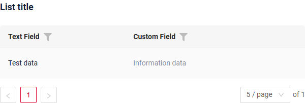
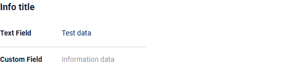
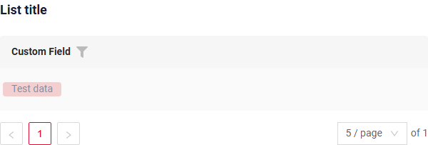
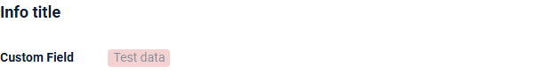
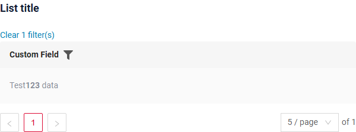
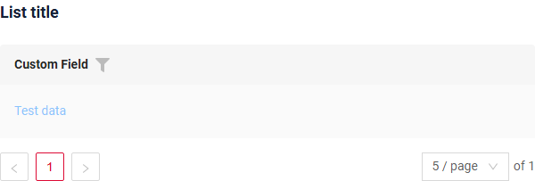
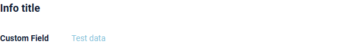
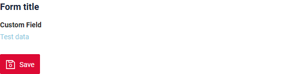

# Hint

`Hint` — нередактируемый компонент для косвенного указания или подсказки
Типичный сценарий — использование в логическом блоке [Multifield](/ru/widget/fields/field/multifield/multifield)
## Основы { #basics }
[:material-play-circle: Живой пример]({{ external_links.code_samples }}/ui/#/screen/myexample156){:target="_blank"} ·
[:fontawesome-brands-github: GitHub]({{ external_links.github_ui }}/{{ external_links.github_branch }}/src/main/java/org/demo/documentation/fields/hint/basic){:target="_blank"}

### Как это выглядит? { #how-does-it-look }

=== "Виджет List"
    
=== "Виджет Info"
    
=== "Виджет Form"
    


### Как добавить? { #how-to-add }

??? Example "Пример"
    **Шаг 1** Добавьте поле **String** в соответствующий **BaseEntity**.
    ```java
    --8<--
    {{ external_links.github_raw_doc }}/fields/hint/basic/MyEntity156.java
    --8<--
    ```

    **Шаг 2** Добавьте поле **String** в соответствующий **DataResponseDTO**.

    ```java
    --8<--
    {{ external_links.github_raw_doc }}/fields/hint/basic/MyExample156DTO.java
    --8<--
    ```

    === "Виджет List"
        **Шаг 3** Добавьте в **_.widget.json_**.

        ```json
        --8<--
        {{ external_links.github_raw_doc }}/fields/hint/basic/MyExample156List.widget.json
        --8<--
        ```
    === "Виджет Info"
        **Шаг 3** Добавьте в **_.widget.json_**.
        
        ```json
        --8<--
        {{ external_links.github_raw_doc }}/fields/hint/basic/MyExample156Info.widget.json
        --8<--
        ```

    === "Виджет Form"

        **Шаг 3** Добавьте в **_.widget.json_**.

        ```json
        --8<--
        {{ external_links.github_raw_doc }}/fields/hint/basic/MyExample156Form.widget.json
        --8<--
        ```

    [:material-play-circle: Живой пример]({{ external_links.code_samples }}/ui/#/screen/myexample156){:target="_blank"} ·
    [:fontawesome-brands-github: GitHub]({{ external_links.github_ui }}/{{ external_links.github_branch }}/src/main/java/org/demo/documentation/fields/hint/basic){:target="_blank"}

## Placeholder
_неприменимо_

## Цвет { #color }
`Color` позволяет задать цвет поля. Его можно вычислять на основе бизнес-логики приложения

**Вычисляемый цвет**

[:material-play-circle: Живой пример]({{ external_links.code_samples }}/ui/#/screen/myexample157){:target="_blank"} ·
[:fontawesome-brands-github: GitHub]({{ external_links.github_ui }}/{{ external_links.github_branch }}/src/main/java/org/demo/documentation/fields/hint/color){:target="_blank"}

**Постоянный цвет**

[:material-play-circle: Живой пример]({{ external_links.code_samples }}/ui/#/screen/myexample158){:target="_blank"} ·
[:fontawesome-brands-github: GitHub]({{ external_links.github_ui }}/{{ external_links.github_branch }}/src/main/java/org/demo/documentation/fields/hint/colorconst){:target="_blank"}

### Как это выглядит? { #how-does-it-look_1 }
=== "Виджет List"
    
=== "Виджет Info"
    
=== "Виджет Form"
    _неприменимо_

### Как добавить? { #how-to-add_1 }
??? Example "Пример"
    === "Вычисляемый цвет"
        **Шаг 1**   Добавьте `собственное поле для цвета` в соответствующий **DataResponseDTO**. Поле может содержать цвет в формате HEX или быть null.
        ```java
        --8<--
        {{ external_links.github_raw_doc }}/fields/hint/color/MyExample157DTO.java
        --8<--
        ```

        === "Виджет List"
            **Шаг 2** Добавьте **"bgColorKey"** :  `собственное поле для цвета` в .widget.json.
            ```json
            --8<--
            {{ external_links.github_raw_doc }}/fields/hint/color/MyExample157List.widget.json
            --8<--
            ```
        === "Виджет Info"
            **Шаг 2** Добавьте **"bgColorKey"** :  `собственное поле для цвета` в .widget.json.
            ```json
            --8<--
            {{ external_links.github_raw_doc }}/fields/hint/color/MyExample157Info.widget.json
            --8<--
            ```
        === "Виджет Form"
            _неприменимо_

        [:material-play-circle: Живой пример]({{ external_links.code_samples }}/ui/#/screen/myexample157){:target="_blank"} ·
        [:fontawesome-brands-github: GitHub]({{ external_links.github_ui }}/{{ external_links.github_branch }}/src/main/java/org/demo/documentation/fields/hint/color){:target="_blank"}

    === "Постоянный цвет"
        === "Виджет List"
            Добавьте **"bgColor"** :  `цвет HEX` в .widget.json.
            ```json
            --8<--
            {{ external_links.github_raw_doc }}/fields/hint/colorconst/MyExample158List.widget.json
            --8<--
            ```
        === "Виджет Info"
            Добавьте **"bgColor"** :  `цвет HEX` в .widget.json.
            ```json
            --8<--
            {{ external_links.github_raw_doc }}/fields/hint/colorconst/MyExample158Info.widget.json
            --8<--
            ```
        === "Виджет Form"
            _неприменимо_

        [:material-play-circle: Живой пример]({{ external_links.code_samples }}/ui/#/screen/myexample158){:target="_blank"} ·
        [:fontawesome-brands-github: GitHub]({{ external_links.github_ui }}/{{ external_links.github_branch }}/src/main/java/org/demo/documentation/fields/hint/colorconst){:target="_blank"}

## Только чтение/Редактирование { #readonlyeditable }
`Hint field` всегда только для чтения, поэтому `Editable` _неприменимо_

## Фильтрация { #filtering }
[:material-play-circle: Живой пример]({{ external_links.code_samples }}/ui/#/screen/myexample162){:target="_blank"} ·
[:fontawesome-brands-github: GitHub]({{ external_links.github_ui }}/{{ external_links.github_branch }}/src/main/java/org/demo/documentation/fields/hint/filtration){:target="_blank"}

`Filtering` позволяет искать данные по критериям.
Для `Hint field` фильтрация нечувствительна к регистру и находит записи, содержащие указанное значение в любой позиции (аналогично SQL ```Like %value%``` ).
### Как это выглядит? { #how-does-it-look_2 }
=== "Виджет List"
    
=== "Виджет Info"
    _неприменимо_
=== "Виджет Form"
    _неприменимо_

### Как добавить? { #how-to-add_2 }
??? Example "Пример"
    === "Виджет List"
        **Шаг 1** Добавьте **@SearchParameter** в соответствующий **DataResponseDTO**. (Расширенная настройка [SearchParameter](/ru/advancedCustomization/element/searchparameter/searchparameter))
        ```java
        --8<--
        {{ external_links.github_raw_doc }}/fields/hint/filtration/MyExample162DTO.java
        --8<--
        ```

        **Шаг 2**  Добавьте **fields.enableFilter** в соответствующий **FieldMetaBuilder**.
        ```java
        --8<--
        {{ external_links.github_raw_doc }}/fields/hint/filtration/MyExample162Meta.java:buildIndependentMeta
        --8<--
        ```

    === "Виджет Info"
        _неприменимо_
    === "Виджет Form"
        _неприменимо_

    [:material-play-circle: Живой пример]({{ external_links.code_samples }}/ui/#/screen/myexample162){:target="_blank"} ·
    [:fontawesome-brands-github: GitHub]({{ external_links.github_ui }}/{{ external_links.github_branch }}/src/main/java/org/demo/documentation/fields/hint/filtration){:target="_blank"}

## Drilldown
[:material-play-circle: Живой пример]({{ external_links.code_samples }}/ui/#/screen/myexample161){:target="_blank"} ·
[:fontawesome-brands-github: GitHub]({{ external_links.github_ui }}/{{ external_links.github_branch }}/src/main/java/org/demo/documentation/fields/hint/drilldown){:target="_blank"}

`DrillDown` позволяет перейти в другое представление простым нажатием. Целевое представление и другие части drill-down можно вычислять на основе бизнес-логики приложения

Также при необходимости можно отфильтровать данные целевого представления до его открытия, `подробнее см.` [DrillDown](/ru/features/element/drilldown/drilldown)

### Как это выглядит? { #how-does-it-look_3 }
=== "Виджет List"
    
=== "Виджет Info"
    
=== "Виджет Form"
    
### Как добавить? { #how-to-add_3 }
??? Example "Пример"
    **Вариант 1**
    
    
    `Шаг 1` Добавьте [fields.setDrilldown](/ru/features/element/drilldown/drilldown) в соответствующий **FieldMetaBuilder**.
    ```java
    --8<--
    {{ external_links.github_raw_doc }}/fields/hint/drilldown/MyExample161Meta.java:buildRowDependentMeta
    --8<--
    ```

    === "Виджет List"
        `Шаг 2` Добавьте **"drillDown": "true"** в .widget.json.
        ```json
        --8<--
        {{ external_links.github_raw_doc }}/fields/hint/drilldown/MyExample161List.widget.json
        --8<--
        ```
 
        **Вариант 2**
           Добавьте **"drillDownKey"** :  `собственное поле` в .widget.json. Подробнее см. [Drilldown](/ru/advancedCustomization_drillDown)

    === "Виджет Info"
        `Шаг 2` Добавьте **"drillDown": "true"** в .widget.json.
        
        ```json
        --8<--
        {{ external_links.github_raw_doc }}/fields/hint/drilldown/MyExample161Info.widget.json
        --8<--
        ```
        **Вариант 2**
           Добавьте **"drillDownKey"** :  `собственное поле` в .widget.json. Подробнее см. [Drilldown](/ru/advancedCustomization_drillDown)

    === "Виджет Form"
        `Шаг 2` Добавьте **"drillDown": "true"** в .widget.json.
        ```json
        --8<--
        {{ external_links.github_raw_doc }}/fields/hint/drilldown/MyExample161Form.widget.json
        --8<--
        ```
        **Вариант 2**
           Добавьте **"drillDownKey"** :  `собственное поле` в .widget.json. Подробнее см. [Drilldown](/ru/advancedCustomization_drillDown)

    [:material-play-circle: Живой пример]({{ external_links.code_samples }}/ui/#/screen/myexample161){:target="_blank"} ·
    [:fontawesome-brands-github: GitHub]({{ external_links.github_ui }}/{{ external_links.github_branch }}/src/main/java/org/demo/documentation/fields/hint/drilldown){:target="_blank"}

[Расширенная настройка](/ru/advancedCustomization_drillDown)

## Валидация { #validation }
_неприменимо_

## Сортировка { #sorting }
_неприменимо_

## Обязательность { #required }
_неприменимо_
