# Input
Компонент `Field Input` используется для редактирования текста. Он позволяет редактировать и отображать однострочный текст.
## Основы { #basics }
[:material-play-circle: Живой пример]({{ external_links.code_samples }}/ui/#/screen/InputBasic){:target="_blank"} ·
[:fontawesome-brands-github: GitHub]({{ external_links.github_ui }}/{{ external_links.github_branch }}/src/main/java/org/demo/documentation/fields/input/basic){:target="_blank"}

### Как это выглядит? { #how-does-it-look }

=== "Виджет List"
    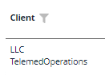
=== "Виджет Info"
    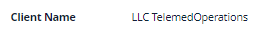
=== "Виджет Form"
    


### Как добавить? { #how-to-add }
??? Example "Пример"

    === "С плагином (рекомендуется)"
        **Шаг 1** Скачайте плагин
            [скачать плагин для IntelliJ](https://doc.cxbox.org/ru/plugin/plugininstalling)
    
        **Шаг 2** Добавьте существующее поле в существующий виджет формы

        

    === "Пример написания кода"
        **Шаг 1**  Добавьте поле **String** в соответствующий **BaseEntity**.
        ```java
        --8<--
        {{ external_links.github_raw_doc }}/fields/input/basic/InputBasic.java
        --8<--
        ```
    
        **Шаг 2** Добавьте поле **String** в соответствующий **DataResponseDTO**.
        ```java
        --8<--
        {{ external_links.github_raw_doc }}/fields/input/basic/InputBasicDTO.java
        --8<--
        ```
    
        === "Виджет List"
            **Шаг 3** Добавьте в **_.widget.json_**.
    
            ```json
            --8<--
            {{ external_links.github_raw_doc }}/fields/input/basic/InputBasicList.widget.json
            --8<--
            ```
        === "Виджет Info"
            **Шаг 3** Добавьте в **_.widget.json_**.
            
            ```json
            --8<--
            {{ external_links.github_raw_doc }}/fields/input/basic/InputBasicInfo.widget.json
            --8<--
            ```
    
        === "Виджет Form"
    
            **Шаг 3** Добавьте в **_.widget.json_**.
    
            ```json
            --8<--
            {{ external_links.github_raw_doc }}/fields/input/basic/InputBasicForm.widget.json
            --8<--
            ```    
    
        [:material-play-circle: Живой пример]({{ external_links.code_samples }}/ui/#/screen/InputBasic){:target="_blank"} ·
        [:fontawesome-brands-github: GitHub]({{ external_links.github_ui }}/{{ external_links.github_branch }}/src/main/java/org/demo/documentation/fields/input/basic){:target="_blank"}

## Placeholder
[:material-play-circle: Живой пример]({{ external_links.code_samples }}/ui/#/screen/InputPlaceholder){:target="_blank"} ·
[:fontawesome-brands-github: GitHub]({{ external_links.github_ui }}/{{ external_links.github_branch }}/src/main/java/org/demo/documentation/fields/input/placeholder){:target="_blank"}

`Placeholder` позволяет задать краткую подсказку об ожидаемом значении. Подсказка отображается до ввода пользователем. Её можно вычислять на основе бизнес-логики приложения. Она отображается и для поля `Readonly`.
### Как это выглядит? { #how-does-it-look_1 }
=== "Виджет List"
    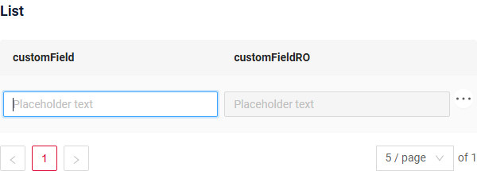
=== "Виджет Info"
    _неприменимо_
=== "Виджет Form"
    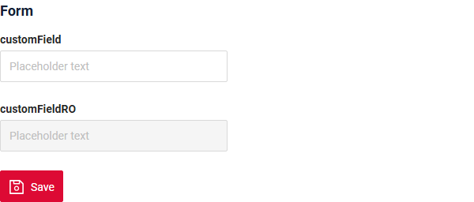
### Как добавить? { #how-to-add_1 }
??? Example "Пример"

    Добавьте **fields.setPlaceholder** в соответствующий **FieldMetaBuilder**.
    ```java
    --8<--
    {{ external_links.github_raw_doc }}/fields/input/placeholder/InputPlaceholderMeta.java:buildRowDependentMeta
    --8<--
    ```
    === "Виджет List"
        **Работает для List.**
    === "Виджет Info"
        **_неприменимо_**
    === "Виджет Form"
        **Работает для Form.**

    [:material-play-circle: Живой пример]({{ external_links.code_samples }}/ui/#/screen/InputPlaceholder){:target="_blank"} ·
    [:fontawesome-brands-github: GitHub]({{ external_links.github_ui }}/{{ external_links.github_branch }}/src/main/java/org/demo/documentation/fields/input/placeholder){:target="_blank"}

## Цвет { #color }
`Color` позволяет задать цвет поля. Его можно вычислять на основе бизнес-логики приложения

**Вычисляемый цвет**

[:material-play-circle: Живой пример]({{ external_links.code_samples }}/ui/#/screen/InputColor){:target="_blank"} ·
[:fontawesome-brands-github: GitHub]({{ external_links.github_ui }}/{{ external_links.github_branch }}/src/main/java/org/demo/documentation/fields/input/color){:target="_blank"}

**Постоянный цвет**

[:material-play-circle: Живой пример]({{ external_links.code_samples }}/ui/#/screen/InputColorConst){:target="_blank"} ·
[:fontawesome-brands-github: GitHub]({{ external_links.github_ui }}/{{ external_links.github_branch }}/src/main/java/org/demo/documentation/fields/input/colorconst){:target="_blank"}
 
### Как это выглядит? { #how-does-it-look_2 }
=== "Виджет List"
    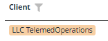
=== "Виджет Info"
    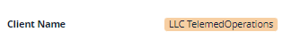
=== "Виджет Form"
    _неприменимо_

### Как добавить? { #how-to-add_2 }
??? Example "Пример"
    === "Вычисляемый цвет"
        **Шаг 1**   Добавьте `собственное поле для цвета` в соответствующий **DataResponseDTO**. Поле может содержать цвет в формате HEX или быть null.
        ```java
        --8<--
        {{ external_links.github_raw_doc }}/fields/input/color/InputColorDTO.java
        --8<--
        ```

        === "Виджет List"
            **Шаг 2** Добавьте **"bgColorKey"** :  `собственное поле для цвета` в .widget.json.
            ```json
            --8<--
            {{ external_links.github_raw_doc }}/fields/input/color/InputColorList.widget.json
            --8<--
            ```
        === "Виджет Info"
            **Шаг 2** Добавьте **"bgColorKey"** :  `собственное поле для цвета` в .widget.json.
            ```json
            --8<--
            {{ external_links.github_raw_doc }}/fields/input/color/InputColorInfo.widget.json
            --8<--
            ```
        === "Виджет Form"
            _неприменимо_

        [:material-play-circle: Живой пример]({{ external_links.code_samples }}/ui/#/screen/InputColor){:target="_blank"} ·
        [:fontawesome-brands-github: GitHub]({{ external_links.github_ui }}/{{ external_links.github_branch }}/src/main/java/org/demo/documentation/fields/input/color){:target="_blank"}

    === "Постоянный цвет"
        === "Виджет List"
            Добавьте **"bgColor"** :  `цвет HEX` в .widget.json.
            ```json
            --8<--
            {{ external_links.github_raw_doc }}/fields/input/colorconst/InputColorConstList.widget.json
            --8<--
            ```
        === "Виджет Info"
            Добавьте **"bgColor"** :  `цвет HEX` в .widget.json.
            ```json
            --8<--
            {{ external_links.github_raw_doc }}/fields/input/colorconst/InputColorConstInfo.widget.json
            --8<--
            ```
        === "Виджет Form"
            _неприменимо_

        [:material-play-circle: Живой пример]({{ external_links.code_samples }}/ui/#/screen/InputColorConst){:target="_blank"} ·
        [:fontawesome-brands-github: GitHub]({{ external_links.github_ui }}/{{ external_links.github_branch }}/src/main/java/org/demo/documentation/fields/input/colorconst){:target="_blank"}

## Только чтение/Редактирование { #readonlyeditable }
`Readonly/Editable` указывает, можно ли редактировать поле. Это можно вычислять на основе бизнес-логики приложения

`Editable`
[:material-play-circle: Живой пример]({{ external_links.code_samples }}/ui/#/screen/InputBasic){:target="_blank"} ·
[:fontawesome-brands-github: GitHub]({{ external_links.github_ui }}/{{ external_links.github_branch }}/src/main/java/org/demo/documentation/fields/input/basic){:target="_blank"}

`Readonly`
[:material-play-circle: Живой пример]({{ external_links.code_samples }}/ui/#/screen/InputCreateEdit){:target="_blank"} ·
[:fontawesome-brands-github: GitHub]({{ external_links.github_ui }}/{{ external_links.github_branch }}/src/main/java/org/demo/documentation/fields/input/ro){:target="_blank"}

### Как это выглядит? { #how-does-it-look_3 }
=== "Редактирование"
    === "Виджет List"
        
    === "Виджет Info"
        _неприменимо_
    === "Виджет Form"
        
=== "Только чтение"
    === "Виджет List"
        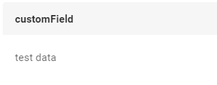
    === "Виджет Info"
        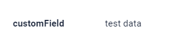
    === "Виджет Form"
        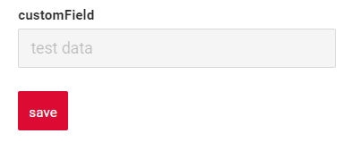
### Как добавить? { #how-to-add_3 }
??? Example "Пример"
    === "Редактирование"
        **Шаг 1** Добавьте маппинг DTO->entity в соответствующий **VersionAwareResponseService**.

        ```java
        --8<--
        {{ external_links.github_raw_doc }}/fields/input/basic/InputBasicService.java:doUpdateEntity
        --8<--
        ```
 
        **Шаг 2** Добавьте **fields.setEnabled** в соответствующий **FieldMetaBuilder**.

        ```java
        --8<--
        {{ external_links.github_raw_doc }}/fields/input/basic/InputBasicMeta.java:buildRowDependentMeta
        --8<--
        ```

        === "Виджет List"
            **Работает для List.**
        === "Виджет Info"
            **_неприменимо_**
        === "Виджет Form"
            **Работает для Form.**

        [:material-play-circle: Живой пример]({{ external_links.code_samples }}/ui/#/screen/InputBasic){:target="_blank"} ·
        [:fontawesome-brands-github: GitHub]({{ external_links.github_ui }}/{{ external_links.github_branch }}/src/main/java/org/demo/documentation/fields/input/basic){:target="_blank"}

    === "Только чтение"

        **Вариант 1** Включено по умолчанию.
        ```java
        --8<--
        {{ external_links.github_raw_doc }}/fields/input/ro/InputCreateEditMeta.java:buildRowDependentMeta
        --8<--
        ```

        **Вариант 2** `Не рекомендуется.` Свойство fields.setDisabled() переопределяет доступность поля, если используется после свойства fields.setEnabled.

        === "Виджет List"
            **Работает для List.**
        === "Виджет Info"
            **_неприменимо_**
        === "Виджет Form"
            **Работает для Form.**

        [:material-play-circle: Живой пример]({{ external_links.code_samples }}/ui/#/screen/InputCreateEdit){:target="_blank"} ·
        [:fontawesome-brands-github: GitHub]({{ external_links.github_ui }}/{{ external_links.github_branch }}/src/main/java/org/demo/documentation/fields/input/ro){:target="_blank"}

## Фильтрация { #filtering }
[:material-play-circle: Живой пример]({{ external_links.code_samples }}/ui/#/screen/InputFiltration){:target="_blank"} ·
[:fontawesome-brands-github: GitHub]({{ external_links.github_ui }}/{{ external_links.github_branch }}/src/main/java/org/demo/documentation/fields/input/filtration){:target="_blank"}

`Filtering` позволяет искать данные по критериям.
Для `Input field` фильтрация нечувствительна к регистру и находит записи, содержащие указанное значение в любой позиции (аналогично SQL ```Like %value%``` ).
### Как это выглядит? { #how-does-it-look_4 }
=== "Виджет List"
    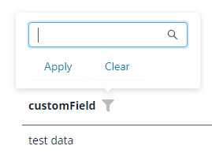
=== "Виджет Info"
    _неприменимо_
=== "Виджет Form"
    _неприменимо_

### Как добавить? { #how-to-add_4 }
??? Example "Пример"
    === "Виджет List"
        **Шаг 1** Добавьте **@SearchParameter** в соответствующий **DataResponseDTO**. (Расширенная настройка [SearchParameter](/ru/advancedCustomization/element/searchparameter/searchparameter))
        ```java
        --8<--
        {{ external_links.github_raw_doc }}/fields/input/filtration/InputFiltrationDTO.java
        --8<--
        ```

        **Шаг 2**  Добавьте **fields.enableFilter** в соответствующий **FieldMetaBuilder**.
        ```java
        --8<--
        {{ external_links.github_raw_doc }}/fields/input/filtration/InputFiltrationMeta.java:buildIndependentMeta   
        --8<--
        ```

    === "Виджет Info"
        _неприменимо_
    === "Виджет Form"
        _неприменимо_

    [:material-play-circle: Живой пример]({{ external_links.code_samples }}/ui/#/screen/InputFiltration){:target="_blank"} ·
    [:fontawesome-brands-github: GitHub]({{ external_links.github_ui }}/{{ external_links.github_branch }}/src/main/java/org/demo/documentation/fields/input/filtration){:target="_blank"}

## Drilldown
[:material-play-circle: Живой пример]({{ external_links.code_samples }}/ui/#/screen/InputDrilldown){:target="_blank"} ·
[:fontawesome-brands-github: GitHub]({{ external_links.github_ui }}/{{ external_links.github_branch }}/src/main/java/org/demo/documentation/fields/input/drilldown){:target="_blank"}

`DrillDown` позволяет перейти в другое представление простым нажатием. Целевое представление и другие части drill-down можно вычислять на основе бизнес-логики приложения

Также при необходимости можно отфильтровать данные целевого представления до его открытия, `подробнее см.` [DrillDown](/ru/features/element/drilldown/drilldown)

### Как это выглядит? { #how-does-it-look_5 }
=== "Виджет List"
    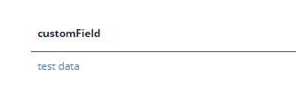
=== "Виджет Info"
    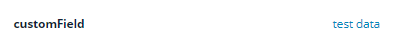
=== "Виджет Form"
    Нажмите на скрепку 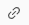

    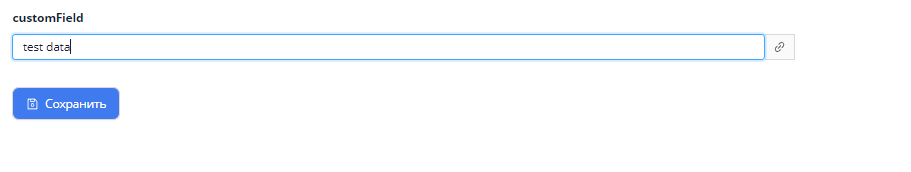
### Как добавить? { #how-to-add_5 }
??? Example "Пример"
    **Вариант 1**
    
    
    `Шаг 1` Добавьте [fields.setDrilldown](/ru/features/element/drilldown/drilldown) в соответствующий **FieldMetaBuilder**.
    ```java
    --8<--
    {{ external_links.github_raw_doc }}/fields/input/drilldown/InputDrilldownMeta.java:buildRowDependentMeta
    --8<--
    ```

    === "Виджет List"
        `Шаг 2` Добавьте **"drillDown": "true"** в .widget.json.
        ```json
        --8<--
        {{ external_links.github_raw_doc }}/fields/input/drilldown/InputDrilldownList.widget.json
        --8<--
        ```
 
        **Вариант 2**
           Добавьте **"drillDownKey"** :  `собственное поле` в .widget.json. Подробнее см. [Drilldown](/ru/features/element/drilldown/drilldown)

    === "Виджет Info"
        `Шаг 2` Добавьте **"drillDown": "true"** в .widget.json.
        
        ```json
        --8<--
        {{ external_links.github_raw_doc }}/fields/input/drilldown/InputDrilldownInfo.widget.json
        --8<--
        ```
        **Вариант 2**
           Добавьте **"drillDownKey"** :  `собственное поле` в .widget.json. Подробнее см. [Drilldown](/ru/features/element/drilldown/drilldown)

    === "Виджет Form"
        `Шаг 2` Добавьте **"drillDown": "true"** в .widget.json.
        ```json
        --8<--
        {{ external_links.github_raw_doc }}/fields/input/drilldown/InputDrilldownForm.widget.json
        --8<--
        ```
        **Вариант 2**
           Добавьте **"drillDownKey"** :  `собственное поле` в .widget.json. Подробнее см. [Drilldown](/ru/features/element/drilldown/drilldown)

    [:material-play-circle: Живой пример]({{ external_links.code_samples }}/ui/#/screen/InputDrilldown){:target="_blank"} ·
    [:fontawesome-brands-github: GitHub]({{ external_links.github_ui }}/{{ external_links.github_branch }}/src/main/java/org/demo/documentation/fields/input/drilldown){:target="_blank"}

[Расширенная настройка](/ru/features/element/drilldown/drilldown)

## Валидация { #validation }
`Validation` позволяет проверять любые бизнес-правила для введённого пользователем значения. Типы валидации:

1) Exception: отображает сообщение, уведомляющее пользователя о технических или бизнес-ошибках.

   `Business Exception`:
   [:material-play-circle: Живой пример]({{ external_links.code_samples }}/ui/#/screen/InputValidationBusinessException){:target="_blank"} ·
   [:fontawesome-brands-github: GitHub]({{ external_links.github_ui }}/{{ external_links.github_branch }}/src/main/java/org/demo/documentation/fields/input/validationbusinessex){:target="_blank"}

   `Runtime Exception`:
   [:material-play-circle: Живой пример]({{ external_links.code_samples }}/ui/#/screen/InputValidationRuntimeException){:target="_blank"} ·
   [:fontawesome-brands-github: GitHub]({{ external_links.github_ui }}/{{ external_links.github_branch }}/src/main/java/org/demo/documentation/fields/input/validationruntimeex){:target="_blank"}
   
2) Confirm: показывает диалог с необязательным сообщением, требующий от пользователя подтверждения или отмены перед продолжением.

   [:material-play-circle: Живой пример]({{ external_links.code_samples }}/ui/#/screen/InputValidation){:target="_blank"} ·
   [:fontawesome-brands-github: GitHub]({{ external_links.github_ui }}/{{ external_links.github_branch }}/src/main/java/org/demo/documentation/fields/input/validationconfirm){:target="_blank"}

3) Валидация на уровне полей: показывает ошибку рядом со всеми полями, не прошедшими проверку

   `Option 1`:
   [:material-play-circle: Живой пример]({{ external_links.code_samples }}/ui/#/screen/myexample163){:target="_blank"} ·
   [:fontawesome-brands-github: GitHub]({{ external_links.github_ui }}/{{ external_links.github_branch }}/src/main/java/org/demo/documentation/fields/input/validationannotation){:target="_blank"}

   `Option 2`:
   [:material-play-circle: Живой пример]({{ external_links.code_samples }}/ui/#/screen/myexample326){:target="_blank"} ·
   [:fontawesome-brands-github: GitHub]({{ external_links.github_ui }}/{{ external_links.github_branch }}/src/main/java/org/demo/documentation/fields/input/validationdynamic){:target="_blank"}

### Как это выглядит? { #how-does-it-look_6 }
=== "Виджет List"
    === "BusinessException"
        
    === "RuntimeException"
        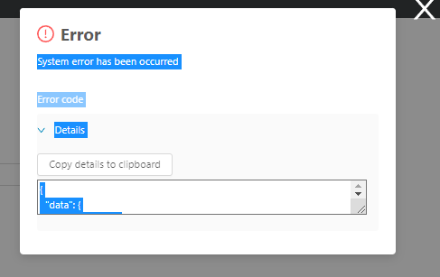
    === "Confirm"
        
    === "Валидация на уровне полей"
        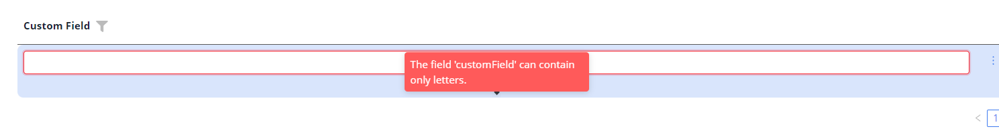

=== "Виджет Info"
    _неприменимо_
=== "Виджет Form"
    === "BusinessException"
        
    === "RuntimeException"
        
    === "Confirm"
        
    === "Валидация на уровне полей"
        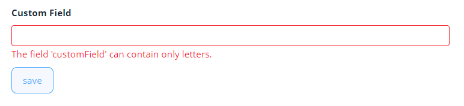
### Как добавить? { #how-to-add_6 }
??? Example "Пример"
    === "BusinessException"
        `BusinessException` описывает ошибку в рамках бизнес-процесса.

        Добавьте **BusinessException** в соответствующий **VersionAwareResponseService**.
        ```java
        --8<--
        {{ external_links.github_raw_doc }}/fields/input/validationbusinessex/InputValidationBusinessExceptionService.java:doUpdateEntity
        --8<--
        ```
        === "Виджет List"
            **Работает для List.**
        === "Виджет Info"
            **_неприменимо_**
        === "Виджет Form"
            **Работает для Form.**

        [:material-play-circle: Живой пример]({{ external_links.code_samples }}/ui/#/screen/InputValidationBusinessException){:target="_blank"} ·
        [:fontawesome-brands-github: GitHub]({{ external_links.github_ui }}/{{ external_links.github_branch }}/src/main/java/org/demo/documentation/fields/input/validationbusinessex){:target="_blank"}

    === "RuntimeException"

        `RuntimeException` описывает техническую ошибку в рамках бизнес-процесса.
        
        Добавьте **RuntimeException** в соответствующий **VersionAwareResponseService**.
        ```java
        --8<--
        {{ external_links.github_raw_doc }}/fields/input/validationruntimeex/InputValidationRuntimeExceptionService.java:doUpdateEntity
        --8<--
        ```
  
        === "Виджет List"
            **Работает для List.**
        === "Виджет Info"
            **_неприменимо_**
        === "Виджет Form"
            **Работает для Form.**

        [:material-play-circle: Живой пример]({{ external_links.code_samples }}/ui/#/screen/InputValidationRuntimeException){:target="_blank"} ·
        [:fontawesome-brands-github: GitHub]({{ external_links.github_ui }}/{{ external_links.github_branch }}/src/main/java/org/demo/documentation/fields/input/validationruntimeex){:target="_blank"}

    === "Confirm"
        Добавьте [PreAction.confirm](/ru/advancedCustomization_validation) в соответствующий **VersionAwareResponseService**.
        ```java
        --8<--
        {{ external_links.github_raw_doc }}/fields/input/validationconfirm/InputValidationService.java:getActions
        --8<--
        ```
 
        === "Виджет List"
            **Работает для List.**
        === "Виджет Info"
            **_неприменимо_**
        === "Виджет Form"
            **Работает для Form.**

        [:material-play-circle: Живой пример]({{ external_links.code_samples }}/ui/#/screen/InputValidation){:target="_blank"} ·
        [:fontawesome-brands-github: GitHub]({{ external_links.github_ui }}/{{ external_links.github_branch }}/src/main/java/org/demo/documentation/fields/input/validationconfirm){:target="_blank"}

    === "Валидация на уровне полей"
        === "Вариант 1"
            Добавьте javax.validation в соответствующий **DataResponseDTO**.

            Используйте, если:

            Нужна простая проверка полей (javax validation)
            ```java
            --8<--
            {{ external_links.github_raw_doc }}/fields/input/validationannotation/MyExample163DTO.java
            --8<--
            ```
 
            === "Виджет List"
                **Работает для List.**
            === "Виджет Info"
                **_неприменимо_**
            === "Виджет Form"
                **Работает для Form.**

            [:material-play-circle: Живой пример]({{ external_links.code_samples }}/ui/#/screen/myexample163){:target="_blank"} ·
            [:fontawesome-brands-github: GitHub]({{ external_links.github_ui }}/{{ external_links.github_branch }}/src/main/java/org/demo/documentation/fields/input/validationannotation){:target="_blank"}

        === "Вариант 2"
            Создайте собственный сервис для проверки бизнес-логики.

            Используйте, если:

            Для полей требуется проверка бизнес-логики

            `Шаг 1`  Создайте собственный метод проверки.
            ```java
            --8<--
            {{ external_links.github_raw_doc }}/fields/input/validationdynamic/MyExample326Service.java:validateFields
            --8<--
            ```
 
            `Шаг 2` Добавьте собственный метод проверки в соответствующий **VersionAwareResponseService**.
            ```java
            --8<--
            {{ external_links.github_raw_doc }}/fields/input/validationdynamic/MyExample326Service.java:doUpdateEntity
            --8<--
            ```

            [:material-play-circle: Живой пример]({{ external_links.code_samples }}/ui/#/screen/myexample326){:target="_blank"} ·
            [:fontawesome-brands-github: GitHub]({{ external_links.github_ui }}/{{ external_links.github_branch }}/src/main/java/org/demo/documentation/fields/input/validationdynamic){:target="_blank"}

## Сортировка { #sorting }
[:material-play-circle: Живой пример]({{ external_links.code_samples }}/ui/#/screen/InputSort){:target="_blank"} ·
[:fontawesome-brands-github: GitHub]({{ external_links.github_ui }}/{{ external_links.github_branch }}/src/main/java/org/demo/documentation/fields/input/sorting){:target="_blank"}

`Sorting` позволяет сортировать данные по возрастанию или убыванию.
`Input field` — текстовое поле, поэтому для него используется лексикографическая сортировка

### Как это выглядит? { #how-does-it-look_7 }
=== "Виджет List"
    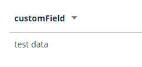
=== "Виджет Info"
    _неприменимо_
=== "Виджет Form"
    _неприменимо_
### Как добавить? { #how-to-add_7 }
??? Example "Пример"
    === "Виджет List"
        подробнее см. [Сортировка](/ru/widget/type/property/sorting/sorting)

        **Шаг 1**  Добавьте **fields.enableSort** в соответствующий **FieldMetaBuilder**.
        ```java
        --8<--
        {{ external_links.github_raw_doc }}/fields/input/sorting/InputSortMeta.java:buildIndependentMeta
        --8<--
        ```

        [:material-play-circle: Живой пример]({{ external_links.code_samples }}/ui/#/screen/InputSort){:target="_blank"} ·
        [:fontawesome-brands-github: GitHub]({{ external_links.github_ui }}/{{ external_links.github_branch }}/src/main/java/org/demo/documentation/fields/input/sorting){:target="_blank"}

    === "Виджет Info"
        _неприменимо_
    === "Виджет Form"
        _неприменимо_

## Обязательность { #required }
[:material-play-circle: Живой пример]({{ external_links.code_samples }}/ui/#/screen/InputRequired){:target="_blank"} ·
[:fontawesome-brands-github: GitHub]({{ external_links.github_ui }}/{{ external_links.github_branch }}/src/main/java/org/demo/documentation/fields/input/required){:target="_blank"}

`Required` позволяет указать, что поле обязательно должно иметь значение. По умолчанию `Input field` не обязательно

### Как это выглядит? { #how-does-it-look_8 }
=== "Виджет List"
    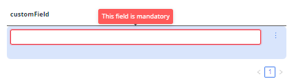
=== "Виджет Info"
    _неприменимо_
=== "Виджет Form"
    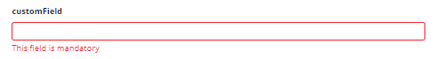
### Как добавить? { #how-to-add_8 }
??? Example "Пример"
    Добавьте **fields.setRequired** в соответствующий **FieldMetaBuilder**.
    ```java
    --8<--
    {{ external_links.github_raw_doc }}/fields/input/required/InputRequiredMeta.java:buildRowDependentMeta
    --8<--
    ```
 
    === "Виджет List"
        **Работает для List.**
    === "Виджет Info"
        **_неприменимо_**
    === "Виджет Form"
        **Работает для Form.**

    [:material-play-circle: Живой пример]({{ external_links.code_samples }}/ui/#/screen/InputRequired){:target="_blank"} ·
    [:fontawesome-brands-github: GitHub]({{ external_links.github_ui }}/{{ external_links.github_branch }}/src/main/java/org/demo/documentation/fields/input/required){:target="_blank"}

## Дополнительные свойства { #additional-properties }
### <a id="maxInput">maxInput</a>
[:material-play-circle: Живой пример]({{ external_links.code_samples }}/ui/#/screen/MaxInput){:target="_blank"} ·
[:fontawesome-brands-github: GitHub]({{ external_links.github_ui }}/{{ external_links.github_branch }}/src/main/java/org/demo/documentation/fields/input/additionalproperties){:target="_blank"}

Задаёт максимальное количество вводимых символов

#### Как это выглядит? { #how-does-it-look_9 }
=== "Виджет List"
    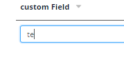
=== "Виджет Info"
    _неприменимо_
=== "Виджет Form"
    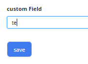

#### Как добавить? { #how-to-add_9 }
??? Example "Пример"
    === "Виджет List"
        Добавьте **maxInput** в **_.widget.json_**.
        ```json
        --8<--
        {{ external_links.github_raw_doc }}/fields/input/additionalproperties/MaxInputList.widget.json
        --8<--
        ```
  
    === "Виджет Info"
        **_неприменимо_**
    === "Виджет Form"
        Добавьте **maxInput** в **_.widget.json_**.
        ```json
        --8<--
        {{ external_links.github_raw_doc }}/fields/input/additionalproperties/MaxInputForm.widget.json
        --8<--
        ```
    
    [:material-play-circle: Живой пример]({{ external_links.code_samples }}/ui/#/screen/MaxInput){:target="_blank"} ·
    [:fontawesome-brands-github: GitHub]({{ external_links.github_ui }}/{{ external_links.github_branch }}/src/main/java/org/demo/documentation/fields/input/additionalproperties){:target="_blank"}
