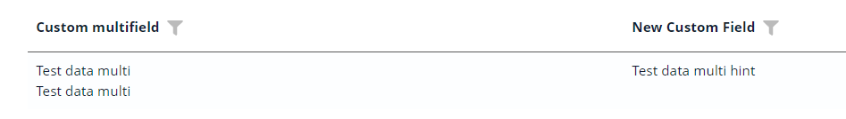
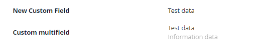
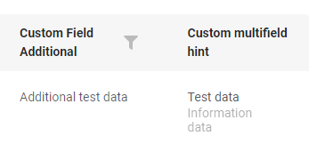
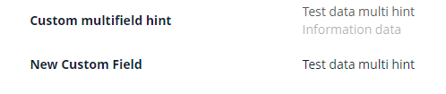
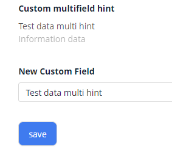
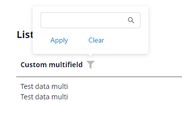

# Multifield

`Multifield` — логический блок, содержащий любое количество полей других типов. Все поля в логическом блоке только для чтения.
Типичный сценарий — использование обычного типа поля (например, input, date) для «основных» данных и поля типа hint для «второстепенных» данных

## Основы { #basics }
[:material-play-circle: Живой пример]({{ external_links.code_samples }}/ui/#/screen/myexample160/view/myexample160list){:target="_blank"} ·
[:fontawesome-brands-github: GitHub]({{ external_links.github_ui }}/{{ external_links.github_branch }}/src/main/java/org/demo/documentation/fields/multifield/basic){:target="_blank"}

### Как это выглядит? { #how-does-it-look }

Логические блоки можно отображать в разных стилях

1) Стиль 'list' отображает каждую запись на отдельной строке

2) Стиль 'inline' отображает все данные в одной строке

=== "Виджет List"
    
=== "Виджет Info"
    
=== "Виджет Form"
    

Блок, содержащий поле типа hint. `подробнее см.` [hint](/ru/widget/fields/field/hint/hint)
=== "Виджет List"
    
=== "Виджет Info"
    
=== "Виджет Form"
    


### Как добавить? { #how-to-add }

??? Example "Пример"
    
    === "Виджет List"
        Добавьте `fields` и `style` в **_.widget.json_**.
        ```json
        --8<--
        {{ external_links.github_raw_doc }}/fields/multifield/basic/MyExample160List.widget.json
        --8<--
        ```     

    === "Виджет Info"
        Добавьте `fields` и `style` в **_.widget.json_**.

        Ключ multifield используется для определения порядка отображения полей в интерфейсе ("options.layout").

        ```json
        --8<--
        {{ external_links.github_raw_doc }}/fields/multifield/basic/MyExample160Info.widget.json
        --8<--
        ```

    === "Виджет Form"

        Добавьте `fields` и `style` в **_.widget.json_**.

        Ключ multifield используется для определения порядка отображения полей в интерфейсе ("options.layout").

        ```json
        --8<--
        {{ external_links.github_raw_doc }}/fields/multifield/basic/MyExample160Form.widget.json
        --8<--
        ```

    [:material-play-circle: Живой пример]({{ external_links.code_samples }}/ui/#/screen/myexample160/view/myexample160list){:target="_blank"} ·
    [:fontawesome-brands-github: GitHub]({{ external_links.github_ui }}/{{ external_links.github_branch }}/src/main/java/org/demo/documentation/fields/multifield/basic){:target="_blank"}

## Placeholder
_неприменимо_

## Цвет { #color }
_неприменимо_

## Только чтение/Редактирование { #readonlyeditable }
Все поля в логическом блоке только для чтения.


## Фильтрация { #filtering }
[:material-play-circle: Живой пример]({{ external_links.code_samples }}/ui/#/screen/myexample360){:target="_blank"} ·
[:fontawesome-brands-github: GitHub]({{ external_links.github_ui }}/{{ external_links.github_branch }}/src/main/java/org/demo/documentation/fields/multifield/filtration){:target="_blank"}

`Filtering` позволяет искать данные по критериям. Поиск по =
### Как это выглядит? { #how-does-it-look_1 }
 
=== "Виджет List"
    
=== "Виджет Info"
    _неприменимо_
=== "Виджет Form"
    _неприменимо_

Фильтр не работает с полем типа hint. `подробнее см.` [hint](/ru/widget/fields/field/hint/hint)

### Как добавить? { #how-to-add_1 }
??? Example "Пример"
    === "Виджет List"

        **Шаг 1** Добавьте **@SearchParameter** в соответствующий **DataResponseDTO**. (Расширенная настройка [SearchParameter](/ru/advancedCustomization/element/searchparameter/searchparameter))
        ```java
        --8<--
        {{ external_links.github_raw_doc }}/fields/multifield/filtration/MyExample360DTO.java
        --8<--
        ```
 
        **Шаг 2**  Добавьте **fields.enableFilter** в соответствующий **FieldMetaBuilder**.
        ```java
        --8<--
        {{ external_links.github_raw_doc }}/fields/multifield/filtration/MyExample360Meta.java
        --8<--
        ```
 
        **Шаг 3**  Добавьте поле для фильтра блока в параметр `key`.
        
        Например, для фильтрации по полю "customFieldAdditionalMulti" — "key" = "customFieldAdditionalMulti"
        
        ```json
        {
          "title": "Custom multifield",
          "key": "customFieldAdditionalMulti",
          "type": "multifield",
          "style": "list",
          "fields": [
            {
              "title": "Custom Field Multi",
              "key": "customFieldMulti",
              "type": "input"
            },
            {
              "title": "New Custom Field Multi",
              "key": "customFieldAdditionalMulti",
              "type": "input"
            }
          ]
        }
        ```
    === "Виджет Info"
        _неприменимо_
    === "Виджет Form"
        _неприменимо_

    [:material-play-circle: Живой пример]({{ external_links.code_samples }}/ui/#/screen/myexample360){:target="_blank"} ·
    [:fontawesome-brands-github: GitHub]({{ external_links.github_ui }}/{{ external_links.github_branch }}/src/main/java/org/demo/documentation/fields/multifield/filtration){:target="_blank"}

## Drilldown
_неприменимо_

## Валидация { #validation }
_неприменимо_

## Сортировка { #sorting }
_неприменимо_

## Обязательность { #required }
_неприменимо_