# MultipleSelect

`MultipleSelect` — компонент, позволяющий выбрать несколько значений из выпадающего списка предопределённых значений

!!! tips "Совет"
    Для этого типа поля важно количество строк во всплывающем окне и количество выбранных строк. Количество строк во всплывающем окне: используйте для справочников или медленно растущих сущностей, например не более 1000 значений (все значения загружаются в память). В противном случае используйте multivalue. Количество выбранных строк: те же ограничения, что и для «количества строк во всплывающем окне»

## Основы { #basics }
[:material-play-circle: Живой пример]({{ external_links.code_samples }}/ui/#/screen/myexample251){:target="_blank"} ·
[:fontawesome-brands-github: GitHub]({{ external_links.github_ui }}/{{ external_links.github_branch }}/src/main/java/org/demo/documentation/fields/multipleselect/basic){:target="_blank"}

### Как это выглядит? { #how-does-it-look }

=== "Виджет List"
    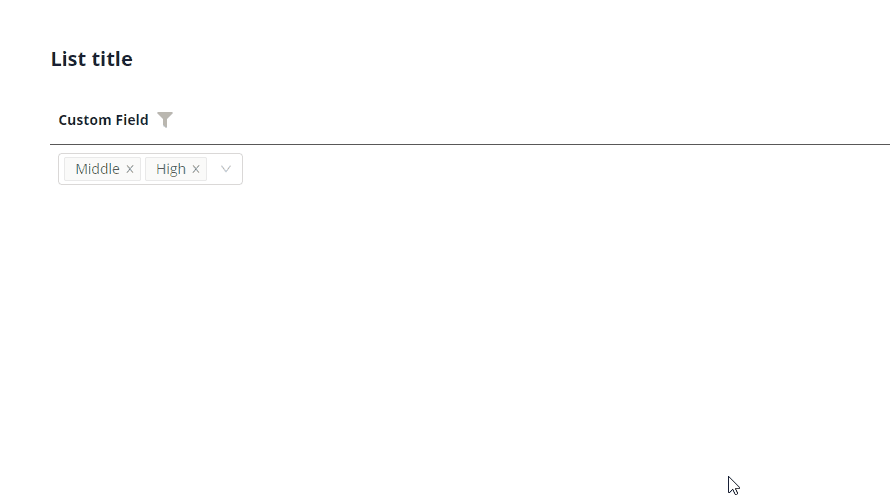
=== "Виджет Info"
    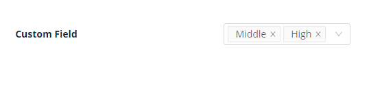
=== "Виджет Form"
    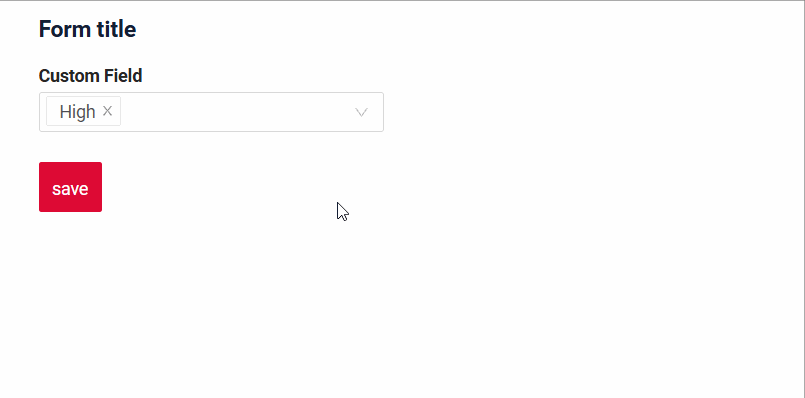

### Как добавить? { #how-to-add }

??? Example "Пример"
    **Шаг 1** Создайте Enum. Рекомендуется использовать постоянный ключ и динамическое значение для визуального отображения.
    ```java
    --8<--
    {{ external_links.github_raw_doc }}/fields/multipleselect/basic/enums/CustomFieldEnum.java
    --8<--
    ```
    **Шаг 2** Добавьте поле **Custom Field** в соответствующий **BaseEntity**.

    ```java
    --8<--
    {{ external_links.github_raw_doc }}/fields/multipleselect/basic/MyEntity251.java
    --8<--
    ```

    **Шаг 3**  Добавьте поле **Custom Field** в соответствующий **DataResponseDTO**.

    ```java
    --8<--
    {{ external_links.github_raw_doc }}/fields/multipleselect/basic/MyExample251DTO.java
    --8<--
    ```

    **Шаг 4** Добавьте **fields.setConcreteValues** в соответствующий **FieldMetaBuilder**.

    ```java
    --8<--
    {{ external_links.github_raw_doc }}/fields/multipleselect/basic/MyExample251Meta.java:buildRowDependentMeta
    --8<--
    ```

    === "Виджет List"
        **Шаг 5** Добавьте в **_.widget.json_**.

        ```json
        --8<--
        {{ external_links.github_raw_doc }}/fields/multipleselect/basic/MyExample251List.widget.json
        --8<--
        ```

    === "Виджет Info"
        **Шаг 5** Добавьте в **_.widget.json_**.
        ```json
        --8<--
        {{ external_links.github_raw_doc }}/fields/multipleselect/basic/MyExample251Info.widget.json
        --8<--
        ```
    === "Виджет Form"
        **Шаг 5** Добавьте в **_.widget.json_**.
        ```json
        --8<--
        {{ external_links.github_raw_doc }}/fields/multipleselect/basic/MyExample251Form.widget.json
        --8<--
        ```

    [:material-play-circle: Живой пример]({{ external_links.code_samples }}/ui/#/screen/myexample251){:target="_blank"} ·
    [:fontawesome-brands-github: GitHub]({{ external_links.github_ui }}/{{ external_links.github_branch }}/src/main/java/org/demo/documentation/fields/multipleselect/basic){:target="_blank"}

## Placeholder
[:material-play-circle: Живой пример]({{ external_links.code_samples }}/ui/#/screen/myexample257){:target="_blank"} ·
[:fontawesome-brands-github: GitHub]({{ external_links.github_ui }}/{{ external_links.github_branch }}/src/main/java/org/demo/documentation/fields/multipleselect/placeholder){:target="_blank"}

`Placeholder` позволяет задать краткую подсказку об ожидаемом значении. Подсказка отображается до ввода пользователем. Её можно вычислять на основе бизнес-логики приложения. Она отображается и для поля `Readonly`.
### Как это выглядит? { #how-does-it-look_1 }
=== "Виджет List"
    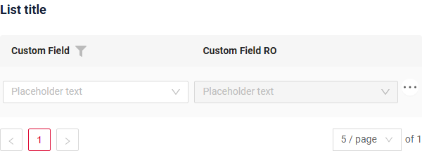
=== "Виджет Info"
    _неприменимо_
=== "Виджет Form"
    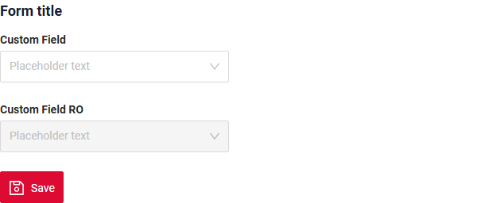
### Как добавить? { #how-to-add_1 }
??? Example "Пример"
    Добавьте **fields.setPlaceholder** в соответствующий **FieldMetaBuilder**.

    ```java
    --8<--
    {{ external_links.github_raw_doc }}/fields/multipleselect/placeholder/MyExample257Meta.java:buildRowDependentMeta
    --8<--
    ```  

    === "Виджет List"
        **Работает для List.**
    === "Виджет Info"
        **_неприменимо_**
    === "Виджет Form"
        **Работает для Form.**

    [:material-play-circle: Живой пример]({{ external_links.code_samples }}/ui/#/screen/myexample257){:target="_blank"} ·
    [:fontawesome-brands-github: GitHub]({{ external_links.github_ui }}/{{ external_links.github_branch }}/src/main/java/org/demo/documentation/fields/multipleselect/placeholder){:target="_blank"}

## Цвет { #color }
_неприменимо_

## Только чтение/Редактирование { #readonlyeditable }
`Readonly/Editable` указывает, можно ли редактировать поле. Это можно вычислять на основе бизнес-логики приложения

`Editable`
[:material-play-circle: Живой пример]({{ external_links.code_samples }}/ui/#/screen/myexample251){:target="_blank"} ·
[:fontawesome-brands-github: GitHub]({{ external_links.github_ui }}/{{ external_links.github_branch }}/src/main/java/org/demo/documentation/fields/multipleselect/basic){:target="_blank"}

`Readonly`
[:material-play-circle: Живой пример]({{ external_links.code_samples }}/ui/#/screen/myexample253){:target="_blank"} ·
[:fontawesome-brands-github: GitHub]({{ external_links.github_ui }}/{{ external_links.github_branch }}/src/main/java/org/demo/documentation/fields/multipleselect/ro){:target="_blank"}

### Как это выглядит? { #how-does-it-look_2 }
=== "Редактирование"
    === "Виджет List"
        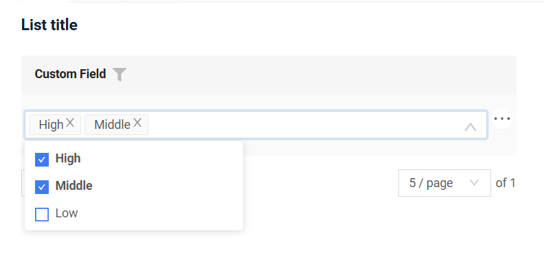
    === "Виджет Info"
        _неприменимо_
    === "Виджет Form"
        
=== "Только чтение"
    === "Виджет List"
        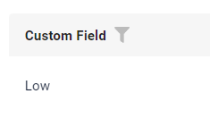
    === "Виджет Info"
        
    === "Виджет Form"
        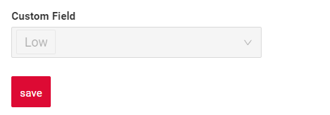
     
### Как добавить? { #how-to-add_2 }
??? Example "Пример"
    === "Редактирование"
        **Шаг 1** Добавьте маппинг DTO->entity в соответствующий **VersionAwareResponseService**.
        ```java
        --8<--
        {{ external_links.github_raw_doc }}/fields/multipleselect/basic/MyExample251Service.java:doUpdateEntity
        --8<--
        ``` 
         **Шаг 2** Добавьте **fields.setEnabled** в соответствующий **FieldMetaBuilder**.
        ```java
        --8<--
        {{ external_links.github_raw_doc }}/fields/multipleselect/basic/MyExample251Meta.java:buildRowDependentMeta
        --8<--
        ```   
 
        === "Виджет List"
            **Работает для List.**
        === "Виджет Info"
            **_неприменимо_**
        === "Виджет Form"
            **Работает для Form.**

        [:material-play-circle: Живой пример]({{ external_links.code_samples }}/ui/#/screen/myexample251){:target="_blank"} ·
        [:fontawesome-brands-github: GitHub]({{ external_links.github_ui }}/{{ external_links.github_branch }}/src/main/java/org/demo/documentation/fields/multipleselect/basic){:target="_blank"}

    === "Только чтение"
    
        **Вариант 1** Включено по умолчанию.
        ```java
        --8<--
        {{ external_links.github_raw_doc }}/fields/multipleselect/ro/MyExample253Meta.java:buildRowDependentMeta
        --8<--
        ```     
    
        **Вариант 2** `Не рекомендуется.` Свойство fields.setDisabled() переопределяет доступность поля, если используется после свойства fields.setEnabled.
        === "Виджет List"
            **Работает для List.**
        === "Виджет Info"
            **Работает для Info.**
        === "Виджет Form"
            **Работает для Form.**

        [:material-play-circle: Живой пример]({{ external_links.code_samples }}/ui/#/screen/myexample253){:target="_blank"} ·
        [:fontawesome-brands-github: GitHub]({{ external_links.github_ui }}/{{ external_links.github_branch }}/src/main/java/org/demo/documentation/fields/multipleselect/ro){:target="_blank"}

## Фильтрация { #filtering }
[:material-play-circle: Живой пример]({{ external_links.code_samples }}/ui/#/screen/myexample256/view/myexample256list){:target="_blank"} ·
[:fontawesome-brands-github: GitHub]({{ external_links.github_ui }}/{{ external_links.github_branch }}/src/main/java/org/demo/documentation/fields/multipleselect/filtration){:target="_blank"}

`Filtering` позволяет искать данные по критериям. Поиск использует оператор `in`.

Компонент фильтра отображает поле текстового поиска и полосу прокрутки в зависимости от количества доступных значений фильтра.
(начиная с [релиза 2.0.13](https://doc.cxbox.org/ru/new/version2013/"))

- Поле поиска и полоса прокрутки появляются, только когда количество значений для фильтрации превышает
  7 элементов (7 — количество элементов по умолчанию, настраивается константой фронтенда).

- Кнопка Apply показывает счётчик выбранных элементов (например, `Apply (5)`).
- Если выбрано больше 7 элементов, отображается `Apply (N+)` (например, `Apply (9+)`).

### Как это выглядит? { #how-does-it-look_3 }
=== "Виджет List"
    === "< количества элементов по умолчанию"
        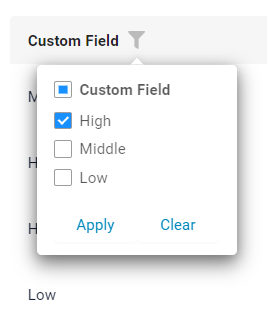
    === "> количества элементов по умолчанию"
        
=== "Виджет Info"
    _неприменимо_
=== "Виджет Form"
    _неприменимо_

### Как добавить? { #how-to-add_3 }
??? Example "Пример"
    === "Виджет List"
        **Шаг 1** Добавьте **@SearchParameter** в соответствующий **DataResponseDTO**. (Расширенная настройка [SearchParameter](/ru/advancedCustomization/element/searchparameter/searchparameter))
        ```java
        --8<--
        {{ external_links.github_raw_doc }}/fields/multipleselect/filtration/MyExample256DTO.java
        --8<--
        ```
 
        **Шаг 2**  Добавьте **fields.enableFilter** в соответствующий **FieldMetaBuilder**.
        ```java
        --8<--
        {{ external_links.github_raw_doc }}/fields/multipleselect/filtration/MyExample256Meta.java:buildIndependentMeta
        --8<--
        ```
 
    === "Виджет Info"
        _неприменимо_
    === "Виджет Form"
        _неприменимо_

    **Настройка количества элементов по умолчанию**

    - Расположение: `\ui\src\constants\filter.ts`
    - Переменные:

        - `checkboxFilterMaxVisibleItems` — определяет, когда появляются прокрутка/поиск.
        - `checkboxFilterCounterLimit` — задаёт максимальное число, после которого используется запись с `+`.

    [:material-play-circle: Живой пример]({{ external_links.code_samples }}/ui/#/screen/myexample256/view/myexample256list){:target="_blank"} ·
    [:fontawesome-brands-github: GitHub]({{ external_links.github_ui }}/{{ external_links.github_branch }}/src/main/java/org/demo/documentation/fields/multipleselect/filtration){:target="_blank"}

## Drilldown
**_неприменимо_**


## Валидация { #validation }
`Validation` позволяет проверять любые бизнес-правила для введённого пользователем значения. Типы валидации:

1) Exception: отображает сообщение, уведомляющее пользователя о технических или бизнес-ошибках.

   `Business Exception`:
   [:material-play-circle: Живой пример]({{ external_links.code_samples }}/ui/#/screen/myexample248){:target="_blank"} ·
   [:fontawesome-brands-github: GitHub]({{ external_links.github_ui }}/{{ external_links.github_branch }}/src/main/java/org/demo/documentation/fields/multipleselect/validationbusinessex){:target="_blank"}

   `Runtime Exception`:
   [:material-play-circle: Живой пример]({{ external_links.code_samples }}/ui/#/screen/myexample249){:target="_blank"} ·
   [:fontawesome-brands-github: GitHub]({{ external_links.github_ui }}/{{ external_links.github_branch }}/src/main/java/org/demo/documentation/fields/multipleselect/validationruntimeex){:target="_blank"}
   
2) Confirm: показывает диалог с необязательным сообщением, требующий от пользователя подтверждения или отмены перед продолжением.

   [:material-play-circle: Живой пример]({{ external_links.code_samples }}/ui/#/screen/myexample260){:target="_blank"} ·
   [:fontawesome-brands-github: GitHub]({{ external_links.github_ui }}/{{ external_links.github_branch }}/src/main/java/org/demo/documentation/fields/multipleselect/validationconfirm){:target="_blank"}

3) Валидация на уровне полей: показывает ошибку рядом со всеми полями, не прошедшими проверку

   `Option 1`:
   [:material-play-circle: Живой пример]({{ external_links.code_samples }}/ui/#/screen/myexample345){:target="_blank"} ·
   [:fontawesome-brands-github: GitHub]({{ external_links.github_ui }}/{{ external_links.github_branch }}/src/main/java/org/demo/documentation/fields/multipleselect/validationannotation){:target="_blank"}

   `Option 2`:
   [:material-play-circle: Живой пример]({{ external_links.code_samples }}/ui/#/screen/myexample334){:target="_blank"} ·
   [:fontawesome-brands-github: GitHub]({{ external_links.github_ui }}/{{ external_links.github_branch }}/src/main/java/org/demo/documentation/fields/multipleselect/validationdynamic){:target="_blank"}

### Как это выглядит? { #how-does-it-look_4 }
=== "Виджет List"
    === "BusinessException"
        
    === "RuntimeException"
        
    === "Confirm"
        
    === "Валидация на уровне полей"
        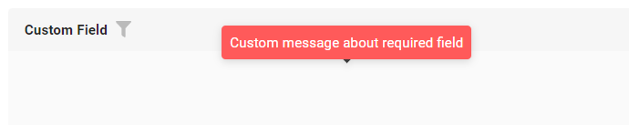
=== "Виджет Info"
    _неприменимо_
=== "Виджет Form"
    === "BusinessException"
        
    === "RuntimeException"
        
    === "Confirm"
        
    === "Валидация на уровне полей"
        

### Как добавить? { #how-to-add_4 }
??? Example "Пример"
    === "BusinessException"
        `BusinessException` описывает ошибку в рамках бизнес-процесса.

        Добавьте **BusinessException** в соответствующий **VersionAwareResponseService**.
        ```java
        --8<--
        {{ external_links.github_raw_doc }}/fields/multipleselect/validationbusinessex/MyExample248Service.java:doUpdateEntity
        --8<--
        ```
 
        === "Виджет List"
            **Работает для List.**
        === "Виджет Info"
            **_неприменимо_**
        === "Виджет Form"
            **Работает для Form.**

        [:material-play-circle: Живой пример]({{ external_links.code_samples }}/ui/#/screen/myexample248){:target="_blank"} ·
        [:fontawesome-brands-github: GitHub]({{ external_links.github_ui }}/{{ external_links.github_branch }}/src/main/java/org/demo/documentation/fields/multipleselect/validationbusinessex){:target="_blank"}

    === "RuntimeException"

        `RuntimeException` описывает техническую ошибку в рамках бизнес-процесса.
        
        Добавьте **RuntimeException** в соответствующий **VersionAwareResponseService**.
        ```java
        --8<--
        {{ external_links.github_raw_doc }}/fields/multipleselect/validationruntimeex/MyExample249Service.java:doUpdateEntity
        --8<--
        ```        
   
        === "Виджет List"
            **Работает для List.**
        === "Виджет Info"
            **_неприменимо_**
        === "Виджет Form"
            **Работает для Form.**

        [:material-play-circle: Живой пример]({{ external_links.code_samples }}/ui/#/screen/myexample249){:target="_blank"} ·
        [:fontawesome-brands-github: GitHub]({{ external_links.github_ui }}/{{ external_links.github_branch }}/src/main/java/org/demo/documentation/fields/multipleselect/validationruntimeex){:target="_blank"}

    === "Confirm"
        Добавьте [PreAction.confirm](/ru/advancedCustomization_validation) в соответствующий **VersionAwareResponseService**.
        ```java
        --8<--
        {{ external_links.github_raw_doc }}/fields/multipleselect/validationconfirm/MyExample260Service.java:getActions
        --8<--
        ```
 
        === "Виджет List"
            **Работает для List.**
        === "Виджет Info"
            **_неприменимо_**
        === "Виджет Form"
            **Работает для Form.**

        [:material-play-circle: Живой пример]({{ external_links.code_samples }}/ui/#/screen/myexample260){:target="_blank"} ·
        [:fontawesome-brands-github: GitHub]({{ external_links.github_ui }}/{{ external_links.github_branch }}/src/main/java/org/demo/documentation/fields/multipleselect/validationconfirm){:target="_blank"}

    === "Валидация на уровне полей"
        === "Вариант 1"
            Добавьте javax.validation в соответствующий **DataResponseDTO**.
            
            Используйте, если:
            
            Нужна простая проверка полей (javax validation)

            ```java
            --8<--
            {{ external_links.github_raw_doc }}/fields/multipleselect/validationannotation/MyExample345DTO.java
            --8<--
            ```
             
            === "Виджет List"
                **Работает для List.**
            === "Виджет Info"
                **_неприменимо_**
            === "Виджет Form"
                **Работает для Form.**

            [:material-play-circle: Живой пример]({{ external_links.code_samples }}/ui/#/screen/myexample345){:target="_blank"} ·
            [:fontawesome-brands-github: GitHub]({{ external_links.github_ui }}/{{ external_links.github_branch }}/src/main/java/org/demo/documentation/fields/multipleselect/validationannotation){:target="_blank"}

        === "Вариант 2"
            Создайте собственный сервис для проверки бизнес-логики.
            
            Используйте, если:
            
            Для полей требуется проверка бизнес-логики
            
            `Шаг 1`  Создайте собственный метод проверки.
            ```java
            --8<--
            {{ external_links.github_raw_doc }}/fields/multipleselect/validationdynamic/MyExample334Service.java:validateFields
            --8<--
            ```
 
            `Шаг 2` Добавьте собственный метод проверки в соответствующий **VersionAwareResponseService**.
            ```java
            --8<--
            {{ external_links.github_raw_doc }}/fields/multipleselect/validationdynamic/MyExample334Service.java:doUpdateEntity
            --8<--
            ```

            [:material-play-circle: Живой пример]({{ external_links.code_samples }}/ui/#/screen/myexample334){:target="_blank"} ·
            [:fontawesome-brands-github: GitHub]({{ external_links.github_ui }}/{{ external_links.github_branch }}/src/main/java/org/demo/documentation/fields/multipleselect/validationdynamic){:target="_blank"}

## Сортировка { #sorting }
**_неприменимо_**

## Обязательность { #required }
[:material-play-circle: Живой пример]({{ external_links.code_samples }}/ui/#/screen/myexample247){:target="_blank"} ·
[:fontawesome-brands-github: GitHub]({{ external_links.github_ui }}/{{ external_links.github_branch }}/src/main/java/org/demo/documentation/fields/multipleselect/required){:target="_blank"}

`Required` позволяет указать, что поле обязательно должно иметь значение.

### Как это выглядит? { #how-does-it-look_5 }
=== "Виджет List"
    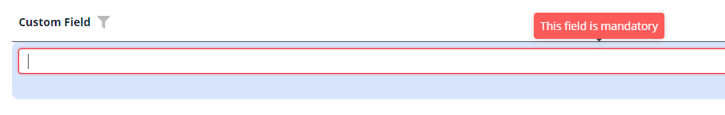
=== "Виджет Info"
    _неприменимо_
=== "Виджет Form"
    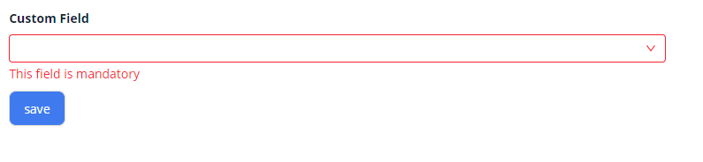
### Как добавить? { #how-to-add_5 }
??? Example "Пример"
    Добавьте **fields.setRequired** в соответствующий **FieldMetaBuilder**.

    ```java
    --8<--
    {{ external_links.github_raw_doc }}/fields/multipleselect/required/MyExample247Meta.java:buildRowDependentMeta
    --8<--
    ```

    === "Виджет List"
        **Работает для List.**
    === "Виджет Info"
        **_неприменимо_**
    === "Виджет Form"
        **Работает для Form.**

    [:material-play-circle: Живой пример]({{ external_links.code_samples }}/ui/#/screen/myexample247){:target="_blank"} ·
    [:fontawesome-brands-github: GitHub]({{ external_links.github_ui }}/{{ external_links.github_branch }}/src/main/java/org/demo/documentation/fields/multipleselect/required){:target="_blank"}

## Дополнительные свойства { #additional-properties }

### Ширина выпадающего списка { #width-of-the-drop-down-list }
Выпадающий список multipleSelect никогда не бывает уже поля и расширяется под самое длинное значение, но не шире
предела, заданного константой фронтенда (значение по умолчанию 1.3, в ширинах поля).

* Если значение не помещается в получившуюся ширину, оно сокращается с многоточием (...).
* При наведении на вариант полное значение показывается во всплывающей подсказке.
* Каким бы ни было значение константы, список никогда не занимает больше 70% представления, поэтому не может перекрыть меню.

#### Как это выглядит? { #how-does-it-look_6 }
=== "Виджет List"
    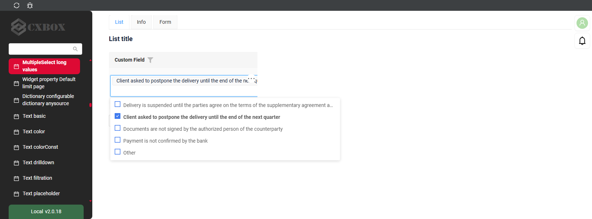
=== "Виджет Info"
    _неприменимо_
=== "Виджет Form"
    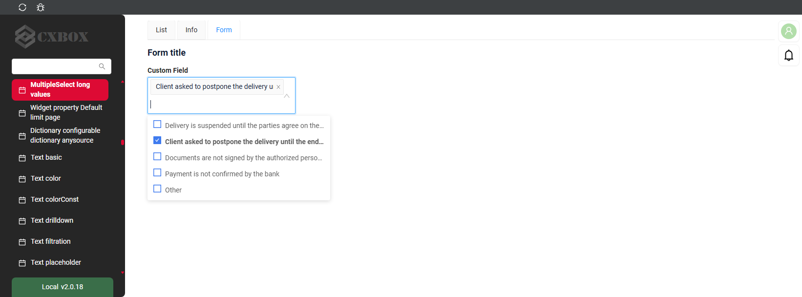

#### Как добавить? { #how-to-add_6 }
??? Example "Пример"
    Измените константу **multipleSelect_dropDownMaxCols** .
    ```
    ui/src/fields/MultipleSelectField/constants.ts
    ```

    === "Виджет List"
        **Работает для List.**
    === "Виджет Info"
        **_неприменимо_**, у значения только для чтения нет выпадающего списка.
    === "Виджет Form"
        **Работает для Form.**

    [:material-play-circle: Живой пример]({{ external_links.code_samples }}/ui/#/screen/myexample3358){:target="_blank"} ·
    [:fontawesome-brands-github: GitHub]({{ external_links.github_ui }}/{{ external_links.github_branch }}/src/main/java/org/demo/documentation/fields/multipleselect/longvalues){:target="_blank"}
