# Multivalue

`Multivalue` — компонент, позволяющий выбрать несколько значений из всплывающего списка сущностей

!!! tips "Совет"
    Для этого типа поля важно количество строк во всплывающем окне и количество выбранных строк. Количество строк во всплывающем окне: этот тип поля можно использовать для больших сущностей любого размера (в память загружается только одна страница). Количество выбранных строк: должно быть <1000-10000, так как выбранные строки хранятся в памяти

## Основы { #basics }
[:material-play-circle: Живой пример]({{ external_links.code_samples }}/ui/#/screen/myexample176){:target="_blank"} ·
[:fontawesome-brands-github: GitHub]({{ external_links.github_ui }}/{{ external_links.github_branch }}/src/main/java/org/demo/documentation/fields/multivalue/basic){:target="_blank"}

### Как это выглядит? { #how-does-it-look }

=== "Виджет List"
    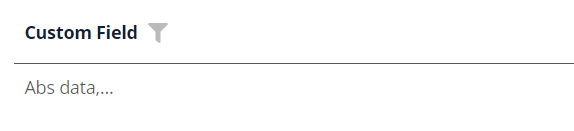
=== "Виджет Info"
    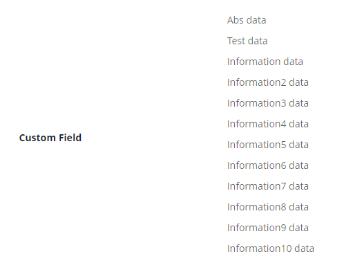
=== "Виджет Form"
    


### Как добавить? { #how-to-add }

??? Example "Пример"
    - **Шаг 1. AssocListPopup**

        В следующем примере сущность MyEntity имеет ссылку ManyToMany на сущность MyEntityMultivalue.
        Связь выполняется по id в таблице MyEntity_MyEntityMultivalue, например MyEntity.id = MyEntity_MyEntityMultivalue.MyEntityId, MyEntityMultivalue.id = MyEntity_MyEntityMultivalue.MyEntityMultivalueId.
       
        +  **Шаг 1.1** Создайте таблицу связи для ManyToMany (MyEntity_MyEntityMultivalue).
        +  **Шаг 1.2** Создайте Entity MyEntityMultivalue.
        +  **Шаг 1.3** Создайте DTO MyEntityMultivalueDTO.
        +  **Шаг 1.4** Добавьте `дополнительное поле` **String** в соответствующий **BaseEntity**.

            ```java
            --8<--
            {{ external_links.github_raw_doc }}/fields/multivalue/basic/MyEntityMultivalue177.java
            --8<--
            ```

        +  **Шаг 1.5** Добавьте `дополнительное поле` **String** в соответствующий **DataResponseDTO**.

            ```java
            --8<--
            {{ external_links.github_raw_doc }}/fields/multivalue/basic/MyEntity177MultivalueDTO.java
            --8<--
            ```

        +  **Шаг 1.6. AssocListPopup**  Создайте AssocListPopup в **_.widget.json_**.
            ```json
            --8<--
            {{ external_links.github_raw_doc }}/fields/multivalue/basic/myEntity177AssocListPopup.widget.json
            --8<--
            ```
        +  **Шаг 2** Добавьте поле **List** в соответствующий **BaseEntity**.

            ```java
            --8<--
            {{ external_links.github_raw_doc }}/fields/multivalue/basic/MyEntity176.java
            --8<--
            ```

        +  **Шаг 3** Добавьте поле **MultivalueField** в соответствующий **DataResponseDTO**.

            ```java
            --8<--
            {{ external_links.github_raw_doc }}/fields/multivalue/basic/MyExample176DTO.java
            --8<--
            ```

        +  **Шаг 4** Добавьте bc **MyEntityMultivalueAssocListPopup** в соответствующий **EnumBcIdentifier**.
    
            ```java
            --8<--
            {{ external_links.github_raw_doc }}/fields/multivalue/basic/PlatformMyExample176Controller.java:bc
            --8<--
            ```

        +  **Шаг 5** Добавьте виджет AssocListPopup на view.

        === "Виджет List"
            **Шаг 6** Добавьте popupBcName и assocValueKey в **_.widget.json_**.
    
            `popupBcName` — имя bc из шага 1.6. AssocListPopup
    
            `assocValueKey` — поле для открытия AssocListPopup
    
            `displayedKey` — текстовое поле, обычно содержащее объединённые значения из связанных строк на виджете List
            
            ```json
            --8<--
            {{ external_links.github_raw_doc }}/fields/multivalue/basic/MyExample176List.widget.json
            --8<--
            ```
    
        === "Виджет Info"
            **Шаг 6** Добавьте в **_.widget.json_**.
            ```json
            --8<--
            {{ external_links.github_raw_doc }}/fields/multivalue/basic/MyExample176Info.widget.json
            --8<--
            ```
        === "Виджет Form"
            **Шаг 6** Добавьте popupBcName и assocValueKey в **_.widget.json_**.
    
            `popupBcName` — имя bc из шага 1.6. AssocListPopup
    
            `assocValueKey` — поле для открытия AssocListPopup
    
            ```json
            --8<--
            {{ external_links.github_raw_doc }}/fields/multivalue/basic/MyExample176Form.widget.json
            --8<--
            ```

        [:material-play-circle: Живой пример]({{ external_links.code_samples }}/ui/#/screen/myexample176){:target="_blank"} ·
        [:fontawesome-brands-github: GitHub]({{ external_links.github_ui }}/{{ external_links.github_branch }}/src/main/java/org/demo/documentation/fields/multivalue/basic){:target="_blank"}

## Placeholder
[:material-play-circle: Живой пример]({{ external_links.code_samples }}/ui/#/screen/myexample186){:target="_blank"} ·
[:fontawesome-brands-github: GitHub]({{ external_links.github_ui }}/{{ external_links.github_branch }}/src/main/java/org/demo/documentation/fields/multivalue/placeholder){:target="_blank"}

`Placeholder` позволяет задать краткую подсказку об ожидаемом значении. Подсказка отображается до ввода пользователем. Её можно вычислять на основе бизнес-логики приложения. Она отображается и для поля `Readonly`.

### Как это выглядит? { #how-does-it-look_1 }
=== "Виджет List"
    _неприменимо_
=== "Виджет Info"
    _неприменимо_
=== "Виджет Form"
    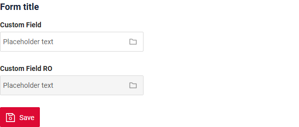

### Как добавить? { #how-to-add_1 }
??? Example "Пример"
    Добавьте **fields.setPlaceholder** в соответствующий **FieldMetaBuilder**.

    ```java
    --8<--
    {{ external_links.github_raw_doc }}/fields/multivalue/placeholder/MyExample186Meta.java:buildRowDependentMeta
    --8<--
    ```  
    === "Виджет List"
        **_неприменимо_**
    === "Виджет Info"
        **_неприменимо_**
    === "Виджет Form"
        **Работает для Form.**

    [:material-play-circle: Живой пример]({{ external_links.code_samples }}/ui/#/screen/myexample186){:target="_blank"} ·
    [:fontawesome-brands-github: GitHub]({{ external_links.github_ui }}/{{ external_links.github_branch }}/src/main/java/org/demo/documentation/fields/multivalue/placeholder){:target="_blank"}

## Цвет { #color }
`Color` позволяет задать цвет поля. Его можно вычислять на основе бизнес-логики приложения

**Вычисляемый цвет**

[:material-play-circle: Живой пример]({{ external_links.code_samples }}/ui/#/screen/myexample174){:target="_blank"} ·
[:fontawesome-brands-github: GitHub]({{ external_links.github_ui }}/{{ external_links.github_branch }}/src/main/java/org/demo/documentation/fields/multivalue/color){:target="_blank"}

**Постоянный цвет**

[:material-play-circle: Живой пример]({{ external_links.code_samples }}/ui/#/screen/myexample178){:target="_blank"} ·
[:fontawesome-brands-github: GitHub]({{ external_links.github_ui }}/{{ external_links.github_branch }}/src/main/java/org/demo/documentation/fields/multivalue/colorconst){:target="_blank"}

### Как это выглядит? { #how-does-it-look_2 }
=== "Виджет List"
    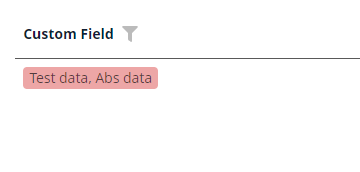
=== "Виджет Info"
    _неприменимо_
=== "Виджет Form"
    _неприменимо_


### Как добавить? { #how-to-add_2 }
??? Example "Пример"
    === "Вычисляемый цвет"
        **Шаг 1**   Добавьте `собственное поле для цвета` в соответствующий **DataResponseDTO**. Поле может содержать цвет в формате HEX или быть null.
        ```java
        --8<--
        {{ external_links.github_raw_doc }}/fields/multivalue/color/MyExample174DTO.java
        --8<--
        ```    
 
        === "Виджет List"
            **Шаг 2** Добавьте **"bgColorKey"** :  `собственное поле для цвета` в .widget.json.
            ```json
            --8<--
            {{ external_links.github_raw_doc }}/fields/multivalue/color/MyExample174List.widget.json
            --8<--
            ``` 
 
        === "Виджет Info"
            _неприменимо_
        === "Виджет Form"
            _неприменимо_

        [:material-play-circle: Живой пример]({{ external_links.code_samples }}/ui/#/screen/myexample174){:target="_blank"} ·
        [:fontawesome-brands-github: GitHub]({{ external_links.github_ui }}/{{ external_links.github_branch }}/src/main/java/org/demo/documentation/fields/multivalue/color){:target="_blank"}

    === "Постоянный цвет"
        === "Виджет List"
            Добавьте **"bgColor"** :  `цвет HEX` в .widget.json.
            ```json
            --8<--
            {{ external_links.github_raw_doc }}/fields/multivalue/colorconst/MyExample178List.widget.json
            --8<--
            ``` 
        === "Виджет Info"
            _неприменимо_
        === "Виджет Form"
            _неприменимо_

        [:material-play-circle: Живой пример]({{ external_links.code_samples }}/ui/#/screen/myexample178){:target="_blank"} ·
        [:fontawesome-brands-github: GitHub]({{ external_links.github_ui }}/{{ external_links.github_branch }}/src/main/java/org/demo/documentation/fields/multivalue/colorconst){:target="_blank"}

## Только чтение/Редактирование { #readonlyeditable }
`Readonly/Editable` указывает, можно ли редактировать поле. Это можно вычислять на основе бизнес-логики приложения

`Editable`
[:material-play-circle: Живой пример]({{ external_links.code_samples }}/ui/#/screen/myexample176){:target="_blank"} ·
[:fontawesome-brands-github: GitHub]({{ external_links.github_ui }}/{{ external_links.github_branch }}/src/main/java/org/demo/documentation/fields/multivalue/basic){:target="_blank"}

`Readonly`
[:material-play-circle: Живой пример]({{ external_links.code_samples }}/ui/#/screen/myexample180/view/myexample180form){:target="_blank"} ·
[:fontawesome-brands-github: GitHub]({{ external_links.github_ui }}/{{ external_links.github_branch }}/src/main/java/org/demo/documentation/fields/multivalue/ro){:target="_blank"}

### Как это выглядит? { #how-does-it-look_3 }
=== "Редактирование"
    === "Виджет List"
        _неприменимо_
    === "Виджет Info"
        _неприменимо_
    === "Виджет Form"
        
=== "Только чтение"
    === "Виджет List"
        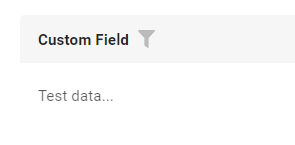
    === "Виджет Info"
        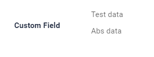
    === "Виджет Form"
        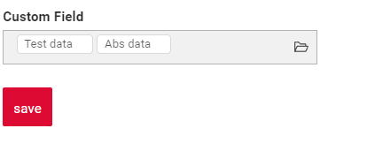

### Как добавить? { #how-to-add_3 }
??? Example "Пример"
    === "Редактирование"
        **Шаг 1** Добавьте маппинг DTO->entity в соответствующий **VersionAwareResponseService**.
        ```java
        --8<--
        {{ external_links.github_raw_doc }}/fields/multivalue/basic/MyExample176Service.java:doUpdateEntity
        --8<--
        ```


        **Шаг 2** Добавьте **fields.setEnabled** в соответствующий **FieldMetaBuilder**.
        ```java
        --8<--
        {{ external_links.github_raw_doc }}/fields/multivalue/basic/MyExample176Meta.java:buildRowDependentMeta
        --8<--
        ```    
 
        === "Виджет List"
            **_неприменимо_**
        === "Виджет Info"
            **_неприменимо_**
        === "Виджет Form"
            **Работает для Form.**

        [:material-play-circle: Живой пример]({{ external_links.code_samples }}/ui/#/screen/myexample176){:target="_blank"} ·
        [:fontawesome-brands-github: GitHub]({{ external_links.github_ui }}/{{ external_links.github_branch }}/src/main/java/org/demo/documentation/fields/multivalue/basic){:target="_blank"}

    === "Только чтение"
    
        **Вариант 1** Включено по умолчанию.
        ```java
        --8<--
        {{ external_links.github_raw_doc }}/fields/multivalue/ro/MyExample180Meta.java:buildRowDependentMeta
        --8<--
        ```    
 
    
        **Вариант 2** `Не рекомендуется.` Свойство fields.setDisabled() переопределяет доступность поля, если используется после свойства fields.setEnabled.
        === "Виджет List"
            **_неприменимо_**
        === "Виджет Info"
            **_неприменимо_**
        === "Виджет Form"
            **Работает для Form.**

        [:material-play-circle: Живой пример]({{ external_links.code_samples }}/ui/#/screen/myexample180/view/myexample180form){:target="_blank"} ·
        [:fontawesome-brands-github: GitHub]({{ external_links.github_ui }}/{{ external_links.github_branch }}/src/main/java/org/demo/documentation/fields/multivalue/ro){:target="_blank"}

## Фильтрация { #filtering }
[:material-play-circle: Живой пример]({{ external_links.code_samples }}/ui/#/screen/myexample184){:target="_blank"} ·
[:fontawesome-brands-github: GitHub]({{ external_links.github_ui }}/{{ external_links.github_branch }}/src/main/java/org/demo/documentation/fields/multivalue/filtration){:target="_blank"}

`Filtering` позволяет искать данные по критериям. Поиск использует оператор in, который в данном случае сравнивает id.
### Как это выглядит? { #how-does-it-look_4 }
=== "Виджет List"
    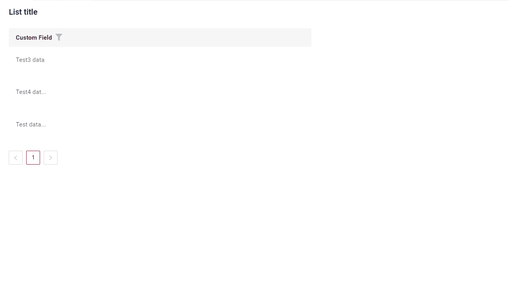
=== "Виджет Info"
    _неприменимо_
=== "Виджет Form"
    _неприменимо_


### Как добавить? { #how-to-add_4 }
??? Example "Пример"
    === "Виджет List"
        **Шаг 1** Добавьте **@SearchParameter** в соответствующий **DataResponseDTO**. (Расширенная настройка [SearchParameter](/ru/advancedCustomization/element/searchparameter/searchparameter))
        ```java
        --8<--
        {{ external_links.github_raw_doc }}/fields/multivalue/filtration/MyExample184DTO.java
        --8<--
        ```
      
        **Шаг 2**  Добавьте **fields.enableFilter** в соответствующий **FieldMetaBuilder**.
        ```java
        --8<--
        {{ external_links.github_raw_doc }}/fields/multivalue/filtration/MyExample184Meta.java:buildIndependentMeta
        --8<--
        ```

        **Шаг 3**  Добавьте popupBcName и assocValueKey в **_.widget.json_**.

        popupBcName — имя bc
        
        assocValueKey — поле для открытия AssocListPopup

        ```json
        --8<--
        {{ external_links.github_raw_doc }}/fields/multivalue/filtration/MyExample184List.widget.json
        --8<--
        ```
 
 
    === "Виджет Info"
        _неприменимо_
    === "Виджет Form"
        _неприменимо_

    [:material-play-circle: Живой пример]({{ external_links.code_samples }}/ui/#/screen/myexample184){:target="_blank"} ·
    [:fontawesome-brands-github: GitHub]({{ external_links.github_ui }}/{{ external_links.github_branch }}/src/main/java/org/demo/documentation/fields/multivalue/filtration){:target="_blank"}

## Drilldown
**_неприменимо_**

## Валидация { #validation }
`Validation` позволяет проверять любые бизнес-правила для введённого пользователем значения. Типы валидации:

1) Exception: отображает сообщение, уведомляющее пользователя о технических или бизнес-ошибках.

   `Business Exception`:
   [:material-play-circle: Живой пример]({{ external_links.code_samples }}/ui/#/screen/myexample192){:target="_blank"} ·
   [:fontawesome-brands-github: GitHub]({{ external_links.github_ui }}/{{ external_links.github_branch }}/src/main/java/org/demo/documentation/fields/multivalue/validationbusinessex){:target="_blank"}

   `Runtime Exception`:
   [:material-play-circle: Живой пример]({{ external_links.code_samples }}/ui/#/screen/myexample196){:target="_blank"} ·
   [:fontawesome-brands-github: GitHub]({{ external_links.github_ui }}/{{ external_links.github_branch }}/src/main/java/org/demo/documentation/fields/multivalue/validationruntimeex){:target="_blank"}
   
2) Confirm: показывает диалог с необязательным сообщением, требующий от пользователя подтверждения или отмены перед продолжением.

   [:material-play-circle: Живой пример]({{ external_links.code_samples }}/ui/#/screen/myexample194){:target="_blank"} ·
   [:fontawesome-brands-github: GitHub]({{ external_links.github_ui }}/{{ external_links.github_branch }}/src/main/java/org/demo/documentation/fields/multivalue/validationconfirm){:target="_blank"}

3) Валидация на уровне полей: показывает ошибку рядом со всеми полями, не прошедшими проверку

   `Option 1`:
   [:material-play-circle: Живой пример]({{ external_links.code_samples }}/ui/#/screen/myexample198){:target="_blank"} ·
   [:fontawesome-brands-github: GitHub]({{ external_links.github_ui }}/{{ external_links.github_branch }}/src/main/java/org/demo/documentation/fields/multivalue/validationannotation){:target="_blank"}

   `Option 2`:
   [:material-play-circle: Живой пример]({{ external_links.code_samples }}/ui/#/screen/myexample335){:target="_blank"} ·
   [:fontawesome-brands-github: GitHub]({{ external_links.github_ui }}/{{ external_links.github_branch }}/src/main/java/org/demo/documentation/fields/multivalue/validationdynamic){:target="_blank"}

### Как это выглядит? { #how-does-it-look_5 }
=== "Виджет List"
    === "BusinessException"
        
    === "RuntimeException"
        
    === "Confirm"
        
    === "Валидация на уровне полей"
        
=== "Виджет Info"
    _неприменимо_
=== "Виджет Form"
    === "BusinessException"
        
    === "RuntimeException"
        
    === "Confirm"
        
    === "Валидация на уровне полей"
        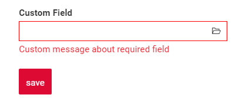
### Как добавить? { #how-to-add_5 }
??? Example "Пример"
    === "BusinessException"

        `BusinessException` описывает ошибку в рамках бизнес-процесса.
        
        Добавьте **BusinessException** в соответствующий **VersionAwareResponseService**.
        ```java
        --8<--
        {{ external_links.github_raw_doc }}/fields/multivalue/validationbusinessex/MyExample192Service.java:doUpdateEntity
        --8<--
        ```
        
        === "Виджет List"
            **Работает для List.**
        === "Виджет Info"
            **_неприменимо_**
        === "Виджет Form"
            **Работает для Form.**

        [:material-play-circle: Живой пример]({{ external_links.code_samples }}/ui/#/screen/myexample192){:target="_blank"} ·
        [:fontawesome-brands-github: GitHub]({{ external_links.github_ui }}/{{ external_links.github_branch }}/src/main/java/org/demo/documentation/fields/multivalue/validationbusinessex){:target="_blank"}

    === "RuntimeException"

        `RuntimeException` описывает техническую ошибку в рамках бизнес-процесса.
        
        Добавьте **RuntimeException** в соответствующий **VersionAwareResponseService**.
        ```java
        --8<--
        {{ external_links.github_raw_doc }}/fields/multivalue/validationruntimeex/MyExample196Service.java:doUpdateEntity
        --8<--
        ```     
 
        === "Виджет List"
            **Работает для List.**
        === "Виджет Info"
            **_неприменимо_**
        === "Виджет Form"
            **Работает для Form.**

        [:material-play-circle: Живой пример]({{ external_links.code_samples }}/ui/#/screen/myexample196){:target="_blank"} ·
        [:fontawesome-brands-github: GitHub]({{ external_links.github_ui }}/{{ external_links.github_branch }}/src/main/java/org/demo/documentation/fields/multivalue/validationruntimeex){:target="_blank"}

    === "Confirm"

        Добавьте [PreAction.confirm](/ru/advancedCustomization_validation) в соответствующий **VersionAwareResponseService**.

        ```java
        --8<--
        {{ external_links.github_raw_doc }}/fields/multivalue/validationconfirm/MyExample194Service.java:getActions
        --8<--
        ```
 
        === "Виджет List"
            **Работает для List.**
        === "Виджет Info"
            **_неприменимо_**
        === "Виджет Form"
            **Работает для Form.**

        [:material-play-circle: Живой пример]({{ external_links.code_samples }}/ui/#/screen/myexample194){:target="_blank"} ·
        [:fontawesome-brands-github: GitHub]({{ external_links.github_ui }}/{{ external_links.github_branch }}/src/main/java/org/demo/documentation/fields/multivalue/validationconfirm){:target="_blank"}

    === "Валидация на уровне полей"
        === "Вариант 1"
            Добавьте javax.validation в соответствующий **DataResponseDTO**.

            Используйте, если:

            Нужна простая проверка полей (javax validation)
            ```java
            --8<--
            {{ external_links.github_raw_doc }}/fields/multivalue/validationannotation/MyExample198DTO.java
            --8<--
            ```
 
            === "Виджет List"
                **Работает для List.**
            === "Виджет Info"
                **_неприменимо_**
            === "Виджет Form"
                **Работает для Form.**

            [:material-play-circle: Живой пример]({{ external_links.code_samples }}/ui/#/screen/myexample198){:target="_blank"} ·
            [:fontawesome-brands-github: GitHub]({{ external_links.github_ui }}/{{ external_links.github_branch }}/src/main/java/org/demo/documentation/fields/multivalue/validationannotation){:target="_blank"}

        === "Вариант 2"
            Создайте собственный сервис для проверки бизнес-логики.

            Используйте, если:

            Для полей требуется проверка бизнес-логики

            `Шаг 1`  Создайте собственный метод проверки.
            ```java
            --8<--
            {{ external_links.github_raw_doc }}/fields/multivalue/validationdynamic/MyExample335Service.java:validateFields
            --8<--
            ```
 
            `Шаг 2` Добавьте собственный метод проверки в соответствующий **VersionAwareResponseService**.
            ```java
            --8<--
            {{ external_links.github_raw_doc }}/fields/multivalue/validationdynamic/MyExample335Service.java:doUpdateEntity
            --8<--
            ```

            [:material-play-circle: Живой пример]({{ external_links.code_samples }}/ui/#/screen/myexample335){:target="_blank"} ·
            [:fontawesome-brands-github: GitHub]({{ external_links.github_ui }}/{{ external_links.github_branch }}/src/main/java/org/demo/documentation/fields/multivalue/validationdynamic){:target="_blank"}

 
## Сортировка { #sorting }
**_неприменимо_**

## Обязательность { #required }
[:material-play-circle: Живой пример]({{ external_links.code_samples }}/ui/#/screen/myexample188){:target="_blank"} ·
[:fontawesome-brands-github: GitHub]({{ external_links.github_ui }}/{{ external_links.github_branch }}/src/main/java/org/demo/documentation/fields/multivalue/required){:target="_blank"}

`Required` позволяет указать, что поле обязательно должно иметь значение.

### Как это выглядит? { #how-does-it-look_6 }
=== "Виджет List"
    _неприменимо_
=== "Виджет Info"
    _неприменимо_
=== "Виджет Form"
    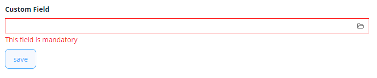
### Как добавить? { #how-to-add_6 }
??? Example "Пример"
    Добавьте **fields.setRequired** в соответствующий **FieldMetaBuilder**.

    ```java
    --8<--
    {{ external_links.github_raw_doc }}/fields/multivalue/required/MyExample188Meta.java:buildRowDependentMeta
    --8<--
    ```
 
    === "Виджет List"
        **_неприменимо_**
    === "Виджет Info"
        **_неприменимо_**
    === "Виджет Form"
        **Работает для Form.**

    [:material-play-circle: Живой пример]({{ external_links.code_samples }}/ui/#/screen/myexample188){:target="_blank"} ·
    [:fontawesome-brands-github: GitHub]({{ external_links.github_ui }}/{{ external_links.github_branch }}/src/main/java/org/demo/documentation/fields/multivalue/required){:target="_blank"}

## Дополнительные свойства { #additional-properties }
### <a id="Primary">Primary</a>
[:material-play-circle: Живой пример]({{ external_links.code_samples }}/ui/#/screen/myexample2000/view/myexample2000form){:target="_blank"} ·
[:fontawesome-brands-github: GitHub]({{ external_links.github_ui }}/{{ external_links.github_branch }}/src/main/java/org/demo/documentation/fields/multivalue/primary){:target="_blank"}

Добавлена возможность указать значение Primary для виджета AssocListPopup.
Если оно указано, отображается дополнительная колонка "Primary", в которой флажок можно установить только в одной из строк.

У поля primary заголовок по умолчанию `primary`.

#### Как это выглядит? { #how-does-it-look_7 }
=== "Виджет List"
    _неприменимо_
=== "Виджет Info"
    _неприменимо_
=== "Виджет Form"
    === "Заголовок по умолчанию"
        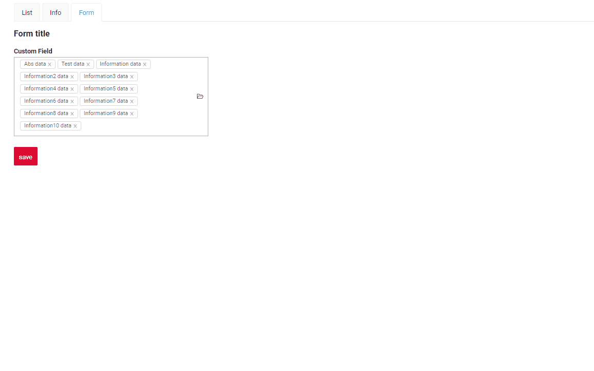
    === "Собственный заголовок"
        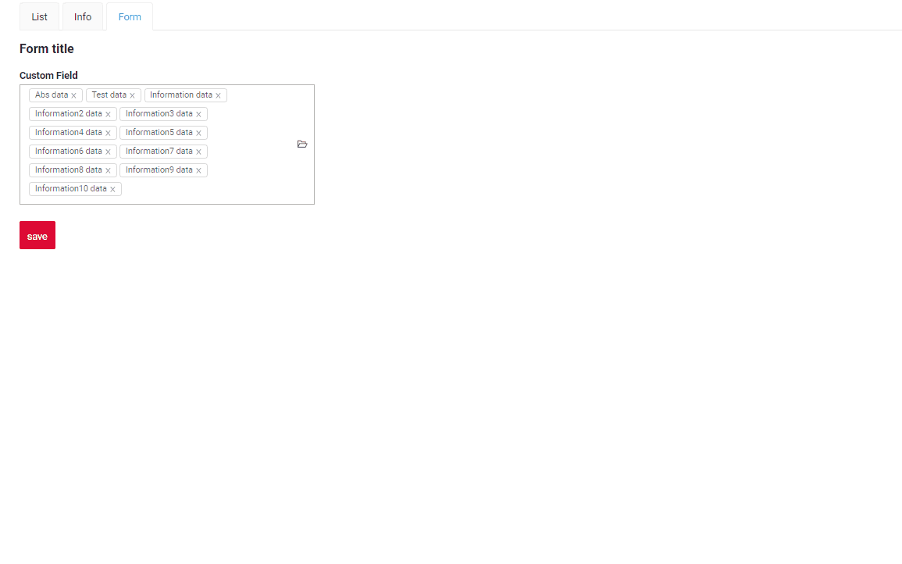

#### Как добавить? { #how-to-add_7 }
??? Example "Пример"
    === "Виджет List"
        **_неприменимо_**
    === "Виджет Info"
        **_неприменимо_**
    === "Виджет Form"
        `Шаг 1` Добавьте **primaryId** в MyEntity.
        ```java
        --8<--
        {{ external_links.github_raw_doc }}/fields/multivalue/primary/MyEntity2000.java
        --8<--
        ```
        `Шаг 2` Добавьте **primary** в соответствующий **.widget.json** Assoc.

        `enabled` - true/false 
        'title' — заголовок поля primary (необязательно. Заголовок по умолчанию `primary`)
        ```json
        --8<--
        {{ external_links.github_raw_doc }}/fields/multivalue/primary/myEntity2001AssocListPopup.widget.json
        --8<--
        ```

    [:material-play-circle: Живой пример]({{ external_links.code_samples }}/ui/#/screen/myexample2000/view/myexample2000form){:target="_blank"} ·
    [:fontawesome-brands-github: GitHub]({{ external_links.github_ui }}/{{ external_links.github_branch }}/src/main/java/org/demo/documentation/fields/multivalue/primary){:target="_blank"}
