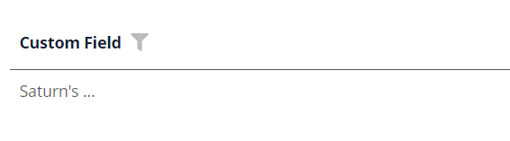
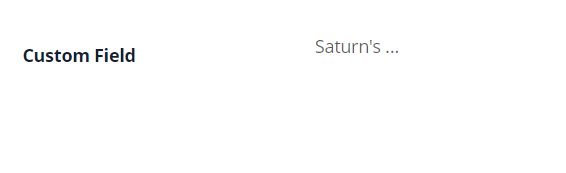
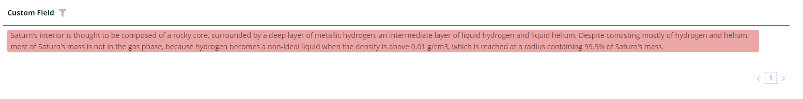
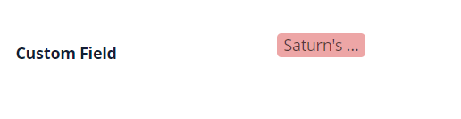
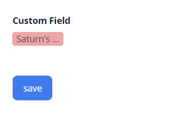
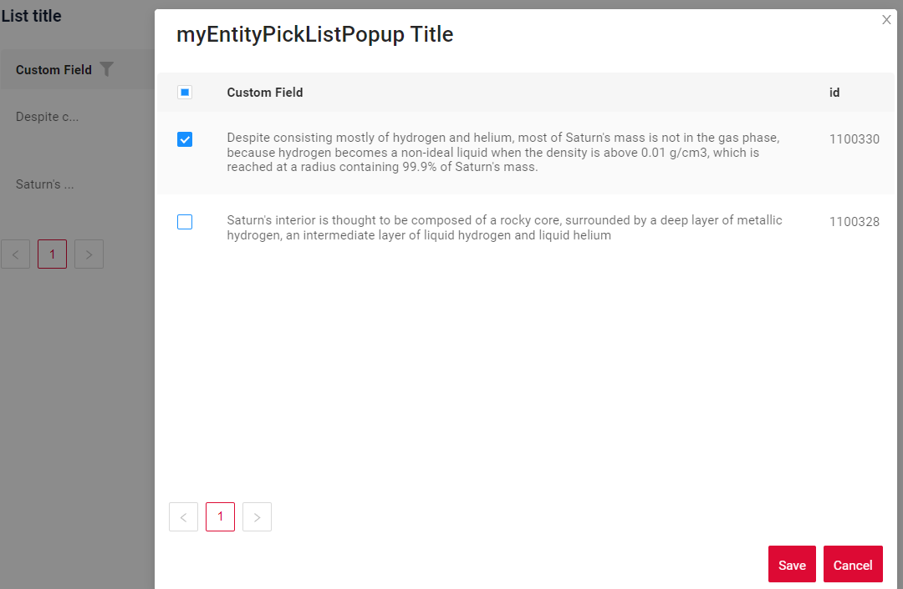
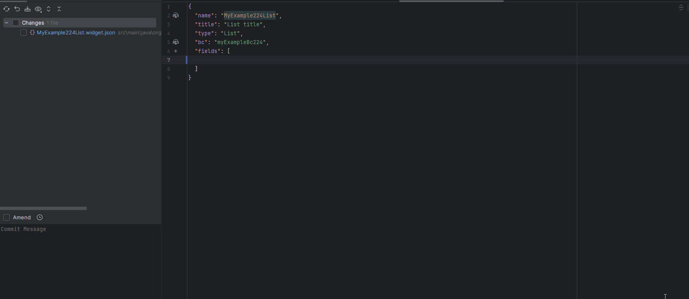

# MultivalueHover

`MultivalueHover` — компонент, позволяющий просматривать несколько значений при наведении мыши. Все поля только для чтения.

## Основы { #basics }
[:material-play-circle: Живой пример]({{ external_links.code_samples }}/ui/#/screen/myexample224){:target="_blank"} ·
[:fontawesome-brands-github: GitHub]({{ external_links.github_ui }}/{{ external_links.github_branch }}/src/main/java/org/demo/documentation/fields/multivaluehover/basic){:target="_blank"}

### Как это выглядит? { #how-does-it-look }

=== "Виджет List"
    
=== "Виджет Info"
    
=== "Виджет Form"
    


### Как добавить? { #how-to-add }

??? Example "Пример"
   
    **Шаг 1** Добавьте поле **List** в соответствующий **BaseEntity**.

    ```java
    --8<--
    {{ external_links.github_raw_doc }}/fields/multivaluehover/basic/MyEntity224.java
    --8<--
    ```

    **Шаг 2** Добавьте поле **MultivalueField** в соответствующий **DataResponseDTO**.

    ```java
    --8<--
    {{ external_links.github_raw_doc }}/fields/multivaluehover/basic/MyExample224DTO.java
    --8<--
    ```

    === "Виджет List"
        **Шаг 3** Добавьте в **_.widget.json_**.

        `displayedKey` — текстовое поле, обычно содержащее объединённые значения из связанных строк

        ```json
        --8<--
        {{ external_links.github_raw_doc }}/fields/multivaluehover/basic/MyExample224List.widget.json
        --8<--
        ```

    === "Виджет Info"
        **Шаг 3** Добавьте в **_.widget.json_**.

        ```json
        --8<--
        {{ external_links.github_raw_doc }}/fields/multivaluehover/basic/MyExample224Info.widget.json
        --8<--
        ```

    === "Виджет Form"
        **Шаг 3** Добавьте в **_.widget.json_**.
 
        `displayedKey` — текстовое поле, обычно содержащее объединённые значения из связанных строк

        ```json
        --8<--
        {{ external_links.github_raw_doc }}/fields/multivaluehover/basic/MyExample224Form.widget.json
        --8<--
        ```

    [:material-play-circle: Живой пример]({{ external_links.code_samples }}/ui/#/screen/myexample224){:target="_blank"} ·
    [:fontawesome-brands-github: GitHub]({{ external_links.github_ui }}/{{ external_links.github_branch }}/src/main/java/org/demo/documentation/fields/multivaluehover/basic){:target="_blank"}

## Placeholder
**_неприменимо_**

## Цвет { #color }
`Color` позволяет задать цвет поля. Его можно вычислять на основе бизнес-логики приложения

**Вычисляемый цвет**

[:material-play-circle: Живой пример]({{ external_links.code_samples }}/ui/#/screen/myexample225){:target="_blank"} ·
[:fontawesome-brands-github: GitHub]({{ external_links.github_ui }}/{{ external_links.github_branch }}/src/main/java/org/demo/documentation/fields/multivaluehover/color){:target="_blank"}

**Постоянный цвет**

[:material-play-circle: Живой пример]({{ external_links.code_samples }}/ui/#/screen/myexample227){:target="_blank"} ·
[:fontawesome-brands-github: GitHub]({{ external_links.github_ui }}/{{ external_links.github_branch }}/src/main/java/org/demo/documentation/fields/multivaluehover/colorconst){:target="_blank"}

### Как это выглядит? { #how-does-it-look_1 }
=== "Виджет List"
    
=== "Виджет Info"
    
=== "Виджет Form"
    


### Как добавить? { #how-to-add_1 }
??? Example "Пример"
    === "Вычисляемый цвет"
        **Шаг 1**   Добавьте `собственное поле для цвета` в соответствующий **DataResponseDTO**. Поле может содержать цвет в формате HEX или быть null.
        ```java
        --8<--
        {{ external_links.github_raw_doc }}/fields/multivaluehover/color/MyExample225DTO.java
        --8<--
        ```   
 
        === "Виджет List"
            **Шаг 2** Добавьте **"bgColorKey"** :  `собственное поле для цвета` в .widget.json.
            ```json
            --8<--
            {{ external_links.github_raw_doc }}/fields/multivaluehover/color/MyExample225List.widget.json
            --8<--
            ```
 
        === "Виджет Info"
            **Шаг 2** Добавьте **"bgColorKey"** :  `собственное поле для цвета` в .widget.json.
 
            ```json
            --8<--
            {{ external_links.github_raw_doc }}/fields/multivaluehover/color/MyExample225Info.widget.json
            --8<--
            ```
        === "Виджет Form"
            **Шаг 2** Добавьте **"bgColorKey"** :  `собственное поле для цвета` в .widget.json.
            ```json
            --8<--
            {{ external_links.github_raw_doc }}/fields/multivaluehover/color/MyExample225Form.widget.json
            --8<--
            ```

        [:material-play-circle: Живой пример]({{ external_links.code_samples }}/ui/#/screen/myexample225){:target="_blank"} ·
        [:fontawesome-brands-github: GitHub]({{ external_links.github_ui }}/{{ external_links.github_branch }}/src/main/java/org/demo/documentation/fields/multivaluehover/color){:target="_blank"}

    === "Постоянный цвет"
        === "Виджет List"
            Добавьте **"bgColor"** :  `цвет HEX` в .widget.json.
            ```json
            --8<--
            {{ external_links.github_raw_doc }}/fields/multivaluehover/colorconst/MyExample227List.widget.json
            --8<--
            ```

        === "Виджет Info"
            Добавьте **"bgColor"** :  `цвет HEX` в .widget.json.
            ```json
            --8<--
            {{ external_links.github_raw_doc }}/fields/multivaluehover/colorconst/MyExample227Info.widget.json
            --8<--
            ```
        === "Виджет Form"
            Добавьте **"bgColor"** :  `цвет HEX` в .widget.json.
            ```json
            --8<--
            {{ external_links.github_raw_doc }}/fields/multivaluehover/colorconst/MyExample227Form.widget.json
            --8<--
            ```

        [:material-play-circle: Живой пример]({{ external_links.code_samples }}/ui/#/screen/myexample227){:target="_blank"} ·
        [:fontawesome-brands-github: GitHub]({{ external_links.github_ui }}/{{ external_links.github_branch }}/src/main/java/org/demo/documentation/fields/multivaluehover/colorconst){:target="_blank"}

## Только чтение/Редактирование { #readonlyeditable }
Все поля только для чтения.

## Фильтрация { #filtering }
[:material-play-circle: Живой пример]({{ external_links.code_samples }}/ui/#/screen/myexample233){:target="_blank"} ·
[:fontawesome-brands-github: GitHub]({{ external_links.github_ui }}/{{ external_links.github_branch }}/src/main/java/org/demo/documentation/fields/multivaluehover/filtration){:target="_blank"}

`Filtering` позволяет искать данные по критериям. Поиск использует оператор in, который в данном случае сравнивает id.

### Как это выглядит? { #how-does-it-look_2 }
=== "Виджет List"
    
=== "Виджет Info"
    _неприменимо_
=== "Виджет Form"
    _неприменимо_

### Как добавить? { #how-to-add_2 }
??? Example "Пример"
    === "С плагином (рекомендуется)"
        **Шаг 1** Скачайте плагин
        [скачать плагин для IntelliJ](https://doc.cxbox.org/ru/plugin/plugininstalling)

        **Шаг 2** Добавьте существующее поле в существующий виджет формы

        

    === "Пример написания кода"
        === "Виджет List"
            **Шаг 1** Добавьте **@SearchParameter** в соответствующий **DataResponseDTO**. (Расширенная настройка [SearchParameter](/ru/advancedCustomization/element/searchparameter/searchparameter))
            ```java
            --8<--
            {{ external_links.github_raw_doc }}/fields/multivaluehover/filtration/MyExample233DTO.java
            --8<--
            ```
     
            **Шаг 2**  Добавьте **fields.enableFilter** в соответствующий **FieldMetaBuilder**.
            ```java
            --8<--
            {{ external_links.github_raw_doc }}/fields/multivaluehover/filtration/MyExample233Meta.java:buildIndependentMeta
            --8<--
            ```
      
            **Шаг 3**  Добавьте **popupBcName** текущего BC в соответствующий **widget.json**.
     
            ```json
            --8<--
            {{ external_links.github_raw_doc }}/fields/multivaluehover/filtration/MyExample233List.widget.json
            --8<--
            ```
            **Шаг 4**  Добавьте **popup** в соответствующий **view.json**.
     
            ```json
            --8<--
            {{ external_links.github_raw_doc }}/fields/multivaluehover/filtration/myexample233list.view.json
            --8<--
            ```
        === "Виджет Info"
            _неприменимо_
        === "Виджет Form"
            _неприменимо_
    
        [:material-play-circle: Живой пример]({{ external_links.code_samples }}/ui/#/screen/myexample233){:target="_blank"} ·
        [:fontawesome-brands-github: GitHub]({{ external_links.github_ui }}/{{ external_links.github_branch }}/src/main/java/org/demo/documentation/fields/multivaluehover/filtration){:target="_blank"}

## Drilldown
**_неприменимо_**

## Валидация { #validation }
**_неприменимо_**

## Сортировка { #sorting }
**_неприменимо_**

## Обязательность { #required }
**_неприменимо_**
