# MultivalueTree

Доступно начиная с [v3.0.1](/ru/new/version3001/)

`MultivalueTree` — компонент, позволяющий выбрать несколько значений из всплывающего списка сущностей

!!! tips "Совет"
    Для этого типа поля важно количество строк во всплывающем окне и количество выбранных строк. Количество строк во всплывающем окне: этот тип поля можно использовать для больших сущностей любого размера (в память загружается только одна страница). Количество выбранных строк: должно быть <1000-10000, так как выбранные строки хранятся в памяти

## Основы { #basics }
[:material-play-circle: Живой пример]({{ external_links.code_samples }}/ui/#/screen/myexample3314){:target="_blank"} ·
[:fontawesome-brands-github: GitHub]({{ external_links.github_ui }}/{{ external_links.github_branch }}/src/main/java/org/demo/documentation/fields/multivaluetree/basic){:target="_blank"}

### Как это выглядит? { #how-does-it-look }

=== "Виджет List"
    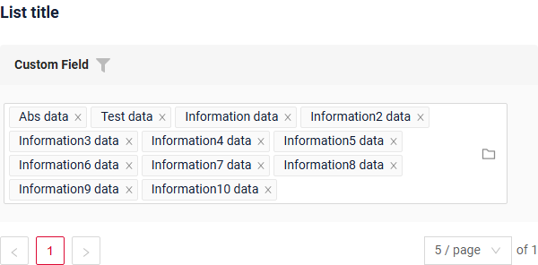
=== "Виджет Info"
    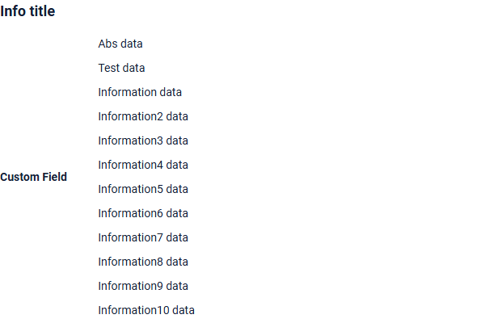
=== "Виджет Form"
    


### Как добавить? { #how-to-add }
!!! info
    Всплывающее окно — дерево: бизнес-компонент всплывающего окна должен возвращать `parentId` (фильтруемое, `null` для корней) и `isLeaf`, оба объявлены как **hidden**-поля виджета всплывающего окна. Настройки дерева описаны в [options.tree](/ru/widget/type/assoctreepopup/assoctreepopup/#optionstree).


??? Example "Пример"
    - **Шаг 1. AssocTreePopup**

        В следующем примере сущность MyEntity имеет ссылку ManyToMany на сущность MyEntityMultivalue.
        Связь выполняется по id в таблице MyEntity_MyEntityMultivalue, например MyEntity.id = MyEntity_MyEntityMultivalue.MyEntityId, MyEntityMultivalue.id = MyEntity_MyEntityMultivalue.MyEntityMultivalueId.
       
        +  **Шаг 1.1** Создайте таблицу связи для ManyToMany (MyEntity_MyEntityMultivalue).
        +  **Шаг 1.2** Создайте Entity MyEntityMultivalue.
        +  **Шаг 1.3** Создайте DTO MyEntityMultivalueDTO.
        +  **Шаг 1.4** Добавьте `дополнительное поле` **String** в соответствующий **BaseEntity**.

            ```java
            --8<--
            {{ external_links.github_raw_doc }}/fields/multivaluetree/basic/MyEntity3314Multivalue.java
            --8<--
            ```

        +  **Шаг 1.5** Добавьте `дополнительное поле` **String** в соответствующий **DataResponseDTO**.

            ```java
            --8<--
            {{ external_links.github_raw_doc }}/fields/multivaluetree/basic/MyEntity3314MultivalueDTO.java
            --8<--
            ```

        +  **Шаг 1.6. AssocTreePopup**  Создайте AssocTreePopup в **_.widget.json_**.
            ```json
            --8<--
            {{ external_links.github_raw_doc }}/fields/multivaluetree/basic/myEntity3314MultivalueAssocTreePopup.widget.json
            --8<--
            ```
        +  **Шаг 2** Добавьте поле **List** в соответствующий **BaseEntity**.

            ```java
            --8<--
            {{ external_links.github_raw_doc }}/fields/multivaluetree/basic/MyEntity3314.java
            --8<--
            ```

        +  **Шаг 3** Добавьте поле **MultivalueField** в соответствующий **DataResponseDTO**.

            ```java
            --8<--
            {{ external_links.github_raw_doc }}/fields/multivaluetree/basic/MyExample3314DTO.java
            --8<--
            ```

        +  **Шаг 4** Добавьте bc **MyEntityMultivalueAssocTreePopup** в соответствующий **EnumBcIdentifier**.
    
            ```java
            --8<--
            {{ external_links.github_raw_doc }}/fields/multivaluetree/basic/PlatformMyExample3314Controller.java:bc
            --8<--
            ```

        +  **Шаг 5** Добавьте виджет AssocTreePopup на view.

        === "Виджет List"
            **Шаг 6** Добавьте popupBcName и assocValueKey в **_.widget.json_**.
    
            `popupBcName` — имя bc из шага 1.6. AssocTreePopup
    
            `assocValueKey` — поле для открытия AssocTreePopup
    
            `displayedKey` — текстовое поле, обычно содержащее объединённые значения из связанных строк на виджете List
            
            ```json
            --8<--
            {{ external_links.github_raw_doc }}/fields/multivaluetree/basic/MyExample3314List.widget.json
            --8<--
            ```
    
        === "Виджет Info"
            **Шаг 6** Добавьте в **_.widget.json_**.
            ```json
            --8<--
            {{ external_links.github_raw_doc }}/fields/multivaluetree/basic/MyExample3314Info.widget.json
            --8<--
            ```
        === "Виджет Form"
            **Шаг 6** Добавьте popupBcName и assocValueKey в **_.widget.json_**.
    
            `popupBcName` — имя bc из шага 1.6. AssocTreePopup
    
            `assocValueKey` — поле для открытия AssocTreePopup
    
            ```json
            --8<--
            {{ external_links.github_raw_doc }}/fields/multivaluetree/basic/MyExample3314Form.widget.json
            --8<--
            ```

        [:material-play-circle: Живой пример]({{ external_links.code_samples }}/ui/#/screen/myexample3314){:target="_blank"} ·
        [:fontawesome-brands-github: GitHub]({{ external_links.github_ui }}/{{ external_links.github_branch }}/src/main/java/org/demo/documentation/fields/multivaluetree/basic){:target="_blank"}

## Placeholder
[:material-play-circle: Живой пример]({{ external_links.code_samples }}/ui/#/screen/myexample3319){:target="_blank"} ·
[:fontawesome-brands-github: GitHub]({{ external_links.github_ui }}/{{ external_links.github_branch }}/src/main/java/org/demo/documentation/fields/multivaluetree/placeholder){:target="_blank"}

`Placeholder` позволяет задать краткую подсказку об ожидаемом значении. Подсказка отображается до ввода пользователем. Её можно вычислять на основе бизнес-логики приложения. Она отображается и для поля `Readonly`.

### Как это выглядит? { #how-does-it-look_1 }
=== "Виджет List"
    _неприменимо_
=== "Виджет Info"
    _неприменимо_
=== "Виджет Form"
    

### Как добавить? { #how-to-add_1 }
??? Example "Пример"
    Добавьте **fields.setPlaceholder** в соответствующий **FieldMetaBuilder**.

    ```java
    --8<--
    {{ external_links.github_raw_doc }}/fields/multivaluetree/placeholder/MyExample3319Meta.java:buildRowDependentMeta
    --8<--
    ```  
    === "Виджет List"
        **_неприменимо_**
    === "Виджет Info"
        **_неприменимо_**
    === "Виджет Form"
        **Работает для Form.**

    [:material-play-circle: Живой пример]({{ external_links.code_samples }}/ui/#/screen/myexample3319){:target="_blank"} ·
    [:fontawesome-brands-github: GitHub]({{ external_links.github_ui }}/{{ external_links.github_branch }}/src/main/java/org/demo/documentation/fields/multivaluetree/placeholder){:target="_blank"}

## Цвет { #color }
`Color` позволяет задать цвет поля. Его можно вычислять на основе бизнес-логики приложения

**Вычисляемый цвет**

[:material-play-circle: Живой пример]({{ external_links.code_samples }}/ui/#/screen/myexample3315){:target="_blank"} ·
[:fontawesome-brands-github: GitHub]({{ external_links.github_ui }}/{{ external_links.github_branch }}/src/main/java/org/demo/documentation/fields/multivaluetree/color){:target="_blank"}

**Постоянный цвет**

[:material-play-circle: Живой пример]({{ external_links.code_samples }}/ui/#/screen/myexample3316){:target="_blank"} ·
[:fontawesome-brands-github: GitHub]({{ external_links.github_ui }}/{{ external_links.github_branch }}/src/main/java/org/demo/documentation/fields/multivaluetree/colorconst){:target="_blank"}

### Как это выглядит? { #how-does-it-look_2 }
=== "Виджет List"
    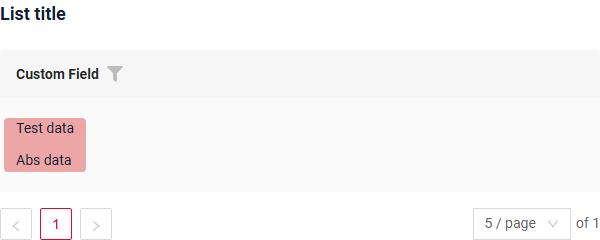
=== "Виджет Info"
    _неприменимо_
=== "Виджет Form"
    _неприменимо_


### Как добавить? { #how-to-add_2 }
??? Example "Пример"
    === "Вычисляемый цвет"
        **Шаг 1**   Добавьте `собственное поле для цвета` в соответствующий **DataResponseDTO**. Поле может содержать цвет в формате HEX или быть null.
        ```java
        --8<--
        {{ external_links.github_raw_doc }}/fields/multivaluetree/color/MyExample3315DTO.java
        --8<--
        ```    
 
        === "Виджет List"
            **Шаг 2** Добавьте **"bgColorKey"** :  `собственное поле для цвета` в .widget.json.
            ```json
            --8<--
            {{ external_links.github_raw_doc }}/fields/multivaluetree/color/MyExample3315List.widget.json
            --8<--
            ``` 
 
        === "Виджет Info"
            _неприменимо_
        === "Виджет Form"
            _неприменимо_

        [:material-play-circle: Живой пример]({{ external_links.code_samples }}/ui/#/screen/myexample3315){:target="_blank"} ·
        [:fontawesome-brands-github: GitHub]({{ external_links.github_ui }}/{{ external_links.github_branch }}/src/main/java/org/demo/documentation/fields/multivaluetree/color){:target="_blank"}

    === "Постоянный цвет"
        === "Виджет List"
            Добавьте **"bgColor"** :  `цвет HEX` в .widget.json.
            ```json
            --8<--
            {{ external_links.github_raw_doc }}/fields/multivaluetree/colorconst/MyExample3316List.widget.json
            --8<--
            ``` 
        === "Виджет Info"
            _неприменимо_
        === "Виджет Form"
            _неприменимо_

        [:material-play-circle: Живой пример]({{ external_links.code_samples }}/ui/#/screen/myexample3316){:target="_blank"} ·
        [:fontawesome-brands-github: GitHub]({{ external_links.github_ui }}/{{ external_links.github_branch }}/src/main/java/org/demo/documentation/fields/multivaluetree/colorconst){:target="_blank"}

## Только чтение/Редактирование { #readonlyeditable }
`Readonly/Editable` указывает, можно ли редактировать поле. Это можно вычислять на основе бизнес-логики приложения

`Editable`
[:material-play-circle: Живой пример]({{ external_links.code_samples }}/ui/#/screen/myexample3314){:target="_blank"} ·
[:fontawesome-brands-github: GitHub]({{ external_links.github_ui }}/{{ external_links.github_branch }}/src/main/java/org/demo/documentation/fields/multivaluetree/basic){:target="_blank"}

`Readonly`
[:material-play-circle: Живой пример]({{ external_links.code_samples }}/ui/#/screen/myexample3322/view/myexample3322form){:target="_blank"} ·
[:fontawesome-brands-github: GitHub]({{ external_links.github_ui }}/{{ external_links.github_branch }}/src/main/java/org/demo/documentation/fields/multivaluetree/ro){:target="_blank"}

### Как это выглядит? { #how-does-it-look_3 }
=== "Редактирование"
    === "Виджет List"
        _неприменимо_
    === "Виджет Info"
        _неприменимо_
    === "Виджет Form"
        
=== "Только чтение"
    === "Виджет List"
        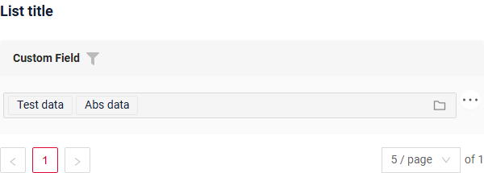
    === "Виджет Info"
        
    === "Виджет Form"
        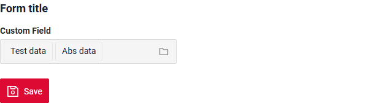

### Как добавить? { #how-to-add_3 }
??? Example "Пример"
    === "Редактирование"
        **Шаг 1** Добавьте маппинг DTO->entity в соответствующий **VersionAwareResponseService**.
        ```java
        --8<--
        {{ external_links.github_raw_doc }}/fields/multivaluetree/basic/MyExample3314Service.java:doUpdateEntity
        --8<--
        ```


        **Шаг 2** Добавьте **fields.setEnabled** в соответствующий **FieldMetaBuilder**.
        ```java
        --8<--
        {{ external_links.github_raw_doc }}/fields/multivaluetree/basic/MyExample3314Meta.java:buildRowDependentMeta
        --8<--
        ```    
 
        === "Виджет List"
            **_неприменимо_**
        === "Виджет Info"
            **_неприменимо_**
        === "Виджет Form"
            **Работает для Form.**

        [:material-play-circle: Живой пример]({{ external_links.code_samples }}/ui/#/screen/myexample3314){:target="_blank"} ·
        [:fontawesome-brands-github: GitHub]({{ external_links.github_ui }}/{{ external_links.github_branch }}/src/main/java/org/demo/documentation/fields/multivaluetree/basic){:target="_blank"}

    === "Только чтение"
    
        **Вариант 1** Включено по умолчанию.
        ```java
        --8<--
        {{ external_links.github_raw_doc }}/fields/multivaluetree/ro/MyExample3322Meta.java:buildRowDependentMeta
        --8<--
        ```    
 
    
        **Вариант 2** `Не рекомендуется.` Свойство fields.setDisabled() переопределяет доступность поля, если используется после свойства fields.setEnabled.
        === "Виджет List"
            **_неприменимо_**
        === "Виджет Info"
            **_неприменимо_**
        === "Виджет Form"
            **Работает для Form.**

        [:material-play-circle: Живой пример]({{ external_links.code_samples }}/ui/#/screen/myexample3322/view/myexample3322form){:target="_blank"} ·
        [:fontawesome-brands-github: GitHub]({{ external_links.github_ui }}/{{ external_links.github_branch }}/src/main/java/org/demo/documentation/fields/multivaluetree/ro){:target="_blank"}

## Фильтрация { #filtering }
[:material-play-circle: Живой пример]({{ external_links.code_samples }}/ui/#/screen/myexample3318){:target="_blank"} ·
[:fontawesome-brands-github: GitHub]({{ external_links.github_ui }}/{{ external_links.github_branch }}/src/main/java/org/demo/documentation/fields/multivaluetree/filtration){:target="_blank"}

`Filtering` позволяет искать данные по критериям. Поиск использует оператор in, который в данном случае сравнивает id.
### Как это выглядит? { #how-does-it-look_4 }
=== "Виджет List"
    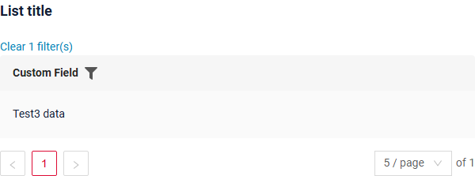
=== "Виджет Info"
    _неприменимо_
=== "Виджет Form"
    _неприменимо_


### Как добавить? { #how-to-add_4 }
??? Example "Пример"
    === "Виджет List"
        **Шаг 1** Добавьте **@SearchParameter** в соответствующий **DataResponseDTO**. (Расширенная настройка [SearchParameter](/ru/advancedCustomization/element/searchparameter/searchparameter))
        ```java
        --8<--
        {{ external_links.github_raw_doc }}/fields/multivaluetree/filtration/MyExample3318DTO.java
        --8<--
        ```
      
        **Шаг 2**  Добавьте **fields.enableFilter** в соответствующий **FieldMetaBuilder**.
        ```java
        --8<--
        {{ external_links.github_raw_doc }}/fields/multivaluetree/filtration/MyExample3318Meta.java:buildIndependentMeta
        --8<--
        ```

        **Шаг 3**  Добавьте popupBcName и assocValueKey в **_.widget.json_**.

        popupBcName — имя bc
        
        assocValueKey — поле для открытия AssocTreePopup

        ```json
        --8<--
        {{ external_links.github_raw_doc }}/fields/multivaluetree/filtration/MyExample3318List.widget.json
        --8<--
        ```
 
 
    === "Виджет Info"
        _неприменимо_
    === "Виджет Form"
        _неприменимо_

    [:material-play-circle: Живой пример]({{ external_links.code_samples }}/ui/#/screen/myexample3318){:target="_blank"} ·
    [:fontawesome-brands-github: GitHub]({{ external_links.github_ui }}/{{ external_links.github_branch }}/src/main/java/org/demo/documentation/fields/multivaluetree/filtration){:target="_blank"}

## Drilldown
**_неприменимо_**

## Валидация { #validation }
`Validation` позволяет проверять любые бизнес-правила для введённого пользователем значения. Типы валидации:

1) Exception: отображает сообщение, уведомляющее пользователя о технических или бизнес-ошибках.

   `Business Exception`:
   [:material-play-circle: Живой пример]({{ external_links.code_samples }}/ui/#/screen/myexample3325){:target="_blank"} ·
   [:fontawesome-brands-github: GitHub]({{ external_links.github_ui }}/{{ external_links.github_branch }}/src/main/java/org/demo/documentation/fields/multivaluetree/validationbusinessex){:target="_blank"}

   `Runtime Exception`:
   [:material-play-circle: Живой пример]({{ external_links.code_samples }}/ui/#/screen/myexample3328){:target="_blank"} ·
   [:fontawesome-brands-github: GitHub]({{ external_links.github_ui }}/{{ external_links.github_branch }}/src/main/java/org/demo/documentation/fields/multivaluetree/validationruntimeex){:target="_blank"}
   
2) Confirm: показывает диалог с необязательным сообщением, требующий от пользователя подтверждения или отмены перед продолжением.

   [:material-play-circle: Живой пример]({{ external_links.code_samples }}/ui/#/screen/myexample3326){:target="_blank"} ·
   [:fontawesome-brands-github: GitHub]({{ external_links.github_ui }}/{{ external_links.github_branch }}/src/main/java/org/demo/documentation/fields/multivaluetree/validationconfirm){:target="_blank"}

3) Валидация на уровне полей: показывает ошибку рядом со всеми полями, не прошедшими проверку

   `Option 1`:
   [:material-play-circle: Живой пример]({{ external_links.code_samples }}/ui/#/screen/myexample3324){:target="_blank"} ·
   [:fontawesome-brands-github: GitHub]({{ external_links.github_ui }}/{{ external_links.github_branch }}/src/main/java/org/demo/documentation/fields/multivaluetree/validationannotation){:target="_blank"}

   `Option 2`:
   [:material-play-circle: Живой пример]({{ external_links.code_samples }}/ui/#/screen/myexample3327){:target="_blank"} ·
   [:fontawesome-brands-github: GitHub]({{ external_links.github_ui }}/{{ external_links.github_branch }}/src/main/java/org/demo/documentation/fields/multivaluetree/validationdynamic){:target="_blank"}

### Как это выглядит? { #how-does-it-look_5 }
=== "Виджет List"
    === "BusinessException"
        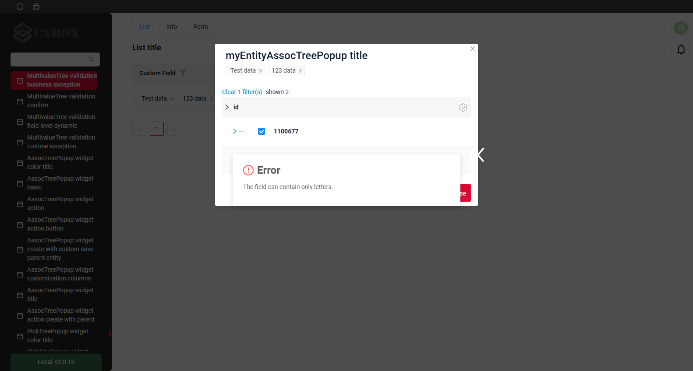
    === "RuntimeException"
        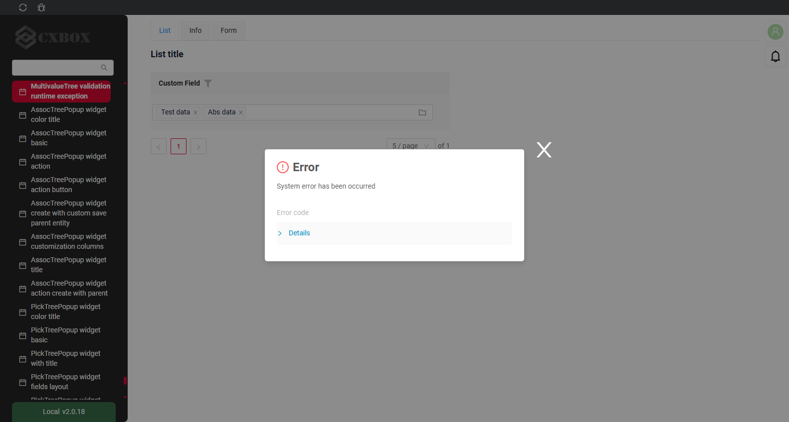
    === "Confirm"
        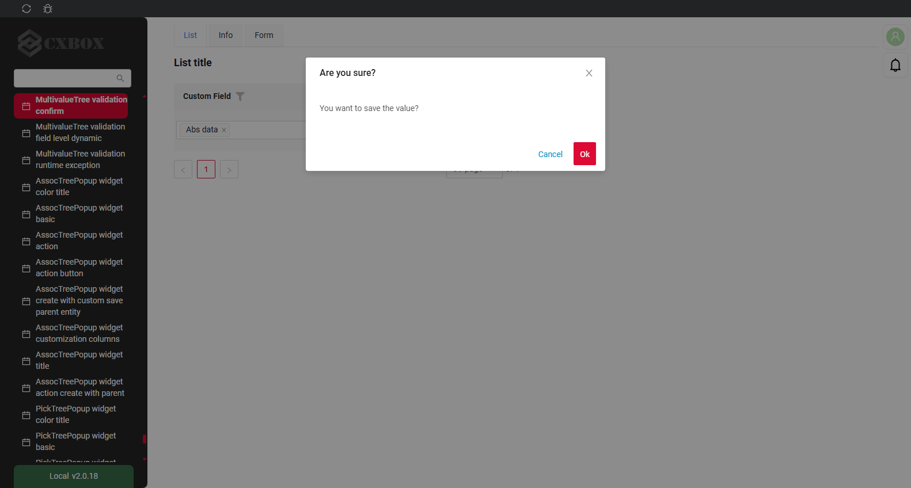
    === "Валидация на уровне полей"
        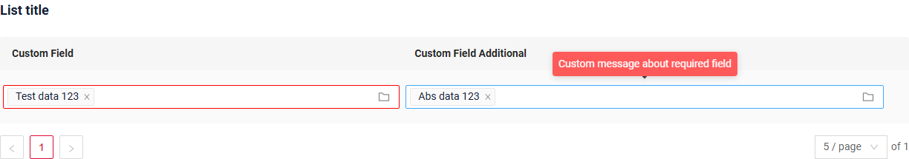
=== "Виджет Info"
    _неприменимо_
=== "Виджет Form"
    === "BusinessException"
        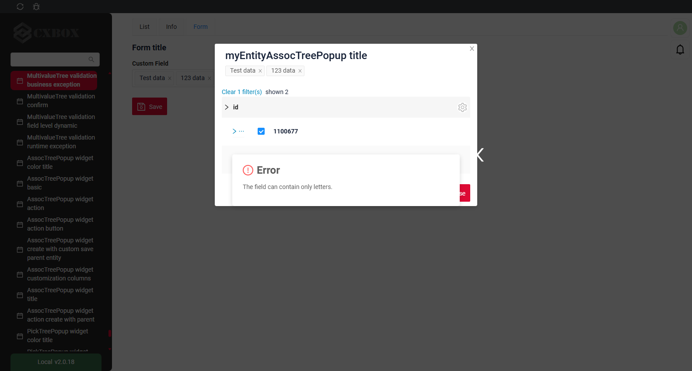
    === "RuntimeException"
        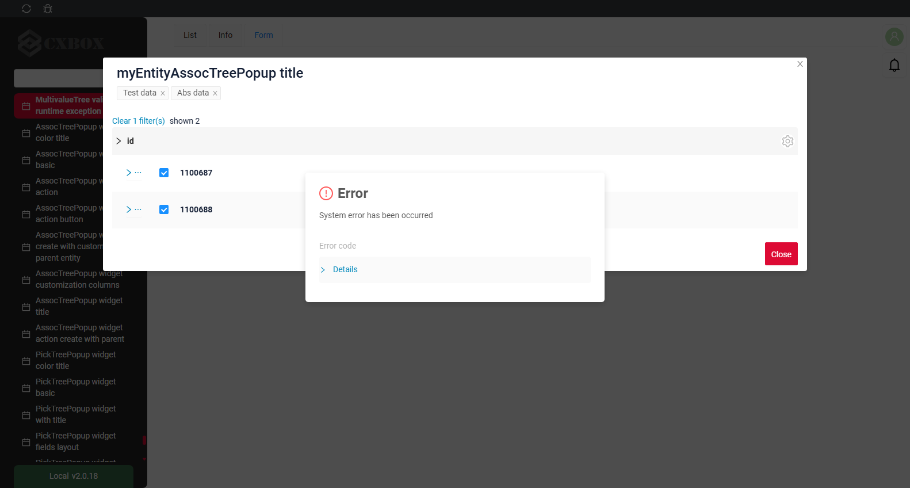
    === "Confirm"
        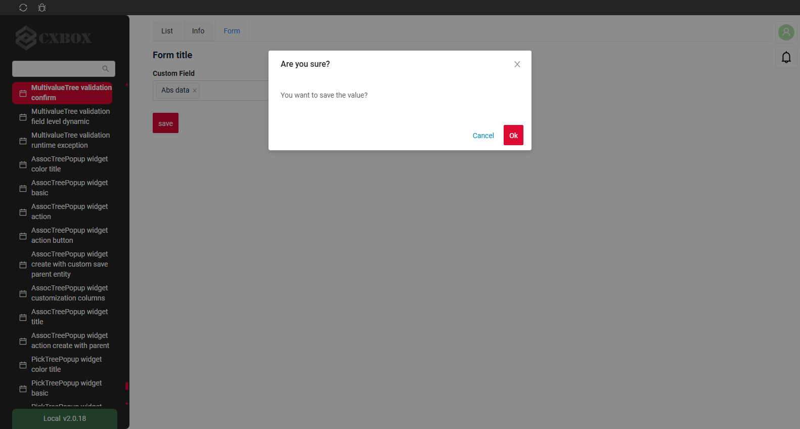
    === "Валидация на уровне полей"
        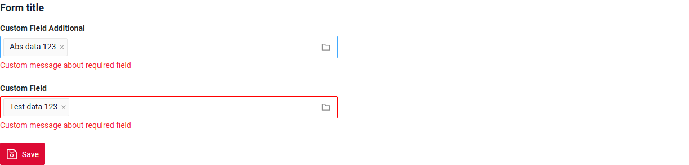
### Как добавить? { #how-to-add_5 }
??? Example "Пример"
    === "BusinessException"

        `BusinessException` описывает ошибку в рамках бизнес-процесса.
        
        Добавьте **BusinessException** в соответствующий **VersionAwareResponseService**.
        ```java
        --8<--
        {{ external_links.github_raw_doc }}/fields/multivaluetree/validationbusinessex/MyExample3325Service.java:doUpdateEntity
        --8<--
        ```
        
        === "Виджет List"
            **Работает для List.**
        === "Виджет Info"
            **_неприменимо_**
        === "Виджет Form"
            **Работает для Form.**

        [:material-play-circle: Живой пример]({{ external_links.code_samples }}/ui/#/screen/myexample3325){:target="_blank"} ·
        [:fontawesome-brands-github: GitHub]({{ external_links.github_ui }}/{{ external_links.github_branch }}/src/main/java/org/demo/documentation/fields/multivaluetree/validationbusinessex){:target="_blank"}

    === "RuntimeException"

        `RuntimeException` описывает техническую ошибку в рамках бизнес-процесса.
        
        Добавьте **RuntimeException** в соответствующий **VersionAwareResponseService**.
        ```java
        --8<--
        {{ external_links.github_raw_doc }}/fields/multivaluetree/validationruntimeex/MyExample3328Service.java:doUpdateEntity
        --8<--
        ```     
 
        === "Виджет List"
            **Работает для List.**
        === "Виджет Info"
            **_неприменимо_**
        === "Виджет Form"
            **Работает для Form.**

        [:material-play-circle: Живой пример]({{ external_links.code_samples }}/ui/#/screen/myexample3328){:target="_blank"} ·
        [:fontawesome-brands-github: GitHub]({{ external_links.github_ui }}/{{ external_links.github_branch }}/src/main/java/org/demo/documentation/fields/multivaluetree/validationruntimeex){:target="_blank"}

    === "Confirm"

        Добавьте [PreAction.confirm](/ru/advancedCustomization_validation) в соответствующий **VersionAwareResponseService**.

        ```java
        --8<--
        {{ external_links.github_raw_doc }}/fields/multivaluetree/validationconfirm/MyExample3326Service.java:getActions
        --8<--
        ```
 
        === "Виджет List"
            **Работает для List.**
        === "Виджет Info"
            **_неприменимо_**
        === "Виджет Form"
            **Работает для Form.**

        [:material-play-circle: Живой пример]({{ external_links.code_samples }}/ui/#/screen/myexample3326){:target="_blank"} ·
        [:fontawesome-brands-github: GitHub]({{ external_links.github_ui }}/{{ external_links.github_branch }}/src/main/java/org/demo/documentation/fields/multivaluetree/validationconfirm){:target="_blank"}

    === "Валидация на уровне полей"
        === "Вариант 1"
            Добавьте javax.validation в соответствующий **DataResponseDTO**.

            Используйте, если:

            Нужна простая проверка полей (javax validation)
            ```java
            --8<--
            {{ external_links.github_raw_doc }}/fields/multivaluetree/validationannotation/MyExample3324DTO.java
            --8<--
            ```
 
            === "Виджет List"
                **Работает для List.**
            === "Виджет Info"
                **_неприменимо_**
            === "Виджет Form"
                **Работает для Form.**

            [:material-play-circle: Живой пример]({{ external_links.code_samples }}/ui/#/screen/myexample3324){:target="_blank"} ·
            [:fontawesome-brands-github: GitHub]({{ external_links.github_ui }}/{{ external_links.github_branch }}/src/main/java/org/demo/documentation/fields/multivaluetree/validationannotation){:target="_blank"}

        === "Вариант 2"
            Создайте собственный сервис для проверки бизнес-логики.

            Используйте, если:

            Для полей требуется проверка бизнес-логики

            `Шаг 1`  Создайте собственный метод проверки.
            ```java
            --8<--
            {{ external_links.github_raw_doc }}/fields/multivaluetree/validationdynamic/MyExample3327Service.java:validateFields
            --8<--
            ```
 
            `Шаг 2` Добавьте собственный метод проверки в соответствующий **VersionAwareResponseService**.
            ```java
            --8<--
            {{ external_links.github_raw_doc }}/fields/multivaluetree/validationdynamic/MyExample3327Service.java:doUpdateEntity
            --8<--
            ```

            [:material-play-circle: Живой пример]({{ external_links.code_samples }}/ui/#/screen/myexample3327){:target="_blank"} ·
            [:fontawesome-brands-github: GitHub]({{ external_links.github_ui }}/{{ external_links.github_branch }}/src/main/java/org/demo/documentation/fields/multivaluetree/validationdynamic){:target="_blank"}

 
## Сортировка { #sorting }
**_неприменимо_**

## Обязательность { #required }
[:material-play-circle: Живой пример]({{ external_links.code_samples }}/ui/#/screen/myexample3321){:target="_blank"} ·
[:fontawesome-brands-github: GitHub]({{ external_links.github_ui }}/{{ external_links.github_branch }}/src/main/java/org/demo/documentation/fields/multivaluetree/required){:target="_blank"}

`Required` позволяет указать, что поле обязательно должно иметь значение.

### Как это выглядит? { #how-does-it-look_6 }
=== "Виджет List"
    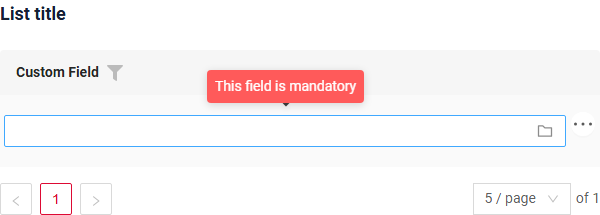
=== "Виджет Info"
    _неприменимо_
=== "Виджет Form"
    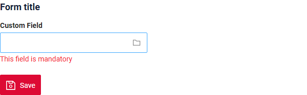
### Как добавить? { #how-to-add_6 }
??? Example "Пример"
    Добавьте **fields.setRequired** в соответствующий **FieldMetaBuilder**.

    ```java
    --8<--
    {{ external_links.github_raw_doc }}/fields/multivaluetree/required/MyExample3321Meta.java:buildRowDependentMeta
    --8<--
    ```
 
    === "Виджет List"
        **_неприменимо_**
    === "Виджет Info"
        **_неприменимо_**
    === "Виджет Form"
        **Работает для Form.**

    [:material-play-circle: Живой пример]({{ external_links.code_samples }}/ui/#/screen/myexample3321){:target="_blank"} ·
    [:fontawesome-brands-github: GitHub]({{ external_links.github_ui }}/{{ external_links.github_branch }}/src/main/java/org/demo/documentation/fields/multivaluetree/required){:target="_blank"}

## Дополнительные свойства { #additional-properties }
### <a id="Primary">Primary</a>
Не поддерживается для `multivalueTree`: настройка `options.primary` всплывающего окна доступна только для [AssocListPopup](/ru/widget/type/assoclistpopup/assoclistpopup/#primary).

### <a id="SelectionModes">Режимы выбора</a>
[:material-play-circle: Живой пример]({{ external_links.code_samples }}/ui/#/screen/myexample3261/view/myexample3261list){:target="_blank"} ·
[:fontawesome-brands-github: GitHub]({{ external_links.github_ui }}/{{ external_links.github_branch }}/src/main/java/org/demo/documentation/widgets/tree/base/inner){:target="_blank"}

На бэкенд отправляется ровно то, что пользователь явно выбрал во всплывающем окне.

* Если пользователь выбирает отдельные записи, отправляются id этих записей.
* Если пользователь выбирает целую группу (узел), отправляется id группы, а её дочерние элементы становятся бледными — они покрываются выбранной группой и отдельно не отправляются.
* Выбор вида «вся группа, кроме N записей» выразить нельзя: либо выбирается группа, либо нужные записи выбираются по одной.

Какие строки вообще можно выбирать — узлы, листья или и те и другие — определяется свойством `options.tree.selection` виджета всплывающего окна, см. [Режимы выбора](/ru/widget/type/assoctreepopup/assoctreepopup/#selectionmodes).

#### Как это выглядит? { #how-does-it-look_7 }
=== "Виджет List"
    _неприменимо_
=== "Виджет Info"
    _неприменимо_
=== "Виджет Form"
    

#### Как добавить? { #how-to-add_7 }
??? Example "Пример"
    === "Виджет List"
        **_неприменимо_**
    === "Виджет Info"
        **_неприменимо_**
    === "Виджет Form"
        Добавьте **tree.selection** в соответствующий **.widget.json** Assoc.
        ```json
        --8<--
        {{ external_links.github_raw_doc }}/widgets/tree/base/inner/myexample3261AssocTreePopup.widget.json
        --8<--
        ```

    [:material-play-circle: Живой пример]({{ external_links.code_samples }}/ui/#/screen/myexample3261/view/myexample3261list){:target="_blank"} ·
    [:fontawesome-brands-github: GitHub]({{ external_links.github_ui }}/{{ external_links.github_branch }}/src/main/java/org/demo/documentation/widgets/tree/base/inner){:target="_blank"}
