# Radio

`Radio` is a component that allows to select one of predefined values visualized as radio buttons

## Basics
[:material-play-circle: Live Sample]({{ external_links.code_samples }}/ui/#/screen/myexample20){:target="_blank"} ·
[:fontawesome-brands-github: GitHub]({{ external_links.github_ui }}/{{ external_links.github_branch }}/src/main/java/org/demo/documentation/fields/radio/basic){:target="_blank"}

### How does it look?

=== "List widget"
    Looks same as dictionary type. Differs only, when editing
    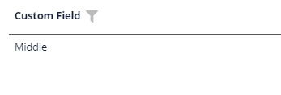
=== "Info widget"
    Looks same as dictionary type. Differs only, when editing in list/form widgets
    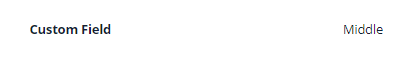
=== "Form widget"
    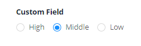


### How to add?

??? Example
    **Step1** Create Enum. Recommend that use additional variable for visual display.
    ```java
    --8<--
    {{ external_links.github_raw_doc }}/fields/radio/basic/enums/CustomFieldEnum.java
    --8<--
    ```
 
    **Step2** Add  **Custom Field Enum** field to corresponding **BaseEntity**.

    ```java
    --8<--
    {{ external_links.github_raw_doc }}/fields/radio/basic/MyEntity20.java
    --8<--
    ``` 

    **Step3** Add  **Custom Field Enum** field to corresponding **DataResponseDTO**.

    ```java
    --8<--
    {{ external_links.github_raw_doc }}/fields/radio/basic/MyExample20DTO.java
    --8<--
    ``` 

    **Step4** Add **fields.setEnumValues** to corresponding **FieldMetaBuilder**.

    ```java
    --8<--
    {{ external_links.github_raw_doc }}/fields/radio/basic/MyExample20Meta.java:buildRowDependentMeta
    --8<--
    ``` 

    === "List widget"
        **Step5** Add to **_.widget.json_**.
        ```json
        --8<--
        {{ external_links.github_raw_doc }}/fields/radio/basic/myexample20list.widget.json
        --8<--
        ``` 

    === "Info widget"
        **Step5** Add to **_.widget.json_**.
        ```json
        --8<--
        {{ external_links.github_raw_doc }}/fields/radio/basic/myexample20info.widget.json
        --8<--
        ``` 
    === "Form widget"
        **Step5** Add to **_.widget.json_**.
        ```json
        --8<--
        {{ external_links.github_raw_doc }}/fields/radio/basic/myexample20form.widget.json
        --8<--
        ``` 

    [:material-play-circle: Live Sample]({{ external_links.code_samples }}/ui/#/screen/myexample20){:target="_blank"} ·
    [:fontawesome-brands-github: GitHub]({{ external_links.github_ui }}/{{ external_links.github_branch }}/src/main/java/org/demo/documentation/fields/radio/basic){:target="_blank"}

## Placeholder
**_not applicable_**

## Color
`Color` allows you to specify a field color. It can be calculated based on business logic of application

**Calculated color**

[:material-play-circle: Live Sample]({{ external_links.code_samples }}/ui/#/screen/myexample21){:target="_blank"} ·
[:fontawesome-brands-github: GitHub]({{ external_links.github_ui }}/{{ external_links.github_branch }}/src/main/java/org/demo/documentation/fields/radio/color){:target="_blank"}

**Constant color**

[:material-play-circle: Live Sample]({{ external_links.code_samples }}/ui/#/screen/myexample22){:target="_blank"} ·
[:fontawesome-brands-github: GitHub]({{ external_links.github_ui }}/{{ external_links.github_branch }}/src/main/java/org/demo/documentation/fields/radio/colorconst){:target="_blank"}

### How does it look?
=== "List widget"
    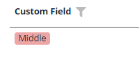
=== "Info widget"
    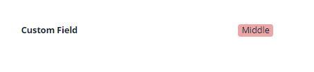
=== "Form widget"
    _not applicable_


### How to add?
??? Example
    === "Calculated color"
        **Step 1**   Add `custom field for color` to corresponding **DataResponseDTO**. The field can contain a HEX color or be null. 
        ```java
        --8<--
        {{ external_links.github_raw_doc }}/fields/radio/color/MyExample21DTO.java
        --8<--
        ```    
        === "List widget"   
            **Step 2** Add **"bgColorKey"** :  `custom field for color`  to .widget.json.
            ```json
            --8<--
            {{ external_links.github_raw_doc }}/fields/radio/color/myexample21list.widget.json
            --8<--
            ```

        === "Info widget"
            **Step 2** Add **"bgColorKey"** :  `custom field for color`  to .widget.json.
            ```json
            --8<--
            {{ external_links.github_raw_doc }}/fields/radio/color/myexample21info.widget.json
            --8<--
            ```

        === "Form widget"
            _not applicable_

        [:material-play-circle: Live Sample]({{ external_links.code_samples }}/ui/#/screen/myexample21){:target="_blank"} ·
        [:fontawesome-brands-github: GitHub]({{ external_links.github_ui }}/{{ external_links.github_branch }}/src/main/java/org/demo/documentation/fields/radio/color){:target="_blank"}

    === "Constant color"
        === "List widget" 
            Add **"bgColor"** :  `HEX color`  to .widget.json.
            ```json
            --8<--
            {{ external_links.github_raw_doc }}/fields/radio/colorconst/myexample22list.widget.json
            --8<--
            ```   
        === "Info widget"
            Add **"bgColor"** :  `HEX color`  to .widget.json.
            ```json
            --8<--
            {{ external_links.github_raw_doc }}/fields/radio/colorconst/myexample22info.widget.json
            --8<--
            ```   

        === "Form widget"
            _not applicable_

        [:material-play-circle: Live Sample]({{ external_links.code_samples }}/ui/#/screen/myexample22){:target="_blank"} ·
        [:fontawesome-brands-github: GitHub]({{ external_links.github_ui }}/{{ external_links.github_branch }}/src/main/java/org/demo/documentation/fields/radio/colorconst){:target="_blank"}

## Readonly/Editable
`Readonly/Editable` indicates whether the field can be edited or not. It can be calculated based on business logic of application

`Editable`
[:material-play-circle: Live Sample]({{ external_links.code_samples }}/ui/#/screen/myexample20){:target="_blank"} ·
[:fontawesome-brands-github: GitHub]({{ external_links.github_ui }}/{{ external_links.github_branch }}/src/main/java/org/demo/documentation/fields/radio/basic){:target="_blank"}

`Readonly`
[:material-play-circle: Live Sample]({{ external_links.code_samples }}/ui/#/screen/myexample23){:target="_blank"} ·
[:fontawesome-brands-github: GitHub]({{ external_links.github_ui }}/{{ external_links.github_branch }}/src/main/java/org/demo/documentation/fields/radio/ro){:target="_blank"}

### How does it look?
=== "Editable"
    === "List widget"
        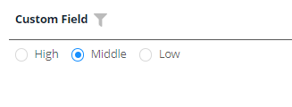
    === "Info widget"
        _not applicable_
    === "Form widget"
        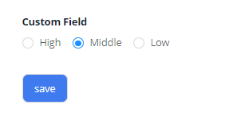
=== "Readonly"
    === "List widget"
        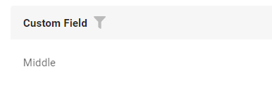
    === "Info widget"
        
    === "Form widget"
        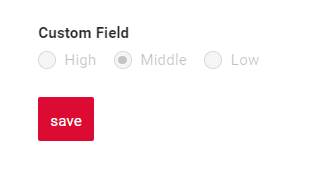

### How to add?
??? Example
    === "Editable"
        **Step1** Add mapping DTO->entity to corresponding **VersionAwareResponseService**.
        ```java
        --8<--
        {{ external_links.github_raw_doc }}/fields/radio/basic/MyExample20Service.java:doUpdateEntity
        --8<--
        ```   
        **Step2** Add **fields.setEnabled** to corresponding **FieldMetaBuilder**.
        ```java
        --8<--
        {{ external_links.github_raw_doc }}/fields/radio/basic/MyExample20Meta.java:buildRowDependentMeta
        --8<--
        ```
        === "List widget"
            **Works for List.**
        === "Info widget"
            **_not applicable_**
        === "Form widget"
            **Works for Form.**

        [:material-play-circle: Live Sample]({{ external_links.code_samples }}/ui/#/screen/myexample20){:target="_blank"} ·
        [:fontawesome-brands-github: GitHub]({{ external_links.github_ui }}/{{ external_links.github_branch }}/src/main/java/org/demo/documentation/fields/radio/basic){:target="_blank"}

    === "Readonly"
    
        **Option 1** Enabled by default.
        ```java
        --8<--
        {{ external_links.github_raw_doc }}/fields/radio/ro/MyExample23Meta.java:buildRowDependentMeta
        --8<--
        ```

        **Option 2** `Not recommended.` Property fields.setDisabled() overrides the enabled field if you use after property fields.setEnabled.
        === "List widget"
            **Works for List.**
        === "Info widget"
            **Works for Info.**
        === "Form widget"
            **Works for Form.**

        [:material-play-circle: Live Sample]({{ external_links.code_samples }}/ui/#/screen/myexample23){:target="_blank"} ·
        [:fontawesome-brands-github: GitHub]({{ external_links.github_ui }}/{{ external_links.github_branch }}/src/main/java/org/demo/documentation/fields/radio/ro){:target="_blank"}

## Filtering
[:material-play-circle: Live Sample]({{ external_links.code_samples }}/ui/#/screen/myexample25){:target="_blank"} ·
[:fontawesome-brands-github: GitHub]({{ external_links.github_ui }}/{{ external_links.github_branch }}/src/main/java/org/demo/documentation/fields/radio/filtration){:target="_blank"}

`Filtering` allows you to search data based on criteria. Search uses `in` operator.

The filter component displays a text search field and scrollbar based on the number of available filter values.
(since [release 2.0.13](https://doc.cxbox.org/new/version2013/"))

- The search input and scrollbar appear only when the number of filterable values exceeds  
  7 items (7 Default count items -configurable via frontend constant).

- The Apply button shows a counter of selected items (e.g., `Apply (5)`).
- If the selection count exceeds  7 items, it displays `Apply (N+)` (e.g., `Apply (9+)`).
 
### How does it look?
=== "List widget"
    === "< Default count items"    
        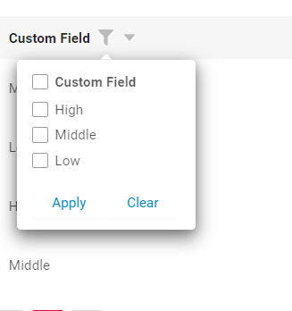
    === "> Default count items"
        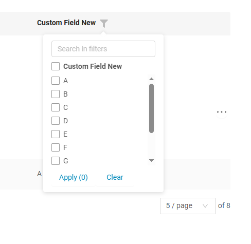
=== "Info widget"
    _not applicable_
=== "Form widget"
    _not applicable_

### How to add?
??? Example
    === "List widget"
        **Step 1** Add **@SearchParameter** to corresponding **DataResponseDTO**. (Advanced customization [SearchParameter](/advancedCustomization/element/searchparameter/searchparameter))
        ```java
        --8<--
        {{ external_links.github_raw_doc }}/fields/radio/filtration/MyExample25DTO.java
        --8<--
        ```
        **Step 2**  Add **fields.enableFilter** to corresponding **FieldMetaBuilder**.
        ```java
        --8<--
        {{ external_links.github_raw_doc }}/fields/radio/filtration/MyExample25Meta.java:buildIndependentMeta
        --8<--
        ```
    === "Info widget"
        _not applicable_
    === "Form widget"
        _not applicable_

    **Configuration Default count items**

    - Location: `\ui\src\constants\filter.ts`
    - Variables:

        - `checkboxFilterMaxVisibleItems` – Controls when scroll/search appear.
        - `checkboxFilterCounterLimit` – Sets the maximum number before switching to `+` notation.

    [:material-play-circle: Live Sample]({{ external_links.code_samples }}/ui/#/screen/myexample25){:target="_blank"} ·
    [:fontawesome-brands-github: GitHub]({{ external_links.github_ui }}/{{ external_links.github_branch }}/src/main/java/org/demo/documentation/fields/radio/filtration){:target="_blank"}

## Drilldown
[:material-play-circle: Live Sample]({{ external_links.code_samples }}/ui/#/screen/myexample24){:target="_blank"} ·
[:fontawesome-brands-github: GitHub]({{ external_links.github_ui }}/{{ external_links.github_branch }}/src/main/java/org/demo/documentation/fields/radio/drilldown){:target="_blank"}

`DrillDown` allows you to navigate to another view by simply tapping on it. Target view and other drill-down parts can be calculated based on business logic of application

Also, it optionally allows you to filter data on target view before it will be opened `see more` [DrillDown](/features/element/drilldown/drilldown)


### How does it look?
=== "List widget"
    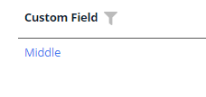
=== "Info widget"
    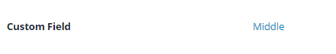
=== "Form widget"
    _not applicable_

### How to add?
??? Example

    **Option 1**

    `Step 1` Add [fields.setDrilldown](/features/element/drilldown/drilldown) to corresponding **FieldMetaBuilder**.
    ```java
    --8<--
    {{ external_links.github_raw_doc }}/fields/radio/drilldown/MyExample24Meta.java:buildRowDependentMeta
    --8<--
    ``` 
    === "List widget"
        `Step 2` Add **"drillDown": "true"**  to .widget.json.
        ```json
        --8<--
        {{ external_links.github_raw_doc }}/fields/radio/drilldown/myexample24list.widget.json
        --8<--
        ``` 

        **Option 2**
           Add **"drillDownKey"** :  `custom field`  to .widget.json. See more [Drilldown](/features/element/drilldown/drilldown) 
 
    === "Info widget"

        `Step 2` Add **"drillDown": "true"**  to .widget.json.
        ```json
        --8<--
        {{ external_links.github_raw_doc }}/fields/radio/drilldown/myexample24info.widget.json
        --8<--
        ``` 
        **Option 2**
           Add **"drillDownKey"** :  `custom field`  to .widget.json. See more [Drilldown](/features/element/drilldown/drilldown) 
 
    === "Form widget"
        _not applicable_

    [:material-play-circle: Live Sample]({{ external_links.code_samples }}/ui/#/screen/myexample24){:target="_blank"} ·
    [:fontawesome-brands-github: GitHub]({{ external_links.github_ui }}/{{ external_links.github_branch }}/src/main/java/org/demo/documentation/fields/radio/drilldown){:target="_blank"}

[Advanced customization](/features/element/drilldown/drilldown)

## Validation
`Validation` allows you to check any business rules for user-entered value. There are types of validation:

1) Exception:Displays a message to notify users about technical or business errors.

   `Business Exception`:
   [:material-play-circle: Live Sample]({{ external_links.code_samples }}/ui/#/screen/myexample29){:target="_blank"} ·
   [:fontawesome-brands-github: GitHub]({{ external_links.github_ui }}/{{ external_links.github_branch }}/src/main/java/org/demo/documentation/fields/radio/validationbusinessex){:target="_blank"}

   `Runtime Exception`:
   [:material-play-circle: Live Sample]({{ external_links.code_samples }}/ui/#/screen/myexample31){:target="_blank"} ·
   [:fontawesome-brands-github: GitHub]({{ external_links.github_ui }}/{{ external_links.github_branch }}/src/main/java/org/demo/documentation/fields/radio/validationruntimeex){:target="_blank"}
   
2) Confirm: Presents a dialog with an optional message, requiring user confirmation or cancellation before proceeding.

   [:material-play-circle: Live Sample]({{ external_links.code_samples }}/ui/#/screen/myexample30){:target="_blank"} ·
   [:fontawesome-brands-github: GitHub]({{ external_links.github_ui }}/{{ external_links.github_branch }}/src/main/java/org/demo/documentation/fields/radio/validationconfirm){:target="_blank"}

3) Field level validation: shows error next to all fields, that validation failed for

   `Option 1`:
   [:material-play-circle: Live Sample]({{ external_links.code_samples }}/ui/#/screen/myexample294){:target="_blank"} ·
   [:fontawesome-brands-github: GitHub]({{ external_links.github_ui }}/{{ external_links.github_branch }}/src/main/java/org/demo/documentation/fields/radio/validationannotation){:target="_blank"}

   `Option 2`:
   [:material-play-circle: Live Sample]({{ external_links.code_samples }}/ui/#/screen/myexample340){:target="_blank"} ·
   [:fontawesome-brands-github: GitHub]({{ external_links.github_ui }}/{{ external_links.github_branch }}/src/main/java/org/demo/documentation/fields/radio/validationdynamic){:target="_blank"}

### How does it look?
=== "List widget"
    === "BusinessException"
        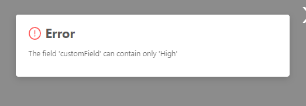
    === "RuntimeException"
        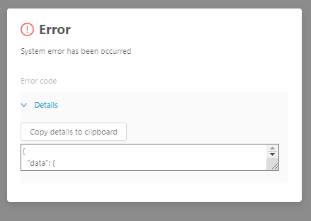
    === "Confirm"
        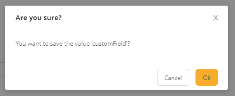
    === "Field level validation"
        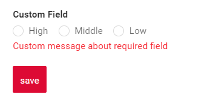
=== "Info widget"
    _not applicable_
=== "Form widget"
    === "BusinessException"
        
    === "RuntimeException"
        
    === "Confirm"
        
    === "Field level validation"
        
### How to add?
??? Example
    === "BusinessException"
        `BusinessException` describes an error  within a business process.

        Add **BusinessException** to corresponding **VersionAwareResponseService**.
        ```java
        --8<--
        {{ external_links.github_raw_doc }}/fields/radio/validationbusinessex/MyExample29Service.java:doUpdateEntity
        --8<--
        ``` 
        === "List widget"
            **Works for List.**
        === "Info widget"
            **_not applicable_**
        === "Form widget"
            **Works for Form.**

        [:material-play-circle: Live Sample]({{ external_links.code_samples }}/ui/#/screen/myexample29){:target="_blank"} ·
        [:fontawesome-brands-github: GitHub]({{ external_links.github_ui }}/{{ external_links.github_branch }}/src/main/java/org/demo/documentation/fields/radio/validationbusinessex){:target="_blank"}

    === "RuntimeException"

        `RuntimeException` describes technical error  within a business process.
        
        Add **RuntimeException** to corresponding **VersionAwareResponseService**.
        ```java
        --8<--
        {{ external_links.github_raw_doc }}/fields/radio/validationruntimeex/MyExample31Service.java:doUpdateEntity
        --8<--
        ```         
        === "List widget"
            **Works for List.**
        === "Info widget"
            **_not applicable_**
        === "Form widget"
            **Works for Form.**

        [:material-play-circle: Live Sample]({{ external_links.code_samples }}/ui/#/screen/myexample31){:target="_blank"} ·
        [:fontawesome-brands-github: GitHub]({{ external_links.github_ui }}/{{ external_links.github_branch }}/src/main/java/org/demo/documentation/fields/radio/validationruntimeex){:target="_blank"}

    === "Confirm"
        Add [PreAction.confirm](/advancedCustomization_validation) to corresponding **VersionAwareResponseService**.
        ```java
        --8<--
        {{ external_links.github_raw_doc }}/fields/radio/validationconfirm/MyExample30Service.java:getActions
        --8<--
        ``` 
        === "List widget"
            **Works for List.**
        === "Info widget"
            **_not applicable_**
        === "Form widget"
            **Works for Form.**

        [:material-play-circle: Live Sample]({{ external_links.code_samples }}/ui/#/screen/myexample30){:target="_blank"} ·
        [:fontawesome-brands-github: GitHub]({{ external_links.github_ui }}/{{ external_links.github_branch }}/src/main/java/org/demo/documentation/fields/radio/validationconfirm){:target="_blank"}

    === "Field level validation"
        === "Option 1"
            Use if:

            Requires a simple fields check (javax validation)

            Add javax.validation to corresponding **DataResponseDTO**.
            ```java
            --8<--
            {{ external_links.github_raw_doc }}/fields/radio/validationannotation/MyExample294DTO.java
            --8<--
            ``` 
            === "List widget"
                **Works for List.**
            === "Info widget"
                **_not applicable_**
            === "Form widget"
                **Works for Form.**

            [:material-play-circle: Live Sample]({{ external_links.code_samples }}/ui/#/screen/myexample294){:target="_blank"} ·
            [:fontawesome-brands-github: GitHub]({{ external_links.github_ui }}/{{ external_links.github_branch }}/src/main/java/org/demo/documentation/fields/radio/validationannotation){:target="_blank"}

        === "Option 2"
            Create custom service for business logic check.

            Use if:

            Business logic check required for fields

            `Step 1`  Create custom method for check.
            ```java
            --8<--
            {{ external_links.github_raw_doc }}/fields/radio/validationdynamic/MyExample340Service.java:validateFields
            --8<--
            ```
            `Step 2` Add custom method for check to corresponding **VersionAwareResponseService**.
            ```java
            --8<--
            {{ external_links.github_raw_doc }}/fields/radio/validationdynamic/MyExample340Service.java:doUpdateEntity
            --8<--
            ```

            [:material-play-circle: Live Sample]({{ external_links.code_samples }}/ui/#/screen/myexample340){:target="_blank"} ·
            [:fontawesome-brands-github: GitHub]({{ external_links.github_ui }}/{{ external_links.github_branch }}/src/main/java/org/demo/documentation/fields/radio/validationdynamic){:target="_blank"}

## Sorting
[:material-play-circle: Live Sample]({{ external_links.code_samples }}/ui/#/screen/myexample28){:target="_blank"} ·
[:fontawesome-brands-github: GitHub]({{ external_links.github_ui }}/{{ external_links.github_branch }}/src/main/java/org/demo/documentation/fields/radio/sorting){:target="_blank"}

`Sorting` allows you to sort data in ascending or descending order.
Lexicographic sorting is used for it.

### How does it look?
=== "List widget"
    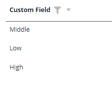
=== "Info widget"
    _not applicable_
=== "Form widget"
    _not applicable_
### How to add?
??? Example
    === "List widget"
        see more [Sorting](/widget/type/property/sorting/sorting)

        **Step 1**  Add **fields.enableSort** to corresponding **FieldMetaBuilder**.
        ```java
        --8<--
        {{ external_links.github_raw_doc }}/fields/radio/sorting/MyExample28Meta.java:buildIndependentMeta
        --8<--
        ```
        [:material-play-circle: Live Sample]({{ external_links.code_samples }}/ui/#/screen/myexample28){:target="_blank"} ·
        [:fontawesome-brands-github: GitHub]({{ external_links.github_ui }}/{{ external_links.github_branch }}/src/main/java/org/demo/documentation/fields/radio/sorting){:target="_blank"}

    === "Info widget"
        _not applicable_
    === "Form widget"
        _not applicable_

## Required
[:material-play-circle: Live Sample]({{ external_links.code_samples }}/ui/#/screen/myexample27){:target="_blank"} ·
[:fontawesome-brands-github: GitHub]({{ external_links.github_ui }}/{{ external_links.github_branch }}/src/main/java/org/demo/documentation/fields/radio/required){:target="_blank"}

`Required` allows you to denote, that this field must have a value provided.

### How does it look?
=== "List widget"
    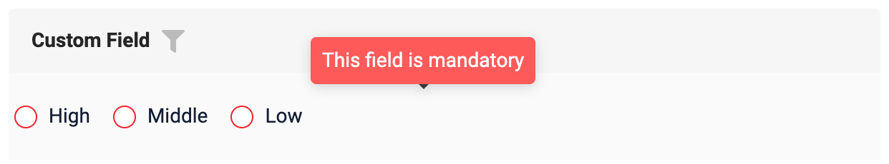
=== "Info widget"
    _not applicable_
=== "Form widget"
    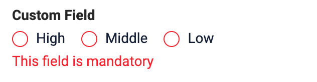
### How to add?
??? Example
    Add **fields.setRequired** to corresponding **FieldMetaBuilder**.

    ```java
    --8<--
    {{ external_links.github_raw_doc }}/fields/radio/required/MyExample27Meta.java:buildRowDependentMeta
    --8<--
    ```

    === "List widget"
        **Works for List.**
    === "Info widget"
        **_not applicable_**
    === "Form widget"
        **Works for Form.**

    [:material-play-circle: Live Sample]({{ external_links.code_samples }}/ui/#/screen/myexample27){:target="_blank"} ·
    [:fontawesome-brands-github: GitHub]({{ external_links.github_ui }}/{{ external_links.github_branch }}/src/main/java/org/demo/documentation/fields/radio/required){:target="_blank"}

## Additional properties
### <a id="displayMode">Display Mode</a>
[:material-play-circle: Live Sample]({{ external_links.code_samples }}/ui/#/screen/myexample441){:target="_blank"} ·
[:fontawesome-brands-github: GitHub]({{ external_links.github_ui }}/{{ external_links.github_branch }}/src/main/java/org/demo/documentation/fields/radio/displaymode){:target="_blank"}

`displayMode` sets how the values are arranged in edit mode:

| Value        | Description                                                                                         |
|--------------|-----------------------------------------------------------------------------------------------------|
| `horizontal` | the values are in a row; the values that do not fit into the width of the widget go to the next line (default) |
| `vertical`   | one value per line                                                                                  |

In view mode only the selected value is shown, so `displayMode` does not change it.

#### How does it look?
=== "List widget"
    === "horizontal"
        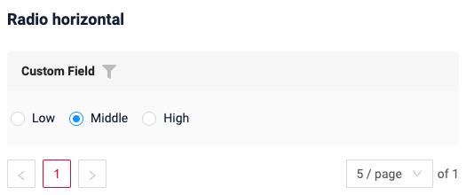
    === "vertical"
        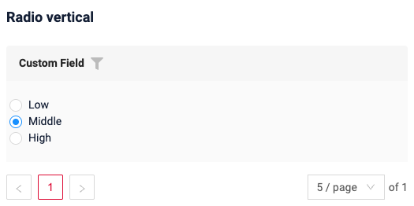
=== "Info widget"
    _not applicable_
=== "Form widget"
    === "horizontal"
        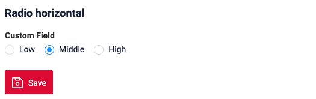
    === "vertical"
        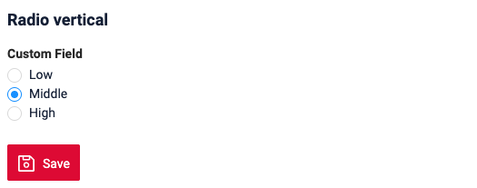

#### How to add?
??? Example
    Add **"displayMode"** to the field in .widget.json.
    === "List widget"
        === "horizontal"
            ```json
            --8<--
            {{ external_links.github_raw_doc }}/fields/radio/displaymode/myexample441listhorizontal.widget.json
            --8<--
            ```
        === "vertical"
            ```json
            --8<--
            {{ external_links.github_raw_doc }}/fields/radio/displaymode/myexample441listvertical.widget.json
            --8<--
            ```
    === "Info widget"
        _not applicable_
    === "Form widget"
        === "horizontal"
            ```json
            --8<--
            {{ external_links.github_raw_doc }}/fields/radio/displaymode/myexample441formhorizontal.widget.json
            --8<--
            ```
        === "vertical"
            ```json
            --8<--
            {{ external_links.github_raw_doc }}/fields/radio/displaymode/myexample441formvertical.widget.json
            --8<--
            ```

    [:material-play-circle: Live Sample]({{ external_links.code_samples }}/ui/#/screen/myexample441){:target="_blank"} ·
    [:fontawesome-brands-github: GitHub]({{ external_links.github_ui }}/{{ external_links.github_branch }}/src/main/java/org/demo/documentation/fields/radio/displaymode){:target="_blank"}

### <a id="height">Value height</a>
The height of each value is set in rows. It works with both values of [displayMode](#displayMode).

| Parameter             | Mode                                                                                                    | Default |
|-----------------------|---------------------------------------------------------------------------------------------------------|---------|
| `maxRowsPerValue`     | view and edit mode                                                                                      | 1       |
| `editMaxRowsPerValue` | edit mode only; overrides `maxRowsPerValue`                                                             | 1       |

* A value longer than the limit is first wrapped by words, then cut: the last row fades out and ends with **...**. Hovering over **...** shows the full value in a tooltip.
* The limit is applied to each value separately.
* `maxRowsPerValue` alone is enough: it limits the values in both view and edit mode.
* `editMaxRowsPerValue` is needed when the value has to be higher in edit mode than in view mode, for widgets where the field has both modes: the value stays compact in view mode and has more rows in edit mode.

#### maxRowsPerValue
[:material-play-circle: Live Sample]({{ external_links.code_samples }}/ui/#/screen/myexample442){:target="_blank"} ·
[:fontawesome-brands-github: GitHub]({{ external_links.github_ui }}/{{ external_links.github_branch }}/src/main/java/org/demo/documentation/fields/radio/maxrows){:target="_blank"}

##### How does it look?
=== "List widget"
    === "view mode"
        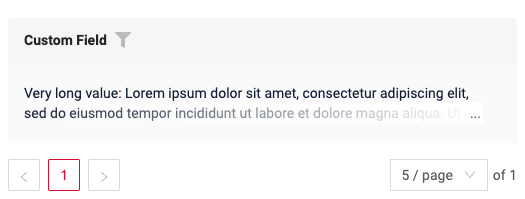
    === "edit mode"
        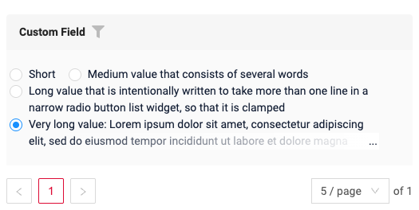
=== "Info widget"
    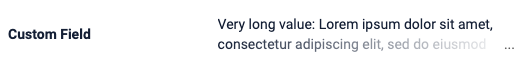
=== "Form widget"
    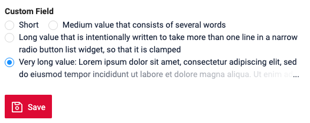

##### How to add?
??? Example
    Add **"maxRowsPerValue"** to the field in .widget.json.
    === "List widget"
        ```json
        --8<--
        {{ external_links.github_raw_doc }}/fields/radio/maxrows/myexample442list.widget.json
        --8<--
        ```
    === "Info widget"
        ```json
        --8<--
        {{ external_links.github_raw_doc }}/fields/radio/maxrows/myexample442info.widget.json
        --8<--
        ```
    === "Form widget"
        ```json
        --8<--
        {{ external_links.github_raw_doc }}/fields/radio/maxrows/myexample442form.widget.json
        --8<--
        ```

    [:material-play-circle: Live Sample]({{ external_links.code_samples }}/ui/#/screen/myexample442){:target="_blank"} ·
    [:fontawesome-brands-github: GitHub]({{ external_links.github_ui }}/{{ external_links.github_branch }}/src/main/java/org/demo/documentation/fields/radio/maxrows){:target="_blank"}

#### editMaxRowsPerValue
[:material-play-circle: Live Sample]({{ external_links.code_samples }}/ui/#/screen/myexample443){:target="_blank"} ·
[:fontawesome-brands-github: GitHub]({{ external_links.github_ui }}/{{ external_links.github_branch }}/src/main/java/org/demo/documentation/fields/radio/editmaxrows){:target="_blank"}

##### How does it look?
=== "List widget"
    `maxRowsPerValue` 1, `editMaxRowsPerValue` 3
    === "view mode"
        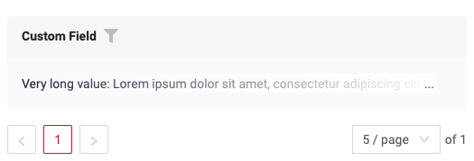
    === "edit mode"
        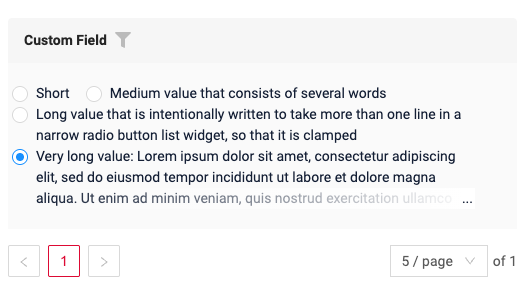
=== "Info widget"
    _not applicable_
=== "Form widget"
    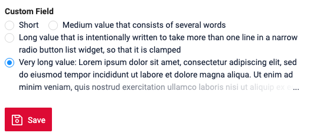

##### How to add?
??? Example
    Add **"editMaxRowsPerValue"** to the field in .widget.json.
    === "List widget"
        ```json
        --8<--
        {{ external_links.github_raw_doc }}/fields/radio/editmaxrows/myexample443list.widget.json
        --8<--
        ```
    === "Info widget"
        _not applicable_
    === "Form widget"
        ```json
        --8<--
        {{ external_links.github_raw_doc }}/fields/radio/editmaxrows/myexample443form.widget.json
        --8<--
        ```

    The defaults for all `radio` fields are frontend constants **maxRowsPerValue** and **editMaxRowsPerValue**:
    ```
    ui/src/components/ui/RadioButton/constants.ts
    ```

    [:material-play-circle: Live Sample]({{ external_links.code_samples }}/ui/#/screen/myexample443){:target="_blank"} ·
    [:fontawesome-brands-github: GitHub]({{ external_links.github_ui }}/{{ external_links.github_branch }}/src/main/java/org/demo/documentation/fields/radio/editmaxrows){:target="_blank"}

### <a id="snapshotKey">snapshotKey</a>
[:material-play-circle: Live Sample]({{ external_links.code_samples }}/ui/#/screen/myexample5900/view/myexample5900list){:target="_blank"} ·
[:fontawesome-brands-github: GitHub]({{ external_links.github_ui }}/{{ external_links.github_branch }}/src/main/java/org/demo/documentation/fields/property/snapshotkey){:target="_blank"}

Shows the difference between the previous (snapshot) value and the current value of the field:
the previous value is struck through on a red background, the current value is on a green background.
The field with `snapshotKey` is always read-only.

See [snapshotKey](/widget/fields/property/snapshotkey/snapshotkey) for all features and limitations.

#### How does it look?
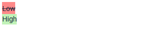

#### How to add?
??? Example
    **Step 1.** Add the field with the previous value to **DTO**. It must have the same type as the main field.

    **Step 2.** Add **snapshotKey** to the field in **_.widget.json_**. Works for List, Info, Form.

    **Step 3.** Add the field with the previous value to the same **_.widget.json_** with type **hidden**:
    the backend sends only the fields of the widgets, without it the previous value is not sent.
    ```json
    [
      {
        "label": "Custom Field",
        "key": "radioField",
        "type": "radio",
        "snapshotKey": "radioFieldSnapshot"
      },
      {
        "label": "Custom Field snapshot",
        "key": "radioFieldSnapshot",
        "type": "hidden"
      }
    ]
    ```

    [:material-play-circle: Live Sample]({{ external_links.code_samples }}/ui/#/screen/myexample5900/view/myexample5900list){:target="_blank"} ·
    [:fontawesome-brands-github: GitHub]({{ external_links.github_ui }}/{{ external_links.github_branch }}/src/main/java/org/demo/documentation/fields/property/snapshotkey){:target="_blank"}
