# RichText

Доступно начиная с [v2.0.18](/ru/new/version2018/)

`RichText` — компонент для редактирования и отображения форматированного многострочного текста. Пользователь форматирует текст с помощью панели инструментов: заголовки, полужирный, курсив, подчёркивание, зачёркивание, списки, цитаты, код и цвет текста.
Значение хранится в Markdown — том же формате, что использует Яндекс Вики.

## Основы { #basics }
[:material-play-circle: Живой пример]({{ external_links.code_samples }}/ui/#/screen/myexample425){:target="_blank"} ·
[:fontawesome-brands-github: GitHub]({{ external_links.github_ui }}/{{ external_links.github_branch }}/src/main/java/org/demo/documentation/fields/richtext/basic){:target="_blank"}

### Как это выглядит? { #how-does-it-look }

=== "Виджет List"
    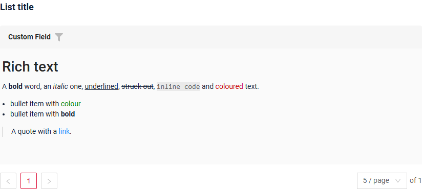
=== "Виджет Info"
    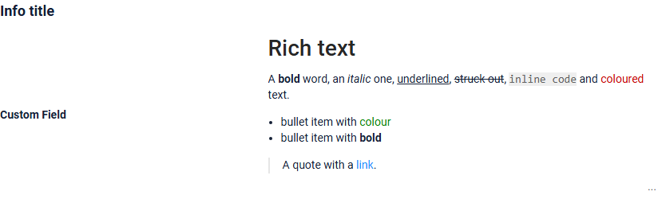
=== "Виджет Form"
    

Форматирование отображается в режиме просмотра и в режиме редактирования. Панель инструментов отображается только в режиме редактирования. Возможности панели см. в разделе [Форматирование](#formatting).

!!! warning "Внимание"
    Значение хранится с метками форматирования, например `**bold**`. Если поле хранит `richText`, используйте тип `richText` на каждом виджете, где отображается это поле. Виджет с другим типом, например `text`, покажет метки как есть.

!!! info
    Поддерживаемый размер содержимого — до **8 000 символов**, включая метки форматирования.

### Как добавить? { #how-to-add }
??? Example "Пример"
    **Шаг 1** Добавьте поле **String** в соответствующий **BaseEntity**. Значение содержит метки форматирования, поэтому колонке нужно больше места, чем для обычного текста.

    ```java
    --8<--
    {{ external_links.github_raw_doc }}/fields/richtext/basic/MyEntity425.java
    --8<--
    ```

    **Шаг 2** Добавьте поле **String** в соответствующий **DataResponseDTO**.

    ```java
    --8<--
    {{ external_links.github_raw_doc }}/fields/richtext/basic/MyExample425DTO.java
    --8<--
    ```

    === "Виджет List"
        **Шаг 3** Добавьте в **_.widget.json_**.

        ```json
        --8<--
        {{ external_links.github_raw_doc }}/fields/richtext/basic/MyExample425List.widget.json
        --8<--
        ```
    === "Виджет Info"
        **Шаг 3** Добавьте в **_.widget.json_**.

        ```json
        --8<--
        {{ external_links.github_raw_doc }}/fields/richtext/basic/MyExample425Info.widget.json
        --8<--
        ```

    === "Виджет Form"
        **Шаг 3** Добавьте в **_.widget.json_**.

        ```json
        --8<--
        {{ external_links.github_raw_doc }}/fields/richtext/basic/MyExample425Form.widget.json
        --8<--
        ```

    [:material-play-circle: Живой пример]({{ external_links.code_samples }}/ui/#/screen/myexample425){:target="_blank"} ·
    [:fontawesome-brands-github: GitHub]({{ external_links.github_ui }}/{{ external_links.github_branch }}/src/main/java/org/demo/documentation/fields/richtext/basic){:target="_blank"}

## Placeholder
[:material-play-circle: Живой пример]({{ external_links.code_samples }}/ui/#/screen/myexample426){:target="_blank"} ·
[:fontawesome-brands-github: GitHub]({{ external_links.github_ui }}/{{ external_links.github_branch }}/src/main/java/org/demo/documentation/fields/richtext/placeholder){:target="_blank"}

`Placeholder` позволяет задать краткую подсказку об ожидаемом значении. Подсказка отображается до ввода пользователем. Её можно вычислять на основе бизнес-логики приложения. Она отображается и для поля `Readonly`.

!!! note "Визуальный редактор: начиная с релиза 3.0.2"
    До [релиза 3.0.1](https://doc.cxbox.org/ru/new/version3001/) включительно placeholder отображается только в режиме **Markdown markup**, а визуальный редактор показывает пустое поле.
    Начиная с [релиза 3.0.2](https://doc.cxbox.org/ru/new/version3002/) placeholder отображается в обоих режимах.

### Как это выглядит? { #how-does-it-look_1 }
=== "Виджет List"
    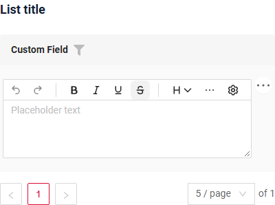
=== "Виджет Info"
    _неприменимо_
=== "Виджет Form"
    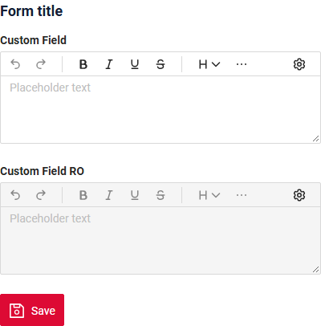
### Как добавить? { #how-to-add_1 }
??? Example "Пример"

    Добавьте **fields.setPlaceholder** в соответствующий **FieldMetaBuilder**.

    ```java
    --8<--
    {{ external_links.github_raw_doc }}/fields/richtext/placeholder/MyExample426Meta.java:buildRowDependentMeta
    --8<--
    ```
    === "Виджет List"
        **Работает для List.**
    === "Виджет Info"
        **_неприменимо_**
    === "Виджет Form"
        **Работает для Form.**

    [:material-play-circle: Живой пример]({{ external_links.code_samples }}/ui/#/screen/myexample426){:target="_blank"} ·
    [:fontawesome-brands-github: GitHub]({{ external_links.github_ui }}/{{ external_links.github_branch }}/src/main/java/org/demo/documentation/fields/richtext/placeholder){:target="_blank"}

## Цвет { #color }
**недоступно**

## Только чтение/Редактирование { #readonlyeditable }
`Readonly/Editable` указывает, можно ли редактировать поле. Это можно вычислять на основе бизнес-логики приложения

`Editable`
[:material-play-circle: Живой пример]({{ external_links.code_samples }}/ui/#/screen/myexample425){:target="_blank"} ·
[:fontawesome-brands-github: GitHub]({{ external_links.github_ui }}/{{ external_links.github_branch }}/src/main/java/org/demo/documentation/fields/richtext/basic){:target="_blank"}

`Readonly`
[:material-play-circle: Живой пример]({{ external_links.code_samples }}/ui/#/screen/myexample427){:target="_blank"} ·
[:fontawesome-brands-github: GitHub]({{ external_links.github_ui }}/{{ external_links.github_branch }}/src/main/java/org/demo/documentation/fields/richtext/ro){:target="_blank"}

### Как это выглядит? { #how-does-it-look_2 }
=== "Редактирование"
    === "Виджет List"
        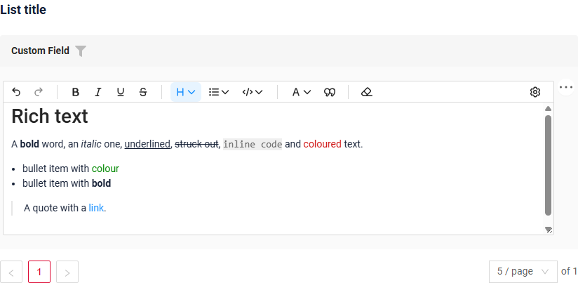
    === "Виджет Info"
        _неприменимо_
    === "Виджет Form"
        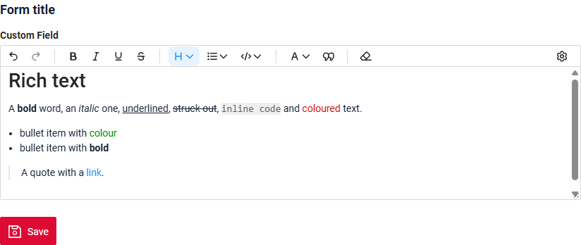
=== "Только чтение"
    === "Виджет List"
        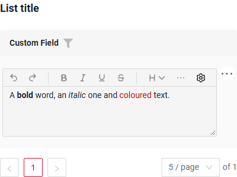
    === "Виджет Info"
        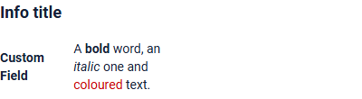
    === "Виджет Form"
        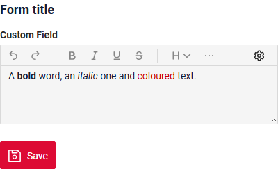

### Как добавить? { #how-to-add_2 }
??? Example "Пример"
    === "Редактирование"
        **Шаг 1** Добавьте маппинг DTO->entity в соответствующий **VersionAwareResponseService**.
        ```java
        --8<--
        {{ external_links.github_raw_doc }}/fields/richtext/basic/MyExample425Service.java:doUpdateEntity
        --8<--
        ```
        **Шаг 2** Добавьте **fields.setEnabled** в соответствующий **FieldMetaBuilder**.
        ```java
        --8<--
        {{ external_links.github_raw_doc }}/fields/richtext/basic/MyExample425Meta.java:buildRowDependentMeta
        --8<--
        ```
        === "Виджет List"
            **Работает для List.**
        === "Виджет Info"
            **_неприменимо_**
        === "Виджет Form"
            **Работает для Form.**

        [:material-play-circle: Живой пример]({{ external_links.code_samples }}/ui/#/screen/myexample425){:target="_blank"} ·
        [:fontawesome-brands-github: GitHub]({{ external_links.github_ui }}/{{ external_links.github_branch }}/src/main/java/org/demo/documentation/fields/richtext/basic){:target="_blank"}

    === "Только чтение"

        **Вариант 1** Включено по умолчанию.
        ```java
        --8<--
        {{ external_links.github_raw_doc }}/fields/richtext/ro/MyExample427Meta.java:buildRowDependentMeta
        --8<--
        ```
        **Вариант 2** `Не рекомендуется.` Свойство fields.setDisabled() переопределяет доступность поля, если используется после свойства fields.setEnabled.

        === "Виджет List"
            **Работает для List.**
        === "Виджет Info"
             **Работает для Info.**
        === "Виджет Form"
            **Работает для Form.**

        [:material-play-circle: Живой пример]({{ external_links.code_samples }}/ui/#/screen/myexample427){:target="_blank"} ·
        [:fontawesome-brands-github: GitHub]({{ external_links.github_ui }}/{{ external_links.github_branch }}/src/main/java/org/demo/documentation/fields/richtext/ro){:target="_blank"}

## Фильтрация { #filtering }
`Filtering` позволяет искать данные по критериям.
Для `MyExample field` фильтрация нечувствительна к регистру и находит записи, содержащие указанное значение в любой позиции (аналогично SQL ```Like %value%``` ).

**Обычный текст**

[:material-play-circle: Живой пример]({{ external_links.code_samples }}/ui/#/screen/myexample438){:target="_blank"} ·
[:fontawesome-brands-github: GitHub]({{ external_links.github_ui }}/{{ external_links.github_branch }}/src/main/java/org/demo/documentation/fields/richtext/filtrationplaintext){:target="_blank"}

Фильтр сравнивает только буквы и цифры, поэтому метки форматирования не мешают: `metal type` находит "**Metal** type".

**По умолчанию** `не рекомендуется`

[:material-play-circle: Живой пример]({{ external_links.code_samples }}/ui/#/screen/myexample428){:target="_blank"} ·
[:fontawesome-brands-github: GitHub]({{ external_links.github_ui }}/{{ external_links.github_branch }}/src/main/java/org/demo/documentation/fields/richtext/filtration){:target="_blank"}

Фильтр ищет по сохранённому значению с метками форматирования: `metal type` не находит "**Metal** type", потому что метки полужирного стоят между словами (`**Metal** type`).

### Как это выглядит? { #how-does-it-look_3 }
=== "Обычный текст"
    === "Виджет List"
        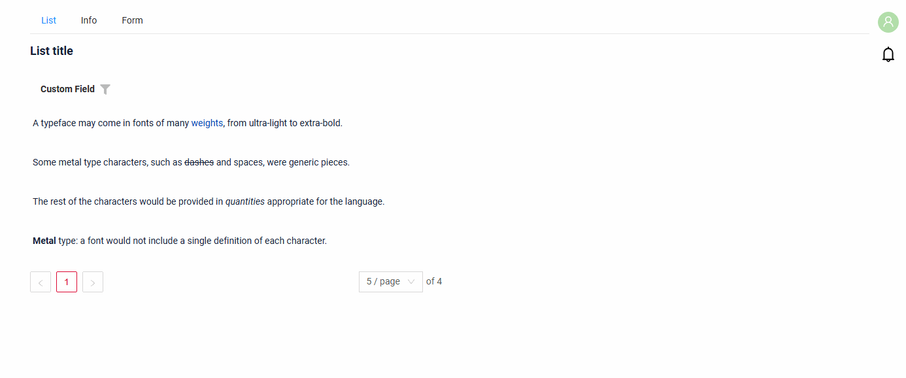
    === "Виджет Info"
        _неприменимо_
    === "Виджет Form"
        _неприменимо_
=== "По умолчанию (не рекомендуется)"
    === "Виджет List"
        
    === "Виджет Info"
        _неприменимо_
    === "Виджет Form"
        _неприменимо_

### Как добавить? { #how-to-add_3 }
??? Example "Пример"
    === "Обычный текст"
        **Шаг 1** Добавьте в соответствующий **BaseEntity** колонку, содержащую только буквы и цифры значения. Её вычисляет база данных, приложение в неё не пишет.
        В примере таблицу создаёт Hibernate, поэтому колонка описана в `columnDefinition` (PostgreSQL). Если таблицу создаёт Liquibase, добавьте колонку с помощью SQL из шага 5.
        ```java
        --8<--
        {{ external_links.github_raw_doc }}/fields/richtext/filtrationplaintext/MyEntity438.java
        --8<--
        ```
        **Шаг 2** Добавьте провайдер, оставляющий только буквы и цифры из значения, введённого пользователем в фильтре.
        ```java
        --8<--
        {{ external_links.github_raw_doc }}/fields/richtext/filtrationplaintext/PlainTextValueProvider.java
        --8<--
        ```
        **Шаг 3** Добавьте **@SearchParameter** с этой колонкой и этим провайдером к полю соответствующего **DataResponseDTO**. (Расширенная настройка [SearchParameter](/ru/advancedCustomization/element/searchparameter/searchparameter))
        ```java
        --8<--
        {{ external_links.github_raw_doc }}/fields/richtext/filtrationplaintext/MyExample438DTO.java
        --8<--
        ```
        **Шаг 4** Добавьте **fields.enableFilter** в соответствующий **FieldMetaBuilder**.
        ```java
        --8<--
        {{ external_links.github_raw_doc }}/fields/richtext/filtrationplaintext/MyExample438Meta.java:buildIndependentMeta
        --8<--
        ```
        **Шаг 5** Для большой таблицы добавьте индекс. Фильтр отправляет `upper(column) LIKE '%VALUE%'`, поэтому индекс строится по `upper(column)`.

        === "PostgreSQL"
            ```sql
            -- the column, if the table is created by Liquibase
            ALTER TABLE my_entity ADD COLUMN custom_field_plain text
              GENERATED ALWAYS AS (regexp_replace(custom_field, '[^[:alnum:]]', '', 'g')) STORED;
            -- the index for LIKE '%value%'
            CREATE EXTENSION IF NOT EXISTS pg_trgm;
            CREATE INDEX my_entity_custom_field_plain_trgm ON my_entity USING gin (upper(custom_field_plain) gin_trgm_ops);
            ```
        === "Oracle"
            ```sql
            -- the column, for a VARCHAR2 column CUSTOM_FIELD
            ALTER TABLE MY_ENTITY ADD CUSTOM_FIELD_PLAIN VARCHAR2(4000)
              GENERATED ALWAYS AS (REGEXP_REPLACE(CUSTOM_FIELD, '[^[:alnum:]]', '')) VIRTUAL;
            ```
            Обычный индекс Oracle не ускоряет `LIKE '%value%'`: значение начинается с `%`.

        !!! restriction "Ограничение"
            Фильтр сравнивает только буквы и цифры — и в колонке, и во введённом значении: пробелы, знаки препинания и метки форматирования игнорируются.
            Поэтому `metal type`, `metaltype` и `Metal-Type` одинаково находят "**Metal** type". Название цвета текста и адрес ссылки тоже состоят из букв, поэтому они тоже находятся.

        === "Виджет List"
            **Работает для List.**
        === "Виджет Info"
            _неприменимо_
        === "Виджет Form"
            _неприменимо_

        [:material-play-circle: Живой пример]({{ external_links.code_samples }}/ui/#/screen/myexample438){:target="_blank"} ·
        [:fontawesome-brands-github: GitHub]({{ external_links.github_ui }}/{{ external_links.github_branch }}/src/main/java/org/demo/documentation/fields/richtext/filtrationplaintext){:target="_blank"}

    === "По умолчанию (не рекомендуется)"
        `Не рекомендуется.` Фильтр ищет по сохранённому значению с метками форматирования.

        **Шаг 1** Добавьте **@SearchParameter** в соответствующий **DataResponseDTO**. (Расширенная настройка [SearchParameter](/ru/advancedCustomization/element/searchparameter/searchparameter))
        ```java
        --8<--
        {{ external_links.github_raw_doc }}/fields/richtext/filtration/MyExample428DTO.java
        --8<--
        ```
        **Шаг 2**  Добавьте **fields.enableFilter** в соответствующий **FieldMetaBuilder**.
        ```java
        --8<--
        {{ external_links.github_raw_doc }}/fields/richtext/filtration/MyExample428Meta.java:buildIndependentMeta
        --8<--
        ```
        === "Виджет List"
            **Работает для List.**
        === "Виджет Info"
            _неприменимо_
        === "Виджет Form"
            _неприменимо_

        [:material-play-circle: Живой пример]({{ external_links.code_samples }}/ui/#/screen/myexample428){:target="_blank"} ·
        [:fontawesome-brands-github: GitHub]({{ external_links.github_ui }}/{{ external_links.github_branch }}/src/main/java/org/demo/documentation/fields/richtext/filtration){:target="_blank"}

## Drilldown
**недоступно**

## Валидация { #validation }
`Validation` позволяет проверять любые бизнес-правила для введённого пользователем значения. Типы валидации:

1) Exception: отображает сообщение, уведомляющее пользователя о технических или бизнес-ошибках.

   `Business Exception`:
   [:material-play-circle: Живой пример]({{ external_links.code_samples }}/ui/#/screen/myexample431){:target="_blank"} ·
   [:fontawesome-brands-github: GitHub]({{ external_links.github_ui }}/{{ external_links.github_branch }}/src/main/java/org/demo/documentation/fields/richtext/validationbusinessex){:target="_blank"}

   `Runtime Exception`:
   [:material-play-circle: Живой пример]({{ external_links.code_samples }}/ui/#/screen/myexample432){:target="_blank"} ·
   [:fontawesome-brands-github: GitHub]({{ external_links.github_ui }}/{{ external_links.github_branch }}/src/main/java/org/demo/documentation/fields/richtext/validationruntimeex){:target="_blank"}

2) Confirm: показывает диалог с необязательным сообщением, требующий от пользователя подтверждения или отмены перед продолжением.

   [:material-play-circle: Живой пример]({{ external_links.code_samples }}/ui/#/screen/myexample433){:target="_blank"} ·
   [:fontawesome-brands-github: GitHub]({{ external_links.github_ui }}/{{ external_links.github_branch }}/src/main/java/org/demo/documentation/fields/richtext/validationconfirm){:target="_blank"}

3) Валидация на уровне полей: показывает ошибку рядом со всеми полями, не прошедшими проверку

   `Option 1`:
   [:material-play-circle: Живой пример]({{ external_links.code_samples }}/ui/#/screen/myexample434){:target="_blank"} ·
   [:fontawesome-brands-github: GitHub]({{ external_links.github_ui }}/{{ external_links.github_branch }}/src/main/java/org/demo/documentation/fields/richtext/validationannotation){:target="_blank"}

   `Option 2`:
   [:material-play-circle: Живой пример]({{ external_links.code_samples }}/ui/#/screen/myexample435){:target="_blank"} ·
   [:fontawesome-brands-github: GitHub]({{ external_links.github_ui }}/{{ external_links.github_branch }}/src/main/java/org/demo/documentation/fields/richtext/validationdynamic){:target="_blank"}

Значение проверяется в том виде, в каком хранится, с метками форматирования. В примерах значение может содержать не более 50 символов: "A **short** note." — это 17 символов (`A **short** note.`), а не 13.

### Как это выглядит? { #how-does-it-look_4 }
=== "Виджет List"
    === "BusinessException"
        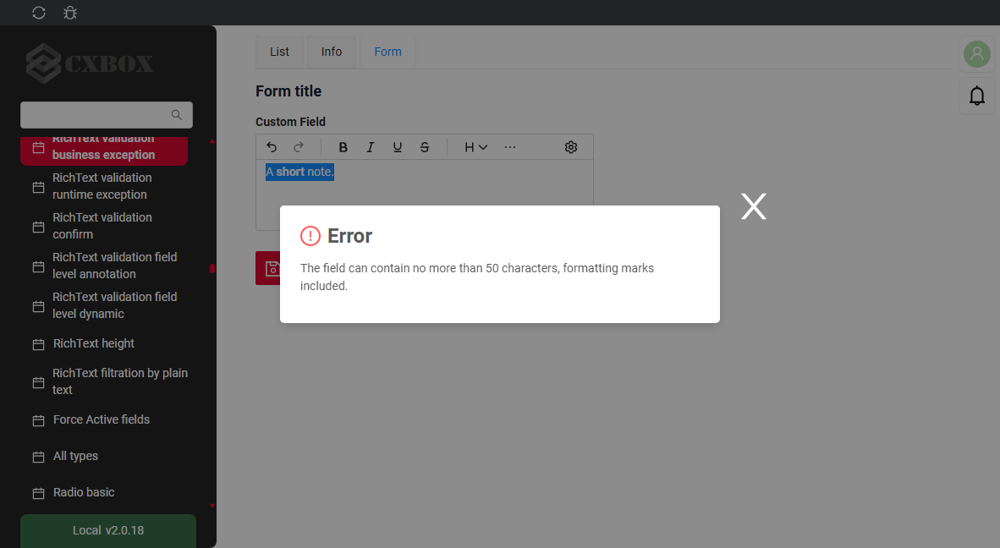
    === "RuntimeException"
        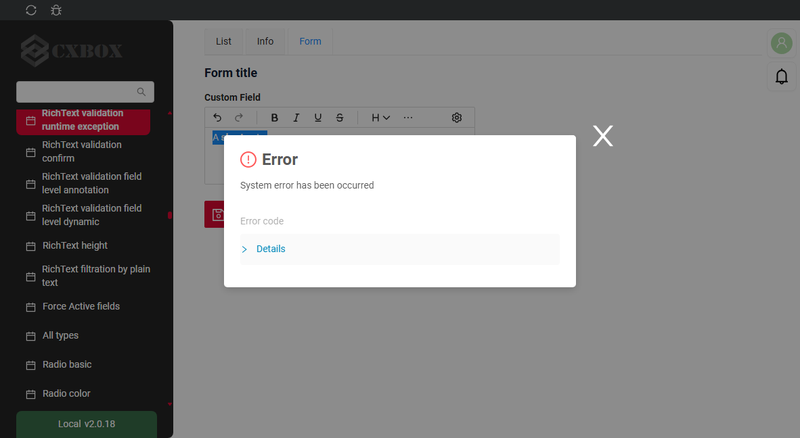
    === "Confirm"
        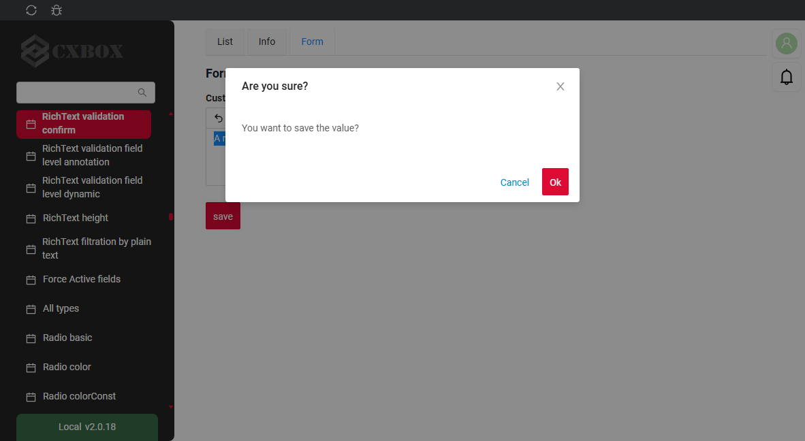
    === "Валидация на уровне полей"
        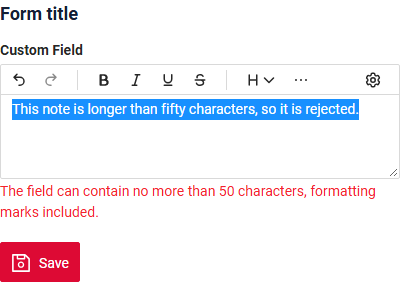
=== "Виджет Info"
    _неприменимо_
=== "Виджет Form"
    === "BusinessException"
        
    === "RuntimeException"
        
    === "Confirm"
        
    === "Валидация на уровне полей"
        
### Как добавить? { #how-to-add_4 }
??? Example "Пример"
    === "BusinessException"
        `BusinessException` описывает ошибку в рамках бизнес-процесса.

        Добавьте **BusinessException** в соответствующий **VersionAwareResponseService**.
        ```java
        --8<--
        {{ external_links.github_raw_doc }}/fields/richtext/validationbusinessex/MyExample431Service.java:doUpdateEntity
        --8<--
        ```
        === "Виджет List"
            **Работает для List.**
        === "Виджет Info"
            **_неприменимо_**
        === "Виджет Form"
            **Работает для Form.**

        [:material-play-circle: Живой пример]({{ external_links.code_samples }}/ui/#/screen/myexample431){:target="_blank"} ·
        [:fontawesome-brands-github: GitHub]({{ external_links.github_ui }}/{{ external_links.github_branch }}/src/main/java/org/demo/documentation/fields/richtext/validationbusinessex){:target="_blank"}

    === "RuntimeException"

        `RuntimeException` описывает техническую ошибку в рамках бизнес-процесса.

        Добавьте **RuntimeException** в соответствующий **VersionAwareResponseService**.
        ```java
        --8<--
        {{ external_links.github_raw_doc }}/fields/richtext/validationruntimeex/MyExample432Service.java:doUpdateEntity
        --8<--
        ```

        === "Виджет List"
            **Работает для List.**
        === "Виджет Info"
            **_неприменимо_**
        === "Виджет Form"
            **Работает для Form.**

        [:material-play-circle: Живой пример]({{ external_links.code_samples }}/ui/#/screen/myexample432){:target="_blank"} ·
        [:fontawesome-brands-github: GitHub]({{ external_links.github_ui }}/{{ external_links.github_branch }}/src/main/java/org/demo/documentation/fields/richtext/validationruntimeex){:target="_blank"}

    === "Confirm"
        Добавьте [PreAction.confirm](/ru/advancedCustomization_validation) в соответствующий **VersionAwareResponseService**.
        ```java
        --8<--
        {{ external_links.github_raw_doc }}/fields/richtext/validationconfirm/MyExample433Service.java:getActions
        --8<--
        ```
        === "Виджет List"
            **Работает для List.**
        === "Виджет Info"
            **_неприменимо_**
        === "Виджет Form"
            **Работает для Form.**

        [:material-play-circle: Живой пример]({{ external_links.code_samples }}/ui/#/screen/myexample433){:target="_blank"} ·
        [:fontawesome-brands-github: GitHub]({{ external_links.github_ui }}/{{ external_links.github_branch }}/src/main/java/org/demo/documentation/fields/richtext/validationconfirm){:target="_blank"}

    === "Валидация на уровне полей"
        === "Вариант 1"
            Используйте, если:

            Нужна простая проверка полей (javax validation)

            Добавьте javax.validation в соответствующий **DataResponseDTO**.
            ```java
            --8<--
            {{ external_links.github_raw_doc }}/fields/richtext/validationannotation/MyExample434DTO.java
            --8<--
            ```
            === "Виджет List"
                **Работает для List.**
            === "Виджет Info"
                **_неприменимо_**
            === "Виджет Form"
                **Работает для Form.**

            [:material-play-circle: Живой пример]({{ external_links.code_samples }}/ui/#/screen/myexample434){:target="_blank"} ·
            [:fontawesome-brands-github: GitHub]({{ external_links.github_ui }}/{{ external_links.github_branch }}/src/main/java/org/demo/documentation/fields/richtext/validationannotation){:target="_blank"}

        === "Вариант 2"
            Создайте собственный сервис для проверки бизнес-логики.

            Используйте, если:

            Для полей требуется проверка бизнес-логики

            `Шаг 1`  Создайте собственный метод проверки.
            ```java
            --8<--
            {{ external_links.github_raw_doc }}/fields/richtext/validationdynamic/MyExample435Service.java:validateFields
            --8<--
            ```
            `Шаг 2` Добавьте собственный метод проверки в соответствующий **VersionAwareResponseService**.
            ```java
            --8<--
            {{ external_links.github_raw_doc }}/fields/richtext/validationdynamic/MyExample435Service.java:doUpdateEntity
            --8<--
            ```

            [:material-play-circle: Живой пример]({{ external_links.code_samples }}/ui/#/screen/myexample435){:target="_blank"} ·
            [:fontawesome-brands-github: GitHub]({{ external_links.github_ui }}/{{ external_links.github_branch }}/src/main/java/org/demo/documentation/fields/richtext/validationdynamic){:target="_blank"}

## Сортировка { #sorting }
[:material-play-circle: Живой пример]({{ external_links.code_samples }}/ui/#/screen/myexample429){:target="_blank"} ·
[:fontawesome-brands-github: GitHub]({{ external_links.github_ui }}/{{ external_links.github_branch }}/src/main/java/org/demo/documentation/fields/richtext/sorting){:target="_blank"}

`Sorting` позволяет сортировать данные по возрастанию или убыванию.
`MyExample field` — текстовое поле, поэтому для него используется лексикографическая сортировка по сохранённому значению.

### Как это выглядит? { #how-does-it-look_5 }
=== "Виджет List"
    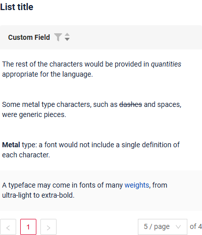
=== "Виджет Info"
    _неприменимо_
=== "Виджет Form"
    _неприменимо_
### Как добавить? { #how-to-add_5 }
??? Example "Пример"
    === "Виджет List"
        подробнее см. [Сортировка](/ru/widget/type/property/sorting/sorting)

        **Шаг 1**  Добавьте **fields.enableSort** в соответствующий **FieldMetaBuilder**.
        ```java
        --8<--
        {{ external_links.github_raw_doc }}/fields/richtext/sorting/MyExample429Meta.java:buildIndependentMeta
        --8<--
        ```
        [:material-play-circle: Живой пример]({{ external_links.code_samples }}/ui/#/screen/myexample429){:target="_blank"} ·
        [:fontawesome-brands-github: GitHub]({{ external_links.github_ui }}/{{ external_links.github_branch }}/src/main/java/org/demo/documentation/fields/richtext/sorting){:target="_blank"}

    === "Виджет Info"
        _неприменимо_
    === "Виджет Form"
        _неприменимо_

## Обязательность { #required }
[:material-play-circle: Живой пример]({{ external_links.code_samples }}/ui/#/screen/myexample430){:target="_blank"} ·
[:fontawesome-brands-github: GitHub]({{ external_links.github_ui }}/{{ external_links.github_branch }}/src/main/java/org/demo/documentation/fields/richtext/required){:target="_blank"}

`Required` позволяет указать, что поле обязательно должно иметь значение. По умолчанию `RichText field` не обязательно

### Как это выглядит? { #how-does-it-look_6 }
=== "Виджет List"
    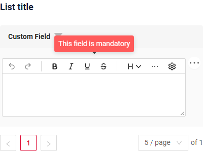
=== "Виджет Info"
    _неприменимо_
=== "Виджет Form"
    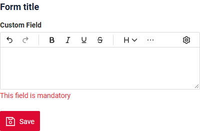
### Как добавить? { #how-to-add_6 }
??? Example "Пример"
    Добавьте **fields.setRequired** в соответствующий **FieldMetaBuilder**.
    ```java
    --8<--
    {{ external_links.github_raw_doc }}/fields/richtext/required/MyExample430Meta.java:buildRowDependentMeta
    --8<--
    ```
    === "Виджет List"
        **Работает для List.**
    === "Виджет Info"
        **_неприменимо_**
    === "Виджет Form"
        **Работает для Form.**

    [:material-play-circle: Живой пример]({{ external_links.code_samples }}/ui/#/screen/myexample430){:target="_blank"} ·
    [:fontawesome-brands-github: GitHub]({{ external_links.github_ui }}/{{ external_links.github_branch }}/src/main/java/org/demo/documentation/fields/richtext/required){:target="_blank"}

## Дополнительные свойства { #additional-properties }

### <a id="editing-modes">Режимы редактирования</a>
[:material-play-circle: Живой пример]({{ external_links.code_samples }}/ui/#/screen/myexample425){:target="_blank"} ·
[:fontawesome-brands-github: GitHub]({{ external_links.github_ui }}/{{ external_links.github_branch }}/src/main/java/org/demo/documentation/fields/richtext/basic){:target="_blank"}

Кнопка настроек (шестерёнка) на панели инструментов переключает редактор:

* **Visual Editor** — форматированный текст (режим по умолчанию);
* **Markdown markup** — показывает и редактирует значение в том виде, в каком оно хранится, с метками форматирования.

Поле только для чтения или недоступное поле всегда показывает форматированный текст.

#### Как это выглядит? { #how-does-it-look_7 }
=== "Visual Editor"
    
=== "Markdown markup"
    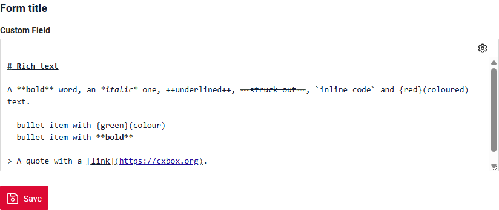

#### Как добавить? { #how-to-add_7 }
??? Example "Пример"
    Работает по умолчанию для поля `richText`, ничего добавлять не нужно.

### <a id="height">Высота поля</a>
[:material-play-circle: Живой пример]({{ external_links.code_samples }}/ui/#/screen/myexample436){:target="_blank"} ·
[:fontawesome-brands-github: GitHub]({{ external_links.github_ui }}/{{ external_links.github_branch }}/src/main/java/org/demo/documentation/fields/richtext/height){:target="_blank"}

Высота поля задаётся в строках. Строка имеет высоту строки поля `text`, заголовок занимает больше места.

| Параметр      | Режим                                                                       | По умолчанию |
|---------------|-----------------------------------------------------------------------------|---------|
| `minRows`     | режим просмотра (List, Info)                                                | 1       |
| `maxRows`     | режим просмотра (List, Info)                                                | 10      |
| `editMinRows` | режим редактирования (Form, inline-редактирование в List); если не задан, используется `minRows` | 5       |
| `editMaxRows` | режим редактирования (Form, inline-редактирование в List); если не задан, используется `maxRows` | 10      |

* В режиме просмотра значение длиннее `maxRows` обрезается: последняя строка затухает и заканчивается **...**. При наведении на **...** полное значение показывается во всплывающей подсказке.
* В режиме редактирования поле растёт вместе с текстом от `editMinRows` до `editMaxRows`, затем появляется полоса прокрутки. Пользователь может растягивать поле за правый нижний угол в этих пределах.

!!! tip "Совет"
    Чтобы показывать на Info всё значение целиком, задайте `maxRows`, которого значение никогда не достигнет.

#### Как это выглядит? { #how-does-it-look_8 }
=== "Виджет List"
    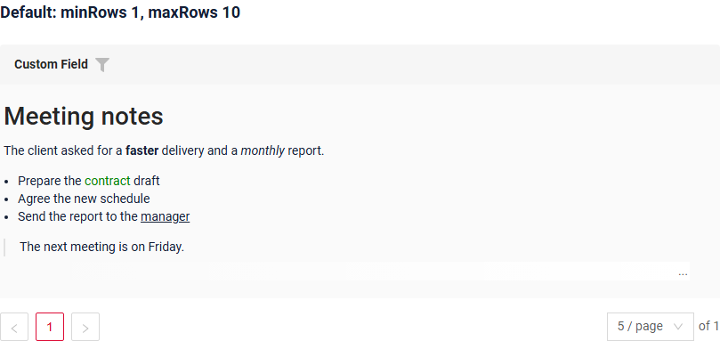
    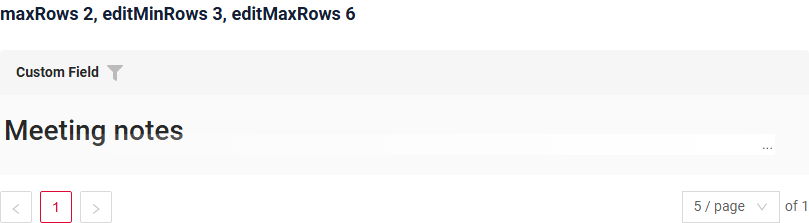
=== "Виджет Info"
    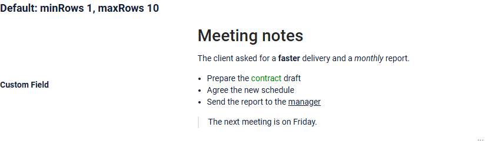
    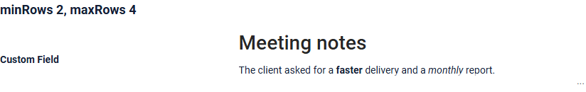
=== "Виджет Form"
    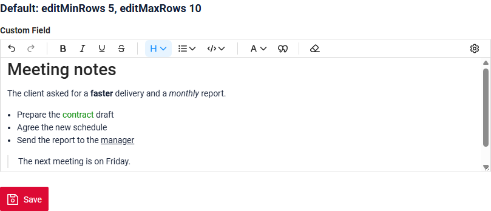
    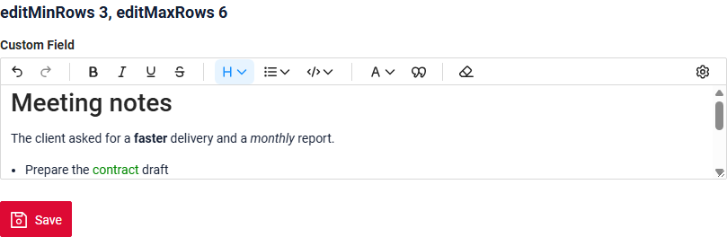

#### Как добавить? { #how-to-add_8 }
??? Example "Пример"
    === "Виджет List"
        Добавьте **"maxRows"**, **"editMinRows"**, **"editMaxRows"** к полю в .widget.json.
        ```json
        --8<--
        {{ external_links.github_raw_doc }}/fields/richtext/height/MyExample436List.widget.json
        --8<--
        ```
    === "Виджет Info"
        Добавьте **"minRows"**, **"maxRows"** к полю в .widget.json.
        ```json
        --8<--
        {{ external_links.github_raw_doc }}/fields/richtext/height/MyExample436Info.widget.json
        --8<--
        ```
    === "Виджет Form"
        Добавьте **"editMinRows"**, **"editMaxRows"** к полю в .widget.json.
        ```json
        --8<--
        {{ external_links.github_raw_doc }}/fields/richtext/height/MyExample436Form.widget.json
        --8<--
        ```

    Значения по умолчанию для всех полей `richText` — константы фронтенда **richTextMinRows**, **richTextMaxRows**, **richTextEditMinRows**, **richTextEditMaxRows**:
    ```
    ui/src/fields/RichText/constants.ts
    ```

    [:material-play-circle: Живой пример]({{ external_links.code_samples }}/ui/#/screen/myexample436){:target="_blank"} ·
    [:fontawesome-brands-github: GitHub]({{ external_links.github_ui }}/{{ external_links.github_branch }}/src/main/java/org/demo/documentation/fields/richtext/height){:target="_blank"}

### <a id="formatting">Форматирование</a>
[:material-play-circle: Живой пример]({{ external_links.code_samples }}/ui/#/screen/myexample425){:target="_blank"} ·
[:fontawesome-brands-github: GitHub]({{ external_links.github_ui }}/{{ external_links.github_branch }}/src/main/java/org/demo/documentation/fields/richtext/basic){:target="_blank"}

Пользователь форматирует текст с помощью панели инструментов. Если поле узкое, не поместившиеся кнопки переходят в меню **⋯**. **Undo**, **Redo** и **Clear Format** работают для всего форматирования ниже.

Значение хранится в Markdown — том же формате, что использует Яндекс Вики. В Markdown нельзя выразить некоторые сочетания форматирования, и Яндекс Вики в этих случаях тоже ошибается.

✅ поддерживается, ⚠️ поддерживается с оговоркой, ❌ не поддерживается, — не проверялось.

**Основы**

| #  | Возможность                                      | Панель инструментов                                  | Статус | Яндекс Вики | Хранится как                     |
|----|--------------------------------------------------|------------------------------------------------------|:------:|:-----------:|----------------------------------|
| 1  | Полужирный                                       | Bold                                                 | ✅ | ✅ | `**bold**`                       |
| 2  | Курсив                                           | Italic                                               | ✅ | ✅ | `*italic*`                       |
| 3  | Подчёркнутый                                     | Underline                                            | ✅ | ✅ | `++under++`                      |
| 4  | Зачёркнутый                                      | Strikethrough                                        | ✅ | ✅ | `~~strike~~`                     |
| 5  | Встроенный код                                   | Code: Inline code                                    | ✅ | ✅ | `` `code` ``                     |
| 6  | Цвет текста                                      | Text color: Gray, Yellow, Orange, Red, Green, Blue, Violet; Default убирает цвет | ✅ | ✅ | `{red}(text)` |
| 7  | Ссылка                                           | кнопки нет, введите в [Markdown markup](#editing-modes) | ✅ | ✅ | `[text](url)`          |
| 8  | Заголовки H1–H6                                  | Heading: Heading 1 … Heading 6; Text делает абзац    | ✅ | ✅ | `# Head` … `###### Head`       |
| 9  | Маркированный / нумерованный список, вложенный список | List: Bullet List, Ordered List, Sink Item, Lift Item | ✅ | ✅ | `- item` / `1. item`      |
| 10 | Цитата                                           | Quote                                                | ✅ | ✅ | `> quote`                        |
| 11 | Блок кода                                        | Code: Code block                                     | ✅ | ✅ | ` ```\ncode\n``` `               |
| 12 | Абзац (Enter) / перенос строки (Shift+Enter)     | клавиатура                                           | ✅ | ✅ | `a\n\nb` / `a  \nb`              |
| 13 | Текст, начинающийся с 4 пробелов или табуляции, остаётся обычным текстом | клавиатура              | ✅ | — | `    text` остаётся текстом      |

**Сочетания и перекрытия**

| #  | Возможность                                      | Статус | Яндекс Вики | Хранится как                       |
|----|--------------------------------------------------|:------:|:-----------:|------------------------------------|
| 14 | Сочетание двух и более стилей                    | ✅ | ✅ | `***x***`, `{red}(**x**)`          |
| 15 | Стили внутри заголовка / списка / цитаты         | ✅ | ✅ | `# **b** head`, `- {red}(c) item`  |
| 16 | Три и более стиля, перекрывающихся «лесенкой»    | ✅ | ✅ | `++abc**def**++**gh~~ij~~**~~kl~~` |
| 17 | Стиль через перенос строки (Shift+Enter)         | ✅ | ✅ | `**a**  \n**b**`                   |
| 18 | Полужирный и курсив, перекрывающие друг друга    | ⚠️ | — | в месте их стыка вставляется невидимый разделитель |
| 19 | Полужирный или курсив вплотную к скобке          | ❌ | ❌ | `abc*def)*ghi` невозможно записать в Markdown; панель инструментов отключает такое форматирование |

**Цвет текста**

| #  | Возможность                                      | Статус | Яндекс Вики | Хранится как                       |
|----|--------------------------------------------------|:------:|:-----------:|------------------------------------|
| 20 | Цвет для текста со скобками                      | ✅ | ✅ | `{red}(Hello \(world\))`           |
| 21 | Цвет через переносы строк (Shift+Enter)          | ✅ | ✅ | `{red}(a)  \n{red}(b)`             |
| 22 | Цвет для встроенного кода                        | ⚠️ | — | невозможно, встроенный код исключает другие стили |

!!! restriction "Ограничение"
    * 13 — строка, начинающаяся с 4 пробелов или табуляции, не превращается в блок кода. Для кода используйте **Code block**.
    * 18 — там, где полужирный и курсив перекрываются, редактор добавляет между ними невидимый символ, поэтому сохраняются оба.
    * 19 — полужирный, курсив, подчёркивание, зачёркивание и встроенный код отключены для выделения, которое начинается или заканчивается на скобке рядом с буквой, например `)def` в `abc)def`. Цвет текста работает.
    * 22 — у встроенного кода не может быть цвета.
