# Time
`Time` — компонент для редактирования времени. Используется для редактирования и отображения времени.

## Основы { #basics }
[:material-play-circle: Живой пример]({{ external_links.code_samples }}/ui/#/screen/myexample3500){:target="_blank"} ·
[:fontawesome-brands-github: GitHub]({{ external_links.github_ui }}/{{ external_links.github_branch }}/src/main/java/org/demo/documentation/fields/time/base){:target="_blank"}

Тип time поддерживает различные форматы представления и обработки значений времени.

!!! info
    Формат этого поля предназначен для бизнес-сценариев, в которых одно и то же поле используется в разных контекстах:
     как **дата и время** и как **только время**.

    Такой подход обеспечивает единообразное хранение данных и гибкое представление и использование в разных частях системы.

**Поддерживаемые форматы**:

| Формат       | Диапазон значений     | Пример      |
| ------------ | --------------------- | ----------- |
| *по умолчанию* | 00–23 : 00–59 : 00–59 | 15:45:28  |
| `HH:mm:ss`   | 00–23 : 00–59 : 00–59 | 15:45:28    |
| `HH:mm`      | 00–23 : 00–59         | 15:28       |
| `HH`         | 00–23                 | 15          |
| `hh:mm:ss A` | 01–12 : 00–59 : 00–59 | 03:45:28 PM |
| `hh:mm A`    | 01–12 : 00–59         | 03:28 PM    |
| `hh A`       | 01–12                 | 03 PM       |

**НЕ поддерживаемые форматы**

| Формат  | Диапазон значений | Пример |
| ------- | ------------- | ------- |
| `mm:ss` | 00–59 : 00–59 | 45:28   |
| `mm`    | 00–59         | 15      |
| `ss`    | 00–59         | 28      |


### Как это выглядит? { #how-does-it-look }

=== "Виджет List"
    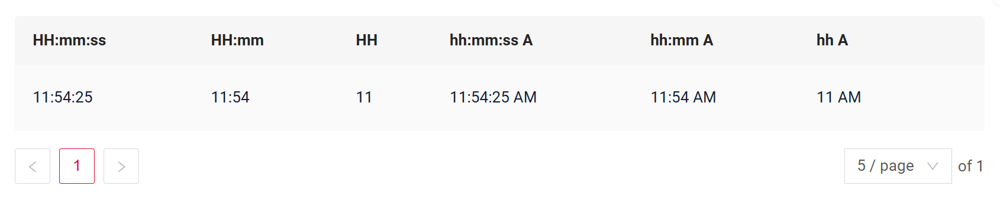
=== "Виджет Info"
    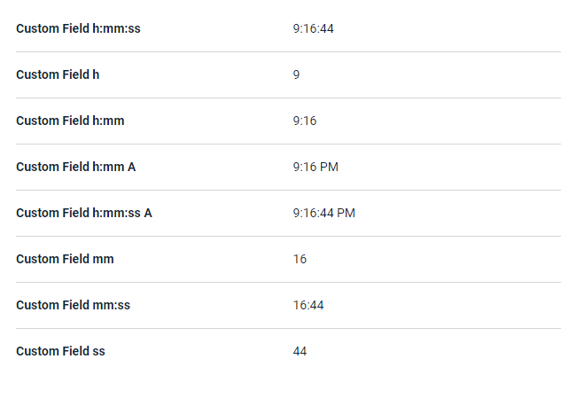
=== "Виджет Form"
    


### Как добавить? { #how-to-add }
??? Example "Пример"
    === "LocalDateTime (рекомендуется)"

        [:material-play-circle: Живой пример]({{ external_links.code_samples }}/ui/#/screen/myexample3500){:target="_blank"} ·
        [:fontawesome-brands-github: GitHub]({{ external_links.github_ui }}/{{ external_links.github_branch }}/src/main/java/org/demo/documentation/fields/time/base){:target="_blank"}

        Рекомендуем использовать тип **`LocalDateTime`**, так как формат этого поля предназначен для бизнес-сценариев, в которых одно и то же поле используется в разных контекстах:
        
        * в одних случаях оно рассматривается как **дата и время** (например, при создании встречи);
          * в других случаях **то же поле** отображается как **только время**, без даты.
        
        Такой подход обеспечивает единообразное моделирование данных и гибкое представление поля в разных частях системы.

        **Шаг 1** Добавьте поле **LocalDateTime** в соответствующий **BaseEntity**.
        ```java
        --8<--
        {{ external_links.github_raw_doc }}/fields/time/base/MyEntity3500.java
        --8<--
        ```
    
        **Шаг 2**  Добавьте поле **LocalDateTime** в соответствующий **DataResponseDTO**.
        ```java
        --8<--
        {{ external_links.github_raw_doc }}/fields/time/base/MyExample3500DTO.java
        --8<--
        ```
 
        === "Виджет List"
            **Шаг 3** Добавьте в **_.widget.json_**.
    
            Чтобы задать формат, добавьте "format".
    
            По умолчанию применяется стандартный формат: "HH : mm:ss"
            ```json
            --8<--
            {{ external_links.github_raw_doc }}/fields/time/base/MyExample3500List.widget.json
            --8<--
            ```
        === "Виджет Info"
            **Шаг 3** Добавьте в **_.widget.json_**.
            
            ```json
            --8<--
            {{ external_links.github_raw_doc }}/fields/time/base/MyExample3500Info.widget.json
            --8<--
            ```
    
        === "Виджет Form"
    
            **Шаг 3** Добавьте в **_.widget.json_**.
    
            ```json
            --8<--
            {{ external_links.github_raw_doc }}/fields/time/base/MyExample3500Form.widget.json
            --8<--
            ```    
    
        [:material-play-circle: Живой пример]({{ external_links.code_samples }}/ui/#/screen/myexample3500){:target="_blank"} ·
        [:fontawesome-brands-github: GitHub]({{ external_links.github_ui }}/{{ external_links.github_branch }}/src/main/java/org/demo/documentation/fields/time/base){:target="_blank"}

    === "LocalTime"
        [:material-play-circle: Живой пример]({{ external_links.code_samples }}/ui/#/screen/myexample3512){:target="_blank"} ·
        [:fontawesome-brands-github: GitHub]({{ external_links.github_ui }}/{{ external_links.github_branch }}/src/main/java/org/demo/documentation/fields/time/baselocaltime){:target="_blank"}

        **Шаг 1** Добавьте поле **LocalTime** в соответствующий **BaseEntity**.
        ```java
        --8<--
        {{ external_links.github_raw_doc }}/fields/time/baselocaltime/MyEntity3512.java
        --8<--
        ```
    
        **Шаг 2**  Добавьте поле **LocalTime** в соответствующий **DataResponseDTO**.
        Добавьте @JsonSerialize(using = LocalTimeWithDateSerializer.class).
        Добавьте @JsonDeserialize(using = LocalTimeWithDateDeserializer.class).

        ```java
        --8<--
        {{ external_links.github_raw_doc }}/fields/time/baselocaltime/MyExample3512DTO.java
        --8<--
        ```

        === "Виджет List"
            **Шаг 3** Добавьте в **_.widget.json_**.
    
            Чтобы задать формат, добавьте "format".
    
            По умолчанию применяется стандартный формат: "HH : mm:ss"
            ```json
            --8<--
            {{ external_links.github_raw_doc }}/fields/time/baselocaltime/MyExample3512List.widget.json
            --8<--
            ```
        === "Виджет Info"
            **Шаг 3** Добавьте в **_.widget.json_**.
            
            ```json
            --8<--
            {{ external_links.github_raw_doc }}/fields/time/baselocaltime/MyExample3512Info.widget.json
            --8<--
            ```
    
        === "Виджет Form"
    
            **Шаг 3** Добавьте в **_.widget.json_**.
    
            ```json
            --8<--
            {{ external_links.github_raw_doc }}/fields/time/baselocaltime/MyExample3512Form.widget.json
            --8<--
            ```    
    
        [:material-play-circle: Живой пример]({{ external_links.code_samples }}/ui/#/screen/myexample3512){:target="_blank"} ·
        [:fontawesome-brands-github: GitHub]({{ external_links.github_ui }}/{{ external_links.github_branch }}/src/main/java/org/demo/documentation/fields/time/baselocaltime){:target="_blank"}

## Placeholder
[:material-play-circle: Живой пример]({{ external_links.code_samples }}/ui/#/screen/myexample3505){:target="_blank"} ·
[:fontawesome-brands-github: GitHub]({{ external_links.github_ui }}/{{ external_links.github_branch }}/src/main/java/org/demo/documentation/fields/time/placeholder){:target="_blank"}

`Placeholder` позволяет задать краткую подсказку об ожидаемом значении. Подсказка отображается до ввода пользователем. Её можно вычислять на основе бизнес-логики приложения. Она отображается и для поля `Readonly`.
### Как это выглядит? { #how-does-it-look_1 }
=== "Виджет List"
    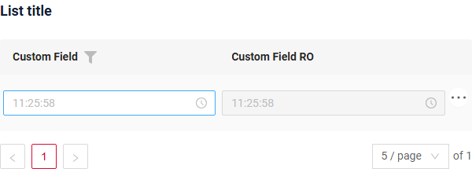
=== "Виджет Info"
    _неприменимо_
=== "Виджет Form"
    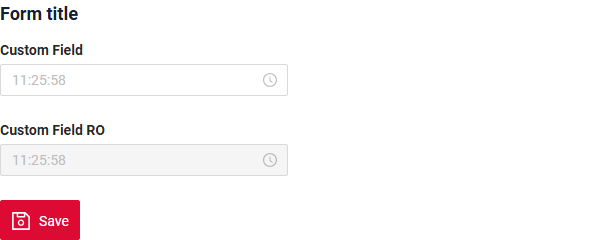

### Как добавить? { #how-to-add_1 }
??? Example "Пример"

    Добавьте **fields.setPlaceholder** в соответствующий **FieldMetaBuilder**.
    
    ```java
    --8<--
    {{ external_links.github_raw_doc }}/fields/time/placeholder/MyExample3505Meta.java:buildRowDependentMeta
    --8<--
    ```   

    === "Виджет List"
        **Работает для List.**
    === "Виджет Info"
        **_неприменимо_**
    === "Виджет Form"
        **Работает для Form.**

    [:material-play-circle: Живой пример]({{ external_links.code_samples }}/ui/#/screen/myexample3505){:target="_blank"} ·
    [:fontawesome-brands-github: GitHub]({{ external_links.github_ui }}/{{ external_links.github_branch }}/src/main/java/org/demo/documentation/fields/time/placeholder){:target="_blank"}

## Цвет { #color }
`Color` позволяет задать цвет поля. Его можно вычислять на основе бизнес-логики приложения

**Вычисляемый цвет**

[:material-play-circle: Живой пример]({{ external_links.code_samples }}/ui/#/screen/myexample3501){:target="_blank"} ·
[:fontawesome-brands-github: GitHub]({{ external_links.github_ui }}/{{ external_links.github_branch }}/src/main/java/org/demo/documentation/fields/time/color){:target="_blank"}

**Постоянный цвет**

[:material-play-circle: Живой пример]({{ external_links.code_samples }}/ui/#/screen/myexample3502){:target="_blank"} ·
[:fontawesome-brands-github: GitHub]({{ external_links.github_ui }}/{{ external_links.github_branch }}/src/main/java/org/demo/documentation/fields/time/colorconst){:target="_blank"}

### Как это выглядит? { #how-does-it-look_2 }
=== "Виджет List"
    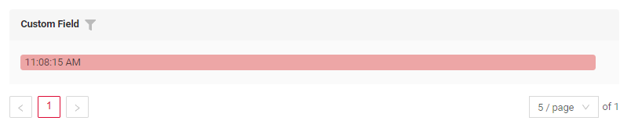

=== "Виджет Info"
    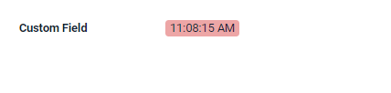

=== "Виджет Form"
    _неприменимо_


### Как добавить? { #how-to-add_2 }
??? Example "Пример"
    === "Вычисляемый цвет"
        **Шаг 1**   Добавьте `собственное поле для цвета` в соответствующий **DataResponseDTO**. Поле может содержать цвет в формате HEX или быть null.

        ```java
        --8<--
        {{ external_links.github_raw_doc }}/fields/time/color/MyExample3501DTO.java
        --8<--
        ```
        === "Виджет List"
            **Шаг 2** Добавьте **"bgColorKey"** :  `собственное поле для цвета` в .widget.json.
            ```json
            --8<--
            {{ external_links.github_raw_doc }}/fields/time/color/MyExample3501List.widget.json
            --8<--
            ```
        === "Виджет Info"
            **Шаг 2** Добавьте **"bgColorKey"** :  `собственное поле для цвета` в .widget.json.
            ```json
            --8<--
            {{ external_links.github_raw_doc }}/fields/time/color/MyExample3501Info.widget.json
            --8<--
            ```   
        === "Виджет Form"
            _неприменимо_

        [:material-play-circle: Живой пример]({{ external_links.code_samples }}/ui/#/screen/myexample3501){:target="_blank"} ·
        [:fontawesome-brands-github: GitHub]({{ external_links.github_ui }}/{{ external_links.github_branch }}/src/main/java/org/demo/documentation/fields/time/color){:target="_blank"}

    === "Постоянный цвет"
        === "Виджет List"
            Добавьте **"bgColor"** :  `цвет HEX` в .widget.json.
            ```json
            --8<--
            {{ external_links.github_raw_doc }}/fields/time/colorconst/MyExample3502List.widget.json
            --8<--
            ```

        === "Виджет Info"
            Добавьте **"bgColor"** :  `цвет HEX` в .widget.json.
            ```json
            --8<--
            {{ external_links.github_raw_doc }}/fields/time/colorconst/MyExample3502Info.widget.json
            --8<--
            ```   

        === "Виджет Form"
            _неприменимо_

        [:material-play-circle: Живой пример]({{ external_links.code_samples }}/ui/#/screen/myexample3502){:target="_blank"} ·
        [:fontawesome-brands-github: GitHub]({{ external_links.github_ui }}/{{ external_links.github_branch }}/src/main/java/org/demo/documentation/fields/time/colorconst){:target="_blank"}


 
## Только чтение/Редактирование { #readonlyeditable }
`Readonly/Editable` указывает, можно ли редактировать поле. Это можно вычислять на основе бизнес-логики приложения

`Editable`
[:material-play-circle: Живой пример]({{ external_links.code_samples }}/ui/#/screen/myexample3500){:target="_blank"} ·
[:fontawesome-brands-github: GitHub]({{ external_links.github_ui }}/{{ external_links.github_branch }}/src/main/java/org/demo/documentation/fields/time/base){:target="_blank"}

`Readonly`
[:material-play-circle: Живой пример]({{ external_links.code_samples }}/ui/#/screen/myexample3507){:target="_blank"} ·
[:fontawesome-brands-github: GitHub]({{ external_links.github_ui }}/{{ external_links.github_branch }}/src/main/java/org/demo/documentation/fields/time/ro){:target="_blank"}


### Как это выглядит? { #how-does-it-look_3 }
=== "Редактирование"
    === "Виджет List"
        
    === "Виджет Info"
        
    === "Виджет Form"
        
=== "Только чтение"
    === "Виджет List"
        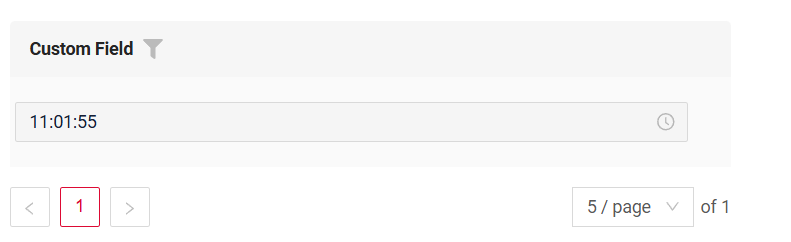
    === "Виджет Info"
        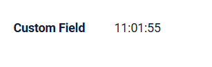
    === "Виджет Form"
        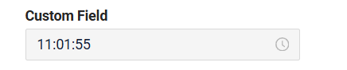


### Как добавить? { #how-to-add_3 }
??? Example "Пример"
    === "Редактирование"
        **Шаг 1** Добавьте маппинг DTO->entity в соответствующий **VersionAwareResponseService**.
        ```java
        --8<--
        {{ external_links.github_raw_doc }}/fields/time/base/MyExample3500Service.java:doUpdateEntity
        --8<--
        ```
 
        **Шаг 2** Добавьте **fields.setEnabled** в соответствующий **FieldMetaBuilder**.
        ```java
        --8<--
        {{ external_links.github_raw_doc }}/fields/time/base/MyExample3500Meta.java:buildRowDependentMeta
        --8<--
        ```
 
        === "Виджет List"
            **Работает для List.**
        === "Виджет Info"
            **_неприменимо_**
        === "Виджет Form"
            **Работает для Form.**
   
    === "Только чтение"
    
        **Вариант 1** Включено по умолчанию.
        ```java
        --8<--
        {{ external_links.github_raw_doc }}/fields/time/ro/MyExample3507Meta.java:buildRowDependentMeta
        --8<--
        ```    
 
        **Вариант 2** `Не рекомендуется.` Свойство fields.setDisabled() переопределяет доступность поля, если используется после свойства fields.setEnabled.
        === "Виджет List"
            **Работает для List.**
        === "Виджет Info"
            **Работает для Info.**
        === "Виджет Form"
            **Работает для Form.**

 
## Фильтрация { #filtering }
[:material-play-circle: Живой пример]({{ external_links.code_samples }}/ui/#/screen/myexample3504){:target="_blank"} ·
[:fontawesome-brands-github: GitHub]({{ external_links.github_ui }}/{{ external_links.github_branch }}/src/main/java/org/demo/documentation/fields/time/filtration){:target="_blank"}

`Filtering` позволяет искать данные по критериям.

Поиск использует (HH:MM:SS):

* операторы `greaterOrEqualThan(>=)` и `lessThan(<)`. При первой установке времени в поле фильтра значения будут 00:00:00 или 23:59:59.
* оператор `equals (=)`. Поиск выполняется в интервале от 00:00:00 до 23:59:59.

### Как это выглядит? { #how-does-it-look_4 }
=== "Виджет List"
    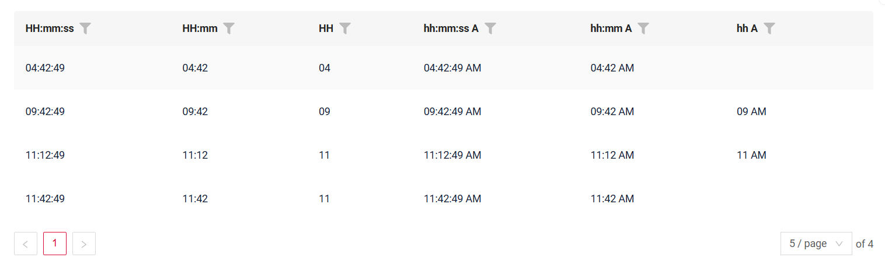
=== "Виджет Info"
    _неприменимо_
=== "Виджет Form"
    _неприменимо_

### Как добавить? { #how-to-add_4 }
??? Example "Пример"
    === "Виджет List"

        !!! info  
            По умолчанию фильтрация выполняется **по диапазону**. Чтобы отключить её, укажите `cxbox.widget.fields.filter-by-range-enabled-default: false` в meta.
            [подробнее](/ru/features/element/applicationparams/applicationparams)

        **Шаг 1** Добавьте **@SearchParameter** в соответствующий **DataResponseDTO**. (Расширенная настройка [SearchParameter](/ru/advancedCustomization/element/searchparameter/searchparameter))
        ```java
        --8<--
        {{ external_links.github_raw_doc }}/fields/time/filtration/MyExample3504DTO.java   
        --8<--
        ```   
        **Шаг 2**  Добавьте **fields.enableFilter** в соответствующий **FieldMetaBuilder**.
        ```java
        --8<--
        {{ external_links.github_raw_doc }}/fields/time/filtration/MyExample3504Meta.java:buildIndependentMeta
        --8<--
        ```       

        [:material-play-circle: Живой пример]({{ external_links.code_samples }}/ui/#/screen/myexample3504){:target="_blank"} ·
        [:fontawesome-brands-github: GitHub]({{ external_links.github_ui }}/{{ external_links.github_branch }}/src/main/java/org/demo/documentation/fields/time/filtration){:target="_blank"}

        !!! info
            При большом количестве строк в базе данных возможна значительная деградация производительности, поэтому рекомендуем добавить соответствующие индексы.

            `postgres` - CREATE INDEX idx_apple_created_date_time_filtr ON my_entity (cast(custom_field as time(6))); 
 
    === "Виджет Info"
        _неприменимо_
    === "Виджет Form"
        _неприменимо_
 

## Drilldown
[:material-play-circle: Живой пример]({{ external_links.code_samples }}/ui/#/screen/myexample3503){:target="_blank"} ·
[:fontawesome-brands-github: GitHub]({{ external_links.github_ui }}/{{ external_links.github_branch }}/src/main/java/org/demo/documentation/fields/time/drilldown){:target="_blank"}

`DrillDown` позволяет перейти в другое представление простым нажатием. Целевое представление и другие части drill-down можно вычислять на основе бизнес-логики приложения

Также при необходимости можно отфильтровать данные целевого представления до его открытия, `подробнее см.` [DrillDown](/ru/features/element/drilldown/drilldown)


### Как это выглядит? { #how-does-it-look_5 }
=== "Виджет List"
    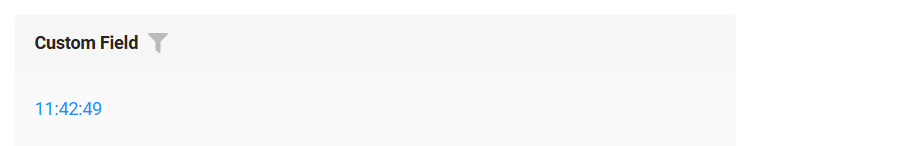
=== "Виджет Info"
    
=== "Виджет Form"
    _неприменимо_

### Как добавить? { #how-to-add_5 }
??? Example "Пример"

    **Вариант 1**

    `Шаг 1` Добавьте [fields.setDrilldown](/ru/features/element/drilldown/drilldown) в соответствующий **FieldMetaBuilder**.
    ```java
    --8<--
    {{ external_links.github_raw_doc }}/fields/time/drilldown/MyExample3503Meta.java:buildRowDependentMeta
    --8<--
    ```
    === "Виджет List"
        `Шаг 2` Добавьте **"drillDown": "true"** в .widget.json.
        ```json
        --8<--
        {{ external_links.github_raw_doc }}/fields/time/drilldown/MyExample3503List.widget.json
        --8<--
        ```
        **Вариант 2**
           Добавьте **"drillDownKey"** :  `собственное поле` в .widget.json. Подробнее см. [Drilldown](/ru/features/element/drilldown/drilldown)
 
    === "Виджет Info"

        `Шаг 2` Добавьте **"drillDown": "true"** в .widget.json.
        ```json
        --8<--
        {{ external_links.github_raw_doc }}/fields/time/drilldown/MyExample3503Info.widget.json
        --8<--
        ```
        **Вариант 2**
           Добавьте **"drillDownKey"** :  `собственное поле` в .widget.json. Подробнее см. [Drilldown](/ru/features/element/drilldown/drilldown)
 
    === "Виджет Form"
        _неприменимо_
[Расширенная настройка](/ru/features/element/drilldown/drilldown)


## Валидация { #validation }
 
`Validation` позволяет проверять любые бизнес-правила для введённого пользователем значения. Типы валидации:

1) Exception: отображает сообщение, уведомляющее пользователя о технических или бизнес-ошибках.

   `Business Exception`:
   [:material-play-circle: Живой пример]({{ external_links.code_samples }}/ui/#/screen/myexample4101){:target="_blank"} ·
   [:fontawesome-brands-github: GitHub]({{ external_links.github_ui }}/{{ external_links.github_branch }}/src/main/java/org/demo/documentation/fields/time/validationbusinessex){:target="_blank"}

   `Runtime Exception`:
   [:material-play-circle: Живой пример]({{ external_links.code_samples }}/ui/#/screen/myexample4104){:target="_blank"} ·
   [:fontawesome-brands-github: GitHub]({{ external_links.github_ui }}/{{ external_links.github_branch }}/src/main/java/org/demo/documentation/fields/time/validationruntimeex){:target="_blank"}
   
2) Confirm: показывает диалог с необязательным сообщением, требующий от пользователя подтверждения или отмены перед продолжением.

   [:material-play-circle: Живой пример]({{ external_links.code_samples }}/ui/#/screen/myexample4103){:target="_blank"} ·
   [:fontawesome-brands-github: GitHub]({{ external_links.github_ui }}/{{ external_links.github_branch }}/src/main/java/org/demo/documentation/fields/time/validationconfirm){:target="_blank"}

3) Валидация на уровне полей: показывает ошибку рядом со всеми полями, не прошедшими проверку

   [:material-play-circle: Живой пример]({{ external_links.code_samples }}/ui/#/screen/myexample4106){:target="_blank"} ·
   [:fontawesome-brands-github: GitHub]({{ external_links.github_ui }}/{{ external_links.github_branch }}/src/main/java/org/demo/documentation/fields/time/validationdynamic){:target="_blank"}

### Как это выглядит? { #how-does-it-look_6 }
=== "Виджет List"
    === "BusinessException"
        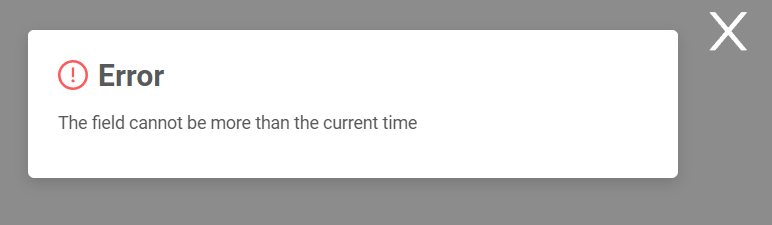
    === "RuntimeException"
        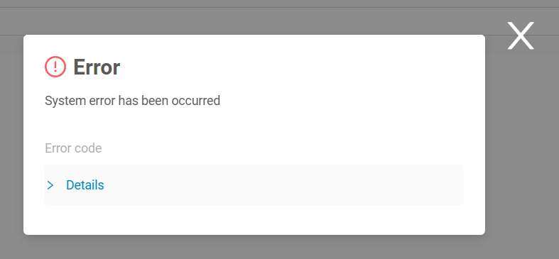   
    === "Confirm"
        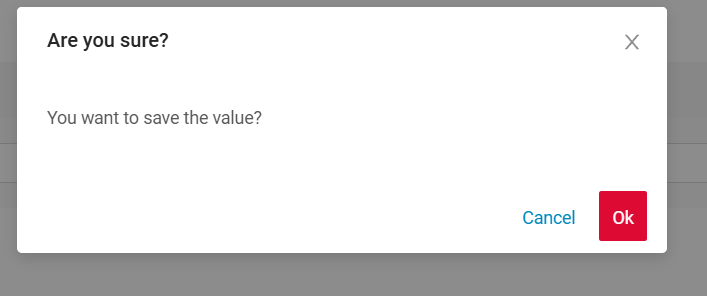
    === "Валидация на уровне полей"
        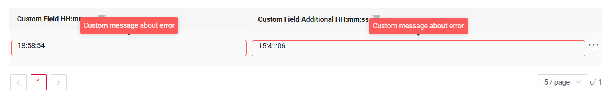
=== "Виджет Info"
    _неприменимо_
=== "Виджет Form"
    === "BusinessException"
        
    === "RuntimeException"
        
    === "Confirm"
        
    === "Валидация на уровне полей"
        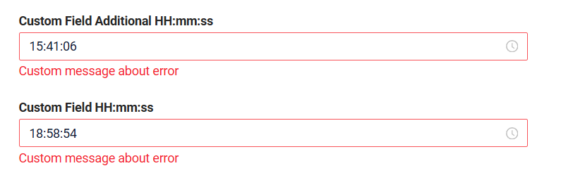


### Как добавить? { #how-to-add_6 }
??? Example "Пример"
    === "BusinessException"

        `BusinessException` описывает ошибку в рамках бизнес-процесса.
    
        Добавьте **BusinessException** в соответствующий **VersionAwareResponseService**.
        ```java
        --8<--
        {{ external_links.github_raw_doc }}/fields/time/validationbusinessex/MyExample4101Service.java:doUpdateEntity
        --8<--
        ```

        [:material-play-circle: Живой пример]({{ external_links.code_samples }}/ui/#/screen/myexample4101){:target="_blank"} ·
        [:fontawesome-brands-github: GitHub]({{ external_links.github_ui }}/{{ external_links.github_branch }}/src/main/java/org/demo/documentation/fields/time/validationbusinessex){:target="_blank"}

        === "Виджет List"
            **Работает для List.**
        === "Виджет Info"
            **_неприменимо_**
        === "Виджет Form"
            **Работает для Form.**
    === "RuntimeException"

        `RuntimeException` описывает техническую ошибку в рамках бизнес-процесса.
        
        Добавьте **RuntimeException** в соответствующий **VersionAwareResponseService**.
        ```java
        --8<--
        {{ external_links.github_raw_doc }}/fields/time/validationruntimeex/MyExample4104Service.java:doUpdateEntity
        --8<--
        ```

        [:material-play-circle: Живой пример]({{ external_links.code_samples }}/ui/#/screen/myexample4104){:target="_blank"} ·
        [:fontawesome-brands-github: GitHub]({{ external_links.github_ui }}/{{ external_links.github_branch }}/src/main/java/org/demo/documentation/fields/time/validationruntimeex){:target="_blank"}

        === "Виджет List"
            **Работает для List.**
        === "Виджет Info"
            **_неприменимо_**
        === "Виджет Form"
            **Работает для Form.**
    === "Confirm"
        Добавьте `PreAction.confirm` в соответствующий **VersionAwareResponseService**.
        ```java
        --8<--
        {{ external_links.github_raw_doc }}/fields/time/validationconfirm/MyExample4103Service.java:getActions
        --8<--
        ```
        
        [:material-play-circle: Живой пример]({{ external_links.code_samples }}/ui/#/screen/myexample4103){:target="_blank"} ·
        [:fontawesome-brands-github: GitHub]({{ external_links.github_ui }}/{{ external_links.github_branch }}/src/main/java/org/demo/documentation/fields/time/validationconfirm){:target="_blank"}

        === "Виджет List"
            **Работает для List.**
        === "Виджет Info"
            **_неприменимо_**
        === "Виджет Form"
            **Работает для Form.**
    === "Валидация на уровне полей"

        Создайте собственный сервис для проверки бизнес-логики.

        Используйте, если:

        Для полей требуется проверка бизнес-логики

        `Шаг 1`  Создайте собственный метод проверки.
        ```java
        --8<--
        {{ external_links.github_raw_doc }}/fields/time/validationdynamic/MyExampleBc4106Service.java:validateFields
        --8<--
        ```
        `Шаг 2` Добавьте собственный метод проверки в соответствующий **VersionAwareResponseService**.
        ```java
        --8<--
        {{ external_links.github_raw_doc }}/fields/time/validationdynamic/MyExampleBc4106Service.java:doUpdateEntity
        --8<--
        ```

## Сортировка { #sorting }
[:material-play-circle: Живой пример]({{ external_links.code_samples }}/ui/#/screen/myexample3508){:target="_blank"} ·
[:fontawesome-brands-github: GitHub]({{ external_links.github_ui }}/{{ external_links.github_branch }}/src/main/java/org/demo/documentation/fields/time/sorting){:target="_blank"}

`Sorting` позволяет сортировать данные по возрастанию или убыванию.

### Как это выглядит? { #how-does-it-look_7 }
=== "Виджет List"
    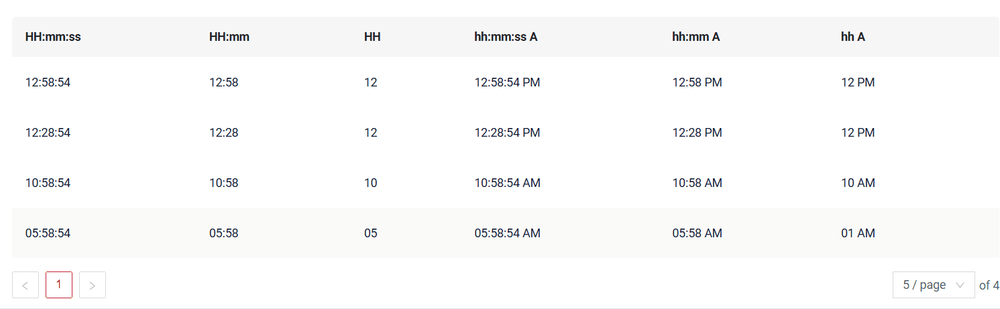
=== "Виджет Info"
    _неприменимо_
=== "Виджет Form"
    _неприменимо_
### Как добавить? { #how-to-add_7 }
??? Example "Пример"
    === "Виджет List"
        подробнее см. [Сортировка](/ru/widget/type/property/sorting/sorting)

        **Шаг 1**  Добавьте **fields.enableSort** в соответствующий **FieldMetaBuilder**.
        ```java
        --8<--
        {{ external_links.github_raw_doc }}/fields/time/sorting/MyExample3508Meta.java:buildIndependentMeta
        --8<--
        ```
        [:material-play-circle: Живой пример]({{ external_links.code_samples }}/ui/#/screen/myexample3508){:target="_blank"} ·
        [:fontawesome-brands-github: GitHub]({{ external_links.github_ui }}/{{ external_links.github_branch }}/src/main/java/org/demo/documentation/fields/time/sorting){:target="_blank"}

        !!! info
            При большом количестве строк в базе данных возможна значительная деградация производительности, поэтому рекомендуем добавить соответствующие индексы.

            `postgres` 
            
            * CREATE INDEX idx_apple_created_date_time_desc ON my_entity (cast(custom_field as time(6)) desc,id desc);
            * CREATE INDEX idx_apple_created_date_time_asc ON my_entity (cast(custom_field as time(6)) asc,id desc);
 
    === "Виджет Info"
        _неприменимо_
    === "Виджет Form"
        _неприменимо_

## Обязательность { #required }
[:material-play-circle: Живой пример]({{ external_links.code_samples }}/ui/#/screen/myexample3506){:target="_blank"} ·
[:fontawesome-brands-github: GitHub]({{ external_links.github_ui }}/{{ external_links.github_branch }}/src/main/java/org/demo/documentation/fields/time/required){:target="_blank"}

`Required` позволяет указать, что поле обязательно должно иметь значение.

### Как это выглядит? { #how-does-it-look_8 }
=== "Виджет List"
    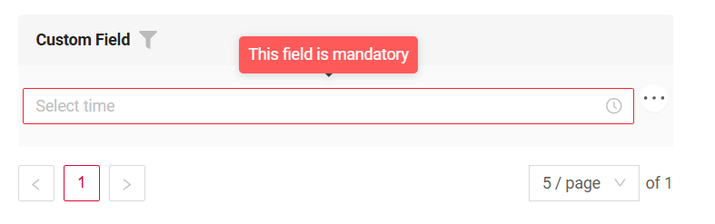
=== "Виджет Info"
    _неприменимо_
=== "Виджет Form"
    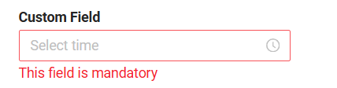
### Как добавить? { #how-to-add_8 }
??? Example "Пример"
    Добавьте **fields.setRequired** в соответствующий **FieldMetaBuilder**.
    ```java
    --8<--
    {{ external_links.github_raw_doc }}/fields/time/required/MyExample3506Meta.java:buildRowDependentMeta
    --8<--
    ```
    === "Виджет List"
        **Работает для List.**
    === "Виджет Info"
        **_неприменимо_**
    === "Виджет Form"
        **Работает для Form.**
 