# Fields
!!! warning line end "Work in progress"

## Field Types
The fields are divided into groups by their purpose:

* [Choice from Predefined Values](#choice-from-predefined-values) — fields for choosing one or several values from a fixed set.
* [Date & Time](#date-time) — fields for dates and time with different precision.
* [Display & Technical](#display-technical) — read-only auxiliary fields and technical fields.
* [Entity Selection](#entity-selection) — fields for choosing records of other entities in a popup, a dropdown or a tree.
* [Files](#files) — fields for viewing and attaching files.
* [Numeric](#numeric) — fields for numbers, percentages and money.
* [Text](#text) — fields for entering and displaying text: a single line, multiple lines or formatted text.

### Choice from Predefined Values
Fields for choosing values from a fixed set: yes or no, one value or several values.

=== "checkbox"
    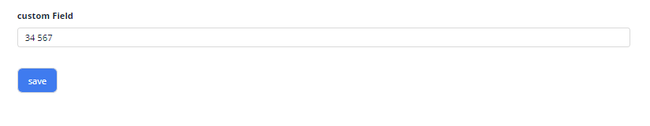
=== "dictionary"
    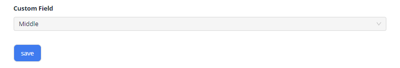
=== "multipleSelect"
    
=== "radio"
    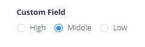

*   [CheckBox](/widget/fields/field/checkbox/checkbox) allows the user to make a binary choice.
*   [Dictionary](/widget/fields/field/dictionary/dictionary) allows to select a single value from a dropdown.
*   [MultipleSelect](/widget/fields/field/multipleSelect/multipleSelect) allows to select multiple values from a dropdown list of predefined values.
*   [Radio](/widget/fields/field/radio/radio) allows to select one of predefined values visualized as radio buttons.

### Date & Time
Fields for dates and time with different precision.

=== "date"
    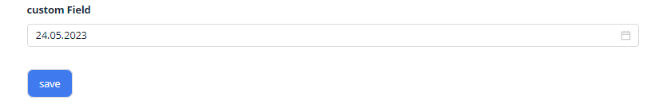
=== "dateTime"
    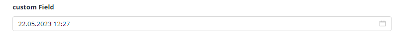
=== "dateTimeWithSeconds"
    
=== "time"
    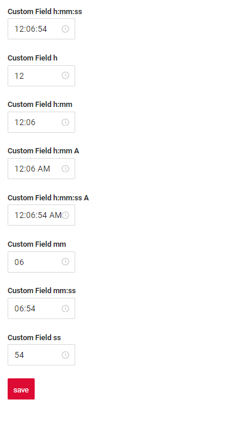

*   [Date](/widget/fields/field/date/date) is used for editing and displaying dates.
*   [DateTime](/widget/fields/field/dateTime/dateTime) is used for editing and displaying dates with time.
*   [DateTimeWithSeconds](/widget/fields/field/dateTimeWithSeconds/dateTimeWithSeconds) is used for editing and displaying dates with time and with seconds.
*   [Time](/widget/fields/field/time/time) is used for editing and displaying time.

### Display & Technical
Read-only fields that help to present other data, and technical fields that are not shown to the user.

=== "hidden"
    
=== "hint"
    
=== "multifield"
    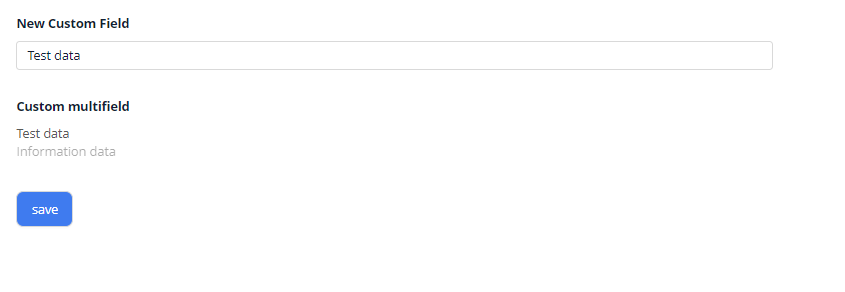
=== "multivalueHover"
    

*   [Hidden](/widget/fields/field/hidden/hidden) is an invisible technical field that allows to send a field value to the frontend.
*   [Hint](/widget/fields/field/hint/hint) is a non-editable field used for indirect indication or suggestion. It is typically used in a [Multifield](/widget/fields/field/multifield/multifield).
*   [Multifield](/widget/fields/field/multifield/multifield) is a logical block containing any number of other fields. All fields in the block are readonly.
*   [MultivalueHover](/widget/fields/field/multivalueHover/multivalueHover) allows to view multiple values on mouse hover. All values are readonly.

### Entity Selection
Fields for choosing records of other entities: one record or several records, in a popup, a dropdown or a tree.

=== "inlinePickList"
    
=== "multivalue"
    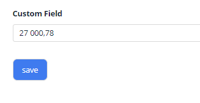
=== "multivalueTree"
    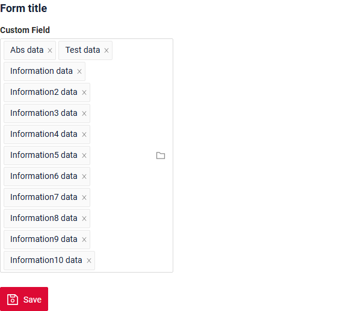
=== "pickList"
    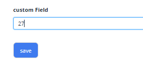
=== "pickTree"
    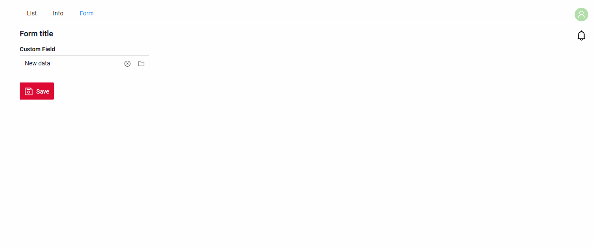
=== "suggestionPickList"
    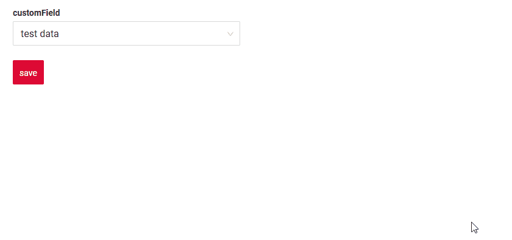

*   [InlinePickList](/widget/fields/field/inlinePickList/inlinePickList) is similar to PickList, but uses a dropdown instead of a popup for value selection.
*   [Multivalue](/widget/fields/field/multivalue/multivalue) allows to select multiple values from a Popup list of entities.
*   [MultivalueTree](/widget/fields/field/multivalueTree/multivalueTree) allows to select multiple values from a Popup tree of entities.
*   [PickList](/widget/fields/field/pickList/pickList) allows to select a value from a Popup list of entities.
*   [PickTree](/widget/fields/field/pickTree/pickTree) allows to select a value from a Popup tree of entities.
*   [SuggestionPickList](/widget/fields/field/suggestionpicklist/suggestionPickList) allows to select a value from a dropdown list with data from various external sources, such as microservices, files and others.

### Files
Fields for the files of records.

=== "fileUpload"
    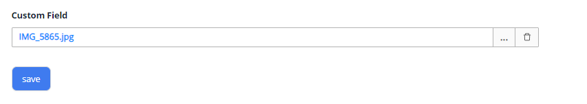

*   [FileUpload](/widget/fields/field/fileUpload/fileUpload) allows to view and attach a single file.

### Numeric
Fields for numbers: they restrict user input to numeric values and support filtering by range.

=== "money"
    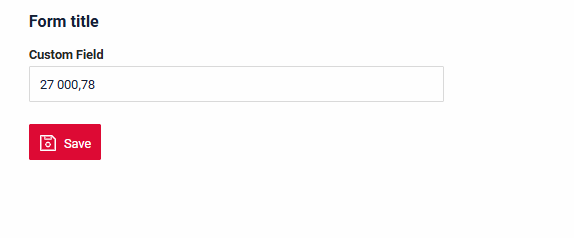
=== "number"
    
=== "percent"
    

*   [Money](/widget/fields/field/money/money) is used for showing and editing fields containing money.
*   [Number](/widget/fields/field/number/number) is used to input and present numbers. It automatically restricts user input to numeric values only.
*   [Percent](/widget/fields/field/percent/percent) is used for editing and displaying percentages.

### Text
Fields for entering and displaying text.

=== "input"
    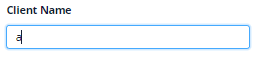
=== "richText"
    
=== "text"
    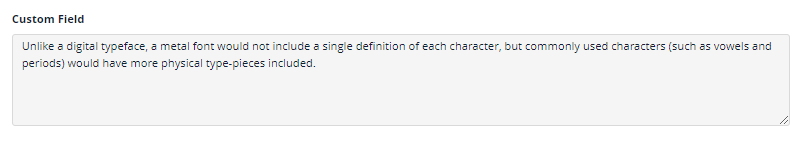

*   [Input](/widget/fields/field/input/input) is used for text editing. It allows editing and displaying single-line text.
*   [RichText](/widget/fields/field/richtext/richtext) is used for editing and displaying formatted multi-line text with a toolbar: headings, bold, italic, lists, quotes, code and text color.
*   [Text](/widget/fields/field/text/text) is used for editing and displaying multi-line text.

## Field properties
Properties supported by each field type. See [SearchOperation for filtering](/widget/fields/filtersearchoperation) for filtering details.

=== "Choice from Predefined Values"

    |   Property    | checkbox | dictionary | multipleSelect | radio |
    |:-------------:|----------|------------|----------------|-------|
    | `Placeholder` | -        | +          | +              | -     |
    |    `Color`    | +        | +          | -              | +     |
    |   `RO/Edit`   | +        | +          | +              | +     |
    |   `Filter`    | +        | +          | +              | +     |
    |  `Drilldown`  | -        | +          | -              | +     |
    | `Validation`  | +        | +          | +              | +     |
    |    `Sort`     | +        | +          | +              | +     |
    |  `Required`   | +        | +          | +              | +     |

=== "Date & Time"

    |   Property    | date | dateTime | dateTimeWithSeconds | time |
    |:-------------:|------|----------|---------------------|------|
    | `Placeholder` | +    | +        | +                   | +    |
    |    `Color`    | +    | +        | +                   | +    |
    |   `RO/Edit`   | +    | +        | +                   | +    |
    |   `Filter`    | +    | +        | +                   | +    |
    |  `Drilldown`  | +    | +        | +                   | +    |
    | `Validation`  | +    | +        | +                   | +    |
    |    `Sort`     | +    | +        | +                   | +    |
    |  `Required`   | +    | +        | +                   | +    |

=== "Display & Technical"

    |   Property    | hidden | hint | multifield | multivalueHover |
    |:-------------:|--------|------|------------|-----------------|
    | `Placeholder` | -      | -    | -          | -               |
    |    `Color`    | -      | +    | -          | +               |
    |   `RO/Edit`   | -      | -    | -          | -               |
    |   `Filter`    | -      | +    | +          | +               |
    |  `Drilldown`  | -      | +    | -          | -               |
    | `Validation`  | -      | -    | -          | -               |
    |    `Sort`     | -      | -    | -          | -               |
    |  `Required`   | -      | -    | -          | -               |

=== "Entity Selection"

    |   Property    | inlinePickList | multivalue | multivalueTree | pickList | pickTree | suggestionPickList |
    |:-------------:|----------------|------------|----------------|----------|----------|--------------------|
    | `Placeholder` | +              | +          | +              | +        | +        | +                  |
    |    `Color`    | +              | +          | +              | +        | +        | +                  |
    |   `RO/Edit`   | +              | +          | +              | +        | +        | +                  |
    |   `Filter`    | +              | +          | +              | +        | +        | +                  |
    |  `Drilldown`  | +              | +          | +              | +        | +        | +                  |
    | `Validation`  | +              | +          | +              | +        | +        | +                  |
    |    `Sort`     | +              | -          | -              | +        | +        | +                  |
    |  `Required`   | +              | +          | +              | +        | +        | +                  |

=== "Files"

    |   Property    | fileUpload |
    |:-------------:|------------|
    | `Placeholder` | +          |
    |    `Color`    | -          |
    |   `RO/Edit`   | +          |
    |   `Filter`    | +          |
    |  `Drilldown`  | -          |
    | `Validation`  | +          |
    |    `Sort`     | +          |
    |  `Required`   | +          |

=== "Numeric"

    |   Property    | money | number | percent |
    |:-------------:|-------|--------|---------|
    | `Placeholder` | +     | +      | +       |
    |    `Color`    | +     | +      | +       |
    |   `RO/Edit`   | +     | +      | +       |
    |   `Filter`    | +     | +      | +       |
    |  `Drilldown`  | +     | +      | +       |
    | `Validation`  | +     | +      | +       |
    |    `Sort`     | +     | +      | +       |
    |  `Required`   | +     | +      | +       |

=== "Text"

    |   Property    | input | richText | text |
    |:-------------:|-------|----------|------|
    | `Placeholder` | +     | +        | +    |
    |    `Color`    | +     | -        | +    |
    |   `RO/Edit`   | +     | +        | +    |
    |   `Filter`    | +     | +        | +    |
    |  `Drilldown`  | +     | -        | +    |
    | `Validation`  | +     | +        | +    |
    |    `Sort`     | +     | +        | +    |
    |  `Required`   | +     | +        | +    |

## How to add block fields?
??? Example

    **Step1** Add Block   "fields": [ ]: in json
    
    label - title field (optional)
    key - name field in DTO (required)
    type -  see standard types (required)

    ```json
    "fields": [  
        {
            "label": "Custom Field",
            "key": "customField",
            "type": "input"
        }
    ]
    ```
