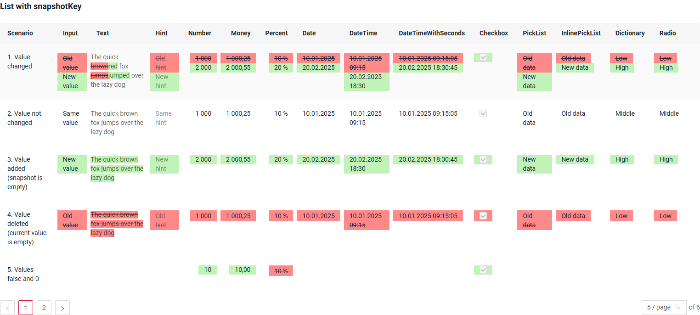
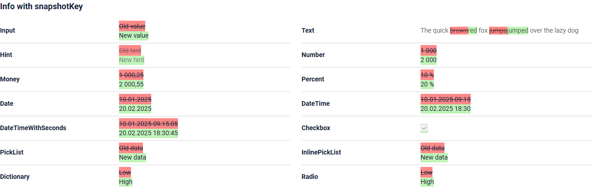
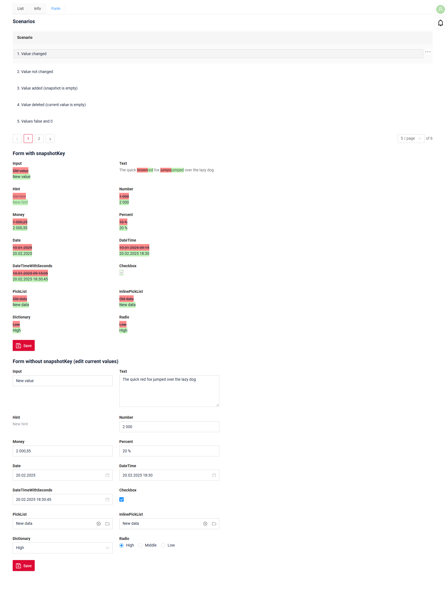
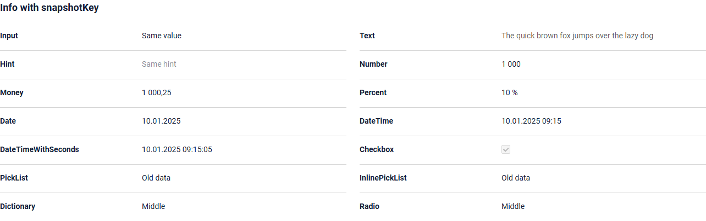
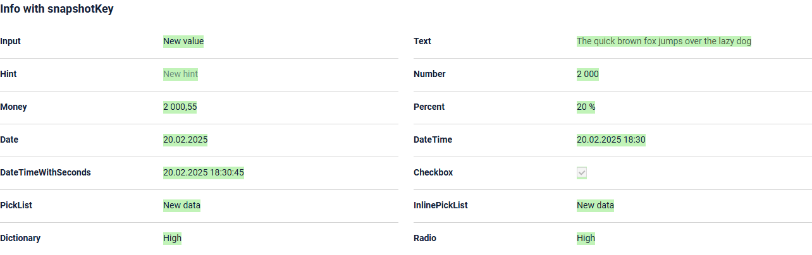
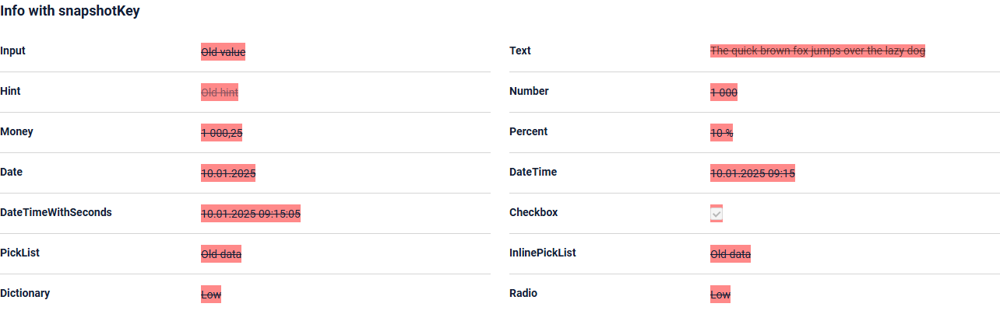
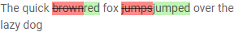
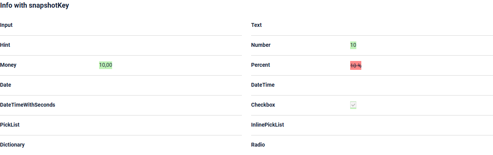

# snapshotKey (history of field changes)
[:material-play-circle: Live Sample]({{ external_links.code_samples }}/ui/#/screen/myexample5900/view/myexample5900list){:target="_blank"} ·
[:fontawesome-brands-github: GitHub]({{ external_links.github_ui }}/{{ external_links.github_branch }}/src/main/java/org/demo/documentation/fields/property/snapshotkey){:target="_blank"}

`snapshotKey` turns on the history mode of a field: the field shows the difference between the previous (snapshot) value and the current value.

* the previous value is taken from the field of the same record whose name is set in `snapshotKey`;
* the current value is taken from the field set in `key`.

=== "List widget"
     
=== "Info widget"
     
=== "Form widget"
     

## Basic

This function is available for:

* [Input](/widget/fields/field/input/input)
* [Text](/widget/fields/field/text/text)
* [Hint](/widget/fields/field/hint/hint)
* [Number](/widget/fields/field/number/number)
* [Money](/widget/fields/field/money/money)
* [Percent](/widget/fields/field/percent/percent)
* [Date](/widget/fields/field/date/date)
* [DateTime](/widget/fields/field/dateTime/dateTime)
* [DateTimeWithSeconds](/widget/fields/field/dateTimeWithSeconds/dateTimeWithSeconds)
* [Checkbox](/widget/fields/field/checkbox/checkbox)
* [PickList](/widget/fields/field/pickList/pickList)
* [InlinePickList](/widget/fields/field/inlinePickList/inlinePickList)
* [Dictionary](/widget/fields/field/dictionary/dictionary)
* [Radio](/widget/fields/field/radio/radio)

It works in [List](/widget/type/list/list), [Info](/widget/type/info/info), [Form](/widget/type/form/form)
and in the other widgets that show fields of a record (for example, [AdditionalInfo](/widget/type/additionalinfo/additionalinfo)).

!!! info
     For the other field types `snapshotKey` is ignored and the field is shown as usual.
     [FileUpload](/widget/fields/field/fileUpload/fileUpload) has its own history mode: `snapshotKey` together with `snapshotFileIdKey`.

### What data is used?

Both values are taken from the same record (DTO) that the backend sends to the frontend:

* **current value** - the DTO field set in `key`. It is the usual value of the field: it is edited and saved as usual;
* **previous (snapshot) value** - the DTO field set in `snapshotKey`. It is a separate field of the same DTO
  with the same type as the current value.

CXBox does not keep the history of changes and does not fill the previous value itself.
"Previous value" is any value that the application wants to compare the current value with,
and the application decides where it comes from, for example:

* the value at a certain moment: before the document was sent for approval, at the previous version, at the last export;
* the value from an audit (history) table or from another system;
* the value of a related record (for example, the parent or the original record that was copied).

The frontend only compares the two values and shows the difference. It does not change the previous value:
when the current value is saved, the previous value stays as the backend sends it.

In the sample each field of the entity has a pair of columns: the current value (`inputField`) and the previous value (`inputFieldSnapshot`).
The previous values are filled by the test data and are not changed on save: `doUpdateEntity` changes only the current values.

### How does it look?

How the field is shown depends on the previous and the current value:

| Previous value | Current value | How the field is shown                                                                               |
|----------------|---------------|------------------------------------------------------------------------------------------------------|
| A              | B             | previous value (red background, strikethrough) and current value (green background) next to each other |
| A              | A             | current value as a usual read-only field                                                             |
| empty          | B             | only current value (green background)                                                                |
| A              | empty         | only previous value (red background, strikethrough)                                                  |

The previous value is shown with the same component as the field type: dates and numbers are formatted,
dictionary shows its icon, checkbox shows a checkbox and so on.

=== "Value changed"
     
=== "Value not changed"
     
=== "Value added (snapshot is empty)"
     
=== "Value deleted (current value is empty)"
     

#### Text field

For the `text` field type changes are shown word by word inside one text:
deleted words have a red background and are struck through, added words have a green background.



### How to add?
??? Example

     **Step 1.** Add the field with the previous value to **DTO**. It must have the same type as the main field.
     The value is sent to the frontend in the same record, the frontend does not request it separately.

     ```java
     --8<--
     {{ external_links.github_raw_doc }}/fields/property/snapshotkey/MyExample5900DTO.java:fields
     --8<--
     ```

     **Step 2.** Add `snapshotKey` to the field in **_.widget.json_**. The value of `snapshotKey` is the name of the DTO field with the previous value.

     **Step 3.** Add the field with the previous value to the same **_.widget.json_** with type `hidden`.
     The backend sends to the frontend only the fields of the widgets, `snapshotKey` is not taken into account:
     without the `hidden` field the previous value is not sent, and the field is shown as not changed.

     === "List widget"
         ```json
         --8<--
         {{ external_links.github_raw_doc }}/fields/property/snapshotkey/myexample5900list.widget.json
         --8<--
         ```
     === "Info widget"
         ```json
         --8<--
         {{ external_links.github_raw_doc }}/fields/property/snapshotkey/myexample5900info.widget.json
         --8<--
         ```
     === "Form widget"
         ```json
         --8<--
         {{ external_links.github_raw_doc }}/fields/property/snapshotkey/myexample5900form.widget.json
         --8<--
         ```

     [:material-play-circle: Live Sample]({{ external_links.code_samples }}/ui/#/screen/myexample5900/view/myexample5900list){:target="_blank"} ·
     [:fontawesome-brands-github: GitHub]({{ external_links.github_ui }}/{{ external_links.github_branch }}/src/main/java/org/demo/documentation/fields/property/snapshotkey){:target="_blank"}

## Features and limitations

### The previous value is sent only as a field of the widget
The backend sends to the frontend only the fields that are used in the widgets of the view.
The field from `snapshotKey` is not added automatically: add it to the widget as a field with type `hidden`.

If it is not added, the previous value is empty on the frontend, and the field looks like this:

* the previous value is empty, the current value is not empty - only the current value (green background);
* the current value is empty too - an empty field, the deleted value is not shown.

```json
{
  "title": "Input snapshot",
  "key": "inputFieldSnapshot",
  "type": "hidden"
}
```

### The field is always read-only
[:material-play-circle: Live Sample]({{ external_links.code_samples }}/ui/#/screen/myexample5900/view/myexample5900form){:target="_blank"}

A field with `snapshotKey` is always shown in read-only mode, even in the Form widget and even if the field is enabled in row meta (`setEnabled`).

To edit the value, show the field in another widget without `snapshotKey`.
In the sample the left Form has `snapshotKey`, the right Form has no `snapshotKey` and is used to change the current values.


### Values that are not saved yet
Whether the difference is shown is decided by the record data received from the backend (saved values).
The current (green) value is shown together with the changes that are not saved yet:
if the value is changed in another widget of the same record, the green value changes at once,
and the previous value stays as it was until the record is saved.

### Empty values: false and 0
Before the comparison both values are converted to strings, and `false`, `0` and `null` are treated as an empty value.
Because of this:

* `checkbox`: if the previous value is `false` and the current value is `true`, only the current value is shown;
  if the previous value is `true` and the current value is `false`, only the previous (struck through) value is shown;
* `number`, `money`, `percent`: the previous value `0` is not shown, the current value `0` is not shown.



### Values are compared as strings
The previous and the current values are compared as strings, exactly as they are received from the backend:

* the previous value must be sent in the same format as the current value. For example, for dates both values must
  have the same format (`2025-01-10T00:00:00`), otherwise equal dates are shown as changed;
* for `pickList` and `inlinePickList` the displayed value (`key`) is compared, not the id of the selected record.
  Send the displayed value of the previous record in `snapshotKey`.

### What else is not shown in history mode
* the validation error popup of the field is not shown;
* drilldown works only for the current value, the previous value has no drilldown.
