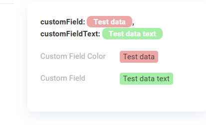
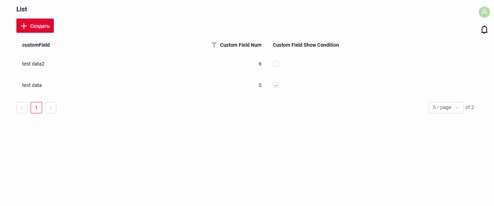

# AdditionalInfo { #additionalinfo }
 
Виджет `AdditionalInfo` — компонент только для просмотра данных. Виджет всегда располагается **справа**.

## Основы { #basics }
[:material-play-circle: Живой пример]({{ external_links.code_samples }}/ui/#/screen/myexample3600){:target="_blank"} ·
[:fontawesome-brands-github: GitHub]({{ external_links.github_ui }}/{{ external_links.github_branch }}/src/main/java/org/demo/documentation/widgets/additionalinfo/base){:target="_blank"}
### Как это выглядит? { #how-does-it-look }


###  <a id="Howtoaddbacis">Как добавить?</a>
??? Example "Пример"
    **Шаг 1** Создайте файл **_.widget.json_** с типом **AdditionalInfo**.

    * name — статический (уникальный в пределах проекта)
    * [title](#Title) — (необязательно)
    * type = "AdditionalInfo" (обязательно)
    * bc — (обязательно)
    * fields — (обязательно) см. [типы полей](/ru/widget/fields/fieldtypes/)
    * [options](#Fieldslayout)  

    ```json
    --8<--
    {{ external_links.github_raw_doc }}/widgets/additionalinfo/base/MyExample3600Additional.widget.json
    --8<--
    ```
    **Шаг 2** Добавьте виджет в соответствующий **_.view.json_**.

    ```json
    --8<--
    {{ external_links.github_raw_doc }}/widgets/additionalinfo/base/myexample3600list.view.json
    --8<--
    ```
## Заголовок (Title) { #title }
<!--Title - a name displayed above the additional information.--->
### Базовый заголовок { #title-basic }

### Цвет заголовка { #title-color }
`Title Color` позволяет задать цвет заголовка. Он может быть постоянным или вычисляемым.

**Постоянный цвет**

[:material-play-circle: Живой пример]({{ external_links.code_samples }}/ui/#/screen/myexample3025/view/myexample3025constcolor){:target="_blank"} ·
[:fontawesome-brands-github: GitHub]({{ external_links.github_ui }}/{{ external_links.github_branch }}/src/main/java/org/demo/documentation/widgets/additionalinfo/colortitle){:target="_blank"}

*Постоянный цвет* — фиксированный цвет, который не меняется. Он остаётся одинаковым независимо от каких-либо факторов в приложении.
**Вычисляемый цвет**

[:material-play-circle: Живой пример]({{ external_links.code_samples }}/ui/#/screen/myexample3025/view/myexample3025){:target="_blank"} ·
[:fontawesome-brands-github: GitHub]({{ external_links.github_ui }}/{{ external_links.github_branch }}/src/main/java/org/demo/documentation/widgets/additionalinfo/colortitle){:target="_blank"}

*Вычисляемый цвет* можно использовать для динамического изменения цвета заголовка. Он меняется в зависимости от бизнес-логики или данных приложения.

!!! info
    Цветовое выделение заголовка **применимо** к следующим [полям](/ru/widget/fields/fieldtypes/): date, dateTime, dateTimeWithSeconds, number, money, percent, time, input, text, dictionary, radio, checkbox, pickList, inlinePickList, multivalue, multivalueHover.

##### Как это выглядит? { #how-does-it-look_1 }


##### Как добавить? { #how-to-add }
??? Example "Пример"
    === "Вычисляемый цвет"

        **Шаг 1**   Добавьте `собственное поле для цвета` в соответствующий **DataResponseDTO**. Поле может содержать цвет в формате HEX или быть null.
        ```java
        --8<--
        {{ external_links.github_raw_doc }}/widgets/additionalinfo/colortitle/MyExample3025DTO.java:colorDTO
        --8<--
        ```  
 
        **Шаг 2** Добавьте **"bgColorKey"** :  `собственное поле для цвета` в .widget.json.

        Добавьте в `title` поле с `${customField}`

        ```json
        --8<--
        {{ external_links.github_raw_doc }}/widgets/additionalinfo/colortitle/MyExample3025.widget.json
        --8<--
        ```       

    === "Постоянный цвет"
 
        Добавьте **"bgColor"** :  `цвет HEX` в .widget.json.

        Добавьте в `title` поле с `${customField}`

        ```json
        --8<--
        {{ external_links.github_raw_doc }}/widgets/additionalinfo/colortitle/MyExample3025ColorConst.widget.json
        --8<--
        ```


## <a id="bc">Бизнес-компонент</a>
Указывает бизнес-компонент (BC), к которому относится эта форма.
Бизнес-компонент представляет определённую часть системы, отвечающую за конкретную бизнес-логику или данные.

подробнее см. [Бизнес-компонент](/ru/environment/businesscomponent/businesscomponent/)

## <a id="Showcondition">Условие отображения</a>

[:material-play-circle: Живой пример]({{ external_links.code_samples }}/ui/#/screen/myexample3600){:target="_blank"} ·
[:fontawesome-brands-github: GitHub]({{ external_links.github_ui }}/{{ external_links.github_branch }}/src/main/java/org/demo/documentation/widgets/additionalinfo/base){:target="_blank"}

* `без условия отображения — рекомендуется`: виджет виден всегда

  [:material-play-circle: Живой пример]({{ external_links.code_samples }}/ui/#/screen/myexample4231){:target="_blank"} ·
  [:fontawesome-brands-github: GitHub]({{ external_links.github_ui }}/{{ external_links.github_branch }}/src/main/java/org/demo/documentation/widgets/additionalinfo/showcondition){:target="_blank"}

* `условие отображения по текущей сущности`: условие может содержать логическое выражение, зависящее от полей текущей сущности. Обновление полей вызывает пересчёт условия только при сохранении или если поле force active

!!! info
    Когда все виджеты справа скрыты, остальные виджеты view занимают всю ширину.

!!! tips "Совет"
    По возможности рекомендуется не использовать `Show condition`, так как широкое применение этой возможности усложняет поддержку приложения.

#### <a id="howdoesitlook">Как это выглядит?</a>
=== "без условия отображения"
    
=== "условие отображения по текущей сущности"
    

#### <a id="howtoadd">Как добавить?</a>
??? Example "Пример"

    === "без условия отображения"
        см. [Основы](#Howtoaddbacis)

    === "условие отображения по текущей сущности"
        **Шаг 1** Добавьте **showCondition** в **_.widget.json_**. Подробнее см. [showCondition](/ru/widget/type/property/showcondition/showcondition)

        ```json
        --8<--
        {{ external_links.github_raw_doc }}/widgets/additionalinfo/showcondition/MyExample4231AddInfo.widget.json
        --8<--
        ```

        [:material-play-circle: Живой пример]({{ external_links.code_samples }}/ui/#/screen/myexample4231){:target="_blank"} ·
        [:fontawesome-brands-github: GitHub]({{ external_links.github_ui }}/{{ external_links.github_branch }}/src/main/java/org/demo/documentation/widgets/additionalinfo/showcondition){:target="_blank"}

## <a id="bc">Поля</a>

## Компоновка (options layout) { #options-layout }
_неприменимо_


## Действия { #actions }
`Actions` отображают доступные действия в виде отдельных кнопок
см. [Действия](/ru/features/element/actions/actions)
