# AdditionalList
 
Виджет `AdditionalList` выводит общую информацию по множеству записей. Виджет всегда располагается **справа**.

У виджета два режима:

* Основной режим: отображает записи в виде списка, идеально подходит для отслеживания статуса шагов бизнес-процесса. Редактирование не поддерживается.

* Режим чтения: представляет значения в заданном для виджета формате для удобного просмотра.


!!! info
    Основной режим AdditionalList не расширяется динамически под содержимое. Если колонок больше, чем помещается, внизу появляется горизонтальная полоса прокрутки.

## <a id="Main Mode">Основы</a>
[:material-play-circle: Живой пример]({{ external_links.code_samples }}/ui/#/screen/myexample3190){:target="_blank"} ·
[:fontawesome-brands-github: GitHub]({{ external_links.github_ui }}/{{ external_links.github_branch }}/src/main/java/org/demo/documentation/widgets/additionallist/base){:target="_blank"}
### Как это выглядит? { #how-does-it-look }
=== "Основной режим"
    
=== "Режим чтения"
    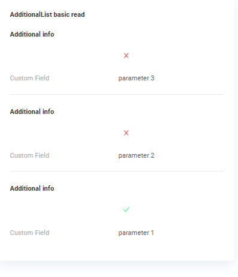

###  <a id="Howtoaddbacis">Как добавить?</a>
??? Example "Пример"
    === "Основной режим"
        **Шаг 1** Создайте файл **_.widget.json_** с type = **"AdditionalList"**
    
        Добавьте существующее поле в виджет AdditionalList. Подробнее см. [Поля](#fields)
        ```json
        --8<--
        {{ external_links.github_raw_doc }}/widgets/additionallist/base/onefield/MyExample3190Additional.widget.json
        --8<--
        ```
     
        **Шаг 2** Добавьте виджет в соответствующий **_.view.json_**.
    
        ```json
        --8<--
        {{ external_links.github_raw_doc }}/widgets/additionallist/base/onefield/myexample3190list.view.json
        --8<--
        ```
    === "Режим чтения"
        **Шаг 1** Создайте файл **_.widget.json_** с type = **"AdditionalInfo"**
    
        Добавьте существующее поле в виджет AdditionalInfo. Подробнее см. [Поля](#fields)
        ```json
        --8<--
        {{ external_links.github_raw_doc }}/widgets/additionallist/base/onefield/MyExample3190AdditionalInfo.widget.json
        --8<--
        ```

        **Шаг 2** Создайте файл **_.widget.json_** с type = **"AdditionalList"**
    
        Добавьте существующее поле в виджет AdditionalList. Подробнее см. [Поля](#fields)
        ```json
        --8<--
        {{ external_links.github_raw_doc }}/widgets/additionallist/base/onefield/MyExample3190AdditionalRead.widget.json
        --8<--
        ```

        **Шаг 3** Добавьте виджет в соответствующий **_.view.json_**.
    
        ```json
        --8<--
        {{ external_links.github_raw_doc }}/widgets/additionallist/base/onefield/myexample3190list.view.json
        --8<--
        ```

## <a id="Title">Заголовок</a>
[:material-play-circle: Живой пример]({{ external_links.code_samples }}/ui/#/screen/myexample3195){:target="_blank"} ·
[:fontawesome-brands-github: GitHub]({{ external_links.github_ui }}/{{ external_links.github_branch }}/src/main/java/org/demo/documentation/widgets/additionallist/title){:target="_blank"}

### Базовый заголовок { #title-basic }
`Title` для виджета (необязательно)

Типы:

* `постоянный заголовок`: показывает постоянный текст.
* `пустой постоянный заголовок`: если нужно визуально связать виджеты, расположив их один под другим
 
#### Как это выглядит? { #how-does-it-look_1 }
=== "Постоянный заголовок"
    === "Основной режим"
        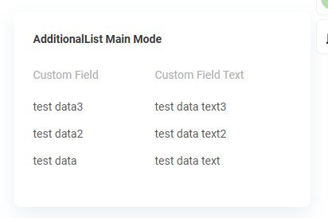
    === "Режим чтения"
        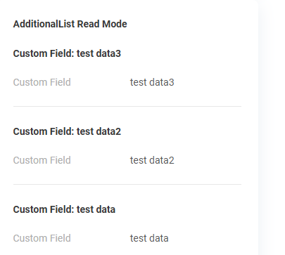
=== "Пустой постоянный заголовок"
    === "Основной режим"
        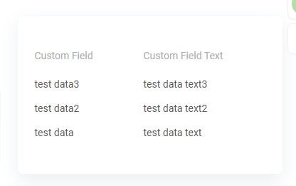
    === "Режим чтения"
        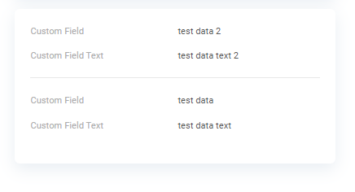 

#### Как добавить? { #how-to-add }
??? Example "Пример"
    === "Постоянный заголовок"
        === "Основной режим"
            **Шаг 1** Добавьте название в **title** в **_.widget.json_**.
            ```json
            --8<--
            {{ external_links.github_raw_doc }}/widgets/additionallist/title/MyExample3195Additional.widget.json
            --8<--
            ```
 
        === "Режим чтения"
            **Шаг 1** Добавьте название в **title** в **_.widget.json_**.
            ```json
            --8<--
            {{ external_links.github_raw_doc }}/widgets/additionallist/title/MyExample3195AdditionalRead.widget.json
            --8<--
            ```
        [:material-play-circle: Живой пример]({{ external_links.code_samples }}/ui/#/screen/myexample3195/view/myexample3195list){:target="_blank"} ·
        [:fontawesome-brands-github: GitHub]({{ external_links.github_ui }}/{{ external_links.github_branch }}/src/main/java/org/demo/documentation/widgets/additionallist/title){:target="_blank"}
            
    === "Пустой постоянный заголовок"
        === "Основной режим"
            **Шаг 1** Удалите параметр **title** из **_.widget.json_**.
            ```json
            --8<--
            {{ external_links.github_raw_doc }}/widgets/additionallist/title/MyExample3195AdditionalEmptyTitle.widget.json
            --8<--
            ```
        === "Режим чтения"
            **Шаг 1** Удалите параметр **title** из **_.widget.json_**.
            ```json
            --8<--
            {{ external_links.github_raw_doc }}/widgets/additionallist/title/MyExample3195AdditionalInfoEmpty.widget.json
            --8<--
            ```
        [:material-play-circle: Живой пример]({{ external_links.code_samples }}/ui/#/screen/myexample3195){:target="_blank"} ·
        [:fontawesome-brands-github: GitHub]({{ external_links.github_ui }}/{{ external_links.github_branch }}/src/main/java/org/demo/documentation/widgets/additionallist/title){:target="_blank"}


### Цвет заголовка { #title-color }
`Title Color` позволяет задать цвет заголовка. Он может быть постоянным или вычисляемым.
<!--  
**Постоянный цвет**

[:material-play-circle: Живой пример]({{ external_links.code_samples }}/ui/#/screen/myexample3196/view/myexample3196listconstant){:target="_blank"} ·
[:fontawesome-brands-github: GitHub]({{ external_links.github_ui }}/{{ external_links.github_branch }}/src/main/java/org/demo/documentation/widgets/additionallist/colortitle){:target="_blank"}

*Постоянный цвет* — фиксированный цвет, который не меняется. Он остаётся одинаковым независимо от каких-либо факторов в приложении.
-->
**Вычисляемый цвет**

[:material-play-circle: Живой пример]({{ external_links.code_samples }}/ui/#/screen/myexample3196/view/myexample3196list){:target="_blank"} ·
[:fontawesome-brands-github: GitHub]({{ external_links.github_ui }}/{{ external_links.github_branch }}/src/main/java/org/demo/documentation/widgets/additionallist/colortitle){:target="_blank"}

*Вычисляемый цвет* можно использовать для динамического изменения цвета заголовка. Он меняется в зависимости от бизнес-логики или данных приложения.

!!! info
    Цветовое выделение заголовка **применимо** к следующим [полям](/ru/widget/fields/fieldtypes/): date, dateTime, dateTimeWithSeconds, number, money, percent, time, input, text, dictionary, radio, checkbox, pickList, inlinePickList, multivalue, multivalueHover.

##### Как это выглядит? { #how-does-it-look_2 }
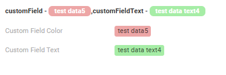

##### Как добавить? { #how-to-add_1 }
??? Example "Пример"
    === "Вычисляемый цвет"

        **Шаг 1**   Добавьте `собственное поле для цвета` в соответствующий **DataResponseDTO**. Поле может содержать цвет в формате HEX или быть null.
        ```java
        --8<--
        {{ external_links.github_raw_doc }}/widgets/additionallist/colortitle/twofields/MyExample3196DTO.java
        --8<--
        ```  

        === "Основной режим"
            **Шаг 2** Добавьте **"bgColorKey"** :  `собственное поле для цвета` в .widget.json.
    
            Добавьте в `title` поле с `${customField}`
    
            ```json
            --8<--
            {{ external_links.github_raw_doc }}/widgets/additionallist/colortitle/twofields/MyExample3196Additional.widget.json
            --8<--
            ``` 
        === "Режим чтения"
            _неприменимо_
        [:material-play-circle: Живой пример]({{ external_links.code_samples }}/ui/#/screen/myexample3196/view/myexample3196list){:target="_blank"} ·
        [:fontawesome-brands-github: GitHub]({{ external_links.github_ui }}/{{ external_links.github_branch }}/src/main/java/org/demo/documentation/widgets/additionallist/colortitle){:target="_blank"}
    === "Постоянный цвет"
        _неприменимо_
<!-- 
            **Шаг 2** Добавьте **"bgColorKey"** :  `собственное поле для цвета` в .widget.json для **read.widget**.
    
            Добавьте в `title` поле с `${customField}`
    
            ```json
            --8<--
            {{ external_links.github_raw_doc }}/widgets/additionallist/colortitle/twofields/MyExample3196AdditionalInfo.widget.json
            --8<--
            ``` 

        [:material-play-circle: Живой пример]({{ external_links.code_samples }}/ui/#/screen/myexample3196/view/myexample3196listconstant){:target="_blank"} ·
        [:fontawesome-brands-github: GitHub]({{ external_links.github_ui }}/{{ external_links.github_branch }}/src/main/java/org/demo/documentation/widgets/additionallist/colortitle){:target="_blank"}
-->
<!--     
    === "Постоянный цвет"
        === "Основной режим"
            Добавьте **"bgColor"** :  `цвет HEX` в .widget.json.
    
            Добавьте в `title` поле с `${customField}`
    
            ```json
            --8<--
            {{ external_links.github_raw_doc }}/widgets/additionallist/colortitle/twofields/MyExample3196AdditionalConstant.widget.json
            --8<--
            ```
    
            [:material-play-circle: Живой пример]({{ external_links.code_samples }}/ui/#/screen/myexample3196/view/myexample3196list){:target="_blank"} ·
            [:fontawesome-brands-github: GitHub]({{ external_links.github_ui }}/{{ external_links.github_branch }}/src/main/java/org/demo/documentation/widgets/additionallist/colortitle){:target="_blank"}
-->
## <a id="bc">Бизнес-компонент</a>
Указывает бизнес-компонент (BC), к которому относится эта форма.
Бизнес-компонент представляет определённую часть системы, отвечающую за конкретную бизнес-логику или данные.

подробнее см. [Бизнес-компонент](/ru/environment/businesscomponent/businesscomponent/)

## <a id="Showcondition">Условие отображения</a>

[:material-play-circle: Живой пример]({{ external_links.code_samples }}/ui/#/screen/myexample3190){:target="_blank"} ·
[:fontawesome-brands-github: GitHub]({{ external_links.github_ui }}/{{ external_links.github_branch }}/src/main/java/org/demo/documentation/widgets/additionallist/base){:target="_blank"}

* `без условия отображения — рекомендуется`: виджет виден всегда

  [:material-play-circle: Живой пример]({{ external_links.code_samples }}/ui/#/screen/myexample3193){:target="_blank"} ·
  [:fontawesome-brands-github: GitHub]({{ external_links.github_ui }}/{{ external_links.github_branch }}/src/main/java/org/demo/documentation/widgets/additionallist/showcondition/bycurrententity){:target="_blank"}

* `условие отображения по текущей сущности`: условие может содержать логическое выражение, зависящее от полей текущей сущности. Обновление полей вызывает пересчёт условия только при сохранении или если поле force active

<!--
  [:material-play-circle: Живой пример]({{ external_links.code_samples }}/ui/#/screen/myexample3005/view/myexample3007showcondform){:target="_blank"} ·
  [:fontawesome-brands-github: GitHub]({{ external_links.github_ui }}/{{ external_links.github_branch }}/src/main/java/org/demo/documentation/widgets/form/showcondition/bycurrententity){:target="_blank"}
 
* `условие отображения по родительской сущности`: условие может содержать логическое выражение, зависящее от родительской сущности. Обновление полей родителя вызывает пересчёт условия только при сохранении или если поле force active и отображается на том же view
-->
!!! info
    Когда все виджеты справа скрыты, остальные виджеты view занимают всю ширину.

!!! tips "Совет"
    По возможности рекомендуется не использовать `Show condition`, так как широкое применение этой возможности усложняет поддержку приложения.

#### <a id="howdoesitlook">Как это выглядит?</a>
=== "без условия отображения"
    см. [Основы](#basic)
=== "условие отображения по текущей сущности"
    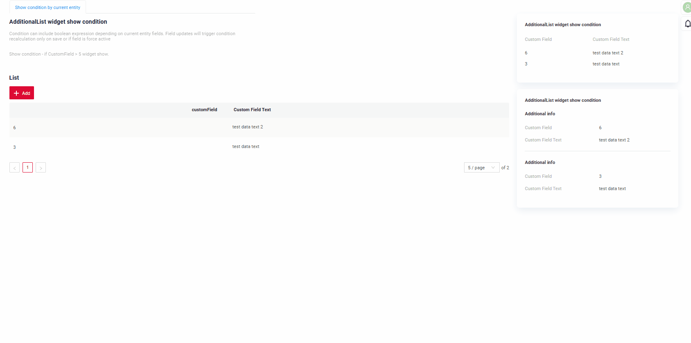
<!--
=== "условие отображения по родительской сущности"
    
-->

#### <a id="howtoadd">Как добавить?</a>
??? Example "Пример"

    === "без условия отображения"
        см. [Основы](#Howtoaddbacis)

    === "условие отображения по текущей сущности"
        **Шаг 1** Добавьте **showCondition** в **_.widget.json_**. Подробнее см. [showCondition](/ru/widget/type/property/showcondition/showcondition)
        === "Основной режим"

            ```json
            --8<--
            {{ external_links.github_raw_doc }}/widgets/additionallist/showcondition/bycurrententity/MyExample3193Additional.widget.json
            --8<--
            ```
        === "Режим чтения"

            ```json
            --8<--
            {{ external_links.github_raw_doc }}/widgets/additionallist/showcondition/bycurrententity/MyExample3193AdditionalRead.widget.json
            --8<--
            ```
        [:material-play-circle: Живой пример]({{ external_links.code_samples }}/ui/#/screen/myexample3193){:target="_blank"} ·
        [:fontawesome-brands-github: GitHub]({{ external_links.github_ui }}/{{ external_links.github_branch }}/src/main/java/org/demo/documentation/widgets/additionallist/showcondition/bycurrententity){:target="_blank"}

<!--
    === "условие отображения по родительской сущности"
        **Шаг 1** Добавьте **showCondition** в **_.widget.json_**. Подробнее см. [showCondition](/ru/widget/type/property/showcondition/showcondition)
        ```json
        --8<--
        {{ external_links.github_raw_doc }}/widgets/additionallist/showcondition/byparententity/child/MyExample3107.widget.json
        --8<--
        ```
-->

## <a id="fields">Поля</a>
Настройка полей. Массив fields определяет отдельные поля формы.

```json
{
    "title": "Custom Field",
    "key": "customField",
    "type": "input"
}
```

* **"title"**

  Описание: заголовок поля.
  
  Тип: String (необязательно).
  
* **"key"**
  
    Описание: имя поля в соответствующем DataResponseDTO.
  
    Тип: String (обязательно).
  
* **"type"**
  
  Описание: [Типы полей](/ru/widget/fields/fieldtypes/)
  
  Тип: String (обязательно).


### Как добавить? { #how-to-add_2 }
??? Example "Пример"

    === "С плагином (рекомендуется)"
        **Шаг 1** Скачайте плагин
            [скачать плагин для IntelliJ](https://doc.cxbox.org/ru/plugin/plugininstalling)
    
        **Шаг 2** Добавьте существующее поле в существующий виджет формы
            
    === "Пример написания кода"
        === "Основной режим"
            Добавьте поле в **_.widget.json_**.
    
              ```json
                 --8<--
                 {{ external_links.github_raw_doc }}/widgets/additionallist/base/onefield/MyExample3190Additional.widget.json
                 --8<--
              ```
        === "Режим чтения"
            Добавьте поле в **_.widget.json_** для виджета "widget.read".
    
              ```json
                 --8<--
                 {{ external_links.github_raw_doc }}/widgets/additionallist/base/onefield/MyExample3190AdditionalRead.widget.json
                 --8<--
              ```

## <a id="Fieldslayout">Компоновка (options layout)</a>
**options.layout** — в этом типе не используется.

## Действия { #actions }
_неприменимо_

## Дополнительные свойства { #additional-properties }
#### Настройка отображаемых колонок { #customization-of-displayed-columns }
[:material-play-circle: Живой пример]({{ external_links.code_samples }}/ui/#/screen/myexample3194){:target="_blank"} ·
[:fontawesome-brands-github: GitHub]({{ external_links.github_ui }}/{{ external_links.github_branch }}/src/main/java/org/demo/documentation/widgets/additionallist/customizationcolumns){:target="_blank"}


Для настройки колонок, отображаемых в виджете списка, доступны два основных действия:

* Скрыть колонки
* Поменять колонки местами

!!! info
    Сейчас данные настройки таблицы хранятся во внутренних таблицах, даже если используются микросервисы.

###### Основы { #basic }
При настройке колонок записи вставляются в таблицу ADDITIONAL_FIELDS.
Таблица *ADDITIONAL_FIELDS* для хранения пользовательских настроек:

* `user_id`: ID пользователя, для которого настраиваются колонки.
* `view`: имя view, в котором настраиваются колонки.
* `widget`: имя виджета, в котором настраиваются колонки.
* `order_fields`: при перестановке колонок последовательность полей обновляется и сохраняется новая последовательность полей через запятую.
* `added_to_additional_fields`: поля, скрытые пользователем.
* `removed_from_additional_fields`: список полей, которые изначально были скрыты для пользователя, но затем сделаны видимыми.
  Когда пользователь открывает виджет и выбирает отображение ранее скрытых полей, эти поля записываются в эту колонку.

###### Как это выглядит? { #how-does-it-look_3 }
=== "Скрыть колонки"
    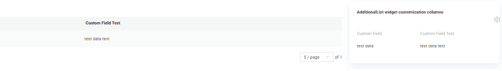
=== "Поменять колонки местами"
    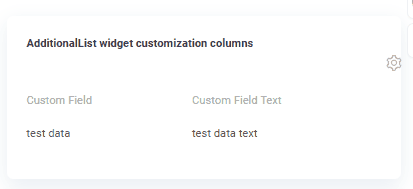
=== "Изначально скрытые"
    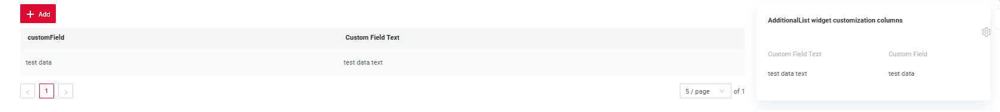

###### Как добавить? { #how-to-add_3 }
??? Example "Пример"
    === "Скрыть и поменять колонки местами"

        Добавьте в **options** параметр **additional** в соответствующий **.widget.json**.
            
        ```
        "additional": {
          "enabled": true
        }
        ```
        
        ```json
        --8<--
        {{ external_links.github_raw_doc }}/widgets/additionallist/customizationcolumns/MyExample3194Additional.widget.json
        --8<--
        ```
        
        [:material-play-circle: Живой пример]({{ external_links.code_samples }}/ui/#/screen/myexample3194){:target="_blank"} ·
        [:fontawesome-brands-github: GitHub]({{ external_links.github_ui }}/{{ external_links.github_branch }}/src/main/java/org/demo/documentation/widgets/additionallist/customizationcolumns){:target="_blank"}
        

    === "Изначально скрытые колонки"
        
        Также можно задать изначально скрытые колонки — они будут скрыты при открытии виджета.
        
        Добавьте в **options** параметр **additional** в соответствующий **.widget.json**.
        
        Добавьте в **options** параметр **fields** со списком скрытых полей в соответствующий **.widget.json**.
            
        ```
           "additional": {
              "fields": ["customFieldText"],
              "enabled": true
            }
        ```
        
        ```json
        --8<--
        {{ external_links.github_raw_doc }}/widgets/additionallist/customizationcolumns/MyExample3194AdditionalHidden.widget.json
        --8<--
        ```
        
        [:material-play-circle: Живой пример]({{ external_links.code_samples }}/ui/#/screen/myexample3194){:target="_blank"} ·
        [:fontawesome-brands-github: GitHub]({{ external_links.github_ui }}/{{ external_links.github_branch }}/src/main/java/org/demo/documentation/widgets/additionallist/customizationcolumns){:target="_blank"}

### Фильтрация { #filtration }
#### Основы { #basic_1 }
Работает только для режима **basic**

подробнее см. [Поля](/ru/widget/type/property/filtration/filtration/)

##### Как это выглядит? { #how-does-it-look_4 }
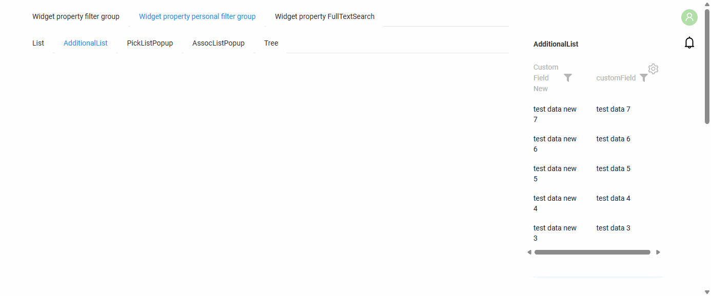

##### Как добавить? { #how-to-add_4 }
??? Example "Пример"
    `Шаг 1` Добавьте **@SearchParameter** в соответствующий **DataResponseDTO**.
    ```java
    --8<--
    {{ external_links.github_raw_doc }}/widgets/property/filtration/filtergroup/MyExample3616DTO.java
    --8<--
    ```

    `Шаг 2` Добавьте **fields.enableFilter** в соответствующий **FieldMetaBuilder**.
    ```java
    --8<--
    {{ external_links.github_raw_doc }}/widgets/property/filtration/filtergroup/MyExample3616Meta.java:buildIndependentMeta
    --8<--
    ```

    [:material-play-circle: Живой пример]({{ external_links.code_samples }}/ui/#/screen/myexample3616/view/myexample3616additionallist){:target="_blank"} ·
    [:fontawesome-brands-github: GitHub]({{ external_links.github_ui }}/{{ external_links.github_branch }}/src/main/java/org/demo/documentation/widgets/property/filtration/filtergroup){:target="_blank"}

#### Полнотекстовый поиск (FullTextSearch) { #fulltextsearch }
_неприменимо_
#### Персональная группа фильтров { #personal-filter-group }
Заполненный пользователем фильтр можно сохранить для каждого отдельного пользователя.
см. [Персональная группа фильтров](/ru/widget/type/property/filtration/filtration/#by-personal-filter-group)

##### Как это выглядит? { #how-does-it-look_5 }


##### Как добавить? { #how-to-add_5 }
??? Example "Пример"
    Доступность фильтрации зависит от типа поля. Подробнее см. [типы полей](/ru/widget/fields/fieldtypes/)

    Для полей, по которым нужно сохранять индивидуальные фильтры, обязательно настройте параметры фильтрации. См. `Шаг 1` и `Шаг 2`

    **Шаг 1** Добавьте **@SearchParameter** в соответствующий **DataResponseDTO**. (Расширенная настройка [SearchParameter](/ru/advancedCustomization/element/searchparameter/searchparameter))
    ```java
    --8<--
    {{ external_links.github_raw_doc }}/widgets/property/filtration/filtergroup/MyExample3616DTO.java
    --8<--
    ```

    **Шаг 2**  Добавьте **fields.enableFilter** в соответствующий **FieldMetaBuilder**.
    ```java
    --8<--
    {{ external_links.github_raw_doc }}/widgets/property/filtration/filtergroup/MyExample3616Meta.java:buildIndependentMeta
    --8<--
    ```

    **Шаг 3** Добавьте **filterSetting** в соответствующий **.widget.json**.

    `enabled` true/false

    ```json
    --8<--
    {{ external_links.github_raw_doc }}/widgets/property/filtration/filtergroup/MyExample3616AdditionalList.widget.json
    --8<--
    ```

    [:material-play-circle: Живой пример]({{ external_links.code_samples }}/ui/#/screen/myexample3616/view/myexample3616additionallist){:target="_blank"} ·
    [:fontawesome-brands-github: GitHub]({{ external_links.github_ui }}/{{ external_links.github_branch }}/src/main/java/org/demo/documentation/widgets/property/filtration/filtergroup){:target="_blank"}

#### Группа фильтров { #filter-group }
`Filter group` — предопределённые настройки фильтров, которые пользователи могут применять в приложении. Они позволяют быстро применить определённые критерии фильтрации без ручного ввода.
см. [Группа фильтров](/ru/widget/type/property/filtration/filtration/#by-filter-group)

##### Как это выглядит? { #how-does-it-look_6 }
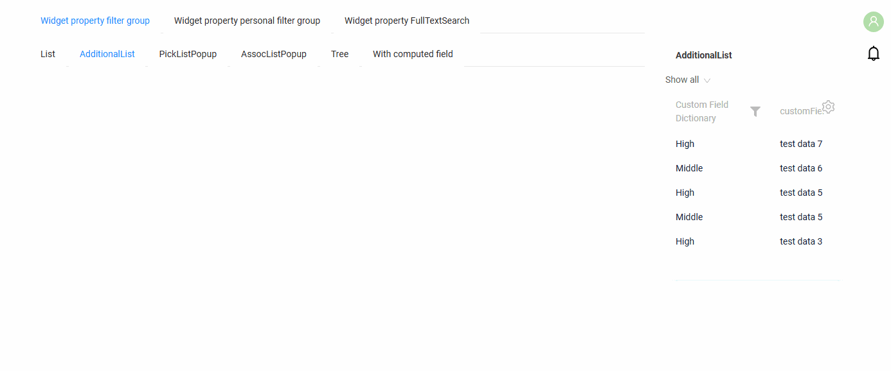

##### Как добавить? { #how-to-add_6 }
??? Example "Пример"
    !!! tips "Совет"
        Чтобы получить условия для колонки `filters`, выполните следующие шаги:

        * Добавьте функцию фильтрации для полей
        * Заполните нужные фильтры в интерфейсе.
        * Откройте панель разработчика.
        * Найдите нужный запрос.
        * Используйте часть этого запроса с фильтром как значение `filters`

        

    Добавьте бизнес-компонент в таблицу **BC_FILTER_GROUPS**

      `name` — имя предопределённого фильтра

      `BC` — имя бизнес-компонента

      `filters` — условия фильтрации

      ```csv
        name;bc;filters;ID
        Dictionary = High;myexample3618;customFieldDictionary.equalsOneOf=%5B%22High%22%5D;
      ```
    [:material-play-circle: Живой пример]({{ external_links.code_samples }}/ui/#/screen/myexample3616/view/myexample3618additionallist){:target="_blank"} ·
    [:fontawesome-brands-github: GitHub]({{ external_links.github_ui }}/{{ external_links.github_branch }}/src/main/java/org/demo/documentation/widgets/property/filtration/filtergroupsave){:target="_blank"}

### Пагинация { #pagination }
_неприменимо_
### Экспорт в Excel { #export-to-excel }
Работает только для режима **basic**

`Export to Excel` позволяет пользователям скачать файл .xlsx с данными таблицы.
см. [Excel](/ru/widget/type/property/export/excel/excel)

