# AssocListPopup

Виджет `AssocListPopup` — всплывающий компонент для выбора нескольких значений.
## Основы { #basics }
[:material-play-circle: Живой пример]({{ external_links.code_samples }}/ui/#/screen/myexample3053){:target="_blank"} ·
[:fontawesome-brands-github: GitHub]({{ external_links.github_ui }}/{{ external_links.github_branch }}/src/main/java/org/demo/documentation/widgets/assoc/base){:target="_blank"}
### Как это выглядит? { #how-does-it-look }
=== "Поле виджета Assoc"
    === "List"
        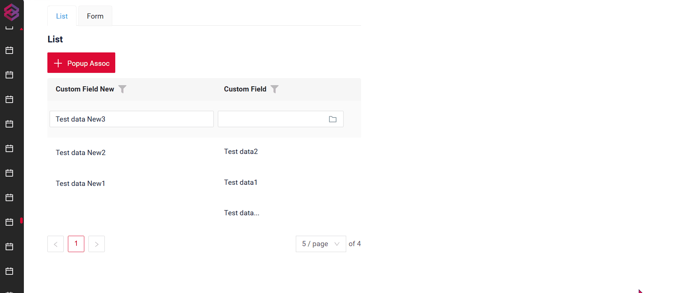
    === "Info"
        _неприменимо_
    === "Form"
        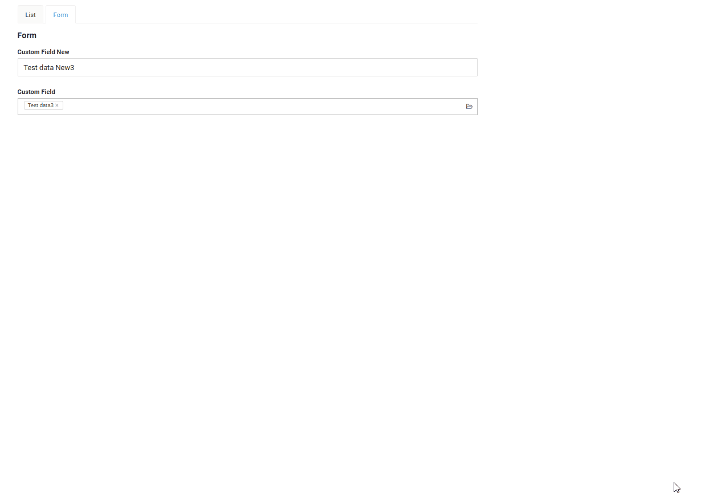
=== "Кнопка виджета Assoc"
    === "List"
        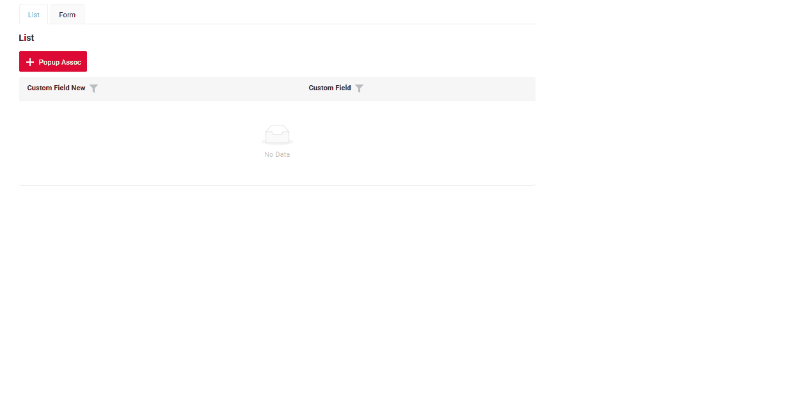
    === "Info"
        _неприменимо_
    === "Form"
        _неприменимо_

!!! info

    Связывание через кнопку отличается от связывания через поле MultiValue следующим:
    
    Ранее выбранные записи не отображаются.
    
    Записи, выбранные пользователем в открытом окне связывания, также не отображаются в виде выбранных чипов.
    
    Так происходит потому, что связывание через кнопку не привязано напрямую. Оно предназначено для добавления записей в таблицу.
    
    Рекомендация
    Если вы планируете использовать связывание через кнопку, необходимо добавить фильтрацию в открываемое окно, чтобы исключить записи, которые уже выбраны и добавлены в таблицу.

**Выбор значения:**

=== "Поле виджета Assoc "
    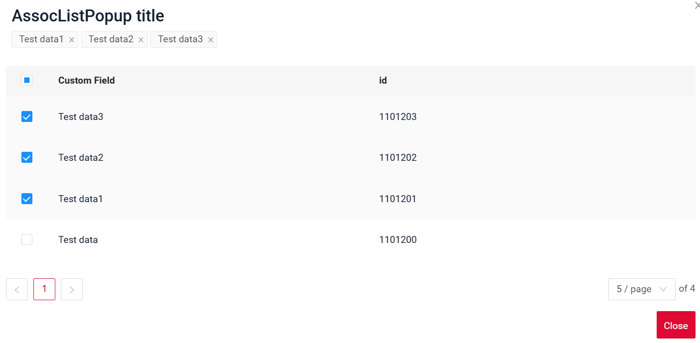
=== "Кнопка виджета Assoc"
    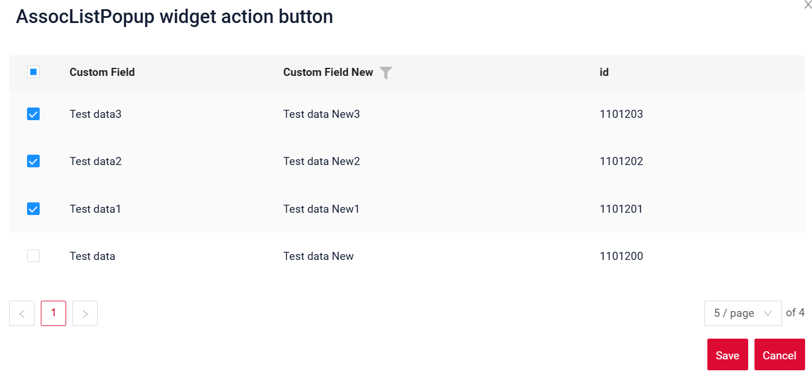


**Открытие виджета:**

=== "Поле виджета Assoc "
    
=== "Кнопка виджета Assoc"
    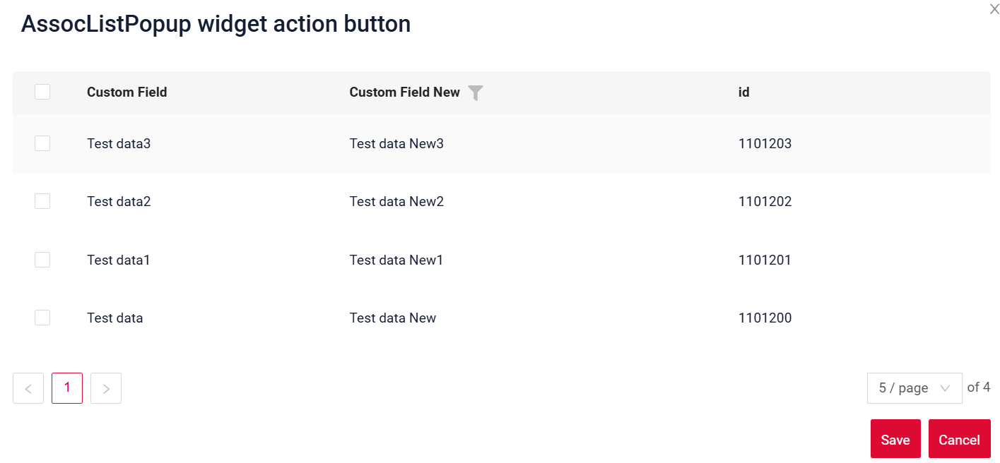

###  <a id="Howtoaddbacis">Как добавить?</a>
??? Example "Пример"
    === "Поле виджета Assoc"
        === "List"
            **Шаг 1** Добавьте поле с типом **multivalue**, подробнее см. [Поля](#fields)

            ```json
            --8<--
            {{ external_links.github_raw_doc }}/widgets/assoc/base/MyExample3053List.widget.json
            --8<--
            ```
       
            **Шаг 2** Добавьте виджет в соответствующий **_.view.json_**.
        
            ```json
            --8<--
            {{ external_links.github_raw_doc }}/widgets/assoc/base/myexample3053list.view.json
            --8<--
            ```
        === "Info"
            _неприменимо_

        === "Form"
            **Шаг 1** Добавьте поле с типом **multivalue**, подробнее см. [Поля](#fields)

            ```json
            --8<--
            {{ external_links.github_raw_doc }}/widgets/assoc/base/MyExample3053Form.widget.json
            --8<--
            ```
       
            **Шаг 2** Добавьте виджет в соответствующий **_.view.json_**.
        
            ```json
            --8<--
            {{ external_links.github_raw_doc }}/widgets/assoc/base/myexample3053form.view.json
            --8<--
            ```
    === "Кнопка виджета Assoc"
        === "List"
            **Шаг 1** Добавьте кнопку `associate` в соответствующий **VersionAwareResponseService**.
            ```java
            --8<--
            {{ external_links.github_raw_doc }}/widgets/assoc/base/MyExample3053Service.java:getActions
            --8<--
            ```
            **Шаг 2** Добавьте метод `doAssociate` в соответствующий **VersionAwareResponseService**.

            `associate`

            ```java
            --8<--
            {{ external_links.github_raw_doc }}/widgets/assoc/base/MyExample3053Service.java:doAssociate
            --8<--
            ```
            метод `addNewRecords`
            ```java
            --8<--
            {{ external_links.github_raw_doc }}/widgets/assoc/base/MyExample3053Service.java:addNewRecords
            --8<--
            ```

            **Шаг 3** Создайте файл **_.widget.json_** с type = **"assoc"** и name = родительский bc + "Assoc"

            Добавьте существующее поле в виджет assoc. Подробнее см. [Поля](#fields)

            ```json
            --8<--
            {{ external_links.github_raw_doc }}/widgets/assoc/base/myexample3053Assoc.widget.json
            --8<--
            ```
            **Шаг 4** Добавьте зависимость Assoc BC от родительского BC в соответствующий **EnumBcIdentifier**
        
             ```java
             --8<--
             {{ external_links.github_raw_doc }}/widgets/assoc/base/CxboxMyExample3053Controller.java
             --8<--
             ```

             **Шаг 5** Добавьте виджет assoc в соответствующий **_.view.json_**.
        
            ```json
            --8<--
            {{ external_links.github_raw_doc }}/widgets/assoc/base/myexample3053list.view.json
            --8<--
            ```
 
        === "Info"
              _неприменимо_

        === "Form"
              _неприменимо_


## <a id="Title">Заголовок</a>
[:material-play-circle: Живой пример]({{ external_links.code_samples }}/ui/#/screen/myexample3090){:target="_blank"} ·
[:fontawesome-brands-github: GitHub]({{ external_links.github_ui }}/{{ external_links.github_branch }}/src/main/java/org/demo/documentation/widgets/assoc/title){:target="_blank"}

### Базовый заголовок { #title-basic }
`Title` для виджета (необязательно)

Типы:

* `постоянный заголовок`: показывает постоянный текст.
* `пустой постоянный заголовок`: если нужно визуально связать виджеты, расположив их один под другим

#### Как это выглядит? { #how-does-it-look_1 }
=== "Постоянный заголовок"
    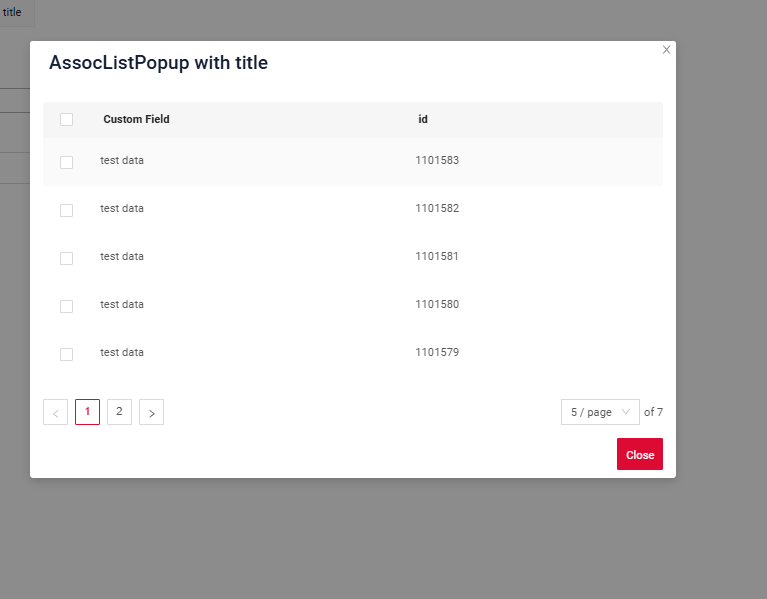
=== "Пустой постоянный заголовок"
    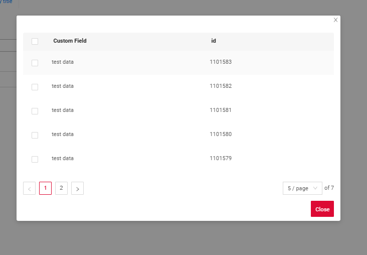

#### Как добавить? { #how-to-add }
??? Example "Пример"
    === "Постоянный заголовок"
        **Шаг 1** Добавьте название в **title** в **_.widget.json_**.
        ```json
        --8<--
        {{ external_links.github_raw_doc }}/widgets/assoc/title/myEntity3090MultiPickAssocListPopup.widget.json
        --8<--
        ```
        [:material-play-circle: Живой пример]({{ external_links.code_samples }}/ui/#/screen/myexample3090){:target="_blank"} ·
        [:fontawesome-brands-github: GitHub]({{ external_links.github_ui }}/{{ external_links.github_branch }}/src/main/java/org/demo/documentation/widgets/assoc/title){:target="_blank"}

    === "Пустой постоянный заголовок"
    
        **Шаг 1** Удалите параметр **title** из **_.widget.json_**.
        ```json
        --8<--
        {{ external_links.github_raw_doc }}/widgets/assoc/title/myEntity3090MultiPickAssocEmptyListPopup.widget.json
        --8<--
        ```
    
        [:material-play-circle: Живой пример]({{ external_links.code_samples }}/ui/#/screen/myexample3090/view/myexample3090emptytitle){:target="_blank"} ·
        [:fontawesome-brands-github: GitHub]({{ external_links.github_ui }}/{{ external_links.github_branch }}/src/main/java/org/demo/documentation/widgets/assoc/title){:target="_blank"}
    

### Цвет заголовка { #title-color }
`Title Color` позволяет задать цвет заголовка. Он может быть постоянным или вычисляемым.

**Постоянный цвет**

[:material-play-circle: Живой пример]({{ external_links.code_samples }}/ui/#/screen/myexample3052/view/myexample3056colorconst){:target="_blank"} ·
[:fontawesome-brands-github: GitHub]({{ external_links.github_ui }}/{{ external_links.github_branch }}/src/main/java/org/demo/documentation/widgets/assoc/colortitle){:target="_blank"}

*Постоянный цвет* — фиксированный цвет, который не меняется. Он остаётся одинаковым независимо от каких-либо факторов в приложении.

**Вычисляемый цвет**

[:material-play-circle: Живой пример]({{ external_links.code_samples }}/ui/#/screen/myexample3052/view/myexample3056color){:target="_blank"} ·
[:fontawesome-brands-github: GitHub]({{ external_links.github_ui }}/{{ external_links.github_branch }}/src/main/java/org/demo/documentation/widgets/assoc/colortitle){:target="_blank"}

*Вычисляемый цвет* можно использовать для динамического изменения цвета заголовка. Он меняется в зависимости от бизнес-логики или данных приложения.

!!! info
    Цветовое выделение заголовка **применимо** к следующим [полям](/ru/widget/fields/fieldtypes/): date, dateTime, dateTimeWithSeconds, number, money, percent, time, input, text, dictionary, radio, checkbox, pickList, inlinePickList, multivalue, multivalueHover.

##### Как это выглядит? { #how-does-it-look_2 }
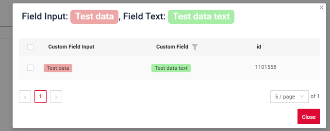

##### Как добавить? { #how-to-add_1 }
??? Example "Пример"
    === "Вычисляемый цвет"

        **Шаг 1**   Добавьте `собственное поле для цвета` в соответствующий **DataResponseDTO**. Поле может содержать цвет в формате HEX или быть null.
        ```java
        --8<--
        {{ external_links.github_raw_doc }}/widgets/assoc/colortitle/color/MyEntity3056MultiPickDTO.java
        --8<--
        ```  
 
        **Шаг 2** Добавьте **"bgColorKey"** :  `собственное поле для цвета` в .widget.json.

        Добавьте в `title` поле с `${customField}`

        ```json
        --8<--
        {{ external_links.github_raw_doc }}/widgets/assoc/colortitle/color/myEntity3056MultiPickAssocListPopup.widget.json
        --8<--
        ``` 

        [:material-play-circle: Живой пример]({{ external_links.code_samples }}/ui/#/screen/myexample3052/view/myexample3056color){:target="_blank"} ·
        [:fontawesome-brands-github: GitHub]({{ external_links.github_ui }}/{{ external_links.github_branch }}/src/main/java/org/demo/documentation/widgets/assoc/colortitle/color){:target="_blank"}

    === "Постоянный цвет"
 
        Добавьте **"bgColor"** :  `цвет HEX` в .widget.json.

        Добавьте в `title` поле с `${customField}`

        ```json
        --8<--
        {{ external_links.github_raw_doc }}/widgets/assoc/colortitle/colorconst/myEntity3056MultiPickAssocListPopup0.widget.json
        --8<--
        ```
 
        [:material-play-circle: Живой пример]({{ external_links.code_samples }}/ui/#/screen/myexample3052/view/myexample3056colorconst){:target="_blank"} ·
        [:fontawesome-brands-github: GitHub]({{ external_links.github_ui }}/{{ external_links.github_branch }}/src/main/java/org/demo/documentation/widgets/assoc/colortitle/colorconst){:target="_blank"}
 
## <a id="bc">Бизнес-компонент</a>
Указывает бизнес-компонент (BC), к которому относится эта форма.
Бизнес-компонент представляет определённую часть системы, отвечающую за конкретную бизнес-логику или данные.

подробнее см. [Бизнес-компонент](/ru/environment/businesscomponent/businesscomponent/)

## <a id="Showcondition">Условие отображения</a>
  

## <a id="fields">Поля</a>
Настройка полей. Массив fields определяет отдельные поля формы.

```json
{
    "title": "Custom Field",
    "key": "customField",
    "type": "input"
}
```

* **"title"**

  Описание: заголовок поля.

  Тип: String (необязательно).

* **"key"**

  Описание: имя поля в соответствующем DataResponseDTO.

  Тип: String (обязательно).

* **"type"**

  Описание: [Типы полей](/ru/widget/fields/fieldtypes/)

  Тип: String (обязательно).


### Как добавить? { #how-to-add_2 }
??? Example "Пример"

    === "С плагином (рекомендуется)"
        **Шаг 1** Скачайте плагин
            [скачать плагин для IntelliJ](https://doc.cxbox.org/ru/plugin/plugininstalling)
    
        **Шаг 2** Добавьте существующее поле в существующий виджет формы
            
    === "Пример написания кода"
        Добавьте поле в **_.widget.json_**.

          ```json
             --8<--
             {{ external_links.github_raw_doc }}/widgets/assoc/base/myEntity3053MultiAssocListPopup.widget.json
             --8<--
          ```

## <a id="Fieldslayout">Компоновка (options layout)</a>
**options.layout** — в этом типе не используется.

## Действия { #actions }
`Actions` отображают доступные действия в виде отдельных кнопок, подробнее см. [Действия](/ru/features/element/actions/actions).

**Стандартные действия**:

* [`Create`](#standart_create): действие, запускающее создание новой записи
* [`Delete`](#standart_delete): удаление существующей записи
* [`Edit`](#standart_edit): обновление или исправление информации пользователем
* [`Save`](#standart_save): сохранение введённых или изменённых данных
* [`Cancel-create`](#standart_cancel_create): отмена создания новой записи без сохранения введённых данных

Для виджета assoc есть несколько действий.
#### Создание { #create }
Кнопка `Create` позволяет создать новое значение нажатием кнопки `Add`. Это действие можно выполнить тремя разными способами — выбирайте любой в зависимости от логики приложения:

Есть три способа создать запись:

* [Inline](#createinline): строку можно добавить напрямую.

!!! info
    Пагинация не сработает, пока страница не будет обновлена после добавления записей.

* [Inline-form](#withwidget): данные можно добавить с помощью виджета формы, не покидая текущий view.

* [With view](#withview): неприменимо.

##### <a id="createinline">Inline</a>
[:material-play-circle: Живой пример]({{ external_links.code_samples }}/ui/#/screen/myexample3054/view/myexample3054create){:target="_blank"} ·
[:fontawesome-brands-github: GitHub]({{ external_links.github_ui }}/{{ external_links.github_branch }}/src/main/java/org/demo/documentation/widgets/assoc/actions/create){:target="_blank"}

При `Line Addition` по нажатию кнопки "Add" вверху виджета assoc сразу добавляется новая пустая строка. Это быстрый способ добавлять строки без предварительного ввода данных.
###### Как это выглядит? { #how-does-it-look_3 }
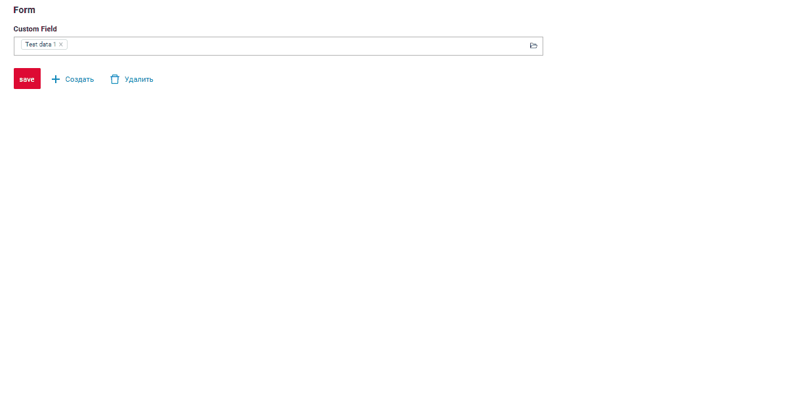

###### Как добавить? { #how-to-add_3 }
??? Example "Пример"

    **Шаг 1** Добавьте кнопку `create` в соответствующий **VersionAwareResponseService**.
    ```java
    --8<--
    {{ external_links.github_raw_doc }}/widgets/assoc/actions/MyEntity3054MultiMultivalueService.java:getActions
    --8<--
    ```
 
    **Шаг 2** Добавьте кнопку `create` в соответствующий **.widget.json**.
    ```json
    --8<--
    {{ external_links.github_raw_doc }}/widgets/assoc/actions/create/myEntity3054MultiAssocListPopupCreateAssocListPopup.widget.json
    --8<--
    ```

    **Шаг 3** Добавьте **fields.setEnabled** в соответствующий **FieldMetaBuilder**.
    ```java
    --8<--
    {{ external_links.github_raw_doc }}/widgets/assoc/actions/MyEntity3054MultiMultivalueMeta.java:buildRowDependentMeta
    --8<--
    ``` 
    [:material-play-circle: Живой пример]({{ external_links.code_samples }}/ui/#/screen/myexample3054/view/myexample3054create){:target="_blank"} ·
    [:fontawesome-brands-github: GitHub]({{ external_links.github_ui }}/{{ external_links.github_branch }}/src/main/java/org/demo/documentation/widgets/assoc/actions/create){:target="_blank"}

##### <a id="withwidget">Inline-form</a>
[:material-play-circle: Живой пример]({{ external_links.code_samples }}/ui/#/screen/myexample3054/view/myexample3054inlinecreate){:target="_blank"} ·
[:fontawesome-brands-github: GitHub]({{ external_links.github_ui }}/{{ external_links.github_branch }}/src/main/java/org/demo/documentation/widgets/assoc/actions/create){:target="_blank"}

`Create with widget` открывает дополнительный виджет при нажатии кнопки "Add". Форма появляется на том же экране, поэтому видны и список сущностей assoc, и форма добавления новой строки.
После заполнения информации и нажатия "Save" новая строка добавляется в assoc.
###### Как это выглядит? { #how-does-it-look_4 }


###### Как добавить? { #how-to-add_4 }
??? Example "Пример"

    **Шаг 1** Добавьте кнопку `create` в соответствующий **VersionAwareResponseService**.
    ```java
    --8<--
    {{ external_links.github_raw_doc }}/widgets/assoc/actions/MyEntity3054MultiMultivalueService.java:getActions
    --8<--
    ```
    **Шаг 2** Добавьте **fields.setEnabled** в соответствующий **FieldMetaBuilder**.
    ```java
    --8<--
    {{ external_links.github_raw_doc }}/widgets/assoc/actions/MyEntity3054MultiMultivalueMeta.java:buildRowDependentMeta
    --8<--
    ```
     **Шаг 3** Создайте widget.json с типом `Form`, который появляется при нажатии кнопки
    ```json
    --8<--
    {{ external_links.github_raw_doc }}/widgets/assoc/actions/myEntity3054MultiFormForPopup2.widget.json
    --8<--
    ```
 
     **Шаг 4** Добавьте widget.json с типом `Form` в соответствующий **.view.json**.
    ```json
    --8<--
    {{ external_links.github_raw_doc }}/widgets/assoc/actions/create/myexample3054inlinecreate.view.json
    --8<--
    ```

     **Шаг 5** Добавьте кнопку `create` и виджет с типом `Form` в соответствующий **.widget.json**.
       
    `options`.`create`: имя виджета, который появляется при нажатии кнопки
        
    ```json
    --8<--
    {{ external_links.github_raw_doc }}/widgets/assoc/actions/create/myEntity3054MultiAssocListPopup.widget.json
    --8<--
    ```
 
    [:material-play-circle: Живой пример]({{ external_links.code_samples }}/ui/#/screen/myexample3054/view/myexample3054inlinecreate){:target="_blank"} ·
    [:fontawesome-brands-github: GitHub]({{ external_links.github_ui }}/{{ external_links.github_branch }}/src/main/java/org/demo/documentation/widgets/assoc/actions/create){:target="_blank"}

##### <a id="withview">With view</a>
_неприменимо_


#### **<a id="standart_delete">Delete</a>**
[:material-play-circle: Живой пример]({{ external_links.code_samples }}/ui/#/screen/myexample3054/view/myexample3054delete){:target="_blank"} ·
[:fontawesome-brands-github: GitHub]({{ external_links.github_ui }}/{{ external_links.github_branch }}/src/main/java/org/demo/documentation/widgets/assoc/actions/delete){:target="_blank"}

`Delete` удаляет существующую запись.

!!! tips "Совет"
    Учтите, что на удаляемую строку может ссылаться другая часть системы или родительская сущность. Для ясности обработайте это исключение и покажите пользователю объяснение.

###### Как это выглядит? { #how-does-it-look_5 }
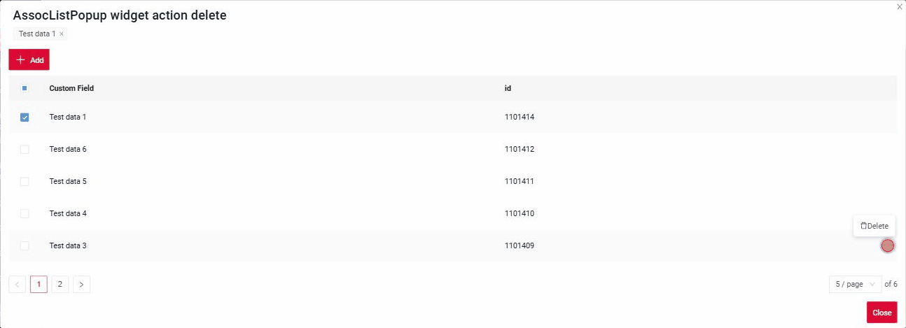

###### Как добавить? { #how-to-add_5 }
??? Example "Пример"

    **Шаг 1** Добавьте действие *delete* в соответствующий **VersionAwareResponseService**.

    По умолчанию кнопка доступна, когда запись существует.

    ```java
    --8<--
    {{ external_links.github_raw_doc }}/widgets/assoc/actions/MyExample3054Service.java:getActions
    --8<--
    ```  
 
    **Шаг 2** Добавьте кнопку или группу кнопок в соответствующий **.widget.json**.
   
    ```json
    --8<--
    {{ external_links.github_raw_doc }}/widgets/assoc/actions/delete/myEntity3054MultiAssocDeleteListPopup.widget.json
    --8<--
    ``` 
    [:material-play-circle: Живой пример]({{ external_links.code_samples }}/ui/#/screen/myexample3054/view/myexample3054delete){:target="_blank"} ·
    [:fontawesome-brands-github: GitHub]({{ external_links.github_ui }}/{{ external_links.github_branch }}/src/main/java/org/demo/documentation/widgets/assoc/actions/delete){:target="_blank"}

#### Редактирование { #edit }
`Edit` позволяет изменить значение поля. Как и для кнопки `Create`, это действие можно реализовать тремя способами.

Есть три способа создать запись:

* [Inline edit](#editline): строку можно редактировать напрямую.

* [Inline-form](#editwithwidget): данные можно редактировать с помощью виджета формы, не покидая текущий view.

* [With view](#editwithview): неприменимо

##### <a id="editline">Inline-редактирование </a>
[:material-play-circle: Живой пример]({{ external_links.code_samples }}/ui/#/screen/myexample3054/view/myexample3054edit){:target="_blank"} ·
[:fontawesome-brands-github: GitHub]({{ external_links.github_ui }}/{{ external_links.github_branch }}/src/main/java/org/demo/documentation/widgets/assoc/actions/edit){:target="_blank"}


`Edit Inline` означает inline-редактирование. Дважды щёлкните по значению, которое нужно изменить.
###### Как это выглядит? { #how-does-it-look_6 }
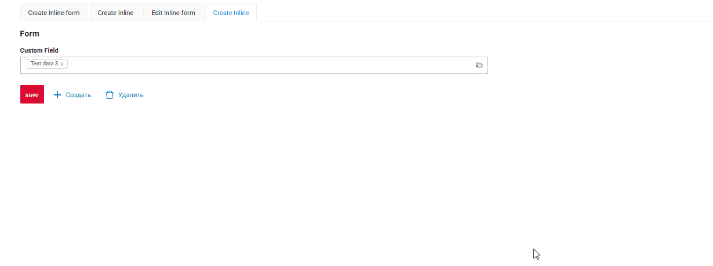

###### Как добавить? { #how-to-add_6 }
??? Example "Пример"

    **Шаг 1** Добавьте **fields.setEnabled** в соответствующий **FieldMetaBuilder**.
    ```java
    --8<--
    {{ external_links.github_raw_doc }}/widgets/assoc/actions/MyEntity3054MultiMultivalueMeta.java:buildRowDependentMeta
    --8<--
    ```
 
    [:material-play-circle: Живой пример]({{ external_links.code_samples }}/ui/#/screen/myexample3054/view/myexample3054edit){:target="_blank"} ·
    [:fontawesome-brands-github: GitHub]({{ external_links.github_ui }}/{{ external_links.github_branch }}/src/main/java/org/demo/documentation/widgets/assoc/actions/edit){:target="_blank"}

##### <a id="editwithwidget">Inline-form</a>
[:material-play-circle: Живой пример]({{ external_links.code_samples }}/ui/#/screen/myexample3054/view/myexample3054editinlineform){:target="_blank"} ·
[:fontawesome-brands-github: GitHub]({{ external_links.github_ui }}/{{ external_links.github_branch }}/src/main/java/org/demo/documentation/widgets/assoc/actions/edit){:target="_blank"}

`Edit with widget` открывает дополнительный виджет при нажатии на иконку редактирования в строке.

###### Как это выглядит? { #how-does-it-look_7 }
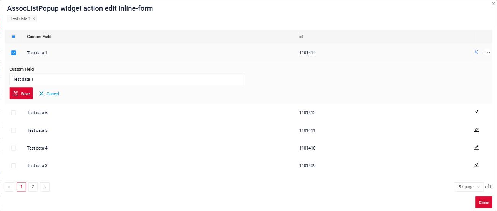

###### Как добавить? { #how-to-add_7 }
??? Example "Пример"

    **Шаг 1** Добавьте действие `save` в соответствующий **VersionAwareResponseService**: с его помощью форма сохраняет запись.
    ```java
    --8<--
    {{ external_links.github_raw_doc }}/widgets/assoc/actions/MyEntity3054MultiMultivalueService.java:getActions
    --8<--
    ```

    **Шаг 2** Добавьте **fields.setEnabled** в соответствующий **FieldMetaBuilder**.
    ```java
    --8<--
    {{ external_links.github_raw_doc }}/widgets/assoc/actions/MyEntity3054MultiMultivalueMeta.java:buildRowDependentMeta
    --8<--
    ```

    **Шаг 3** Создайте widget.json с типом `Form`, который появляется при нажатии на иконку редактирования.
    ```json
    --8<--
    {{ external_links.github_raw_doc }}/widgets/assoc/actions/myEntity3054MultiFormForPopup.widget.json
    --8<--
    ```

    **Шаг 4** Добавьте widget.json с типом `Form` в соответствующий **.view.json**.
    ```json
    --8<--
    {{ external_links.github_raw_doc }}/widgets/assoc/actions/edit/myexample3054editinlineform.view.json
    --8<--
    ```

    **Шаг 5** Добавьте виджет с типом `Form` в **options**.**edit**.**widget** соответствующего **.widget.json**: в каждой строке появится иконка редактирования.
    ```json
    --8<--
    {{ external_links.github_raw_doc }}/widgets/assoc/actions/edit/myEntity3054MultiAssocListPopupEditInlineForm.widget.json
    --8<--
    ```

    [:material-play-circle: Живой пример]({{ external_links.code_samples }}/ui/#/screen/myexample3054/view/myexample3054editinlineform){:target="_blank"} ·
    [:fontawesome-brands-github: GitHub]({{ external_links.github_ui }}/{{ external_links.github_branch }}/src/main/java/org/demo/documentation/widgets/assoc/actions/edit){:target="_blank"}

##### <a id="editwithview">With view</a>
неприменимо

### Дополнительные свойства { #additional-properties }
#### Настройка отображаемых колонок { #customization-of-displayed-columns }
неприменимо
#### Фильтрация { #filtration }
##### Основы { #basic }
подробнее см. [Поля](/ru/widget/type/property/filtration/filtration/)

###### Как это выглядит? { #how-does-it-look_8 }
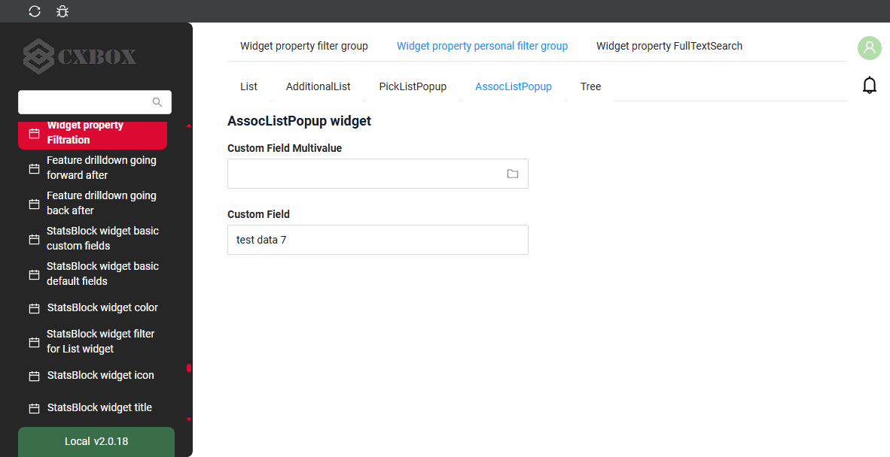

###### Как добавить? { #how-to-add_8 }
??? Example "Пример"
    Шаги выполняются для бизнес-компонента всплывающего окна.

    `Шаг 1` Добавьте **@SearchParameter** в соответствующий **DataResponseDTO**.
    ```java
    --8<--
    {{ external_links.github_raw_doc }}/widgets/property/filtration/filtergroup/MyExample3616DTO.java
    --8<--
    ```

    `Шаг 2` Добавьте **fields.enableFilter** в соответствующий **FieldMetaBuilder**.
    ```java
    --8<--
    {{ external_links.github_raw_doc }}/widgets/property/filtration/filtergroup/MyExample3616Meta.java:buildIndependentMeta
    --8<--
    ```

    [:material-play-circle: Живой пример]({{ external_links.code_samples }}/ui/#/screen/myexample3616/view/myexample3616assoc){:target="_blank"} ·
    [:fontawesome-brands-github: GitHub]({{ external_links.github_ui }}/{{ external_links.github_branch }}/src/main/java/org/demo/documentation/widgets/property/filtration/filtergroup/forassoc){:target="_blank"}

##### FullTextSearch
`FullTextSearch` — когда пользователь вводит текст в поле полнотекстового поиска, виджет фильтрует строки, соответствующие запросу.
см. [FullTextSearch](/ru/widget/type/property/filtration/filtration/#by-fulltextsearch)

###### Как это выглядит? { #how-does-it-look_9 }
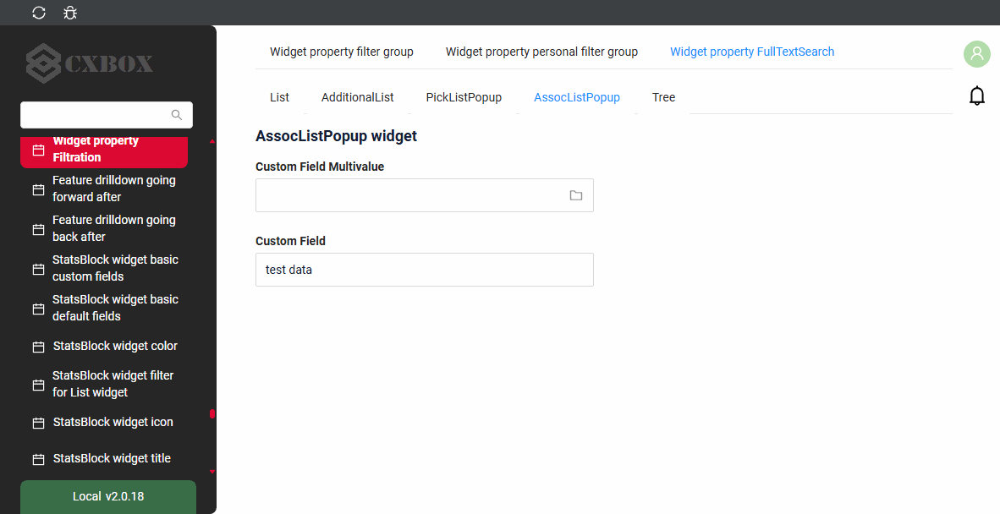

###### Как добавить? { #how-to-add_9 }
??? Example "Пример"
    `Шаг 1` Добавьте файл расширения FullTextSearchExt.java
    ```java
    import java.util.Optional;
    import jakarta.persistence.criteria.CriteriaBuilder;
    import jakarta.persistence.criteria.Path;
    import jakarta.persistence.criteria.Predicate;
    import lombok.NonNull;
    import lombok.experimental.UtilityClass;
    import org.apache.commons.lang3.StringUtils;
    import org.cxbox.core.crudma.bc.BusinessComponent;

    @UtilityClass
    public class FullTextSearchExt {

        @NonNull
        public static Optional<String> getFullTextSearchFilterParam(BusinessComponent bc) {
            return Optional.ofNullable(bc.getParameters().getParameter("_fullTextSearch"));
        }

        public static Predicate likeIgnoreCase(String value, CriteriaBuilder cb, Path<String> path) {
            return cb.like(cb.lower(path), StringUtils.lowerCase("%" + value + "%"));
        }

    }
    ```

    `Шаг 2` Добавьте **specifications** для полей полнотекстового поиска в соответствующий **JpaRepository**.
    ```java
    --8<--
    {{ external_links.github_raw_doc }}/widgets/property/filtration/fulltextsearch/forassoc/MyEntity3625Repository.java
    --8<--
    ```

    `Шаг 3` Добавьте **getSpecification** в соответствующий **VersionAwareResponseService**.
    ```java
    --8<--
    {{ external_links.github_raw_doc }}/widgets/property/filtration/fulltextsearch/forassoc/MyEntity3625PickService.java:getSpecification
    --8<--
    ```

    `Шаг 4` Добавьте **fullTextSearch** в соответствующий **.widget.json**.

    `enabled` true/false

    `placeholder` — описание для fullTextSearch

    ```json
    --8<--
    {{ external_links.github_raw_doc }}/widgets/property/filtration/fulltextsearch/forassoc/myEntity3625PickAssocListPopup.widget.json
    --8<--
    ```

    [:material-play-circle: Живой пример]({{ external_links.code_samples }}/ui/#/screen/myexample3616/view/myexample3614assoclistpopup){:target="_blank"} ·
    [:fontawesome-brands-github: GitHub]({{ external_links.github_ui }}/{{ external_links.github_branch }}/src/main/java/org/demo/documentation/widgets/property/filtration/fulltextsearch/forassoc){:target="_blank"}

##### Персональная группа фильтров { #personal-filter-group }
неприменимо
##### Группа фильтров { #filter-group }
неприменимо
#### Пагинация { #pagination }
`Pagination` — разбиение содержимого на отдельные страницы, упрощающее навигацию и работу с большими объёмами информации.
см. [Пагинация](/ru/widget/type/property/pagination/pagination)

#### Экспорт в Excel { #export-to-excel }
неприменимо
