# AssocTreePopup

Доступно начиная с [v3.0.1](/ru/new/version3001/)

Виджет `AssocTreePopup` — всплывающий компонент для выбора нескольких значений.

!!! info
    В этом релизе для виджета `AssocTreePopup` **недоступны** следующие возможности:

    * полностью или частично раскрытая начальная загрузка (дерево всегда открывается свёрнутым)


## Основы { #basics }
[:material-play-circle: Живой пример]({{ external_links.code_samples }}/ui/#/screen/myexample3330){:target="_blank"} ·
[:fontawesome-brands-github: GitHub]({{ external_links.github_ui }}/{{ external_links.github_branch }}/src/main/java/org/demo/documentation/widgets/assoctree/base){:target="_blank"}

Всплывающее окно показывает записи в виде дерева: к бизнес-компоненту всплывающего окна применяются требования [виджета Tree](/ru/widget/type/tree/tree/#basics).

Минимальный набор данных записи всплывающего окна:

* `id` — идентификатор записи.
* `parentId` — идентификатор родительской записи. Для корневой записи значение `null`.
  Бэкенд должен **всегда** возвращать это поле, и поле должно быть **фильтруемым**, так как дерево строится запросами `parentId.specified=false` (корневые записи) и `parentId.equals=<id>` (дочерние записи). Подробнее см. [Ленивая загрузка](#lazyload)
* поле названия (title) — значение, отображаемое в колонке дерева.
* `isLeaf` — вычисляемый логический флаг. Значение по умолчанию `false`. Значение `true` означает, что у записи нет дочерних записей, поэтому стрелка раскрытия для неё не отображается.

!!! info
    **Первое** поле массива `fields` отображается как колонка дерева: стрелка раскрытия и флажок. Все остальные поля отображаются как обычные колонки.

    `parentId` и `isLeaf` — служебные поля: они объявляются в виджете всплывающего окна с типом **hidden**.

**<a id="optionstree">options.tree</a>**

Все настройки, специфичные для дерева, размещаются в **options**.**tree** файла **_.widget.json_**.

??? Example "Пример"

    | Свойство                 | Тип                                             | По умолчанию             | Описание                                                                                                          |
    |--------------------------|-------------------------------------------------|--------------------------|-------------------------------------------------------------------------------------------------------------------|
    | `parentIdFieldKey`       | String                                          | `parentId`               | Имя поля с идентификатором родительской записи.                                                                     |
    | `isLeafFieldKey`         | String                                          | `isLeaf`                 | Имя поля с флагом «у записи нет дочерних записей».                                                                   |
    | `searchModes`            | Массив из `collapse`, `hide`                    | `["collapse", "hide"]`   | Режимы отображения результата фильтрации. Первый элемент массива — активный. см. [Режимы поиска](#searchmodes) |
    | `onFilterApplyNestLevel` | Number                                          | `0`                      | Сколько уровней пути навигации показывается над найденной записью в режиме `collapse`. см. [Режимы поиска](#searchmodes) |
    | `insertPosition`         | `start`, `end`                                  | —                        | Куда внутри узла вставляется новая строка. см. [Создание](#createinline)                                            |
    | `selection`              | `node`, `nodeAndLeaf`, `leaf`                   | —                        | Что пользователю разрешено отмечать. см. [Режимы выбора](#selectionmodes) |
    | `confirms`               | Массив из `paginationUnselect`, `paginationSelect` | `["paginationUnselect"]` | Подтверждения, отображаемые, когда выбор затрагивает узел, записи которого загружены не полностью. см. [Режимы выбора](#selectionmodes) |

**<a id="lazyload">Ленивая загрузка</a>**

Дерево всегда загружается **лениво** и всегда открывается **свёрнутым**: при открытии всплывающего окна запрашиваются только корневые записи, а дочерние записи узла — когда пользователь его раскрывает.

!!! info
    Операция `specified` используется **только** для выбора записей с пустым родителем. Для всех остальных запросов используется операция `equals`.
    Поэтому поле с идентификатором родителя должно быть фильтруемым на бэкенде.

Каждый узел хранит **собственное состояние пагинации**, поэтому записи одного узла загружаются постранично независимо от соседних узлов. Подробнее см. [Пагинация](#pagination)

??? Example "Пример"
    * **Корневые записи** запрашиваются с фильтром по пустому родителю:

    ```
    ?parentId.specified=false&_page=1&_limit=5
    ```

    * **Дочерние записи** узла запрашиваются при раскрытии узла:

    ```
    ?parentId.equals=<id>&_page=1&_limit=5
    ```

### Как это выглядит? { #how-does-it-look }
=== "Поле виджета Assoc"
    === "List"
        
    === "Info"
        _неприменимо_
    === "Form"
        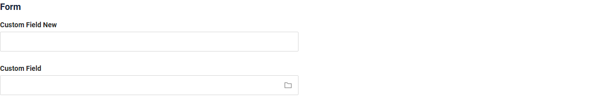
=== "Кнопка виджета Assoc"
    === "List"
        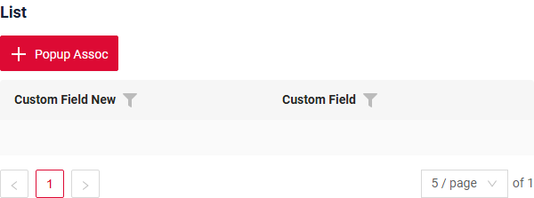
    === "Info"
        _неприменимо_
    === "Form"
        _неприменимо_

!!! info

    Связывание через кнопку отличается от связывания через поле MultiValue следующим:
    
    Ранее выбранные записи не отображаются.
    
    Записи, выбранные пользователем в открытом окне связывания, также не отображаются в виде выбранных чипов.
    
    Так происходит потому, что связывание через кнопку не привязано напрямую. Оно предназначено для добавления записей в таблицу.
    
    Рекомендация
    Если вы планируете использовать связывание через кнопку, необходимо добавить фильтрацию в открываемое окно, чтобы исключить записи, которые уже выбраны и добавлены в таблицу.

**Выбор значения:**

=== "Поле виджета Assoc "
    
=== "Кнопка виджета Assoc"
    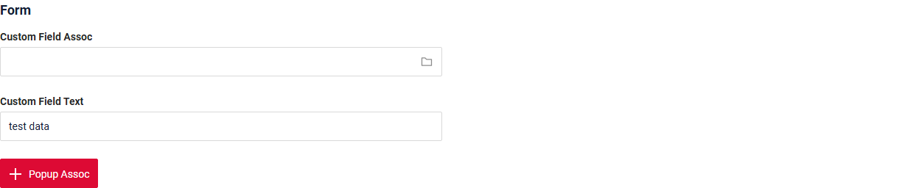


**Открытие виджета:**

=== "Поле виджета Assoc "
    
=== "Кнопка виджета Assoc"
    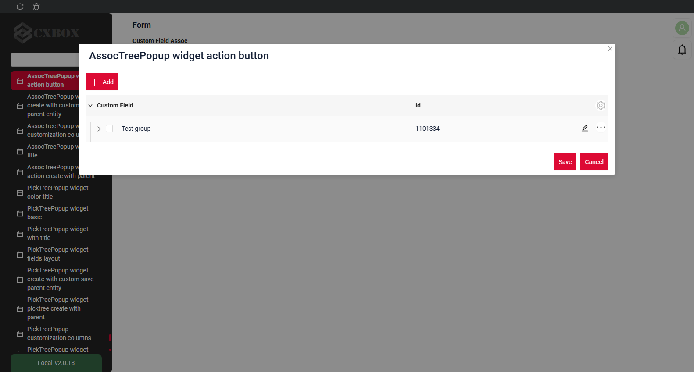

###  <a id="Howtoaddbacis">Как добавить?</a>
??? Example "Пример"
    === "Поле виджета Assoc"
        === "List"
            **Шаг 1** Добавьте поле с типом **multivalueTree**, подробнее см. [Поля](#fields)

            ```json
            --8<--
            {{ external_links.github_raw_doc }}/widgets/assoctree/base/MyExample3330List.widget.json
            --8<--
            ```
       
            **Шаг 2** Создайте виджет всплывающего окна **_.widget.json_** с type = **"AssocTreePopup"**.

            Для корректной работы дерева виджет всплывающего окна должен содержать поля `parentId` и `isLeaf`. Эти поля нужно настроить как **hidden**.

            ```json
            --8<--
            {{ external_links.github_raw_doc }}/widgets/assoctree/base/myEntity3330MultiAssocTreePopup.widget.json
            --8<--
            ```

            **Шаг 3** Добавьте виджет в соответствующий **_.view.json_**.
        
            ```json
            --8<--
            {{ external_links.github_raw_doc }}/widgets/assoctree/base/myexample3330list.view.json
            --8<--
            ```
        === "Info"
            _неприменимо_

        === "Form"
            **Шаг 1** Добавьте поле с типом **multivalueTree**, подробнее см. [Поля](#fields)

            ```json
            --8<--
            {{ external_links.github_raw_doc }}/widgets/assoctree/base/MyExample3330Form.widget.json
            --8<--
            ```
       
            **Шаг 2** Создайте виджет всплывающего окна **_.widget.json_** с type = **"AssocTreePopup"**.

            Для корректной работы дерева виджет всплывающего окна должен содержать поля `parentId` и `isLeaf`. Эти поля нужно настроить как **hidden**.

            ```json
            --8<--
            {{ external_links.github_raw_doc }}/widgets/assoctree/base/myEntity3330MultiAssocTreePopup.widget.json
            --8<--
            ```

            **Шаг 3** Добавьте виджет в соответствующий **_.view.json_**.
        
            ```json
            --8<--
            {{ external_links.github_raw_doc }}/widgets/assoctree/base/myexample3330form.view.json
            --8<--
            ```
    === "Кнопка виджета Assoc"
        === "List"
            **Шаг 1** Добавьте кнопку `associate` в соответствующий **VersionAwareResponseService**.
            ```java
            --8<--
            {{ external_links.github_raw_doc }}/widgets/assoctree/base/MyExample3330Service.java:getActions
            --8<--
            ```
            **Шаг 2** Добавьте метод `doAssociate` в соответствующий **VersionAwareResponseService**.

            `associate`

            ```java
            --8<--
            {{ external_links.github_raw_doc }}/widgets/assoctree/base/MyExample3330Service.java:doAssociate
            --8<--
            ```
            метод `addNewRecords`
            ```java
            --8<--
            {{ external_links.github_raw_doc }}/widgets/assoctree/base/MyExample3330Service.java:addNewRecords
            --8<--
            ```

            **Шаг 3** Создайте файл **_.widget.json_** с type = **"assoc"** и name = родительский bc + "Assoc"

            Добавьте существующее поле в виджет assoc. Подробнее см. [Поля](#fields)

            ```json
            --8<--
            {{ external_links.github_raw_doc }}/widgets/assoctree/base/myexample3330Assoc.widget.json
            --8<--
            ```
            **Шаг 4** Добавьте зависимость Assoc BC от родительского BC в соответствующий **EnumBcIdentifier**
        
             ```java
             --8<--
             {{ external_links.github_raw_doc }}/widgets/assoctree/base/CxboxMyExample3330Controller.java
             --8<--
             ```

             **Шаг 5** Добавьте виджет assoc в соответствующий **_.view.json_**.
        
            ```json
            --8<--
            {{ external_links.github_raw_doc }}/widgets/assoctree/base/myexample3330list.view.json
            --8<--
            ```
 
        === "Info"
              _неприменимо_

        === "Form"
              _неприменимо_


## <a id="Title">Заголовок</a>
[:material-play-circle: Живой пример]({{ external_links.code_samples }}/ui/#/screen/myexample3336){:target="_blank"} ·
[:fontawesome-brands-github: GitHub]({{ external_links.github_ui }}/{{ external_links.github_branch }}/src/main/java/org/demo/documentation/widgets/assoctree/title){:target="_blank"}

### Базовый заголовок { #title-basic }
`Title` для виджета (необязательно)

Типы:

* `постоянный заголовок`: показывает постоянный текст.
* `пустой постоянный заголовок`: если нужно визуально связать виджеты, расположив их один под другим

#### Как это выглядит? { #how-does-it-look_1 }
=== "Постоянный заголовок"
    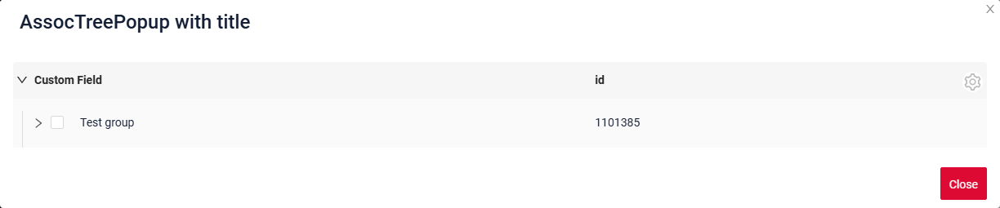
=== "Пустой постоянный заголовок"
    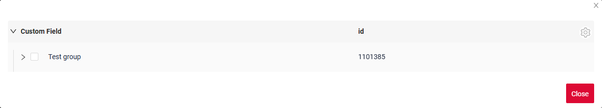

#### Как добавить? { #how-to-add }
??? Example "Пример"
    === "Постоянный заголовок"
        **Шаг 1** Добавьте название в **title** в **_.widget.json_**.
        ```json
        --8<--
        {{ external_links.github_raw_doc }}/widgets/assoctree/title/myEntity3336MultiPickAssocTreePopup.widget.json
        --8<--
        ```
        [:material-play-circle: Живой пример]({{ external_links.code_samples }}/ui/#/screen/myexample3336){:target="_blank"} ·
        [:fontawesome-brands-github: GitHub]({{ external_links.github_ui }}/{{ external_links.github_branch }}/src/main/java/org/demo/documentation/widgets/assoctree/title){:target="_blank"}

    === "Пустой постоянный заголовок"
    
        **Шаг 1** Удалите параметр **title** из **_.widget.json_**.
        ```json
        --8<--
        {{ external_links.github_raw_doc }}/widgets/assoctree/title/myEntity3336MultiPickAssocEmptyListPopup.widget.json
        --8<--
        ```
    
        [:material-play-circle: Живой пример]({{ external_links.code_samples }}/ui/#/screen/myexample3336/view/myexample3336emptytitle){:target="_blank"} ·
        [:fontawesome-brands-github: GitHub]({{ external_links.github_ui }}/{{ external_links.github_branch }}/src/main/java/org/demo/documentation/widgets/assoctree/title){:target="_blank"}
    

### Цвет заголовка { #title-color }
`Title Color` позволяет задать цвет заголовка. Он может быть постоянным или вычисляемым.

**Постоянный цвет**

[:material-play-circle: Живой пример]({{ external_links.code_samples }}/ui/#/screen/myexample3329/view/myexample3332colorconst){:target="_blank"} ·
[:fontawesome-brands-github: GitHub]({{ external_links.github_ui }}/{{ external_links.github_branch }}/src/main/java/org/demo/documentation/widgets/assoctree/colortitle){:target="_blank"}

*Постоянный цвет* — фиксированный цвет, который не меняется. Он остаётся одинаковым независимо от каких-либо факторов в приложении.

**Вычисляемый цвет**

[:material-play-circle: Живой пример]({{ external_links.code_samples }}/ui/#/screen/myexample3329/view/myexample3332color){:target="_blank"} ·
[:fontawesome-brands-github: GitHub]({{ external_links.github_ui }}/{{ external_links.github_branch }}/src/main/java/org/demo/documentation/widgets/assoctree/colortitle){:target="_blank"}

*Вычисляемый цвет* можно использовать для динамического изменения цвета заголовка. Он меняется в зависимости от бизнес-логики или данных приложения.

!!! info
    Цветовое выделение заголовка **применимо** к следующим [полям](/ru/widget/fields/fieldtypes/): date, dateTime, dateTimeWithSeconds, number, money, percent, time, input, text, dictionary, radio, checkbox, pickList, inlinePickList, multivalueTree, multivalueHover.

##### Как это выглядит? { #how-does-it-look_2 }
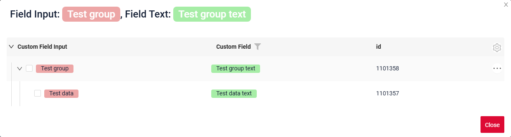

##### Как добавить? { #how-to-add_1 }
??? Example "Пример"
    === "Вычисляемый цвет"

        **Шаг 1**   Добавьте `собственное поле для цвета` в соответствующий **DataResponseDTO**. Поле может содержать цвет в формате HEX или быть null.
        ```java
        --8<--
        {{ external_links.github_raw_doc }}/widgets/assoctree/colortitle/color/MyEntity3332MultiPickDTO.java
        --8<--
        ```  
 
        **Шаг 2** Добавьте **"bgColorKey"** :  `собственное поле для цвета` в .widget.json.

        Добавьте в `title` поле с `${customField}`

        ```json
        --8<--
        {{ external_links.github_raw_doc }}/widgets/assoctree/colortitle/color/myEntity3332MultiPickAssocTreePopup.widget.json
        --8<--
        ``` 

        [:material-play-circle: Живой пример]({{ external_links.code_samples }}/ui/#/screen/myexample3329/view/myexample3332color){:target="_blank"} ·
        [:fontawesome-brands-github: GitHub]({{ external_links.github_ui }}/{{ external_links.github_branch }}/src/main/java/org/demo/documentation/widgets/assoctree/colortitle/color){:target="_blank"}

    === "Постоянный цвет"
 
        Добавьте **"bgColor"** :  `цвет HEX` в .widget.json.

        Добавьте в `title` поле с `${customField}`

        ```json
        --8<--
        {{ external_links.github_raw_doc }}/widgets/assoctree/colortitle/colorconst/myEntity3332MultiPickAssocTreePopup0.widget.json
        --8<--
        ```
 
        [:material-play-circle: Живой пример]({{ external_links.code_samples }}/ui/#/screen/myexample3329/view/myexample3332colorconst){:target="_blank"} ·
        [:fontawesome-brands-github: GitHub]({{ external_links.github_ui }}/{{ external_links.github_branch }}/src/main/java/org/demo/documentation/widgets/assoctree/colortitle/colorconst){:target="_blank"}
 
## <a id="bc">Бизнес-компонент</a>
Указывает бизнес-компонент (BC), к которому относится эта форма.
Бизнес-компонент представляет определённую часть системы, отвечающую за конкретную бизнес-логику или данные.

подробнее см. [Бизнес-компонент](/ru/environment/businesscomponent/businesscomponent/)

## <a id="Showcondition">Условие отображения</a>
  

## <a id="fields">Поля</a>
Настройка полей. Массив fields определяет отдельные поля формы.

```json
{
    "title": "Custom Field",
    "key": "customField",
    "type": "input"
}
```

* **"title"**

  Описание: заголовок поля.

  Тип: String (необязательно).

* **"key"**

  Описание: имя поля в соответствующем DataResponseDTO.

  Тип: String (обязательно).

* **"type"**

  Описание: [Типы полей](/ru/widget/fields/fieldtypes/)

  Тип: String (обязательно).


### Как добавить? { #how-to-add_2 }
??? Example "Пример"

    === "С плагином (рекомендуется)"
        **Шаг 1** Скачайте плагин
            [скачать плагин для IntelliJ](https://doc.cxbox.org/ru/plugin/plugininstalling)
    
        **Шаг 2** Добавьте существующее поле в существующий виджет формы
            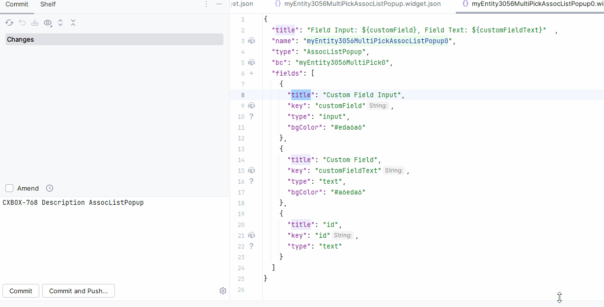
    === "Пример написания кода"
        Добавьте поле в **_.widget.json_**.

          ```json
             --8<--
             {{ external_links.github_raw_doc }}/widgets/assoctree/base/myEntity3330MultiAssocTreePopup.widget.json
             --8<--
          ```

## <a id="Fieldslayout">Компоновка (options layout)</a>
**options.layout** — в этом типе не используется.

## Действия { #actions }
`Actions` отображают доступные действия в виде отдельных кнопок, подробнее см. [Действия](/ru/features/element/actions/actions).

**Стандартные действия**:

* [`Create`](#standart_create): действие, запускающее создание новой записи
* [`Delete`](#standart_delete): удаление существующей записи
* [`Edit`](#standart_edit): обновление или исправление информации пользователем
* [`Save`](#standart_save): сохранение введённых или изменённых данных
* [`Cancel-create`](#standart_cancel_create): отмена создания новой записи без сохранения введённых данных

Для виджета assoc есть несколько действий.
#### Создание { #create }
Кнопка `Create` позволяет создать новое значение нажатием кнопки `Add`. Это действие можно выполнить тремя разными способами — выбирайте любой в зависимости от логики приложения:

Есть три способа создать запись:

* [Inline](#createinline): строку можно добавить напрямую.

!!! info
    Пагинация не сработает, пока страница не будет обновлена после добавления записей.

* [Inline-form](#withwidget): данные можно добавить с помощью виджета формы, не покидая текущий view.

* [With view](#withview): неприменимо.

##### <a id="createinline">Inline</a>
[:material-play-circle: Живой пример]({{ external_links.code_samples }}/ui/#/screen/myexample3331/view/myexample3331create){:target="_blank"} ·
[:fontawesome-brands-github: GitHub]({{ external_links.github_ui }}/{{ external_links.github_branch }}/src/main/java/org/demo/documentation/widgets/assoctree/actions/create){:target="_blank"}

При `Line Addition` по нажатию кнопки "Add" вверху виджета assoc сразу добавляется новая пустая строка. Это быстрый способ добавлять строки без предварительного ввода данных.

Позиция новой строки внутри узла задаётся **options**.**tree**.**insertPosition**: `start` помещает её перед уже загруженными строками узла, `end` — после них. см. [options.tree](#optionstree)

###### Как это выглядит? { #how-does-it-look_3 }
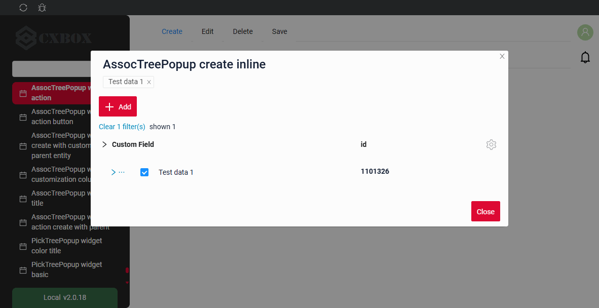

###### Как добавить? { #how-to-add_3 }
??? Example "Пример"

    **Шаг 1** Добавьте кнопку `create` в соответствующий **VersionAwareResponseService**.
    ```java
    --8<--
    {{ external_links.github_raw_doc }}/widgets/assoctree/actions/MyEntity3331MultiMultivalueService.java:getActions
    --8<--
    ```
 
    **Шаг 2** Добавьте кнопку `create` в соответствующий **.widget.json**.

    Позиция новой строки внутри узла задаётся `options`.`tree`.`insertPosition`: `start` помещает её перед уже загруженными строками узла, `end` — после них.

    ```json
    --8<--
    {{ external_links.github_raw_doc }}/widgets/assoctree/actions/create/myEntity3331MultiAssocTreePopupCreateAssocTreePopup.widget.json
    --8<--
    ```

    **Шаг 3** Добавьте **fields.setEnabled** в соответствующий **FieldMetaBuilder**.
    ```java
    --8<--
    {{ external_links.github_raw_doc }}/widgets/assoctree/actions/MyEntity3331MultiMultivalueMeta.java:buildRowDependentMeta
    --8<--
    ``` 
    [:material-play-circle: Живой пример]({{ external_links.code_samples }}/ui/#/screen/myexample3331/view/myexample3331create){:target="_blank"} ·
    [:fontawesome-brands-github: GitHub]({{ external_links.github_ui }}/{{ external_links.github_branch }}/src/main/java/org/demo/documentation/widgets/assoctree/actions/create){:target="_blank"}

##### <a id="withwidget">Inline-form</a>
[:material-play-circle: Живой пример]({{ external_links.code_samples }}/ui/#/screen/myexample3331/view/myexample3331inlinecreate){:target="_blank"} ·
[:fontawesome-brands-github: GitHub]({{ external_links.github_ui }}/{{ external_links.github_branch }}/src/main/java/org/demo/documentation/widgets/assoctree/actions/create){:target="_blank"}

`Create with widget` открывает дополнительный виджет при нажатии кнопки "Add". Форма появляется на том же экране, поэтому видны и список сущностей assoc, и форма добавления новой строки.
После заполнения информации и нажатия "Save" новая строка добавляется в assoc.

Позиция новой строки внутри узла задаётся **options**.**tree**.**insertPosition**: `start` помещает её перед уже загруженными строками узла, `end` — после них. см. [options.tree](#optionstree)

###### Как это выглядит? { #how-does-it-look_4 }
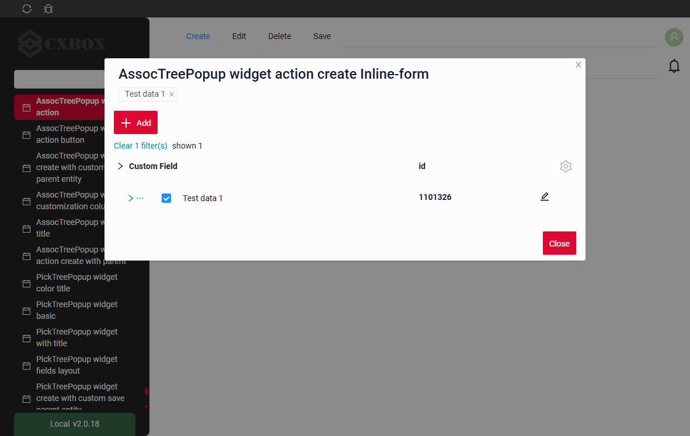

###### Как добавить? { #how-to-add_4 }
??? Example "Пример"

    **Шаг 1** Добавьте кнопку `create` в соответствующий **VersionAwareResponseService**.
    ```java
    --8<--
    {{ external_links.github_raw_doc }}/widgets/assoctree/actions/MyEntity3331MultiMultivalueService.java:getActions
    --8<--
    ```
    **Шаг 2** Добавьте **fields.setEnabled** в соответствующий **FieldMetaBuilder**.
    ```java
    --8<--
    {{ external_links.github_raw_doc }}/widgets/assoctree/actions/MyEntity3331MultiMultivalueMeta.java:buildRowDependentMeta
    --8<--
    ```
     **Шаг 3** Создайте widget.json с типом `Form`, который появляется при нажатии кнопки
    ```json
    --8<--
    {{ external_links.github_raw_doc }}/widgets/assoctree/actions/myEntity3331MultiFormForPopup2.widget.json
    --8<--
    ```
 
     **Шаг 4** Добавьте widget.json с типом `Form` в соответствующий **.view.json**.
    ```json
    --8<--
    {{ external_links.github_raw_doc }}/widgets/assoctree/actions/create/myexample3331inlinecreate.view.json
    --8<--
    ```

     **Шаг 5** Добавьте кнопку `create` и виджет с типом `Form` в соответствующий **.widget.json**.
       
    `options`.`create`: имя виджета, который появляется при нажатии кнопки

    Позиция новой строки внутри узла задаётся `options`.`tree`.`insertPosition`: `start` помещает её перед уже загруженными строками узла, `end` — после них.

        
    ```json
    --8<--
    {{ external_links.github_raw_doc }}/widgets/assoctree/actions/create/myEntity3331MultiAssocTreePopup.widget.json
    --8<--
    ```
 
    [:material-play-circle: Живой пример]({{ external_links.code_samples }}/ui/#/screen/myexample3331/view/myexample3331inlinecreate){:target="_blank"} ·
    [:fontawesome-brands-github: GitHub]({{ external_links.github_ui }}/{{ external_links.github_branch }}/src/main/java/org/demo/documentation/widgets/assoctree/actions/create){:target="_blank"}

##### <a id="withview">With view</a>
_неприменимо_


#### **<a id="standart_delete">Delete</a>**
[:material-play-circle: Живой пример]({{ external_links.code_samples }}/ui/#/screen/myexample3331/view/myexample3331delete){:target="_blank"} ·
[:fontawesome-brands-github: GitHub]({{ external_links.github_ui }}/{{ external_links.github_branch }}/src/main/java/org/demo/documentation/widgets/assoctree/actions/delete){:target="_blank"}

`Delete` удаляет существующую запись.

!!! tips "Совет"
    Учтите, что на удаляемую строку может ссылаться другая часть системы или родительская сущность. Для ясности обработайте это исключение и покажите пользователю объяснение.

###### Как это выглядит? { #how-does-it-look_5 }
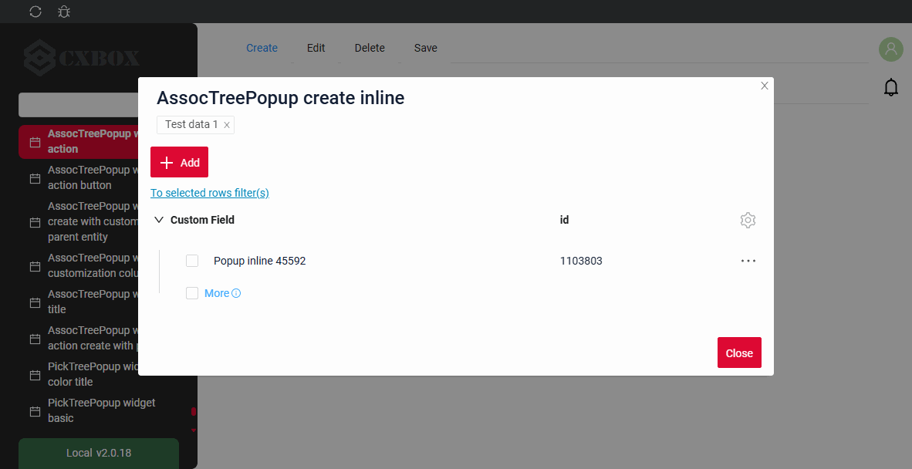

###### Как добавить? { #how-to-add_5 }
??? Example "Пример"

    **Шаг 1** Добавьте действие *delete* в соответствующий **VersionAwareResponseService**.

    По умолчанию кнопка доступна, когда запись существует.

    ```java
    --8<--
    {{ external_links.github_raw_doc }}/widgets/assoctree/actions/MyExample3331Service.java:getActions
    --8<--
    ```  
 
    **Шаг 2** Добавьте кнопку или группу кнопок в соответствующий **.widget.json**.
   
    ```json
    --8<--
    {{ external_links.github_raw_doc }}/widgets/assoctree/actions/delete/myEntity3331MultiAssocDeleteListPopup.widget.json
    --8<--
    ``` 
    [:material-play-circle: Живой пример]({{ external_links.code_samples }}/ui/#/screen/myexample3331/view/myexample3331delete){:target="_blank"} ·
    [:fontawesome-brands-github: GitHub]({{ external_links.github_ui }}/{{ external_links.github_branch }}/src/main/java/org/demo/documentation/widgets/assoctree/actions/delete){:target="_blank"}

#### Редактирование { #edit }
`Edit` позволяет изменить значение поля. Как и для кнопки `Create`, это действие можно реализовать тремя способами.

Есть три способа создать запись:

* [Inline edit](#editline): строку можно редактировать напрямую.

* [Inline-form](#editwithwidget): данные можно редактировать с помощью виджета формы, не покидая текущий view.

* [With view](#editwithview): неприменимо

##### <a id="editline">Inline-редактирование </a>
[:material-play-circle: Живой пример]({{ external_links.code_samples }}/ui/#/screen/myexample3331/view/myexample3331edit){:target="_blank"} ·
[:fontawesome-brands-github: GitHub]({{ external_links.github_ui }}/{{ external_links.github_branch }}/src/main/java/org/demo/documentation/widgets/assoctree/actions/edit){:target="_blank"}


`Edit Inline` означает inline-редактирование. Дважды щёлкните по значению, которое нужно изменить.
###### Как это выглядит? { #how-does-it-look_6 }
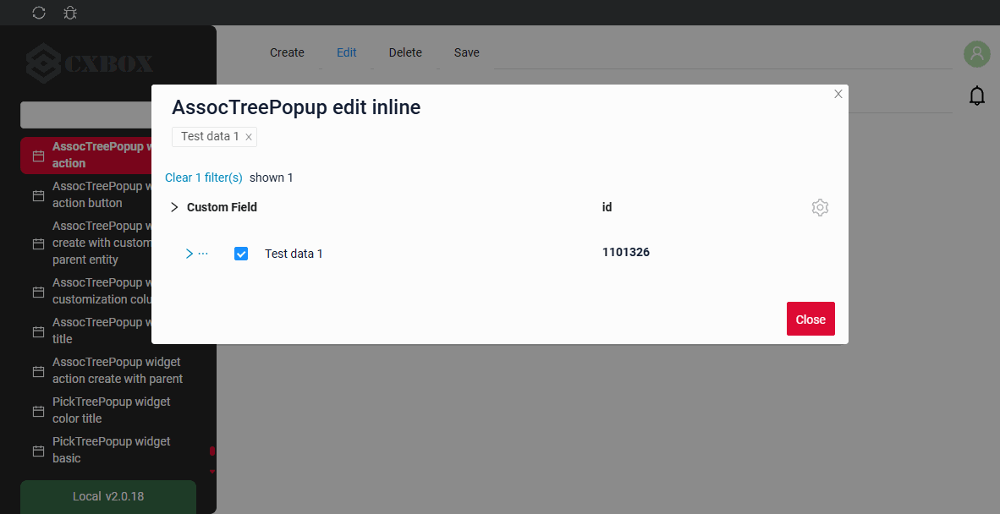

###### Как добавить? { #how-to-add_6 }
??? Example "Пример"

    **Шаг 1** Добавьте **fields.setEnabled** в соответствующий **FieldMetaBuilder**.
    ```java
    --8<--
    {{ external_links.github_raw_doc }}/widgets/assoctree/actions/MyEntity3331MultiMultivalueMeta.java:buildRowDependentMeta
    --8<--
    ```
 
    [:material-play-circle: Живой пример]({{ external_links.code_samples }}/ui/#/screen/myexample3331/view/myexample3331edit){:target="_blank"} ·
    [:fontawesome-brands-github: GitHub]({{ external_links.github_ui }}/{{ external_links.github_branch }}/src/main/java/org/demo/documentation/widgets/assoctree/actions/edit){:target="_blank"}

##### <a id="editwithwidger">Inline-form</a>
[:material-play-circle: Живой пример]({{ external_links.code_samples }}/ui/#/screen/myexample3331/view/myexample3331editinlineform){:target="_blank"} ·
[:fontawesome-brands-github: GitHub]({{ external_links.github_ui }}/{{ external_links.github_branch }}/src/main/java/org/demo/documentation/widgets/assoctree/actions/edit){:target="_blank"}

`Edit with widget` открывает дополнительный виджет при нажатии на иконку редактирования в строке.

###### Как это выглядит? { #how-does-it-look_7 }
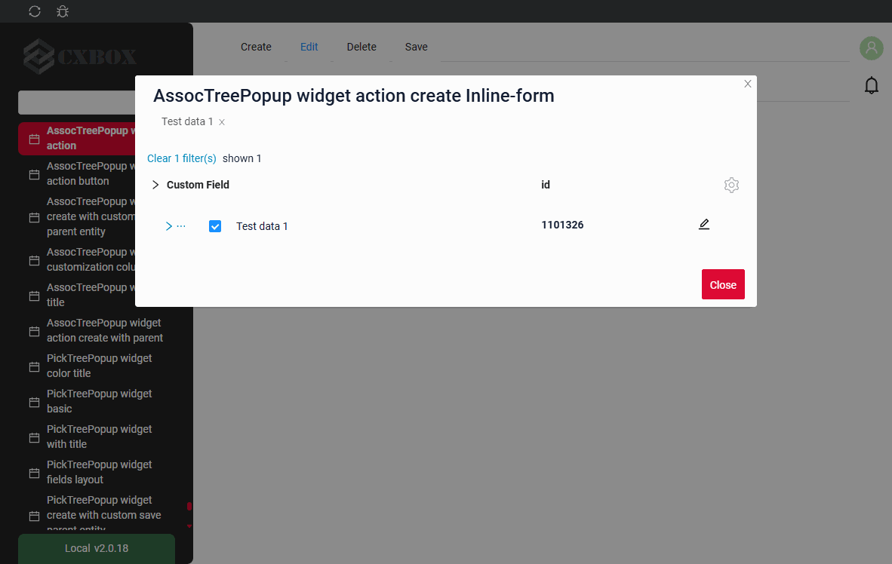

###### Как добавить? { #how-to-add_7 }
??? Example "Пример"

    **Шаг 1** Добавьте действие `save` в соответствующий **VersionAwareResponseService**: с его помощью форма сохраняет запись.
    ```java
    --8<--
    {{ external_links.github_raw_doc }}/widgets/assoctree/actions/MyEntity3331MultiMultivalueService.java:getActions
    --8<--
    ```

    **Шаг 2** Добавьте **fields.setEnabled** в соответствующий **FieldMetaBuilder**.
    ```java
    --8<--
    {{ external_links.github_raw_doc }}/widgets/assoctree/actions/MyEntity3331MultiMultivalueMeta.java:buildRowDependentMeta
    --8<--
    ```
 
    **Шаг 2**  Создайте widget.json с типом `Form`, который появляется при нажатии кнопки
    ```json
    --8<--
    {{ external_links.github_raw_doc }}/widgets/assoctree/actions/myEntity3331MultiFormForPopup.widget.json
    --8<--
    ```
 
     **Шаг 4** Добавьте widget.json с типом `Form` в соответствующий **.view.json**.
    ```json
    --8<--
    {{ external_links.github_raw_doc }}/widgets/assoctree/actions/edit/myexample3331editinlineform.view.json
    --8<--
    ```

     **Шаг 5** Добавьте виджет с типом `Form` в **options**.**edit**.**widget** соответствующего **.widget.json**: в каждой строке появится иконка редактирования.
       
    `options`.`edit`: имя виджета, который появляется при нажатии кнопки
        
    ```json
    --8<--
    {{ external_links.github_raw_doc }}/widgets/assoctree/actions/edit/myEntity3331MultiAssocTreePopupEditInlineForm.widget.json
    --8<--
    ```

    [:material-play-circle: Живой пример]({{ external_links.code_samples }}/ui/#/screen/myexample3331/view/myexample3331editinlineform){:target="_blank"} ·
    [:fontawesome-brands-github: GitHub]({{ external_links.github_ui }}/{{ external_links.github_branch }}/src/main/java/org/demo/documentation/widgets/assoctree/actions/edit){:target="_blank"}

##### <a id="editwithview">With view</a>
неприменимо

### Дополнительные свойства { #additional-properties }
#### <a id="noderefresh">Обновление узла</a>
После действия (save, delete, cancel-create) всплывающее окно обновляет только **узел**, к которому относится запись, так же как [виджет Tree](/ru/widget/type/tree/tree/#noderefresh):

* строка обновляется из ответа действия или, если ответ её не содержит, перечитывается запросом `?id.equals=<id>`;
* row-meta строки запрашивается повторно;
* если запись больше не возвращается, строка удаляется из дерева;
* узел сворачивается, а его уже загруженные дочерние записи забываются, поэтому при следующем раскрытии они загружаются заново.

!!! info
    Соседние и родительские записи автоматически **не** обновляются. `PostAction.refreshBC` в этом релизе не поддерживается для дерева: корневая страница загружается заново, но раскрытые узлы и их уже загруженные дочерние записи остаются как есть.

#### Настройка отображаемых колонок { #customization-of-displayed-columns }
неприменимо
#### Фильтрация { #filtration }
##### Основы { #basic }
подробнее см. [Поля](/ru/widget/type/property/filtration/filtration/)

Фильтрация всплывающего окна — стандартный запрос. Строки, соответствующие фильтру, возвращаются бэкендом без иерархии, а всплывающее окно решает, как их отображать, см. [Режимы поиска](#searchmodes).

Панель над деревом показывает:

* `Clear N filter(s)` — количество применённых фильтров и возможность их сбросить;
* `Shown N` — сколько найденных записей сейчас отображается;
* `More M` — сколько найденных записей ещё не отображено, где `M` — количество найденных записей минус количество показанных.

!!! info
    В режиме пагинации `nextAndPreviousWithCount` запрос `/count` после фильтрации **не** выполняется. Вместо количества найденных записей отображается иконка `i` с подсказкой **"Load more and show count"**.

###### Как это выглядит? { #how-does-it-look_8 }


###### Как добавить? { #how-to-add_8 }
??? Example "Пример"
    Шаги выполняются для бизнес-компонента всплывающего окна.
    Найденные записи отображаются согласно [режимам поиска](#searchmodes).

    `Шаг 1` Добавьте **@SearchParameter** в соответствующий **DataResponseDTO**.
    ```java
    --8<--
    {{ external_links.github_raw_doc }}/widgets/property/filtration/filtergroup/MyExample3616DTO.java
    --8<--
    ```

    `Шаг 2` Добавьте **fields.enableFilter** в соответствующий **FieldMetaBuilder**.
    ```java
    --8<--
    {{ external_links.github_raw_doc }}/widgets/property/filtration/filtergroup/MyExample3616Meta.java:buildIndependentMeta
    --8<--
    ```

    [:material-play-circle: Живой пример]({{ external_links.code_samples }}/ui/#/screen/myexample3261/view/myexample3261list){:target="_blank"} ·
    [:fontawesome-brands-github: GitHub]({{ external_links.github_ui }}/{{ external_links.github_branch }}/src/main/java/org/demo/documentation/widgets/tree/base/inner){:target="_blank"}

##### FullTextSearch
`FullTextSearch` — когда пользователь вводит текст в поле полнотекстового поиска, виджет фильтрует строки, соответствующие запросу.
см. [FullTextSearch](/ru/widget/type/property/filtration/filtration/#by-fulltextsearch)

Результат полнотекстового поиска отображается так же, как результат фильтрации, см. [Режимы поиска](#searchmodes).

###### Как это выглядит? { #how-does-it-look_9 }


###### Как добавить? { #how-to-add_9 }
??? Example "Пример"
    `Шаг 1` Добавьте файл расширения FullTextSearchExt.java
    ```java
    import java.util.Optional;
    import jakarta.persistence.criteria.CriteriaBuilder;
    import jakarta.persistence.criteria.Path;
    import jakarta.persistence.criteria.Predicate;
    import lombok.NonNull;
    import lombok.experimental.UtilityClass;
    import org.apache.commons.lang3.StringUtils;
    import org.cxbox.core.crudma.bc.BusinessComponent;

    @UtilityClass
    public class FullTextSearchExt {

        @NonNull
        public static Optional<String> getFullTextSearchFilterParam(BusinessComponent bc) {
            return Optional.ofNullable(bc.getParameters().getParameter("_fullTextSearch"));
        }

        public static Predicate likeIgnoreCase(String value, CriteriaBuilder cb, Path<String> path) {
            return cb.like(cb.lower(path), StringUtils.lowerCase("%" + value + "%"));
        }

    }
    ```

    `Шаг 2` Добавьте **specifications** для полей полнотекстового поиска в соответствующий **JpaRepository**.
    ```java
    --8<--
    {{ external_links.github_raw_doc }}/widgets/tree/data/inner/MyEntity3261Repository.java
    --8<--
    ```

    `Шаг 3` Добавьте **getSpecification** в соответствующий **VersionAwareResponseService** всплывающего окна.
    ```java
    --8<--
    {{ external_links.github_raw_doc }}/widgets/tree/base/inner/Myexample3261Pick0Service.java:getSpecification
    --8<--
    ```

    `Шаг 4` Добавьте **fullTextSearch** в соответствующий **.widget.json**.

    `enabled` true/false

    `placeholder` — описание для fullTextSearch

    ```json
    --8<--
    {{ external_links.github_raw_doc }}/widgets/tree/base/inner/myexample3261AssocTreePopup.widget.json
    --8<--
    ```

    [:material-play-circle: Живой пример]({{ external_links.code_samples }}/ui/#/screen/myexample3261/view/myexample3261list){:target="_blank"} ·
    [:fontawesome-brands-github: GitHub]({{ external_links.github_ui }}/{{ external_links.github_branch }}/src/main/java/org/demo/documentation/widgets/tree/base/inner){:target="_blank"}

##### Персональная группа фильтров { #personal-filter-group }
неприменимо
##### Группа фильтров { #filter-group }
неприменимо

#### <a id="searchmodes">Режимы поиска</a>
[:material-play-circle: Живой пример]({{ external_links.code_samples }}/ui/#/screen/myexample3261/view/myexample3261list){:target="_blank"} ·
[:fontawesome-brands-github: GitHub]({{ external_links.github_ui }}/{{ external_links.github_branch }}/src/main/java/org/demo/documentation/widgets/tree/base/inner){:target="_blank"}

Способ отображения результата фильтрации и полнотекстового поиска задаётся **options**.**tree**.**searchModes**.

Есть два режима:

* `collapse` — **результаты поиска и дерево**. Дерево показывает найденные записи вместе с записями, необходимыми для навигации: путь навигации над каждой найденной записью восстанавливается на `onFilterApplyNestLevel` уровней вверх. Пользователь может перемещаться по дереву, раскрывать и сворачивать ветви, видеть соседние записи и подгружать дополнительные записи.
* `hide` — **только результаты поиска**. Дерево показывает только найденные записи, всё остальное скрыто. Пользователь работает только с результатом поиска и не может перемещаться по другим записям дерева.

Оба режима могут быть доступны одновременно. **Первый** элемент массива `searchModes` — режим, активный при применении фильтра; пользователь переключается между доступными режимами в меню шестерёнки всплывающего окна.

**Восстановление пути вверх**

В режиме `collapse` записи, родители которых ещё не загружены, помещаются под псевдоузел. Кнопка `>...` загружает недостающих родителей запросом `?id.equals=<parentId>` и перемещает записи в иерархию. Один клик восстанавливает до **2** уровней вложенности, поэтому для глубокой иерархии кнопку нужно нажать несколько раз.

###### Как это выглядит? { #how-does-it-look_10 }
=== "Результаты поиска и дерево (collapse)"
    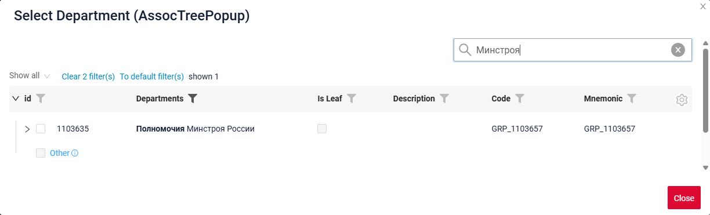
=== "Только результаты поиска (hide)"
    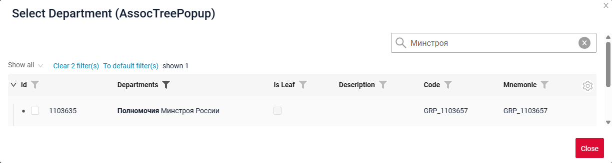
=== "Переключение между режимами"
    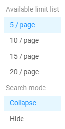

###### Как добавить? { #how-to-add_10 }
??? Example "Пример"
    **Шаг 1** Добавьте **options**.**tree**.**searchModes** в соответствующий **_.widget.json_**.

    Первый элемент массива — режим, активный при применении фильтра.

    ```
    "tree": {
      "searchModes": ["collapse", "hide"],
      "onFilterApplyNestLevel": 0
    }
    ```

    ```json
    --8<--
    {{ external_links.github_raw_doc }}/widgets/tree/base/inner/myexample3261AssocTreePopup.widget.json
    --8<--
    ```

    [:material-play-circle: Живой пример]({{ external_links.code_samples }}/ui/#/screen/myexample3261/view/myexample3261list){:target="_blank"} ·
    [:fontawesome-brands-github: GitHub]({{ external_links.github_ui }}/{{ external_links.github_branch }}/src/main/java/org/demo/documentation/widgets/tree/base/inner){:target="_blank"}

#### <a id="pagination">Пагинация</a>
`Pagination` — разбиение содержимого на отдельные страницы, упрощающее навигацию и работу с большими объёмами информации.
см. [Пагинация](/ru/widget/type/property/pagination/pagination)

У всплывающего окна нет стрелок навигации. Вместо стрелки «вперёд» последняя строка узла — кнопка **`More`**, которая загружает следующую страницу узла и добавляет её к уже загруженным записям. Выбор лимита (`availableLimitsList`) перенесён в меню шестерёнки всплывающего окна.

Кнопка `More` работает по тому же алгоритму, что и стрелка «вперёд» в трёх режимах пагинации:

| Режим пагинации              | Когда отображается `More`                                                                     | Счётчик                                     |
|------------------------------|-----------------------------------------------------------------------------------------------|---------------------------------------------|
| `nextAndPreviousWithHasNext` | `hasNext`, возвращённый бэкендом, равен `true`                                                  | не отображается                             |
| `nextAndPreviousWithCount`   | `count` больше количества уже загруженных записей                                               | сколько записей осталось загрузить          |
| `nextAndPreviousSmart`       | бэкенд вернул больше записей, чем лимит узла                                                    | не отображается                             |

подробнее см. [Режимы пагинации](/ru/widget/type/property/pagination/pagination)

###### Как это выглядит? { #how-does-it-look_11 }
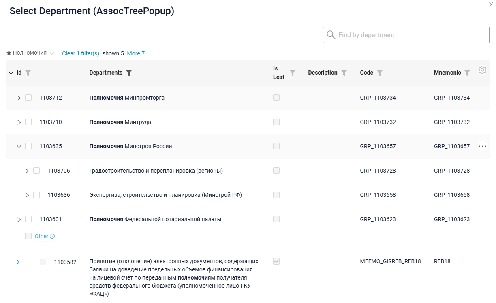

###### Как добавить? { #how-to-add_11 }
??? Example "Пример"
    === "availableLimitsList"
        Список доступных лимитов отображается в меню шестерёнки всплывающего окна.

        ```
        "pagination": {
          "availableLimitsList": [1, 2, 3]
        }
        ```

        ```json
        --8<--
        {{ external_links.github_raw_doc }}/widgets/property/pagination/availablelimitselist/myEntity3867MultiPickAssocTreePopup.widget.json
        --8<--
        ```

        [:fontawesome-brands-github: GitHub]({{ external_links.github_ui }}/{{ external_links.github_branch }}/src/main/java/org/demo/documentation/widgets/property/pagination/availablelimitselist){:target="_blank"}

    === "Лимит страницы"
        Количество записей, запрашиваемых для узла по умолчанию, определяется лимитом страницы, см. [Лимит записей на странице](/ru/widget/type/property/defaultlimitpage/defaultlimitpage).

        ```json
        --8<--
        {{ external_links.github_raw_doc }}/widgets/property/defaultlimitpage/myEntity359AssocPickAssocTreePopup.widget.json
        --8<--
        ```

        [:fontawesome-brands-github: GitHub]({{ external_links.github_ui }}/{{ external_links.github_branch }}/src/main/java/org/demo/documentation/widgets/property/defaultlimitpage){:target="_blank"}

#### Экспорт в Excel { #export-to-excel }
неприменимо

#### Множественная загрузка файлов { #multi-upload-files }
неприменимо

##### Сортировка { #sorting }
`Sorting` позволяет пользователю сортировать записи по колонке.
см. [Сортировка](/ru/widget/type/property/sorting/sorting)

Сортировка во всплывающем окне работает **внутри узла**: записи сортируются среди дочерних элементов одного родителя, сама иерархия не меняется. В остальном сортировка стандартная.

#### <a id="selectionmodes">Режимы выбора</a>
[:material-play-circle: Живой пример]({{ external_links.code_samples }}/ui/#/screen/myexample3261/view/myexample3261list){:target="_blank"} ·
[:fontawesome-brands-github: GitHub]({{ external_links.github_ui }}/{{ external_links.github_branch }}/src/main/java/org/demo/documentation/widgets/tree/base/inner){:target="_blank"}

Флажки доступны и на узлах, и на листьях дерева. Что именно пользователю разрешено отмечать, задаётся **options**.**tree**.**selection**:

* `node` — можно отмечать только узлы.
* `leaf` — можно отмечать только листья.
* `nodeAndLeaf` — можно отмечать и узлы, и листья.

!!! info
    Флажок строки `More` всегда **недоступен**: эта строка — элемент управления пагинацией, а не запись.

**Правило 1.** То, что пользователь выбрал **явно**, отмечается **ярким** флажком, и именно это отправляется на бэкенд. Всё, что выбрано **косвенно**, как следствие явного выбора, отмечается **бледным** флажком или **бледным** квадратом.

Возможны следующие случаи:

* **Пользователь выбирает листья вручную.** На бэкенд отправляются идентификаторы выбранных листьев. Родительская группа отмечается бледным квадратом, так как сама группа не выбрана.

* **Пользователь выбирает группу.** На бэкенд отправляется идентификатор группы. Все дочерние элементы группы, включая строку `More`, становятся бледными: они выбраны как часть группы и не могут быть выбраны отдельно.

* **Пользователь снимает отметку с дочернего элемента выбранной группы.** Выбор переключается в ручной режим: группа больше не отправляется на бэкенд, вместо неё отправляются идентификаторы оставшихся дочерних элементов.

!!! info
    Ограничение: выбор «группа **минус** N записей» выразить нельзя. Такой выбор всегда преобразуется в явный список оставшихся записей.

* **Пользователь вручную отмечает все дочерние элементы группы.** Это **не** то же самое, что выбор самой группы. Эти два выбора визуально различаются и ведут себя по-разному: при появлении новых записей этой группы в ручном случае они **не** выбираются, а при выборе самой группы входят в выбор.

##### Подтверждение для не полностью загруженного узла { #confirmation-for-a-node-that-is-not-fully-loaded }
У узла могут быть ещё не загруженные записи, скрытые за строкой `More`. **options**.**tree**.**confirms** определяет, какие действия с таким узлом требуют подтверждения:

| Значение             | Описание                                                                                                                                                                     |
|----------------------|------------------------------------------------------------------------------------------------------------------------------------------------------------------------------|
| `paginationUnselect` | Пользователь снимает отметку с дочернего элемента выбранного узла. После подтверждения выбор переключается в ручной режим: выбранными остаются только загруженные записи, скрытые теряются. |
| `paginationSelect`   | Пользователь отмечает сам узел. После подтверждения выбирается весь узел, включая записи, скрытые за `More`.                                                                 |

Значение по умолчанию — `["paginationUnselect"]`, пустой массив отключает подтверждения. Подробнее см. [options.tree](#optionstree)

##### Как это выглядит? { #how-does-it-look_12 }
=== "Выбор группы"
    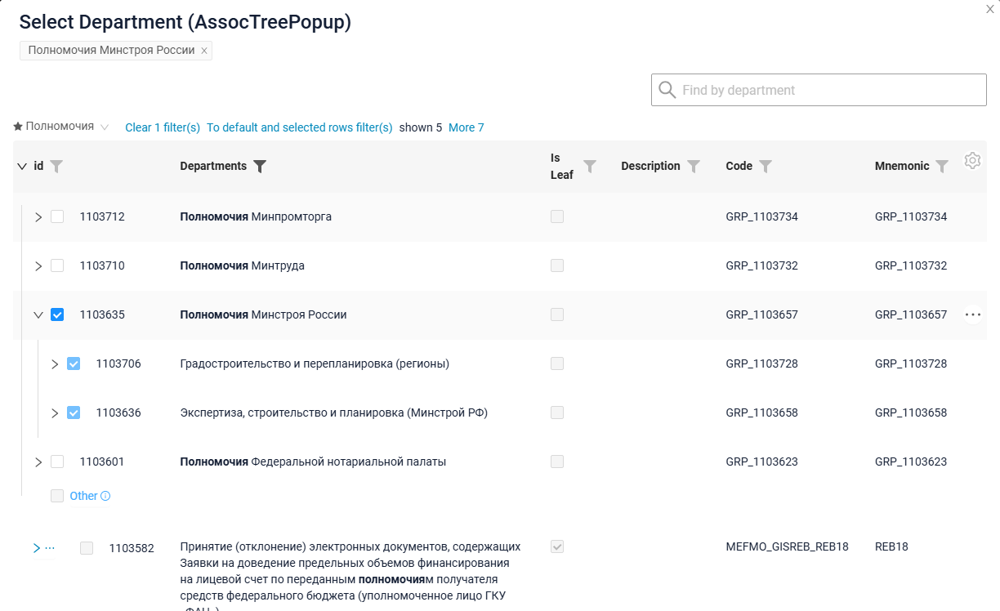
=== "Ручной выбор дочерних элементов"
    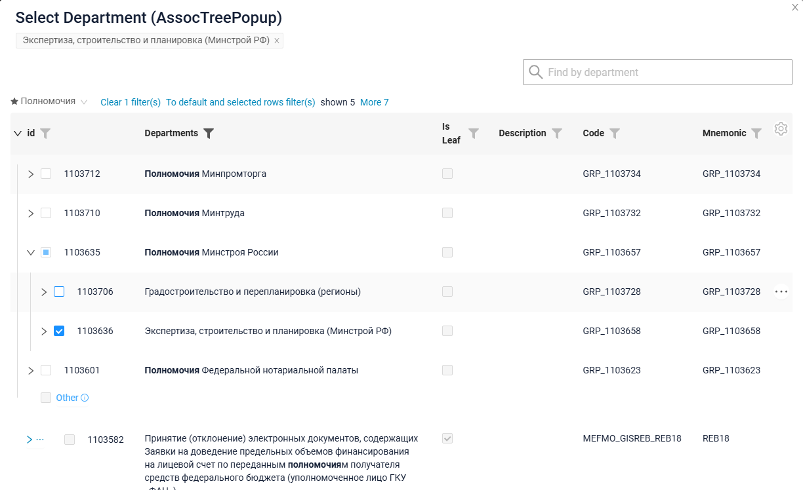
=== "Подтверждение для не полностью загруженного узла"
    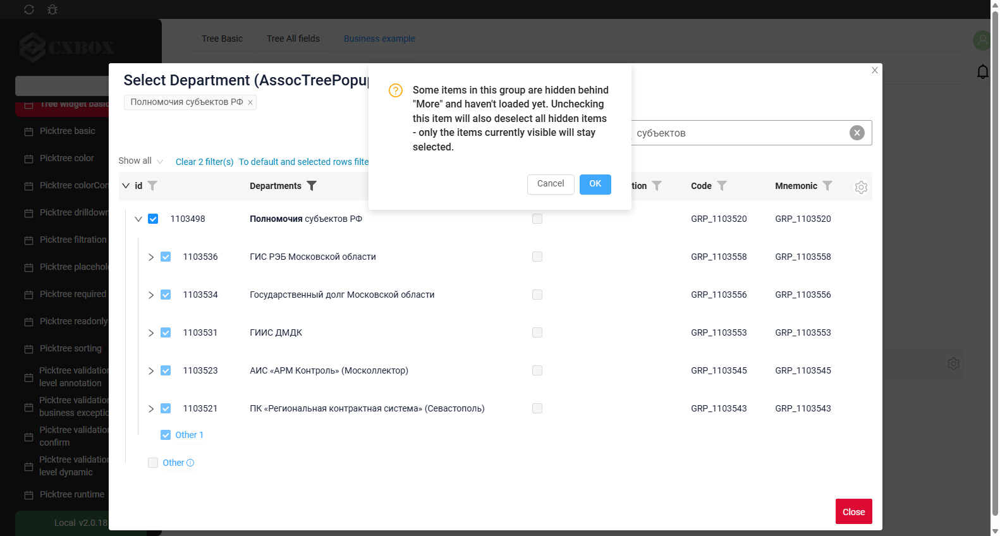

##### Как добавить? { #how-to-add_12 }
??? Example "Пример"
    Добавьте в **options** параметр **tree** в соответствующий **.widget.json**.

    ```
    "tree": {
      "selection": "node",
      "confirms": ["paginationUnselect"]
    }
    ```

    ```json
    --8<--
    {{ external_links.github_raw_doc }}/widgets/tree/base/inner/myexample3261AssocTreePopup.widget.json
    --8<--
    ```

    [:material-play-circle: Живой пример]({{ external_links.code_samples }}/ui/#/screen/myexample3261/view/myexample3261list){:target="_blank"} ·
    [:fontawesome-brands-github: GitHub]({{ external_links.github_ui }}/{{ external_links.github_branch }}/src/main/java/org/demo/documentation/widgets/tree/base/inner){:target="_blank"}

!!! info
    Использование кнопки и использование поля `multivalueTree` различаются тем, как отображаются уже выбранные значения.

    На поле с типом `multivalueTree` всплывающее окно показывает уже выбранные значения в виде **тегов** сверху, поэтому пользователь продолжает предыдущий выбор.

    Всплывающее окно, открытое кнопкой, не привязано напрямую к полю, поэтому всегда открывается **с нуля**, без тегов уже выбранных значений. Добавьте фильтрацию в открываемое окно, чтобы исключить уже добавленные записи.
