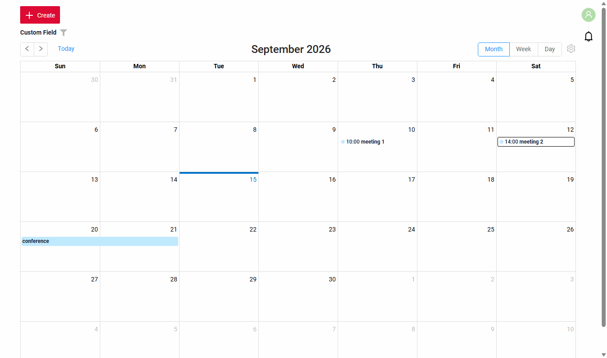
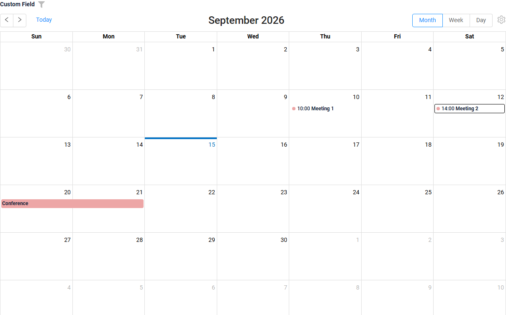
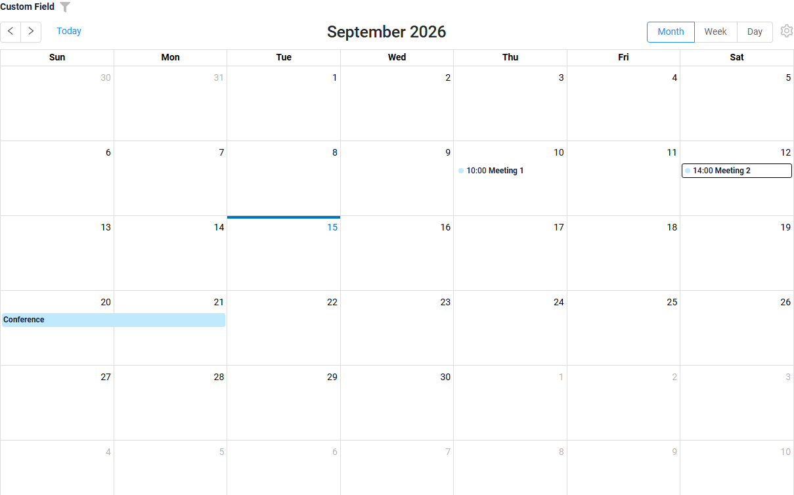
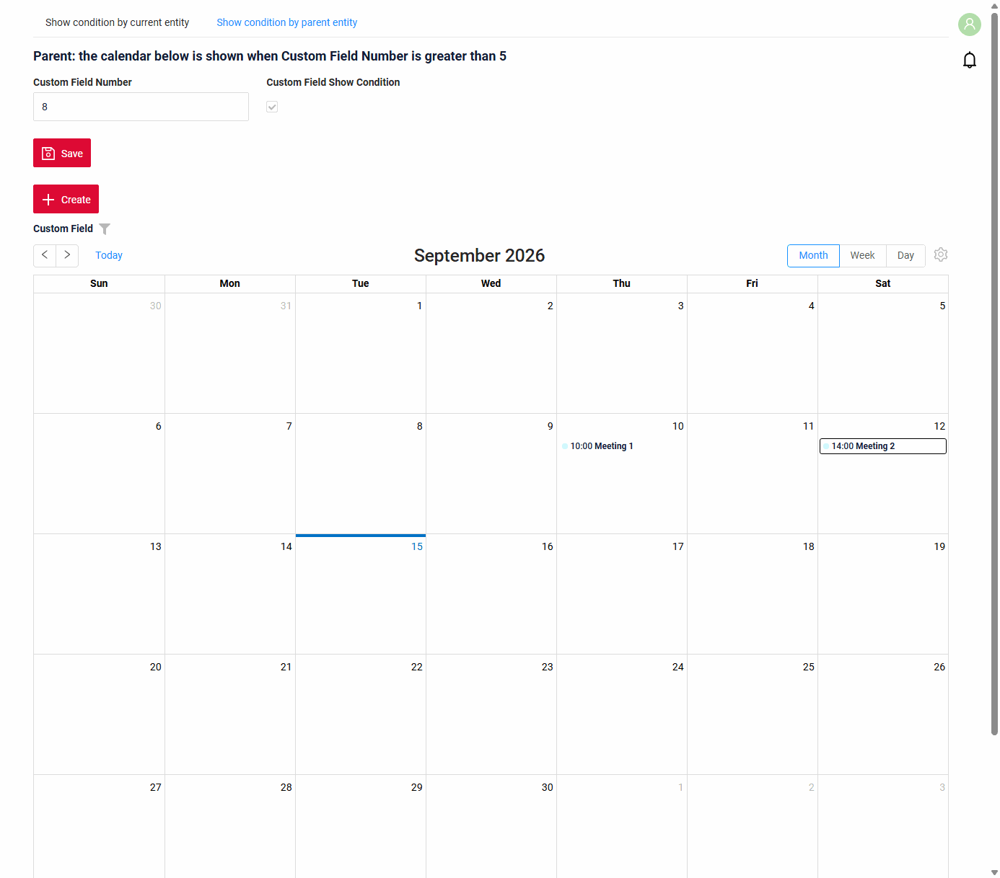
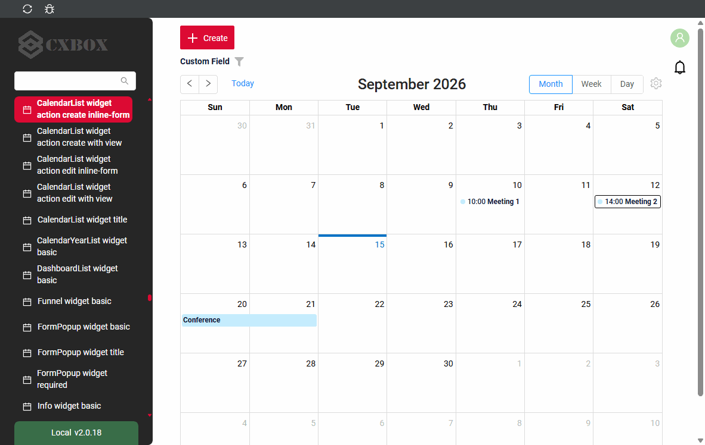
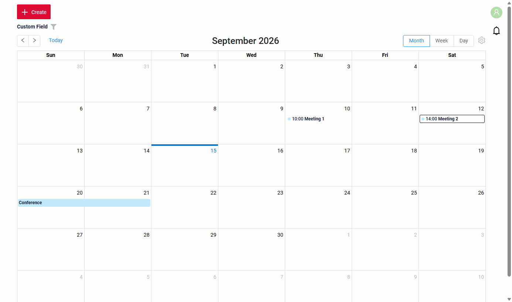
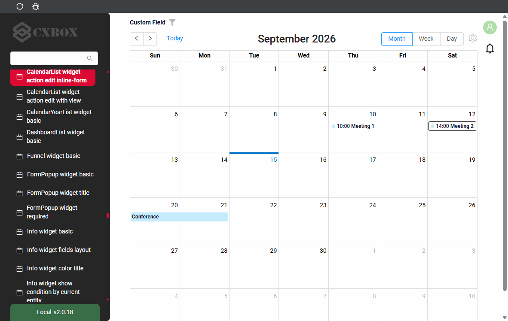
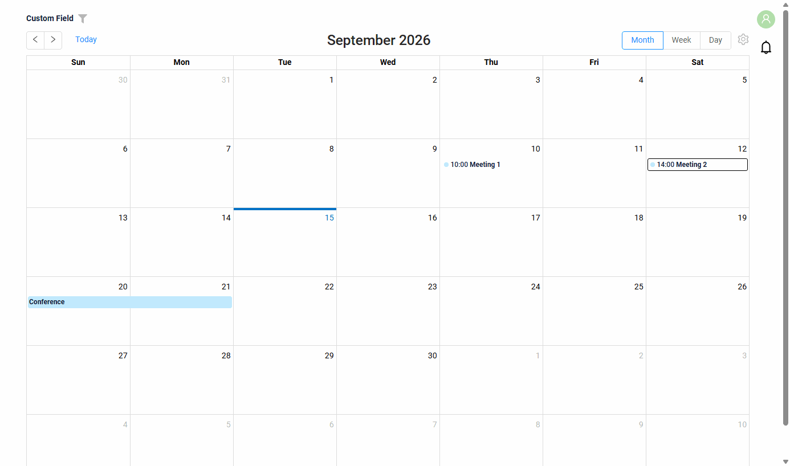
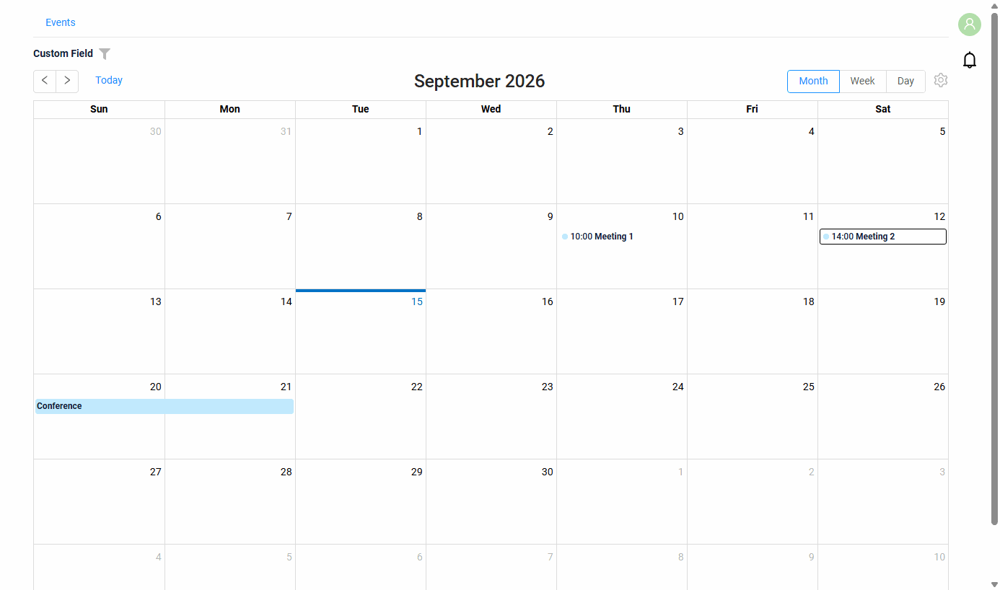
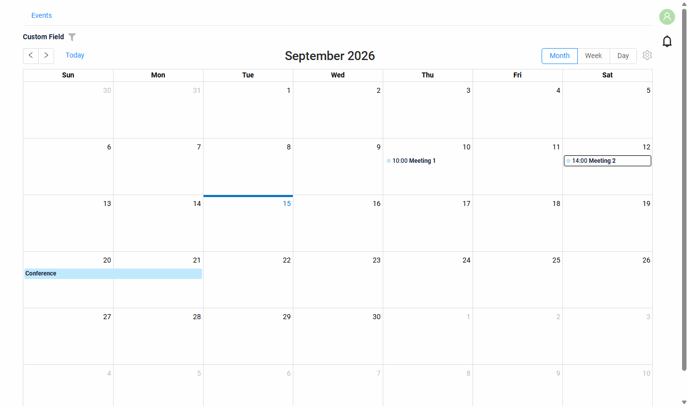

# CalendarList

Виджет `CalendarList` показывает записи как события календаря: за месяц, неделю или день.

## Основы { #basics }
[:material-play-circle: Живой пример]({{ external_links.code_samples }}/ui/#/screen/myexample5055){:target="_blank"} ·
[:fontawesome-brands-github: GitHub]({{ external_links.github_ui }}/{{ external_links.github_branch }}/src/main/java/org/demo/documentation/widgets/calendarlist/base/events){:target="_blank"}

### Как это выглядит? { #how-does-it-look }


Запись отображается как событие с помощью трёх полей виджета:

* поле названия — значение, отображаемое в событии;
* поля начала и окончания — поля `dateTime` с периодом события.

**options.calendar**

Поля события задаются в **options**.**calendar** файла **_.widget.json_**.

??? Example "Пример"

    | Свойство        | Тип    | По умолчанию | Описание                                                  |
    |-----------------|--------|---------|-----------------------------------------------------------|
    | `valueFieldKey` | String | `value` | Имя поля, отображаемого как название события.             |
    | `startFieldKey` | String | `start` | Имя поля `dateTime` с началом события.                    |
    | `endFieldKey`   | String | `end`   | Имя поля `dateTime` с окончанием события.                 |

!!! info
    У поля названия может быть drilldown: клик по названию события открывает ссылку, клик по остальной части события открывает форму редактирования. см. [Редактирование](#editwithwidget)

###  <a id="Howtoaddbacis">Как добавить?</a>
??? Example "Пример"
    **Шаг 1** Создайте файл **_.widget.json_** с type = **"CalendarList"**. Добавьте поля события и **options.calendar**.
    ```json
    --8<--
    {{ external_links.github_raw_doc }}/widgets/calendarlist/base/events/MyExample5055List.widget.json
    --8<--
    ```

    **Шаг 2** Добавьте виджет в соответствующий **_.view.json_**.
    ```json
    --8<--
    {{ external_links.github_raw_doc }}/widgets/calendarlist/base/events/myexample5055list.view.json
    --8<--
    ```

## <a id="Title">Заголовок</a>
[:material-play-circle: Живой пример]({{ external_links.code_samples }}/ui/#/screen/myexample5066){:target="_blank"} ·
[:fontawesome-brands-github: GitHub]({{ external_links.github_ui }}/{{ external_links.github_branch }}/src/main/java/org/demo/documentation/widgets/calendarlist/title){:target="_blank"}

!!! info
    Заголовок в этом релизе **недоступен**: виджет не отображает заголовок.

## <a id="Color">Цвет</a>
`Color` позволяет задать цвет событий. Он задаётся для поля названия события (`valueFieldKey`) и может быть постоянным или вычисляемым.

**Вычисляемый цвет**

[:material-play-circle: Живой пример]({{ external_links.code_samples }}/ui/#/screen/myexample5056/view/myexample5056list){:target="_blank"} ·
[:fontawesome-brands-github: GitHub]({{ external_links.github_ui }}/{{ external_links.github_branch }}/src/main/java/org/demo/documentation/widgets/calendarlist/color){:target="_blank"}

*Вычисляемый цвет* можно использовать для динамического изменения цвета события. Он меняется в зависимости от бизнес-логики или данных приложения.

**Постоянный цвет**

[:material-play-circle: Живой пример]({{ external_links.code_samples }}/ui/#/screen/myexample5056/view/myexample5056listcolorconst){:target="_blank"} ·
[:fontawesome-brands-github: GitHub]({{ external_links.github_ui }}/{{ external_links.github_branch }}/src/main/java/org/demo/documentation/widgets/calendarlist/color){:target="_blank"}

*Постоянный цвет* — фиксированный цвет, который не меняется. Он остаётся одинаковым независимо от каких-либо факторов в приложении.

##### Как это выглядит? { #how-does-it-look_1 }


##### Как добавить? { #how-to-add }
??? Example "Пример"
    === "Вычисляемый цвет"

        **Шаг 1**   Добавьте `собственное поле для цвета` в соответствующий **DataResponseDTO**. Поле может содержать цвет в формате HEX или быть null.
        ```java
        --8<--
        {{ external_links.github_raw_doc }}/widgets/calendarlist/color/MyExample5056DTO.java:colorDTO
        --8<--
        ```

        **Шаг 2** Добавьте **"bgColorKey"** :  `собственное поле для цвета` к полю названия события в .widget.json.

        ```json
        --8<--
        {{ external_links.github_raw_doc }}/widgets/calendarlist/color/MyExample5056.widget.json
        --8<--
        ```

        [:material-play-circle: Живой пример]({{ external_links.code_samples }}/ui/#/screen/myexample5056/view/myexample5056list){:target="_blank"} ·
        [:fontawesome-brands-github: GitHub]({{ external_links.github_ui }}/{{ external_links.github_branch }}/src/main/java/org/demo/documentation/widgets/calendarlist/color){:target="_blank"}

    === "Постоянный цвет"

        Добавьте **"bgColor"** :  `цвет HEX` к полю названия события в .widget.json.

        ```json
        --8<--
        {{ external_links.github_raw_doc }}/widgets/calendarlist/color/MyExample5056ColorConst.widget.json
        --8<--
        ```

        [:material-play-circle: Живой пример]({{ external_links.code_samples }}/ui/#/screen/myexample5056/view/myexample5056listcolorconst){:target="_blank"} ·
        [:fontawesome-brands-github: GitHub]({{ external_links.github_ui }}/{{ external_links.github_branch }}/src/main/java/org/demo/documentation/widgets/calendarlist/color){:target="_blank"}

## <a id="bc">Бизнес-компонент</a>
Указывает бизнес-компонент (BC), к которому относится этот виджет.
Бизнес-компонент представляет определённую часть системы, отвечающую за конкретную бизнес-логику или данные.

подробнее см. [Бизнес-компонент](/ru/environment/businesscomponent/businesscomponent/)

## <a id="Showcondition">Условие отображения</a>

* `без условия отображения — рекомендуется`: виджет виден всегда

  [:material-play-circle: Живой пример]({{ external_links.code_samples }}/ui/#/screen/myexample5055){:target="_blank"} ·
  [:fontawesome-brands-github: GitHub]({{ external_links.github_ui }}/{{ external_links.github_branch }}/src/main/java/org/demo/documentation/widgets/calendarlist/base/events){:target="_blank"}

* `условие отображения по текущей сущности`: **не рекомендуется** для календаря.

  [:material-play-circle: Живой пример]({{ external_links.code_samples }}/ui/#/screen/myexample5057){:target="_blank"} ·
  [:fontawesome-brands-github: GitHub]({{ external_links.github_ui }}/{{ external_links.github_branch }}/src/main/java/org/demo/documentation/widgets/calendarlist/showcondition/bycurrententity){:target="_blank"}

* `условие отображения по родительской сущности`: условие может содержать логическое выражение, зависящее от родительской сущности. Обновление полей родителя вызывает пересчёт условия только при сохранении или если поле force active и отображается на том же view

  [:material-play-circle: Живой пример]({{ external_links.code_samples }}/ui/#/screen/myexample5057/view/myexample5059showcond){:target="_blank"} ·
  [:fontawesome-brands-github: GitHub]({{ external_links.github_ui }}/{{ external_links.github_branch }}/src/main/java/org/demo/documentation/widgets/calendarlist/showcondition/byparententity){:target="_blank"}

!!! tips "Совет"
    По возможности рекомендуется не использовать `Show condition`, так как широкое применение этой возможности усложняет поддержку приложения.

#### <a id="howdoesitlook">Как это выглядит?</a>
=== "без условия отображения"
    
=== "условие отображения по текущей сущности"
    **Не рекомендуется** для календаря.
=== "условие отображения по родительской сущности"
    

#### <a id="howtoadd">Как добавить?</a>
??? Example "Пример"

    === "без условия отображения"
        см. [Основы](#Howtoaddbacis)

    === "условие отображения по текущей сущности"
        **Не рекомендуется** для календаря.

        **Шаг 1** Добавьте **showCondition** в **_.widget.json_**. Подробнее см. [showCondition](/ru/widget/type/property/showcondition/showcondition)
        ```json
        --8<--
        {{ external_links.github_raw_doc }}/widgets/calendarlist/showcondition/bycurrententity/MyExample5057ShowCond.widget.json
        --8<--
        ```
        [:material-play-circle: Живой пример]({{ external_links.code_samples }}/ui/#/screen/myexample5057){:target="_blank"} ·
        [:fontawesome-brands-github: GitHub]({{ external_links.github_ui }}/{{ external_links.github_branch }}/src/main/java/org/demo/documentation/widgets/calendarlist/showcondition/bycurrententity){:target="_blank"}

    === "условие отображения по родительской сущности"
        **Шаг 1** Добавьте **showCondition** в **_.widget.json_**. Подробнее см. [showCondition](/ru/widget/type/property/showcondition/showcondition)
        ```json
        --8<--
        {{ external_links.github_raw_doc }}/widgets/calendarlist/showcondition/byparententity/MyExample5059Child.widget.json
        --8<--
        ```
        [:material-play-circle: Живой пример]({{ external_links.code_samples }}/ui/#/screen/myexample5057/view/myexample5059showcond){:target="_blank"} ·
        [:fontawesome-brands-github: GitHub]({{ external_links.github_ui }}/{{ external_links.github_branch }}/src/main/java/org/demo/documentation/widgets/calendarlist/showcondition/byparententity){:target="_blank"}

## <a id="fields">Поля</a>
Настройка полей. Массив fields определяет поля события (см. [options.calendar](#basics)) и поля, доступные для фильтрации.

```json
{
    "title": "Custom Field",
    "key": "customField",
    "type": "input"
}
```

* **"title"**

  Описание: заголовок поля.

  Тип: String (необязательно).

* **"key"**

    Описание: имя поля в соответствующем DataResponseDTO.

    Тип: String (обязательно).

* **"type"**

  Описание: [Типы полей](/ru/widget/fields/fieldtypes/)

  Тип: String (обязательно).

### Как добавить? { #how-to-add_1 }
??? Example "Пример"

    Добавьте поле в **_.widget.json_**.

    ```json
    --8<--
    {{ external_links.github_raw_doc }}/widgets/calendarlist/base/events/MyExample5055List.widget.json
    --8<--
    ```

## <a id="Fieldslayout">Компоновка (options layout)</a>
**options.layout** — в этом типе не используется.

## <a id="actions">Действия</a>
`Actions` отображают доступные действия в виде отдельных кнопок, подробнее см. [Действия](/ru/features/element/actions/actions).

#### Создание { #create }
Кнопка `Create` позволяет создать новую запись. Способы создания записи:

* Inline: в этом релизе **недоступно**.

* [Inline-form](#withwidget): данные можно добавить с помощью виджета формы во всплывающем окне поверх календаря. Используется по умолчанию, если задан `options.create.widget`.

* [With view](#withview): запись можно создать, перейдя в отдельный view.

##### <a id="withwidget">Inline-form</a>
[:material-play-circle: Живой пример]({{ external_links.code_samples }}/ui/#/screen/myexample5061){:target="_blank"} ·
[:fontawesome-brands-github: GitHub]({{ external_links.github_ui }}/{{ external_links.github_branch }}/src/main/java/org/demo/documentation/widgets/calendarlist/actions/create/withwidget){:target="_blank"}

`Create with widget` открывает виджет формы из `options.create` во всплывающем окне поверх календаря при нажатии кнопки "Create". После заполнения информации и нажатия "Save" окно закрывается, а новое событие отображается в календаре.

`options.create.style`:

* `inlineForm` (по умолчанию) или `popup`: форма отображается во всплывающем окне;
* `none`: формы нет.

Ширина всплывающего окна — это `gridWidth` виджета формы в **_.view.json_**, как и для других всплывающих виджетов.

###### Как это выглядит? { #how-does-it-look_2 }


###### Как добавить? { #how-to-add_2 }
??? Example "Пример"

    **Шаг 1** Добавьте кнопку `create` в соответствующий **VersionAwareResponseService**.
    ```java
    --8<--
    {{ external_links.github_raw_doc }}/widgets/calendarlist/actions/create/withwidget/MyExample5061Service.java:getActions
    --8<--
    ```
    **Шаг 2** Добавьте **fields.setEnabled** в соответствующий **FieldMetaBuilder**.
    ```java
    --8<--
    {{ external_links.github_raw_doc }}/widgets/calendarlist/actions/create/withwidget/MyExample5061Meta.java:buildRowDependentMeta
    --8<--
    ```

     **Шаг 3** Создайте widget.json с типом `Form`, который появляется при нажатии кнопки
    ```json
    --8<--
    {{ external_links.github_raw_doc }}/widgets/calendarlist/actions/create/withwidget/myEntity5061CreateForm.widget.json
    --8<--
    ```

     **Шаг 4** Добавьте widget.json с типом `Form` в соответствующий **.view.json**. `gridWidth` — ширина всплывающего окна.
    ```json
    --8<--
    {{ external_links.github_raw_doc }}/widgets/calendarlist/actions/create/withwidget/myexample5061list.view.json
    --8<--
    ```

     **Шаг 5** Добавьте кнопку `create` и виджет с типом `Form` в соответствующий **.widget.json**.

    `options`.`create`: имя виджета, который появляется при нажатии кнопки

    ```json
    --8<--
    {{ external_links.github_raw_doc }}/widgets/calendarlist/actions/create/withwidget/MyExample5061.widget.json
    --8<--
    ```

    [:material-play-circle: Живой пример]({{ external_links.code_samples }}/ui/#/screen/myexample5061){:target="_blank"} ·
    [:fontawesome-brands-github: GitHub]({{ external_links.github_ui }}/{{ external_links.github_branch }}/src/main/java/org/demo/documentation/widgets/calendarlist/actions/create/withwidget){:target="_blank"}

##### <a id="withview">With view</a>
[:material-play-circle: Живой пример]({{ external_links.code_samples }}/ui/#/screen/myexample5062){:target="_blank"} ·
[:fontawesome-brands-github: GitHub]({{ external_links.github_ui }}/{{ external_links.github_branch }}/src/main/java/org/demo/documentation/widgets/calendarlist/actions/create/newview){:target="_blank"}

При `Create with view` нажатие кнопки "Create" открывает отдельный view, отображающий только форму ввода данных. После заполнения формы и сохранения система возвращается в календарь с новым событием.

###### Как это выглядит? { #how-does-it-look_3 }


###### Как добавить? { #how-to-add_3 }
??? Example "Пример"

    **Шаг 1** Добавьте кнопку `create` в соответствующий **VersionAwareResponseService**.
    ```java
    --8<--
    {{ external_links.github_raw_doc }}/widgets/calendarlist/actions/create/newview/MyExample5062Service.java:getActions
    --8<--
    ```
     **Шаг 2** Добавьте **PostAction.drillDown** в метод **doCreateEntity** соответствующего **VersionAwareResponseService**.
    ```java
    --8<--
    {{ external_links.github_raw_doc }}/widgets/calendarlist/actions/create/newview/MyExample5062Service.java:doCreateEntity
    --8<--
    ```
    **Шаг 3** Добавьте кнопку `create` в соответствующий **.widget.json**.
    ```json
    --8<--
    {{ external_links.github_raw_doc }}/widgets/calendarlist/actions/create/newview/MyExample5062.widget.json
    --8<--
    ```

    [:material-play-circle: Живой пример]({{ external_links.code_samples }}/ui/#/screen/myexample5062){:target="_blank"} ·
    [:fontawesome-brands-github: GitHub]({{ external_links.github_ui }}/{{ external_links.github_branch }}/src/main/java/org/demo/documentation/widgets/calendarlist/actions/create/newview){:target="_blank"}

#### Редактирование { #edit }
`Edit` позволяет изменить значение поля. Способы редактирования записи:

* Inline edit: в этом релизе **недоступно**.

* [Inline-form](#editwithwidget): клик по событию открывает виджет формы во всплывающей панели рядом с событием.

* [With view](#editwithview): запись можно отредактировать, перейдя в отдельный view.

##### <a id="editwithwidget">Inline-form</a>
[:material-play-circle: Живой пример]({{ external_links.code_samples }}/ui/#/screen/myexample5064){:target="_blank"} ·
[:fontawesome-brands-github: GitHub]({{ external_links.github_ui }}/{{ external_links.github_branch }}/src/main/java/org/demo/documentation/widgets/calendarlist/actions/edit/withwidget){:target="_blank"}

`Edit with widget` открывает виджет формы из `options.edit` во всплывающей панели при клике по событию. Действия записи находятся в меню с тремя точками формы.

`options.edit.style`:

* `inlineForm` (по умолчанию): форма отображается во всплывающей панели у события;
* `popup`: форма отображается во всплывающем окне поверх календаря, как форма `options.create`;
* `none`: формы нет.

Ширина всплывающей панели или окна — это `gridWidth` виджета формы в **_.view.json_**.

###### Как это выглядит? { #how-does-it-look_4 }


###### Как добавить? { #how-to-add_4 }
??? Example "Пример"

    **Шаг 1** Добавьте кнопку `save` в соответствующий **VersionAwareResponseService**.
    ```java
    --8<--
    {{ external_links.github_raw_doc }}/widgets/calendarlist/actions/edit/withwidget/MyExample5064Service.java:getActions
    --8<--
    ```

    **Шаг 2** Добавьте **fields.setEnabled** в соответствующий **FieldMetaBuilder**.
    ```java
    --8<--
    {{ external_links.github_raw_doc }}/widgets/calendarlist/actions/edit/withwidget/MyExample5064Meta.java:buildRowDependentMeta
    --8<--
    ```

    **Шаг 3**  Создайте widget.json с типом `Form`, который появляется при клике по событию
    ```json
    --8<--
    {{ external_links.github_raw_doc }}/widgets/calendarlist/actions/edit/withwidget/myEntity5064EditForm.widget.json
    --8<--
    ```

     **Шаг 4** Добавьте widget.json с типом `Form` в соответствующий **.view.json**. `gridWidth` — ширина всплывающей панели.
    ```json
    --8<--
    {{ external_links.github_raw_doc }}/widgets/calendarlist/actions/edit/withwidget/myexample5064list.view.json
    --8<--
    ```

     **Шаг 5** Добавьте виджет с типом `Form` в соответствующий **.widget.json**.

    `options`.`edit`: имя виджета, который появляется при клике по событию

    ```json
    --8<--
    {{ external_links.github_raw_doc }}/widgets/calendarlist/actions/edit/withwidget/MyExample5064.widget.json
    --8<--
    ```

    [:material-play-circle: Живой пример]({{ external_links.code_samples }}/ui/#/screen/myexample5064){:target="_blank"} ·
    [:fontawesome-brands-github: GitHub]({{ external_links.github_ui }}/{{ external_links.github_branch }}/src/main/java/org/demo/documentation/widgets/calendarlist/actions/edit/withwidget){:target="_blank"}

##### <a id="editwithview">With view</a>
[:material-play-circle: Живой пример]({{ external_links.code_samples }}/ui/#/screen/myexample5065){:target="_blank"} ·
[:fontawesome-brands-github: GitHub]({{ external_links.github_ui }}/{{ external_links.github_branch }}/src/main/java/org/demo/documentation/widgets/calendarlist/actions/edit/newview){:target="_blank"}

При `Edit with view` сущность можно редактировать в отдельном view, отображающем только форму ввода данных. Выберите пункт "Edit" в меню с тремя точками события.

###### Как это выглядит? { #how-does-it-look_5 }


###### Как добавить? { #how-to-add_5 }
??? Example "Пример"

    **Шаг 1** Добавьте действие *edit* в соответствующий **VersionAwareResponseService**.

    Добавьте **PostAction.drillDown** в метод *edit*

    ```java
    --8<--
    {{ external_links.github_raw_doc }}/widgets/calendarlist/actions/edit/newview/MyExample5065Service.java:getActions
    --8<--
    ```
    **Шаг 2** Добавьте кнопку или группу кнопок в соответствующий **.widget.json**.

    ```json
    --8<--
    {{ external_links.github_raw_doc }}/widgets/calendarlist/actions/edit/newview/MyExample5065.widget.json
    --8<--
    ```
    [:material-play-circle: Живой пример]({{ external_links.code_samples }}/ui/#/screen/myexample5065){:target="_blank"} ·
    [:fontawesome-brands-github: GitHub]({{ external_links.github_ui }}/{{ external_links.github_branch }}/src/main/java/org/demo/documentation/widgets/calendarlist/actions/edit/newview){:target="_blank"}

### Дополнительные свойства { #additional-properties }
#### Настройка отображаемых колонок { #customization-of-displayed-columns }
_неприменимо_: у календаря нет колонок.

#### Фильтрация { #filtration }
Поля виджета с фильтром отображаются над календарём; поля начала и окончания события там не отображаются — по ним записи фильтрует отображаемый период.



подробнее см. [Поля](/ru/widget/type/property/filtration/filtration/)

#### <a id="pagination">Пагинация</a>
Периоды календаря — это его страницы: стрелки переходят к следующему и предыдущему месяцу, неделе или дню, "Today" возвращает к текущему периоду.
Записи отображаемого периода запрашиваются с фильтром по полям начала и окончания.



#### <a id="monthweekday">Месяц / Неделя / День</a>
Кнопки "Month", "Week", "Day" на панели инструментов показывают события за месяц, неделю или день:

* `Month` (по умолчанию): события месяца по дням; в дне отображается до 5 событий, остальные — за "+N more";
* `Week`, `Day`: события распределяются по часам.


