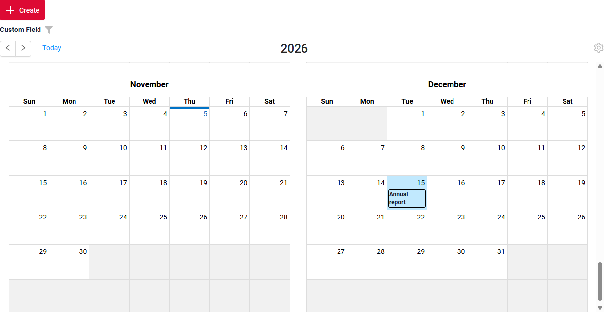
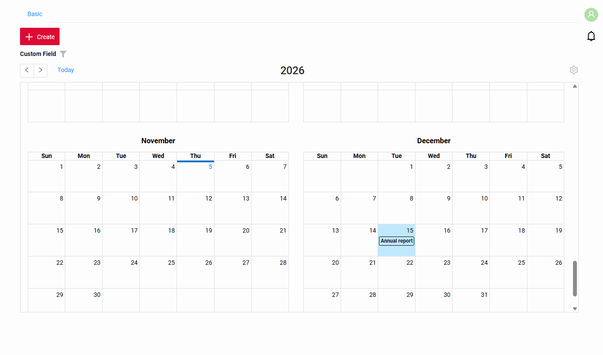

# CalendarYearList

`CalendarYearList` widget shows the records as events of a year calendar: twelve months of a year, an event takes one whole day.
It is used for the events of a day: holidays, deadlines, reports. For the events with a time, use [CalendarList](/widget/type/calendarlist/calendarlist).

## Basics
[:material-play-circle: Live Sample]({{ external_links.code_samples }}/ui/#/screen/myexample5039){:target="_blank"} ·
[:fontawesome-brands-github: GitHub]({{ external_links.github_ui }}/{{ external_links.github_branch }}/src/main/java/org/demo/documentation/widgets/calendaryearlist/base){:target="_blank"}

### How does it look?


A record is shown as an event by three fields of the widget:

* a title field — the value shown in the event;
* a start field and an end field — `dateTime` (or `date`) fields with the day of the event.

The year calendar has rules for the data:

* an event is one whole day: the start is the beginning of the day (00:00), the end is the end of the same day (23:59 for `dateTime`);
* one event per day.

When a record breaks the rules, the calendar is not drawn, see [Incorrect data](#incorrectdata).

**options.calendar**

The fields of the event are set in **options**.**calendar** of **_.widget.json_**.

??? Example

    | Property        | Type   | Default | Description                                               |
    |-----------------|--------|---------|-----------------------------------------------------------|
    | `valueFieldKey` | String | `value` | Name of the field shown as the title of the event.        |
    | `startFieldKey` | String | `start` | Name of the field with the start of the event.            |
    | `endFieldKey`   | String | `end`   | Name of the field with the end of the event.              |

###  <a id="Howtoaddbacis">How to add?</a>
??? Example
    **Step1** Create **DataResponseDTO** with the title field and the start and end fields.
    The start and end fields have **@SearchParameter**: the calendar filters the records by the shown year.
    ```java
    --8<--
    {{ external_links.github_raw_doc }}/widgets/calendaryearlist/base/MyExampleBc5039DTO.java
    --8<--
    ```

    **Step2** Fill the start and the end of the events by the boundaries of a day.
    ```java
    --8<--
    {{ external_links.github_raw_doc }}/widgets/calendaryearlist/base/MyEntity5039TestDataLoadService.java:events
    --8<--
    ```

    **Step3** Add **fields.enableFilter** for the start and end fields to corresponding **FieldMetaBuilder**.
    ```java
    --8<--
    {{ external_links.github_raw_doc }}/widgets/calendaryearlist/base/MyExampleBc5039MetaBuilder.java
    --8<--
    ```

    **Step4** Create file **_.widget.json_** with type = **"CalendarYearList"**. Add the fields of the event and **options.calendar**.
    ```json
    --8<--
    {{ external_links.github_raw_doc }}/widgets/calendaryearlist/base/myexample5039.widget.json
    --8<--
    ```

    **Step5** Add widget to corresponding **_.view.json_**.
    ```json
    --8<--
    {{ external_links.github_raw_doc }}/widgets/calendaryearlist/base/myexample5039.view.json
    --8<--
    ```

    **Step6** Set the page limit of the business component to the number of events of a year, for example 1000.
    When the business component has more records than the limit, the widget shows only the table. See [Page limit](#pagelimit).
    ```csv
    BC;PAGE_LIMIT;MASS_PAGE_LIMIT;SORT;FILTER;ID
    myExampleBc5039;1000;NULL;NULL;'""';
    ```

## <a id="Title">Title</a>
!!! info
    Title is **not available** in this release: the widget does not show a title.

## <a id="Color">Color</a>
The color of the events is set for the title field of the event (`valueFieldKey`), as in [CalendarList](/widget/type/calendarlist/calendarlist/#Color):
`bgColorKey` for a calculated color, `bgColor` for a constant color.

## <a id="bc">Business component</a>
This specifies the business component (BC) to which this widget belongs.
A business component represents a specific part of a system that handles a particular business logic or data.

see more  [Business component](/environment/businesscomponent/businesscomponent/)

## <a id="Showcondition">Show condition</a>
* `no show condition - recommended`: widget always visible

  [:material-play-circle: Live Sample]({{ external_links.code_samples }}/ui/#/screen/myexample5039){:target="_blank"} ·
  [:fontawesome-brands-github: GitHub]({{ external_links.github_ui }}/{{ external_links.github_branch }}/src/main/java/org/demo/documentation/widgets/calendaryearlist/base){:target="_blank"}

* `show condition by current entity`, `show condition by parent entity`: as in [CalendarList](/widget/type/calendarlist/calendarlist/#Showcondition).

!!! tips
    It is recommended not to use `Show condition` when possible, because wide usage of this feature makes application hard to support.

## <a id="fields">Fields</a>
Fields Configuration. The fields array defines the fields of the event (see [options.calendar](#basics)), the fields available for filtration
and the columns of the [table mode](#tablemode).

```json
{
    "title": "Custom Field",
    "key": "customField",
    "type": "input"
}
```

* **"title"**

  Description:  Field Title.

  Type: String(optional).

* **"key"**

    Description: Name field to corresponding DataResponseDTO.

    Type: String(required).

* **"type"**

  Description: [Field types](/widget/fields/fieldtypes/). The start and end fields: `date`, `dateTime` or `dateTimeWithSeconds`.
  The type sets how exactly the boundaries of the day are checked: to a day, a minute or a second.

  Type: String(required).

### How to add?
??? Example

    Add field to **_.widget.json_**.

    ```json
    --8<--
    {{ external_links.github_raw_doc }}/widgets/calendaryearlist/base/myexample5039.widget.json
    --8<--
    ```

## <a id="Fieldslayout">Options layout</a>
**options.layout** - no use in this type.

## <a id="actions">Actions</a>
`Actions` show available actions as separate buttons above the calendar see more [Actions](/features/element/actions/actions).

A click on an event selects the record. The actions of the record are in the three-dot menu that appears when the mouse is over the event.

The form widget of `options.edit` opens at the event on click, as in [CalendarList](/widget/type/calendarlist/calendarlist/#editwithwidget).
When a record is created, the widget switches to the table mode.

### Additional properties
#### Customization of displayed columns
_not applicable_: the calendar has no columns.

#### <a id="pagination">Year navigation</a>
The years of the calendar are its pages: the arrows go to the next and the previous year, "Today" returns to the current year.
The months of the year are scrolled inside the widget; on opening, the calendar is scrolled to the current month.
The records of the shown year are requested with the filters by the start and the end fields.



#### Filtration
The fields of the widget with a filter are shown above the calendar; the start and the end fields of the event are not shown there, the shown year filters the records by them.

see more  [Filtration](/widget/type/property/filtration/filtration/)

#### <a id="drilldown">Drilldown</a>
The title field can have a drilldown: a click on the title of the event opens the link.
see more [DrillDown](/advancedCustomization/element/drillDown/drillDown)

#### <a id="tablemode">Table mode</a>
The settings icon of the widget opens the `Mode` menu with `Calendar` and `Table`. In the table mode the widget shows the records
as a table with a column per field of the widget. After the switch back to the calendar, the calendar shows the year of the filter of the table.


#### <a id="incorrectdata">Incorrect data</a>
When a record of the shown data breaks the [rules](#basics) — the start or the end is empty, the event is not one whole day,
or a day has two events — the calendar is not drawn: the widget opens in the table mode, the `Calendar` mode is disabled
and a warning icon shows `There is incorrect data, only table mode is available`.

#### <a id="pagelimit">Page limit</a>
When the business component has more records than the page limit, the calendar is not drawn: the widget opens in the table mode,
the `Calendar` mode is disabled and a warning icon explains why.
see more [Page limit](/widget/type/property/defaultlimitpage/defaultlimitpage)
