# CardList

Виджет `CardList` показывает записи в виде карточек файлов, расположенных рядами. Каждая карточка показывает предпросмотр файла записи, название, описание и статус.
Пользователь листает страницы, выбирает карточку кликом, а также открывает, редактирует и удаляет файлы прямо на карточках.

!!! info "CardList и CardCarouselList"
    [CardList](/ru/widget/type/cardlist/cardlist) и [CardCarouselList](/ru/widget/type/cardcarousellist/cardcarousellist) показывают одинаковые карточки и настраиваются одинаково. Оба загружают по одной странице записей: по умолчанию 5, задаётся [лимитом записей на странице](/ru/widget/type/property/defaultlimitpage/defaultlimitpage).

    * **CardList**: любое количество записей. Кнопки страниц под карточками открывают следующие страницы.
    * **CardCarouselList**: только записи первой страницы. Стрелки прокручивают карточки этой страницы, следующей страницы нет. Чтобы показать все записи, задайте лимит страницы равным их количеству, до 20: вся страница загружается сразу.

## Основы { #basics }
[:material-play-circle: Живой пример]({{ external_links.code_samples }}/ui/#/screen/myexample5300){:target="_blank"} ·
[:fontawesome-brands-github: GitHub]({{ external_links.github_ui }}/{{ external_links.github_branch }}/src/main/java/org/demo/documentation/widgets/cardlist/base){:target="_blank"}

### Как это выглядит? { #how-does-it-look }
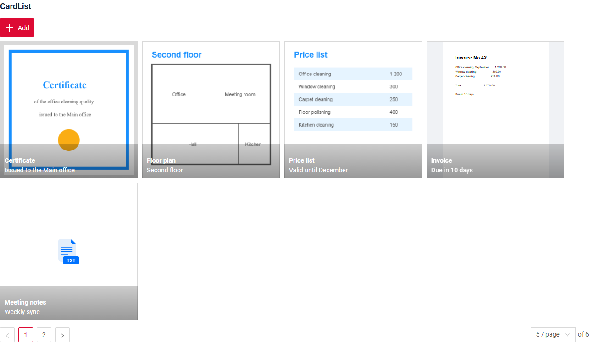

Виджету нужно одно поле типа [fileUpload](/ru/widget/fields/field/fileUpload/fileUpload/). Карточка показывает этот файл.
Без других настроек название карточки — имя файла. В примере название и описание берутся из полей, см. [Параметры карточки](#cardoptions).

* Одна карточка — одна запись бизнес-компонента.
* Карточки заполняют ширину виджета и продолжаются в следующем ряду. Пагинация под карточками переключает страницы, см. [Пагинация](#pagination).
* Клик по карточке делает её текущей записью.

###  <a id="Howtoaddbacis">Как добавить?</a>
??? Example "Пример"
    **Шаг 1** Создайте файл **_.widget.json_** с type = **"CardList"**.
    Добавьте поле с типом `fileUpload` и поля для названия и описания. Задайте их в `options.card`. Подробнее см. [Поля](#fields)
    ```json
    --8<--
    {{ external_links.github_raw_doc }}/widgets/cardlist/base/MyExample5300CardList.widget.json
    --8<--
    ```

    **Шаг 2** Добавьте виджет в соответствующий **_.view.json_**.

    ```json
    --8<--
    {{ external_links.github_raw_doc }}/widgets/cardlist/base/myexample5300list.view.json
    --8<--
    ```

## Основные визуальные части { #main-visual-parts }
[:material-play-circle: Живой пример]({{ external_links.code_samples }}/ui/#/screen/myexample5300){:target="_blank"} ·
[:fontawesome-brands-github: GitHub]({{ external_links.github_ui }}/{{ external_links.github_branch }}/src/main/java/org/demo/documentation/widgets/cardlist/base){:target="_blank"}


* `preview` — файл поля fileUpload. см. [Предпросмотр](#preview)
* `status` — значение первого поля **dictionary**, в середине карточки. см. [Статус](#status)
* `title` — имя файла или поле из `titleFieldKey`. см. [Параметры карточки](#cardoptions)
* `description` — поле из `descriptionFieldKey`, под названием. см. [Параметры карточки](#cardoptions)
* `actions` — действия записи в виде иконок. Отображаются при наведении мыши на карточку. см. [Действия](#actions)
* `pagination` — переключает страницы карточек. см. [Пагинация](#pagination)
* `read widget` — файл выбранной карточки, крупно, над карточками. см. [Read widget](#read)

## <a id="Title">Заголовок</a>
[:material-play-circle: Живой пример]({{ external_links.code_samples }}/ui/#/screen/myexample5301){:target="_blank"} ·
[:fontawesome-brands-github: GitHub]({{ external_links.github_ui }}/{{ external_links.github_branch }}/src/main/java/org/demo/documentation/widgets/cardlist/title){:target="_blank"}

### Базовый заголовок { #title-basic }
`Title` для виджета (необязательно)

Типы:

* `постоянный заголовок`: показывает постоянный текст.
* `пустой постоянный заголовок`: если нужно визуально связать виджеты, расположив их один под другим

#### Как это выглядит? { #how-does-it-look_1 }
=== "Постоянный заголовок"
    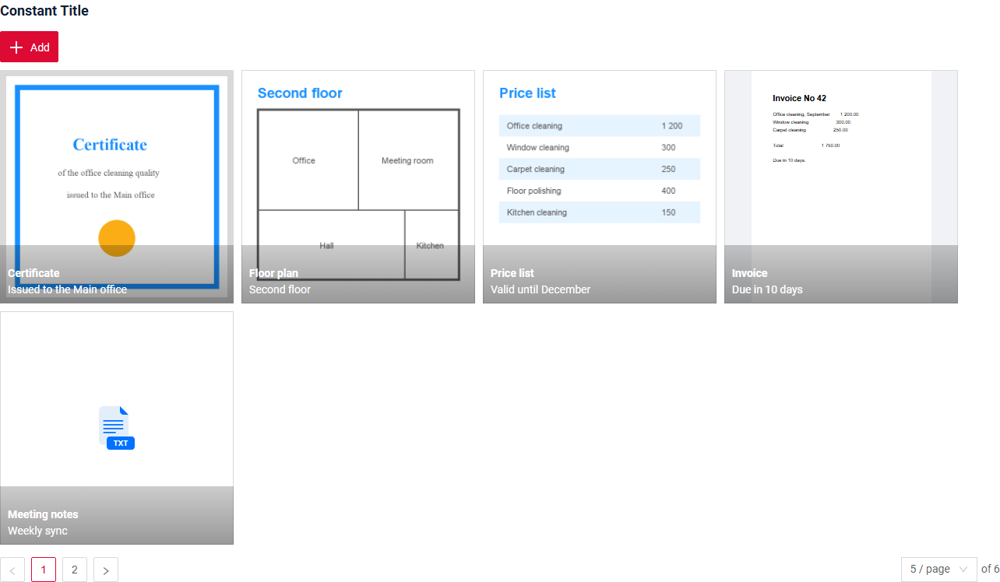
=== "Пустой постоянный заголовок"
    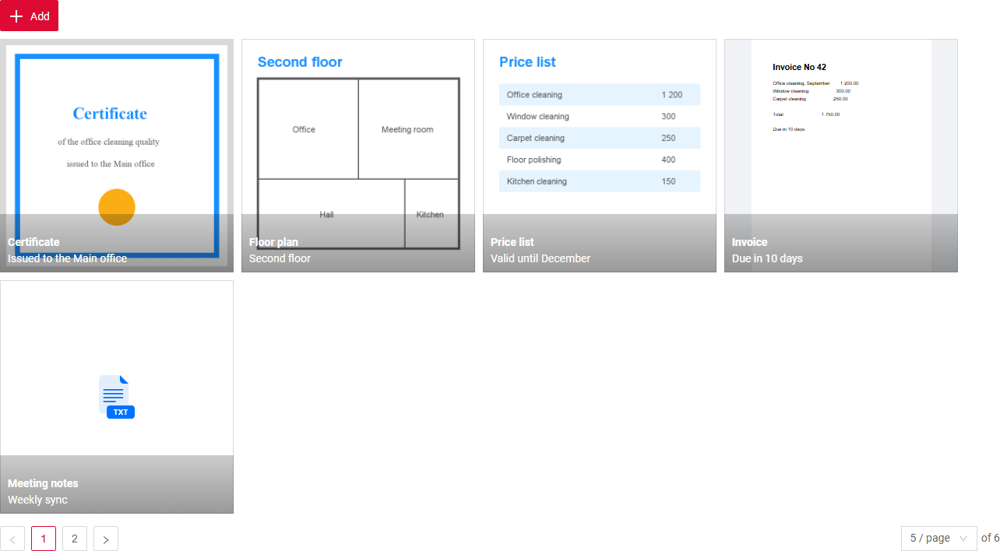

#### Как добавить? { #how-to-add }
??? Example "Пример"
    === "Постоянный заголовок"
        **Шаг 1** Добавьте название в **title** в **_.widget.json_**.
        ```json
        --8<--
        {{ external_links.github_raw_doc }}/widgets/cardlist/title/MyExample5301CardList.widget.json
        --8<--
        ```
        [:material-play-circle: Живой пример]({{ external_links.code_samples }}/ui/#/screen/myexample5301/view/myexample5301title){:target="_blank"} ·
        [:fontawesome-brands-github: GitHub]({{ external_links.github_ui }}/{{ external_links.github_branch }}/src/main/java/org/demo/documentation/widgets/cardlist/title){:target="_blank"}

    === "Пустой постоянный заголовок"
        **Шаг 1** Удалите параметр **title** из **_.widget.json_**.
        ```json
        --8<--
        {{ external_links.github_raw_doc }}/widgets/cardlist/title/MyExample5301EmptyTitle.widget.json
        --8<--
        ```
        [:material-play-circle: Живой пример]({{ external_links.code_samples }}/ui/#/screen/myexample5301/view/myexample5301emptytitle){:target="_blank"} ·
        [:fontawesome-brands-github: GitHub]({{ external_links.github_ui }}/{{ external_links.github_branch }}/src/main/java/org/demo/documentation/widgets/cardlist/title){:target="_blank"}

### Цвет заголовка { #title-color }
`Title Color` позволяет задать цвет заголовка. Он может быть постоянным или вычисляемым.
Заголовок показывает значения полей текущей записи, то есть выбранной карточки.

**Постоянный цвет**

[:material-play-circle: Живой пример]({{ external_links.code_samples }}/ui/#/screen/myexample5302/view/myexample5302colorconst){:target="_blank"} ·
[:fontawesome-brands-github: GitHub]({{ external_links.github_ui }}/{{ external_links.github_branch }}/src/main/java/org/demo/documentation/widgets/cardlist/colortitle){:target="_blank"}

*Постоянный цвет* — фиксированный цвет, который не меняется. Он остаётся одинаковым независимо от каких-либо факторов в приложении.

**Вычисляемый цвет**

[:material-play-circle: Живой пример]({{ external_links.code_samples }}/ui/#/screen/myexample5302/view/myexample5302color){:target="_blank"} ·
[:fontawesome-brands-github: GitHub]({{ external_links.github_ui }}/{{ external_links.github_branch }}/src/main/java/org/demo/documentation/widgets/cardlist/colortitle){:target="_blank"}

*Вычисляемый цвет* можно использовать для динамического изменения цвета заголовка. Он меняется в зависимости от бизнес-логики или данных приложения.

!!! info
    Цветовое выделение заголовка **применимо** к следующим [полям](/ru/widget/fields/fieldtypes/): date, dateTime, dateTimeWithSeconds, number, money, percent, time, input, text, dictionary, radio, checkbox, pickList, inlinePickList, multivalue, multivalueHover.

##### Как это выглядит? { #how-does-it-look_2 }
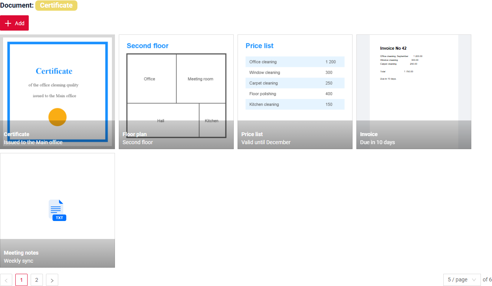

##### Как добавить? { #how-to-add_1 }
??? Example "Пример"
    === "Вычисляемый цвет"

        **Шаг 1**   Добавьте `собственное поле для цвета` в соответствующий **DataResponseDTO**. Поле может содержать цвет в формате HEX или быть null.
        ```java
        --8<--
        {{ external_links.github_raw_doc }}/widgets/cardlist/colortitle/MyExample5302DTO.java:colorDTO
        --8<--
        ```

        **Шаг 2** Добавьте **"bgColorKey"** :  `собственное поле для цвета` в .widget.json.

        Добавьте в `title` поле с `${customField}`

        ```json
        --8<--
        {{ external_links.github_raw_doc }}/widgets/cardlist/colortitle/MyExample5302CardList.widget.json
        --8<--
        ```

        [:material-play-circle: Живой пример]({{ external_links.code_samples }}/ui/#/screen/myexample5302/view/myexample5302color){:target="_blank"} ·
        [:fontawesome-brands-github: GitHub]({{ external_links.github_ui }}/{{ external_links.github_branch }}/src/main/java/org/demo/documentation/widgets/cardlist/colortitle){:target="_blank"}

    === "Постоянный цвет"

        Добавьте **"bgColor"** :  `цвет HEX` в .widget.json.

        Добавьте в `title` поле с `${customField}`

        ```json
        --8<--
        {{ external_links.github_raw_doc }}/widgets/cardlist/colortitle/MyExample5302ColorConst.widget.json
        --8<--
        ```

        [:material-play-circle: Живой пример]({{ external_links.code_samples }}/ui/#/screen/myexample5302/view/myexample5302colorconst){:target="_blank"} ·
        [:fontawesome-brands-github: GitHub]({{ external_links.github_ui }}/{{ external_links.github_branch }}/src/main/java/org/demo/documentation/widgets/cardlist/colortitle){:target="_blank"}

## <a id="bc">Бизнес-компонент</a>
Указывает бизнес-компонент (BC), к которому относится эта форма.
Бизнес-компонент представляет определённую часть системы, отвечающую за конкретную бизнес-логику или данные.

подробнее см. [Бизнес-компонент](/ru/environment/businesscomponent/businesscomponent/)

## <a id="Showcondition">Условие отображения</a>

* `без условия отображения — рекомендуется`: виджет виден всегда

  [:material-play-circle: Живой пример]({{ external_links.code_samples }}/ui/#/screen/myexample5300){:target="_blank"} ·
  [:fontawesome-brands-github: GitHub]({{ external_links.github_ui }}/{{ external_links.github_branch }}/src/main/java/org/demo/documentation/widgets/cardlist/base){:target="_blank"}

* `условие отображения по текущей сущности`: **не рекомендуется**. Условие вычисляется по выбранной карточке, поэтому виджет может скрыть сам себя, когда пользователь выбирает другую карточку.

* `условие отображения по родительской сущности`: условие может содержать логическое выражение, зависящее от родительской сущности. Обновление полей родителя вызывает пересчёт условия только при сохранении или если поле force active и отображается на том же view

  [:material-play-circle: Живой пример]({{ external_links.code_samples }}/ui/#/screen/myexample5303){:target="_blank"} ·
  [:fontawesome-brands-github: GitHub]({{ external_links.github_ui }}/{{ external_links.github_branch }}/src/main/java/org/demo/documentation/widgets/cardlist/showcondition){:target="_blank"}

!!! tips "Совет"
    По возможности рекомендуется не использовать `Show condition`, так как широкое применение этой возможности усложняет поддержку приложения.

#### <a id="howdoesitlook">Как это выглядит?</a>
=== "без условия отображения"
    
=== "условие отображения по родительской сущности"
    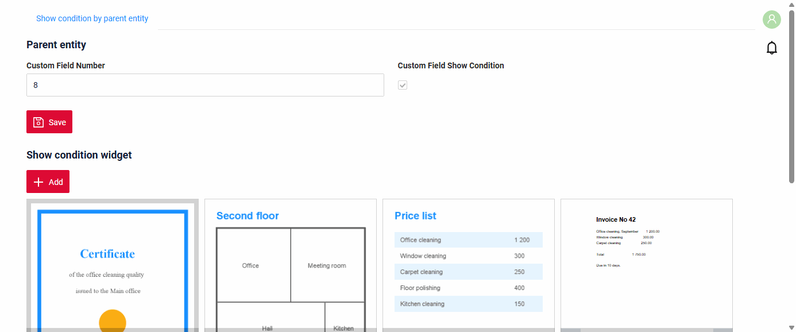

#### <a id="howtoadd">Как добавить?</a>
??? Example "Пример"

    === "без условия отображения"
        см. [Основы](#Howtoaddbacis)

    === "условие отображения по родительской сущности"
        **Шаг 1** Добавьте **showCondition** в **_.widget.json_**. Подробнее см. [showCondition](/ru/widget/type/property/showcondition/showcondition)
        ```json
        --8<--
        {{ external_links.github_raw_doc }}/widgets/cardlist/showcondition/MyExample5313CardList.widget.json
        --8<--
        ```

## <a id="fields">Поля</a>
Настройка полей. Массив fields определяет поля, используемые карточками.

```json
{
    "title": "Document",
    "key": "document",
    "type": "fileUpload",
    "fileIdKey": "documentId",
    "preview": {
        "enabled": true,
        "mode": "inline"
    }
}
```

* **"title"**

  Описание: заголовок поля.

  Тип: String (необязательно).

* **"key"**

    Описание: имя поля в соответствующем DataResponseDTO.

    Тип: String (обязательно).

* **"type"**

  Описание: [Типы полей](/ru/widget/fields/fieldtypes/)

  Тип: String (обязательно).

Виджет использует только эти поля:

| Поле | Где отображается |
|---|---|
| **fileUpload** | предпросмотр карточки; первое поле fileUpload или поле из `valueFieldKey` |
| любое поле из `titleFieldKey` | название карточки |
| любое поле из `descriptionFieldKey` | описание карточки |
| первое поле **dictionary** | статус карточки |

Остальные поля на карточке не отображаются. Их можно использовать в форме создания и редактирования.

### Как добавить? { #how-to-add_2 }
??? Example "Пример"
    Добавьте поле в **_.widget.json_**.

      ```json
         --8<--
         {{ external_links.github_raw_doc }}/widgets/cardlist/base/MyExample5300CardList.widget.json
         --8<--
      ```

## <a id="Fieldslayout">Компоновка (options layout)</a>
_неприменимо_

## <a id="actions">Действия</a>
`Actions` отображают доступные действия в виде отдельных кнопок, подробнее см. [Действия](/ru/features/element/actions/actions).

Действия записи отображаются на карточке в виде иконок. Действия виджета (например, **Add**) отображаются над карточками.

!!! info
    На карточке отображаются все действия записи из сервиса, в том числе **Save** и **Cancel**.
    Оставьте только нужные с помощью **actionGroups**: `"actionGroups": {"include": ["create", "delete"]}`.

### Создание { #create }
Кнопка `Create` позволяет создать новую карточку нажатием кнопки `Add`. Это действие можно выполнить разными способами — выбирайте любой в зависимости от логики приложения:

Есть четыре способа создать запись:

* [Inline](#createinline): **неприменимо**.

* [Inline-form](#createinlineform): **неприменимо**.

* [Popup](#createpopup): можно загрузить файл и заполнить поля во всплывающем окне, не покидая текущий view.

* [With view](#createwithview): запись можно создать, перейдя в отдельный view.

#### <a id="createinline">Inline</a>
_неприменимо_: у карточки нет полей для заполнения на месте, поэтому пустая карточка не может получить файл.

#### <a id="createinlineform">Inline-form</a>
_неприменимо_: CardList не показывает форму рядом с карточками. Используйте [Popup](#createpopup).

#### <a id="createpopup">Popup</a>
[:material-play-circle: Живой пример]({{ external_links.code_samples }}/ui/#/screen/myexample5300){:target="_blank"} ·
[:fontawesome-brands-github: GitHub]({{ external_links.github_ui }}/{{ external_links.github_branch }}/src/main/java/org/demo/documentation/widgets/cardlist/base){:target="_blank"}

`Create with popup` открывает всплывающее окно файла при нажатии кнопки "Add". Окно показывает пустой предпросмотр файла и форму из `options.create` под ним.
Пользователь загружает файл, заполняет поля и нажимает "Save": новая карточка добавляется. "Cancel" удаляет новую карточку.

!!! warning "Внимание"
    Форма должна иметь тип **Form**. **FormPopup** во всплывающем окне не отображается.

##### Как это выглядит? { #how-does-it-look_3 }


##### Как добавить? { #how-to-add_3 }
??? Example "Пример"
    **Шаг 1** Добавьте действие create в соответствующий **VersionAwareResponseService**.
    ```java
    --8<--
    {{ external_links.github_raw_doc }}/widgets/cardlist/base/MyExample5300Service.java:getActions
    --8<--
    ```

    **Шаг 2** Создайте widget.json с типом `Form`, который появляется во всплывающем окне.
    ```json
    --8<--
    {{ external_links.github_raw_doc }}/widgets/cardlist/base/MyExample5300Form.widget.json
    --8<--
    ```

    **Шаг 3** Добавьте widget.json с типом `Form` в соответствующий **.view.json**.
    ```json
    --8<--
    {{ external_links.github_raw_doc }}/widgets/cardlist/base/myexample5300list.view.json
    --8<--
    ```

    **Шаг 4** Добавьте виджет с типом `Form` в **options**.**create** с `"style": "popup"` соответствующего **.widget.json**.
    ```json
    --8<--
    {{ external_links.github_raw_doc }}/widgets/cardlist/base/MyExample5300CardList.widget.json
    --8<--
    ```

    [:material-play-circle: Живой пример]({{ external_links.code_samples }}/ui/#/screen/myexample5300){:target="_blank"} ·
    [:fontawesome-brands-github: GitHub]({{ external_links.github_ui }}/{{ external_links.github_branch }}/src/main/java/org/demo/documentation/widgets/cardlist/base){:target="_blank"}

#### <a id="createwithview">With view</a>
[:material-play-circle: Живой пример]({{ external_links.code_samples }}/ui/#/screen/myexample5309){:target="_blank"} ·
[:fontawesome-brands-github: GitHub]({{ external_links.github_ui }}/{{ external_links.github_branch }}/src/main/java/org/demo/documentation/widgets/cardlist/actions/newview){:target="_blank"}

При `Create with view` нажатие кнопки "Add" открывает отдельный view, отображающий только форму ввода данных. После заполнения формы и нажатия "Save and Close" система возвращается к карточкам с добавленной новой карточкой.

##### Как это выглядит? { #how-does-it-look_4 }
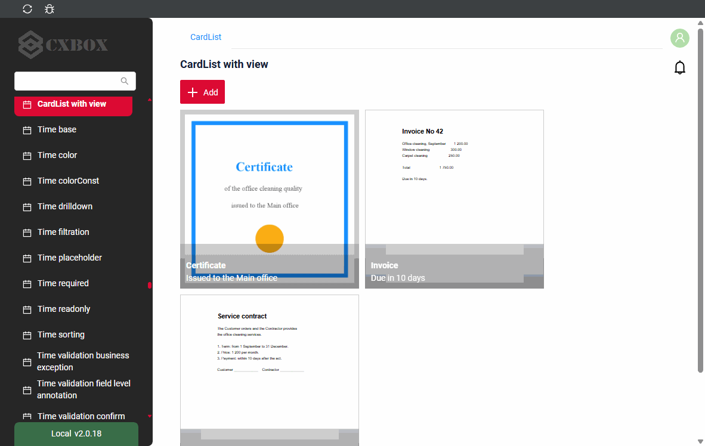

##### Как добавить? { #how-to-add_4 }
??? Example "Пример"

    **Шаг 1** Добавьте кнопку `create` в соответствующий **VersionAwareResponseService**.
    ```java
    --8<--
    {{ external_links.github_raw_doc }}/widgets/cardlist/actions/newview/MyExample5309Service.java:getActions
    --8<--
    ```

    **Шаг 2** Добавьте **PostAction.drillDown** в метод **doCreateEntity** соответствующего **VersionAwareResponseService**.
    ```java
    --8<--
    {{ external_links.github_raw_doc }}/widgets/cardlist/actions/newview/MyExample5309Service.java:doCreateEntity
    --8<--
    ```

    **Шаг 3** Добавьте кнопку `create` в соответствующий **.widget.json**.
    ```json
    --8<--
    {{ external_links.github_raw_doc }}/widgets/cardlist/actions/newview/MyExample5309CardList.widget.json
    --8<--
    ```

    [:material-play-circle: Живой пример]({{ external_links.code_samples }}/ui/#/screen/myexample5309){:target="_blank"} ·
    [:fontawesome-brands-github: GitHub]({{ external_links.github_ui }}/{{ external_links.github_branch }}/src/main/java/org/demo/documentation/widgets/cardlist/actions/newview){:target="_blank"}

### Редактирование { #edit }
`Edit` позволяет изменить карточку. Как и для кнопки `Create`, это действие можно реализовать несколькими способами.

Есть четыре способа отредактировать запись:

* [Inline edit](#editinline): **неприменимо**.

* [Inline-form](#editinlineform): **неприменимо**.

* [Popup](#editpopup): можно изменить файл и поля во всплывающем окне, не покидая текущий view.

* [With view](#editwithview): запись можно отредактировать, перейдя в отдельный view.

#### <a id="editinline">Inline edit</a>
_неприменимо_: у карточки нет полей для редактирования на месте.

#### <a id="editinlineform">Inline-form</a>
_неприменимо_: CardList не показывает форму рядом с карточками. Используйте [Popup](#editpopup).

#### <a id="editpopup">Popup</a>
[:material-play-circle: Живой пример]({{ external_links.code_samples }}/ui/#/screen/myexample5300){:target="_blank"} ·
[:fontawesome-brands-github: GitHub]({{ external_links.github_ui }}/{{ external_links.github_branch }}/src/main/java/org/demo/documentation/widgets/cardlist/base){:target="_blank"}

При наличии `options.edit` у карточки есть иконка **edit**. Она открывает всплывающее окно с файлом и формой под ним. **Save** сохраняет запись и закрывает окно.
Стрелки внизу всплывающего окна переходят к предыдущей или следующей карточке.

Без `options.edit` у карточки есть иконка **глаза**. Она открывает файл во всплывающем окне для просмотра.

##### Как это выглядит? { #how-does-it-look_5 }
=== "С options.edit"
    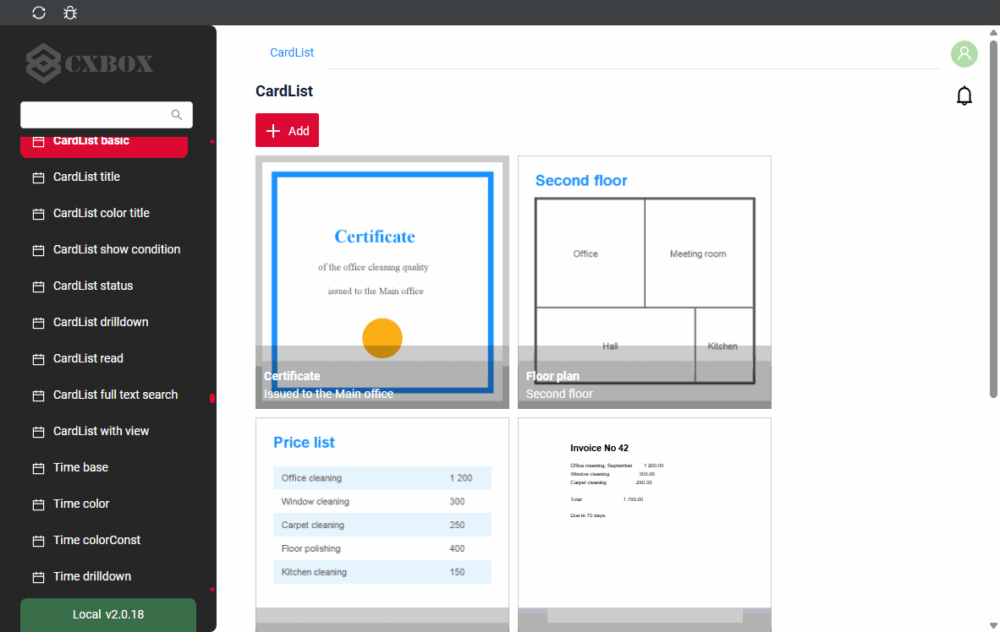
=== "Без options.edit"
    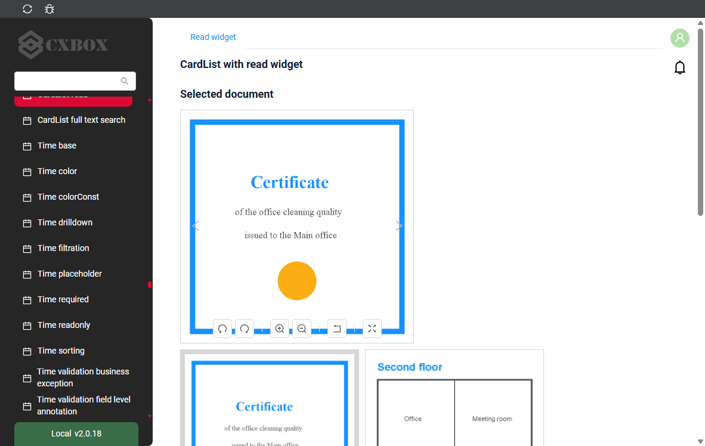

##### Как добавить? { #how-to-add_5 }
??? Example "Пример"
    **Шаг 1** Добавьте действие `save` в соответствующий **VersionAwareResponseService**: с его помощью форма сохраняет запись.
    ```java
    --8<--
    {{ external_links.github_raw_doc }}/widgets/cardlist/base/MyExample5300Service.java:getActions
    --8<--
    ```

    **Шаг 2** Создайте widget.json с типом `Form`, который появляется во всплывающем окне.
    ```json
    --8<--
    {{ external_links.github_raw_doc }}/widgets/cardlist/base/MyExample5300Form.widget.json
    --8<--
    ```

    **Шаг 3** Добавьте widget.json с типом `Form` в соответствующий **.view.json**.
    ```json
    --8<--
    {{ external_links.github_raw_doc }}/widgets/cardlist/base/myexample5300list.view.json
    --8<--
    ```

    **Шаг 4** Добавьте виджет с типом `Form` в **options**.**edit** с `"style": "popup"` соответствующего **.widget.json**: на каждой карточке появится иконка редактирования.
    ```json
    --8<--
    {{ external_links.github_raw_doc }}/widgets/cardlist/base/MyExample5300CardList.widget.json
    --8<--
    ```

    [:material-play-circle: Живой пример]({{ external_links.code_samples }}/ui/#/screen/myexample5300){:target="_blank"} ·
    [:fontawesome-brands-github: GitHub]({{ external_links.github_ui }}/{{ external_links.github_branch }}/src/main/java/org/demo/documentation/widgets/cardlist/base){:target="_blank"}

#### <a id="editwithview">With view</a>
[:material-play-circle: Живой пример]({{ external_links.code_samples }}/ui/#/screen/myexample5309){:target="_blank"} ·
[:fontawesome-brands-github: GitHub]({{ external_links.github_ui }}/{{ external_links.github_branch }}/src/main/java/org/demo/documentation/widgets/cardlist/actions/newview){:target="_blank"}

При `Edit with view` карточку можно редактировать в отдельном view, отображающем только форму ввода данных. Нажмите иконку **edit** карточки.

##### Как это выглядит? { #how-does-it-look_6 }


##### Как добавить? { #how-to-add_6 }
??? Example "Пример"

    **Шаг 1** Добавьте действие *edit* в соответствующий **VersionAwareResponseService**.

    Добавьте **PostAction.drillDown** в метод *edit*. Карточка показывает действия записи только в виде иконок, поэтому задайте иконку через **withIcon**.

    ```java
    --8<--
    {{ external_links.github_raw_doc }}/widgets/cardlist/actions/newview/MyExample5309Service.java:getActions
    --8<--
    ```

    Иконка — это **ActionIconSpecifier**:
    ```java
    --8<--
    {{ external_links.github_raw_doc }}/widgets/cardlist/actions/newview/MyExample5309ActionIcon.java
    --8<--
    ```

    **Шаг 2** Добавьте действие *edit* в **actionGroups** соответствующего **.widget.json**.
    ```json
    --8<--
    {{ external_links.github_raw_doc }}/widgets/cardlist/actions/newview/MyExample5309CardList.widget.json
    --8<--
    ```

    [:material-play-circle: Живой пример]({{ external_links.code_samples }}/ui/#/screen/myexample5309){:target="_blank"} ·
    [:fontawesome-brands-github: GitHub]({{ external_links.github_ui }}/{{ external_links.github_branch }}/src/main/java/org/demo/documentation/widgets/cardlist/actions/newview){:target="_blank"}

### Удаление { #delete }
[:material-play-circle: Живой пример]({{ external_links.code_samples }}/ui/#/screen/myexample5300){:target="_blank"} ·
[:fontawesome-brands-github: GitHub]({{ external_links.github_ui }}/{{ external_links.github_branch }}/src/main/java/org/demo/documentation/widgets/cardlist/base){:target="_blank"}

Иконка **delete** сразу удаляет запись, как в [List](/ru/widget/type/list/list/).

#### Как это выглядит? { #how-does-it-look_7 }
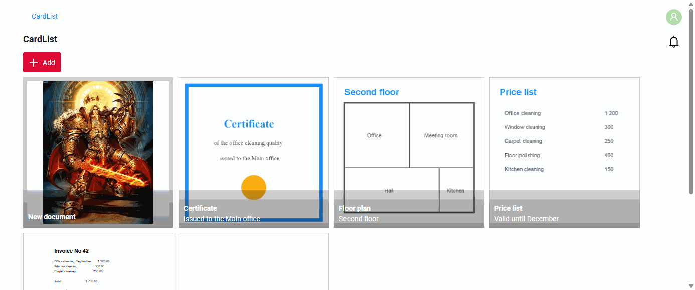

#### Как добавить? { #how-to-add_7 }
??? Example "Пример"
    Добавьте действие delete в соответствующий **VersionAwareResponseService**.
    ```java
    --8<--
    {{ external_links.github_raw_doc }}/widgets/cardlist/base/MyExample5300Service.java:getActions
    --8<--
    ```

## Дополнительные свойства { #additional-properties }
### <a id="cardoptions">Параметры карточки</a>
[:material-play-circle: Живой пример]({{ external_links.code_samples }}/ui/#/screen/myexample5300){:target="_blank"} ·
[:fontawesome-brands-github: GitHub]({{ external_links.github_ui }}/{{ external_links.github_branch }}/src/main/java/org/demo/documentation/widgets/cardlist/base){:target="_blank"}

`options.card` задаёт, какие поля отображаются на карточке. Все ключи необязательны.

| Ключ | Что задаёт | По умолчанию |
|---|---|---|
| `valueFieldKey` | поле fileUpload карточки | первое поле fileUpload |
| `titleFieldKey` | поле для названия | имя файла |
| `descriptionFieldKey` | поле для описания | без описания |

При наличии описания название и описание обрезаются до одной строки. Без описания длинное название переносится на следующие строки.

#### Как добавить? { #how-to-add_8 }
??? Example "Пример"
    Добавьте **options.card** в **_.widget.json_**.
    ```json
    --8<--
    {{ external_links.github_raw_doc }}/widgets/cardlist/base/MyExample5300CardList.widget.json
    --8<--
    ```

### <a id="cardsize">Размер карточки</a>
[:material-play-circle: Живой пример]({{ external_links.code_samples }}/ui/#/screen/myexample5300){:target="_blank"} ·
[:fontawesome-brands-github: GitHub]({{ external_links.github_ui }}/{{ external_links.github_branch }}/src/main/java/org/demo/documentation/widgets/cardlist/base){:target="_blank"}

Размер карточки задаётся на поле fileUpload карточки:

* `width`: ширина карточки в пикселях. По умолчанию: 300.
* `minRows`: высота карточки в строках по 40 пикселей. По умолчанию карточка квадратная.

В ряду столько карточек, сколько помещается по ширине виджета, остальные переходят в следующие ряды.

### <a id="preview">Предпросмотр</a>
[:material-play-circle: Живой пример]({{ external_links.code_samples }}/ui/#/screen/myexample5300){:target="_blank"} ·
[:fontawesome-brands-github: GitHub]({{ external_links.github_ui }}/{{ external_links.github_branch }}/src/main/java/org/demo/documentation/widgets/cardlist/base){:target="_blank"}

Карточка показывает предпросмотр файла, когда у `preview` поля fileUpload задано `"enabled": true`: изображение или первая страница PDF. Остальные файлы отображаются иконкой их типа.

* Поддерживается только `"mode": "inline"`. Другие режимы тоже работают как inline и выдают предупреждение в консоль браузера.
* Без `preview` или с `"enabled": false` карточка показывает только иконку типа файла.

#### Как добавить? { #how-to-add_9 }
??? Example "Пример"
    Добавьте **preview** с `"enabled": true` и `"mode": "inline"` к полю fileUpload в **_.widget.json_**.
    ```json
    --8<--
    {{ external_links.github_raw_doc }}/widgets/cardlist/base/MyExample5300CardList.widget.json
    --8<--
    ```

### <a id="status">Статус</a>
[:material-play-circle: Живой пример]({{ external_links.code_samples }}/ui/#/screen/myexample5305){:target="_blank"} ·
[:fontawesome-brands-github: GitHub]({{ external_links.github_ui }}/{{ external_links.github_branch }}/src/main/java/org/demo/documentation/widgets/cardlist/status){:target="_blank"}

`Status` показывает значение поля dictionary в середине карточки, поверх предпросмотра. Цвет статуса задаётся так же, как [цвет заголовка](#Title): постоянный `bgColor` или вычисляемый `bgColorKey` поля dictionary.

!!! info
    Виджет берёт первое поле с типом `dictionary`. Параметра для выбора другого поля dictionary нет.

#### Как это выглядит? { #how-does-it-look_8 }
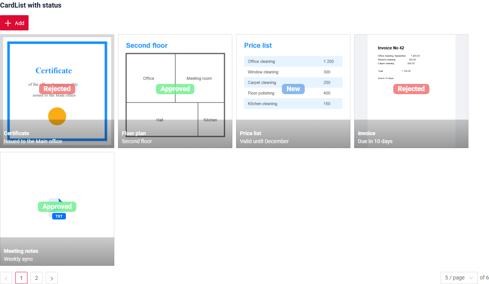

#### Как добавить? { #how-to-add_10 }
??? Example "Пример"
    **Шаг 1** Добавьте поле dictionary и поле для его цвета в соответствующий **DataResponseDTO**.
    ```java
    --8<--
    {{ external_links.github_raw_doc }}/widgets/cardlist/status/MyExample5305DTO.java:statusDTO
    --8<--
    ```

    **Шаг 2** Добавьте поле dictionary с **"bgColorKey"** в **_.widget.json_**.
    ```json
    --8<--
    {{ external_links.github_raw_doc }}/widgets/cardlist/status/MyExample5305CardList.widget.json
    --8<--
    ```

### <a id="drilldown">DrillDown</a>
[:material-play-circle: Живой пример]({{ external_links.code_samples }}/ui/#/screen/myexample5306){:target="_blank"} ·
[:fontawesome-brands-github: GitHub]({{ external_links.github_ui }}/{{ external_links.github_branch }}/src/main/java/org/demo/documentation/widgets/cardlist/drilldown){:target="_blank"}

`DrillDown` позволяет перейти в другое представление с карточки.

* У названия карточки появляется иконка ссылки. Клик по названию открывает целевое представление.
* Клик по другим частям карточки (предпросмотр, описание, пустое место) только выбирает карточку и не открывает ссылку.
* Целевое представление вычисляется для каждой карточки, поэтому каждая карточка может открывать свою запись или своё представление. В примере название открывает форму записи карточки.

#### Как это выглядит? { #how-does-it-look_9 }
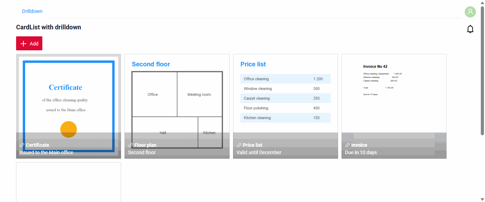

#### Как добавить? { #how-to-add_11 }
??? Example "Пример"
    `Шаг 1` Добавьте **"drillDown": true** к полю fileUpload карточки в **_.widget.json_**.
    ```json
    --8<--
    {{ external_links.github_raw_doc }}/widgets/cardlist/drilldown/MyExample5306CardList.widget.json
    --8<--
    ```

    `Шаг 2` Добавьте **fields.setDrilldown** для того же поля fileUpload в соответствующий **FieldMetaBuilder**. Ссылка строится для записи каждой карточки.
    ```java
    --8<--
    {{ external_links.github_raw_doc }}/widgets/cardlist/drilldown/MyExample5306Meta.java:drilldown
    --8<--
    ```

    [:material-play-circle: Живой пример]({{ external_links.code_samples }}/ui/#/screen/myexample5306){:target="_blank"} ·
    [:fontawesome-brands-github: GitHub]({{ external_links.github_ui }}/{{ external_links.github_branch }}/src/main/java/org/demo/documentation/widgets/cardlist/drilldown){:target="_blank"}

### <a id="read">Read widget</a>
[:material-play-circle: Живой пример]({{ external_links.code_samples }}/ui/#/screen/myexample5307){:target="_blank"} ·
[:fontawesome-brands-github: GitHub]({{ external_links.github_ui }}/{{ external_links.github_branch }}/src/main/java/org/demo/documentation/widgets/cardlist/read){:target="_blank"}

`Read widget` показывает файл выбранной карточки крупно над карточками. Стрелки на крупном просмотре выбирают предыдущую или следующую карточку. У изображения есть кнопки поворота, масштабирования, сброса и открытия на весь экран.

* Read widget — это виджет Info или Form с тем же полем fileUpload. Отображается только предпросмотр файла, остальные поля виджета не отображаются.
* `options.layout` read widget задаёт размер и место предпросмотра: `span` поля fileUpload — его ширина, `minRows` поля — его высота. Чтобы разместить предпросмотр по центру, поставьте колонку fileUpload между двумя колонками других полей: read widget показывает только файл, поэтому эти колонки остаются пустыми.

#### Как это выглядит? { #how-does-it-look_10 }
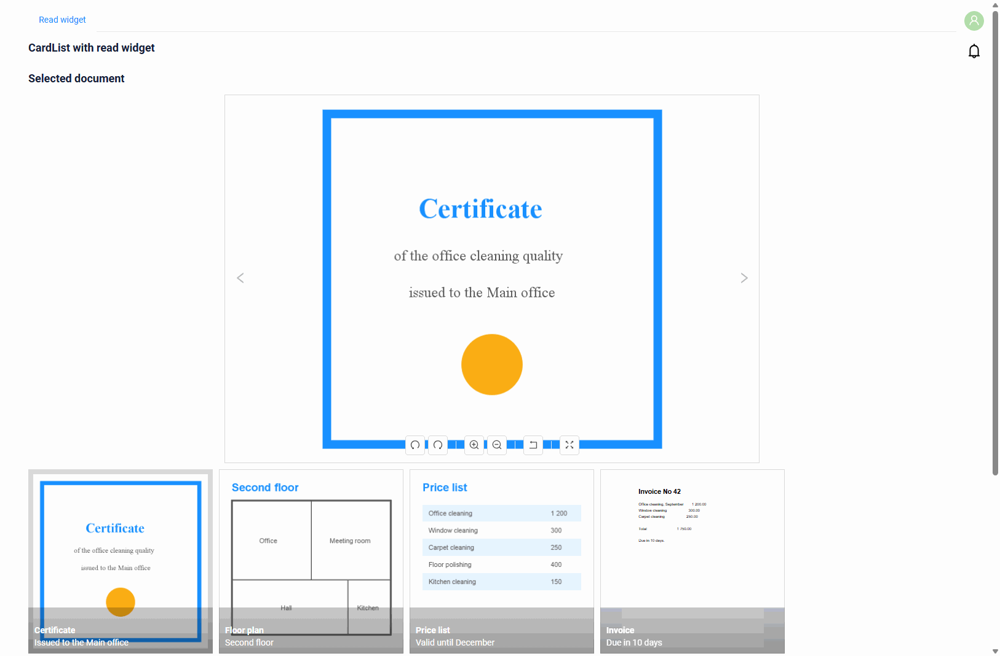

#### Как добавить? { #how-to-add_12 }
??? Example "Пример"
    **Шаг 1** Создайте виджет Info с полем fileUpload.
    ```json
    --8<--
    {{ external_links.github_raw_doc }}/widgets/cardlist/read/MyExample5307Read.widget.json
    --8<--
    ```

    **Шаг 2** Добавьте **options.read.widget** в виджет CardList.
    ```json
    --8<--
    {{ external_links.github_raw_doc }}/widgets/cardlist/read/MyExample5307CardList.widget.json
    --8<--
    ```

    **Шаг 3** Добавьте оба виджета в **_.view.json_**.
    ```json
    --8<--
    {{ external_links.github_raw_doc }}/widgets/cardlist/read/myexample5307list.view.json
    --8<--
    ```

### Фильтрация { #filtration }
_неприменимо_

#### Полнотекстовый поиск (FullTextSearch) { #fulltextsearch }
[:material-play-circle: Живой пример]({{ external_links.code_samples }}/ui/#/screen/myexample5308){:target="_blank"} ·
[:fontawesome-brands-github: GitHub]({{ external_links.github_ui }}/{{ external_links.github_branch }}/src/main/java/org/demo/documentation/widgets/cardlist/fulltextsearch){:target="_blank"}

`FullTextSearch` — когда пользователь вводит текст в поле поиска виджета, виджет показывает карточки, соответствующие запросу. Сервис фильтрует записи, как в List.

##### Как это выглядит? { #how-does-it-look_11 }
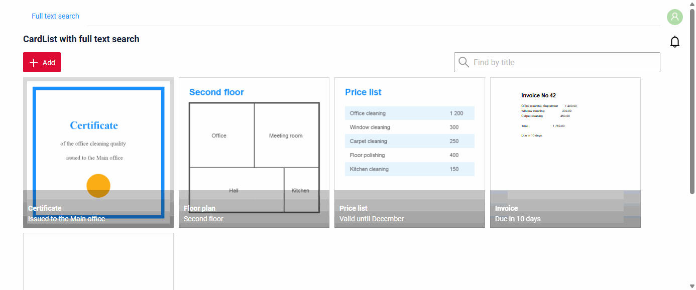

см. [FullTextSearch](/ru/widget/type/property/filtration/filtration/#by-fulltextsearch)

##### Как добавить? { #how-to-add_13 }
??? Example "Пример"
    **Шаг 1** Добавьте **fullTextSearch** в **options** файла **_.widget.json_**.
    ```json
    --8<--
    {{ external_links.github_raw_doc }}/widgets/cardlist/fulltextsearch/MyExample5308CardList.widget.json
    --8<--
    ```

    **Шаг 2** Добавьте спецификацию поиска в репозиторий.
    ```java
    --8<--
    {{ external_links.github_raw_doc }}/widgets/cardlist/fulltextsearch/MyEntity5308Repository.java:getFullTextSearchSpecification
    --8<--
    ```

    **Шаг 3** Примените её в **getSpecification** сервиса.
    ```java
    --8<--
    {{ external_links.github_raw_doc }}/widgets/cardlist/fulltextsearch/MyExample5308Service.java:getSpecification
    --8<--
    ```

### <a id="pagination">Пагинация</a>
[:material-play-circle: Живой пример]({{ external_links.code_samples }}/ui/#/screen/myexample5300){:target="_blank"} ·
[:fontawesome-brands-github: GitHub]({{ external_links.github_ui }}/{{ external_links.github_branch }}/src/main/java/org/demo/documentation/widgets/cardlist/base){:target="_blank"}

`Pagination` работает как в [List](/ru/widget/type/list/list/): пагинация под карточками переключает страницы, по умолчанию 5 карточек на странице.

#### Как это выглядит? { #how-does-it-look_12 }
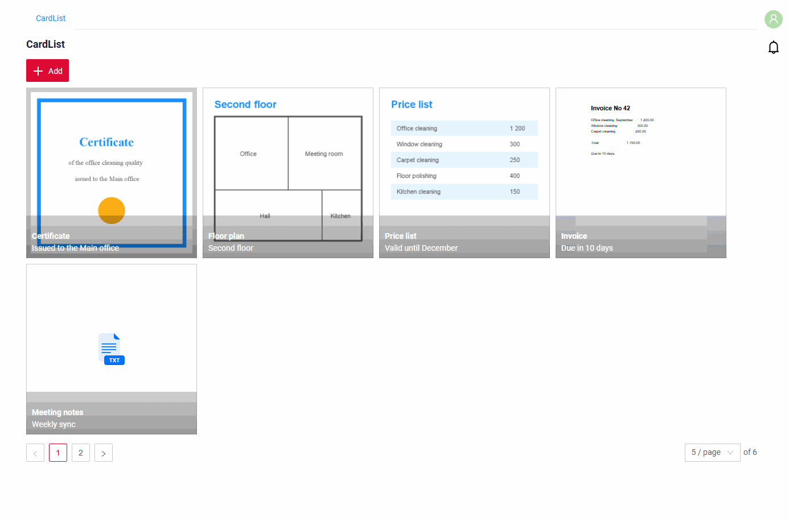

см. [Пагинация](/ru/widget/type/property/pagination/pagination) и [Лимит записей на странице](/ru/widget/type/property/defaultlimitpage/defaultlimitpage)

### Экспорт в Excel { #export-to-excel }
_неприменимо_

### Множественная загрузка файлов { #multi-upload-files }
[:material-play-circle: Живой пример]({{ external_links.code_samples }}/ui/#/screen/myexample6100/view/myexample6100cardlist){:target="_blank"} ·
[:fontawesome-brands-github: GitHub]({{ external_links.github_ui }}/{{ external_links.github_branch }}/src/main/java/org/demo/documentation/feature/file){:target="_blank"}

Реализована множественная загрузка файлов. Для выбора файлов можно использовать специальную зону drag-and-drop или стандартную кнопку. Каждый загруженный файл становится новой карточкой.

#### Как это выглядит? { #how-does-it-look_13 }
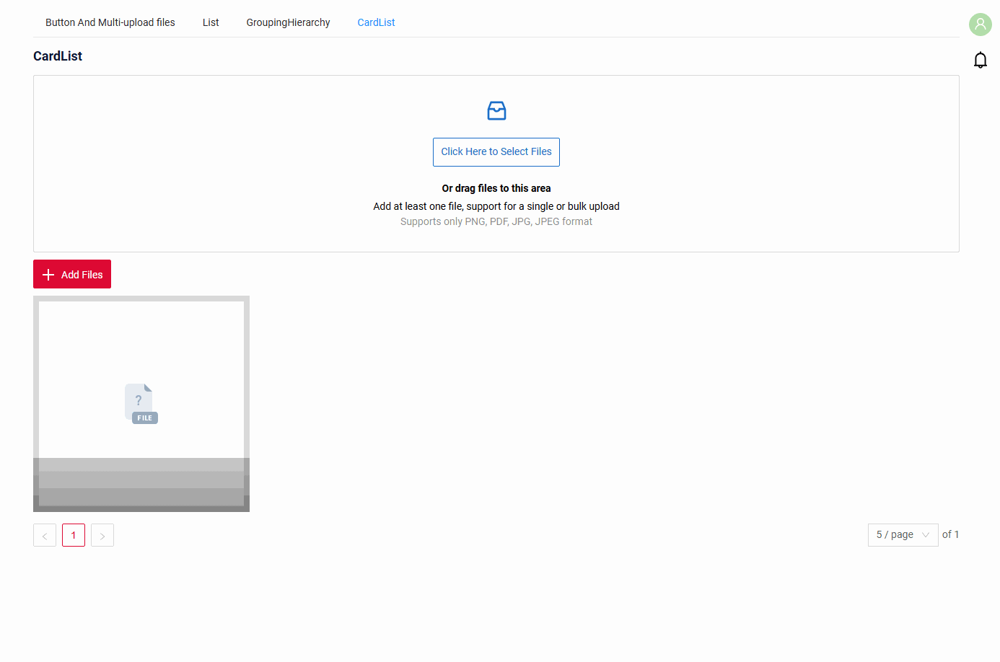

#### Как добавить? { #how-to-add_14 }
??? Example "Пример"
    **Шаг 1** Добавьте actionKey **associate** в **options.buttons** соответствующего **.widget.json**.
    ```json
    --8<--
    {{ external_links.github_raw_doc }}/feature/file/MyExample6100CardList.widget.json
    --8<--
    ```

    **Шаг 2** Добавьте **setFileAccept**, **associate** и **doAssociate**, см. [Множественная загрузка файлов](/ru/widget/type/property/multiupload/multiupload), **Шаг 2** – **Шаг 3.2**.

    [:material-play-circle: Живой пример]({{ external_links.code_samples }}/ui/#/screen/myexample6100/view/myexample6100cardlist){:target="_blank"} ·
    [:fontawesome-brands-github: GitHub]({{ external_links.github_ui }}/{{ external_links.github_branch }}/src/main/java/org/demo/documentation/feature/file){:target="_blank"}

подробнее см. [Множественная загрузка файлов](/ru/widget/type/property/multiupload/multiupload)

### Настройка отображаемых колонок { #customization-of-displayed-columns }
_неприменимо_

### Сортировка { #sorting }
_неприменимо_
