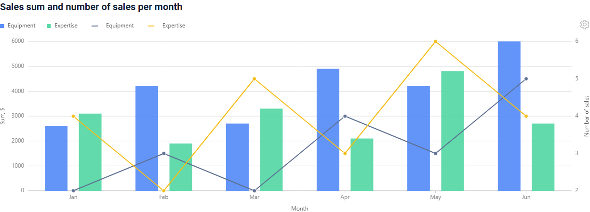
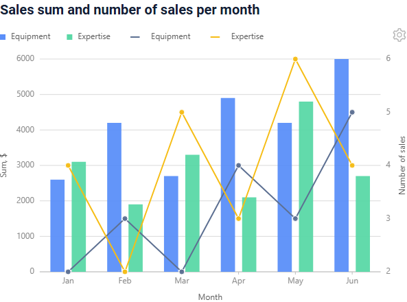
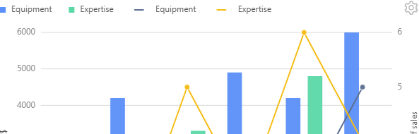
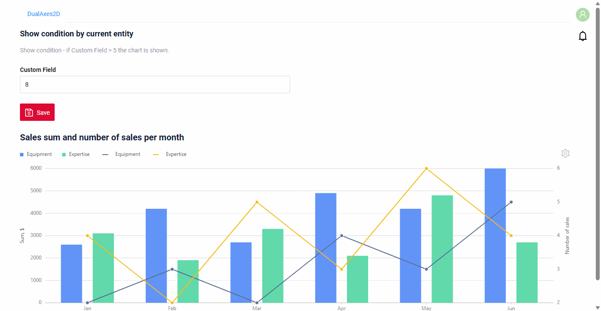
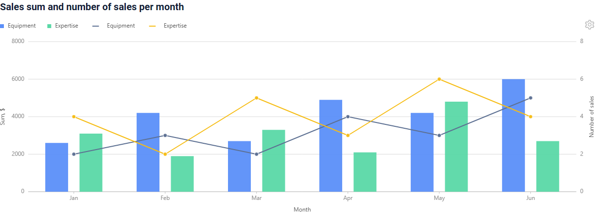
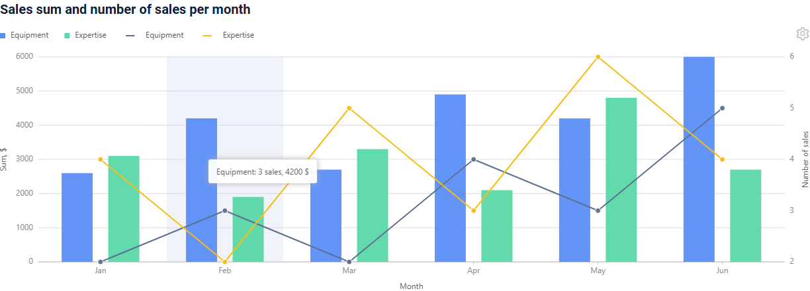
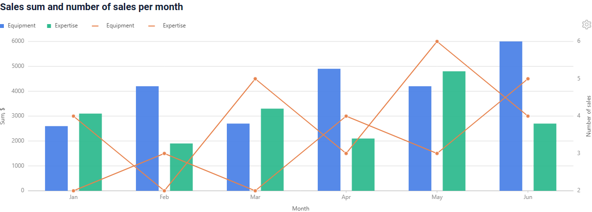
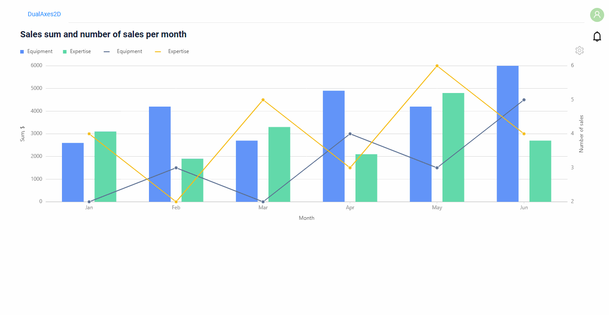
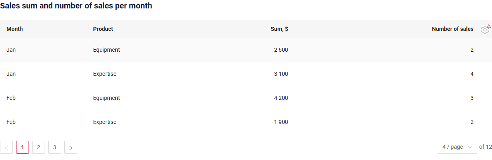
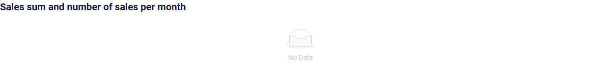

# DualAxes2D

`DualAxes2D` widget draws two 2D charts in one area: a [Column2D](/widget/type/column2d/column2d) chart and a [Line2D](/widget/type/line2d/line2d) chart
(or two charts of the same type) share the X axis, and each chart has its own Y axis.
For example, the columns show the sum of the sales per month, and the line shows the number of the sales. The user can switch the chart to a table.

## Basics
[:material-play-circle: Live Sample]({{ external_links.code_samples }}/ui/#/screen/myexample4280){:target="_blank"} ·
[:fontawesome-brands-github: GitHub]({{ external_links.github_ui }}/{{ external_links.github_branch }}/src/main/java/org/demo/documentation/widgets/dualaxes2d/base){:target="_blank"}

### How does it look?


`DualAxes2D` has no chart settings of its own: it takes them from two chart widgets listed in `options.dual2D.widgets`.

* The first widget is drawn with the left Y axis, the second one with the right Y axis.
* The widgets must have the type `Column2D` or `Line2D`.
* The widgets must have the same business component as the `DualAxes2D` widget and the same `xValueFieldKey`.
* The widgets must be added to the same view: the `DualAxes2D` widget finds them among the widgets of the view.
  They are shown on the view as usual widgets too.

All the settings of `options.chart2D` of the chart widgets work in `DualAxes2D`: `groupFieldKey`, `stack`,
`yMin`/`yMax`/`yStep`, `descriptionFieldKey`, the colors and the drilldown of the X field.
The legend shows the groups of both charts.

When the conditions are broken, the widget writes a message to the browser console, for example
`widgets in 'options.dual2D' must have the same bc`.

Options of `options.dual2D`:

| Option    | Required | Description                                                                                                  |
|-----------|----------|--------------------------------------------------------------------------------------------------------------|
| `widgets` | yes      | Names of two widgets with the type `Column2D` or `Line2D`. The first one uses the left Y axis, the second one the right Y axis. |

###  <a id="Howtoaddbacis">How to add?</a>
??? Example
    **Step1** Create **DataResponseDTO** with the fields of both charts: the X value and the Y values of each chart.
    ```java
    --8<--
    {{ external_links.github_raw_doc }}/widgets/dualaxes2d/base/MyExample4280DTO.java
    --8<--
    ```

    **Step2** Create **DAO** extends AbstractAnySourceBaseDAO<> implements AnySourceBaseDAO.
    The DAO returns one record per point, sorted along the X axis, with a unique `id`. One record has the values of both charts.
    ```java
    --8<--
    {{ external_links.github_raw_doc }}/widgets/dualaxes2d/base/MyExample4280Dao.java:getStats
    --8<--
    ```

    **Step3** Create **Meta** extends AnySourceFieldMetaBuilder.
    ```java
    --8<--
    {{ external_links.github_raw_doc }}/widgets/dualaxes2d/base/MyExample4280Meta.java
    --8<--
    ```

    **Step4** Create **Service** extends AnySourceVersionAwareResponseService.
    ```java
    --8<--
    {{ external_links.github_raw_doc }}/widgets/dualaxes2d/base/MyExample4280Service.java
    --8<--
    ```

    **Step5** Create two chart widgets with the same **bc** and the same **xValueFieldKey**: a **Column2D** widget and a **Line2D** widget.
    ```json
    --8<--
    {{ external_links.github_raw_doc }}/widgets/dualaxes2d/base/myexample4280column2d.widget.json
    --8<--
    ```
    ```json
    --8<--
    {{ external_links.github_raw_doc }}/widgets/dualaxes2d/base/myexample4280line2d.widget.json
    --8<--
    ```

    **Step6** Create file **_.widget.json_** with type = **"DualAxes2D"**. Add **options.dual2D.widgets** with the names of the chart widgets.
    The fields of the `DualAxes2D` widget are the columns of the [table mode](#tablemode).
    ```json
    --8<--
    {{ external_links.github_raw_doc }}/widgets/dualaxes2d/base/myexample4280dualaxes2d.widget.json
    --8<--
    ```

    **Step7** Add the `DualAxes2D` widget and both chart widgets to corresponding **_.view.json_**.
    ```json
    --8<--
    {{ external_links.github_raw_doc }}/widgets/dualaxes2d/base/myexample4280dualaxes2d.view.json
    --8<--
    ```

    **Step8** Set the page limit of the business component to the number of points, for example 1000.
    The default limit is 5. When the business component has more records than the limit, the widget shows only the table.
    See [Page limit](#pagelimit).

    Add the business component to the **BC_PROPERTIES** table:
    ```csv
    BC;PAGE_LIMIT;MASS_PAGE_LIMIT;SORT;FILTER;ID
    myExampleBc4280;1000;NULL;NULL;'""';
    ```

## <a id="Title">Title</a>
[:material-play-circle: Live Sample]({{ external_links.code_samples }}/ui/#/screen/myexample4281){:target="_blank"} ·
[:fontawesome-brands-github: GitHub]({{ external_links.github_ui }}/{{ external_links.github_branch }}/src/main/java/org/demo/documentation/widgets/dualaxes2d/title){:target="_blank"}

### Title Basic
`Title` for widget (optional). The titles of the chart widgets are not shown in `DualAxes2D`.

There are types of:

* `constant title`: shows constant text.
* `constant title empty`: if you want to visually connect widgets by them to be placed one under another

#### How does it look?
=== "Constant title"
    
=== "Constant title empty"
    

#### How to add?
??? Example
    === "Constant title"
        **Step1** Add name for **title** to **_.widget.json_**.
        ```json
        --8<--
        {{ external_links.github_raw_doc }}/widgets/dualaxes2d/title/myexample4281dualaxes2d.widget.json
        --8<--
        ```
    === "Constant title empty"
        **Step1** Add empty **title** to **_.widget.json_**.
        ```json
        --8<--
        {{ external_links.github_raw_doc }}/widgets/dualaxes2d/title/myexample4281dualaxes2demptytitle.widget.json
        --8<--
        ```

### Title Color
_not applicable_

## <a id="bc">Business component</a>
This specifies the business component (BC) to which this widget belongs.
A business component represents a specific part of a system that handles a particular business logic or data.

`DualAxes2D` and both chart widgets have the same business component. The data is taken from an **AnySource** business component:
the DAO builds the points (for example, the sum and the number of the sales per month) and returns them in the order of the X axis.
One record is one point of both charts, so the `id` of a record must be unique.

see more  [Business component](/environment/businesscomponent/businesscomponent/)

## <a id="Showcondition">Show condition</a>
[:material-play-circle: Live Sample]({{ external_links.code_samples }}/ui/#/screen/myexample4282){:target="_blank"} ·
[:fontawesome-brands-github: GitHub]({{ external_links.github_ui }}/{{ external_links.github_branch }}/src/main/java/org/demo/documentation/widgets/dualaxes2d/showcondition){:target="_blank"}

* `no show condition - recommended`: widget always visible
* `show condition by current entity`: the chart is shown when a field of the current record of another business component on the view has the given value

The show condition of the `DualAxes2D` widget does not hide the chart widgets of `options.dual2D.widgets`: they have their own show conditions.

!!! tips
    It is recommended not to use `Show condition` when possible, because wide usage of this feature makes application hard to support.

#### <a id="howdoesitlook">How does it look?</a>
=== "no show condition"
    
=== "show condition by current entity"
    

#### <a id="howtoadd">How to add?</a>
??? Example

    === "no show condition"
        see [Basic](#Howtoaddbacis)

    === "show condition by current entity"
        **Step1** Add **showCondition** to **_.widget.json_**. see more [showCondition](/widget/type/property/showcondition/showcondition)
        ```json
        --8<--
        {{ external_links.github_raw_doc }}/widgets/dualaxes2d/showcondition/myexample4282dualaxes2d.widget.json
        --8<--
        ```

## <a id="fields">Fields</a>
Fields Configuration. The charts are drawn by the fields of the chart widgets of `options.dual2D.widgets`.
The fields of the `DualAxes2D` widget are the columns of the [table mode](#tablemode).

```json
{
    "title": "Month",
    "key": "month",
    "type": "input"
}
```

* **"title"**

  Description: Field Title. In the chart widgets it is the axis title.

  Type: String(optional).

* **"key"**

    Description: Name field to corresponding DataResponseDTO.

    Type: String(required).

* **"type"**

  Description: [Field types](/widget/fields/fieldtypes/). The Y fields of the chart widgets must be numeric.

  Type: String(required).

### How to add?
??? Example
    Add field to **_.widget.json_**.

      ```json
         --8<--
         {{ external_links.github_raw_doc }}/widgets/dualaxes2d/base/myexample4280dualaxes2d.widget.json
         --8<--
      ```

## <a id="Fieldslayout">Options layout</a>
**options.layout** - no use in this type.

## Actions
_not applicable_

### Additional properties

#### <a id="axis">Axis scale and step</a>
[:material-play-circle: Live Sample]({{ external_links.code_samples }}/ui/#/screen/myexample4283){:target="_blank"} ·
[:fontawesome-brands-github: GitHub]({{ external_links.github_ui }}/{{ external_links.github_branch }}/src/main/java/org/demo/documentation/widgets/dualaxes2d/axis){:target="_blank"}

Each Y axis takes `yMin`, `yMax`, `yStep` and the title from its chart widget. Without them the range is taken from the data.

When both chart widgets have the same `yValueFieldKey`, the charts use one common Y scale:
the right axis is hidden, and the options of the axis are taken from the first widget (and from the second one when the first has none).

###### How does it look?


###### How to add?
??? Example
    **Step1** Add **yMin**, **yMax**, **yStep** to **options.chart2D** of the chart widgets.
    ```json
    --8<--
    {{ external_links.github_raw_doc }}/widgets/dualaxes2d/axis/myexample4283column2d.widget.json
    --8<--
    ```
    ```json
    --8<--
    {{ external_links.github_raw_doc }}/widgets/dualaxes2d/axis/myexample4283line2d.widget.json
    --8<--
    ```

#### <a id="tooltip">Tooltip</a>
[:material-play-circle: Live Sample]({{ external_links.code_samples }}/ui/#/screen/myexample4284){:target="_blank"} ·
[:fontawesome-brands-github: GitHub]({{ external_links.github_ui }}/{{ external_links.github_branch }}/src/main/java/org/demo/documentation/widgets/dualaxes2d/tooltip){:target="_blank"}

The tooltip appears when the user moves the mouse over a point. By default it shows the X value and the values of both charts.
`descriptionFieldKey` of the chart widgets replaces it with the values of the listed fields of the record, joined with a comma.
The fields of both widgets are used, each field once.

###### How does it look?


###### How to add?
??? Example
    **Step1** Fill the description field in the DAO.
    ```java
    --8<--
    {{ external_links.github_raw_doc }}/widgets/dualaxes2d/tooltip/MyExample4284Dao.java:getStats
    --8<--
    ```
    **Step2** Add the description field to **fields** and **descriptionFieldKey** to **options.chart2D** of the chart widgets.
    ```json
    --8<--
    {{ external_links.github_raw_doc }}/widgets/dualaxes2d/tooltip/myexample4284column2d.widget.json
    --8<--
    ```

#### <a id="color">Color</a>
[:material-play-circle: Live Sample]({{ external_links.code_samples }}/ui/#/screen/myexample4285){:target="_blank"} ·
[:fontawesome-brands-github: GitHub]({{ external_links.github_ui }}/{{ external_links.github_branch }}/src/main/java/org/demo/documentation/widgets/dualaxes2d/color){:target="_blank"}

The color of each chart is set on the X field of its chart widget, as in [Line2D](/widget/type/line2d/line2d/#color):

* `bgColorKey`: the key of the field with the color of the record.
* `bgColor`: one constant color for the chart.

In the sample the columns take the color from the field `color`, and the line has a constant color.

###### How does it look?


###### How to add?
??? Example
    === "Color from a field"
        **Step1** Add the color field to **DataResponseDTO** and fill it in the DAO.
        ```java
        --8<--
        {{ external_links.github_raw_doc }}/widgets/dualaxes2d/color/MyExample4285Dao.java:getStats
        --8<--
        ```
        **Step2** Add **bgColorKey** to the X field of the chart widget.
        ```json
        --8<--
        {{ external_links.github_raw_doc }}/widgets/dualaxes2d/color/myexample4285column2d.widget.json
        --8<--
        ```
    === "Constant color"
        **Step1** Add **bgColor** to the X field of the chart widget.
        ```json
        --8<--
        {{ external_links.github_raw_doc }}/widgets/dualaxes2d/color/myexample4285line2d.widget.json
        --8<--
        ```

#### <a id="drilldown">Drilldown</a>
[:material-play-circle: Live Sample]({{ external_links.code_samples }}/ui/#/screen/myexample4286){:target="_blank"} ·
[:fontawesome-brands-github: GitHub]({{ external_links.github_ui }}/{{ external_links.github_branch }}/src/main/java/org/demo/documentation/widgets/dualaxes2d/drilldown){:target="_blank"}

A click on a point opens the view with the records behind the point. The drilldown is taken from the X field of the **first** widget
of `options.dual2D.widgets`: `drillDown: true` in the widget and the target view with a filter in the Meta of the record.
The line of a `Line2D` chart is drawn over the columns: a click on the line itself opens nothing,
so where the line crosses a column, click the column above or below the line.

In the table mode the X value is a link with the same drilldown, when the X field of the `DualAxes2D` widget has `drillDown: true`.

###### How does it look?


###### How to add?
??? Example
    **Step1** Add **drillDown** to the X field of the first chart widget.
    ```json
    --8<--
    {{ external_links.github_raw_doc }}/widgets/dualaxes2d/drilldown/myexample4286column2d.widget.json
    --8<--
    ```
    **Step2** Set the target view and the filter in **buildRowDependentMeta** of the **Meta**.
    ```java
    --8<--
    {{ external_links.github_raw_doc }}/widgets/dualaxes2d/drilldown/MyExample4286Meta.java:buildRowDependentMeta
    --8<--
    ```
    **Step3** Add the target **List** widget and its view. The filtered fields have **@SearchParameter** in the DTO.
    ```java
    --8<--
    {{ external_links.github_raw_doc }}/widgets/dualaxes2d/drilldown/MyExample4286ListDTO.java
    --8<--
    ```

    see more [DrillDown](/advancedCustomization/element/drillDown/drillDown)

#### <a id="tablemode">Table mode</a>
[:material-play-circle: Live Sample]({{ external_links.code_samples }}/ui/#/screen/myexample4287){:target="_blank"} ·
[:fontawesome-brands-github: GitHub]({{ external_links.github_ui }}/{{ external_links.github_branch }}/src/main/java/org/demo/documentation/widgets/dualaxes2d/tablemode){:target="_blank"}

The settings icon of the widget opens the `Mode` menu with `Chart` and `Table`. In the table mode the widget shows the records
as a table with a column per field of the `DualAxes2D` widget (fields with type `hidden` are not shown).
A `DualAxes2D` widget without fields shows a table without columns.

###### How does it look?


###### How to add?
The table mode is always available. Add the fields of the table to the `DualAxes2D` widget, see [Fields](#fields).

#### Groups and stack
`groupFieldKey` and `stack` are set in the chart widgets, see [Line2D groups](/widget/type/line2d/line2d/#groups)
and [Column2D](/widget/type/column2d/column2d). In the [base sample](#basics) both charts are grouped by the product.

#### Customization of displayed columns
**not available** in this release.

#### Filtration
Works only in the [table mode](#tablemode), as in [Line2D](/widget/type/line2d/line2d/#filtration): the AnySource DAO applies the filter itself.

#### Pagination
_not applicable_: the chart shows one page, see [Page limit](#pagelimit).

#### Export to Excel
**not available** in this release.

#### Multi-upload files
_not applicable_

#### Sorting
Works only in the [table mode](#tablemode), as in [Line2D](/widget/type/line2d/line2d/#sorting).

#### <a id="pagelimit">Page limit</a>
[:material-play-circle: Live Sample]({{ external_links.code_samples }}/ui/#/screen/myexample4288){:target="_blank"} ·
[:fontawesome-brands-github: GitHub]({{ external_links.github_ui }}/{{ external_links.github_branch }}/src/main/java/org/demo/documentation/widgets/dualaxes2d/pagelimit){:target="_blank"}

The chart draws only the first page of the business component. When the business component has more records than the page limit,
the chart is not drawn: the widget opens in the table mode, the `Chart` mode is disabled and a warning icon explains why.
The chart widgets of `options.dual2D.widgets` have the same business component, so they show only the table too.

Set the page limit of the business component to the number of points, see [Page limit](/widget/type/property/defaultlimitpage/defaultlimitpage).

###### How does it look?


###### How to add?
??? Example
    **Step1** Set the page limit in the **BC_PROPERTIES** table. In the sample it is 4 for 12 points.
    ```csv
    BC;PAGE_LIMIT;MASS_PAGE_LIMIT;SORT;FILTER;ID
    myExampleBc4288;4;NULL;NULL;'""';
    ```
    **Step2** The DAO returns the page asked by the widget.
    ```java
    --8<--
    {{ external_links.github_raw_doc }}/widgets/dualaxes2d/pagelimit/MyExample4288Dao.java:getList
    --8<--
    ```

#### <a id="nodata">No data</a>
[:material-play-circle: Live Sample]({{ external_links.code_samples }}/ui/#/screen/myexample4289){:target="_blank"} ·
[:fontawesome-brands-github: GitHub]({{ external_links.github_ui }}/{{ external_links.github_branch }}/src/main/java/org/demo/documentation/widgets/dualaxes2d/nodata){:target="_blank"}

When the business component returns no records, the widget shows `No Data` instead of the chart.

###### How does it look?


#### Parent-child
**not available** in the chart mode in this release: a click on a point does not select the record, the child widgets do not change.
In the table mode a click on a row selects the record.
