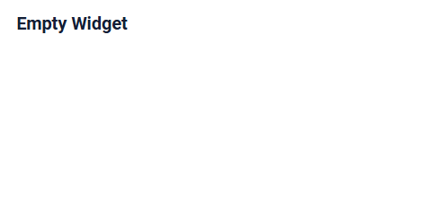
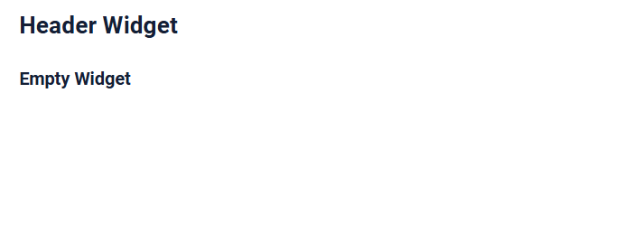
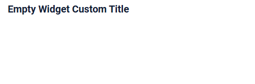
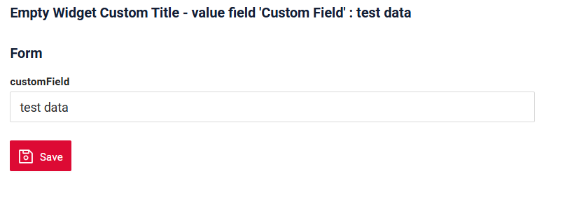
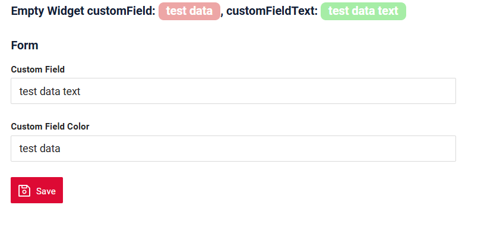
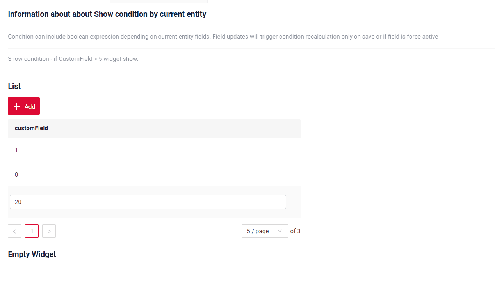
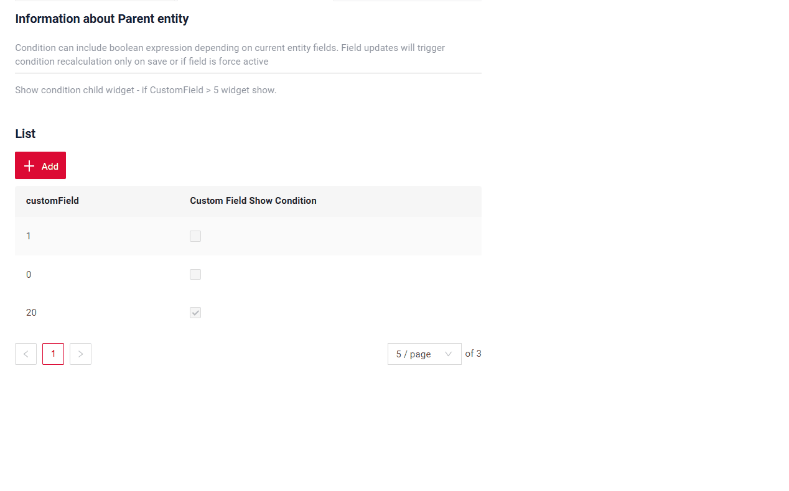

# EmptyWidget
 
Виджет `EmptyWidget` — компонент для отображения текста.

* не поддерживает элементы управления (например, кнопки действий или меню) и поля.

## Основы { #basics }
[:material-play-circle: Живой пример]({{ external_links.code_samples }}/ui/#/screen/myexample5022){:target="_blank"} ·
[:fontawesome-brands-github: GitHub]({{ external_links.github_ui }}/{{ external_links.github_branch }}/src/main/java/org/demo/documentation/widgets/emptywidget/base){:target="_blank"}
### Как это выглядит? { #how-does-it-look }
=== "Пустой виджет"
    
=== "Пустой виджет с другим виджетом"
    
=== "EmptyWidget и emptywidget"
    

###  <a id="Howtoaddbacis">Как добавить?</a>
??? Example "Пример"
 
    **Шаг 1** Создайте файл **_.widget.json_** с type = **"EmptyWidget"**

    ```json
       --8<--
       {{ external_links.github_raw_doc }}/widgets/emptywidget/base/myexample5022EmptyWidget.widget.json
       --8<--
    ```

    **Шаг 2** Добавьте виджет в соответствующий **_.view.json_**.

    ```json
        --8<--
        {{ external_links.github_raw_doc }}/widgets/emptywidget/base/myexample5022empty.view.json
        --8<--
    ```

    [:material-play-circle: Живой пример]({{ external_links.code_samples }}/ui/#/screen/myexample5022){:target="_blank"} ·
    [:fontawesome-brands-github: GitHub]({{ external_links.github_ui }}/{{ external_links.github_branch }}/src/main/java/org/demo/documentation/widgets/emptywidget/base){:target="_blank"}

## <a id="Title">Заголовок</a>
[:material-play-circle: Живой пример]({{ external_links.code_samples }}/ui/#/screen/myexample5034){:target="_blank"} ·
[:fontawesome-brands-github: GitHub]({{ external_links.github_ui }}/{{ external_links.github_branch }}/src/main/java/org/demo/documentation/widgets/emptywidget/title){:target="_blank"}

### Базовый заголовок { #title-basic }
`Title` для виджета.

Типы:

* `постоянный заголовок`: показывает постоянный текст.
* `вычисляемый заголовок`: показывает значение из скрытого текстового поля, например вычисленное на основе бизнес-логики приложения
 
#### Как это выглядит? { #how-does-it-look_1 }
=== "Постоянный заголовок"
     
=== "Вычисляемый заголовок"
    
#### Как добавить? { #how-to-add }
??? Example "Пример"
    === "Постоянный заголовок"
        **Шаг 1** Добавьте название в **title** в **_.widget.json_**.
        ```json
        --8<--
        {{ external_links.github_raw_doc }}/widgets/emptywidget/title/myExample5034const.widget.json
        --8<--
        ```
        [:material-play-circle: Живой пример]({{ external_links.code_samples }}/ui/#/screen/myexample5034){:target="_blank"} ·
        [:fontawesome-brands-github: GitHub]({{ external_links.github_ui }}/{{ external_links.github_branch }}/src/main/java/org/demo/documentation/widgets/emptywidget/title){:target="_blank"}

    === "Вычисляемый заголовок"
        <!--родитель??-->
        **Шаг 1** Добавьте ${customField} в **title** в **_.widget.json_**.

        Динамический вывод данных в заголовке работает, только если эти поля отображаются на другом виджете или передаются как [Field hidden](/ru/widget/fields/field/hidden/hidden/) с другого виджета: [виджет List](/ru/widget/type/list/list), [виджет Form](/ru/widget/type/form/form), [виджет Info](/ru/widget/type/info/info).

        ```json
        --8<--
        {{ external_links.github_raw_doc }}/widgets/emptywidget/title/myExample5034.widget.json
        --8<--
        ```
        [:material-play-circle: Живой пример]({{ external_links.code_samples }}/ui/#/screen/myexample5034/view/myexample5034form){:target="_blank"} ·
        [:fontawesome-brands-github: GitHub]({{ external_links.github_ui }}/{{ external_links.github_branch }}/src/main/java/org/demo/documentation/widgets/emptywidget/title/myExample5034.widget.json){:target="_blank"}

### <a id="TitleColor">Цвет заголовка</a>
 
`Title Color` позволяет задать цвет заголовка. Он может быть постоянным или вычисляемым.
 
[:material-play-circle: Живой пример]({{ external_links.code_samples }}/ui/#/screen/myexample5031/view/myexample5031formconstcolor){:target="_blank"} ·
[:fontawesome-brands-github: GitHub]({{ external_links.github_ui }}/{{ external_links.github_branch }}/src/main/java/org/demo/documentation/widgets/emptywidget/colortitle){:target="_blank"}

* `Постоянный цвет` — фиксированный цвет, который не меняется. Он остаётся одинаковым независимо от каких-либо факторов в приложении.

[:material-play-circle: Живой пример]({{ external_links.code_samples }}/ui/#/screen/myexample5031/view/myexample5031form){:target="_blank"} ·
[:fontawesome-brands-github: GitHub]({{ external_links.github_ui }}/{{ external_links.github_branch }}/src/main/java/org/demo/documentation/widgets/emptywidget/colortitle){:target="_blank"}

* `Вычисляемый цвет` можно использовать для динамического изменения цвета заголовка. Он меняется в зависимости от бизнес-логики или данных приложения.

!!! info
    Цветовое выделение заголовка **применимо** к следующим [полям](/ru/widget/fields/fieldtypes/): date, dateTime, dateTimeWithSeconds, number, money, percent, time, input, text, dictionary, radio, checkbox, pickList, inlinePickList, multivalue, multivalueHover.


##### Как это выглядит? { #how-does-it-look_2 }


##### Как добавить? { #how-to-add_1 }
 
??? Example "Пример"
    === "Вычисляемый цвет"

        **Шаг 1**   Добавьте `собственное поле для цвета` в соответствующий **DataResponseDTO**. Поле может содержать цвет в формате HEX или быть null.
        ```java
        --8<--
        {{ external_links.github_raw_doc }}/widgets/emptywidget/colortitle/MyExample5031DTO.java:colorDTO
        --8<--
        ```   
 
         **Шаг 2** Динамический вывод данных в заголовке работает, только если эти поля отображаются на другом виджете или передаются как [Field hidden](/ru/widget/fields/field/hidden/hidden/) с другого виджета: [виджет List](/ru/widget/type/list/list), [виджет Form](/ru/widget/type/form/form), [виджет Info](/ru/widget/type/info/info)
        со свойством bgColorKey.

        Добавьте **"bgColorKey"** :  `собственное поле для цвета` в .widget.json ([виджет List](/ru/widget/type/list/list), [виджет Form](/ru/widget/type/form/form), [виджет Info](/ru/widget/type/info/info))

        ```json
        {
        "label": "Custom Field",
        "key": "customFieldText",
        "type": "input",
        "bgColorKey": "customFieldTextColor"
        }
        ```

        ```json
        --8<--
        {{ external_links.github_raw_doc }}/widgets/emptywidget/colortitle/myexample5031Form.widget.json
        --8<--
        ```     

         **Шаг 3** Добавьте в `title` поле с `${customField}`.

        ```json
        --8<--
        {{ external_links.github_raw_doc }}/widgets/emptywidget/colortitle/myExample5031EmptyWidget.widget.json
        --8<--
        ```     

        [:material-play-circle: Живой пример]({{ external_links.code_samples }}/ui/#/screen/myexample5031/view/myexample5031form){:target="_blank"} ·
        [:fontawesome-brands-github: GitHub]({{ external_links.github_ui }}/{{ external_links.github_branch }}/src/main/java/org/demo/documentation/widgets/emptywidget/colortitle){:target="_blank"}

    === "Постоянный цвет"
        Постоянный цвет в заголовке работает, только если эти поля отображаются на другом виджете или передаются как [Field hidden](/ru/widget/fields/field/hidden/hidden/) с другого виджета: [виджет List](/ru/widget/type/list/list), [виджет Form](/ru/widget/type/form/form), [виджет Info](/ru/widget/type/info/info).

        Добавьте **"bgColor"** :  `цвет HEX` в .widget.json ([виджет List](/ru/widget/type/list/list), [виджет Form](/ru/widget/type/form/form), [виджет Info](/ru/widget/type/info/info)).

        Добавьте в `title` поле с `${customField}`
 
        ```json
        --8<--
        {{ external_links.github_raw_doc }}/widgets/emptywidget/colortitle/myExample5031EmptyWidgetConstColor.widget.json
        --8<--
        ```
        
        [:material-play-circle: Живой пример]({{ external_links.code_samples }}/ui/#/screen/myexample5031/view/myexample5031formconstcolor){:target="_blank"} ·
        [:fontawesome-brands-github: GitHub]({{ external_links.github_ui }}/{{ external_links.github_branch }}/src/main/java/org/demo/documentation/widgets/emptywidget/colortitle){:target="_blank"}


## <a id="Showcondition">Условие отображения</a>
подробнее см. [showCondition](/ru/widget/type/property/showcondition/showcondition)

[:material-play-circle: Живой пример]({{ external_links.code_samples }}/ui/#/screen/myexample5022){:target="_blank"} ·
[:fontawesome-brands-github: GitHub]({{ external_links.github_ui }}/{{ external_links.github_branch }}/src/main/java/org/demo/documentation/widgets/emptywidget/base){:target="_blank"}

* `без условия отображения — рекомендуется`: виджет виден всегда

[:material-play-circle: Живой пример]({{ external_links.code_samples }}/ui/#/screen/myexample5033/view/myexample5033form){:target="_blank"} ·
[:fontawesome-brands-github: GitHub]({{ external_links.github_ui }}/{{ external_links.github_branch }}/src/main/java/org/demo/documentation/widgets/emptywidget/showcondition/bycurrententity){:target="_blank"}

* `условие отображения по текущей сущности`: условие может содержать логическое выражение, зависящее от полей текущей сущности. Обновление полей вызывает пересчёт условия только при сохранении или если поле force active

[:material-play-circle: Живой пример]({{ external_links.code_samples }}/ui/#/screen/myexample5033/view/myexample5036form){:target="_blank"} ·
[:fontawesome-brands-github: GitHub]({{ external_links.github_ui }}/{{ external_links.github_branch }}/src/main/java/org/demo/documentation/widgets/emptywidget/showcondition/byparententity){:target="_blank"}

* `условие отображения по родительской сущности`: условие может содержать логическое выражение, зависящее от родительской сущности. Обновление полей родителя вызывает пересчёт условия только при сохранении или если поле force active и отображается на том же view

!!! tips "Совет"
    По возможности рекомендуется не использовать `Show condition`, так как широкое применение этой возможности усложняет поддержку приложения.


#### <a id="howdoesitlook">Как это выглядит?</a>
=== "без условия отображения"
    
=== "условие отображения по текущей сущности"
    
=== "условие отображения по родительской сущности"
    

### <a id="howtoadd">Как добавить?</a>
??? Example "Пример"

    === "без условия отображения"
        см. [Основы](#Howtoaddbacis)
        [:material-play-circle: Живой пример]({{ external_links.code_samples }}/ui/#/screen/myexample5022){:target="_blank"} ·
        [:fontawesome-brands-github: GitHub]({{ external_links.github_ui }}/{{ external_links.github_branch }}/src/main/java/org/demo/documentation/widgets/emptywidget/base){:target="_blank"}

    === "условие отображения по текущей сущности"
        `showCondition` работает, только если поля для showCondition отображаются на другом виджете или передаются как [Field hidden](/ru/widget/fields/field/hidden/hidden/) с другого виджета: [виджет List](/ru/widget/type/list/list), [виджет Form](/ru/widget/type/form/form), [виджет Info](/ru/widget/type/info/info).

        **Шаг 1** Добавьте **showCondition** в **_.widget.json_**. Подробнее см. [showCondition](/ru/widget/type/property/showcondition/showcondition)
        ```json
        --8<--
        {{ external_links.github_raw_doc }}/widgets/emptywidget/showcondition/bycurrententity/myExample5033.widget.json
        --8<--
        ```

        [:material-play-circle: Живой пример]({{ external_links.code_samples }}/ui/#/screen/myexample5033/view/myexample5033form){:target="_blank"} ·
        [:fontawesome-brands-github: GitHub]({{ external_links.github_ui }}/{{ external_links.github_branch }}/src/main/java/org/demo/documentation/widgets/emptywidget/showcondition/bycurrententity){:target="_blank"}

    === "условие отображения по родительской сущности"
        `showCondition` работает, только если поля для showCondition отображаются на другом виджете или передаются как [Field hidden](/ru/widget/fields/field/hidden/hidden/) с другого виджета: [виджет List](/ru/widget/type/list/list), [виджет Form](/ru/widget/type/form/form), [виджет Info](/ru/widget/type/info/info).

        **Шаг 1** Добавьте **showCondition** в **_.widget.json_**. Подробнее см. [showCondition](/ru/widget/type/property/showcondition/showcondition)
        ```json
        --8<--
        {{ external_links.github_raw_doc }}/widgets/emptywidget/showcondition/byparententity/child/myexample5037Empty.widget.json
        --8<--
        ```
        [:material-play-circle: Живой пример]({{ external_links.code_samples }}/ui/#/screen/myexample5033/view/myexample5036form){:target="_blank"} ·
        [:fontawesome-brands-github: GitHub]({{ external_links.github_ui }}/{{ external_links.github_branch }}/src/main/java/org/demo/documentation/widgets/emptywidget/showcondition/byparententity){:target="_blank"}

 
## <a id="bc">Бизнес-компонент</a>
Указывает бизнес-компонент (BC), к которому относится этот emptywidget.
Бизнес-компонент представляет определённую часть системы, отвечающую за конкретную бизнес-логику или данные.

подробнее см. [Бизнес-компонент](/ru/environment/businesscomponent/businesscomponent/)

## <a id="fields">Поля</a>
Этот тип виджета не поддерживает поля

## Параметры (Options) { #options }
Этот тип виджета не поддерживает options

## Стандартные действия { #standard-actions }
Этот тип виджета не поддерживает кнопки