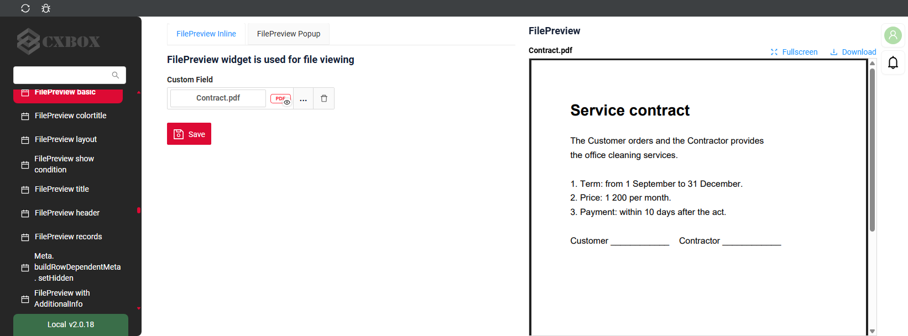
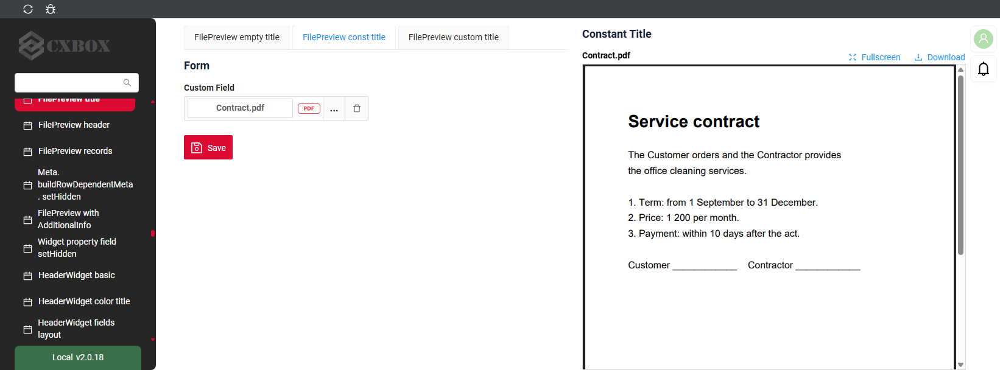
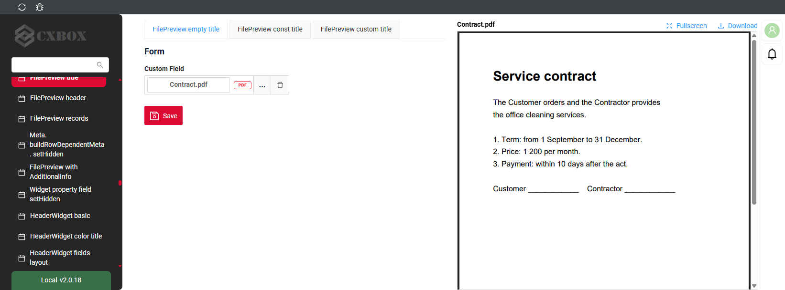
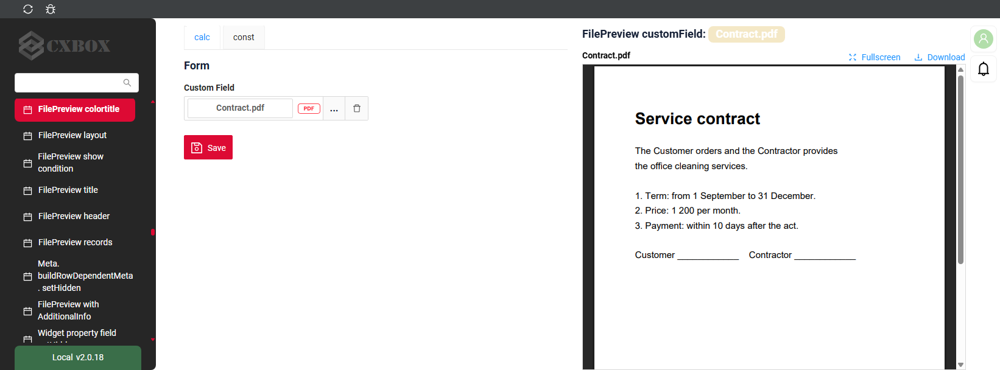
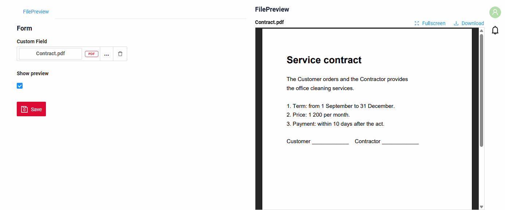
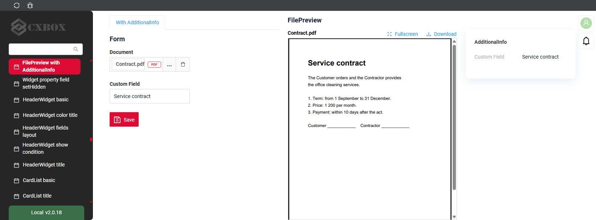
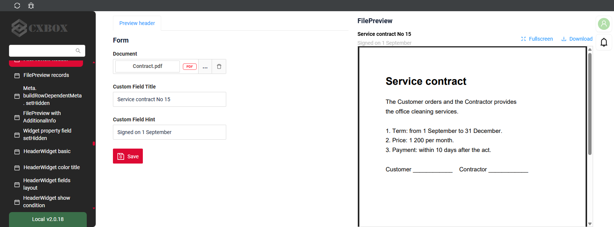
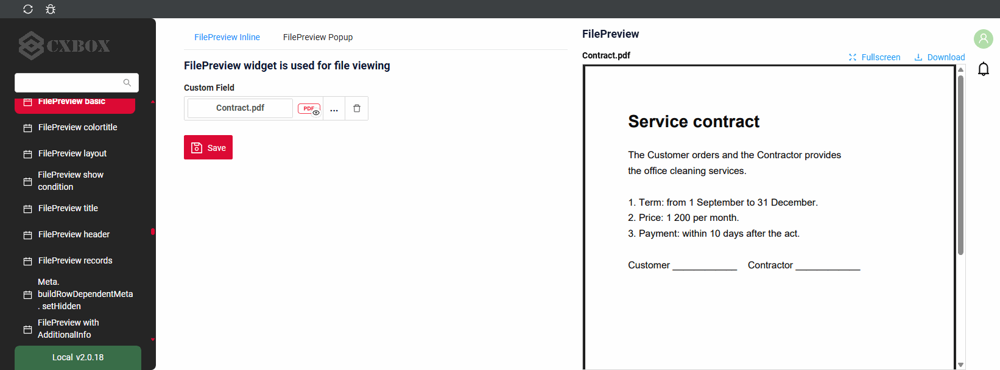
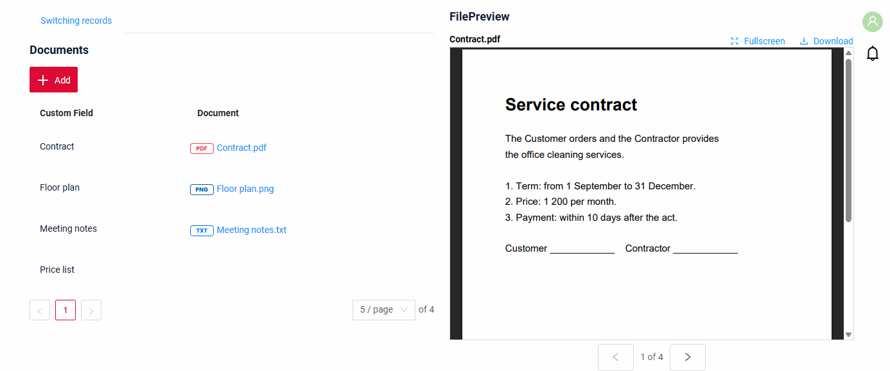

# FilePreview

Виджет `FilePreview` показывает файл текущей записи прямо на странице, рядом с другими виджетами.
Пользователь читает документ и одновременно заполняет форму: файл остаётся в поле зрения при прокрутке страницы.

## Основы { #basics }
[:material-play-circle: Живой пример]({{ external_links.code_samples }}/ui/#/screen/myexample5003){:target="_blank"} ·
[:fontawesome-brands-github: GitHub]({{ external_links.github_ui }}/{{ external_links.github_branch }}/src/main/java/org/demo/documentation/widgets/filepreview/base){:target="_blank"}

### Как это выглядит? { #how-does-it-look }


Виджету нужно одно поле типа [fileUpload](/ru/widget/fields/field/fileUpload/fileUpload/) с `"preview": {"enabled": true, "mode": "inline"}`.
Файл отображается сразу, без всплывающего окна.

* Виджет всегда занимает правую половину view. Остальные виджеты view размещаются в левой половине.
* Виджет закреплён в верхней части экрана: файл остаётся в поле зрения при прокрутке страницы.
* Виджет нельзя свернуть. Его место сохраняется, даже если у записи нет файла.
* Виджет показывает файл текущей записи своего бизнес-компонента. Когда другой виджет того же бизнес-компонента выбирает запись, предпросмотр показывает её файл.

!!! info
    Из-за фиксированного положения под FilePreview нельзя разместить другие виджеты.

    `"mode": "inline"` работает только в FilePreview. В других виджетах файл открывается во всплывающем окне, как при `"mode": "popup"`.

###  <a id="Howtoaddbacis">Как добавить?</a>
??? Example "Пример"
    **Шаг 1** Создайте файл **_.widget.json_** с type = **"FilePreview"**.
    Добавьте поле с типом `fileUpload` и `"preview": {"enabled": true, "mode": "inline"}`. Подробнее см. [Поля](#fields)
    ```json
    --8<--
    {{ external_links.github_raw_doc }}/widgets/filepreview/base/MyExample5003InlineFilePreview.widget.json
    --8<--
    ```

    **Шаг 2** Добавьте виджет в соответствующий **_.view.json_**. `position` и `gridWidth` не меняют место виджета.

    ```json
    --8<--
    {{ external_links.github_raw_doc }}/widgets/filepreview/base/MyExample5003Inlineform.view.json
    --8<--
    ```

## Основные визуальные части { #main-visual-parts }
[:material-play-circle: Живой пример]({{ external_links.code_samples }}/ui/#/screen/myexample5009){:target="_blank"} ·
[:fontawesome-brands-github: GitHub]({{ external_links.github_ui }}/{{ external_links.github_branch }}/src/main/java/org/demo/documentation/widgets/filepreview/records){:target="_blank"}

* `title` — заголовок виджета. см. [Заголовок](#Title)
* `header` — имя файла или поле из `preview.titleKey`, подсказка из `preview.hintKey`. см. [Заголовок предпросмотра](#header)
* `Fullscreen` и `Download` — кнопки в заголовке. см. [Fullscreen и Download](#fullscreen)
* `file` — pdf, изображение или аудио. Для других файлов и записей без файла отображается сообщение. см. [Типы файлов](#filetypes)
* `arrows` — переключают записи бизнес-компонента, `1 of 4` показывает текущую. см. [Переключение записей](#records)

## <a id="Title">Заголовок</a>
[:material-play-circle: Живой пример]({{ external_links.code_samples }}/ui/#/screen/myexample5007){:target="_blank"} ·
[:fontawesome-brands-github: GitHub]({{ external_links.github_ui }}/{{ external_links.github_branch }}/src/main/java/org/demo/documentation/widgets/filepreview/title){:target="_blank"}

### Базовый заголовок { #title-basic }
`Title` для виджета (необязательно)

Типы:

* `постоянный заголовок`: показывает постоянный текст.
* `пустой постоянный заголовок`: если нужно визуально связать виджеты, расположив их один под другим

#### Как это выглядит? { #how-does-it-look_1 }
=== "Постоянный заголовок"
    
=== "Пустой постоянный заголовок"
    

#### Как добавить? { #how-to-add }
??? Example "Пример"
    === "Постоянный заголовок"
        **Шаг 1** Добавьте название в **title** в **_.widget.json_**.
        ```json
        --8<--
        {{ external_links.github_raw_doc }}/widgets/filepreview/title/MyExample5007FilePreview.widget.json
        --8<--
        ```
        [:material-play-circle: Живой пример]({{ external_links.code_samples }}/ui/#/screen/myexample5007/view/MyExample5007form){:target="_blank"} ·
        [:fontawesome-brands-github: GitHub]({{ external_links.github_ui }}/{{ external_links.github_branch }}/src/main/java/org/demo/documentation/widgets/filepreview/title){:target="_blank"}

    === "Пустой постоянный заголовок"
        **Шаг 1** Удалите параметр **title** из **_.widget.json_**.
        ```json
        --8<--
        {{ external_links.github_raw_doc }}/widgets/filepreview/title/MyExample5007FilePreviewTitleEmpty.widget.json
        --8<--
        ```
        [:material-play-circle: Живой пример]({{ external_links.code_samples }}/ui/#/screen/myexample5007/view/MyExample5007formemptytitle){:target="_blank"} ·
        [:fontawesome-brands-github: GitHub]({{ external_links.github_ui }}/{{ external_links.github_branch }}/src/main/java/org/demo/documentation/widgets/filepreview/title){:target="_blank"}

### Цвет заголовка { #title-color }
`Title Color` позволяет задать цвет заголовка. Он может быть постоянным или вычисляемым.
Заголовок показывает значения полей текущей записи.

**Постоянный цвет**

[:material-play-circle: Живой пример]({{ external_links.code_samples }}/ui/#/screen/myexample5004/view/MyExample5004form){:target="_blank"} ·
[:fontawesome-brands-github: GitHub]({{ external_links.github_ui }}/{{ external_links.github_branch }}/src/main/java/org/demo/documentation/widgets/filepreview/colortitle){:target="_blank"}

*Постоянный цвет* — фиксированный цвет, который не меняется. Он остаётся одинаковым независимо от каких-либо факторов в приложении.

**Вычисляемый цвет**

[:material-play-circle: Живой пример]({{ external_links.code_samples }}/ui/#/screen/myexample5004/view/MyExample5004formcalc){:target="_blank"} ·
[:fontawesome-brands-github: GitHub]({{ external_links.github_ui }}/{{ external_links.github_branch }}/src/main/java/org/demo/documentation/widgets/filepreview/colortitle){:target="_blank"}

*Вычисляемый цвет* можно использовать для динамического изменения цвета заголовка. Он меняется в зависимости от бизнес-логики или данных приложения.

!!! info
    Цветовое выделение заголовка **применимо** к следующим [полям](/ru/widget/fields/fieldtypes/): date, dateTime, dateTimeWithSeconds, number, money, percent, time, input, text, dictionary, radio, checkbox, pickList, inlinePickList, multivalue, multivalueHover, fileUpload.

##### Как это выглядит? { #how-does-it-look_2 }


##### Как добавить? { #how-to-add_1 }
??? Example "Пример"
    === "Вычисляемый цвет"

        **Шаг 1**   Добавьте `собственное поле для цвета` в соответствующий **DataResponseDTO**. Поле может содержать цвет в формате HEX или быть null.
        ```java
        --8<--
        {{ external_links.github_raw_doc }}/widgets/filepreview/colortitle/MyExample5004DTO.java:colorDTO
        --8<--
        ```

        **Шаг 2** Добавьте **"bgColorKey"** :  `собственное поле для цвета` в .widget.json.

        Добавьте в `title` поле с `${customField}`

        ```json
        --8<--
        {{ external_links.github_raw_doc }}/widgets/filepreview/colortitle/MyExample5004FilePreviewCalc.widget.json
        --8<--
        ```

        [:material-play-circle: Живой пример]({{ external_links.code_samples }}/ui/#/screen/myexample5004/view/MyExample5004formcalc){:target="_blank"} ·
        [:fontawesome-brands-github: GitHub]({{ external_links.github_ui }}/{{ external_links.github_branch }}/src/main/java/org/demo/documentation/widgets/filepreview/colortitle){:target="_blank"}

    === "Постоянный цвет"

        Добавьте **"bgColor"** :  `цвет HEX` в .widget.json.

        Добавьте в `title` поле с `${customField}`

        ```json
        --8<--
        {{ external_links.github_raw_doc }}/widgets/filepreview/colortitle/MyExample5004FilePreview.widget.json
        --8<--
        ```

        [:material-play-circle: Живой пример]({{ external_links.code_samples }}/ui/#/screen/myexample5004/view/MyExample5004form){:target="_blank"} ·
        [:fontawesome-brands-github: GitHub]({{ external_links.github_ui }}/{{ external_links.github_branch }}/src/main/java/org/demo/documentation/widgets/filepreview/colortitle){:target="_blank"}

## <a id="bc">Бизнес-компонент</a>
Указывает бизнес-компонент (BC), к которому относится этот виджет.
Бизнес-компонент представляет определённую часть системы, отвечающую за конкретную бизнес-логику или данные.
Виджет показывает файл текущей записи этого бизнес-компонента.

подробнее см. [Бизнес-компонент](/ru/environment/businesscomponent/businesscomponent/)

## <a id="Showcondition">Условие отображения</a>

* `без условия отображения — рекомендуется`: виджет виден всегда

  [:material-play-circle: Живой пример]({{ external_links.code_samples }}/ui/#/screen/myexample5003){:target="_blank"} ·
  [:fontawesome-brands-github: GitHub]({{ external_links.github_ui }}/{{ external_links.github_branch }}/src/main/java/org/demo/documentation/widgets/filepreview/base){:target="_blank"}

* `условие отображения по текущей сущности`: условие может содержать логическое выражение, зависящее от полей текущей сущности. Обновление полей вызывает пересчёт условия только при сохранении или если поле force active

  [:material-play-circle: Живой пример]({{ external_links.code_samples }}/ui/#/screen/myexample5006){:target="_blank"} ·
  [:fontawesome-brands-github: GitHub]({{ external_links.github_ui }}/{{ external_links.github_branch }}/src/main/java/org/demo/documentation/widgets/filepreview/showcondition){:target="_blank"}

* `условие отображения по родительской сущности`: условие может содержать логическое выражение, зависящее от родительской сущности. Обновление полей родителя вызывает пересчёт условия только при сохранении или если поле force active и отображается на том же view

!!! tips "Совет"
    По возможности рекомендуется не использовать `Show condition`, так как широкое применение этой возможности усложняет поддержку приложения.

#### <a id="howdoesitlook">Как это выглядит?</a>
=== "без условия отображения"
    
=== "условие отображения по текущей сущности"
    

#### <a id="howtoadd">Как добавить?</a>
??? Example "Пример"

    === "без условия отображения"
        см. [Основы](#Howtoaddbacis)

    === "условие отображения по текущей сущности"
        **Шаг 1** Добавьте **showCondition** в **_.widget.json_**. Подробнее см. [showCondition](/ru/widget/type/property/showcondition/showcondition)
        ```json
        --8<--
        {{ external_links.github_raw_doc }}/widgets/filepreview/showcondition/MyExample5006FilePreview.widget.json
        --8<--
        ```

## <a id="fields">Поля</a>
[:material-play-circle: Живой пример]({{ external_links.code_samples }}/ui/#/screen/myexample5002){:target="_blank"} ·
[:fontawesome-brands-github: GitHub]({{ external_links.github_ui }}/{{ external_links.github_branch }}/src/main/java/org/demo/documentation/widgets/filepreview/allpropertiesfield){:target="_blank"}

Настройка полей. Массив fields определяет поле файла виджета.

```json
{
    "label": "Custom Field",
    "key": "customField",
    "type": "fileUpload",
    "fileIdKey": "customFieldId",
    "preview": {
        "enabled": true,
        "mode": "inline"
    }
}
```

* **"label"**

  Описание: заголовок поля.

  Тип: String (необязательно).

* **"key"**

    Описание: имя поля в соответствующем DataResponseDTO.

    Тип: String (обязательно).

* **"type"**

  Описание: [Типы полей](/ru/widget/fields/fieldtypes/)

  Тип: String (обязательно).

* **"preview"**

  Описание: `"enabled": true` и `"mode": "inline"` показывают файл в виджете. `titleKey` и `hintKey` меняют заголовок, см. [Заголовок предпросмотра](#header).

  Тип: Object (обязательно).

Виджет показывает только первое поле типа **fileUpload** с `"mode": "inline"`. Остальные поля не отображаются.
Без такого поля виджет ничего не показывает, а в консоли браузера указывается причина.

### Как добавить? { #how-to-add_2 }
??? Example "Пример"
    Добавьте поле в **_.widget.json_**.

      ```json
         --8<--
         {{ external_links.github_raw_doc }}/widgets/filepreview/allpropertiesfield/MyExample5002FilePreview.widget.json
         --8<--
      ```

## <a id="Fieldslayout">Компоновка (options layout)</a>
_неприменимо_

## <a id="actions">Действия</a>
_неприменимо_

У виджета нет действий. Файл загружается, изменяется и сохраняется в другом виджете того же бизнес-компонента, например в форме рядом.

## Дополнительные свойства { #additional-properties }
### <a id="layout">Место на view</a>
[:material-play-circle: Живой пример]({{ external_links.code_samples }}/ui/#/screen/myexample5005){:target="_blank"} ·
[:fontawesome-brands-github: GitHub]({{ external_links.github_ui }}/{{ external_links.github_branch }}/src/main/java/org/demo/documentation/widgets/filepreview/fieldslayoute){:target="_blank"}

* Виджет занимает правую половину view при любых `gridWidth` и `position`.
* На view отображается один виджет FilePreview: первый в `.view.json`. Остальные виджеты FilePreview этого view не отображаются.
* Правая половина остаётся пустой, пока виджет скрыт своим [условием отображения](#Showcondition).

### <a id="additionalinfo">С виджетами AdditionalInfo</a>
[:material-play-circle: Живой пример]({{ external_links.code_samples }}/ui/#/screen/myexample5011){:target="_blank"} ·
[:fontawesome-brands-github: GitHub]({{ external_links.github_ui }}/{{ external_links.github_branch }}/src/main/java/org/demo/documentation/widgets/filepreview/additionalinfo){:target="_blank"}

Если на view есть виджеты [AdditionalInfo](/ru/widget/type/additionalinfo/additionalinfo), они занимают правую четверть экрана.
Остальное делится пополам: другие виджеты слева, FilePreview справа.

#### Как это выглядит? { #how-does-it-look_3 }


#### Как добавить? { #how-to-add_3 }
??? Example "Пример"
    Добавьте виджеты FilePreview и AdditionalInfo в **_.view.json_**.
    ```json
    --8<--
    {{ external_links.github_raw_doc }}/widgets/filepreview/additionalinfo/myexample5011addinfo.view.json
    --8<--
    ```

### <a id="header">Заголовок предпросмотра</a>
[:material-play-circle: Живой пример]({{ external_links.code_samples }}/ui/#/screen/myexample5008){:target="_blank"} ·
[:fontawesome-brands-github: GitHub]({{ external_links.github_ui }}/{{ external_links.github_branch }}/src/main/java/org/demo/documentation/widgets/filepreview/header){:target="_blank"}

Заголовок над файлом показывает имя файла. Вместо него можно показывать поля записи:

* `titleKey` — поле, отображаемое вместо имени файла.
* `hintKey` — поле, отображаемое под ним в качестве подсказки.

#### Как это выглядит? { #how-does-it-look_4 }


#### Как добавить? { #how-to-add_4 }
??? Example "Пример"
    Добавьте **titleKey** и **hintKey** в **preview** поля в **_.widget.json_**.
    ```json
    --8<--
    {{ external_links.github_raw_doc }}/widgets/filepreview/header/MyExample5008FilePreview.widget.json
    --8<--
    ```

### <a id="fullscreen">Fullscreen и Download</a>
[:material-play-circle: Живой пример]({{ external_links.code_samples }}/ui/#/screen/myexample5003){:target="_blank"} ·
[:fontawesome-brands-github: GitHub]({{ external_links.github_ui }}/{{ external_links.github_branch }}/src/main/java/org/demo/documentation/widgets/filepreview/base){:target="_blank"}

* `Fullscreen` открывает файл на весь экран. Стрелки переключают записи и там; крестик возвращает к view.
* `Download` сохраняет файл.

Обе кнопки отображаются всегда, настройка не нужна.

#### Как это выглядит? { #how-does-it-look_5 }


### <a id="records">Переключение записей</a>
[:material-play-circle: Живой пример]({{ external_links.code_samples }}/ui/#/screen/myexample5009){:target="_blank"} ·
[:fontawesome-brands-github: GitHub]({{ external_links.github_ui }}/{{ external_links.github_branch }}/src/main/java/org/demo/documentation/widgets/filepreview/records){:target="_blank"}

Когда у бизнес-компонента несколько записей, под файлом отображаются стрелки. Они переключают текущую запись,
поэтому другие виджеты того же бизнес-компонента тоже переключаются: в примере список выделяет строку отображаемого файла.
Стрелки проходят по записям загруженной страницы.

#### Как это выглядит? { #how-does-it-look_6 }


#### Как добавить? { #how-to-add_5 }
??? Example "Пример"
    Добавьте FilePreview и List того же бизнес-компонента в **_.view.json_**.
    ```json
    --8<--
    {{ external_links.github_raw_doc }}/widgets/filepreview/records/myexample5009list.view.json
    --8<--
    ```

### <a id="filetypes">Типы файлов</a>
[:material-play-circle: Живой пример]({{ external_links.code_samples }}/ui/#/screen/myexample5009){:target="_blank"} ·
[:fontawesome-brands-github: GitHub]({{ external_links.github_ui }}/{{ external_links.github_branch }}/src/main/java/org/demo/documentation/widgets/filepreview/records){:target="_blank"}

| Файл | Что показывает виджет |
|---|---|
| pdf | документ с прокруткой |
| изображение: png, jpg, gif, svg, webp и другие | изображение |
| аудио: mp3, wav, ogg, m4a, aac, flac | плеер |
| другие типы, например txt, docx, xlsx | "This file type cannot be viewed" и кнопка Download |
| запись без файла | "There is no file in this row" |

Примеры приведены в разделе [Переключение записей](#records).

### Фильтрация { #filtration }
_неприменимо_

#### Полнотекстовый поиск (FullTextSearch) { #fulltextsearch }
_неприменимо_

### <a id="pagination">Пагинация</a>
_неприменимо_

### Экспорт в Excel { #export-to-excel }
_неприменимо_

### Множественная загрузка файлов { #multi-upload-files }
_неприменимо_

### Настройка отображаемых колонок { #customization-of-displayed-columns }
_неприменимо_

### Сортировка { #sorting }
_неприменимо_
