# Form
 
Виджет `Form` — компонент для просмотра и редактирования данных. Обычно отображает несколько полей. Также может отображать доступные действия.
## Основы { #basics }
[:material-play-circle: Живой пример]({{ external_links.code_samples }}/ui/#/screen/myexample3000/view/myexample3000form){:target="_blank"} ·
[:fontawesome-brands-github: GitHub]({{ external_links.github_ui }}/{{ external_links.github_branch }}/src/main/java/org/demo/documentation/widgets/form/base/onefield){:target="_blank"}
### Как это выглядит? { #how-does-it-look }
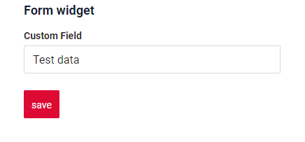

###  <a id="Howtoaddbacis">Как добавить?</a>
??? Example "Пример"
    
    **Шаг 1** Создайте файл **_.widget.json_** с type = **"Form"**
    Добавьте существующее поле в виджет формы. Подробнее см. [Поля](#fields)

    ```json
       --8<--
       {{ external_links.github_raw_doc }}/widgets/form/base/onefield/MyExample3000Form.widget.json
       --8<--
    ```

    **Шаг 2** Добавьте виджет в соответствующий **_.view.json_**.

    ```json
        --8<--
        {{ external_links.github_raw_doc }}/widgets/form/base/onefield/myexample3000form.view.json
        --8<--
    ```

    [:material-play-circle: Живой пример]({{ external_links.code_samples }}/ui/#/screen/myexample3000){:target="_blank"} ·
    [:fontawesome-brands-github: GitHub]({{ external_links.github_ui }}/{{ external_links.github_branch }}/src/main/java/org/demo/documentation/widgets/form/base/onefield){:target="_blank"}

## <a id="Title">Заголовок</a>
[:material-play-circle: Живой пример]({{ external_links.code_samples }}/ui/#/screen/myexample3003){:target="_blank"} ·
[:fontawesome-brands-github: GitHub]({{ external_links.github_ui }}/{{ external_links.github_branch }}/src/main/java/org/demo/documentation/widgets/form/title){:target="_blank"}

### Базовый заголовок { #title-basic }
`Title` для виджета — (необязательно)

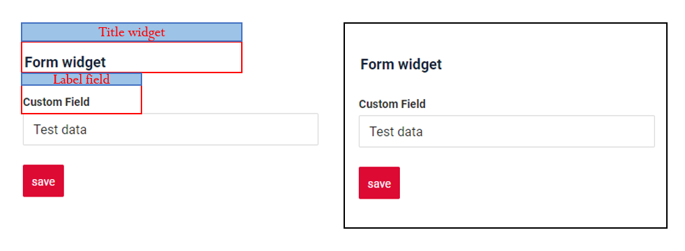    

Типы:

* `постоянный заголовок`: показывает постоянный текст.
* `пустой постоянный заголовок`: если нужно визуально связать виджеты, расположив их один под другим
* `вычисляемый заголовок`: показывает значение из скрытого текстового поля, например вычисленное на основе бизнес-логики приложения
 
#### Как это выглядит? { #how-does-it-look_1 }
=== "Постоянный заголовок"
    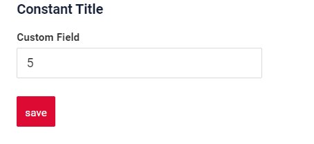
=== "Пустой постоянный заголовок"
    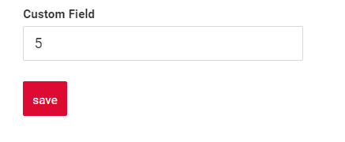
=== "Вычисляемый заголовок"
    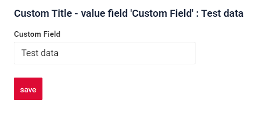
#### Как добавить? { #how-to-add }
??? Example "Пример"
    === "Постоянный заголовок"
        **Шаг 1** Добавьте название в **title** в **_.widget.json_**.
        ```json
        --8<--
        {{ external_links.github_raw_doc }}/widgets/form/title/MyExample3003Form.widget.json
        --8<--
        ```
        [:material-play-circle: Живой пример]({{ external_links.code_samples }}/ui/#/screen/myexample3003){:target="_blank"} ·
        [:fontawesome-brands-github: GitHub]({{ external_links.github_ui }}/{{ external_links.github_branch }}/src/main/java/org/demo/documentation/widgets/form/title){:target="_blank"}

    === "Пустой постоянный заголовок"
        **Шаг 1** Удалите параметр **title** из **_.widget.json_**.
        ```json
        --8<--
        {{ external_links.github_raw_doc }}/widgets/form/title/MyExample3003EmptyTitleForm.widget.json
        --8<--
        ```
        [:material-play-circle: Живой пример]({{ external_links.code_samples }}/ui/#/screen/myexample3003/view/myexample3003formemtytitle){:target="_blank"} ·
        [:fontawesome-brands-github: GitHub]({{ external_links.github_ui }}/{{ external_links.github_branch }}/src/main/java/org/demo/documentation/widgets/form/title){:target="_blank"}

    === "Вычисляемый заголовок"
        <!--родитель??-->
        **Шаг 1** Добавьте ${customField} в **title** в **_.widget.json_**.
        ```json
        --8<--
        {{ external_links.github_raw_doc }}/widgets/form/title/MyExample3003FormCustomTitle.widget.json
        --8<--
        ```
        [:material-play-circle: Живой пример]({{ external_links.code_samples }}/ui/#/screen/myexample3003/view/myexample3003customtitleform){:target="_blank"} ·
        [:fontawesome-brands-github: GitHub]({{ external_links.github_ui }}/{{ external_links.github_branch }}/src/main/java/org/demo/documentation/widgets/form/title/MyExample3003FormCustomTitle.widget.json){:target="_blank"}


### Цвет заголовка { #title-color }
`Title Color` позволяет задать цвет заголовка. Он может быть постоянным или вычисляемым.
 
[:material-play-circle: Живой пример]({{ external_links.code_samples }}/ui/#/screen/myexample3026/view/myexample3026colorconst){:target="_blank"} ·
[:fontawesome-brands-github: GitHub]({{ external_links.github_ui }}/{{ external_links.github_branch }}/src/main/java/org/demo/documentation/widgets/form/colortitle){:target="_blank"}

* `Постоянный цвет` — фиксированный цвет, который не меняется. Он остаётся одинаковым независимо от каких-либо факторов в приложении.

[:material-play-circle: Живой пример]({{ external_links.code_samples }}/ui/#/screen/myexample3026/view/myexample3026){:target="_blank"} ·
[:fontawesome-brands-github: GitHub]({{ external_links.github_ui }}/{{ external_links.github_branch }}/src/main/java/org/demo/documentation/widgets/form/colortitle){:target="_blank"}

* `Вычисляемый цвет` можно использовать для динамического изменения цвета заголовка. Он меняется в зависимости от бизнес-логики или данных приложения.

!!! info
    Цветовое выделение заголовка **применимо** к следующим [полям](/ru/widget/fields/fieldtypes/): date, dateTime, dateTimeWithSeconds, number, money, percent, time, input, text, dictionary, radio, checkbox, pickList, inlinePickList, multivalue, multivalueHover.


##### Как это выглядит? { #how-does-it-look_2 }
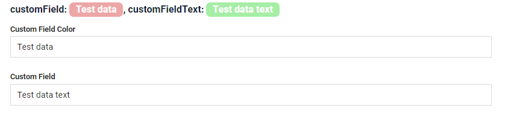

##### Как добавить? { #how-to-add_1 }
 
??? Example "Пример"
    === "Вычисляемый цвет"

        **Шаг 1**   Добавьте `собственное поле для цвета` в соответствующий **DataResponseDTO**. Поле может содержать цвет в формате HEX или быть null.
        ```java
        --8<--
        {{ external_links.github_raw_doc }}/widgets/form/colortitle/MyExample3026DTO.java:colorDTO
        --8<--
        ```   
 
        **Шаг 2** Добавьте **"bgColorKey"** :  `собственное поле для цвета` в .widget.json.

        Добавьте в `title` поле с `${customField}`

        ```json
        --8<--
        {{ external_links.github_raw_doc }}/widgets/form/colortitle/MyExample3026dynamic.widget.json
        --8<--
        ```     

        [:material-play-circle: Живой пример]({{ external_links.code_samples }}/ui/#/screen/myexample3026/view/myexample3026){:target="_blank"} ·
        [:fontawesome-brands-github: GitHub]({{ external_links.github_ui }}/{{ external_links.github_branch }}/src/main/java/org/demo/documentation/widgets/form/colortitle){:target="_blank"}

    === "Постоянный цвет"
 
        Добавьте **"bgColor"** :  `цвет HEX` в .widget.json.

        Добавьте в `title` поле с `${customField}`

        ```json
        --8<--
        {{ external_links.github_raw_doc }}/widgets/form/colortitle/MyExample3026const.widget.json
        --8<--
        ```
        
        [:material-play-circle: Живой пример]({{ external_links.code_samples }}/ui/#/screen/myexample3026/view/myexample3026colorconst){:target="_blank"} ·
        [:fontawesome-brands-github: GitHub]({{ external_links.github_ui }}/{{ external_links.github_branch }}/src/main/java/org/demo/documentation/widgets/form/colortitle){:target="_blank"}


## <a id="Showcondition">Условие отображения</a>
подробнее см. [showCondition](/ru/widget/type/property/showcondition/showcondition)

[:material-play-circle: Живой пример]({{ external_links.code_samples }}/ui/#/screen/myexample3000){:target="_blank"} ·
[:fontawesome-brands-github: GitHub]({{ external_links.github_ui }}/{{ external_links.github_branch }}/src/main/java/org/demo/documentation/widgets/form/base/onefield){:target="_blank"}

* `без условия отображения — рекомендуется`: виджет виден всегда

[:material-play-circle: Живой пример]({{ external_links.code_samples }}/ui/#/screen/myexample3005/view/myexample3005showcondform){:target="_blank"} ·
[:fontawesome-brands-github: GitHub]({{ external_links.github_ui }}/{{ external_links.github_branch }}/src/main/java/org/demo/documentation/widgets/form/showcondition/bycurrententity){:target="_blank"}

* `условие отображения по текущей сущности`: условие может содержать логическое выражение, зависящее от полей текущей сущности. Обновление полей вызывает пересчёт условия только при сохранении или если поле force active

[:material-play-circle: Живой пример]({{ external_links.code_samples }}/ui/#/screen/myexample3005/view/myexample3007showcondform){:target="_blank"} ·
[:fontawesome-brands-github: GitHub]({{ external_links.github_ui }}/{{ external_links.github_branch }}/src/main/java/org/demo/documentation/widgets/form/showcondition/byparententity){:target="_blank"}

* `условие отображения по родительской сущности`: условие может содержать логическое выражение, зависящее от родительской сущности. Обновление полей родителя вызывает пересчёт условия только при сохранении или если поле force active и отображается на том же view

!!! tips "Совет"
    По возможности рекомендуется не использовать `Show condition`, так как широкое применение этой возможности усложняет поддержку приложения.


#### <a id="howdoesitlook">Как это выглядит?</a>
=== "без условия отображения"
    
=== "условие отображения по текущей сущности"
    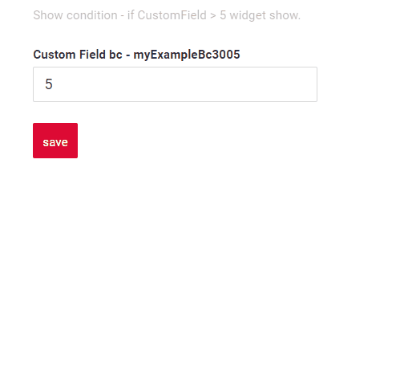
=== "условие отображения по родительской сущности"
    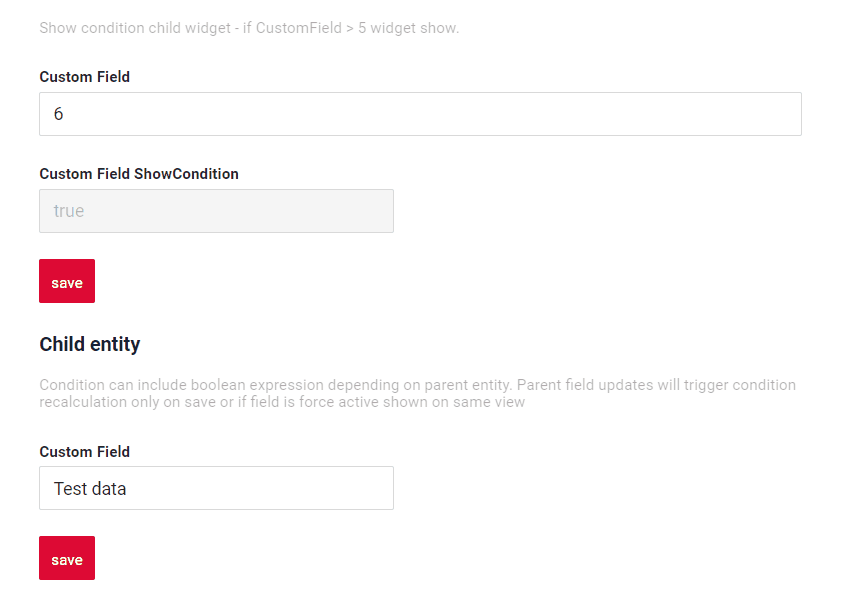

### <a id="howtoadd">Как добавить?</a>
??? Example "Пример"

    === "без условия отображения"
        см. [Основы](#Howtoaddbacis)
        [:material-play-circle: Живой пример]({{ external_links.code_samples }}/ui/#/screen/myexample3000){:target="_blank"} ·
        [:fontawesome-brands-github: GitHub]({{ external_links.github_ui }}/{{ external_links.github_branch }}/src/main/java/org/demo/documentation/widgets/form/base/onefield){:target="_blank"}

    === "условие отображения по текущей сущности"
        **Шаг 1** Добавьте **showCondition** в **_.widget.json_**. Подробнее см. [showCondition](/ru/widget/type/property/showcondition/showcondition)
        ```json
        --8<--
        {{ external_links.github_raw_doc }}/widgets/form/showcondition/bycurrententity/MyExample30052Form.widget.json
        --8<--
        ```

        [:material-play-circle: Живой пример]({{ external_links.code_samples }}/ui/#/screen/myexample3005/view/myexample3005showcondform){:target="_blank"} ·
        [:fontawesome-brands-github: GitHub]({{ external_links.github_ui }}/{{ external_links.github_branch }}/src/main/java/org/demo/documentation/widgets/form/showcondition/bycurrententity){:target="_blank"}

    === "условие отображения по родительской сущности"
        **Шаг 1** Добавьте **showCondition** в **_.widget.json_**. Подробнее см. [showCondition](/ru/widget/type/property/showcondition/showcondition)
        ```json
        --8<--
        {{ external_links.github_raw_doc }}/widgets/form/showcondition/byparententity/child/MyExample3006Form.widget.json
        --8<--
        ```
        [:material-play-circle: Живой пример]({{ external_links.code_samples }}/ui/#/screen/myexample3005/view/myexample3007showcondform){:target="_blank"} ·
        [:fontawesome-brands-github: GitHub]({{ external_links.github_ui }}/{{ external_links.github_branch }}/src/main/java/org/demo/documentation/widgets/form/showcondition/byparententity){:target="_blank"}

## <a id="bc">Бизнес-компонент</a>
Указывает бизнес-компонент (BC), к которому относится эта форма.
Бизнес-компонент представляет определённую часть системы, отвечающую за конкретную бизнес-логику или данные.

подробнее см. [Бизнес-компонент](/ru/environment/businesscomponent/businesscomponent/)

## <a id="fields">Поля</a>
Настройка полей. Массив fields определяет отдельные поля формы.

```json
{
    "label": "Custom Field",
    "key": "customField",
    "type": "input"
}
```

* **"label"**

Описание: заголовок поля.

Тип: String (необязательно).

* **"key"**

Описание: имя поля в соответствующем DataResponseDTO.

Тип: String (обязательно).

* **"type"**

Описание: [Типы полей](/ru/widget/fields/fieldtypes/)

Тип: String (обязательно).

### Как добавить? { #how-to-add_2 }
??? Example "Пример"

    === "С плагином (рекомендуется)"
        **Шаг 1** Скачайте плагин
            [скачать плагин для IntelliJ](https://doc.cxbox.org/ru/plugin/plugininstalling)
    
        **Шаг 2** Добавьте существующее поле в существующий виджет формы
            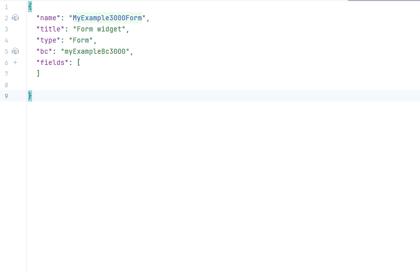

    === "Пример написания кода"
        Добавьте поле в **_.widget.json_**.

        ```json
           --8<--
           {{ external_links.github_raw_doc }}/widgets/form/base/onefield/MyExample3000Form.widget.json
           --8<--
        ```
        
подробнее см. [Поля](/ru/widget/fields/fieldtypes/)
## <a id="option">Параметры (Options)</a>
Объект options задаёт параметры компоновки виджета.
 
### <a id="Fieldslayout">Компоновка (options layout)</a>
[:material-play-circle: Живой пример]({{ external_links.code_samples }}/ui/#/screen/myexample3004){:target="_blank"} ·
[:fontawesome-brands-github: GitHub]({{ external_links.github_ui }}/{{ external_links.github_branch }}/src/main/java/org/demo/documentation/widgets/form/fieldslayoute){:target="_blank"}

Задаёт структуру виджета с помощью строк и колонок.

* `одноколоночная компоновка — рекомендуется`: каждое поле на новой строке. Ширина каждого поля — от 1 до 24.

!!! tips "Совет"
    Используйте одноколоночную компоновку, когда поля часто скрываются или переставляются. Это исключает проблемы с компоновкой и обеспечивает лучший пользовательский опыт.

* `многоколоночная компоновка`: поля отображаются в сетке. Сетка может содержать любое количество строк. Каждая строка может содержать любое количество полей, пока сумма их ширин в строке не превышает 24. Ширина каждого поля — от 1 до 24.
* `empty`: отображаются только заголовок и действия. Обычно используется, когда нужно изменить стандартное положение кнопок (например, показать кнопки под виджетом). Можно скрыть кнопки на виджете с данными, создать отдельный виджет только с кнопками и разместить его в любом месте view

!!! tips "Совет"
    По возможности рекомендуется использовать `одноколоночную` компоновку, так как динамическое скрытие полей в этом случае всегда работает корректно.

!!! info
    Строка имеет размер 24 span; если в одной строке определены поля с суммарной шириной больше 24 span, это поле и все последующие переносятся на новую строку. То есть каждая строка вмещает поля, пока суммарная ширина не достигнет 24 span, а всё, что превышает, переходит на следующую строку.

Например, есть три поля шириной 12, 8 и 10 соответственно. В этом случае первое и второе поле полностью помещаются в первой строке, так как укладываются в предел 24. Однако ширина третьего поля добавляется к сумме, и она превышает 24. В результате третье поле переносится на следующую строку.


#### Как это выглядит? { #how-does-it-look_3 }
=== "Одноколоночная компоновка — рекомендуется"
    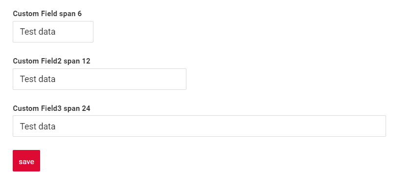
=== "Многоколоночная компоновка"
    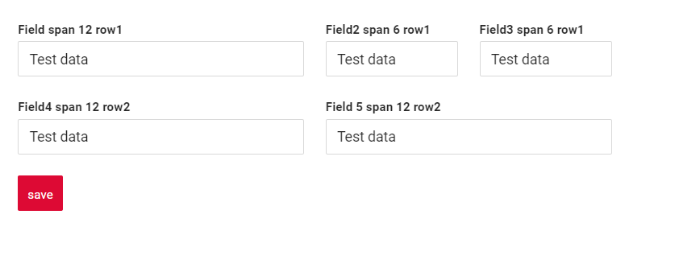
=== "Empty — только кнопки"
    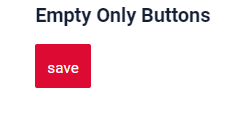
#### Как добавить? { #how-to-add_3 }
??? Example "Пример"
    === "Одноколоночная компоновка — рекомендуется"

        **Шаг 1** Создайте **"options": {"layout": {}}**.

        **Шаг 2** Добавьте поля в **"options": {"layout": {}}**

        Формирование строк:

        * Откройте `cols` : "cols": [
        * Добавьте все поля (customField, customField2, customField3) со span от 1 до 24.
        * Закройте `cols` : ]

        ```json
        --8<--
        {{ external_links.github_raw_doc }}/widgets/form/fieldslayoute/MyExample3004Form.widget.json
        --8<--
        ```

        [:material-play-circle: Живой пример]({{ external_links.code_samples }}/ui/#/screen/myexample3004){:target="_blank"} ·
        [:fontawesome-brands-github: GitHub]({{ external_links.github_ui }}/{{ external_links.github_branch }}/src/main/java/org/demo/documentation/widgets/form/fieldslayoute/MyExample3004Form.widget.json){:target="_blank"}

    === "Многоколоночная компоновка"
        **Шаг 1** Создайте **"options": {"layout": {}}**.

        **Шаг 2** Добавьте поля в **"options": {"layout": {}}**.

        Формирование строки 1:

        * Откройте `cols` : "cols": [
        * Добавьте все поля: customField, customField2, customField3
        * Проверьте, что сумма span <= 24: customField (span = 12), customField2 = 6, customField3 = 6 : сумма 24)
        * Закройте `cols` : ]

        Формирование строки 2:

        * Откройте 'cols' : "cols": [
        * Добавьте все поля (customField4)
        * Проверьте, что сумма span <= 24 (customField4 span = 12 : сумма 12)
        * Закройте 'cols' : ]
 
        ```json
        --8<--
        {{ external_links.github_raw_doc }}/widgets/form/fieldslayoute/MyExample3004MultiColumnForm.widget.json
        --8<--
        ```
        
        [:material-play-circle: Живой пример]({{ external_links.code_samples }}/ui/#/screen/myexample3004/view/myexample3004multicolumnform){:target="_blank"} ·
        [:fontawesome-brands-github: GitHub]({{ external_links.github_ui }}/{{ external_links.github_branch }}/src/main/java/org/demo/documentation/widgets/form/fieldslayoute/MyExample3004MultiColumnForm.widget.json){:target="_blank"}

    === "Empty — только кнопки"
        **Шаг 1** Создайте **"options": {"layout": {}}**.

        Кнопка "Create" — по умолчанию

        ```json
        --8<--
        {{ external_links.github_raw_doc }}/widgets/form/fieldslayoute/MyExample3004EmptyOnlyButtonsForm.widget.json
        --8<--
        ```

        [:material-play-circle: Живой пример]({{ external_links.code_samples }}/ui/#/screen/myexample3004/view/myexample3004emptyonlybuttonsform){:target="_blank"} ·
        [:fontawesome-brands-github: GitHub]({{ external_links.github_ui }}/{{ external_links.github_branch }}/src/main/java/org/demo/documentation/widgets/form/fieldslayoute/MyExample3004EmptyOnlyButtonsForm.widget.json){:target="_blank"}
 
## Стандартные действия { #standard-actions }
`Actions` отображают доступные действия в виде отдельных кнопок, подробнее см. [Действия](/ru/features/element/actions/actions).

**Стандартные действия**:

* [`Create`](#standart_create): действие, запускающее создание новой записи
* [`Delete`](#standart_delete): удаление существующей записи
* [`Edit`](#standart_edit): обновление или исправление информации пользователем
* [`Save`](#standart_save): сохранение введённых или изменённых данных
* [`Cancel-create`](#standart_cancel_create): отмена создания новой записи без сохранения введённых данных


#### **<a id="standart_create">Создание</a>**
Кнопка `Create` позволяет создать новое значение нажатием кнопки `Add`.

!!! tips "Совет"
    Не рекомендуем создавать записи в виджете формы.

Есть два способа создать запись:

1. [Basic](#createinline): данные можно добавить с помощью стандартной кнопки create, не покидая текущий view.

2. [With view](#withview): запись можно создать, перейдя в отдельный view.

##### <a id="createinline">Основы</a>
[:material-play-circle: Живой пример]({{ external_links.code_samples }}/ui/#/screen/myexample3300){:target="_blank"} ·
[:fontawesome-brands-github: GitHub]({{ external_links.github_ui }}/{{ external_links.github_branch }}/src/main/java/org/demo/documentation/widgets/form/actions/create/basic){:target="_blank"}

###### Как это выглядит? { #how-does-it-look_4 }
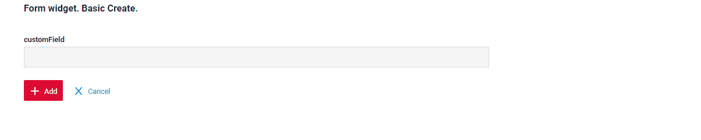

###### Как добавить? { #how-to-add_4 }
??? Example "Пример"

    **Шаг 1** Добавьте кнопку `create` в соответствующий **VersionAwareResponseService**.
    ```java
    --8<--
    {{ external_links.github_raw_doc }}/widgets/form/actions/create/basic/MyExample3300Service.java:getActions
    --8<--
    ```
     **Шаг 2** Добавьте кнопку `create` в соответствующий **.widget.json**.
    ```json
    --8<--
    {{ external_links.github_raw_doc }}/widgets/form/actions/create/basic/MyExample3300Form.widget.json
    --8<--
    ```
     **Шаг 3** Добавьте **fields.setEnabled** в соответствующий **FieldMetaBuilder**.
    ```java
    --8<--
    {{ external_links.github_raw_doc }}/widgets/form/actions/create/basic/MyExample3300Meta.java:buildRowDependentMeta
    --8<--
    ```
 
    [:material-play-circle: Живой пример]({{ external_links.code_samples }}/ui/#/screen/myexample3300){:target="_blank"} ·
    [:fontawesome-brands-github: GitHub]({{ external_links.github_ui }}/{{ external_links.github_branch }}/src/main/java/org/demo/documentation/widgets/form/actions/create/basic){:target="_blank"}

##### <a id="withview">With view</a>
[:material-play-circle: Живой пример]({{ external_links.code_samples }}/ui/#/screen/myexample3302){:target="_blank"} ·
[:fontawesome-brands-github: GitHub]({{ external_links.github_ui }}/{{ external_links.github_branch }}/src/main/java/org/demo/documentation/widgets/form/actions/create/withview){:target="_blank"}

При `Create with view` нажатие кнопки "Add" открывает отдельный view, отображающий только форму ввода данных. После заполнения формы и сохранения система возвращается к форме сущностей с добавленной новой строкой.
###### Как это выглядит? { #how-does-it-look_5 }
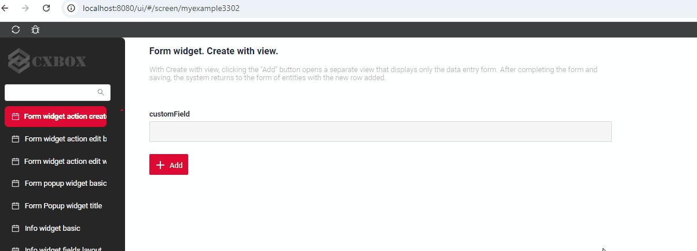

###### Как добавить? { #how-to-add_5 }
??? Example "Пример"

    **Шаг 1** Добавьте кнопку `create` в соответствующий **VersionAwareResponseService**.
    ```java
    --8<--
    {{ external_links.github_raw_doc }}/widgets/form/actions/create/withview/MyExample3302Service.java:getActions
    --8<--
    ```
    **Шаг 2** Добавьте **PostAction.drillDown** в метод **doCreateEntity** соответствующего **VersionAwareResponseService**.
    ```java
    --8<--
    {{ external_links.github_raw_doc }}/widgets/form/actions/create/withview/MyExample3302Service.java:doCreateEntity
    --8<--
    ```
    **Шаг 3** Добавьте кнопку `create` в соответствующий **.widget.json**.
  
    ```json
    --8<--
    {{ external_links.github_raw_doc }}/widgets/form/actions/create/withview/MyExample3302Form.widget.json
    --8<--
    ```  

    [:material-play-circle: Живой пример]({{ external_links.code_samples }}/ui/#/screen/myexample3302){:target="_blank"} ·
    [:fontawesome-brands-github: GitHub]({{ external_links.github_ui }}/{{ external_links.github_branch }}/src/main/java/org/demo/documentation/widgets/form/actions/create/withview){:target="_blank"}

#### **<a id="standart_delete">Delete</a>**
`Delete` удаляет существующую запись.
 
[:material-play-circle: Живой пример]({{ external_links.code_samples }}/ui/#/screen/myexample3180){:target="_blank"} ·
[:fontawesome-brands-github: GitHub]({{ external_links.github_ui }}/{{ external_links.github_branch }}/src/main/java/org/demo/documentation/widgets/form/actions/delete){:target="_blank"}

###### Как это выглядит? { #how-does-it-look_6 }
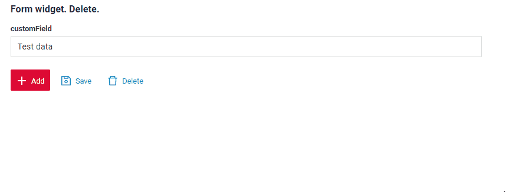

###### Как добавить? { #how-to-add_6 }
??? Example "Пример"
 
    **Шаг 1** Добавьте действие *delete* в соответствующий **VersionAwareResponseService**.

    По умолчанию кнопка доступна, когда запись существует.

    ```java
    --8<--
    {{ external_links.github_raw_doc }}/widgets/form/actions/delete/MyExample3180Service.java:getActions
    --8<--
    ``` 
 
    **Шаг 2** Добавьте кнопку или группу кнопок в соответствующий **.widget.json**.
   
    ```json
    --8<--
    {{ external_links.github_raw_doc }}/widgets/form/actions/delete/MyExample3180Form.widget.json
    --8<--
    ```
    
    Чтобы реализовать собственный обработчик удаления сущности, переопределите метод `deleteEntity` в соответствующем **VersionAwareResponseService**.

    [:material-play-circle: Живой пример]({{ external_links.code_samples }}/ui/#/screen/myexample3180){:target="_blank"} ·
    [:fontawesome-brands-github: GitHub]({{ external_links.github_ui }}/{{ external_links.github_branch }}/src/main/java/org/demo/documentation/widgets/form/actions/delete){:target="_blank"}

`Edit` позволяет изменить значение поля.
### **<a id="standart_edit">Редактирование</a>**

Есть два способа отредактировать запись:

1. [Basic](#basic): данные можно редактировать в текущем виджете.

2. [With view](#withview): запись можно отредактировать, перейдя в отдельный view.

##### <a id="editline">Базовое редактирование </a>
[:material-play-circle: Живой пример]({{ external_links.code_samples }}/ui/#/screen/myexample3301){:target="_blank"} ·
[:fontawesome-brands-github: GitHub]({{ external_links.github_ui }}/{{ external_links.github_branch }}/src/main/java/org/demo/documentation/widgets/form/actions/edit/basic){:target="_blank"}


`Edit Inline` означает inline-редактирование. Дважды щёлкните по значению, которое нужно изменить.
###### Как это выглядит? { #how-does-it-look_7 }
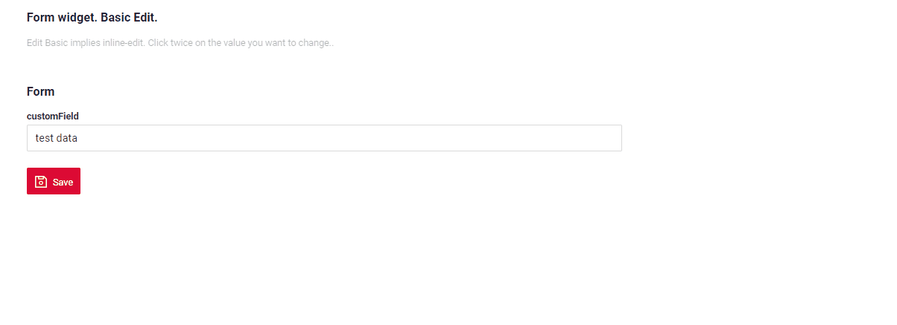

###### Как добавить? { #how-to-add_7 }
??? Example "Пример"

    **Шаг 1** Добавьте **fields.setEnabled** в соответствующий **FieldMetaBuilder**.
    ```java
    --8<--
    {{ external_links.github_raw_doc }}/widgets/form/actions/edit/basic/MyExample3301Meta.java:buildRowDependentMeta
    --8<--
    ```

    [:material-play-circle: Живой пример]({{ external_links.code_samples }}/ui/#/screen/myexample3301){:target="_blank"} ·
    [:fontawesome-brands-github: GitHub]({{ external_links.github_ui }}/{{ external_links.github_branch }}/src/main/java/org/demo/documentation/widgets/form/actions/edit/basic){:target="_blank"}

##### <a id="editwithview">With view</a>
[:material-play-circle: Живой пример]({{ external_links.code_samples }}/ui/#/screen/myexample3303){:target="_blank"} ·
[:fontawesome-brands-github: GitHub]({{ external_links.github_ui }}/{{ external_links.github_branch }}/src/main/java/org/demo/documentation/widgets/form/actions/edit/withview){:target="_blank"}

При `Edit with view` сущность можно редактировать в отдельном view, отображающем только форму ввода данных. Выберите пункт "Edit".

###### Как это выглядит? { #how-does-it-look_8 }
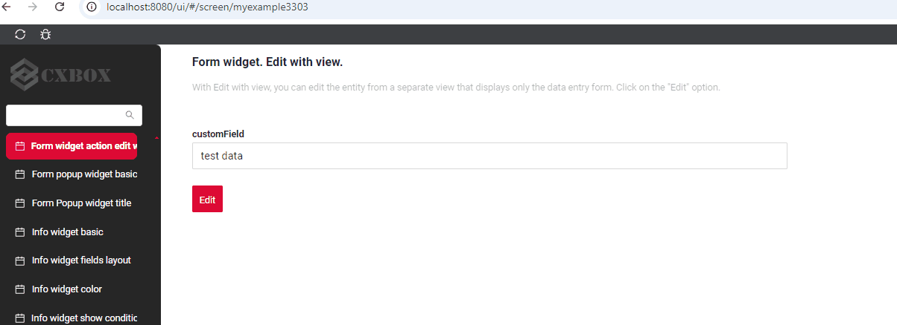

###### Как добавить? { #how-to-add_8 }
??? Example "Пример"

    **Шаг 1** Добавьте действие *edit* в соответствующий **VersionAwareResponseService**.
    
    Добавьте **PostAction.drillDown** в метод *edit*

    ```java
    --8<--
    {{ external_links.github_raw_doc }}/widgets/form/actions/edit/withview/MyExample3303Service.java:getActions
    --8<--
    ``` 
    **Шаг 2** Добавьте кнопку или группу кнопок в соответствующий **.widget.json**.
   
    ```json
    --8<--
    {{ external_links.github_raw_doc }}/widgets/form/actions/edit/withview/MyExample3303Form.widget.json
    --8<--
    ```

    [:material-play-circle: Живой пример]({{ external_links.code_samples }}/ui/#/screen/myexample3303){:target="_blank"} ·
    [:fontawesome-brands-github: GitHub]({{ external_links.github_ui }}/{{ external_links.github_branch }}/src/main/java/org/demo/documentation/widgets/form/actions/edit/withview){:target="_blank"}

###  **<a id="standart_save">Сохранение</a>**
[:material-play-circle: Живой пример]({{ external_links.code_samples }}/ui/#/screen/myexample3181){:target="_blank"} ·
[:fontawesome-brands-github: GitHub]({{ external_links.github_ui }}/{{ external_links.github_branch }}/src/main/java/org/demo/documentation/widgets/form/actions/save){:target="_blank"}

`Save` сохраняет введённые или изменённые данные. см. [информацию об автосохранении](/ru/features/element/autosave/autosave)
 
###### Как это выглядит? { #how-does-it-look_9 }
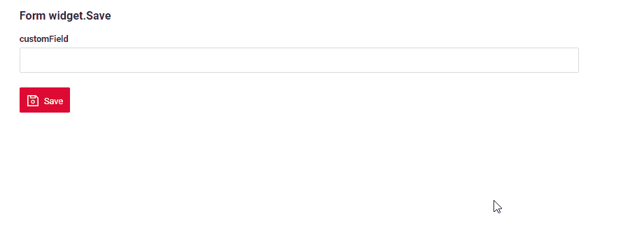

###### Как добавить? { #how-to-add_9 }
??? Example "Пример"

    **Шаг 1** Добавьте действие *save* в соответствующий **VersionAwareResponseService**.

    ```java
    --8<--
    {{ external_links.github_raw_doc }}/widgets/form/actions/save/MyExample3181Service.java:getActions
    --8<--
    ```  
    **Шаг 2** Добавьте кнопку или группу кнопок в соответствующий **.widget.json**.
   
    ```json
    --8<--
    {{ external_links.github_raw_doc }}/widgets/form/actions/save/MyExample3181Form.widget.json
    --8<--
    ```

    [:material-play-circle: Живой пример]({{ external_links.code_samples }}/ui/#/screen/myexample3181){:target="_blank"} ·
    [:fontawesome-brands-github: GitHub]({{ external_links.github_ui }}/{{ external_links.github_branch }}/src/main/java/org/demo/documentation/widgets/form/actions/save){:target="_blank"}
    
### **<a id="standart_cancel_create">Отмена создания (Cancel-create)</a>**
[:material-play-circle: Живой пример]({{ external_links.code_samples }}/ui/#/screen/myexample3182){:target="_blank"} ·
[:fontawesome-brands-github: GitHub]({{ external_links.github_ui }}/{{ external_links.github_branch }}/src/main/java/org/demo/documentation/widgets/form/actions/cancelcreate){:target="_blank"}

`Cancel-create` отменяет создание новой записи без сохранения введённых данных

###### Как это выглядит? { #how-does-it-look_10 }
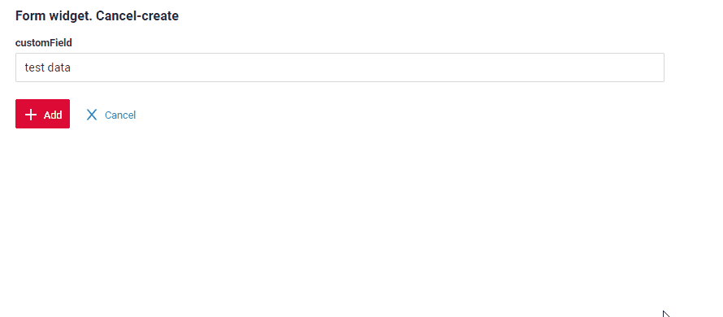
 
###### Как добавить? { #how-to-add_10 }
??? Example "Пример"
    === "Базовый"

        **Шаг 1** Добавьте стандартное действие *cancelCreate* в соответствующий **VersionAwareResponseService**.
        По умолчанию интерфейс отображает "cancelCreate".

        ```java
        --8<--
        {{ external_links.github_raw_doc }}/widgets/form/actions/cancelcreate/basic/MyExample3182Service.java:getActions
        --8<--
        ```
        [:material-play-circle: Живой пример]({{ external_links.code_samples }}/ui/#/screen/myexample3182){:target="_blank"} ·
        [:fontawesome-brands-github: GitHub]({{ external_links.github_ui }}/{{ external_links.github_branch }}/src/main/java/org/demo/documentation/widgets/form/actions/cancelcreate){:target="_blank"}

    === "С postAction"
        **Шаг 1** Добавьте действие *cancel* с postAction в соответствующий **VersionAwareResponseService**.
    
        ```java
        --8<--
        {{ external_links.github_raw_doc }}/widgets/form/actions/cancelcreate/postaction/MyExample3187Service.java:getActions
        --8<--
        ```

        **Шаг 2** Добавьте кнопку или группу кнопок в соответствующий **.widget.json**.
       
        ```json
        --8<--
        {{ external_links.github_raw_doc }}/widgets/form/actions/cancelcreate/postaction/MyExample3187FormCreate.widget.json
        --8<--
        ```
        [:material-play-circle: Живой пример]({{ external_links.code_samples }}/ui/#/screen/myexample3187){:target="_blank"} ·
        [:fontawesome-brands-github: GitHub]({{ external_links.github_ui }}/{{ external_links.github_branch }}/src/main/java/org/demo/documentation/widgets/form/actions/cancelcreate){:target="_blank"}

    === "Метод onCancel"
        !!! info
            Только для **Inner** бизнес-компонента, подробнее см. [Бизнес-компонент](/ru/environment/businesscomponent/businesscomponent/)

        **Шаг 1** Добавьте стандартное действие *cancelCreate* в соответствующий **VersionAwareResponseService**.
    
        ```java
        --8<--
        {{ external_links.github_raw_doc }}/widgets/form/actions/cancelcreate/oncancel/MyExample3186Service.java:getActions
        --8<--
        ``` 
        **Шаг 2** Добавьте метод *onCancel* в соответствующий **VersionAwareResponseService**.
        ```java
        --8<--
        {{ external_links.github_raw_doc }}/widgets/form/actions/cancelcreate/oncancel/MyExample3186Service.java:onCancel
        --8<--
        ``` 
        **Шаг 3** Добавьте кнопку или группу кнопок в соответствующий **.widget.json**.
       
        ```json
        --8<--
        {{ external_links.github_raw_doc }}/widgets/form/actions/cancelcreate/oncancel/MyExample3186FormCreate.widget.json
        --8<--
        ```

        [:material-play-circle: Живой пример]({{ external_links.code_samples }}/ui/#/screen/myexample3186){:target="_blank"} ·
        [:fontawesome-brands-github: GitHub]({{ external_links.github_ui }}/{{ external_links.github_branch }}/src/main/java/org/demo/documentation/widgets/form/actions/cancelcreate){:target="_blank"}


## Дополнительные свойства { #additional-properties }

### Скрытие полей { #field-hidden }

[:material-play-circle: Живой пример]({{ external_links.code_samples }}/ui/#/screen/myexample5019/view/myexample5019form){:target="_blank"} ·
[:fontawesome-brands-github: GitHub]({{ external_links.github_ui }}/{{ external_links.github_branch }}/src/main/java/org/demo/documentation/widgets/property/sethidden){:target="_blank"}

Если нужно скрывать определённые поля в зависимости от значений других полей, используйте свойства **[hidden](/ru/environment/meta/buildrowdependentmeta/sethidden/sethidden)** и **`forceActive`**.

При изменении значения связанного поля текущее поле автоматически:

* скрывается и становится недоступным, или
* отображается и становится видимым,

в зависимости от настроенной логики.


#### Как это выглядит? { #how-does-it-look_11 }


#### Как добавить? { #how-to-add_11 }
??? Example "Пример"
    подробнее см. [setHidden](/ru/environment/meta/buildrowdependentmeta/sethidden/sethidden)

    [:material-play-circle: Живой пример]({{ external_links.code_samples }}/ui/#/screen/myexample5019/view/myexample5019form){:target="_blank"} ·
    [:fontawesome-brands-github: GitHub]({{ external_links.github_ui }}/{{ external_links.github_branch }}/src/main/java/org/demo/documentation/widgets/property/sethidden){:target="_blank"}
