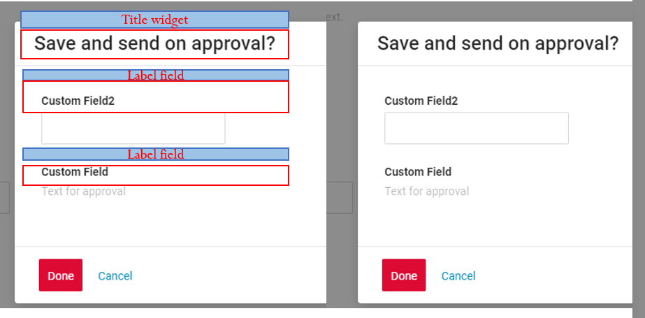
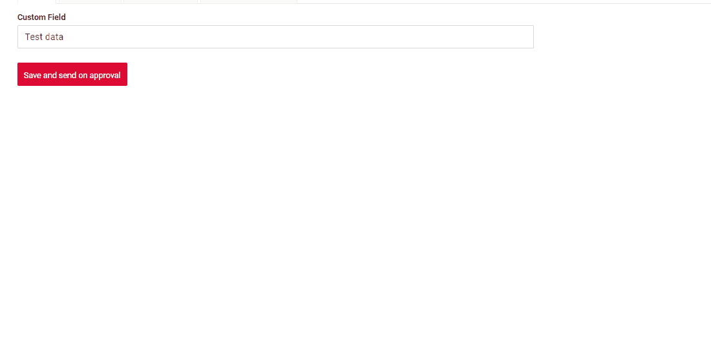
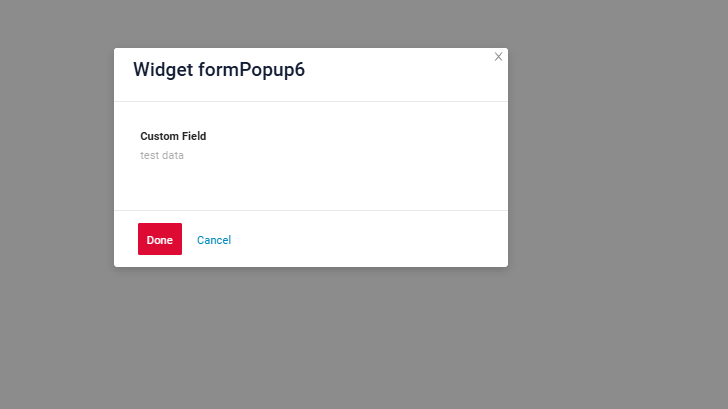
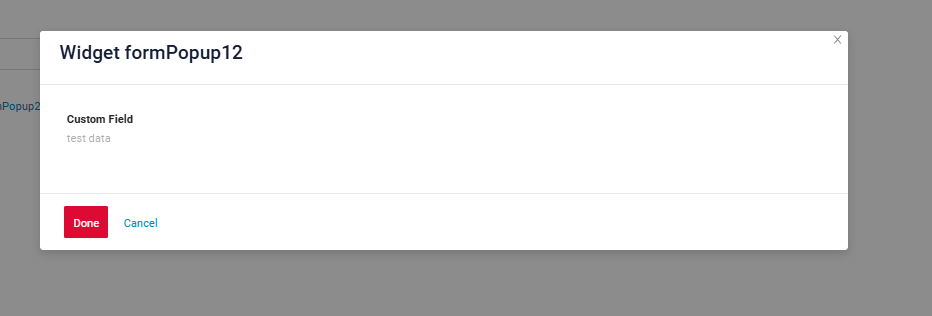
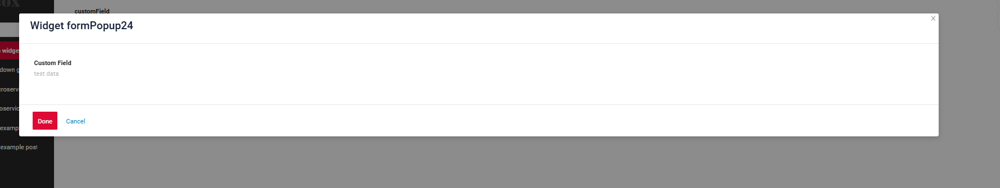
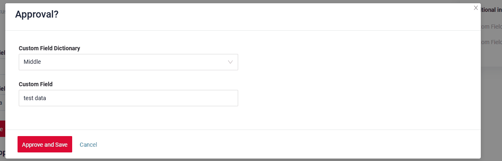

# FormPopup

Виджет `FormPopup` — компонент для дополнительных проверок полей во всплывающем окне и возможности добавлять информацию внутри него.

## Основы { #basics }
[:material-play-circle: Живой пример]({{ external_links.code_samples }}/ui/#/screen/myexample3400){:target="_blank"} ·
[:fontawesome-brands-github: GitHub]({{ external_links.github_ui }}/{{ external_links.github_branch }}/src/main/java/org/demo/documentation/widgets/formpopup/base){:target="_blank"}
### Как это выглядит? { #how-does-it-look }


###  <a id="Howtoaddbacis">Как добавить?</a>
??? Example "Пример"
    === "начиная с 4.0.0-M16-SNAPSHOT"

    === "до 4.0.0-M16-SNAPSHOT"
        Добавьте тип **"FormPopup"** в **BaseFieldExtractor**.
        ```java
        @Override
        public List<String> getSupportedTypes() {
            return Lists.newArrayList(
                    "Funnel",
                    "RingProgress",
                    "DashboardList",
                    "FormPopup"
            );
        }
        ```
    
        Добавьте файл **"ActionsExt"**.
        ```java
        @UtilityClass
        public class ActionsExt {
    
            public static PreAction confirmWithCustomWidget(@Nullable String message, @Nullable String widget, @Nullable String yesButton, @Nullable String noButton) {
                Map<String, String> customParameters = new HashMap<>();
                customParameters.put("subtype", "confirmWithCustomWidget");
                if (widget != null) {
                    customParameters.put("widget", widget);
                }
                if (yesButton != null) {
                    customParameters.put("yesText", yesButton);
                }
                if (noButton != null) {
                    customParameters.put("noText", noButton);
                }
                return PreAction.custom(message, customParameters);
            }
        
        }
        ```
    **Шаг 1** Добавьте кнопку **"save-send"**, которая вызывает всплывающий виджет
    ```json
    --8<--
    {{ external_links.github_raw_doc }}/widgets/formpopup/base/onefield/MyExample3400FormButton.widget.json
    --8<--
    ```
    **Шаг 2** Добавьте виджет с типом **FormPopup**
    ```json
    --8<--
    {{ external_links.github_raw_doc }}/widgets/formpopup/base/onefield/MyExample3400Formpopup.widget.json
    --8<--
    ```
    **Шаг 3** Добавьте виджет **FormPopup** на view
    ```json
    --8<--
    {{ external_links.github_raw_doc }}/widgets/formpopup/base/onefield/myexample3400formpopup.view.json
    --8<--
    ```
    **Шаг 4** Добавьте **withPreAction** с действием **confirmWithWidget**
     
    Параметры:

    `PreAction.confirmWithWidget("myWidget", cf -> cf
    .title("Approve?") //or withoutTitle()
    .yesText("Yes")
    .noText("Cancel"))`

    myWidget — имя виджета FormPopup.widget.json текущего bc

    ```java
    --8<--
    {{ external_links.github_raw_doc }}/widgets/formpopup/base/onefield/MyExample3400Service.java
    --8<--
    ```

## <a id="Title">Заголовок</a>
 
<!--  
### Базовый заголовок { #title-basic }
[:material-play-circle: Живой пример]({{ external_links.code_samples }}/ui/#/screen/myexample3003){:target="_blank"} ·
[:fontawesome-brands-github: GitHub]({{ external_links.github_ui }}/{{ external_links.github_branch }}/src/main/java/org/demo/documentation/widgets/form/title){:target="_blank"}

Title — (необязательно)



Типы:

* `постоянный заголовок`: показывает постоянный текст.
* `вычисляемый заголовок`: показывает значение из скрытого текстового поля, например вычисленное на основе бизнес-логики приложения

#### Как это выглядит? { #how-does-it-look_1 }
=== "Постоянный заголовок"

=== "Вычисляемый заголовок"

#### Как добавить? { #how-to-add }
??? Example "Пример"
=== "Постоянный заголовок"
**Шаг 1** Добавьте название в **title** в **_.widget.json_**.
```json
--8<--
{{ external_links.github_raw_doc }}/widgets/form/title/MyExample3003Form.widget.json
--8<--
```

    === "Вычисляемый заголовок"
 
        **Шаг 1** Добавьте ${customField} в **title** в **_.widget.json_**.
        ```json
        --8<--
        {{ external_links.github_raw_doc }}/widgets/form/title/MyExample3003FormCustomTitle.widget.json
        --8<--
        ```  
-->

### Цвет заголовка { #title-color }
`Title Color` позволяет задать цвет заголовка. Он может быть постоянным или вычисляемым.

**Постоянный цвет**

[:material-play-circle: Живой пример]({{ external_links.code_samples }}/ui/#/screen/myexample3027/view/myexample3027formcolorconst){:target="_blank"} ·
[:fontawesome-brands-github: GitHub]({{ external_links.github_ui }}/{{ external_links.github_branch }}/src/main/java/org/demo/documentation/widgets/formpopup/colortitle){:target="_blank"}

*Постоянный цвет* — фиксированный цвет, который не меняется. Он остаётся одинаковым независимо от каких-либо факторов в приложении.

**Вычисляемый цвет**

[:material-play-circle: Живой пример]({{ external_links.code_samples }}/ui/#/screen/myexample3027/view/myexample3027form){:target="_blank"} ·
[:fontawesome-brands-github: GitHub]({{ external_links.github_ui }}/{{ external_links.github_branch }}/src/main/java/org/demo/documentation/widgets/formpopup/colortitle){:target="_blank"}

*Вычисляемый цвет* можно использовать для динамического изменения цвета заголовка. Он меняется в зависимости от бизнес-логики или данных приложения.

!!! info
    Цветовое выделение заголовка **применимо** к следующим [полям](/ru/widget/fields/fieldtypes/): date, dateTime, dateTimeWithSeconds, number, money, percent, time, input, text, dictionary, radio, checkbox, pickList, inlinePickList, multivalue, multivalueHover.

#### Как это выглядит? { #how-does-it-look_2 }


#### Как добавить? { #how-to-add_1 }
??? Example "Пример"
    === "Вычисляемый цвет"

        **Шаг 1**   Добавьте `собственное поле для цвета` в соответствующий **DataResponseDTO**. Поле может содержать цвет в формате HEX или быть null.
        ```java
        --8<--
        {{ external_links.github_raw_doc }}/widgets/formpopup/colortitle/MyExample3027DTO.java:colorDTO
        --8<--
        ```  
 
        **Шаг 2** Добавьте **"bgColorKey"** :  `собственное поле для цвета` в .widget.json.

        Добавьте в `title` поле с `${customField}`

        ```json
        --8<--
        {{ external_links.github_raw_doc }}/widgets/formpopup/colortitle/MyExample3027FormPopup.widget.json
        --8<--
        ```  

        [:material-play-circle: Живой пример]({{ external_links.code_samples }}/ui/#/screen/myexample3027/view/myexample3027form){:target="_blank"} ·
        [:fontawesome-brands-github: GitHub]({{ external_links.github_ui }}/{{ external_links.github_branch }}/src/main/java/org/demo/documentation/widgets/formpopup/colortitle){:target="_blank"}

    === "Постоянный цвет"
 
        Добавьте **"bgColor"** :  `цвет HEX` в .widget.json.

        Добавьте в `title` поле с `${customField}`

        ```json
        --8<--
        {{ external_links.github_raw_doc }}/widgets/formpopup/colortitle/MyExample3027FormPopupColorConst.widget.json
        --8<--
        ```

        [:material-play-circle: Живой пример]({{ external_links.code_samples }}/ui/#/screen/myexample3027/view/myexample3027formcolorconst){:target="_blank"} ·
        [:fontawesome-brands-github: GitHub]({{ external_links.github_ui }}/{{ external_links.github_branch }}/src/main/java/org/demo/documentation/widgets/formpopup/colortitle){:target="_blank"}


## <a id="Showcondition">Условие отображения</a>
_неприменимо_

## <a id="bc">Бизнес-компонент</a>
Указывает бизнес-компонент (BC), к которому относится эта форма.
Бизнес-компонент представляет определённую часть системы, отвечающую за конкретную бизнес-логику или данные.

подробнее см. [Бизнес-компонент](/ru/environment/businesscomponent/businesscomponent/)

## <a id="fields">Поля</a>
Настройка полей. Массив fields определяет отдельные поля формы.
 
```json
{
    "label": "Custom Field",
    "key": "customField",
    "type": "input"
}
```

* **"label"**

  Описание: заголовок поля.

  Тип: String (необязательно).

* **"key"**

  Описание: имя поля в соответствующем DataResponseDTO.

  Тип: String (обязательно).

* **"type"**

  Описание: [Типы полей](/ru/widget/fields/fieldtypes/)

  Тип: String (обязательно).


### Как добавить? { #how-to-add_2 }
??? Example "Пример"

    === "С плагином (рекомендуется)"
        **Шаг 1** Скачайте плагин
            [скачать плагин для IntelliJ](https://doc.cxbox.org/ru/plugin/plugininstalling)
    
        **Шаг 2** Добавьте существующее поле в существующий виджет формы

            
    === "Пример написания кода"
        Добавьте поле в **_.widget.json_**.

          ```json
             --8<--
             {{ external_links.github_raw_doc }}/widgets/formpopup/base/onefield/MyExample3400Formpopup.widget.json
             --8<--
          ```

### <a id="Fieldslayout">Компоновка (options layout)</a>
_неприменимо_

 
## Действия { #actions }
`Actions` отображают доступные действия в виде отдельных кнопок
см. [Действия](/ru/features/element/actions/actions)

## Дополнительные свойства { #additional-properties }
### Размер виджета { #widget-size }
[:material-play-circle: Живой пример]({{ external_links.code_samples }}/ui/#/screen/myexample3402){:target="_blank"} ·
[:fontawesome-brands-github: GitHub]({{ external_links.github_ui }}/{{ external_links.github_branch }}/src/main/java/org/demo/documentation/widgets/formpopup/widgetsize){:target="_blank"}

Особенности размера виджета:

* Параметр определяет ширину всплывающего окна относительно видимой области (viewport), а не всей ширины экрана.

    - Если view содержит дополнительные виджеты, области, отведённой этим виджетам, присваивается значение 24.

    - Если в view нет дополнительных виджетов, области без них также присваивается значение 24.

* Ширина всплывающего окна не может занимать весь экран.

* Всплывающее окно всегда центрируется на экране.

#### Как это выглядит? { #how-does-it-look_3 }
=== "gridWidth 6 во view"
    
=== "gridWidth 12 во view"
     
=== "gridWidth 24 во view — рекомендуется"
    

#### Как добавить? { #how-to-add_3 }
??? Example "Пример"
    === "gridWidth24 — рекомендуется"
        Измените **gridWidth** = 24 всплывающего виджета в соответствующем **view** (view примера содержит три всплывающих окна с gridWidth 24, 12 и 6)
        ```json
        --8<--
        {{ external_links.github_raw_doc }}/widgets/formpopup/widgetsize/myexample3402form.view.json
        --8<--
        ```

    === "gridWidth12"
        Измените **gridWidth** = 12 всплывающего виджета в соответствующем **view** (view примера содержит три всплывающих окна с gridWidth 24, 12 и 6)
        ```json
        --8<--
        {{ external_links.github_raw_doc }}/widgets/formpopup/widgetsize/myexample3402form.view.json
        --8<--
        ``` 

    === "gridWidth6"
        Измените **gridWidth** = 6 всплывающего виджета в соответствующем **view** (view примера содержит три всплывающих окна с gridWidth 24, 12 и 6)
        ```json
        --8<--
        {{ external_links.github_raw_doc }}/widgets/formpopup/widgetsize/myexample3402form.view.json
        --8<--
        ```
<!-- 
## <a id="Title">Заголовок</a>
[:material-play-circle: Живой пример]({{ external_links.code_samples }}/ui/#/screen/myexample3003){:target="_blank"} ·
[:fontawesome-brands-github: GitHub]({{ external_links.github_ui }}/{{ external_links.github_branch }}/src/main/java/org/demo/documentation/widgets/form/title){:target="_blank"}

Title — (необязательно)

    

Типы:

* `постоянный заголовок`: показывает постоянный текст.
* `вычисляемый заголовок`: показывает значение из скрытого текстового поля, например вычисленное на основе бизнес-логики приложения

#### Как это выглядит? { #how-does-it-look_4 }
=== "Постоянный заголовок"
    
=== "Вычисляемый заголовок"
    
#### Как добавить? { #how-to-add_4 }
??? Example "Пример"
    === "Постоянный заголовок"
        **Шаг 1** Добавьте название в **title** в **_.widget.json_**.
        ```json
        --8<--
        {{ external_links.github_raw_doc }}/widgets/form/title/MyExample3003Form.widget.json
        --8<--
        ```

    === "Вычисляемый заголовок"
 
        **Шаг 1** Добавьте ${customField} в **title** в **_.widget.json_**.
        ```json
        --8<--
        {{ external_links.github_raw_doc }}/widgets/form/title/MyExample3003FormCustomTitle.widget.json
        --8<--
        ```   
 
## Действия { #actions_1 }
`Actions` отображают доступные действия в виде отдельных кнопок
см. [Действия](/ru/features/element/actions/actions)
-->

## Дополнительные свойства { #additional-properties_1 }

### Скрытие полей { #field-hidden }

[:material-play-circle: Живой пример]({{ external_links.code_samples }}/ui/#/screen/myexample5019/view/myexample5019form){:target="_blank"} ·
[:fontawesome-brands-github: GitHub]({{ external_links.github_ui }}/{{ external_links.github_branch }}/src/main/java/org/demo/documentation/widgets/property/sethidden){:target="_blank"}

Если нужно скрывать определённые поля в зависимости от значений других полей, используйте свойства **[hidden](/ru/environment/meta/buildrowdependentmeta/sethidden/sethidden)** и **`forceActive`**.

При изменении значения связанного поля текущее поле автоматически:

* скрывается и становится недоступным, или
* отображается и становится видимым,

в зависимости от настроенной логики.


#### Как это выглядит? { #how-does-it-look_5 }


#### Как добавить? { #how-to-add_5 }
??? Example "Пример"
    подробнее см. [setHidden](/ru/environment/meta/buildrowdependentmeta/sethidden/sethidden)

    [:material-play-circle: Живой пример]({{ external_links.code_samples }}/ui/#/screen/myexample5019/view/myexample5019form){:target="_blank"} ·
    [:fontawesome-brands-github: GitHub]({{ external_links.github_ui }}/{{ external_links.github_branch }}/src/main/java/org/demo/documentation/widgets/property/sethidden){:target="_blank"}
