# GroupingHierarchy
 
Виджет `GroupingHierarchy` выводит общую информацию по множеству записей и позволяет группировать строки по одному или нескольким заданным полям.


Доступность этой функции зависит от типа поля:

Функция доступна для: MultivalueHover, Hint, Multivalue, MultipleSelect, Inline, PickList, Radio, Money, Number, Dictionary, DateTimeWithSeconds, Date, Checkbox, DateTime, Text, FileUpload.

Подробнее см. [типы полей](/ru/widget/fields/fieldtypes/)

## Основы { #basics }
[:material-play-circle: Живой пример]({{ external_links.code_samples }}/ui/#/screen/myexample3121){:target="_blank"} ·
[:fontawesome-brands-github: GitHub]({{ external_links.github_ui }}/{{ external_links.github_branch }}/src/main/java/org/demo/documentation/widgets/groupinghierarhy/base){:target="_blank"}

Особенности режима `Grouping Hierarchy`:

!!! Attention "Внимание"
    Этот виджет не рекомендуется для больших наборов данных, так как выбранные строки хранятся в памяти.
    Рекомендуемое максимальное количество строк — меньше 1000.

* Все данные должны поступать с бэкенда (например, при размере страницы на бэкенде 1000),
    группировка выполняется в памяти на фронтенде.

    Если бэкенд сообщает, что общее количество строк превышает размер страницы, виджет переключается в режим List, а иконка переключения режима подсвечивается красным.
    При наведении на иконку отображается сообщение `Warning!Rows were fetched from backend - limit for Grouping Hierarhical mode is ...(1000). Only GroupingHierarchy mode is available.`
    подробнее см. [Лимит записей на странице](/ru/widget/type/property/defaultlimitpage/defaultlimitpage)

* Количество уровней вложенности не ограничено.

* Поля, содержащие один элемент или ни одного, по умолчанию отображаются раскрытыми. Строка раскрыта по умолчанию, если раскрытая ветвь занимает столько же места, сколько в свёрнутом виде.

* По сути, этот виджет — виджет List с дополнительной функцией «группировки», позволяющей переключаться между обычным табличным видом и видом «иерархии группировки».

* Результаты запроса автоматически упорядочиваются по полям группировки. Пользовательская сортировка в этом случае не поддерживается.

### Как это выглядит? { #how-does-it-look }
=== "Базовый"
    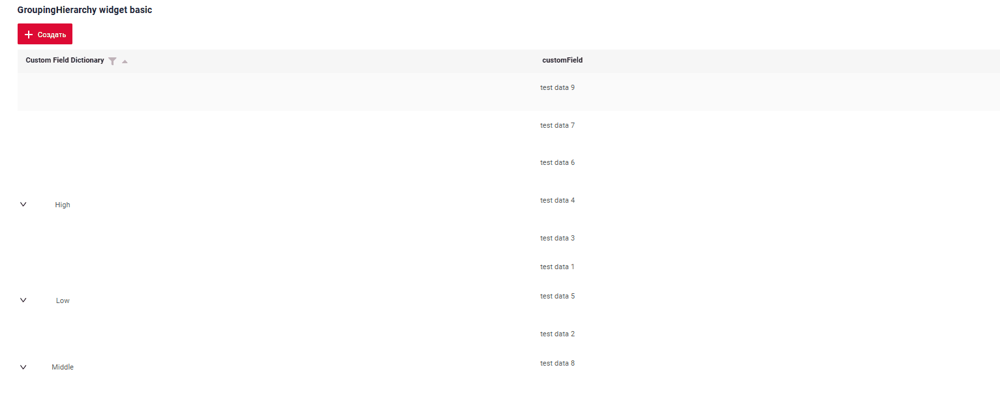
=== "Groupinghierarhy в List"
    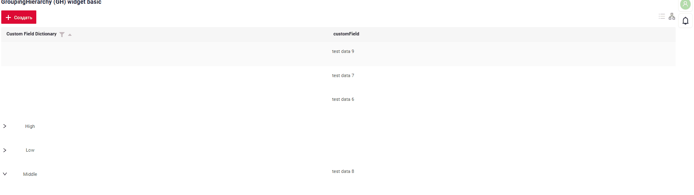

###  <a id="Howtoaddbacis">Как добавить?</a>
??? Example "Пример"
    **Шаг 1** Создайте файл **_.widget.json_** с type = **"GroupingHierarchy"**

    Добавьте параметр **groupingHierarchy** с полем для группировки.
    Ключи полей из блока Fields виджета через запятую.
    Порядок полей не важен — он берётся из блока Fields.

    ```json
     "groupingHierarchy": {
      "fields": [
        "customFieldDictionary"
      ]
    }
    ```

    Добавьте существующее поле в виджет GroupingHierarchy. Подробнее см. [Поля](#fields)
    ```json
    --8<--
    {{ external_links.github_raw_doc }}/widgets/groupinghierarhy/base/MyExample3121GH.widget.json
    --8<--
    ```
 
    **Шаг 2** Добавьте виджет в соответствующий **_.view.json_**.

    ```json
    --8<--
    {{ external_links.github_raw_doc }}/widgets/groupinghierarhy/base/myexample3121gh.view.json
    --8<--
    ```

    **Шаг 3** Добавьте bc в **BC_PROPERTIES.csv**. Подробнее см. [Лимит записей на странице](/ru/widget/type/property/defaultlimitpage/defaultlimitpage)

    ```csv
    ID;BC;PAGE_LIMIT;SORT;FILTER
    1;'myexample';1000;NULL;'""'
    ```

    [:material-play-circle: Живой пример]({{ external_links.code_samples }}/ui/#/screen/myexample3121){:target="_blank"} ·
    [:fontawesome-brands-github: GitHub]({{ external_links.github_ui }}/{{ external_links.github_branch }}/src/main/java/org/demo/documentation/widgets/groupinghierarhy/base){:target="_blank"}

 
## <a id="Title">Заголовок</a>
[:material-play-circle: Живой пример]({{ external_links.code_samples }}/ui/#/screen/myexample3139){:target="_blank"} ·
[:fontawesome-brands-github: GitHub]({{ external_links.github_ui }}/{{ external_links.github_branch }}/src/main/java/org/demo/documentation/widgets/groupinghierarhy/title){:target="_blank"}

### Базовый заголовок { #title-basic }
`Title` для виджета (необязательно)

Типы:

* `постоянный заголовок`: показывает постоянный текст.
* `пустой постоянный заголовок`: если нужно визуально связать виджеты, расположив их один под другим
 
#### Как это выглядит? { #how-does-it-look_1 }
=== "Постоянный заголовок"
    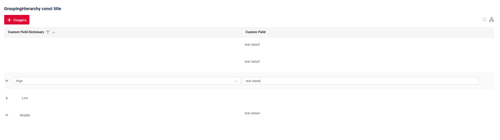
=== "Пустой постоянный заголовок"
    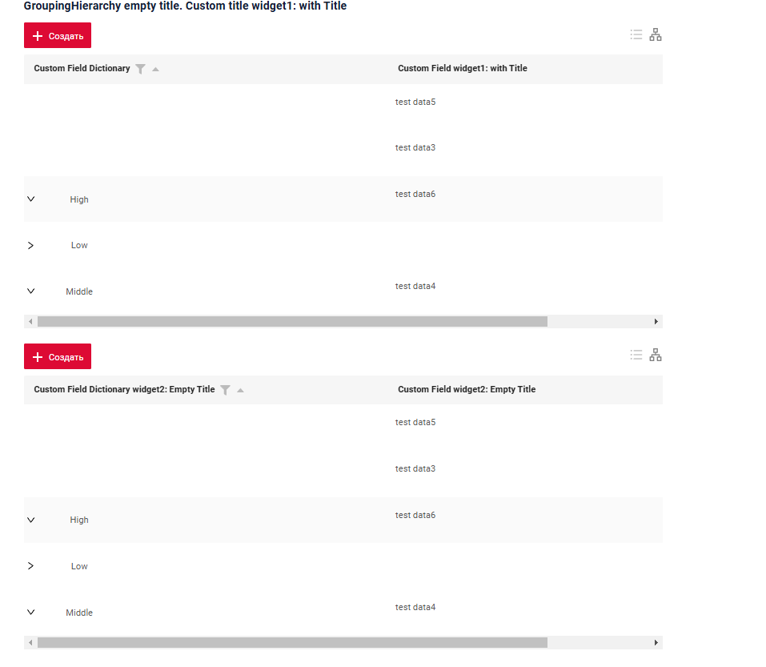
 
#### Как добавить? { #how-to-add }
??? Example "Пример"
    === "Постоянный заголовок"
        **Шаг 1** Добавьте название в **title** в **_.widget.json_**.
        ```json
        --8<--
        {{ external_links.github_raw_doc }}/widgets/groupinghierarhy/title/MyExample3139GH.widget.json
        --8<--
        ```
        [:material-play-circle: Живой пример]({{ external_links.code_samples }}/ui/#/screen/myexample3139){:target="_blank"} ·
        [:fontawesome-brands-github: GitHub]({{ external_links.github_ui }}/{{ external_links.github_branch }}/src/main/java/org/demo/documentation/widgets/groupinghierarhy/title){:target="_blank"}


    === "Пустой постоянный заголовок"

        **Шаг 1** Удалите параметр **title** из **_.widget.json_**.
        ```json
        --8<--
        {{ external_links.github_raw_doc }}/widgets/groupinghierarhy/title/MyExample3139EmptyTitle.widget.json
        --8<--
        ```

        [:material-play-circle: Живой пример]({{ external_links.code_samples }}/ui/#/screen/myexample3139){:target="_blank"} ·
        [:fontawesome-brands-github: GitHub]({{ external_links.github_ui }}/{{ external_links.github_branch }}/src/main/java/org/demo/documentation/widgets/groupinghierarhy/title){:target="_blank"}
        

### Цвет заголовка { #title-color }
`Title Color` позволяет задать цвет заголовка. Он может быть постоянным или вычисляемым.

**Постоянный цвет**

[:material-play-circle: Живой пример]({{ external_links.code_samples }}/ui/#/screen/myexample3133/view/myexample3133colorconst){:target="_blank"} ·
[:fontawesome-brands-github: GitHub]({{ external_links.github_ui }}/{{ external_links.github_branch }}/src/main/java/org/demo/documentation/widgets/groupinghierarhy/colortitle){:target="_blank"}

*Постоянный цвет* — фиксированный цвет, который не меняется. Он остаётся одинаковым независимо от каких-либо факторов в приложении.

**Вычисляемый цвет**

[:material-play-circle: Живой пример]({{ external_links.code_samples }}/ui/#/screen/myexample3133/view/myexample3133list){:target="_blank"} ·
[:fontawesome-brands-github: GitHub]({{ external_links.github_ui }}/{{ external_links.github_branch }}/src/main/java/org/demo/documentation/widgets/groupinghierarhy/colortitle){:target="_blank"}

*Вычисляемый цвет* можно использовать для динамического изменения цвета заголовка. Он меняется в зависимости от бизнес-логики или данных приложения.

!!! info
    Цветовое выделение заголовка **применимо** к следующим [полям](/ru/widget/fields/fieldtypes/): date, dateTime, dateTimeWithSeconds, number, money, percent, time, input, text, dictionary, radio, checkbox, pickList, inlinePickList, multivalue, multivalueHover.

##### Как это выглядит? { #how-does-it-look_2 }
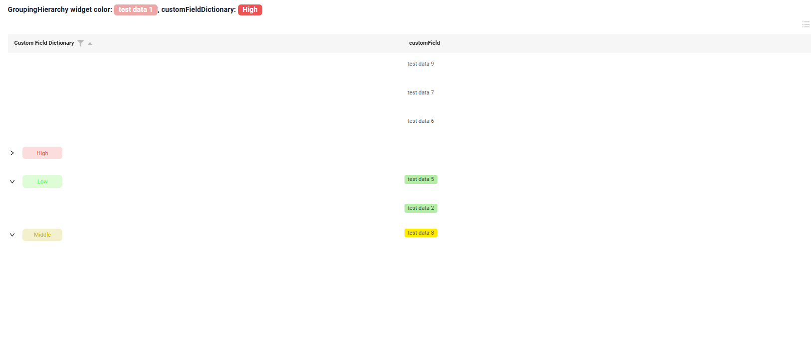

##### Как добавить? { #how-to-add_1 }
??? Example "Пример"
    === "Вычисляемый цвет"

        **Шаг 1**   Добавьте `собственное поле для цвета` в соответствующий **DataResponseDTO**. Поле может содержать цвет в формате HEX или быть null.
        ```java
        --8<--
        {{ external_links.github_raw_doc }}/widgets/groupinghierarhy/colortitle/MyExample3133DTO.java
        --8<--
        ```  
 
        **Шаг 2** Добавьте **"bgColorKey"** :  `собственное поле для цвета` в .widget.json.

        Добавьте в `title` поле с `${customField}`

        ```json
        --8<--
        {{ external_links.github_raw_doc }}/widgets/groupinghierarhy/colortitle/MyExample3133List.widget.json
        --8<--
        ``` 

        [:material-play-circle: Живой пример]({{ external_links.code_samples }}/ui/#/screen/myexample3133/view/myexample3133list){:target="_blank"} ·
        [:fontawesome-brands-github: GitHub]({{ external_links.github_ui }}/{{ external_links.github_branch }}/src/main/java/org/demo/documentation/widgets/groupinghierarhy/colortitle){:target="_blank"}

    === "Постоянный цвет"
 
        Добавьте **"bgColor"** :  `цвет HEX` в .widget.json.

        Добавьте в `title` поле с `${customField}`

        ```json
        --8<--
        {{ external_links.github_raw_doc }}/widgets/groupinghierarhy/colortitle/MyExample3133ColorConstList.widget.json
        --8<--
        ```

        [:material-play-circle: Живой пример]({{ external_links.code_samples }}/ui/#/screen/myexample3133/view/myexample3133colorconst){:target="_blank"} ·
        [:fontawesome-brands-github: GitHub]({{ external_links.github_ui }}/{{ external_links.github_branch }}/src/main/java/org/demo/documentation/widgets/groupinghierarhy/colortitle){:target="_blank"}

## <a id="bc">Бизнес-компонент</a>
Указывает бизнес-компонент (BC), к которому относится эта форма.
Бизнес-компонент представляет определённую часть системы, отвечающую за конкретную бизнес-логику или данные.

подробнее см. [Бизнес-компонент](/ru/environment/businesscomponent/businesscomponent/)

## <a id="Showcondition">Условие отображения</a>

[:material-play-circle: Живой пример]({{ external_links.code_samples }}/ui/#/screen/myexample3121){:target="_blank"} ·
[:fontawesome-brands-github: GitHub]({{ external_links.github_ui }}/{{ external_links.github_branch }}/src/main/java/org/demo/documentation/widgets/groupinghierarhy/base){:target="_blank"}

* `без условия отображения — рекомендуется`: виджет виден всегда

[:material-play-circle: Живой пример]({{ external_links.code_samples }}/ui/#/screen/myexample3169/view/myexample3171gh){:target="_blank"} ·
[:fontawesome-brands-github: GitHub]({{ external_links.github_ui }}/{{ external_links.github_branch }}/src/main/java/org/demo/documentation/widgets/groupinghierarhy/showcondition/bycurrententity){:target="_blank"}

* `условие отображения по текущей сущности`: условие может содержать логическое выражение, зависящее от полей текущей сущности. Обновление полей вызывает пересчёт условия только при сохранении или если поле force active

<!--
  [:material-play-circle: Живой пример]({{ external_links.code_samples }}/ui/#/screen/myexample3005/view/myexample3007showcondform){:target="_blank"} ·
  [:fontawesome-brands-github: GitHub]({{ external_links.github_ui }}/{{ external_links.github_branch }}/src/main/java/org/demo/documentation/widgets/form/showcondition/bycurrententity){:target="_blank"}
 
* `условие отображения по родительской сущности`: условие может содержать логическое выражение, зависящее от родительской сущности. Обновление полей родителя вызывает пересчёт условия только при сохранении или если поле force active и отображается на том же view
-->
!!! tips "Совет"
    По возможности рекомендуется не использовать `Show condition`, так как широкое применение этой возможности усложняет поддержку приложения.

#### <a id="howdoesitlook">Как это выглядит?</a>
=== "без условия отображения"
    
=== "условие отображения по текущей сущности"
    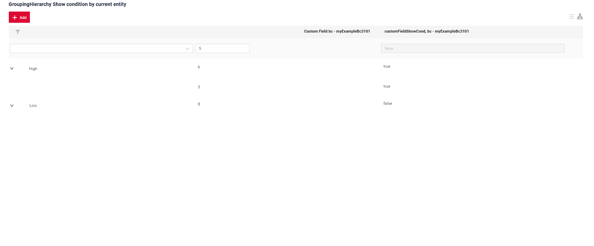
<!--
=== "условие отображения по родительской сущности"
    
-->

#### <a id="howtoadd">Как добавить?</a>
??? Example "Пример"

    === "без условия отображения"
        см. [Основы](#Howtoaddbacis)

        [:material-play-circle: Живой пример]({{ external_links.code_samples }}/ui/#/screen/myexample3121){:target="_blank"} ·
        [:fontawesome-brands-github: GitHub]({{ external_links.github_ui }}/{{ external_links.github_branch }}/src/main/java/org/demo/documentation/widgets/groupinghierarhy/base){:target="_blank"}

    === "условие отображения по текущей сущности"
        **Шаг 1** Добавьте **showCondition** в **_.widget.json_**. Подробнее см. [showCondition](/ru/widget/type/property/showcondition/showcondition)
        ```json
        --8<--
        {{ external_links.github_raw_doc }}/widgets/groupinghierarhy/showcondition/bycurrententity/MyExample3171showcond.widget.json
        --8<--
        ```
        [:material-play-circle: Живой пример]({{ external_links.code_samples }}/ui/#/screen/myexample3169/view/myexample3171gh){:target="_blank"} ·
        [:fontawesome-brands-github: GitHub]({{ external_links.github_ui }}/{{ external_links.github_branch }}/src/main/java/org/demo/documentation/widgets/groupinghierarhy/showcondition/bycurrententity){:target="_blank"}

<!--
    === "условие отображения по родительской сущности"
        **Шаг 1** Добавьте **showCondition** в **_.widget.json_**. Подробнее см. [showCondition](/ru/widget/type/property/showcondition/showcondition)
        ```json
        --8<--
        {{ external_links.github_raw_doc }}/widgets/groupinghierarhy/showcondition/byparententity/child/MyExample3107.widget.json
        --8<--
        ```
-->

## <a id="fields">Поля</a>
Настройка полей. Массив fields определяет отдельные поля формы.

```json
{
    "label": "Custom Field",
    "key": "customField",
    "type": "input"
}
```

* **"label"**

  Описание: заголовок поля.
  
  Тип: String (необязательно).
  
* **"key"**
  
    Описание: имя поля в соответствующем DataResponseDTO.
  
    Тип: String (обязательно).
  
* **"type"**
  
  Описание: [Типы полей](/ru/widget/fields/fieldtypes/)
  
  Тип: String (обязательно).

### Как добавить? { #how-to-add_2 }
??? Example "Пример"

    === "С плагином (рекомендуется)"
        **Шаг 1** Скачайте плагин
            [скачать плагин для IntelliJ](https://doc.cxbox.org/ru/plugin/plugininstalling)
    
        **Шаг 2** Добавьте существующее поле в существующий виджет формы
            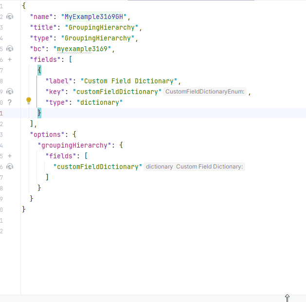

    === "Пример написания кода"
        Добавьте поле в **_.widget.json_**.

        ```json
        --8<--
        {{ external_links.github_raw_doc }}/widgets/groupinghierarhy/base/MyExample3121GH.widget.json
        --8<--
        ```

## <a id="Fieldslayout">Компоновка (options layout)</a>
**options.layout** — в этом типе не используется.


## Действия { #actions }
`Actions` отображают доступные действия в виде отдельных кнопок, подробнее см. [Действия](/ru/features/element/actions/actions).

Для виджета GroupingHierarchy есть несколько действий.
#### Создание { #create }
Кнопка `Create` позволяет создать новое значение нажатием кнопки `Add`. Это действие можно выполнить тремя разными способами — выбирайте любой в зависимости от логики приложения:

Есть три способа создать запись:

1. [Inline](#createinline): строку можно добавить напрямую.

!!! info
    Пагинация не сработает, пока страница не будет обновлена после добавления записей.

2. [Inline-form](#withwidget): данные можно добавить с помощью виджета формы, не покидая текущий view.

3. [With view](#withview): запись можно создать, перейдя в отдельный view.

##### <a id="createinline">Inline</a>
[:material-play-circle: Живой пример]({{ external_links.code_samples }}/ui/#/screen/myexample3148/view/myexample3148gh){:target="_blank"} ·
[:fontawesome-brands-github: GitHub]({{ external_links.github_ui }}/{{ external_links.github_branch }}/src/main/java/org/demo/documentation/widgets/groupinghierarhy/actions/create/basic){:target="_blank"}

При `Line Addition` по нажатию кнопки "Add" вверху виджета GroupingHierarchy сразу добавляется новая пустая строка. Это быстрый способ добавлять строки без предварительного ввода данных.
###### Как это выглядит? { #how-does-it-look_3 }
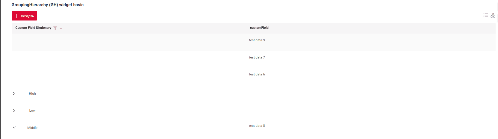

###### Как добавить? { #how-to-add_3 }
??? Example "Пример"
    
    **Шаг 1** Добавьте кнопку `create` в соответствующий **VersionAwareResponseService**.
    ```java
    --8<--
    {{ external_links.github_raw_doc }}/widgets/groupinghierarhy/actions/create/basic/MyExample3148Service.java:getActions
    --8<--
    ```
     **Шаг 2** Добавьте кнопку `create` в соответствующий **.widget.json**.
    ```json
    --8<--
    {{ external_links.github_raw_doc }}/widgets/groupinghierarhy/actions/create/basic/MyExample3148GH.widget.json
    --8<--
    ```
     **Шаг 3** Добавьте **fields.setEnabled** в соответствующий **FieldMetaBuilder**.
    ```java
    --8<--
    {{ external_links.github_raw_doc }}/widgets/groupinghierarhy/actions/create/basic/MyExample3148Meta.java:buildRowDependentMeta
    --8<--
    ```
    [:material-play-circle: Живой пример]({{ external_links.code_samples }}/ui/#/screen/myexample3148/view/myexample3148gh){:target="_blank"} ·
    [:fontawesome-brands-github: GitHub]({{ external_links.github_ui }}/{{ external_links.github_branch }}/src/main/java/org/demo/documentation/widgets/groupinghierarhy/actions/create/basic){:target="_blank"}

##### <a id="withwidget">Inline-form</a> 
[:material-play-circle: Живой пример]({{ external_links.code_samples }}/ui/#/screen/myexample3148/view/myexample3159gh){:target="_blank"} ·
[:fontawesome-brands-github: GitHub]({{ external_links.github_ui }}/{{ external_links.github_branch }}/src/main/java/org/demo/documentation/widgets/groupinghierarhy/actions/create/withwidget){:target="_blank"}

`Create with widget` открывает дополнительный виджет при нажатии кнопки "Add". Форма появляется на том же экране, поэтому видны и GroupingHierarchy сущностей, и форма добавления новой строки.
После заполнения информации и нажатия "Save" новая строка добавляется в GroupingHierarchy.
###### Как это выглядит? { #how-does-it-look_4 }
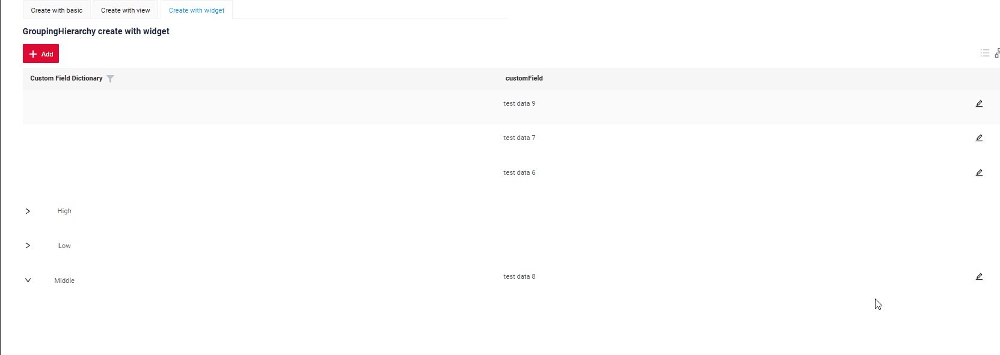

###### Как добавить? { #how-to-add_4 }
??? Example "Пример"

    **Шаг 1** Добавьте кнопку `create` в соответствующий **VersionAwareResponseService**.
    ```java
    --8<--
    {{ external_links.github_raw_doc }}/widgets/groupinghierarhy/actions/create/withwidget/MyExample3159Service.java:getActions
    --8<--
    ```
    **Шаг 2** Добавьте **fields.setEnabled** в соответствующий **FieldMetaBuilder**.
    ```java
    --8<--
    {{ external_links.github_raw_doc }}/widgets/groupinghierarhy/actions/create/withwidget/MyExample3159Meta.java:buildRowDependentMeta
    --8<--
    ```

     **Шаг 3** Создайте widget.json с типом `Form`, который появляется при нажатии кнопки
    ```json
    --8<--
    {{ external_links.github_raw_doc }}/widgets/groupinghierarhy/actions/create/withwidget/myEntity3159CreateForm.widget.json
    --8<--
    ```
 
     **Шаг 4** Добавьте widget.json с типом `Form` в соответствующий **.view.json**.
    ```json
    --8<--
    {{ external_links.github_raw_doc }}/widgets/groupinghierarhy/actions/create/withwidget/myexample3159gh.view.json
    --8<--
    ```

     **Шаг 5** Добавьте кнопку `create` и виджет с типом `Form` в соответствующий **.widget.json**.
       
    `options`.`create`: имя виджета, который появляется при нажатии кнопки
        
    ```json
    --8<--
    {{ external_links.github_raw_doc }}/widgets/groupinghierarhy/actions/create/withwidget/MyExample3159GH.widget.json
    --8<--
    ```

    [:material-play-circle: Живой пример]({{ external_links.code_samples }}/ui/#/screen/myexample3148/view/myexample3159gh){:target="_blank"} ·
    [:fontawesome-brands-github: GitHub]({{ external_links.github_ui }}/{{ external_links.github_branch }}/src/main/java/org/demo/documentation/widgets/groupinghierarhy/actions/create/withwidget){:target="_blank"}

##### <a id="withview">With view</a>
[:material-play-circle: Живой пример]({{ external_links.code_samples }}/ui/#/screen/myexample3148/view/myexample3149gh){:target="_blank"} ·
[:fontawesome-brands-github: GitHub]({{ external_links.github_ui }}/{{ external_links.github_branch }}/src/main/java/org/demo/documentation/widgets/groupinghierarhy/actions/create/newview){:target="_blank"}

При `Create with view` нажатие кнопки "Add" открывает отдельный view, отображающий только форму ввода данных. После заполнения формы и сохранения система возвращается к GroupingHierarchy сущностей с добавленной новой строкой.
###### Как это выглядит? { #how-does-it-look_5 }
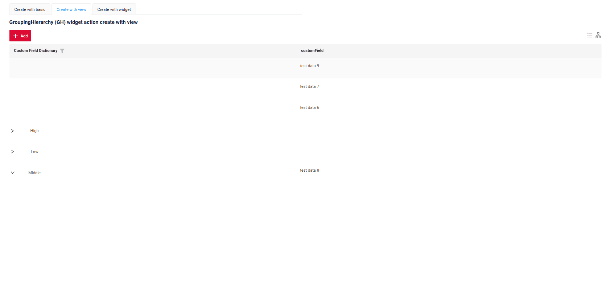

###### Как добавить? { #how-to-add_5 }
??? Example "Пример"

    **Шаг 1** Добавьте кнопку `create` в соответствующий **VersionAwareResponseService**.
    ```java
    --8<--
    {{ external_links.github_raw_doc }}/widgets/groupinghierarhy/actions/create/newview/MyExample3149Service.java:getActions
    --8<--
    ```
     **Шаг 2** Добавьте **PostAction.drillDown** в метод **doCreateEntity** соответствующего **VersionAwareResponseService**.
    ```java
    --8<--
    {{ external_links.github_raw_doc }}/widgets/groupinghierarhy/actions/create/newview/MyExample3149Service.java:doCreateEntity
    --8<--
    ```
    **Шаг 3** Добавьте кнопку `create` в соответствующий **.widget.json**.
  
    ```json
    --8<--
    {{ external_links.github_raw_doc }}/widgets/groupinghierarhy/actions/create/newview/MyExample3149GH.widget.json
    --8<--
    ```

    [:material-play-circle: Живой пример]({{ external_links.code_samples }}/ui/#/screen/myexample3148/view/myexample3149gh){:target="_blank"} ·
    [:fontawesome-brands-github: GitHub]({{ external_links.github_ui }}/{{ external_links.github_branch }}/src/main/java/org/demo/documentation/widgets/groupinghierarhy/actions/create/newview){:target="_blank"}


#### Редактирование { #edit }
`Edit` позволяет изменить значение поля. Как и для кнопки `Create`, это действие можно реализовать тремя способами.

Есть три способа создать запись:

1. [Inline edit](#editline): строку можно редактировать напрямую.

2. [Inline-form](#editwithwidget): данные можно редактировать с помощью виджета формы, не покидая текущий view.

3. [With view](#editwithview): запись можно отредактировать, перейдя в отдельный view.

##### <a id="editline">Inline-редактирование </a>
[:material-play-circle: Живой пример]({{ external_links.code_samples }}/ui/#/screen/myexample3166/view/myexample3166gh){:target="_blank"} ·
[:fontawesome-brands-github: GitHub]({{ external_links.github_ui }}/{{ external_links.github_branch }}/src/main/java/org/demo/documentation/widgets/groupinghierarhy/actions/edit/basic){:target="_blank"}


`Edit Inline` означает inline-редактирование. Дважды щёлкните по значению, которое нужно изменить.
###### Как это выглядит? { #how-does-it-look_6 }
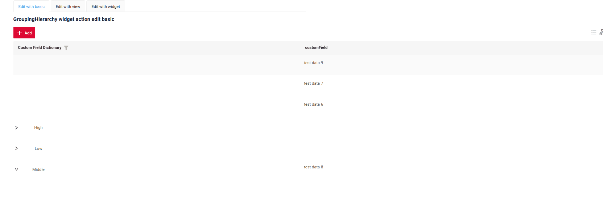

###### Как добавить? { #how-to-add_6 }
??? Example "Пример"

    **Шаг 1** Добавьте **fields.setEnabled** в соответствующий **FieldMetaBuilder**.
    ```java
    --8<--
    {{ external_links.github_raw_doc }}/widgets/groupinghierarhy/actions/edit/basic/MyExample3166Meta.java:buildRowDependentMeta
    --8<--
    ```
 
    [:material-play-circle: Живой пример]({{ external_links.code_samples }}/ui/#/screen/myexample3166/view/myexample3166gh){:target="_blank"} ·
    [:fontawesome-brands-github: GitHub]({{ external_links.github_ui }}/{{ external_links.github_branch }}/src/main/java/org/demo/documentation/widgets/groupinghierarhy/actions/edit/basic){:target="_blank"}

##### <a id="editwithwidget">Inline-form</a>
[:material-play-circle: Живой пример]({{ external_links.code_samples }}/ui/#/screen/myexample3166/view/myexample3168gh){:target="_blank"} ·
[:fontawesome-brands-github: GitHub]({{ external_links.github_ui }}/{{ external_links.github_branch }}/src/main/java/org/demo/documentation/widgets/groupinghierarhy/actions/edit/withwidget){:target="_blank"}

`Edit with widget` открывает дополнительный виджет при нажатии на иконку редактирования в строке.

###### Как это выглядит? { #how-does-it-look_7 }
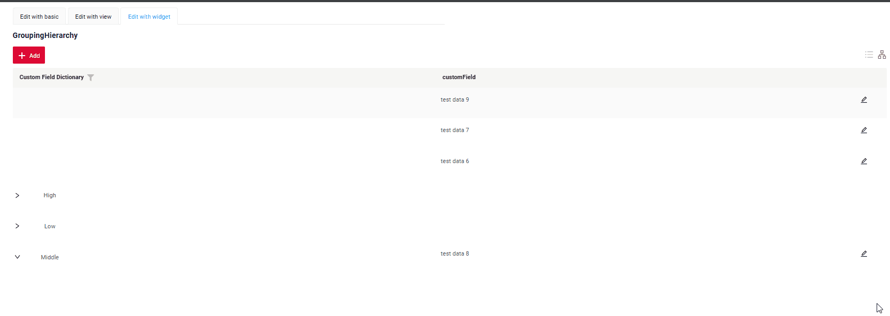

###### Как добавить? { #how-to-add_7 }
??? Example "Пример"

    **Шаг 1** Добавьте действие `save` в соответствующий **VersionAwareResponseService**: с его помощью форма сохраняет запись.
    ```java
    --8<--
    {{ external_links.github_raw_doc }}/widgets/groupinghierarhy/actions/edit/withwidget/MyExample3168Service.java:getActions
    --8<--
    ```

    **Шаг 2** Добавьте **fields.setEnabled** в соответствующий **FieldMetaBuilder**.
    ```java
    --8<--
    {{ external_links.github_raw_doc }}/widgets/groupinghierarhy/actions/edit/withwidget/MyExample3168Meta.java:buildRowDependentMeta
    --8<--
    ```
 
    **Шаг 3**  Создайте widget.json с типом `Form`, который появляется при нажатии кнопки
    ```json
    --8<--
    {{ external_links.github_raw_doc }}/widgets/groupinghierarhy/actions/edit/withwidget/myEntity3168EditForm.widget.json
    --8<--
    ```
 
     **Шаг 4** Добавьте widget.json с типом `Form` в соответствующий **.view.json**.
    ```json
    --8<--
    {{ external_links.github_raw_doc }}/widgets/groupinghierarhy/actions/edit/withwidget/myexample3168gh.view.json
    --8<--
    ```

     **Шаг 5** Добавьте виджет с типом `Form` в **options**.**edit**.**widget** соответствующего **.widget.json**: в каждой строке появится иконка редактирования.
       
    `options`.`edit`: имя виджета, который появляется при нажатии кнопки
        
    ```json
    --8<--
    {{ external_links.github_raw_doc }}/widgets/groupinghierarhy/actions/edit/withwidget/MyExample3168GH.widget.json
    --8<--
    ```

    [:material-play-circle: Живой пример]({{ external_links.code_samples }}/ui/#/screen/myexample3166/view/myexample3168gh){:target="_blank"} ·
    [:fontawesome-brands-github: GitHub]({{ external_links.github_ui }}/{{ external_links.github_branch }}/src/main/java/org/demo/documentation/widgets/groupinghierarhy/actions/edit/withwidget){:target="_blank"}

##### <a id="editwithview">With view</a>
[:material-play-circle: Живой пример]({{ external_links.code_samples }}/ui/#/screen/myexample3166/view/myexample3167gh){:target="_blank"} ·
[:fontawesome-brands-github: GitHub]({{ external_links.github_ui }}/{{ external_links.github_branch }}/src/main/java/org/demo/documentation/widgets/groupinghierarhy/actions/edit/newview){:target="_blank"}

При `Edit with view` сущность можно редактировать в отдельном view, отображающем только форму ввода данных. Выберите пункт "Edit" в меню с тремя точками.

###### Как это выглядит? { #how-does-it-look_8 }
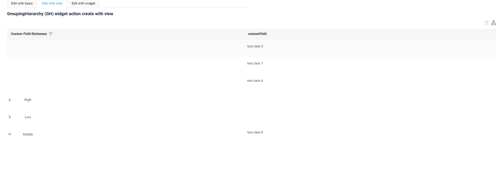

###### Как добавить? { #how-to-add_8 }
??? Example "Пример"

    **Шаг 1** Добавьте действие *edit* в соответствующий **VersionAwareResponseService**.
    
    Добавьте **PostAction.drillDown** в метод *edit*

    ```java
    --8<--
    {{ external_links.github_raw_doc }}/widgets/groupinghierarhy/actions/edit/newview/MyExample3167Service.java:getActions
    --8<--
    ```
    **Шаг 2** Добавьте кнопку или группу кнопок в соответствующий **.widget.json**.
   
    ```json
    --8<--
    {{ external_links.github_raw_doc }}/widgets/groupinghierarhy/actions/edit/newview/MyExample3167GH.widget.json
    --8<--
    ```
    [:material-play-circle: Живой пример]({{ external_links.code_samples }}/ui/#/screen/myexample3166/view/myexample3167gh){:target="_blank"} ·
    [:fontawesome-brands-github: GitHub]({{ external_links.github_ui }}/{{ external_links.github_branch }}/src/main/java/org/demo/documentation/widgets/groupinghierarhy/actions/edit/newview){:target="_blank"}


### Дополнительные свойства { #additional-properties }
#### Настройка отображаемых колонок { #customization-of-displayed-columns }
[:material-play-circle: Живой пример]({{ external_links.code_samples }}/ui/#/screen/myexample3175){:target="_blank"} ·
[:fontawesome-brands-github: GitHub]({{ external_links.github_ui }}/{{ external_links.github_branch }}/src/main/java/org/demo/documentation/widgets/groupinghierarhy/customizationcolumns){:target="_blank"}

Для настройки колонок, отображаемых в виджете списка, доступны два основных действия:

* Скрыть колонки
* Поменять колонки местами

!!! info
    Сейчас данные настройки таблицы хранятся во внутренних таблицах, даже если используются микросервисы.

###### Основы { #basic }
При настройке колонок записи вставляются в таблицу ADDITIONAL_FIELDS.
Таблица *ADDITIONAL_FIELDS* для хранения пользовательских настроек:

* `user_id`: ID пользователя, для которого настраиваются колонки.
* `view`: имя view, в котором настраиваются колонки.
* `widget`: имя виджета, в котором настраиваются колонки.
* `order_fields`: при перестановке колонок последовательность полей обновляется и сохраняется новая последовательность полей через запятую.
* `added_to_additional_fields`: поля, скрытые пользователем.
* `removed_from_additional_fields`: список полей, которые изначально были скрыты для пользователя, но затем сделаны видимыми.
  Когда пользователь открывает виджет и выбирает отображение ранее скрытых полей, эти поля записываются в эту колонку.

!!! info
    Колонки, используемые для группировки, нельзя скрыть или переставить. Они всегда отображаются в начале виджета в порядке, заданном в основном разделе Fields. Это ограничение действует и при переключении в режим "Table", поэтому колонки группировки всегда видны.

###### Как это выглядит? { #how-does-it-look_9 }
=== "Скрыть колонки"
    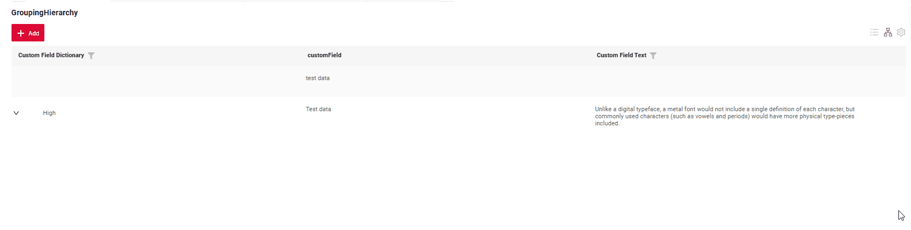
=== "Поменять колонки местами"
    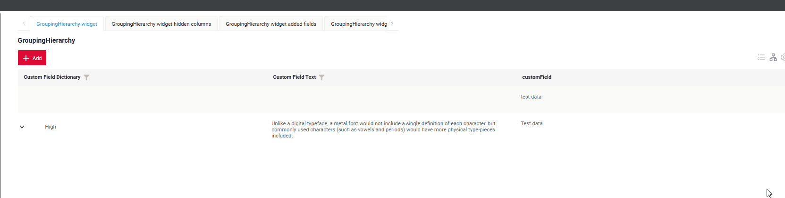
=== "Изначально скрытые"
    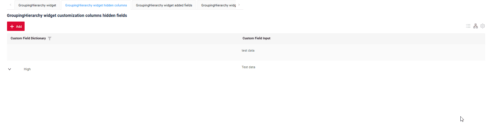

###### Как добавить? { #how-to-add_9 }
??? Example "Пример"
    === "Скрыть и поменять колонки местами"

        Добавьте в **options** параметр **additional** в соответствующий **.widget.json**.
            
        ```
        "additional": {
          "enabled": true
        }
        ```
        
        ```json
        --8<--
        {{ external_links.github_raw_doc }}/widgets/groupinghierarhy/customizationcolumns/MyExample3175GH.widget.json
        --8<--
        ```
        
        [:material-play-circle: Живой пример]({{ external_links.code_samples }}/ui/#/screen/myexample3175){:target="_blank"} ·
        [:fontawesome-brands-github: GitHub]({{ external_links.github_ui }}/{{ external_links.github_branch }}/src/main/java/org/demo/documentation/widgets/groupinghierarhy/customizationcolumns){:target="_blank"}
        

    === "Изначально скрытые колонки"
        
        Также можно задать изначально скрытые колонки — они будут скрыты при открытии виджета.
        
        Добавьте в **options** параметр **additional** в соответствующий **.widget.json**.
        
        Добавьте в **options** параметр **fields** со списком скрытых полей в соответствующий **.widget.json**.
            
        ```
           "additional": {
              "fields": ["customFieldPercent", "customFieldRadio"],
              "enabled": true
            }
        ```
        
        ```json
        --8<--
        {{ external_links.github_raw_doc }}/widgets/groupinghierarhy/customizationcolumns/MyExample3175GHHiddenFields.widget.json
        --8<--
        ```
        
        [:material-play-circle: Живой пример]({{ external_links.code_samples }}/ui/#/screen/myexample3175/view/myexample3175ghhidden){:target="_blank"} ·
        [:fontawesome-brands-github: GitHub]({{ external_links.github_ui }}/{{ external_links.github_branch }}/src/main/java/org/demo/documentation/widgets/groupinghierarhy/customizationcolumns){:target="_blank"}

###### Обработка старых записей { #handling-old-records }
`Delete fields with widget`

Если поля, сохранённые в таблице дополнительных настроек, удалены из виджета, функциональность продолжает работать корректно, игнорируя эти старые поля.

#### Фильтрация { #filtration }
##### Основы { #basic_1 }
подробнее см. [Поля](/ru/widget/type/property/filtration/filtration/)

###### Как это выглядит? { #how-does-it-look_10 }
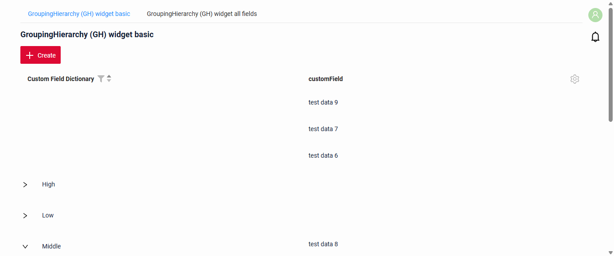

###### Как добавить? { #how-to-add_10 }
??? Example "Пример"
    `Шаг 1` Добавьте **@SearchParameter** в соответствующий **DataResponseDTO**.
    ```java
    --8<--
    {{ external_links.github_raw_doc }}/widgets/property/filtration/filtergroup/MyExample3616DTO.java
    --8<--
    ```

    `Шаг 2` Добавьте **fields.enableFilter** в соответствующий **FieldMetaBuilder**.
    ```java
    --8<--
    {{ external_links.github_raw_doc }}/widgets/property/filtration/filtergroup/MyExample3616Meta.java:buildIndependentMeta
    --8<--
    ```

    [:material-play-circle: Живой пример]({{ external_links.code_samples }}/ui/#/screen/myexample3121/view/myexample3121gh){:target="_blank"} ·
    [:fontawesome-brands-github: GitHub]({{ external_links.github_ui }}/{{ external_links.github_branch }}/src/main/java/org/demo/documentation/widgets/groupinghierarhy/base){:target="_blank"}

##### FullTextSearch
`FullTextSearch` — когда пользователь вводит текст в поле полнотекстового поиска, виджет фильтрует строки, соответствующие запросу.
см. [FullTextSearch](/ru/widget/type/property/filtration/filtration/#by-fulltextsearch)

#### Пагинация { #pagination }
Пагинация в режиме "Grouping Hierarchy" не работает. Она работает только при переключении в режим "Table".

см. [Пагинация](/ru/widget/type/property/pagination/pagination)

#### Сортировка { #sorting }
Все запросы всегда начинаются с сортировки по колонкам группировки, за которой следует сортировка, заданная пользователем
##### Как это выглядит? { #how-does-it-look_11 }
 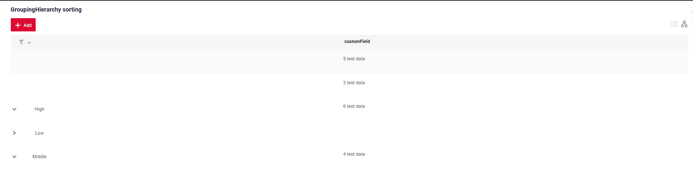
 
#### Кнопка «свернуть всё» { #collapse-all-button }
Добавлена кнопка, позволяющая свернуть всё
##### Как это выглядит? { #how-does-it-look_12 }
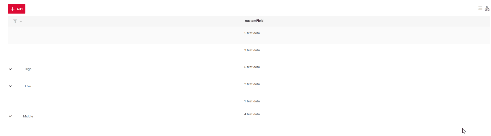
##### Как добавить? { #how-to-add_11 }
По умолчанию

#### Счётчик { #counter }
`Counter` показывает количество вложенных элементов на каждом уровне дерева.

Работает в трёх режимах:

* none (по умолчанию): счётчик не отображается.
* collapsed: счётчик появляется только у полей группировки в свёрнутом состоянии. Он исчезает, когда поле группировки раскрыто.
* always: счётчик отображается независимо от состояния поля группировки — и в свёрнутом, и в раскрытом виде.


##### Как это выглядит? { #how-does-it-look_13 }
=== "always"
    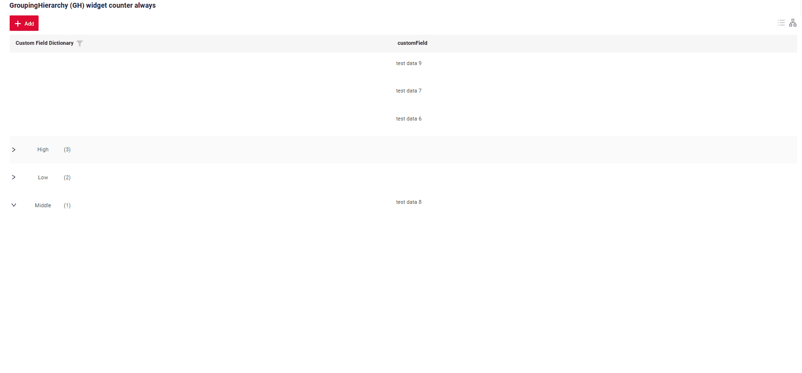
=== "collapsed"
    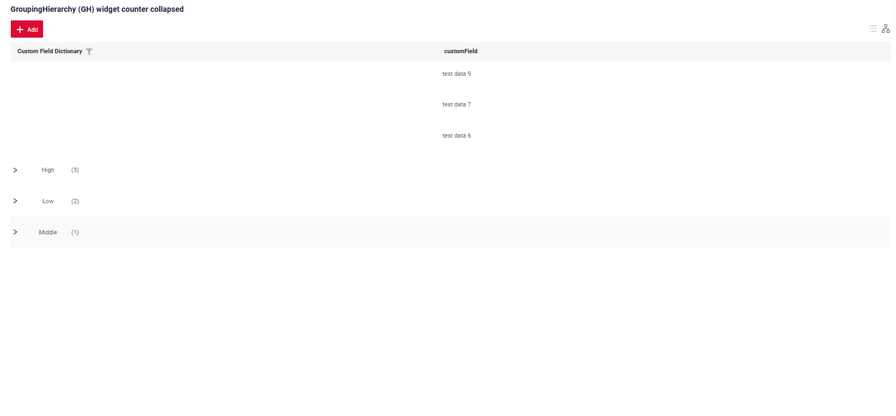
=== "none"
    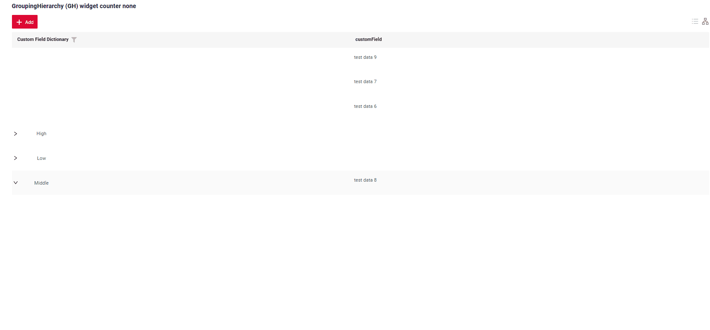

##### Как добавить? { #how-to-add_12 }
??? Example "Пример"
    === "always"
        Добавьте в **groupingHierarchy** **counterMode** в соответствующий **.widget.json**.
            
        ```
        "groupingHierarchy": {
          "counterMode": "always",
          "fields": [

          ]
        }
        ```
        
        ```json
        --8<--
        {{ external_links.github_raw_doc }}/widgets/groupinghierarhy/counter/MyExample3201GHAlways.widget.json
        --8<--
        ```

        [:material-play-circle: Живой пример]({{ external_links.code_samples }}/ui/#/screen/myexample3201/view/myexample3201ghalways){:target="_blank"} ·
        [:fontawesome-brands-github: GitHub]({{ external_links.github_ui }}/{{ external_links.github_branch }}/src/main/java/org/demo/documentation/widgets/groupinghierarhy/counter){:target="_blank"}
    === "collapsed"
        Добавьте в **groupingHierarchy** **counterMode** в соответствующий **.widget.json**.
            
        ```
        "groupingHierarchy": {
          "counterMode": "collapsed",
          "fields": [

          ]
        }
        ```
        
        ```json
        --8<--
        {{ external_links.github_raw_doc }}/widgets/groupinghierarhy/counter/MyExample3201GHCollapsed.widget.json
        --8<--
        ```

        [:material-play-circle: Живой пример]({{ external_links.code_samples }}/ui/#/screen/myexample3201/view/myexample3201ghcollapsed){:target="_blank"} ·
        [:fontawesome-brands-github: GitHub]({{ external_links.github_ui }}/{{ external_links.github_branch }}/src/main/java/org/demo/documentation/widgets/groupinghierarhy/counter){:target="_blank"}

    === "none"
        По умолчанию, или добавьте в **groupingHierarchy** **counterMode** в соответствующий **.widget.json**.
            
        ```
        "groupingHierarchy": {
          "counterMode": "none",
          "fields": [

          ]
        }
        ```
        
        ```json
        --8<--
        {{ external_links.github_raw_doc }}/widgets/groupinghierarhy/counter/MyExample3201GH.widget.json
        --8<--
        ```

        [:material-play-circle: Живой пример]({{ external_links.code_samples }}/ui/#/screen/myexample3201/view/myexample3201gh){:target="_blank"} ·
        [:fontawesome-brands-github: GitHub]({{ external_links.github_ui }}/{{ external_links.github_branch }}/src/main/java/org/demo/documentation/widgets/groupinghierarhy/counter){:target="_blank"}

#### Быстрый переход к «нераспределённым строкам» { #quick-transition-to-unallocated-rows }
После массовой загрузки колонки группировки заполняются редактированием отдельных строк.
После обновления строки пользователь автоматически «переносится» к той же строке внутри иерархии.

Для быстрого возврата к нераспределённым записям над таблицей справа отображается «плавающая» иконка.
Нажатие на эту иконку сразу переводит пользователя к нераспределённым строкам. Если таких строк нет, иконка скрыта.

##### Как это выглядит? { #how-does-it-look_14 }
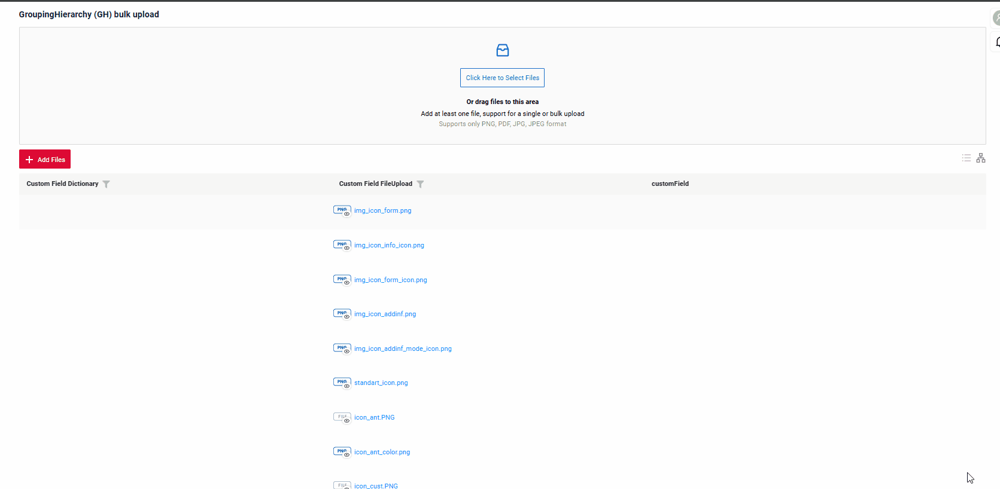 
##### Как добавить? { #how-to-add_13 }
По умолчанию


#### GroupingHierarchy по умолчанию { #default-groupinghierarchy }
Эту функцию можно использовать, чтобы заранее отображать структуру группировки, даже когда данных нет.
Количество уровней вложенности не ограничено.

`Level 1`
[:material-play-circle: Живой пример]({{ external_links.code_samples }}/ui/#/screen/myexample3164){:target="_blank"} ·
[:fontawesome-brands-github: GitHub]({{ external_links.github_ui }}/{{ external_links.github_branch }}/src/main/java/org/demo/documentation/widgets/groupinghierarhy/defaultgroupinghierarchy/onelevel){:target="_blank"}

`Level 2`
[:material-play-circle: Живой пример]({{ external_links.code_samples }}/ui/#/screen/myexample3157){:target="_blank"} ·
[:fontawesome-brands-github: GitHub]({{ external_links.github_ui }}/{{ external_links.github_branch }}/src/main/java/org/demo/documentation/widgets/groupinghierarhy/defaultgroupinghierarchy/twolevel){:target="_blank"}

`Level 3`
[:material-play-circle: Живой пример]({{ external_links.code_samples }}/ui/#/screen/myexample3165){:target="_blank"} ·
[:fontawesome-brands-github: GitHub]({{ external_links.github_ui }}/{{ external_links.github_branch }}/src/main/java/org/demo/documentation/widgets/groupinghierarhy/defaultgroupinghierarchy/threelevel){:target="_blank"}

`Level 4`
[:material-play-circle: Живой пример]({{ external_links.code_samples }}/ui/#/screen/myexample3155){:target="_blank"} ·
[:fontawesome-brands-github: GitHub]({{ external_links.github_ui }}/{{ external_links.github_branch }}/src/main/java/org/demo/documentation/widgets/groupinghierarhy/defaultgroupinghierarchy/fourlevel){:target="_blank"}

`Level 5`
[:material-play-circle: Живой пример]({{ external_links.code_samples }}/ui/#/screen/myexample3158){:target="_blank"} ·
[:fontawesome-brands-github: GitHub]({{ external_links.github_ui }}/{{ external_links.github_branch }}/src/main/java/org/demo/documentation/widgets/groupinghierarhy/defaultgroupinghierarchy/fivelevel){:target="_blank"}

###### Как это выглядит? { #how-does-it-look_15 }
=== "Уровень 1"
    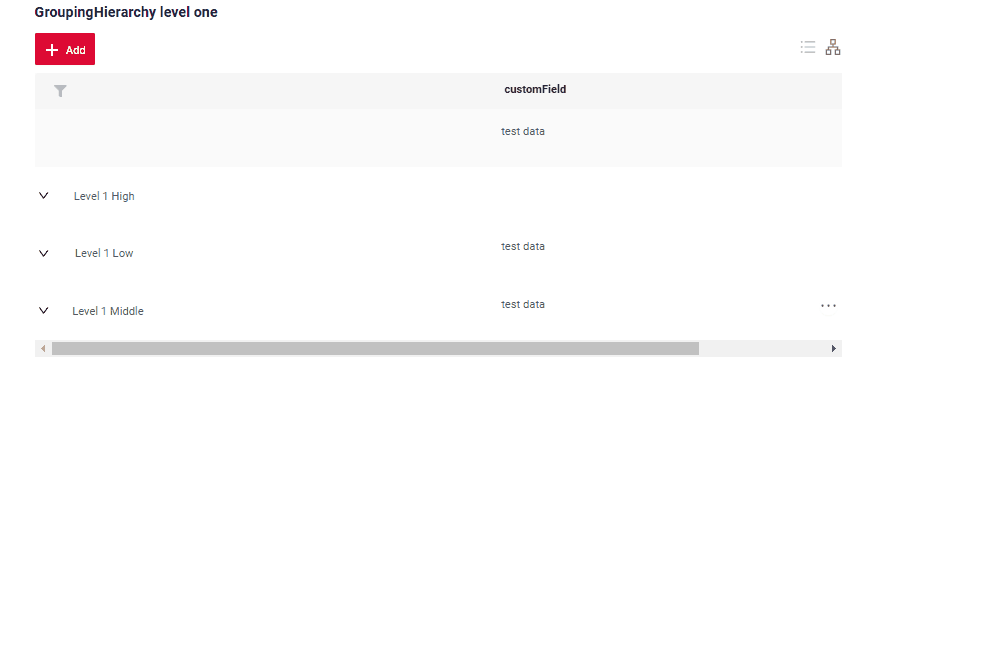
=== "Уровень 2"
    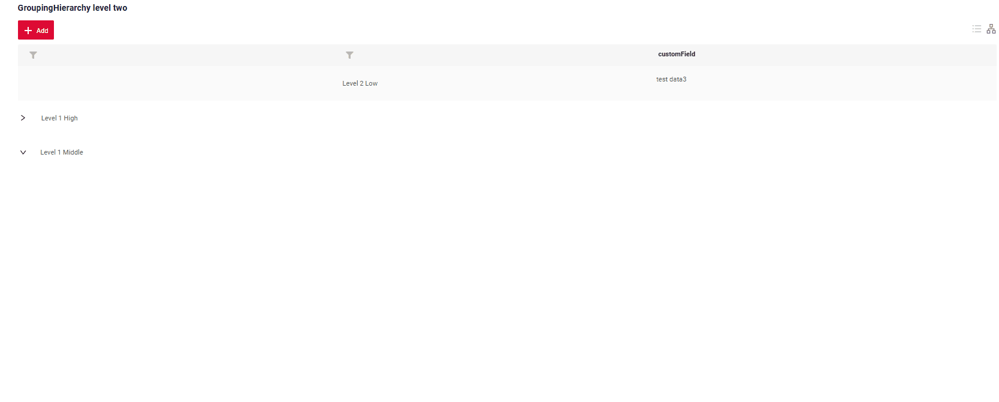
=== "Уровень 3"
    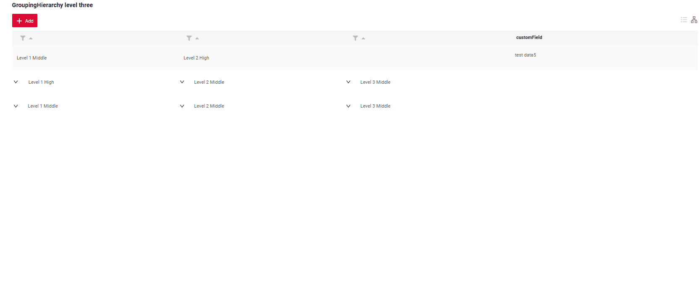
=== "Уровень 4"
    
=== "Уровень 5"
    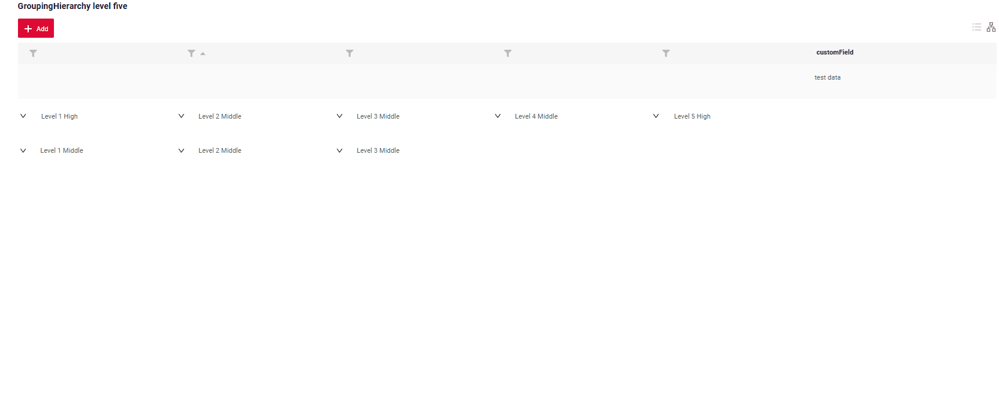

###### Как добавить? { #how-to-add_14 }
??? Example "Пример"
    === "Уровни 1,2,3,4"
    
        `Шаг 1` Добавьте **groupingHierarchy** в соответствующий **.widget.json**.
            
        ```json
        --8<--
        {{ external_links.github_raw_doc }}/widgets/groupinghierarhy/defaultgroupinghierarchy/fourlevel/MyExample3155GH.widget.json
        --8<--
        ```
        `Шаг 2` Добавьте **defaultGroupingHierarchy** в `buildIndependentMeta` соответствующего **FieldMetaBuilder**.
         
         [defaultGroupingHierarchy()](/environment/meta/buildindependentmeta/defaultgh/defaultgh)
 
        ```java
        --8<--
        {{ external_links.github_raw_doc }}/widgets/groupinghierarhy/defaultgroupinghierarchy/fourlevel/MyExample3155Meta.java:buildIndependentMeta
        --8<--
        ```
        `Level 1`
        [:material-play-circle: Живой пример]({{ external_links.code_samples }}/ui/#/screen/myexample3164){:target="_blank"} ·
        [:fontawesome-brands-github: GitHub]({{ external_links.github_ui }}/{{ external_links.github_branch }}/src/main/java/org/demo/documentation/widgets/groupinghierarhy/defaultgroupinghierarchy/onelevel){:target="_blank"}
        
        `Level 2`
        [:material-play-circle: Живой пример]({{ external_links.code_samples }}/ui/#/screen/myexample3157){:target="_blank"} ·
        [:fontawesome-brands-github: GitHub]({{ external_links.github_ui }}/{{ external_links.github_branch }}/src/main/java/org/demo/documentation/widgets/groupinghierarhy/defaultgroupinghierarchy/twolevel){:target="_blank"}
        
        `Level 3`
        [:material-play-circle: Живой пример]({{ external_links.code_samples }}/ui/#/screen/myexample3165){:target="_blank"} ·
        [:fontawesome-brands-github: GitHub]({{ external_links.github_ui }}/{{ external_links.github_branch }}/src/main/java/org/demo/documentation/widgets/groupinghierarhy/defaultgroupinghierarchy/threelevel){:target="_blank"}
        
        `Level 4`
        [:material-play-circle: Живой пример]({{ external_links.code_samples }}/ui/#/screen/myexample3155){:target="_blank"} ·
        [:fontawesome-brands-github: GitHub]({{ external_links.github_ui }}/{{ external_links.github_branch }}/src/main/java/org/demo/documentation/widgets/groupinghierarhy/defaultgroupinghierarchy/fourlevel){:target="_blank"}

    === "Уровень >=5"

        `Шаг 1` Добавьте **groupingHierarchy** в соответствующий **.widget.json**.
            
        ```json
        --8<--
        {{ external_links.github_raw_doc }}/widgets/groupinghierarhy/defaultgroupinghierarchy/fivelevel/MyExample3158GH.widget.json
        --8<--
        ```
        `Шаг 2` Добавьте **defaultGroupingHierarchy** в `buildIndependentMeta` соответствующего **FieldMetaBuilder**.
         
         [defaultGroupingHierarchy()](/environment/meta/buildindependentmeta/defaultgh/defaultgh)
    
        
        ```java
        --8<--
        {{ external_links.github_raw_doc }}/widgets/groupinghierarhy/defaultgroupinghierarchy/fivelevel/MyExample3158Meta.java:buildIndependentMeta
        --8<--
        ```

        `Level 5`
        [:material-play-circle: Живой пример]({{ external_links.code_samples }}/ui/#/screen/myexample3158){:target="_blank"} ·
        [:fontawesome-brands-github: GitHub]({{ external_links.github_ui }}/{{ external_links.github_branch }}/src/main/java/org/demo/documentation/widgets/groupinghierarhy/defaultgroupinghierarchy/fivelevel){:target="_blank"}


#### <a id="default_expanded ">GroupingHierarchy по умолчанию. Раскрыто по умолчанию </a>
[:material-play-circle: Живой пример]({{ external_links.code_samples }}/ui/#/screen/myexample3203){:target="_blank"} ·
[:fontawesome-brands-github: GitHub]({{ external_links.github_ui }}/{{ external_links.github_branch }}/src/main/java/org/demo/documentation/widgets/groupinghierarhy/defaultgroupinghierarchy/defaultexpanded){:target="_blank"}

только для GroupingHierarchy по умолчанию

Параметр defaultExpanded определяет, раскрыта или свёрнута группа в иерархии по умолчанию.

* true:
  Группа раскрыта по умолчанию независимо от количества вложенных в неё элементов. Все уровни сразу полностью видны.
* false:
  Свёрнута, если группа содержит более одного элемента.
* null или отсутствует:
  По умолчанию (аналогично false)

##### Как это выглядит? { #how-does-it-look_16 }
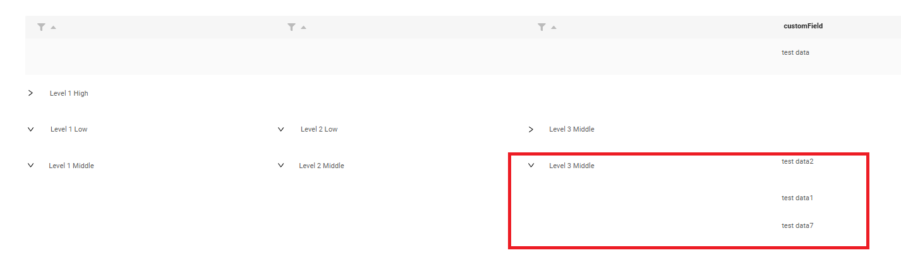

##### Как добавить? { #how-to-add_15 }
??? Example "Пример"

    Добавьте в **groupingHierarchy** **addWithCfg** в соответствующий **FieldMetaBuilder**.

    Добавьте **defaultExpanded** в соответствующий **addWithCfg**.

    ```
    .addWithCfg(
                CustomFieldDictionaryEnum.LEVEL_1_HIGH,
                cfg -> cfg.defaultExpanded(true),
    ```
        
    ```json
    --8<--
    {{ external_links.github_raw_doc }}/widgets/groupinghierarhy/defaultgroupinghierarchy/defaultexpanded/MyExample3203GH.widget.json
    --8<--
    ```

    [:material-play-circle: Живой пример]({{ external_links.code_samples }}/ui/#/screen/myexample3203){:target="_blank"} ·
    [:fontawesome-brands-github: GitHub]({{ external_links.github_ui }}/{{ external_links.github_branch }}/src/main/java/org/demo/documentation/widgets/groupinghierarhy/defaultgroupinghierarchy/defaultexpanded){:target="_blank"}

#### Режим отображения групп { #group-display-mode }
Настройка `groupMode` (`"aggregate"` / `"compact"`) **не задаётся явно** в метаданных.
Если указан параметр `aggFields` или `aggLevels`, значение `groupMode` автоматически устанавливается в `"aggregate"`.

По умолчанию значение `groupMode` — `"compact"`.

##### Как это выглядит? { #how-does-it-look_17 }
=== "`groupMode: compact` (режим по умолчанию)"
    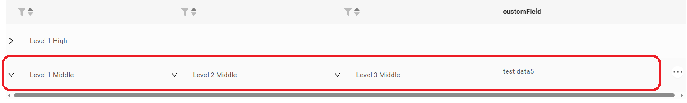
=== "`groupMode: aggregate`"
    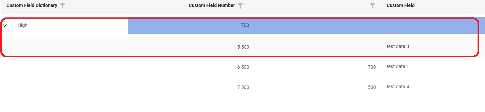

##### **compact**
  
**По умолчанию** используется режим `compact`. Если параметр `groupMode` не задан, этот режим применяется автоматически.

В этом режиме содержимое группы (например, строки внутри «папки») отображается **в той же строке**, что и заголовок группы.

Такая компоновка даёт аккуратную и компактную визуальную структуру.

`Inline Editing`
    
Поддерживается inline-редактирование строк.

Если оно включено, клик по строке активирует **режим редактирования всей строки**, включая строки заголовков групп.

##### **aggregate**

Этот режим используется, когда на уровне группы нужно отображать агрегированные значения (например, сумму, максимум, минимум).

**Компактное отображение в этом режиме невозможно**, так как строка заголовка группы используется для отображения агрегированных значений.

- Агрегирующая строка отображается прямо на уровне поля группировки, независимо от того, раскрыта группа или свёрнута.
- Если в группе нет строк данных, агрегированные значения не отображаются.
- Содержимое группы начинается со следующей строки
- В самом низу отображается строка общего итога по всей таблице.

`Inline Editing`

В режиме `aggregate` inline-редактирование заголовков групп недоступно.

Это связано с тем, что эти строки предназначены для отображения агрегированной информации.

#### Агрегация данных { #data-aggregation }
Можно включить режим агрегации для вычисления итоговых значений по группам и по всей таблице.
 
Поддерживаются **4 стандартные функции**:

[:material-play-circle: Живой пример]({{ external_links.code_samples }}/ui/#/screen/myexample3124/view/myexample3124ghsum){:target="_blank"} ·
[:fontawesome-brands-github: GitHub]({{ external_links.github_ui }}/{{ external_links.github_branch }}/src/main/java/org/demo/documentation/widgets/groupinghierarhy/aggregate/aggfields/MyExample3124SumGH.widget.json){:target="_blank"}

`sum` — вычисляет **общую сумму** значений в колонке.

[:material-play-circle: Живой пример]({{ external_links.code_samples }}/ui/#/screen/myexample3124/view/myexample3124ghmin){:target="_blank"} ·
[:fontawesome-brands-github: GitHub]({{ external_links.github_ui }}/{{ external_links.github_branch }}/src/main/java/org/demo/documentation/widgets/groupinghierarhy/aggregate/aggfields/MyExample3124MinGH.widget.json){:target="_blank"}

`min` — находит **минимальное значение** в колонке.

[:material-play-circle: Живой пример]({{ external_links.code_samples }}/ui/#/screen/myexample3124/view/myexample3124ghmax){:target="_blank"} ·
[:fontawesome-brands-github: GitHub]({{ external_links.github_ui }}/{{ external_links.github_branch }}/src/main/java/org/demo/documentation/widgets/groupinghierarhy/aggregate/aggfields/MyExample3124MaxGH.widget.json){:target="_blank"}

`max` — находит **максимальное значение** в колонке.

[:material-play-circle: Живой пример]({{ external_links.code_samples }}/ui/#/screen/myexample3124/view/myexample3124ghavg){:target="_blank"} ·
[:fontawesome-brands-github: GitHub]({{ external_links.github_ui }}/{{ external_links.github_branch }}/src/main/java/org/demo/documentation/widgets/groupinghierarhy/aggregate/aggfields/MyExample3124AvgGH.widget.json){:target="_blank"}

`avg` — вычисляет **среднее значение** колонки.


!!! info "Поведение UI"
    У таблицы есть **особенности отображения**.
    Подробнее см. [Group Mode = aggregate](#groupmode).

**Настройка внешнего вида**
В настройках можно изменить **цвет и прозрачность** агрегирующих строк.

    ..\src\components\widgets\Table\groupingHierarchy\constants\index.ts

!!! info 
    Все поля, используемые для агрегации, должны присутствовать в интерфейсе.
    Они могут быть видимыми или скрытыми.

!!! Attention "Внимание"
    Поле не может одновременно быть полем группировки и агрегируемым полем

###### Как это выглядит? { #how-does-it-look_18 }
=== "sum"
    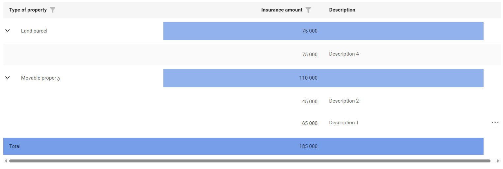 
=== "min"
    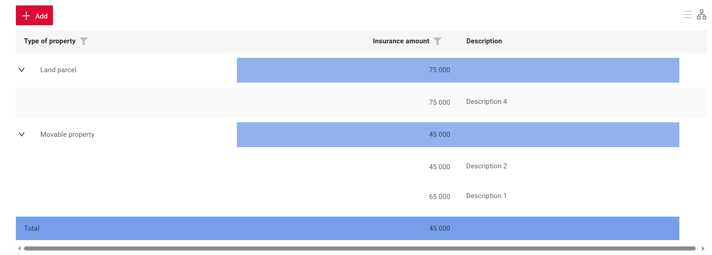
=== "max"
    
=== "avg"
    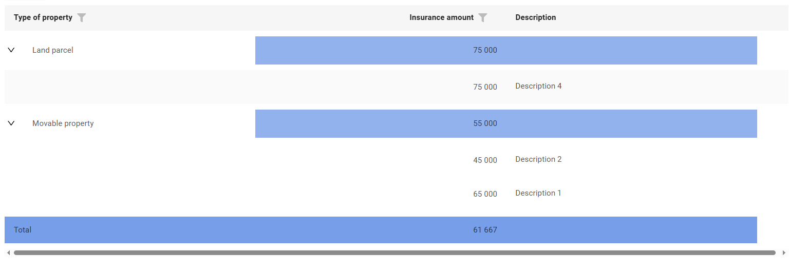


###### Как добавить? { #how-to-add_16 }
??? Example "Пример"

    aggFields (массив объектов)
            
    Описание: задаёт, какие колонки агрегируются и как вычисляются их значения.
    
    Каждый объект aggFields содержит:
    
    * fieldKey — колонка, значения которой агрегируются.
                
    * func — функция агрегации. Поддерживаемые значения:
        
        sum — вычисляет общую сумму,
        
        min — минимальное значение,
        
        max — максимальное значение,
        
        avg — среднее значение.

    * description (необязательно) — текстовое описание агрегации, отображаемое в UI.

    ```json
    "options": {
        "groupingHierarchy": {
          "fields": [
            "customFieldDictionary"
          ],
          "aggFields": [ // array of aggFields objects
            {
              "fieldKey": "customField", //  the column whose values will be aggregated and displayed above it.
              "func": "sum", // aggregation function: sum/min/max/avg
              "description": "My sum" // OPTIONAL. Description for UI
            }
          ]
        }
    }
    ```
    === "sum"
        ```json
        --8<--
        {{ external_links.github_raw_doc }}/widgets/groupinghierarhy/aggregate/aggfields/MyExample3124SumGH.widget.json
        --8<--
        ```  

        [:material-play-circle: Живой пример]({{ external_links.code_samples }}/ui/#/screen/myexample3124/view/myexample3124ghsum){:target="_blank"} ·
        [:fontawesome-brands-github: GitHub]({{ external_links.github_ui }}/{{ external_links.github_branch }}/src/main/java/org/demo/documentation/widgets/groupinghierarhy/aggregate/aggfields/MyExample3124SumGH.widget.json){:target="_blank"}
        
    === "min"
        ```json
        --8<--
        {{ external_links.github_raw_doc }}/widgets/groupinghierarhy/aggregate/aggfields/MyExample3124MinGH.widget.json
        --8<--
        ```  

        [:material-play-circle: Живой пример]({{ external_links.code_samples }}/ui/#/screen/myexample3124/view/myexample3124ghmin){:target="_blank"} ·
        [:fontawesome-brands-github: GitHub]({{ external_links.github_ui }}/{{ external_links.github_branch }}/src/main/java/org/demo/documentation/widgets/groupinghierarhy/aggregate/aggfields/MyExample3124MinGH.widget.json){:target="_blank"}

    === "max"
        ```json
        --8<--
        {{ external_links.github_raw_doc }}/widgets/groupinghierarhy/aggregate/aggfields/MyExample3124MaxGH.widget.json
        --8<--
        ```  
        [:material-play-circle: Живой пример]({{ external_links.code_samples }}/ui/#/screen/myexample3124/view/myexample3124ghmax){:target="_blank"} ·
        [:fontawesome-brands-github: GitHub]({{ external_links.github_ui }}/{{ external_links.github_branch }}/src/main/java/org/demo/documentation/widgets/groupinghierarhy/aggregate/aggfields/MyExample3124MaxGH.widget.json){:target="_blank"}

    === "avg"
        ```json
        --8<--
        {{ external_links.github_raw_doc }}/widgets/groupinghierarhy/aggregate/aggfields/MyExample3124AvgGH.widget.json
        --8<--
        ```

        [:material-play-circle: Живой пример]({{ external_links.code_samples }}/ui/#/screen/myexample3124/view/myexample3124ghavg){:target="_blank"} ·
        [:fontawesome-brands-github: GitHub]({{ external_links.github_ui }}/{{ external_links.github_branch }}/src/main/java/org/demo/documentation/widgets/groupinghierarhy/aggregate/aggfields/MyExample3124AvgGH.widget.json){:target="_blank"}

             
##### Параметры { #options }
###### Агрегированные значения в разных колонках { #aggregated-values-in-different-columns }
Варианты отображения агрегированных значений:

[:material-play-circle: Живой пример]({{ external_links.code_samples }}/ui/#/screen/myexample3124/view/myexample3124ghsum){:target="_blank"} ·
[:fontawesome-brands-github: GitHub]({{ external_links.github_ui }}/{{ external_links.github_branch }}/src/main/java/org/demo/documentation/widgets/groupinghierarhy/aggregate/aggfields/MyExample3124SumGH.widget.json){:target="_blank"}

* **Над той же колонкой** — агрегированное значение отображается прямо над агрегируемой колонкой.

[:material-play-circle: Живой пример]({{ external_links.code_samples }}/ui/#/screen/myexample3124/view/myexample3124ghsum){:target="_blank"} ·
[:fontawesome-brands-github: GitHub]({{ external_links.github_ui }}/{{ external_links.github_branch }}/src/main/java/org/demo/documentation/widgets/groupinghierarhy/aggregate/aggfields/MyExample3124SumGHForOptionalParameter.widget.json){:target="_blank"}

* **Над другой колонкой** — агрегированное значение отображается над другой выбранной колонкой.

💡 Также можно отображать **агрегации по нескольким полям** — над той же колонкой или над другой.

Как это выглядит?

=== "Над той же колонкой"
    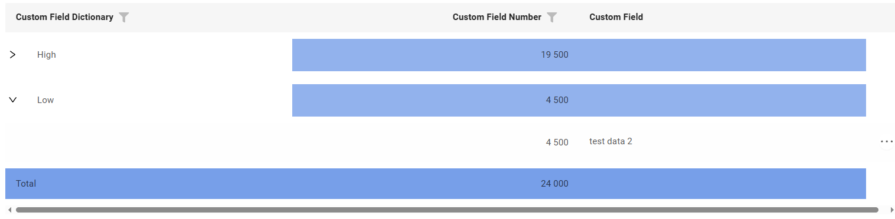
=== "Над другой колонкой"
    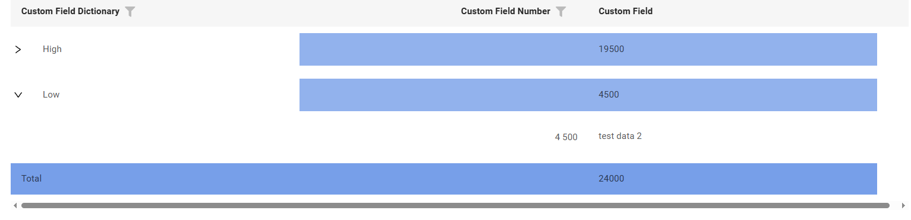

 
Также можно задать **пользовательские функции агрегации** (см. [Пользовательские функции](#custom-functions)).

Как добавить?

??? Example "Пример"
    === "Над той же колонкой"

        aggFields (массив объектов)
                
        Описание: задаёт, какие колонки агрегируются и как вычисляются их значения.
        
        Каждый объект aggFields содержит:
        
        * fieldKey — колонка, значения которой агрегируются.
                    
        * func — функция агрегации. Поддерживаемые значения:
            
            sum — вычисляет общую сумму,
            
            min — минимальное значение,
            
            max — максимальное значение,
            
            avg — среднее значение.

        ```json
        "options": {
            "groupingHierarchy": {
              "fields": [
                "customFieldDictionary"
              ],
              "aggFields": [ // array of aggFields objects
                {
                  "fieldKey": "customField", //  the column whose values will be aggregated and displayed above it.
                  "func": "sum" // aggregation function: sum/min/max/avg
                }
              ]
            }
        }
        ```

        Добавьте `aggFields` в соответствующий widget.json.

        ```json
        --8<--
        {{ external_links.github_raw_doc }}/widgets/groupinghierarhy/aggregate/aggfields/MyExample3124SumGH.widget.json
        --8<--
        ```  

        [:material-play-circle: Живой пример]({{ external_links.code_samples }}/ui/#/screen/myexample3124/view/myexample3124ghsum){:target="_blank"} ·
        [:fontawesome-brands-github: GitHub]({{ external_links.github_ui }}/{{ external_links.github_branch }}/src/main/java/org/demo/documentation/widgets/groupinghierarhy/aggregate/aggfields/MyExample3124SumGH.widget.json){:target="_blank"}

    === "Над другой колонкой и агрегации по нескольким полям"

        aggFields (массив объектов)
                
        Описание: задаёт, какие колонки агрегируются и как вычисляются их значения.
        
        Каждый объект aggFields содержит:
        
        * fieldKey — колонка, значения которой агрегируются.
                    
        * func — функция агрегации. Поддерживаемые значения:
            
            sum — вычисляет общую сумму,
            
            min — минимальное значение,
            
            max — максимальное значение,
            
            avg — среднее значение.
        
        * argFieldKeys (необязательно) — список имён колонок, значения которых агрегируются. Здесь можно перечислить несколько полей, чтобы агрегировать их сразу.
        
        * description (необязательно) — текстовое описание агрегации, отображаемое в UI.

        ```json
        "options": {
            "groupingHierarchy": {
              "fields": [
                "customFieldDictionary"
              ],
              "aggFields": [ // array of aggFields objects
                {
                  "fieldKey": "customField", // the column above which the aggregated value will be displayed.
                  "func": "sum", // aggregation function: sum/min/max/avg
                  "argFieldKeys": ["customFieldNumber"], // OPTIONAL. If you need to display an aggregated value not above the column being aggregated,or if you need to aggregate multiple fields at once, list the column names separated by commas.
                  "description": "Sum field customFieldNumber" // OPTIONAL. Description for UI
                }
              ]
            }
        }
        ```

        Добавьте `aggFields` в соответствующий widget.json.

        ```json
        --8<--
        {{ external_links.github_raw_doc }}/widgets/groupinghierarhy/aggregate/aggfields/MyExample3124SumGHForOptionalParameter.widget.json
        --8<--
        ```  
        [:material-play-circle: Живой пример]({{ external_links.code_samples }}/ui/#/screen/myexample3124/view/myexample3124ghsum){:target="_blank"} ·
        [:fontawesome-brands-github: GitHub]({{ external_links.github_ui }}/{{ external_links.github_branch }}/src/main/java/org/demo/documentation/widgets/groupinghierarhy/aggregate/aggfields/MyExample3124SumGHForOptionalParameter.widget.json){:target="_blank"}

###### Общий итог { #aggregated-total }
[:material-play-circle: Живой пример]({{ external_links.code_samples }}/ui/#/screen/myexample3124/view/myexample3125agglevelwithouttotal){:target="_blank"} ·
[:fontawesome-brands-github: GitHub]({{ external_links.github_ui }}/{{ external_links.github_branch }}/src/main/java/org/demo/documentation/widgets/groupinghierarhy/aggregate/agglevels/MyExample3125AggLevelsWithoutCountGH.widget.json){:target="_blank"}

Строку общего итога (агрегации) можно включить или скрыть.

По умолчанию, если агрегация включена, строка **Total** отображается автоматически.

!!! note "Правило строки общего итога"
    Если в таблице нет строк данных, строка общего итога не отображается.
    Как только появляется хотя бы одна строка данных, строка общего итога становится видимой.

Как это выглядит?
=== "Без итога"
    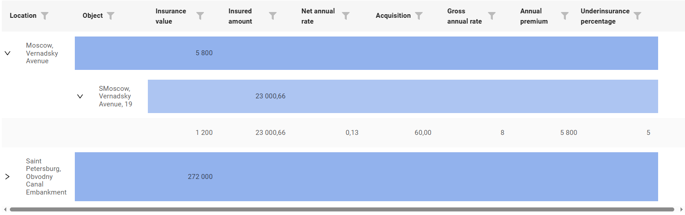
=== "С итогом"
    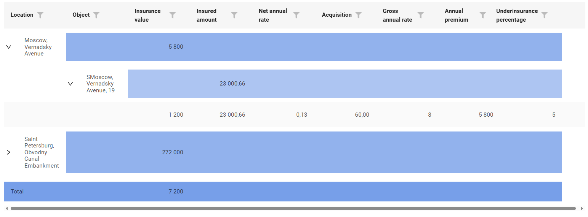

Как добавить?

??? Example "Пример"

    Чтобы убрать строку Total, используйте параметр aggLevels.

    Он задаёт, какие поля агрегируются на каждом уровне группировки, с помощью тега aggFields.
    
    * Номер уровня задаётся параметром level.
    * Уровни нумеруются с 1 и соответствуют порядку полей в groupingHierarchy.fields.
    * Если задать level = 0, агрегированные значения отображаются в отдельной строке Total.
    * Если уровень 0 не задан, строка Total не отображается.

        ```
         "options": {
            "groupingHierarchy": {
              "fields": [
                "location",
                "object"
              ],
              "aggLevels": [
                {
                  "level": 1,
                  "aggFields": [
                    {
                      "fieldKey": "insuranceValue",
                      "func": "sum",
                      "argFieldKeys": [
                        "annualPremium"
                      ],
                      "description": "sum fields `Annual Premium`"
                    }
                  ]
                },
                {
                  "level": 2,
                  "aggFields": [
                    {
                      "fieldKey": "insuranceAmount",
                      "func": "sum",
                      "argFieldKeys": [
                        "insuranceAmount"
                      ]
                    }
                  ]
                }
              ]
            }
        ```

        ```json
        --8<--
        {{ external_links.github_raw_doc }}/widgets/groupinghierarhy/aggregate/agglevels/MyExample3125AggLevelsWithoutCountGH.widget.json
        --8<--
        ```  

        [:material-play-circle: Живой пример]({{ external_links.code_samples }}/ui/#/screen/myexample3124/view/myexample3125agglevelwithouttotal){:target="_blank"} ·
        [:fontawesome-brands-github: GitHub]({{ external_links.github_ui }}/{{ external_links.github_branch }}/src/main/java/org/demo/documentation/widgets/groupinghierarhy/aggregate/agglevels/MyExample3125AggLevelsWithoutCountGH.widget.json){:target="_blank"}

###### Агрегированные значения на разных уровнях { #aggregated-values-in-different-levels }
[:material-play-circle: Живой пример]({{ external_links.code_samples }}/ui/#/screen/myexample3124/view/myexample3125agglevel){:target="_blank"} ·
[:fontawesome-brands-github: GitHub]({{ external_links.github_ui }}/{{ external_links.github_branch }}/src/main/java/org/demo/documentation/widgets/groupinghierarhy/aggregate/agglevels/MyExample3125AggLevelsGH.widget.json){:target="_blank"}

Применяйте разные стандартные функции агрегации на уровнях группировки и на уровне итога.

Как это выглядит?

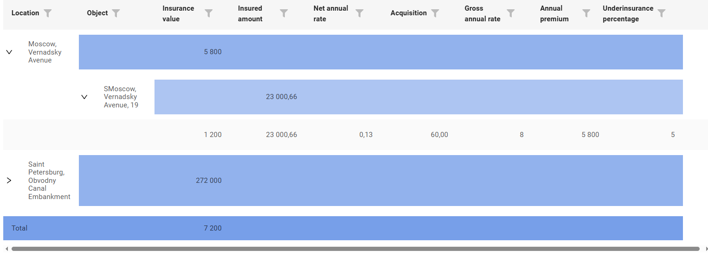

Как добавить?

??? Example "Пример"

    Параметр aggLevels задаёт, какие поля агрегируются на каждом уровне группировки, с помощью тега aggFields.
    
    level — задаёт номер уровня.
    
    Уровни нумеруются с 1 и соответствуют порядку полей в groupingHierarchy.fields.
    
    Можно указать уровень, на котором нужна агрегация, и агрегированные данные будут отображаться на этом уровне.
    
    * aggFields (массив объектов)

    Описание: задаёт, какие колонки агрегируются и как вычисляются их значения.
    
    Каждый объект aggFields содержит:
    
    * fieldKey — колонка, значения которой агрегируются.
                
    * func — функция агрегации. Поддерживаемые значения:
        
        sum — вычисляет общую сумму,
        
        min — минимальное значение,
        
        max — максимальное значение,
        
        avg — среднее значение.
    
    * argFieldKeys (необязательно) — список имён колонок, значения которых агрегируются. Здесь можно перечислить несколько полей, чтобы агрегировать их сразу.
    
    * description (необязательно) — текстовое описание агрегации, отображаемое в UI.

        ```
         "options": {
            "groupingHierarchy": {
              "fields": [
                "location",
                "object"
              ],
              "aggLevels": [
                {
                  "level": 0,
                  "aggFields": [
                    {
                      "fieldKey": "insuranceValue",
                      "func": "sum",
                      "argFieldKeys": [
                        "insuranceValue"
                      ],
                      "description": "sum fields `Insured amount`"
                    }
                  ]
                },
                {
                  "level": 1,
                  "aggFields": [
                    {
                      "fieldKey": "insuranceValue", // the column above which the aggregated value will be displayed.
                      "func": "sum",  // aggregation function: sum/min/max/avg
                      "argFieldKeys": [ // OPTIONAL. If you need to display an aggregated value not above the column being aggregated,or if you need to aggregate multiple fields at once, list the column names separated by commas.
                        "annualPremium"
                      ],
                      "description": "sum fields `Annual Premium`" // OPTIONAL. Description for UI
                    }
                  ]
                },
                {
                  "level": 2,
                  "aggFields": [
                    {
                      "fieldKey": "insuranceAmount",
                      "func": "sum",
                      "argFieldKeys": [
                        "insuranceAmount"
                      ]
                    }
                  ]
                }
              ]
            }
        ```

        ```json
        --8<--
        {{ external_links.github_raw_doc }}/widgets/groupinghierarhy/aggregate/agglevels/MyExample3125AggLevelsGH.widget.json
        --8<--
        ``` 

        [:material-play-circle: Живой пример]({{ external_links.code_samples }}/ui/#/screen/myexample3124/view/myexample3125agglevel){:target="_blank"} ·
        [:fontawesome-brands-github: GitHub]({{ external_links.github_ui }}/{{ external_links.github_branch }}/src/main/java/org/demo/documentation/widgets/groupinghierarhy/aggregate/agglevels/MyExample3125AggLevelsGH.widget.json){:target="_blank"}

###### Пользовательские функции { #custom-functions }
[:material-play-circle: Живой пример]({{ external_links.code_samples }}/ui/#/screen/myexample3124/view/myexample3126customfunctgh){:target="_blank"} ·
[:fontawesome-brands-github: GitHub]({{ external_links.github_ui }}/{{ external_links.github_branch }}/src/main/java/org/demo/documentation/widgets/groupinghierarhy/aggregate/customfunction/MyExample3126GH.widget.json){:target="_blank"}

**Пользовательские функции** — задайте собственные правила агрегации, когда стандартных недостаточно.

Как это выглядит?

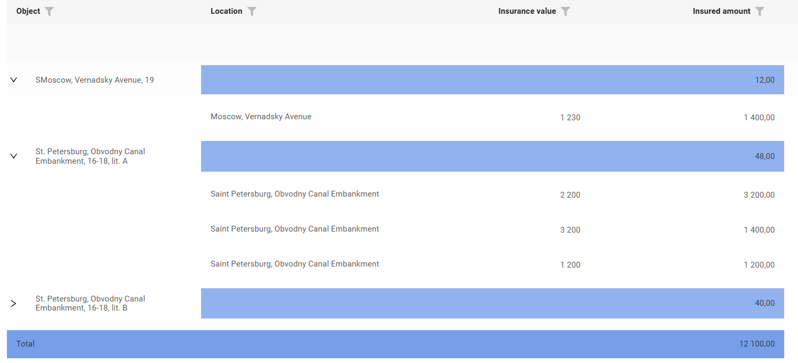

Как добавить?

??? Example "Пример"

    Параметр aggLevels задаёт, какие поля агрегируются на каждом уровне группировки, с помощью тега aggFields.
    
    level — задаёт номер уровня.
    
    Уровни нумеруются с 1 и соответствуют порядку полей в groupingHierarchy.fields.
    
    Можно указать уровень, на котором нужна агрегация, и агрегированные данные будут отображаться на этом уровне.
    
    * aggFields (массив объектов)

    Описание: задаёт, какие колонки агрегируются и как вычисляются их значения.
    
    Каждый объект aggFields содержит:
    
    * fieldKey — колонка, значения которой агрегируются.
                
    * func — min

    * argFieldKeys (необязательно) — список имён колонок, значения которых агрегируются. Здесь можно перечислить несколько полей, чтобы агрегировать их сразу.
    
    * description (необязательно) — текстовое описание агрегации, отображаемое в UI.

        ```
         "options": {
            "groupingHierarchy": {
              "fields": [
                "object"
              ],
              "aggLevels": [
                {
                  "level": 0,
                  "aggFields": [
                    {
                      "fieldKey": "insuranceAmount",
                      "func": "sum"
                    }
                  ]
                },
                {
                  "level": 1,
                  "aggFields": [
                    {
                      "fieldKey": "insuranceAmount", // the column above which the aggregated value will be displayed
                      "func": "min", // aggregation function: sum/min/max/avg
                      "argFieldKeys": [ // the value is calculated from another column, here a hidden one
                        "percentInsuranceAmount"
                      ],
                      "description": "%" // OPTIONAL. Description for UI
                    }
                  ]
                }
              ]
            }
        ```

        ```json
        --8<--
        {{ external_links.github_raw_doc }}/widgets/groupinghierarhy/aggregate/customfunction/MyExample3126GH.widget.json
        --8<--
        ``` 
        [:material-play-circle: Живой пример]({{ external_links.code_samples }}/ui/#/screen/myexample3124/view/myexample3126customfunctgh){:target="_blank"} ·
        [:fontawesome-brands-github: GitHub]({{ external_links.github_ui }}/{{ external_links.github_branch }}/src/main/java/org/demo/documentation/widgets/groupinghierarhy/aggregate/customfunction/MyExample3126GH.widget.json){:target="_blank"}
 
#### Множественная загрузка файлов { #multi-upload-files }
Реализована множественная загрузка файлов. Для выбора файлов можно использовать специальную зону drag-and-drop или стандартную кнопку.

подробнее см. [Множественная загрузка файлов](/ru/widget/type/property/multiupload/multiupload)
 
