# Info
 
Виджет `Info` — компонент только для просмотра данных.
## Основы { #basics }
[:material-play-circle: Живой пример]({{ external_links.code_samples }}/ui/#/screen/myexample3001){:target="_blank"} ·
[:fontawesome-brands-github: GitHub]({{ external_links.github_ui }}/{{ external_links.github_branch }}/src/main/java/org/demo/documentation/widgets/info/base/onefield){:target="_blank"}
### Как это выглядит? { #how-does-it-look }
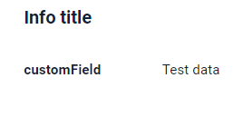


###  <a id="Howtoaddbacis">Как добавить?</a>
??? Example "Пример"
    **Шаг 1** Создайте файл **_.widget.json_** с type = "Info"
 
    ```json
    --8<--
    {{ external_links.github_raw_doc }}/widgets/info/base/onefield/MyExample3009Info.widget.json
    --8<--
    ```
    **Шаг 2** Добавьте виджет в соответствующий **_.view.json_**.

    ```json
    --8<--
    {{ external_links.github_raw_doc }}/widgets/info/base/onefield/myexample3009info.view.json
    --8<--
    ```

    [:material-play-circle: Живой пример]({{ external_links.code_samples }}/ui/#/screen/myexample3001){:target="_blank"} ·
    [:fontawesome-brands-github: GitHub]({{ external_links.github_ui }}/{{ external_links.github_branch }}/src/main/java/org/demo/documentation/widgets/info/base/onefield){:target="_blank"}
     
## <a id="Title">Заголовок</a>
[:material-play-circle: Живой пример]({{ external_links.code_samples }}/ui/#/screen/myexample3102){:target="_blank"} ·
[:fontawesome-brands-github: GitHub]({{ external_links.github_ui }}/{{ external_links.github_branch }}/src/main/java/org/demo/documentation/widgets/info/title){:target="_blank"}

### Базовый заголовок { #title-basic }
Title — (необязательно)

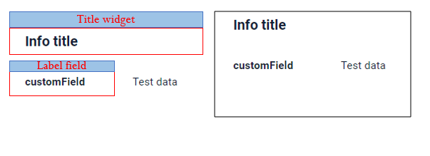    

Типы:

* `постоянный заголовок`: показывает постоянный текст.
* `пустой постоянный заголовок`: если нужно визуально связать виджеты, расположив их один под другим
* `вычисляемый заголовок`: показывает значение из скрытого текстового поля, например вычисленное на основе бизнес-логики приложения

#### Как это выглядит? { #how-does-it-look_1 }
=== "Постоянный заголовок"
    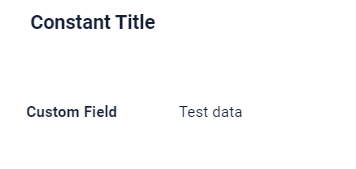
=== "Пустой постоянный заголовок"
    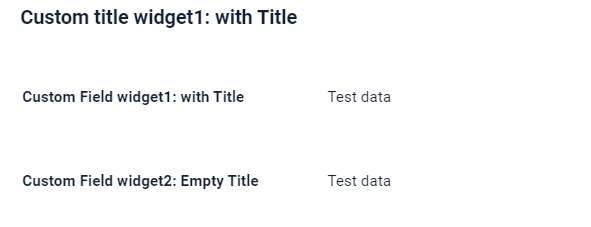
=== "Вычисляемый заголовок"
    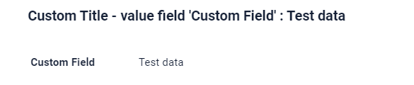
#### Как добавить? { #how-to-add }
??? Example "Пример"
    === "Постоянный заголовок"
        **Шаг 1** Добавьте название в **title** в **_.widget.json_**.
        ```json
        --8<--
        {{ external_links.github_raw_doc }}/widgets/info/title/MyExample3102Title.widget.json
        --8<--
        ```

        [:material-play-circle: Живой пример]({{ external_links.code_samples }}/ui/#/screen/myexample3102){:target="_blank"} ·
        [:fontawesome-brands-github: GitHub]({{ external_links.github_ui }}/{{ external_links.github_branch }}/src/main/java/org/demo/documentation/widgets/info/title){:target="_blank"}

    === "Пустой постоянный заголовок"
        **Шаг 1** Удалите параметр **title** из **_.widget.json_**.
        ```json
        --8<--
        {{ external_links.github_raw_doc }}/widgets/info/title/MyExample3102EmptyTitle.widget.json
        --8<--
        ```

        [:material-play-circle: Живой пример]({{ external_links.code_samples }}/ui/#/screen/myexample3102){:target="_blank"} ·
        [:fontawesome-brands-github: GitHub]({{ external_links.github_ui }}/{{ external_links.github_branch }}/src/main/java/org/demo/documentation/widgets/info/title){:target="_blank"}

    === "Вычисляемый заголовок"
        <!--родитель??-->
        **Шаг 1** Добавьте ${customField} в **title** в **_.widget.json_**.
        ```json
        --8<--
        {{ external_links.github_raw_doc }}/widgets/info/title/MyExample3102CustomTitle.widget.json
        --8<--
        ```

        [:material-play-circle: Живой пример]({{ external_links.code_samples }}/ui/#/screen/myexample3102){:target="_blank"} ·
        [:fontawesome-brands-github: GitHub]({{ external_links.github_ui }}/{{ external_links.github_branch }}/src/main/java/org/demo/documentation/widgets/info/title){:target="_blank"}


### Цвет заголовка { #title-color }
`Title Color` позволяет задать цвет заголовка. Он может быть постоянным или вычисляемым.

**Постоянный цвет**

[:material-play-circle: Живой пример]({{ external_links.code_samples }}/ui/#/screen/myexample3040/view/myexample3040infocolorconst){:target="_blank"} ·
[:fontawesome-brands-github: GitHub]({{ external_links.github_ui }}/{{ external_links.github_branch }}/src/main/java/org/demo/documentation/widgets/info/colortitle){:target="_blank"}

*Постоянный цвет* — фиксированный цвет, который не меняется. Он остаётся одинаковым независимо от каких-либо факторов в приложении.

**Вычисляемый цвет**

[:material-play-circle: Живой пример]({{ external_links.code_samples }}/ui/#/screen/myexample3040/view/myexample3040info){:target="_blank"} ·
[:fontawesome-brands-github: GitHub]({{ external_links.github_ui }}/{{ external_links.github_branch }}/src/main/java/org/demo/documentation/widgets/info/colortitle){:target="_blank"}

*Вычисляемый цвет* можно использовать для динамического изменения цвета заголовка. Он меняется в зависимости от бизнес-логики или данных приложения.

!!! info
    Цветовое выделение заголовка **применимо** к следующим [полям](/ru/widget/fields/fieldtypes/): date, dateTime, dateTimeWithSeconds, number, money, percent, time, input, text, dictionary, radio, checkbox, pickList, inlinePickList, multivalue, multivalueHover.

##### Как это выглядит? { #how-does-it-look_2 }
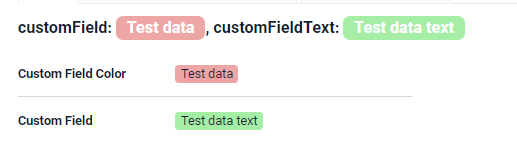

##### Как добавить? { #how-to-add_1 }
??? Example "Пример"
    === "Вычисляемый цвет"

        **Шаг 1**   Добавьте `собственное поле для цвета` в соответствующий **DataResponseDTO**. Поле может содержать цвет в формате HEX или быть null.
        ```java
        --8<--
        {{ external_links.github_raw_doc }}/widgets/info/colortitle/MyExample3040DTO.java:colorDTO
        --8<--
        ```  
 
        **Шаг 2** Добавьте **"bgColorKey"** :  `собственное поле для цвета` в .widget.json.

        Добавьте в `title` поле с `${customField}`

        ```json
        --8<--
        {{ external_links.github_raw_doc }}/widgets/info/colortitle/MyExample3040.widget.json
        --8<--
        ```       

        [:material-play-circle: Живой пример]({{ external_links.code_samples }}/ui/#/screen/myexample3040/view/myexample3040info){:target="_blank"} ·
        [:fontawesome-brands-github: GitHub]({{ external_links.github_ui }}/{{ external_links.github_branch }}/src/main/java/org/demo/documentation/widgets/info/colortitle){:target="_blank"}

    === "Постоянный цвет"
 
        Добавьте **"bgColor"** :  `цвет HEX` в .widget.json.

        Добавьте в `title` поле с `${customField}`

        ```json
        --8<--
        {{ external_links.github_raw_doc }}/widgets/info/colortitle/MyExample3040ColorConst.widget.json
        --8<--
        ```

        [:material-play-circle: Живой пример]({{ external_links.code_samples }}/ui/#/screen/myexample3040/view/myexample3040infocolorconst){:target="_blank"} ·
        [:fontawesome-brands-github: GitHub]({{ external_links.github_ui }}/{{ external_links.github_branch }}/src/main/java/org/demo/documentation/widgets/info/colortitle){:target="_blank"}

## <a id="bc">Бизнес-компонент</a>
Указывает бизнес-компонент (BC), к которому относится эта форма.
Бизнес-компонент представляет определённую часть системы, отвечающую за конкретную бизнес-логику или данные.

подробнее см. [Бизнес-компонент](/ru/environment/businesscomponent/businesscomponent/)
 
## <a id="Showcondition">Условие отображения</a>
`showCondition` используется для динамического определения доступности или видимости виджета.
`showCondition` в конфигурации — условие, при котором виджет становится видимым пользователю. Оно определяет, отображается ли форма в интерфейсе, на основе значения определённого поля другого или текущего бизнес-компонента.

* `без условия отображения — рекомендуется`: виджет виден всегда

  [:material-play-circle: Живой пример]({{ external_links.code_samples }}/ui/#/screen/myexample3001){:target="_blank"} ·
  [:fontawesome-brands-github: GitHub]({{ external_links.github_ui }}/{{ external_links.github_branch }}/src/main/java/org/demo/documentation/widgets/info/base/onefield){:target="_blank"}

* `условие отображения по текущей сущности`: условие может содержать логическое выражение, зависящее от полей текущей сущности. Обновление полей вызывает пересчёт условия только при сохранении или если поле force active

  [:material-play-circle: Живой пример]({{ external_links.code_samples }}/ui/#/screen/myexample3103/view/myexample3103showcond){:target="_blank"} ·
  [:fontawesome-brands-github: GitHub]({{ external_links.github_ui }}/{{ external_links.github_branch }}/src/main/java/org/demo/documentation/widgets/info/showcondition/bycurrententity){:target="_blank"}

* `условие отображения по родительской сущности`: условие может содержать логическое выражение, зависящее от родительской сущности. Обновление полей родителя вызывает пересчёт условия только при сохранении или если поле force active и отображается на том же view

  [:material-play-circle: Живой пример]({{ external_links.code_samples }}/ui/#/screen/myexample3103/view/myexample3105showcond){:target="_blank"} ·
  [:fontawesome-brands-github: GitHub]({{ external_links.github_ui }}/{{ external_links.github_branch }}/src/main/java/org/demo/documentation/widgets/info/showcondition/byparententity){:target="_blank"}

!!! tips "Совет"
    По возможности рекомендуется не использовать `Show condition`, так как широкое применение этой возможности усложняет поддержку приложения.

### <a id="howdoesitlook">Как это выглядит?</a>
=== "без условия отображения"
    
=== "условие отображения по текущей сущности"
    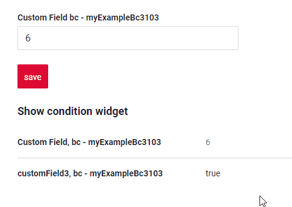
=== "условие отображения по родительской сущности"
    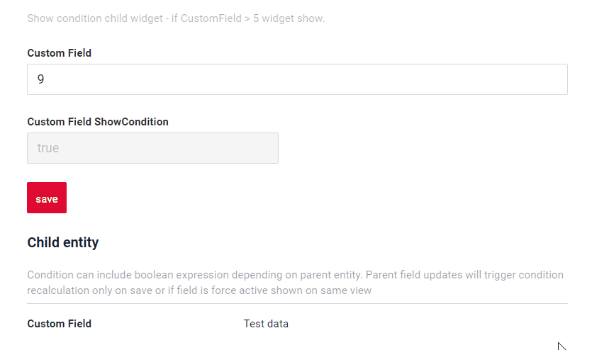
 
### <a id="howtoadd">Как добавить?</a>
??? Example "Пример"
 
    === "без условия отображения"
        см. [Основы](#Howtoaddbacis)

        [:material-play-circle: Живой пример]({{ external_links.code_samples }}/ui/#/screen/myexample3001){:target="_blank"} ·
        [:fontawesome-brands-github: GitHub]({{ external_links.github_ui }}/{{ external_links.github_branch }}/src/main/java/org/demo/documentation/widgets/info/base/onefield){:target="_blank"}

    === "условие отображения по текущей сущности"
        **Шаг 1** Добавьте **showCondition** в **_.widget.json_**. Подробнее см. [showCondition](/ru/widget/type/property/showcondition/showcondition)
        ```json
        --8<--
        {{ external_links.github_raw_doc }}/widgets/info/showcondition/bycurrententity/MyExample31032.widget.json
        --8<--
        ```

        [:material-play-circle: Живой пример]({{ external_links.code_samples }}/ui/#/screen/myexample3103/view/myexample3103showcond){:target="_blank"} ·
        [:fontawesome-brands-github: GitHub]({{ external_links.github_ui }}/{{ external_links.github_branch }}/src/main/java/org/demo/documentation/widgets/info/showcondition/bycurrententity){:target="_blank"}

    === "условие отображения по родительской сущности"
        **Шаг 1** Добавьте **showCondition** в **_.widget.json_**. Подробнее см. [showCondition](/ru/widget/type/property/showcondition/showcondition)
        ```json
        --8<--
        {{ external_links.github_raw_doc }}/widgets/info/showcondition/byparententity/child/MyExample3107.widget.json
        --8<--
        ```

        [:material-play-circle: Живой пример]({{ external_links.code_samples }}/ui/#/screen/myexample3103/view/myexample3105showcond){:target="_blank"} ·
        [:fontawesome-brands-github: GitHub]({{ external_links.github_ui }}/{{ external_links.github_branch }}/src/main/java/org/demo/documentation/widgets/info/showcondition/byparententity){:target="_blank"}

## <a id="bc">Поля</a>
Настройка полей. Массив fields определяет отдельные поля формы.

```json
{
    "label": "Custom Field",
    "key": "customField",
    "type": "input"
}
```

* **"label"**

Описание: заголовок поля.

Тип: String (необязательно).

* **"key"**

Описание: имя поля в соответствующем DataResponseDTO.

Тип: String (обязательно).

* **"type"**

Описание: [Типы полей](/ru/widget/fields/fieldtypes/)

Тип: String (обязательно).

### Как добавить? { #how-to-add_2 }
??? Example "Пример"

    === "С плагином"
        **Шаг 1** Скачайте плагин
            [скачать плагин для IntelliJ](https://doc.cxbox.org/ru/plugin/plugininstalling)
    
        **Шаг 2** Добавьте существующее поле в существующий виджет формы
            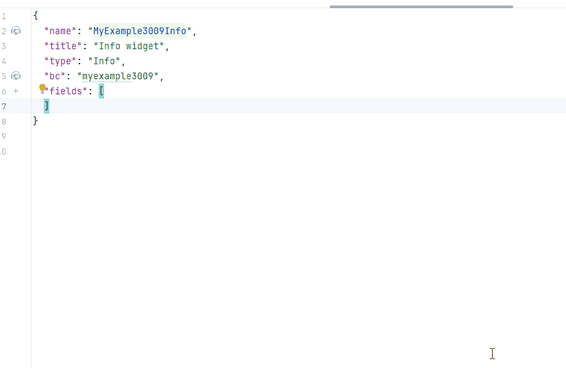

    === "Другое"
        Добавьте поле в **_.widget.json_**.

        ```json
           --8<--
           {{ external_links.github_raw_doc }}/widgets/info/base/onefield/MyExample3009Info.widget.json
           --8<--
        ```


подробнее см. [Поля](/ru/widget/fields/fieldtypes/)

## <a id="Fieldslayout">Компоновка (options layout)</a>
[:material-play-circle: Живой пример]({{ external_links.code_samples }}/ui/#/screen/myexample3008){:target="_blank"} ·
[:fontawesome-brands-github: GitHub]({{ external_links.github_ui }}/{{ external_links.github_branch }}/src/main/java/org/demo/documentation/widgets/info/fieldslayoute){:target="_blank"}

* `одноколоночная компоновка — рекомендуется`: каждое поле на новой строке. Ширина каждого поля — от 1 до 24.

    !!! tips "Совет"
        Используйте одноколоночную компоновку, когда поля часто скрываются или переставляются. Это исключает проблемы с компоновкой и обеспечивает лучший пользовательский опыт.

* `многоколоночная компоновка`: поля отображаются в сетке. Сетка может содержать любое количество строк. Каждая строка может содержать любое количество полей, пока сумма их ширин в строке не превышает 24. Ширина каждого поля — от 1 до 24.
* `empty`: отображаются только заголовок и действия. Обычно используется, когда нужно изменить стандартное положение кнопок (например, показать кнопки под виджетом). Можно скрыть кнопки на виджете с данными, создать отдельный виджет только с кнопками и разместить его в любом месте view

!!! tips "Совет"
    По возможности рекомендуется использовать `одноколоночную` компоновку, так как динамическое скрытие полей в этом случае всегда работает корректно.

!!! info
    Строка имеет размер 24 span; если в одной строке определены поля с суммарной шириной больше 24 span, это поле и все последующие переносятся на новую строку. То есть каждая строка вмещает поля, пока суммарная ширина не достигнет 24 span, а всё, что превышает, переходит на следующую строку.

    Например, есть три поля шириной 12, 8 и 10 соответственно. В этом случае первое и второе поле полностью помещаются в первой строке, так как укладываются в предел 24. Однако ширина третьего поля добавляется к сумме, и она превышает 24. В результате третье поле переносится на следующую строку.


#### Как это выглядит? { #how-does-it-look_3 }
=== "Одноколоночная компоновка — рекомендуется"
    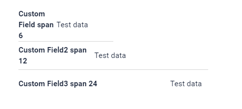
=== "Многоколоночная компоновка"
    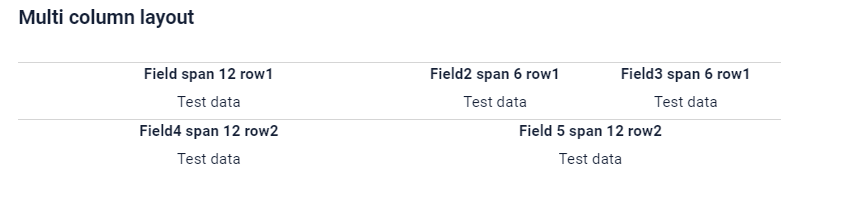
=== "Empty — только кнопки"
    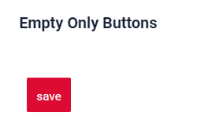
#### Как добавить? { #how-to-add_3 }
??? Example "Пример"
    === "Одноколоночная компоновка — рекомендуется"

        **Шаг 1** Создайте **"options": {"layout": {}}**.

        **Шаг 2** Добавьте поля в **"options": {"layout": {}}**

        Формирование строк:

        * Откройте `cols` : "cols": [
        * Добавьте все поля (customField, customField2, customField3) со span от 1 до 24.
        * Закройте `cols` : ]

        ```json
        --8<--
        {{ external_links.github_raw_doc }}/widgets/info/fieldslayoute/MyExample3008Info.widget.json
        --8<--
        ```

        [:material-play-circle: Живой пример]({{ external_links.code_samples }}/ui/#/screen/myexample3008){:target="_blank"} ·
        [:fontawesome-brands-github: GitHub]({{ external_links.github_ui }}/{{ external_links.github_branch }}/src/main/java/org/demo/documentation/widgets/info/fieldslayoute){:target="_blank"}

    === "Многоколоночная компоновка"
        **Шаг 1** Создайте **"options": {"layout": {}}**.

        **Шаг 2** Добавьте поля в **"options": {"layout": {}}**.

        Формирование строки 1:

        * Откройте `cols` : "cols": [
        * Добавьте все поля: customField, customField2, customField3
        * Проверьте, что сумма span <= 24: customField (span = 12), customField2 = 6, customField3 = 6 : сумма 24)
        * Закройте `cols` : ]

        Формирование строки 2:

        * Откройте 'cols' : "cols": [
        * Добавьте все поля (customField4)
        * Проверьте, что сумма span <= 24 (customField4 span = 12 : сумма 12)
        * Закройте 'cols' : ]
 
        ```json
        --8<--
        {{ external_links.github_raw_doc }}/widgets/info/fieldslayoute/MyExample3008MultiColumnDefault.widget.json
        --8<--
        ```

        [:material-play-circle: Живой пример]({{ external_links.code_samples }}/ui/#/screen/myexample3008){:target="_blank"} ·
        [:fontawesome-brands-github: GitHub]({{ external_links.github_ui }}/{{ external_links.github_branch }}/src/main/java/org/demo/documentation/widgets/info/fieldslayoute){:target="_blank"}

    === "Empty — только кнопки"
        **Шаг 1** Создайте **"options": {"layout": {}}**.

        ```json
        --8<--
        {{ external_links.github_raw_doc }}/widgets/info/fieldslayoute/MyExample3008EmptyOnlyButtons.widget.json
        --8<--
        ```

        [:material-play-circle: Живой пример]({{ external_links.code_samples }}/ui/#/screen/myexample3008){:target="_blank"} ·
        [:fontawesome-brands-github: GitHub]({{ external_links.github_ui }}/{{ external_links.github_branch }}/src/main/java/org/demo/documentation/widgets/info/fieldslayoute){:target="_blank"}

## Действия { #actions }
Этот тип виджета не поддерживает кнопки


 