# Line2D

Виджет `Line2D` строит линейный график: одно значение на категорию по оси X, число по оси Y.
Если записи сгруппированы по полю, отображается несколько линий. Пользователь может переключить график в таблицу.

## Основы { #basics }
[:material-play-circle: Живой пример]({{ external_links.code_samples }}/ui/#/screen/myexample4240){:target="_blank"} ·
[:fontawesome-brands-github: GitHub]({{ external_links.github_ui }}/{{ external_links.github_branch }}/src/main/java/org/demo/documentation/widgets/line2d/base){:target="_blank"}
### Как это выглядит? { #how-does-it-look }


Каждая запись бизнес-компонента — одна точка графика. Виджет берёт точку из двух полей:

* `xValueFieldKey`: поле с категорией по оси X (месяц, клиент, дата в виде текста).
* `yValueFieldKey`: числовое поле со значением по оси Y.

`title` этих полей отображается как название оси. Записи без значения Y пропускаются.
Бэкенд возвращает записи в порядке оси X: диаграмма их не сортирует.

Параметры `options.chart2D`:

| Параметр              | Обязательный | Описание                                                                                                                 |
|-----------------------|----------|------------------------------------------------------------------------------------------------------------------------------|
| `xValueFieldKey`      | да       | Ключ поля для оси X.                                                                                                         |
| `yValueFieldKey`      | да       | Ключ поля для оси Y. Должен быть числового типа (`number`, `money`, `percent`).                                              |
| `groupFieldKey`       | нет      | Ключ поля, разделяющего записи на линии. Одна линия на значение, значения отображаются в легенде. См. [Группы](#groups).     |
| `stack`               | нет      | `true` рисует линии одну поверх другой. См. [Стек](#stack).                                                                  |
| `yMin`, `yMax`, `yStep` | нет    | Масштаб и шаг оси Y. См. [Масштаб и шаг осей](#axis).                                                                        |
| `xMin`, `xMax`, `xStep` | нет    | Масштаб и шаг оси X. Только для числового поля X. См. [Масштаб и шаг осей](#axis).                                           |
| `descriptionFieldKey` | нет      | Ключи полей, отображаемых в подсказке вместо значения X. См. [Подсказка](#tooltip).                                          |

###  <a id="Howtoaddbacis">Как добавить?</a>
??? Example "Пример"
    **Шаг 1** Создайте **DataResponseDTO** с полями точки: значением X и значением Y.
    ```java
    --8<--
    {{ external_links.github_raw_doc }}/widgets/line2d/base/MyExample4240DTO.java
    --8<--
    ```

    **Шаг 2** Создайте **DAO**, наследующий AbstractAnySourceBaseDAO<> и реализующий AnySourceBaseDAO.
    DAO возвращает одну запись на точку, отсортированную по оси X, с уникальным `id`.
    ```java
    --8<--
    {{ external_links.github_raw_doc }}/widgets/line2d/base/MyExample4240Dao.java:getStats
    --8<--
    ```

    **Шаг 3** Создайте **Meta**, наследующий AnySourceFieldMetaBuilder.
    ```java
    --8<--
    {{ external_links.github_raw_doc }}/widgets/line2d/base/MyExample4240Meta.java
    --8<--
    ```

    **Шаг 4** Создайте **Service**, наследующий AnySourceVersionAwareResponseService.
    ```java
    --8<--
    {{ external_links.github_raw_doc }}/widgets/line2d/base/MyExample4240Service.java
    --8<--
    ```

    **Шаг 5** Создайте файл **_.widget.json_** с type = **"Line2D"**.
    Добавьте поля точки и **options.chart2D** с `xValueFieldKey` и `yValueFieldKey`.
    ```json
    --8<--
    {{ external_links.github_raw_doc }}/widgets/line2d/base/MyExample4240Line2D.widget.json
    --8<--
    ```

    **Шаг 6** Добавьте виджет в соответствующий **_.view.json_**.
    ```json
    --8<--
    {{ external_links.github_raw_doc }}/widgets/line2d/base/myexample4240line2d.view.json
    --8<--
    ```

    **Шаг 7** Задайте лимит страницы бизнес-компонента равным количеству точек, например 1000.
    Лимит по умолчанию — 5. Если у бизнес-компонента больше записей, чем лимит, виджет показывает только таблицу.
    См. [Лимит страницы](#pagelimit).

    Добавьте бизнес-компонент в таблицу **BC_PROPERTIES**:
    ```csv
    BC;PAGE_LIMIT;MASS_PAGE_LIMIT;SORT;FILTER;ID
    myExampleBc4240;1000;NULL;NULL;'""';
    ```

## <a id="Title">Заголовок</a>
[:material-play-circle: Живой пример]({{ external_links.code_samples }}/ui/#/screen/myexample4241){:target="_blank"} ·
[:fontawesome-brands-github: GitHub]({{ external_links.github_ui }}/{{ external_links.github_branch }}/src/main/java/org/demo/documentation/widgets/line2d/title){:target="_blank"}

### Базовый заголовок { #title-basic }
`Title` для виджета (необязательно)

Типы:

* `постоянный заголовок`: показывает постоянный текст.
* `пустой постоянный заголовок`: если нужно визуально связать виджеты, расположив их один под другим

#### Как это выглядит? { #how-does-it-look_1 }
=== "Постоянный заголовок"
    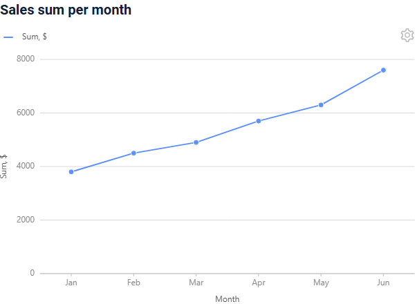
=== "Пустой постоянный заголовок"
    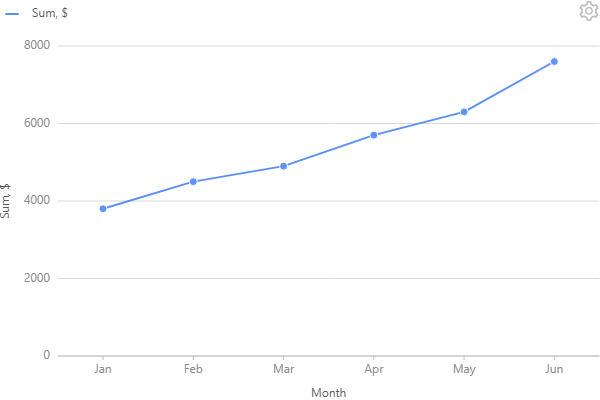

#### Как добавить? { #how-to-add }
??? Example "Пример"
    === "Постоянный заголовок"
        **Шаг 1** Добавьте название в **title** в **_.widget.json_**.
        ```json
        --8<--
        {{ external_links.github_raw_doc }}/widgets/line2d/title/MyExample4241Line2D.widget.json
        --8<--
        ```
    === "Пустой постоянный заголовок"
        **Шаг 1** Добавьте пустой **title** в **_.widget.json_**.
        ```json
        --8<--
        {{ external_links.github_raw_doc }}/widgets/line2d/title/MyExample4241Line2DEmptyTitle.widget.json
        --8<--
        ```

### Цвет заголовка { #title-color }
_неприменимо_

## <a id="bc">Бизнес-компонент</a>
Указывает бизнес-компонент (BC), к которому относится этот виджет.
Бизнес-компонент представляет определённую часть системы, отвечающую за конкретную бизнес-логику или данные.

График берёт данные из бизнес-компонента **AnySource**: DAO строит точки (например, сумму за месяц)
и возвращает их в порядке оси X. Одна запись — одна точка, поэтому `id` записи должен быть уникальным.

подробнее см. [Бизнес-компонент](/ru/environment/businesscomponent/businesscomponent/)

## <a id="Showcondition">Условие отображения</a>
[:material-play-circle: Живой пример]({{ external_links.code_samples }}/ui/#/screen/myexample4242){:target="_blank"} ·
[:fontawesome-brands-github: GitHub]({{ external_links.github_ui }}/{{ external_links.github_branch }}/src/main/java/org/demo/documentation/widgets/line2d/showcondition){:target="_blank"}

* `без условия отображения — рекомендуется`: виджет виден всегда
* `условие отображения по текущей сущности`: диаграмма отображается, когда поле текущей записи другого бизнес-компонента на view имеет заданное значение

!!! tips "Совет"
    По возможности рекомендуется не использовать `Show condition`, так как широкое применение этой возможности усложняет поддержку приложения.

#### <a id="howdoesitlook">Как это выглядит?</a>
=== "без условия отображения"
    
=== "условие отображения по текущей сущности"
    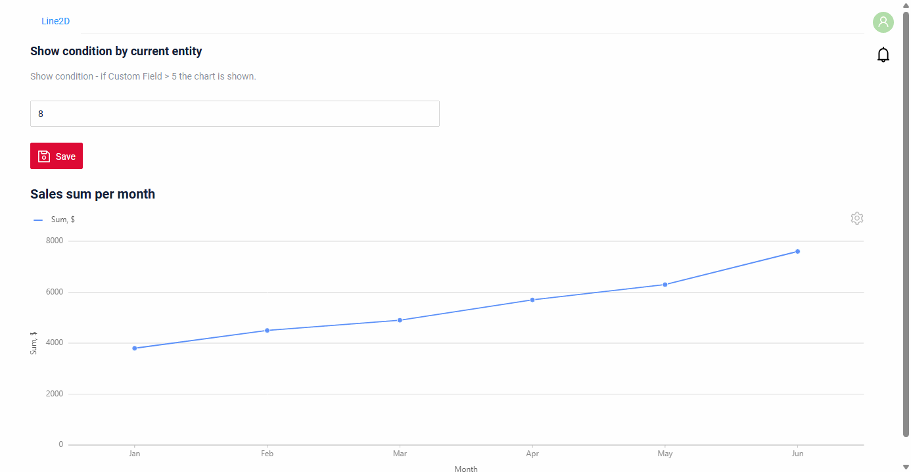

#### <a id="howtoadd">Как добавить?</a>
??? Example "Пример"

    === "без условия отображения"
        см. [Основы](#Howtoaddbacis)

    === "условие отображения по текущей сущности"
        **Шаг 1** Добавьте **showCondition** в **_.widget.json_**. Подробнее см. [showCondition](/ru/widget/type/property/showcondition/showcondition)
        ```json
        --8<--
        {{ external_links.github_raw_doc }}/widgets/line2d/showcondition/MyExample4242Line2D.widget.json
        --8<--
        ```

## <a id="fields">Поля</a>
Настройка полей. Массив fields определяет поля точки. График использует поля, указанные в `options.chart2D`;
остальные поля отображаются в [табличном режиме](#tablemode) и в подсказке.

```json
{
    "title": "Month",
    "key": "month",
    "type": "input"
}
```

* **"title"**

  Описание: заголовок поля. Для полей X и Y это название оси. Пустой заголовок скрывает название оси.

  Тип: String (необязательно).

* **"key"**

    Описание: имя поля в соответствующем DataResponseDTO.

    Тип: String (обязательно).

* **"type"**

  Описание: [Типы полей](/ru/widget/fields/fieldtypes/). Поле Y должно быть числовым.

  Тип: String (обязательно).

Поле с типом `hidden` не отображается в табличном режиме. Используйте его для значений, нужных только фильтру drilldown.

### Как добавить? { #how-to-add_1 }
??? Example "Пример"
    Добавьте поле в **_.widget.json_**.

      ```json
         --8<--
         {{ external_links.github_raw_doc }}/widgets/line2d/base/MyExample4240Line2D.widget.json
         --8<--
      ```

## <a id="Fieldslayout">Компоновка (options layout)</a>
**options.layout** — в этом типе не используется.

## Действия { #actions }
_неприменимо_

### Дополнительные свойства { #additional-properties }

#### <a id="tooltip">Подсказка</a>
[:material-play-circle: Живой пример]({{ external_links.code_samples }}/ui/#/screen/myexample4246){:target="_blank"} ·
[:fontawesome-brands-github: GitHub]({{ external_links.github_ui }}/{{ external_links.github_branch }}/src/main/java/org/demo/documentation/widgets/line2d/tooltip){:target="_blank"}

Подсказка появляется при наведении мыши на точку. По умолчанию она показывает значение X и значение каждой линии.
`descriptionFieldKey` заменяет её значениями перечисленных полей записи через запятую.

###### Как это выглядит? { #how-does-it-look_2 }
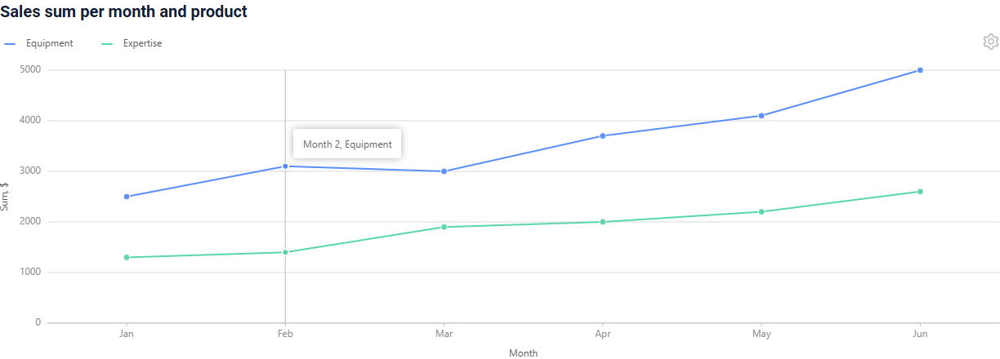

###### Как добавить? { #how-to-add_2 }
??? Example "Пример"
    **Шаг 1** Добавьте поле описания в **fields**, а **descriptionFieldKey** — в **options.chart2D** в **_.widget.json_**.
    ```json
    --8<--
    {{ external_links.github_raw_doc }}/widgets/line2d/tooltip/MyExample4246Line2D.widget.json
    --8<--
    ```

#### <a id="color">Цвет</a>
[:material-play-circle: Живой пример]({{ external_links.code_samples }}/ui/#/screen/myexample4247){:target="_blank"} ·
[:fontawesome-brands-github: GitHub]({{ external_links.github_ui }}/{{ external_links.github_branch }}/src/main/java/org/demo/documentation/widgets/line2d/color){:target="_blank"}

Цвет линий задаётся на поле X:

* `bgColorKey`: ключ поля с цветом записи. Линия получает цвет своей первой записи.
* `bgColor`: один постоянный цвет для всех линий.

Без них виджет использует палитру по умолчанию.

###### Как это выглядит? { #how-does-it-look_3 }
=== "Цвет из поля"
    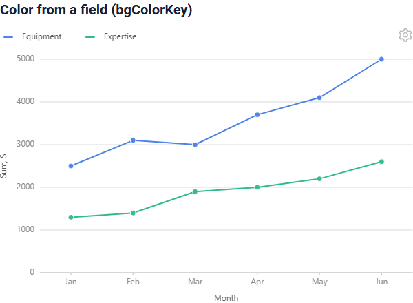
=== "Постоянный цвет"
    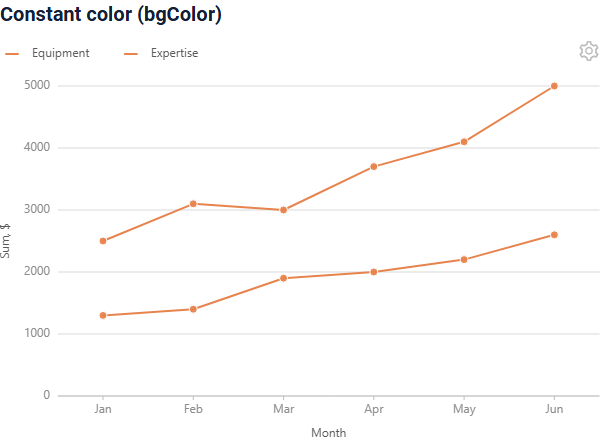

###### Как добавить? { #how-to-add_3 }
??? Example "Пример"
    === "Цвет из поля"
        **Шаг 1** Добавьте поле цвета в **DataResponseDTO** и заполните его в DAO.
        ```java
        --8<--
        {{ external_links.github_raw_doc }}/widgets/line2d/color/MyExample4247Dao.java:getStats
        --8<--
        ```
        **Шаг 2** Добавьте **bgColorKey** к полю X в **_.widget.json_**.
        ```json
        --8<--
        {{ external_links.github_raw_doc }}/widgets/line2d/color/MyExample4247Line2DColorKey.widget.json
        --8<--
        ```
    === "Постоянный цвет"
        **Шаг 1** Добавьте **bgColor** к полю X в **_.widget.json_**.
        ```json
        --8<--
        {{ external_links.github_raw_doc }}/widgets/line2d/color/MyExample4247Line2DColor.widget.json
        --8<--
        ```

#### <a id="drilldown">Drilldown</a>
[:material-play-circle: Живой пример]({{ external_links.code_samples }}/ui/#/screen/myexample4248){:target="_blank"} ·
[:fontawesome-brands-github: GitHub]({{ external_links.github_ui }}/{{ external_links.github_branch }}/src/main/java/org/demo/documentation/widgets/line2d/drilldown){:target="_blank"}

Клик по точке открывает view с записями, стоящими за точкой. Drilldown задаётся на поле X:
`drillDown: true` в виджете, а целевое представление с фильтром — в Meta записи.
При наличии `groupFieldKey` точка знает свою линию, поэтому фильтр может включать значение группы.

В табличном режиме значение X — ссылка с тем же drilldown.

###### Как это выглядит? { #how-does-it-look_4 }
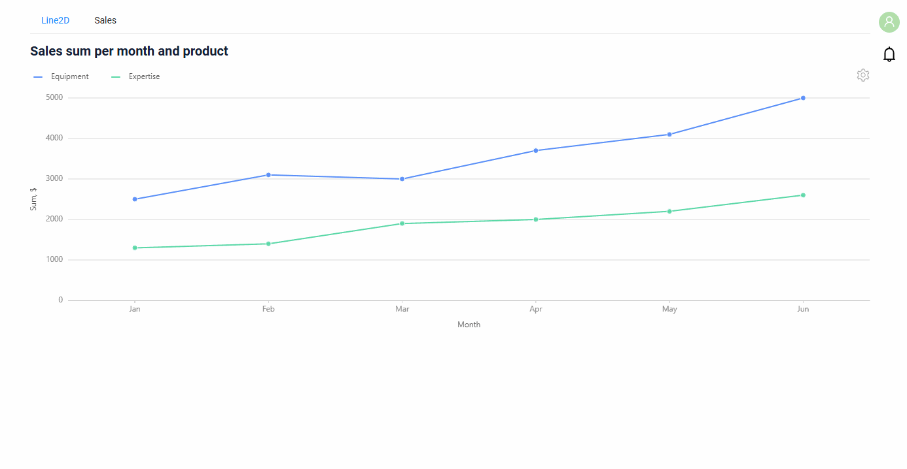

###### Как добавить? { #how-to-add_4 }
??? Example "Пример"
    **Шаг 1** Добавьте **drillDown** к полю X в **_.widget.json_**.
    ```json
    --8<--
    {{ external_links.github_raw_doc }}/widgets/line2d/drilldown/MyExample4248Line2D.widget.json
    --8<--
    ```
    **Шаг 2** Задайте целевое представление и фильтр в **buildRowDependentMeta** класса **Meta**.
    ```java
    --8<--
    {{ external_links.github_raw_doc }}/widgets/line2d/drilldown/MyExample4248Meta.java:buildRowDependentMeta
    --8<--
    ```
    **Шаг 3** Добавьте целевой виджет **List** и его view. У фильтруемых полей в DTO есть **@SearchParameter**.
    ```java
    --8<--
    {{ external_links.github_raw_doc }}/widgets/line2d/drilldown/MyExample4248ListDTO.java
    --8<--
    ```

    подробнее см. [DrillDown](/ru/advancedCustomization/element/drillDown/drillDown)

#### <a id="tablemode">Табличный режим</a>
[:material-play-circle: Живой пример]({{ external_links.code_samples }}/ui/#/screen/myexample4249){:target="_blank"} ·
[:fontawesome-brands-github: GitHub]({{ external_links.github_ui }}/{{ external_links.github_branch }}/src/main/java/org/demo/documentation/widgets/line2d/tablemode){:target="_blank"}

Иконка настроек виджета открывает меню `Mode` с вариантами `Chart` и `Table`. В табличном режиме виджет показывает записи
в виде таблицы с колонкой для каждого поля виджета (поля с типом `hidden` не отображаются).

###### Как это выглядит? { #how-does-it-look_5 }
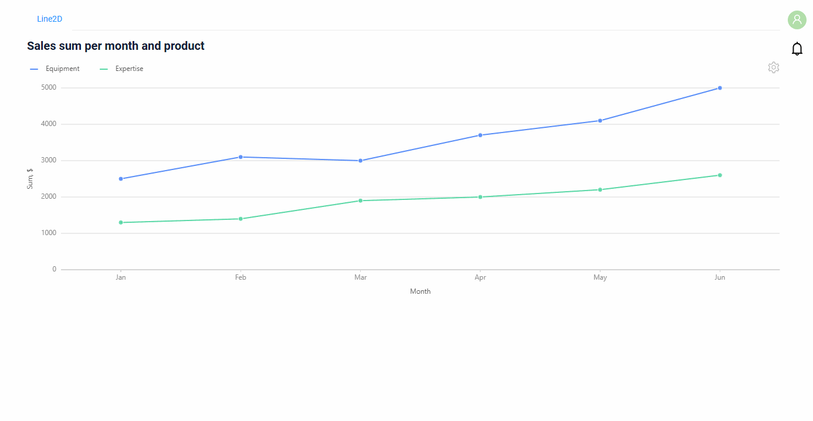

###### Как добавить? { #how-to-add_5 }
Табличный режим доступен всегда, ничего добавлять не нужно.

#### <a id="groups">Группы</a>
[:material-play-circle: Живой пример]({{ external_links.code_samples }}/ui/#/screen/myexample4243){:target="_blank"} ·
[:fontawesome-brands-github: GitHub]({{ external_links.github_ui }}/{{ external_links.github_branch }}/src/main/java/org/demo/documentation/widgets/line2d/groups){:target="_blank"}

`groupFieldKey` разделяет записи на линии: одна линия на значение поля. Значения отображаются в легенде.
Клик по значению легенды скрывает или показывает линию.

Без `groupFieldKey` у графика одна линия, а легенда показывает заголовок поля Y.

###### Как это выглядит? { #how-does-it-look_6 }
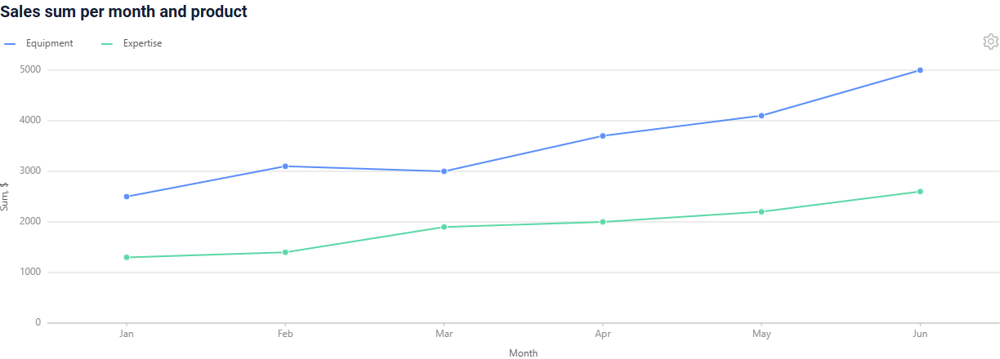

###### Как добавить? { #how-to-add_6 }
??? Example "Пример"
    **Шаг 1** Добавьте **groupFieldKey** в **options.chart2D** в **_.widget.json_**.
    DAO возвращает одну запись на значение X и группу.
    ```json
    --8<--
    {{ external_links.github_raw_doc }}/widgets/line2d/groups/MyExample4243Line2D.widget.json
    --8<--
    ```

#### <a id="stack">Стек</a>
[:material-play-circle: Живой пример]({{ external_links.code_samples }}/ui/#/screen/myexample4244){:target="_blank"} ·
[:fontawesome-brands-github: GitHub]({{ external_links.github_ui }}/{{ external_links.github_branch }}/src/main/java/org/demo/documentation/widgets/line2d/stack){:target="_blank"}

`stack: true` рисует линии одну поверх другой: точка линии — её значение плюс значения линий ниже.
Используйте вместе с `groupFieldKey`.

###### Как это выглядит? { #how-does-it-look_7 }
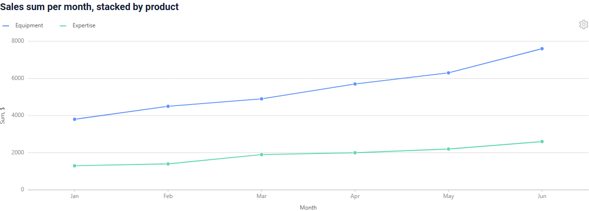

###### Как добавить? { #how-to-add_7 }
??? Example "Пример"
    **Шаг 1** Добавьте **stack** в **options.chart2D** в **_.widget.json_**.
    ```json
    --8<--
    {{ external_links.github_raw_doc }}/widgets/line2d/stack/MyExample4244Line2D.widget.json
    --8<--
    ```

#### <a id="axis">Масштаб и шаг осей</a>
[:material-play-circle: Живой пример]({{ external_links.code_samples }}/ui/#/screen/myexample4245){:target="_blank"} ·
[:fontawesome-brands-github: GitHub]({{ external_links.github_ui }}/{{ external_links.github_branch }}/src/main/java/org/demo/documentation/widgets/line2d/axis){:target="_blank"}

`yMin`, `yMax` задают диапазон оси Y, `yStep` — расстояние между подписями оси.
Без них диапазон берётся из данных.

`xMin`, `xMax`, `xStep` делают то же для оси X и работают, только когда поле X числового типа.
Для текстового поля X они игнорируются, и виджет выводит сообщение в консоль браузера.

###### Как это выглядит? { #how-does-it-look_8 }
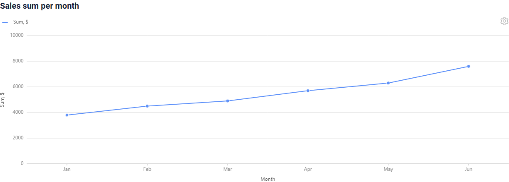

###### Как добавить? { #how-to-add_8 }
??? Example "Пример"
    **Шаг 1** Добавьте **yMin**, **yMax**, **yStep** в **options.chart2D** в **_.widget.json_**.
    ```json
    --8<--
    {{ external_links.github_raw_doc }}/widgets/line2d/axis/MyExample4245Line2D.widget.json
    --8<--
    ```

#### DualAxes2D
Виджет `Line2D` можно объединить с виджетом `Column2D` в одной области с помощью виджета `DualAxes2D`:
диаграммы используют общую ось X и могут иметь отдельные оси Y.

#### Настройка отображаемых колонок { #customization-of-displayed-columns }
в этом релизе **недоступно**.

#### Фильтрация { #filtration }
##### Основы { #basic }
[:material-play-circle: Живой пример]({{ external_links.code_samples }}/ui/#/screen/myexample4272){:target="_blank"} ·
[:fontawesome-brands-github: GitHub]({{ external_links.github_ui }}/{{ external_links.github_branch }}/src/main/java/org/demo/documentation/widgets/line2d/filtration){:target="_blank"}

Работает только в [табличном режиме](#tablemode): фильтры колонок отображаются для полей с `enableFilter` в Meta, как в виджете List.
В режиме графика фильтров нет. Виджет отправляет фильтр на бэкенд, и AnySource DAO графика применяет его сам. После возврата в режим графика он строится только по отфильтрованным записям. Режим графика не показывает, что фильтр применён: фильтр сбрасывается в табличном режиме.
подробнее см. [Фильтрация](/ru/widget/type/property/filtration/filtration/)

###### Как добавить? { #how-to-add_9 }
??? Example "Пример"
    Когда данные диаграммы поступают из AnySource DAO, DAO применяет фильтр сам.

    `Шаг 1` Добавьте **@SearchParameter** в соответствующий **DataResponseDTO**.
    ```java
    --8<--
    {{ external_links.github_raw_doc }}/widgets/line2d/filtration/MyExample4272DTO.java
    --8<--
    ```

    `Шаг 2` Добавьте **fields.enableFilter** в соответствующий **FieldMetaBuilder**.
    ```java
    --8<--
    {{ external_links.github_raw_doc }}/widgets/line2d/filtration/MyExample4272Meta.java:buildIndependentMeta
    --8<--
    ```

    `Шаг 3` Примените фильтр в **getList** AnySource DAO.
    ```java
    --8<--
    {{ external_links.github_raw_doc }}/widgets/line2d/filtration/MyExample4272Dao.java:getList
    --8<--
    ```

    [:material-play-circle: Живой пример]({{ external_links.code_samples }}/ui/#/screen/myexample4272){:target="_blank"} ·
    [:fontawesome-brands-github: GitHub]({{ external_links.github_ui }}/{{ external_links.github_branch }}/src/main/java/org/demo/documentation/widgets/line2d/filtration){:target="_blank"}

##### FullTextSearch
[:material-play-circle: Живой пример]({{ external_links.code_samples }}/ui/#/screen/myexample4273){:target="_blank"} ·
[:fontawesome-brands-github: GitHub]({{ external_links.github_ui }}/{{ external_links.github_branch }}/src/main/java/org/demo/documentation/widgets/line2d/fulltextsearch){:target="_blank"}

Работает только в [табличном режиме](#tablemode) при наличии `options.fullTextSearch` в **_.widget.json_**: поле поиска отображается над таблицей.
Виджет отправляет текст поиска на бэкенд, и AnySource DAO графика применяет его сам. После возврата в режим графика он строится только по отфильтрованным записям. Режим графика не показывает, что фильтр применён: фильтр сбрасывается в табличном режиме.
см. [FullTextSearch](/ru/widget/type/property/filtration/filtration/#by-fulltextsearch)

###### Как добавить? { #how-to-add_10 }
??? Example "Пример"
    Когда данные диаграммы поступают из AnySource DAO, DAO применяет поиск сам.

    `Шаг 1` Добавьте файл расширения FullTextSearchExt.java
    ```java
    import java.util.Optional;
    import jakarta.persistence.criteria.CriteriaBuilder;
    import jakarta.persistence.criteria.Path;
    import jakarta.persistence.criteria.Predicate;
    import lombok.NonNull;
    import lombok.experimental.UtilityClass;
    import org.apache.commons.lang3.StringUtils;
    import org.cxbox.core.crudma.bc.BusinessComponent;

    @UtilityClass
    public class FullTextSearchExt {

        @NonNull
        public static Optional<String> getFullTextSearchFilterParam(BusinessComponent bc) {
            return Optional.ofNullable(bc.getParameters().getParameter("_fullTextSearch"));
        }

        public static Predicate likeIgnoreCase(String value, CriteriaBuilder cb, Path<String> path) {
            return cb.like(cb.lower(path), StringUtils.lowerCase("%" + value + "%"));
        }

    }
    ```

    `Шаг 2` Примените текст поиска в **getList** AnySource DAO.
    ```java
    --8<--
    {{ external_links.github_raw_doc }}/widgets/line2d/fulltextsearch/MyExample4273Dao.java:getList
    --8<--
    ```

    `Шаг 3` Добавьте **fullTextSearch** в соответствующий **.widget.json**.

    `enabled` true/false

    `placeholder` — описание для fullTextSearch

    ```json
    --8<--
    {{ external_links.github_raw_doc }}/widgets/line2d/fulltextsearch/MyExample4273Line2D.widget.json
    --8<--
    ```

    [:material-play-circle: Живой пример]({{ external_links.code_samples }}/ui/#/screen/myexample4273){:target="_blank"} ·
    [:fontawesome-brands-github: GitHub]({{ external_links.github_ui }}/{{ external_links.github_branch }}/src/main/java/org/demo/documentation/widgets/line2d/fulltextsearch){:target="_blank"}

##### Персональная группа фильтров { #personal-filter-group }
в этом релизе **недоступно**: в меню настроек диаграммы есть только пункты `Mode`, поэтому пункта `Save filters` нет.
##### Группа фильтров { #filter-group }
[:material-play-circle: Живой пример]({{ external_links.code_samples }}/ui/#/screen/myexample4274){:target="_blank"} ·
[:fontawesome-brands-github: GitHub]({{ external_links.github_ui }}/{{ external_links.github_branch }}/src/main/java/org/demo/documentation/widgets/line2d/filtergroup){:target="_blank"}

Работает только в [табличном режиме](#tablemode): группы фильтров бизнес-компонента отображаются над таблицей, как в виджете List.
Виджет отправляет фильтр выбранной группы на бэкенд, и AnySource DAO диаграммы применяет его сам. После возврата в режим диаграммы она строится только по отфильтрованным записям. Режим диаграммы не показывает, что фильтр применён: фильтр сбрасывается в табличном режиме.
см. [Группа фильтров](/ru/widget/type/property/filtration/filtration/#by-filter-group)

###### Как добавить? { #how-to-add_11 }
??? Example "Пример"
    Когда данные диаграммы поступают из AnySource DAO, DAO сам применяет фильтр группы.

    !!! tips "Совет"
        Чтобы получить условия для колонки `filters`, выполните следующие шаги:

        * Добавьте функцию фильтрации для полей
        * Заполните нужные фильтры в интерфейсе.
        * Откройте панель разработчика.
        * Найдите нужный запрос.
        * Используйте часть этого запроса с фильтром как значение `filters`

        

    **Шаг 1** Добавьте бизнес-компонент в таблицу **BC_FILTER_GROUPS**

    ```csv
    name;bc;filters;ID
    Sum from 5000;myExampleBc4274;sum.greaterOrEqualThan=5000;
    Sum under 5000;myExampleBc4274;sum.lessThan=5000;
    ```

    **Шаг 2** Примените фильтр в **getList** AnySource DAO.
    ```java
    --8<--
    {{ external_links.github_raw_doc }}/widgets/line2d/filtergroup/MyExample4274Dao.java:getList
    --8<--
    ```

    [:material-play-circle: Живой пример]({{ external_links.code_samples }}/ui/#/screen/myexample4274){:target="_blank"} ·
    [:fontawesome-brands-github: GitHub]({{ external_links.github_ui }}/{{ external_links.github_branch }}/src/main/java/org/demo/documentation/widgets/line2d/filtergroup){:target="_blank"}

#### Пагинация { #pagination }
_неприменимо_: диаграмма показывает одну страницу, см. [Лимит страницы](#pagelimit).

#### Экспорт в Excel { #export-to-excel }
в этом релизе **недоступно**.

#### Множественная загрузка файлов { #multi-upload-files }
_неприменимо_

#### Сортировка { #sorting }
[:material-play-circle: Живой пример]({{ external_links.code_samples }}/ui/#/screen/myexample4275){:target="_blank"} ·
[:fontawesome-brands-github: GitHub]({{ external_links.github_ui }}/{{ external_links.github_branch }}/src/main/java/org/demo/documentation/widgets/line2d/sorting){:target="_blank"}

Работает только в [табличном режиме](#tablemode) для полей с `enableSort` в Meta.
Виджет отправляет сортировку на бэкенд, и AnySource DAO графика применяет её сам. После возврата в режим графика записи отображаются в отсортированном порядке.
подробнее см. [Сортировка](/ru/widget/type/property/sorting/sorting)

#### <a id="pagelimit">Лимит страницы</a>
[:material-play-circle: Живой пример]({{ external_links.code_samples }}/ui/#/screen/myexample4251){:target="_blank"} ·
[:fontawesome-brands-github: GitHub]({{ external_links.github_ui }}/{{ external_links.github_branch }}/src/main/java/org/demo/documentation/widgets/line2d/pagelimit){:target="_blank"}

Диаграмма строится только по первой странице бизнес-компонента. Если у бизнес-компонента больше записей, чем лимит страницы,
диаграмма не строится: виджет открывается в табличном режиме, режим `Chart` недоступен, а иконка предупреждения объясняет причину.

Задайте лимит страницы бизнес-компонента равным количеству точек, см. [Лимит записей на странице](/ru/widget/type/property/defaultlimitpage/defaultlimitpage).

###### Как это выглядит? { #how-does-it-look_9 }
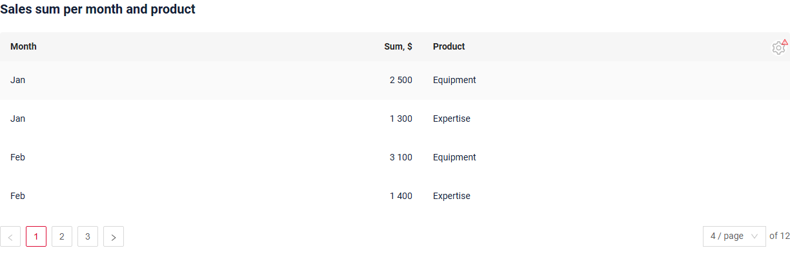

###### Как добавить? { #how-to-add_12 }
??? Example "Пример"
    **Шаг 1** Задайте лимит страницы в таблице **BC_PROPERTIES**. В примере он равен 4 для 12 точек.
    ```csv
    BC;PAGE_LIMIT;MASS_PAGE_LIMIT;SORT;FILTER;ID
    myExampleBc4251;4;NULL;NULL;'""';
    ```
    **Шаг 2** DAO возвращает страницу, запрошенную виджетом.
    ```java
    --8<--
    {{ external_links.github_raw_doc }}/widgets/line2d/pagelimit/MyExample4251Dao.java:getList
    --8<--
    ```

#### <a id="nodata">Нет данных</a>
[:material-play-circle: Живой пример]({{ external_links.code_samples }}/ui/#/screen/myexample4250){:target="_blank"} ·
[:fontawesome-brands-github: GitHub]({{ external_links.github_ui }}/{{ external_links.github_branch }}/src/main/java/org/demo/documentation/widgets/line2d/nodata){:target="_blank"}

Когда бизнес-компонент не возвращает записей, виджет показывает `No Data` вместо диаграммы.

###### Как это выглядит? { #how-does-it-look_10 }
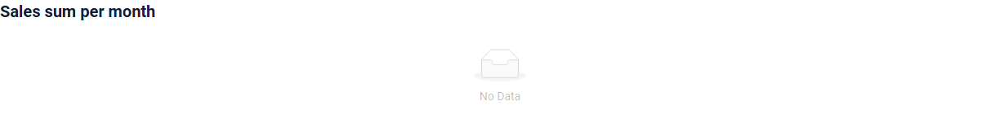

#### Родитель-потомок { #parent-child }
В режиме графика в этом релизе **недоступно**: клик по точке не выбирает запись, дочерние виджеты не меняются.
В табличном режиме клик по строке выбирает запись.
