# List
 
Виджет `List` выводит общую информацию по множеству записей и представляет её в удобном для пользователя виде.

## Основы { #basics }
[:material-play-circle: Живой пример]({{ external_links.code_samples }}/ui/#/screen/myexample3002){:target="_blank"} ·
[:fontawesome-brands-github: GitHub]({{ external_links.github_ui }}/{{ external_links.github_branch }}/src/main/java/org/demo/documentation/widgets/list/base){:target="_blank"}
### Как это выглядит? { #how-does-it-look }


###  <a id="Howtoaddbacis">Как добавить?</a>
??? Example "Пример"
    **Шаг 1** Создайте файл **_.widget.json_** с type = **"List"**
    Добавьте существующее поле в виджет списка. Подробнее см. [Поля](#fields)
    ```json
    --8<--
    {{ external_links.github_raw_doc }}/widgets/list/base/onefield/MyExample3189List.widget.json
    --8<--
    ```
 
    **Шаг 2** Добавьте виджет в соответствующий **_.view.json_**.

    ```json
    --8<--
    {{ external_links.github_raw_doc }}/widgets/list/base/onefield/myexample3189list.view.json
    --8<--
    ```

## <a id="Title">Заголовок</a>
[:material-play-circle: Живой пример]({{ external_links.code_samples }}/ui/#/screen/myexample3104){:target="_blank"} ·
[:fontawesome-brands-github: GitHub]({{ external_links.github_ui }}/{{ external_links.github_branch }}/src/main/java/org/demo/documentation/widgets/list/title){:target="_blank"}

### Базовый заголовок { #title-basic }
`Title` для виджета (необязательно)

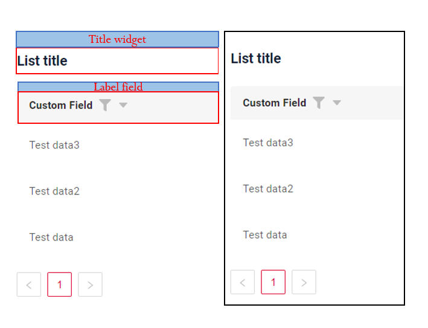    

Типы:

* `постоянный заголовок`: показывает постоянный текст.
* `пустой постоянный заголовок`: если нужно визуально связать виджеты, расположив их один под другим
 
#### Как это выглядит? { #how-does-it-look_1 }
=== "Постоянный заголовок"
    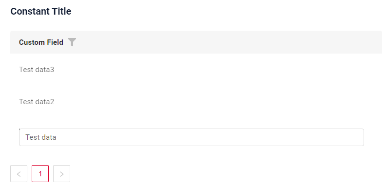
=== "Пустой постоянный заголовок"
    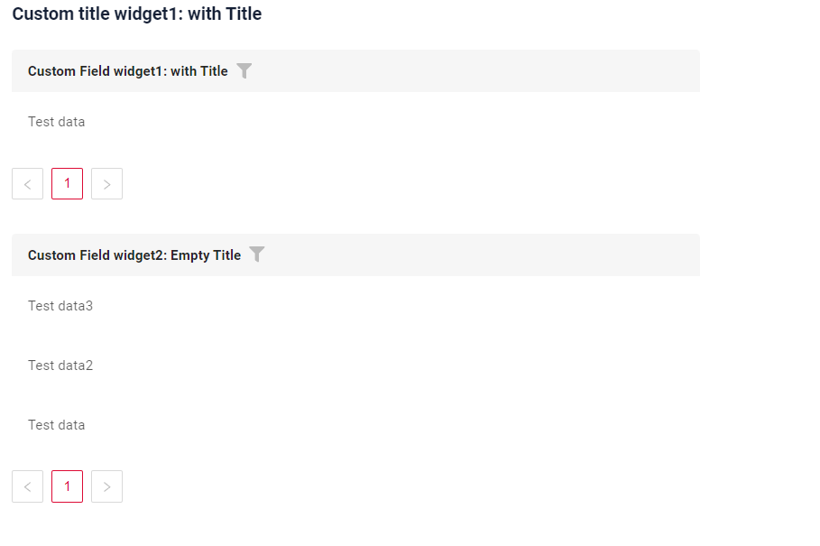
 
#### Как добавить? { #how-to-add }
??? Example "Пример"
    === "Постоянный заголовок"
        **Шаг 1** Добавьте название в **title** в **_.widget.json_**.
        ```json
        --8<--
        {{ external_links.github_raw_doc }}/widgets/list/title/MyExample3104List.widget.json
        --8<--
        ```
        [:material-play-circle: Живой пример]({{ external_links.code_samples }}/ui/#/screen/myexample3104){:target="_blank"} ·
        [:fontawesome-brands-github: GitHub]({{ external_links.github_ui }}/{{ external_links.github_branch }}/src/main/java/org/demo/documentation/widgets/list/title){:target="_blank"}


    === "Пустой постоянный заголовок"

        **Шаг 1** Удалите параметр **title** из **_.widget.json_**.
        ```json
        --8<--
        {{ external_links.github_raw_doc }}/widgets/list/title/MyExample3104EmptyTitle.widget.json
        --8<--
        ```

        [:material-play-circle: Живой пример]({{ external_links.code_samples }}/ui/#/screen/myexample3104){:target="_blank"} ·
        [:fontawesome-brands-github: GitHub]({{ external_links.github_ui }}/{{ external_links.github_branch }}/src/main/java/org/demo/documentation/widgets/list/title){:target="_blank"}


### Цвет заголовка { #title-color }
`Title Color` позволяет задать цвет заголовка. Он может быть постоянным или вычисляемым.

**Постоянный цвет**

[:material-play-circle: Живой пример]({{ external_links.code_samples }}/ui/#/screen/myexample3050/view/myexample3050listcolorconst){:target="_blank"} ·
[:fontawesome-brands-github: GitHub]({{ external_links.github_ui }}/{{ external_links.github_branch }}/src/main/java/org/demo/documentation/widgets/list/colortitle){:target="_blank"}

*Постоянный цвет* — фиксированный цвет, который не меняется. Он остаётся одинаковым независимо от каких-либо факторов в приложении.

**Вычисляемый цвет**

[:material-play-circle: Живой пример]({{ external_links.code_samples }}/ui/#/screen/myexample3050/view/myexample3050list){:target="_blank"} ·
[:fontawesome-brands-github: GitHub]({{ external_links.github_ui }}/{{ external_links.github_branch }}/src/main/java/org/demo/documentation/widgets/list/colortitle){:target="_blank"}

*Вычисляемый цвет* можно использовать для динамического изменения цвета заголовка. Он меняется в зависимости от бизнес-логики или данных приложения.

!!! info
    Цветовое выделение заголовка **применимо** к следующим [полям](/ru/widget/fields/fieldtypes/): date, dateTime, dateTimeWithSeconds, number, money, percent, time, input, text, dictionary, radio, checkbox, pickList, inlinePickList, multivalue, multivalueHover.

##### Как это выглядит? { #how-does-it-look_2 }
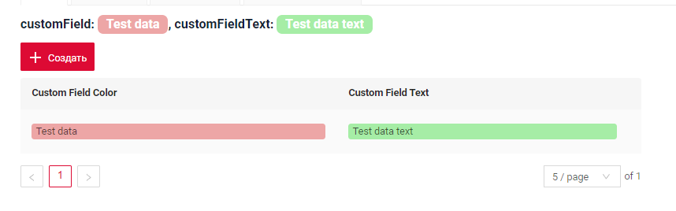

##### Как добавить? { #how-to-add_1 }
??? Example "Пример"
    === "Вычисляемый цвет"

        **Шаг 1**   Добавьте `собственное поле для цвета` в соответствующий **DataResponseDTO**. Поле может содержать цвет в формате HEX или быть null.
        ```java
        --8<--
        {{ external_links.github_raw_doc }}/widgets/list/colortitle/MyExample3050DTO.java:colorDTO
        --8<--
        ```  
 
        **Шаг 2** Добавьте **"bgColorKey"** :  `собственное поле для цвета` в .widget.json.

        Добавьте в `title` поле с `${customField}`

        ```json
        --8<--
        {{ external_links.github_raw_doc }}/widgets/list/colortitle/MyExample3050.widget.json
        --8<--
        ``` 

        [:material-play-circle: Живой пример]({{ external_links.code_samples }}/ui/#/screen/myexample3050/view/myexample3050list){:target="_blank"} ·
        [:fontawesome-brands-github: GitHub]({{ external_links.github_ui }}/{{ external_links.github_branch }}/src/main/java/org/demo/documentation/widgets/list/colortitle){:target="_blank"}

    === "Постоянный цвет"
 
        Добавьте **"bgColor"** :  `цвет HEX` в .widget.json.

        Добавьте в `title` поле с `${customField}`

        ```json
        --8<--
        {{ external_links.github_raw_doc }}/widgets/list/colortitle/MyExample3050ColorConst.widget.json
        --8<--
        ```

        [:material-play-circle: Живой пример]({{ external_links.code_samples }}/ui/#/screen/myexample3050/view/myexample3050listcolorconst){:target="_blank"} ·
        [:fontawesome-brands-github: GitHub]({{ external_links.github_ui }}/{{ external_links.github_branch }}/src/main/java/org/demo/documentation/widgets/list/colortitle){:target="_blank"}

## <a id="bc">Бизнес-компонент</a>
Указывает бизнес-компонент (BC), к которому относится эта форма.
Бизнес-компонент представляет определённую часть системы, отвечающую за конкретную бизнес-логику или данные.

подробнее см. [Бизнес-компонент](/ru/environment/businesscomponent/businesscomponent/)

## <a id="Showcondition">Условие отображения</a>

* `без условия отображения — рекомендуется`: виджет виден всегда

  [:material-play-circle: Живой пример]({{ external_links.code_samples }}/ui/#/screen/myexample3002){:target="_blank"} ·
  [:fontawesome-brands-github: GitHub]({{ external_links.github_ui }}/{{ external_links.github_branch }}/src/main/java/org/demo/documentation/widgets/list/base){:target="_blank"}

* `условие отображения по текущей сущности`: условие может содержать логическое выражение, зависящее от полей текущей сущности. Обновление полей вызывает пересчёт условия только при сохранении или если поле force active

  [:material-play-circle: Живой пример]({{ external_links.code_samples }}/ui/#/screen/myexample3101){:target="_blank"} ·
  [:fontawesome-brands-github: GitHub]({{ external_links.github_ui }}/{{ external_links.github_branch }}/src/main/java/org/demo/documentation/widgets/list/showcondition/bycurrententity){:target="_blank"}

* `условие отображения по родительской сущности`: условие может содержать логическое выражение, зависящее от родительской сущности. Обновление полей родителя вызывает пересчёт условия только при сохранении или если поле force active и отображается на том же view

  [:material-play-circle: Живой пример]({{ external_links.code_samples }}/ui/#/screen/myexample3101/view/myexample3106showcond){:target="_blank"} ·
  [:fontawesome-brands-github: GitHub]({{ external_links.github_ui }}/{{ external_links.github_branch }}/src/main/java/org/demo/documentation/widgets/list/showcondition/byparententity){:target="_blank"}

!!! tips "Совет"
    По возможности рекомендуется не использовать `Show condition`, так как широкое применение этой возможности усложняет поддержку приложения.

#### <a id="howdoesitlook">Как это выглядит?</a>
=== "без условия отображения"
    
=== "условие отображения по текущей сущности"
    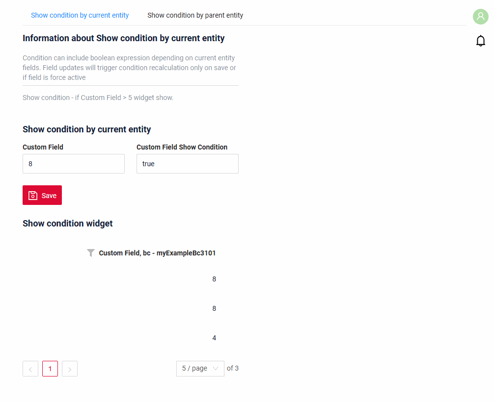
=== "условие отображения по родительской сущности"
    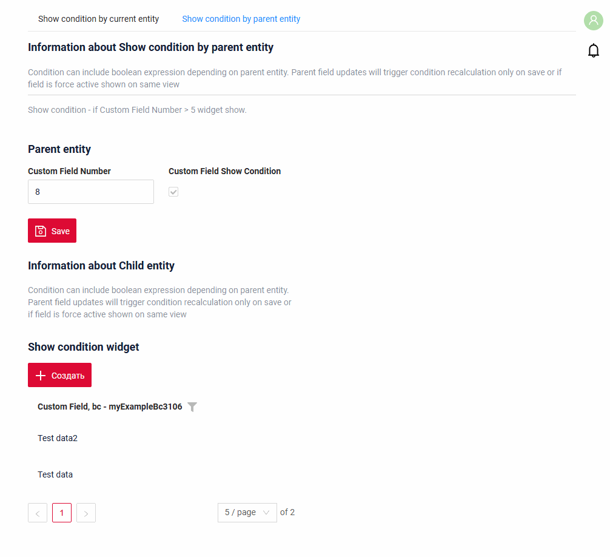

#### <a id="howtoadd">Как добавить?</a>
??? Example "Пример"

    === "без условия отображения"
        см. [Основы](#Howtoaddbacis)

    === "условие отображения по текущей сущности"
        **Шаг 1** Добавьте **showCondition** в **_.widget.json_**. Подробнее см. [showCondition](/ru/widget/type/property/showcondition/showcondition)
        ```json
        --8<--
        {{ external_links.github_raw_doc }}/widgets/list/showcondition/bycurrententity/MyExample31012.widget.json
        --8<--
        ```

    === "условие отображения по родительской сущности"
        **Шаг 1** Добавьте **showCondition** в **_.widget.json_**. Подробнее см. [showCondition](/ru/widget/type/property/showcondition/showcondition)
        ```json
        --8<--
        {{ external_links.github_raw_doc }}/widgets/list/showcondition/byparententity/MyExample3106child.widget.json
        --8<--
        ```

## <a id="fields">Поля</a>
Настройка полей. Массив fields определяет отдельные поля формы.

```json
{
    "title": "Custom Field",
    "key": "customField",
    "type": "input"
}
```

* **"title"**

  Описание: заголовок поля.
  
  Тип: String (необязательно).
  
* **"key"**
  
    Описание: имя поля в соответствующем DataResponseDTO.
  
    Тип: String (обязательно).
  
* **"type"**
  
  Описание: [Типы полей](/ru/widget/fields/fieldtypes/)
  
  Тип: String (обязательно).


### Как добавить? { #how-to-add_2 }
??? Example "Пример"

    === "С плагином (рекомендуется)"
        **Шаг 1** Скачайте плагин
            [скачать плагин для IntelliJ](https://doc.cxbox.org/ru/plugin/plugininstalling)
    
        **Шаг 2** Добавьте существующее поле в существующий виджет формы
            
    === "Пример написания кода"
        Добавьте поле в **_.widget.json_**.

          ```json
             --8<--
             {{ external_links.github_raw_doc }}/widgets/list/base/onefield/MyExample3189List.widget.json
             --8<--
          ```

## <a id="Fieldslayout">Компоновка (options layout)</a>
**options.layout** — в этом типе не используется.


## Действия { #actions }
`Actions` отображают доступные действия в виде отдельных кнопок, подробнее см. [Действия](/ru/features/element/actions/actions).

Для виджета List есть несколько действий.
#### Создание { #create }
Кнопка `Create` позволяет создать новое значение нажатием кнопки `Add`. Это действие можно выполнить тремя разными способами — выбирайте любой в зависимости от логики приложения:

Есть три способа создать запись:

* [Inline](#createinline): строку можно добавить напрямую.

!!! info
    Пагинация не сработает, пока страница не будет обновлена после добавления записей.

* [Inline-form](#withwidget): данные можно добавить с помощью виджета формы, не покидая текущий view.

* [With view](#withview): запись можно создать, перейдя в отдельный view.

##### <a id="createinline">Inline</a>
[:material-play-circle: Живой пример]({{ external_links.code_samples }}/ui/#/screen/myexample3059){:target="_blank"} ·
[:fontawesome-brands-github: GitHub]({{ external_links.github_ui }}/{{ external_links.github_branch }}/src/main/java/org/demo/documentation/widgets/list/actions/create/basic){:target="_blank"}

При `Line Addition` по нажатию кнопки "Add" вверху виджета списка сразу добавляется новая пустая строка. Это быстрый способ добавлять строки без предварительного ввода данных.
###### Как это выглядит? { #how-does-it-look_3 }
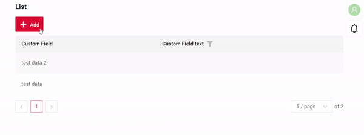

###### Как добавить? { #how-to-add_3 }
??? Example "Пример"
    
    **Шаг 1** Добавьте кнопку `create` в соответствующий **VersionAwareResponseService**.
    ```java
    --8<--
    {{ external_links.github_raw_doc }}/widgets/list/actions/create/basic/MyExample3059Service.java:getActions
    --8<--
    ```
     **Шаг 2** Добавьте кнопку `create` в соответствующий **.widget.json**.
    ```json
    --8<--
    {{ external_links.github_raw_doc }}/widgets/list/actions/create/basic/MyExample3059List.widget.json
    --8<--
    ```
     **Шаг 3** Добавьте **fields.setEnabled** в соответствующий **FieldMetaBuilder**.
    ```java
    --8<--
    {{ external_links.github_raw_doc }}/widgets/list/actions/create/basic/MyExample3059Meta.java:buildRowDependentMeta
    --8<--
    ```
    [:material-play-circle: Живой пример]({{ external_links.code_samples }}/ui/#/screen/myexample3059){:target="_blank"} ·
    [:fontawesome-brands-github: GitHub]({{ external_links.github_ui }}/{{ external_links.github_branch }}/src/main/java/org/demo/documentation/widgets/list/actions/create/basic){:target="_blank"}

##### <a id="withwidget">Inline-form</a> 
[:material-play-circle: Живой пример]({{ external_links.code_samples }}/ui/#/screen/myexample3064){:target="_blank"} ·
[:fontawesome-brands-github: GitHub]({{ external_links.github_ui }}/{{ external_links.github_branch }}/src/main/java/org/demo/documentation/widgets/list/actions/create/withwidget){:target="_blank"}

`Create with widget` открывает дополнительный виджет при нажатии кнопки "Add". Форма появляется на том же экране, поэтому видны и список сущностей, и форма добавления новой строки.
После заполнения информации и нажатия "Save" новая строка добавляется в List.
###### Как это выглядит? { #how-does-it-look_4 }
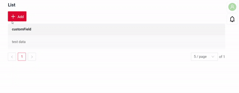

###### Как добавить? { #how-to-add_4 }
??? Example "Пример"

    **Шаг 1** Добавьте кнопку `create` в соответствующий **VersionAwareResponseService**.
    ```java
    --8<--
    {{ external_links.github_raw_doc }}/widgets/list/actions/create/withwidget/MyExample3064Service.java:getActions
    --8<--
    ```
    **Шаг 2** Добавьте **fields.setEnabled** в соответствующий **FieldMetaBuilder**.
    ```java
    --8<--
    {{ external_links.github_raw_doc }}/widgets/list/actions/create/withwidget/MyExample3064Meta.java:buildRowDependentMeta
    --8<--
    ```

     **Шаг 3** Создайте widget.json с типом `Form`, который появляется при нажатии кнопки
    ```json
    --8<--
    {{ external_links.github_raw_doc }}/widgets/list/actions/create/withwidget/myEntity3064CreateForm.widget.json
    --8<--
    ```
 
     **Шаг 4** Добавьте widget.json с типом `Form` в соответствующий **.view.json**.
    ```json
    --8<--
    {{ external_links.github_raw_doc }}/widgets/list/actions/create/withwidget/myexample3064list.view.json
    --8<--
    ```

     **Шаг 5** Добавьте кнопку `create` и виджет с типом `Form` в соответствующий **.widget.json**.
       
    `options`.`create`: имя виджета, который появляется при нажатии кнопки
        
    ```json
    --8<--
    {{ external_links.github_raw_doc }}/widgets/list/actions/create/withwidget/MyExample3064List.widget.json
    --8<--
    ```

    [:material-play-circle: Живой пример]({{ external_links.code_samples }}/ui/#/screen/myexample3064){:target="_blank"} ·
    [:fontawesome-brands-github: GitHub]({{ external_links.github_ui }}/{{ external_links.github_branch }}/src/main/java/org/demo/documentation/widgets/list/actions/create/withwidget){:target="_blank"}

##### <a id="withview">With view</a>
[:material-play-circle: Живой пример]({{ external_links.code_samples }}/ui/#/screen/myexample3066){:target="_blank"} ·
[:fontawesome-brands-github: GitHub]({{ external_links.github_ui }}/{{ external_links.github_branch }}/src/main/java/org/demo/documentation/widgets/list/actions/create/newview){:target="_blank"}

При `Create with view` нажатие кнопки "Add" открывает отдельный view, отображающий только форму ввода данных. После заполнения формы и сохранения система возвращается к списку сущностей с добавленной новой строкой.
###### Как это выглядит? { #how-does-it-look_5 }
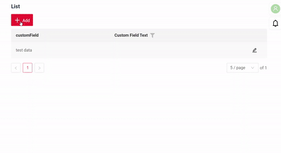

###### Как добавить? { #how-to-add_5 }
??? Example "Пример"

    **Шаг 1** Добавьте кнопку `create` в соответствующий **VersionAwareResponseService**.
    ```java
    --8<--
    {{ external_links.github_raw_doc }}/widgets/list/actions/create/newview/MyExample3066Service.java:getActions
    --8<--
    ```
     **Шаг 2** Добавьте **PostAction.drillDown** в метод **doCreateEntity** соответствующего **VersionAwareResponseService**.
    ```java
    --8<--
    {{ external_links.github_raw_doc }}/widgets/list/actions/create/newview/MyExample3066Service.java:doCreateEntity
    --8<--
    ```
    **Шаг 3** Добавьте кнопку `create` в соответствующий **.widget.json**.
  
    ```json
    --8<--
    {{ external_links.github_raw_doc }}/widgets/list/actions/create/newview/MyExample3066List.widget.json
    --8<--
    ```

    [:material-play-circle: Живой пример]({{ external_links.code_samples }}/ui/#/screen/myexample3066){:target="_blank"} ·
    [:fontawesome-brands-github: GitHub]({{ external_links.github_ui }}/{{ external_links.github_branch }}/src/main/java/org/demo/documentation/widgets/list/actions/create/newview){:target="_blank"}


#### Редактирование { #edit }
`Edit` позволяет изменить значение поля. Как и для кнопки `Create`, это действие можно реализовать тремя способами.

Есть три способа создать запись:

* [Inline edit](#editline): строку можно редактировать напрямую.

* [Inline-form](#editwithwidget): данные можно редактировать с помощью виджета формы, не покидая текущий view.

* [With view](#editwithview): запись можно отредактировать, перейдя в отдельный view.

##### <a id="editline">Inline-редактирование </a>
[:material-play-circle: Живой пример]({{ external_links.code_samples }}/ui/#/screen/myexample3700){:target="_blank"} ·
[:fontawesome-brands-github: GitHub]({{ external_links.github_ui }}/{{ external_links.github_branch }}/src/main/java/org/demo/documentation/widgets/list/actions/edit/basic){:target="_blank"}


`Edit Inline` означает inline-редактирование. Дважды щёлкните по значению, которое нужно изменить.
###### Как это выглядит? { #how-does-it-look_6 }
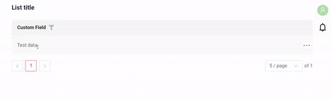

###### Как добавить? { #how-to-add_6 }
??? Example "Пример"

    **Шаг 1** Добавьте **fields.setEnabled** в соответствующий **FieldMetaBuilder**.
    ```java
    --8<--
    {{ external_links.github_raw_doc }}/widgets/list/actions/edit/basic/MyExample3700Meta.java:buildRowDependentMeta
    --8<--
    ```
 
    [:material-play-circle: Живой пример]({{ external_links.code_samples }}/ui/#/screen/myexample3700){:target="_blank"} ·
    [:fontawesome-brands-github: GitHub]({{ external_links.github_ui }}/{{ external_links.github_branch }}/src/main/java/org/demo/documentation/widgets/list/actions/edit/basic){:target="_blank"}

##### <a id="editwithwidger">Inline-form</a>
[:material-play-circle: Живой пример]({{ external_links.code_samples }}/ui/#/screen/myexample3065){:target="_blank"} ·
[:fontawesome-brands-github: GitHub]({{ external_links.github_ui }}/{{ external_links.github_branch }}/src/main/java/org/demo/documentation/widgets/list/actions/edit/withwidget){:target="_blank"}

`Edit with widget` открывает дополнительный виджет при нажатии на иконку редактирования в строке.

###### Как это выглядит? { #how-does-it-look_7 }
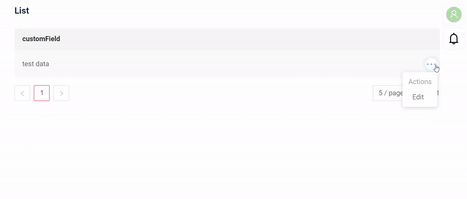

###### Как добавить? { #how-to-add_7 }
??? Example "Пример"

    **Шаг 1** Добавьте действие `save` в соответствующий **VersionAwareResponseService**: с его помощью форма сохраняет запись.
    ```java
    --8<--
    {{ external_links.github_raw_doc }}/widgets/list/actions/edit/withwidget/MyExample3065Service.java:getActions
    --8<--
    ```

    **Шаг 2** Добавьте **fields.setEnabled** в соответствующий **FieldMetaBuilder**.
    ```java
    --8<--
    {{ external_links.github_raw_doc }}/widgets/list/actions/edit/withwidget/MyExample3065Meta.java:buildRowDependentMeta
    --8<--
    ```
 
    **Шаг 3**  Создайте widget.json с типом `Form`, который появляется при нажатии кнопки
    ```json
    --8<--
    {{ external_links.github_raw_doc }}/widgets/list/actions/edit/withwidget/myEntity3065EditForm.widget.json
    --8<--
    ```
 
     **Шаг 4** Добавьте widget.json с типом `Form` в соответствующий **.view.json**.
    ```json
    --8<--
    {{ external_links.github_raw_doc }}/widgets/list/actions/edit/withwidget/myexample3065list.view.json
    --8<--
    ```

     **Шаг 5** Добавьте виджет с типом `Form` в **options**.**edit**.**widget** соответствующего **.widget.json**: в каждой строке появится иконка редактирования.
       
    `options`.`edit`: имя виджета, который появляется при нажатии кнопки
        
    ```json
    --8<--
    {{ external_links.github_raw_doc }}/widgets/list/actions/edit/withwidget/MyExample3065List.widget.json
    --8<--
    ```

    [:material-play-circle: Живой пример]({{ external_links.code_samples }}/ui/#/screen/myexample3065){:target="_blank"} ·
    [:fontawesome-brands-github: GitHub]({{ external_links.github_ui }}/{{ external_links.github_branch }}/src/main/java/org/demo/documentation/widgets/list/actions/edit/withwidget){:target="_blank"}

##### <a id="editwithview">With view</a>
[:material-play-circle: Живой пример]({{ external_links.code_samples }}/ui/#/screen/myexample3075){:target="_blank"} ·
[:fontawesome-brands-github: GitHub]({{ external_links.github_ui }}/{{ external_links.github_branch }}/src/main/java/org/demo/documentation/widgets/list/actions/edit/newview){:target="_blank"}

При `Edit with view` сущность можно редактировать в отдельном view, отображающем только форму ввода данных. Выберите пункт "Edit" в меню с тремя точками.

###### Как это выглядит? { #how-does-it-look_8 }
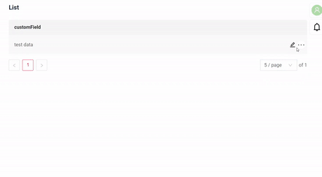

###### Как добавить? { #how-to-add_8 }
??? Example "Пример"

    **Шаг 1** Добавьте действие *edit* в соответствующий **VersionAwareResponseService**.
    
    Добавьте **PostAction.drillDown** в метод *edit*

    ```java
    --8<--
    {{ external_links.github_raw_doc }}/widgets/list/actions/edit/newview/MyExample3075Service.java:getActions
    --8<--
    ```
    **Шаг 2** Добавьте кнопку или группу кнопок в соответствующий **.widget.json**.
   
    ```json
    --8<--
    {{ external_links.github_raw_doc }}/widgets/list/actions/edit/newview/MyExample3075List.widget.json
    --8<--
    ```
    [:material-play-circle: Живой пример]({{ external_links.code_samples }}/ui/#/screen/myexample3075){:target="_blank"} ·
    [:fontawesome-brands-github: GitHub]({{ external_links.github_ui }}/{{ external_links.github_branch }}/src/main/java/org/demo/documentation/widgets/list/actions/edit/newview){:target="_blank"}


### Дополнительные свойства { #additional-properties }
#### Настройка отображаемых колонок { #customization-of-displayed-columns }
[:material-play-circle: Живой пример]({{ external_links.code_samples }}/ui/#/screen/myexample3135){:target="_blank"} ·
[:fontawesome-brands-github: GitHub]({{ external_links.github_ui }}/{{ external_links.github_branch }}/src/main/java/org/demo/documentation/widgets/list/customizationcolumns){:target="_blank"}
 
Для настройки колонок, отображаемых в виджете списка, доступны два основных действия:

* Скрыть колонки
* Поменять колонки местами
 
!!! info
    Сейчас данные настройки таблицы хранятся во внутренних таблицах, даже если используются микросервисы.

###### Основы { #basic }
При настройке колонок записи вставляются в таблицу ADDITIONAL_FIELDS.
Таблица *ADDITIONAL_FIELDS* для хранения пользовательских настроек:

 * `user_id`: ID пользователя, для которого настраиваются колонки.
 * `view`: имя view, в котором настраиваются колонки.
 * `widget`: имя виджета, в котором настраиваются колонки.
 * `order_fields`: при перестановке колонок последовательность полей обновляется и сохраняется новая последовательность полей через запятую.
 * `added_to_additional_fields`: поля, скрытые пользователем.
 * `removed_from_additional_fields`: список полей, которые изначально были скрыты для пользователя, но затем сделаны видимыми.
   Когда пользователь открывает виджет и выбирает отображение ранее скрытых полей, эти поля записываются в эту колонку.

###### Как это выглядит? { #how-does-it-look_9 }
=== "Скрыть колонки"
    
=== "Поменять колонки местами"
    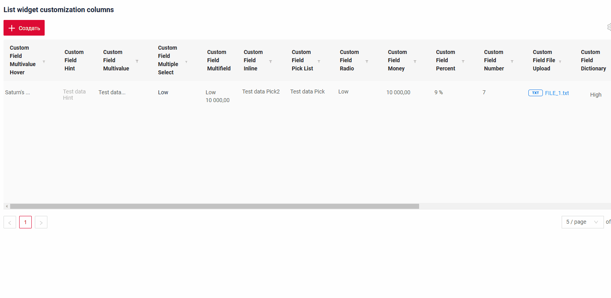
=== "Изначально скрытые"
    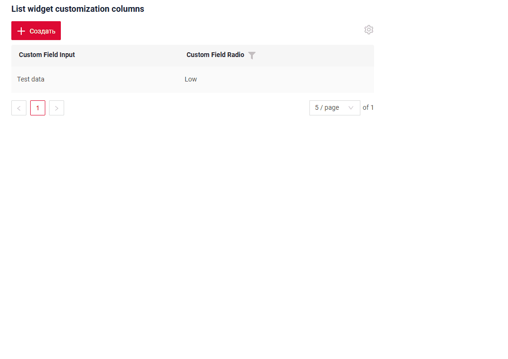

###### Как добавить? { #how-to-add_9 }
??? Example "Пример"
    === "Скрыть и поменять колонки местами"
    
        Добавьте в **options** параметр **additional** в соответствующий **.widget.json**.
            
        ```
        "additional": {
          "enabled": true
        }
        ```
        
        ```json
        --8<--
        {{ external_links.github_raw_doc }}/widgets/list/customizationcolumns/MyExample3135List.widget.json
        --8<--
        ```
        
        [:material-play-circle: Живой пример]({{ external_links.code_samples }}/ui/#/screen/myexample3135){:target="_blank"} ·
        [:fontawesome-brands-github: GitHub]({{ external_links.github_ui }}/{{ external_links.github_branch }}/src/main/java/org/demo/documentation/widgets/list/customizationcolumns){:target="_blank"}
        

    === "Изначально скрытые колонки"
        
        Также можно задать изначально скрытые колонки — они будут скрыты при открытии виджета.
        
        Добавьте в **options** параметр **additional** в соответствующий **.widget.json**.
        
        Добавьте в **options** параметр **fields** со списком скрытых полей в соответствующий **.widget.json**.
            
        ```
           "additional": {
              "fields": ["customFieldPercent", "customFieldRadio"],
              "enabled": true
            }
        ```
        
        ```json
        --8<--
        {{ external_links.github_raw_doc }}/widgets/list/customizationcolumns/MyExample3135ListHiddenFields.widget.json
        --8<--
        ```
        
        [:material-play-circle: Живой пример]({{ external_links.code_samples }}/ui/#/screen/myexample3135/view/myexample3135listhidden){:target="_blank"} ·
        [:fontawesome-brands-github: GitHub]({{ external_links.github_ui }}/{{ external_links.github_branch }}/src/main/java/org/demo/documentation/widgets/list/customizationcolumns){:target="_blank"}

###### Обработка старых записей { #handling-old-records }
`Delete fields with widget`

Если поля, сохранённые в таблице дополнительных настроек, удалены из виджета, функциональность продолжает работать корректно, игнорируя эти старые поля.
#### Фильтрация { #filtration }
##### Основы { #basic_1 }
подробнее см. [Поля](/ru/widget/type/property/filtration/filtration/)

###### Как это выглядит? { #how-does-it-look_10 }
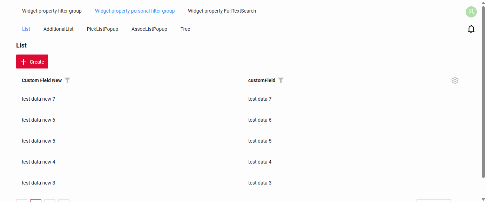

###### Как добавить? { #how-to-add_10 }
??? Example "Пример"
    `Шаг 1` Добавьте **@SearchParameter** в соответствующий **DataResponseDTO**.
    ```java
    --8<--
    {{ external_links.github_raw_doc }}/widgets/property/filtration/filtergroup/MyExample3616DTO.java
    --8<--
    ```

    `Шаг 2` Добавьте **fields.enableFilter** в соответствующий **FieldMetaBuilder**.
    ```java
    --8<--
    {{ external_links.github_raw_doc }}/widgets/property/filtration/filtergroup/MyExample3616Meta.java:buildIndependentMeta
    --8<--
    ```

    [:material-play-circle: Живой пример]({{ external_links.code_samples }}/ui/#/screen/myexample3616/view/myexample3616list){:target="_blank"} ·
    [:fontawesome-brands-github: GitHub]({{ external_links.github_ui }}/{{ external_links.github_branch }}/src/main/java/org/demo/documentation/widgets/property/filtration/filtergroup){:target="_blank"}

##### FullTextSearch
`FullTextSearch` — когда пользователь вводит текст в поле полнотекстового поиска, виджет фильтрует строки, соответствующие запросу.
см. [FullTextSearch](/ru/widget/type/property/filtration/filtration/#by-fulltextsearch)

###### Как это выглядит? { #how-does-it-look_11 }
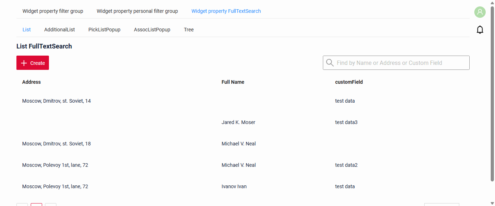

###### Как добавить? { #how-to-add_11 }
??? Example "Пример"
    `Шаг 1` Добавьте файл расширения FullTextSearchExt.java
    ```java
    import java.util.Optional;
    import jakarta.persistence.criteria.CriteriaBuilder;
    import jakarta.persistence.criteria.Path;
    import jakarta.persistence.criteria.Predicate;
    import lombok.NonNull;
    import lombok.experimental.UtilityClass;
    import org.apache.commons.lang3.StringUtils;
    import org.cxbox.core.crudma.bc.BusinessComponent;

    @UtilityClass
    public class FullTextSearchExt {

        @NonNull
        public static Optional<String> getFullTextSearchFilterParam(BusinessComponent bc) {
            return Optional.ofNullable(bc.getParameters().getParameter("_fullTextSearch"));
        }

        public static Predicate likeIgnoreCase(String value, CriteriaBuilder cb, Path<String> path) {
            return cb.like(cb.lower(path), StringUtils.lowerCase("%" + value + "%"));
        }

    }
    ```

    `Шаг 2` Добавьте **specifications** для полей полнотекстового поиска в соответствующий **JpaRepository**.
    ```java
    --8<--
    {{ external_links.github_raw_doc }}/widgets/property/filtration/fulltextsearch/MyEntity3614Repository.java
    --8<--
    ```

    `Шаг 3` Добавьте **getSpecification** в соответствующий **VersionAwareResponseService**.
    ```java
    --8<--
    {{ external_links.github_raw_doc }}/widgets/property/filtration/fulltextsearch/MyExample3614Service.java:getSpecification
    --8<--
    ```

    `Шаг 4` Добавьте **fullTextSearch** в соответствующий **.widget.json**.

    `enabled` true/false

    `placeholder` — описание для fullTextSearch

    ```json
    --8<--
    {{ external_links.github_raw_doc }}/widgets/property/filtration/fulltextsearch/MyExample3614List.widget.json
    --8<--
    ```

    [:material-play-circle: Живой пример]({{ external_links.code_samples }}/ui/#/screen/myexample3616/view/myexample3614list){:target="_blank"} ·
    [:fontawesome-brands-github: GitHub]({{ external_links.github_ui }}/{{ external_links.github_branch }}/src/main/java/org/demo/documentation/widgets/property/filtration/fulltextsearch){:target="_blank"}

##### Персональная группа фильтров { #personal-filter-group }
Заполненный пользователем фильтр можно сохранить для каждого отдельного пользователя.
см. [Персональная группа фильтров](/ru/widget/type/property/filtration/filtration/#by-personal-filter-group)

###### Как это выглядит? { #how-does-it-look_12 }


###### Как добавить? { #how-to-add_12 }
??? Example "Пример"
    Доступность фильтрации зависит от типа поля. Подробнее см. [типы полей](/ru/widget/fields/fieldtypes/)

    Для полей, по которым нужно сохранять индивидуальные фильтры, обязательно настройте параметры фильтрации. См. `Шаг 1` и `Шаг 2`

    **Шаг 1** Добавьте **@SearchParameter** в соответствующий **DataResponseDTO**. (Расширенная настройка [SearchParameter](/ru/advancedCustomization/element/searchparameter/searchparameter))
    ```java
    --8<--
    {{ external_links.github_raw_doc }}/widgets/property/filtration/filtergroup/MyExample3616DTO.java
    --8<--
    ```

    **Шаг 2**  Добавьте **fields.enableFilter** в соответствующий **FieldMetaBuilder**.
    ```java
    --8<--
    {{ external_links.github_raw_doc }}/widgets/property/filtration/filtergroup/MyExample3616Meta.java:buildIndependentMeta
    --8<--
    ```

    **Шаг 3** Добавьте **filterSetting** в соответствующий **.widget.json**.

    `enabled` true/false

    ```json
    --8<--
    {{ external_links.github_raw_doc }}/widgets/property/filtration/filtergroup/MyExample3616List.widget.json
    --8<--
    ```

    [:material-play-circle: Живой пример]({{ external_links.code_samples }}/ui/#/screen/myexample3616/view/myexample3616list){:target="_blank"} ·
    [:fontawesome-brands-github: GitHub]({{ external_links.github_ui }}/{{ external_links.github_branch }}/src/main/java/org/demo/documentation/widgets/property/filtration/filtergroup){:target="_blank"}

##### Группа фильтров { #filter-group }
`Filter group` — предопределённые настройки фильтров, которые пользователи могут применять в приложении. Они позволяют быстро применить определённые критерии фильтрации без ручного ввода.
см. [Группа фильтров](/ru/widget/type/property/filtration/filtration/#by-filter-group)

###### Как это выглядит? { #how-does-it-look_13 }
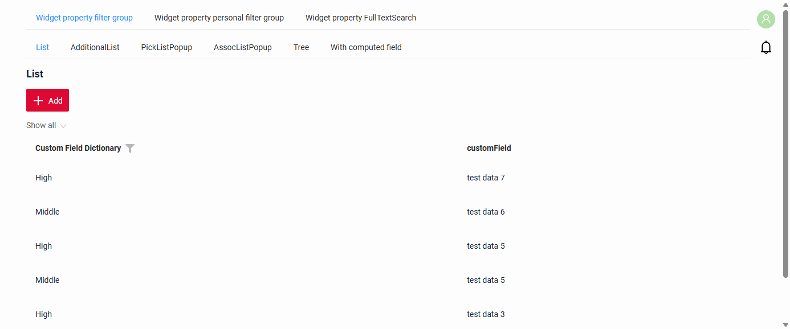

###### Как добавить? { #how-to-add_13 }
??? Example "Пример"
    === "Базовый"
        !!! tips "Совет"
            Чтобы получить условия для колонки `filters`, выполните следующие шаги:

            * Добавьте функцию фильтрации для полей
            * Заполните нужные фильтры в интерфейсе.
            * Откройте панель разработчика.
            * Найдите нужный запрос.
            * Используйте часть этого запроса с фильтром как значение `filters`

            

        Добавьте бизнес-компонент в таблицу **BC_FILTER_GROUPS**

          `name` — имя предопределённого фильтра

          `BC` — имя бизнес-компонента

          `filters` — условия фильтрации

          ```csv
            name;bc;filters;ID
            Dictionary = High;myexample3618;customFieldDictionary.equalsOneOf=%5B%22High%22%5D;
          ```
        [:material-play-circle: Живой пример]({{ external_links.code_samples }}/ui/#/screen/myexample3616/view/myexample3618list){:target="_blank"} ·
        [:fontawesome-brands-github: GitHub]({{ external_links.github_ui }}/{{ external_links.github_branch }}/src/main/java/org/demo/documentation/widgets/property/filtration/filtergroupsave){:target="_blank"}

    === "С вычисляемым полем"

        Если логика выбора группы фильтров слишком сложна и не выражается простыми условиями «и» по полям виджета,
        можно добавить отдельное вычисляемое скрытое поле. Это поле заранее вычисляет нужное значение, а затем к нему применяется группа фильтров.

        **Шаг 1** Добавьте вычисляемое логическое поле в соответствующий **DataResponseDTO**.
        ```java
        --8<--
        {{ external_links.github_raw_doc }}/widgets/property/filtration/filtergrouphiddenfield/MyExample3628DTO.java
        --8<--
        ```
        **Шаг 2** Добавьте бизнес-компонент в таблицу **BC_FILTER_GROUPS**

          `name` — имя предопределённого фильтра

          `BC` — имя бизнес-компонента

          `filters` — условия фильтрации

          ```csv
            name;bc;filters;ID
            Dictionary is null;myexample3628;customFieldHidden.equals=true;
          ```

        [:material-play-circle: Живой пример]({{ external_links.code_samples }}/ui/#/screen/myexample3616/view/myexample3628list){:target="_blank"} ·
        [:fontawesome-brands-github: GitHub]({{ external_links.github_ui }}/{{ external_links.github_branch }}/src/main/java/org/demo/documentation/widgets/property/filtration/filtergrouphiddenfield){:target="_blank"}

#### Пагинация { #pagination }
`Pagination` — разбиение содержимого на отдельные страницы, упрощающее навигацию и работу с большими объёмами информации.
см. [Пагинация](/ru/widget/type/property/pagination/pagination)

#### Экспорт в Excel { #export-to-excel }
`Export to Excel` позволяет пользователям скачать файл .xlsx с данными таблицы.
см. [Excel](/ru/widget/type/property/export/excel/excel)

#### Множественная загрузка файлов { #multi-upload-files }
Реализована множественная загрузка файлов. Для выбора файлов можно использовать специальную зону drag-and-drop или стандартную кнопку.

подробнее см. [Множественная загрузка файлов](/ru/widget/type/property/multiupload/multiupload)
 
