# PickListPopup

`PickListPopup` — компонент, позволяющий пользователю выбрать значение из всплывающего списка сущностей.
 
## Основы { #basics }
[:material-play-circle: Живой пример]({{ external_links.code_samples }}/ui/#/screen/myexample3067){:target="_blank"} ·
[:fontawesome-brands-github: GitHub]({{ external_links.github_ui }}/{{ external_links.github_branch }}/src/main/java/org/demo/documentation/widgets/picklist/base){:target="_blank"}

### Как это выглядит? { #how-does-it-look }
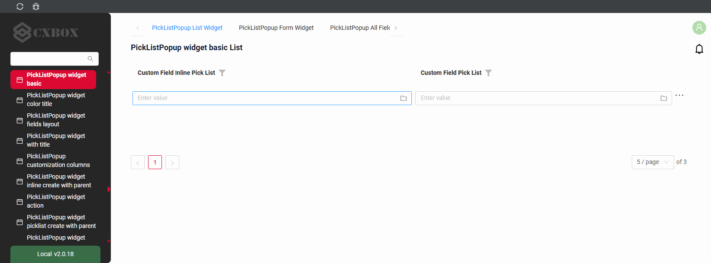

??? Example "Пример"
 
    **Шаг 1** Добавьте поле с типом **pickList** или **inline-pickList**, подробнее см. [Поля](#fields)

    ```json
    --8<--
    {{ external_links.github_raw_doc }}/widgets/picklist/base/onefield/MyExample3079List.widget.json
    --8<--
    ```
 
    **Шаг 2** Добавьте виджет и всплывающий виджет в соответствующий **_.view.json_**.

    ```json
    --8<--
    {{ external_links.github_raw_doc }}/widgets/picklist/base/onefield/myexample3079list.view.json
    --8<--
    ```
 
    [:material-play-circle: Живой пример]({{ external_links.code_samples }}/ui/#/screen/myexample3067){:target="_blank"} ·
    [:fontawesome-brands-github: GitHub]({{ external_links.github_ui }}/{{ external_links.github_branch }}/src/main/java/org/demo/documentation/widgets/picklist/base){:target="_blank"}

 
## Заголовок (Title) { #title }
[:material-play-circle: Живой пример]({{ external_links.code_samples }}/ui/#/screen/myexample3068){:target="_blank"} ·
[:fontawesome-brands-github: GitHub]({{ external_links.github_ui }}/{{ external_links.github_branch }}/src/main/java/org/demo/documentation/widgets/picklist/title){:target="_blank"}

### Базовый заголовок { #title-basic }
Для Picklist Popup есть 3 типа заголовков:

* `постоянный заголовок`: отображает фиксированный текст, который нельзя изменить.
* `пустой постоянный заголовок`: не отображает текст.
* `вычисляемый заголовок`: отображает динамический текст, то есть он может меняться в зависимости от бизнес-логики или данных приложения.
 
#### Как это выглядит? { #how-does-it-look_1 }
=== "Постоянный заголовок"
    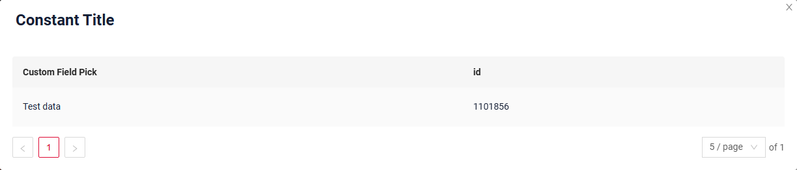
=== "Пустой постоянный заголовок"
    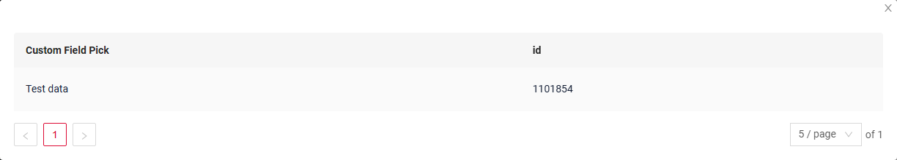
=== "Вычисляемый заголовок"
    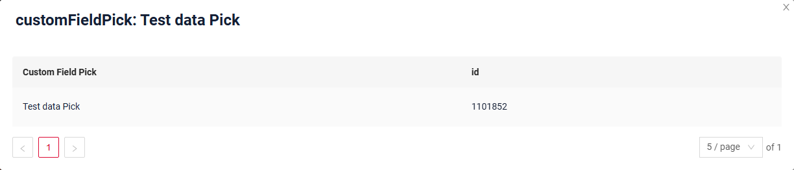


#### Как добавить? { #how-to-add }
??? Example "Пример"
    === "Постоянный заголовок"
        **Шаг 1** Добавьте название в **title** в **_.widget.json_**.
        ```json
        --8<--
        {{ external_links.github_raw_doc }}/widgets/picklist/title/withtitle/myEntity3068PickPickListPopup.widget.json
        --8<--
        ```
 
    === "Пустой постоянный заголовок"
        **Шаг 1** Удалите параметр **title** из **_.widget.json_**.
        ```json
        --8<--
        {{ external_links.github_raw_doc }}/widgets/picklist/title/withouttitle/myEntity3069PickPickListPopup.widget.json
        --8<--
        ```
 
    === "Вычисляемый заголовок"
        <!--родитель??-->
        **Шаг 1** Добавьте ${customField} в **title** в **_.widget.json_**.
        ```json
        --8<--
        {{ external_links.github_raw_doc }}/widgets/picklist/title/calculatedtitle/myEntity3071PickPickListPopup.widget.json
        --8<--
        ```
 
### Цвет заголовка { #title-color }
`Title Color` позволяет задать цвет заголовка. Он может быть постоянным или вычисляемым.

**Постоянный цвет**

[:material-play-circle: Живой пример]({{ external_links.code_samples }}/ui/#/screen/myexample3060/view/myexample3060formcolorconst){:target="_blank"} ·
[:fontawesome-brands-github: GitHub]({{ external_links.github_ui }}/{{ external_links.github_branch }}/src/main/java/org/demo/documentation/widgets/picklist/colortitle){:target="_blank"}

*Постоянный цвет* — фиксированный цвет, который не меняется. Он остаётся одинаковым независимо от каких-либо факторов в приложении.

**Вычисляемый цвет**

[:material-play-circle: Живой пример]({{ external_links.code_samples }}/ui/#/screen/myexample3060/view/myexample3060form){:target="_blank"} ·
[:fontawesome-brands-github: GitHub]({{ external_links.github_ui }}/{{ external_links.github_branch }}/src/main/java/org/demo/documentation/widgets/picklist/colortitle){:target="_blank"}

*Вычисляемый цвет* можно использовать для динамического изменения цвета заголовка. Он меняется в зависимости от бизнес-логики или данных приложения.

!!! info
    Цветовое выделение заголовка **применимо** к следующим [полям](/ru/widget/fields/fieldtypes/): date, dateTime, dateTimeWithSeconds, number, money, percent, time, input, text, dictionary, radio, checkbox, pickList, inlinePickList, multivalue, multivalueHover.

#### Как это выглядит? { #how-does-it-look_2 }
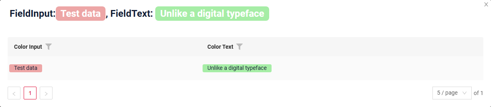

#### Как добавить? { #how-to-add_1 }
??? Example "Пример"
    === "Вычисляемый цвет"

        **Шаг 1**   Добавьте `собственное поле для цвета` в соответствующий **DataResponseDTO**. Поле может содержать цвет в формате HEX или быть null.
        ```java
        --8<--
        {{ external_links.github_raw_doc }}/widgets/picklist/colortitle/MyEntity3061PickDTO.java:colorDTO
        --8<--
        ```  
 
        **Шаг 2** Добавьте **"bgColorKey"** :  `собственное поле для цвета` в .widget.json.

        Добавьте в `title` поле с `${customField}`

        ```json
        --8<--
        {{ external_links.github_raw_doc }}/widgets/picklist/colortitle/myEntity3061PickListPopup.widget.json
        --8<--
        ```       
 
    === "Постоянный цвет"
 
        Добавьте **"bgColor"** :  `цвет HEX` в .widget.json.

        Добавьте в `title` поле с `${customField}`

        ```json
        --8<--
        {{ external_links.github_raw_doc }}/widgets/picklist/colortitle/myEntity3061PickListPopupColorConst.widget.json
        --8<--
        ```
 
## <a id="bc">Бизнес-компонент</a>
Указывает бизнес-компонент (BC), к которому относится эта форма.
Бизнес-компонент представляет определённую часть системы, отвечающую за конкретную бизнес-логику или данные.

подробнее см. [Бизнес-компонент](/ru/environment/businesscomponent/businesscomponent/)

## <a id="Showcondition">Условие отображения</a>


## <a id="fields">Поля</a>
Настройка полей. Массив fields определяет отдельные поля формы.

```json
{
    "title": "Custom Field",
    "key": "customField",
    "type": "input"
}
```

* **"title"**

  Описание: заголовок поля.

  Тип: String (необязательно).

* **"key"**

  Описание: имя поля в соответствующем DataResponseDTO.

  Тип: String (обязательно).

* **"type"**

  Описание: [Типы полей](/ru/widget/fields/fieldtypes/)

  Тип: String (обязательно).


### Как добавить? { #how-to-add_2 }
??? Example "Пример"

    === "С плагином (рекомендуется)"
        **Шаг 1** Скачайте плагин
            [скачать плагин для IntelliJ](https://doc.cxbox.org/ru/plugin/plugininstalling)
    
        **Шаг 2** Добавьте существующее поле в существующий виджет формы
            
    === "Пример написания кода"
        Добавьте поле в **_.widget.json_**.

          ```json
             --8<--
             {{ external_links.github_raw_doc }}/widgets/picklist/base/onefield/picklistpopup/picklist/myEntity3079PickPickPickListPopup.widget.json
             --8<--
          ```
 
## <a id="Fieldslayout">Компоновка (options layout)</a>
**options.layout** — в этом типе не используется.

## Стандартные действия { #standard-actions }
`Actions` отображают доступные действия в виде отдельных кнопок, подробнее см. [Действия](/ru/features/element/actions/actions).

**Стандартные действия**:

* [`Create`](#standart_create): действие, запускающее создание новой записи
* [`Edit`](#standart_edit): действие для изменения записи всплывающего окна (inline-form)
* [`Delete`](#standart_delete): действие для удаления записи всплывающего окна
* [`Save`](#standart_save): сохранение введённых или изменённых данных
* [`Cancel-create`](#standart_cancel_create): отмена создания новой записи без сохранения введённых данных
 

####  <a id="standart_create">Создание</a>
Кнопка `Create` позволяет создать новое значение нажатием кнопки `Add`. Это действие можно выполнить тремя разными способами — выбирайте любой в зависимости от логики приложения:

Есть три способа создать запись:

* [Inline](#createinline): строку можно добавить напрямую.

!!! info
    Пагинация не сработает, пока страница не будет обновлена после добавления записей.

* [Inline-form](#withwidget): данные можно добавить с помощью виджета формы, не покидая текущий view.

* [With view](#withview): неприменимо.

##### <a id="createinline">Inline</a>
[:material-play-circle: Живой пример]({{ external_links.code_samples }}/ui/#/screen/myexample3092){:target="_blank"} ·
[:fontawesome-brands-github: GitHub]({{ external_links.github_ui }}/{{ external_links.github_branch }}/src/main/java/org/demo/documentation/widgets/picklist/actions/create){:target="_blank"}

При `Line Addition` по нажатию кнопки "Add" вверху виджета assoc сразу добавляется новая пустая строка. Это быстрый способ добавлять строки без предварительного ввода данных.
###### Как это выглядит? { #how-does-it-look_3 }
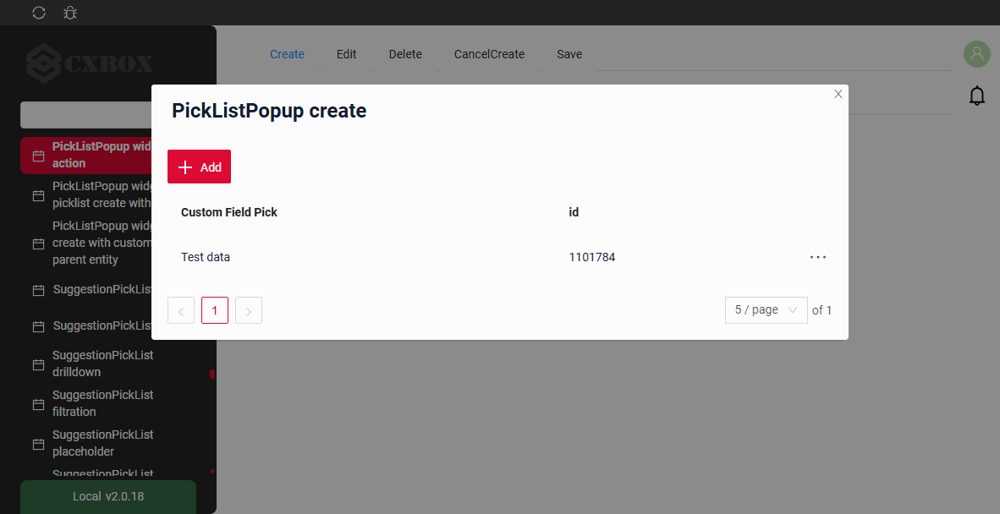

###### Как добавить? { #how-to-add_3 }
??? Example "Пример"

    **Шаг 1** Добавьте кнопку `create` в соответствующий **VersionAwareResponseService**.
    ```java
    --8<--
    {{ external_links.github_raw_doc }}/widgets/picklist/actions/create/inlinepicklist/MyEntity3072InlinePickPickService.java:getActions
    --8<--
    ```

    **Шаг 2** Добавьте кнопку `create` в соответствующий **.widget.json**.
    ```json
    --8<--
    {{ external_links.github_raw_doc }}/widgets/picklist/actions/create/inlinepicklist/myEntity3072InlinePickPickListPopup2.widget.json
    --8<--
    ```
 
    **Шаг 3** Добавьте **fields.setEnabled** в соответствующий **FieldMetaBuilder**.
    ```java
    --8<--
    {{ external_links.github_raw_doc }}/widgets/picklist/actions/create/inlinepicklist/MyEntity3072InlinePickPickMeta.java:buildRowDependentMeta
    --8<--
    ```
 
    [:material-play-circle: Живой пример]({{ external_links.code_samples }}/ui/#/screen/myexample3092){:target="_blank"} ·
    [:fontawesome-brands-github: GitHub]({{ external_links.github_ui }}/{{ external_links.github_branch }}/src/main/java/org/demo/documentation/widgets/picklist/actions/create){:target="_blank"}
 
##### <a id="withwidget">Inline-form</a>
[:material-play-circle: Живой пример]({{ external_links.code_samples }}/ui/#/screen/myexample3092/view/myexample3072listinlineform){:target="_blank"} ·
[:fontawesome-brands-github: GitHub]({{ external_links.github_ui }}/{{ external_links.github_branch }}/src/main/java/org/demo/documentation/widgets/picklist/actions/create){:target="_blank"}

`Create with widget` открывает дополнительный виджет при нажатии кнопки "Add". Форма появляется на том же экране, поэтому видны и список сущностей assoc, и форма добавления новой строки.
После заполнения информации и нажатия "Save" новая строка добавляется в assoc.
###### Как это выглядит? { #how-does-it-look_4 }
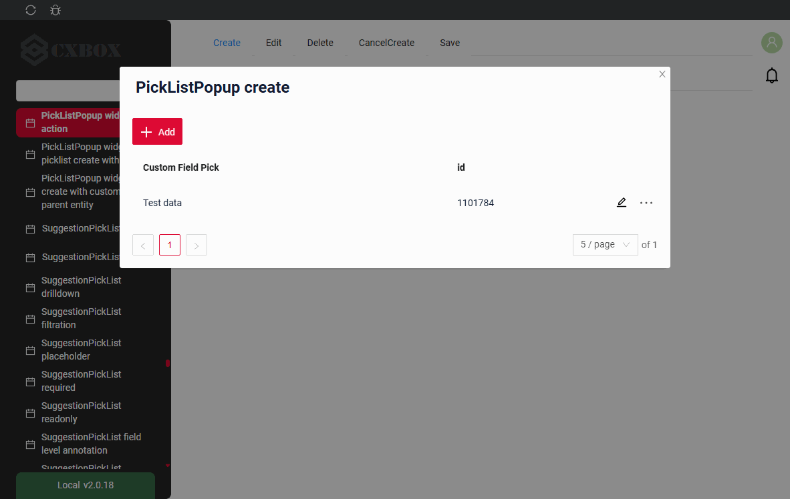

###### Как добавить? { #how-to-add_4 }
??? Example "Пример"

    **Шаг 1** Добавьте кнопку `create` в соответствующий **VersionAwareResponseService**.
    ```java
    --8<--
    {{ external_links.github_raw_doc }}/widgets/picklist/actions/create/inlinepicklist/MyEntity3072InlinePickPickService.java:getActions
    --8<--
    ```
    **Шаг 2** Добавьте **fields.setEnabled** в соответствующий **FieldMetaBuilder**.
    ```java
    --8<--
    {{ external_links.github_raw_doc }}/widgets/picklist/actions/create/inlinepicklist/MyEntity3072InlinePickPickMeta.java:buildRowDependentMeta
    --8<--
    ```
    **Шаг 3** Создайте widget.json с типом `Form`, который появляется при нажатии кнопки
    ```json
    --8<--
    {{ external_links.github_raw_doc }}/widgets/picklist/actions/create/inlinepicklist/myEntity3072InlinePickListForm.widget.json
    --8<--
    ```
 
     **Шаг 4** Добавьте widget.json с типом `Form` в соответствующий **.view.json**.
    ```json
    --8<--
    {{ external_links.github_raw_doc }}/widgets/picklist/actions/create/picklist/myexample3072listinlineform.view.json
    --8<--
    ```
 
     **Шаг 5** Добавьте кнопку `create` и виджет с типом `Form` в соответствующий **.widget.json**.
       
    `options`.`create`: имя виджета, который появляется при нажатии кнопки
        
    ```json
    --8<--
    {{ external_links.github_raw_doc }}/widgets/picklist/actions/create/inlinepicklist/myEntity3072InlinePickPickListPopup.widget.json
    --8<--
    ``` 
 
    [:material-play-circle: Живой пример]({{ external_links.code_samples }}/ui/#/screen/myexample3092/view/myexample3072listinlineform){:target="_blank"} ·
    [:fontawesome-brands-github: GitHub]({{ external_links.github_ui }}/{{ external_links.github_branch }}/src/main/java/org/demo/documentation/widgets/picklist/actions/create){:target="_blank"}

##### <a id="withview">With view</a>
_неприменимо_

#### <a id="standart_edit">Редактирование</a>
`Edit` позволяет изменить значение поля. Как и для кнопки `Create`, это действие можно реализовать тремя способами.

Есть три способа отредактировать запись:

* [Inline](#editline): неприменимо

* [Inline-form](#editwithwidger): данные можно редактировать с помощью виджета формы, не покидая текущий view.

* With view: неприменимо

##### <a id="editline">Inline</a>
_неприменимо_: клик по строке всплывающего окна выбирает значение. Строка редактируется через [inline-form](#editwithwidger) или сразу после создания.

##### <a id="editwithwidger">Inline-form</a>
[:material-play-circle: Живой пример]({{ external_links.code_samples }}/ui/#/screen/myexample3092/view/myexample3092listinlineform){:target="_blank"} ·
[:fontawesome-brands-github: GitHub]({{ external_links.github_ui }}/{{ external_links.github_branch }}/src/main/java/org/demo/documentation/widgets/picklist/actions/edit){:target="_blank"}

`Edit with widget` открывает дополнительный виджет при выборе пункта Edit в меню с тремя точками.

###### Как это выглядит? { #how-does-it-look_5 }
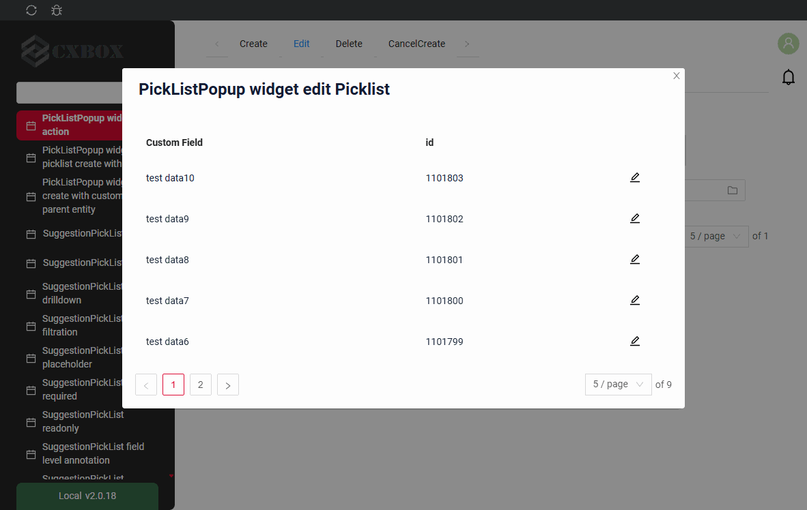

###### Как добавить? { #how-to-add_5 }
??? Example "Пример"

    **Шаг 1** Создайте widget.json с типом `Form`, который появляется при нажатии кнопки
    ```json
    --8<--
    {{ external_links.github_raw_doc }}/widgets/picklist/actions/edit/picklistpopup/picklist/inlineform/myEntity3092FormForEditPickListInlineForm.widget.json
    --8<--
    ```

    **Шаг 2** Добавьте widget.json с типом `Form` в соответствующий **.view.json**.
    ```json
    --8<--
    {{ external_links.github_raw_doc }}/widgets/picklist/actions/edit/myexample3092listinlineform.view.json
    --8<--
    ```

    **Шаг 3** Добавьте кнопку `edit` и виджет с типом `Form` в соответствующий **.widget.json**.

    `options`.`edit`: имя виджета, который появляется при нажатии кнопки

    ```json
    --8<--
    {{ external_links.github_raw_doc }}/widgets/picklist/actions/edit/picklistpopup/picklist/inlineform/myEntity3092PickListInlineForm.widget.json
    --8<--
    ```

    [:material-play-circle: Живой пример]({{ external_links.code_samples }}/ui/#/screen/myexample3092/view/myexample3092listinlineform){:target="_blank"} ·
    [:fontawesome-brands-github: GitHub]({{ external_links.github_ui }}/{{ external_links.github_branch }}/src/main/java/org/demo/documentation/widgets/picklist/actions/edit){:target="_blank"}

##### With view
_неприменимо_

#### **<a id="standart_delete">Delete</a>**
[:material-play-circle: Живой пример]({{ external_links.code_samples }}/ui/#/screen/myexample3092/view/myexample3188form){:target="_blank"} ·
[:fontawesome-brands-github: GitHub]({{ external_links.github_ui }}/{{ external_links.github_branch }}/src/main/java/org/demo/documentation/widgets/picklist/actions/delete){:target="_blank"}

`Delete` удаляет существующую запись.

!!! tips "Совет"
    Учтите, что на удаляемую строку может ссылаться другая часть системы или родительская сущность. Для ясности обработайте это исключение и покажите пользователю объяснение.

###### Как это выглядит? { #how-does-it-look_6 }
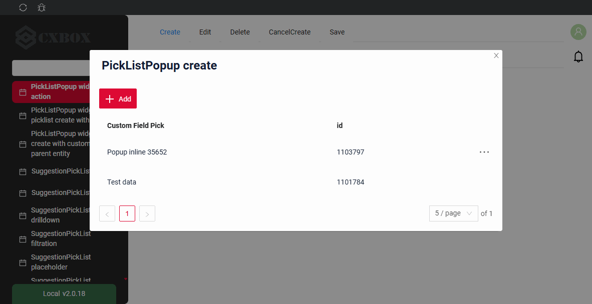

###### Как добавить? { #how-to-add_6 }
??? Example "Пример"

    **Шаг 1** Добавьте действие *delete* в соответствующий **VersionAwareResponseService**.

    По умолчанию кнопка доступна, когда запись существует.

    ```java
    --8<--
    {{ external_links.github_raw_doc }}/widgets/picklist/actions/delete/forpicklistpopup/MyEntity3188PickPickService.java:getActions
    --8<--
    ```
    **Шаг 2** Необязательно. Добавьте *deleteEntity* в соответствующий **VersionAwareResponseService**.

    ```java
    --8<--
    {{ external_links.github_raw_doc }}/widgets/picklist/actions/delete/forpicklistpopup/MyEntity3188PickPickService.java:deleteEntity
    --8<--
    ```
    **Шаг 3** Добавьте кнопку или группу кнопок в соответствующий **.widget.json**.

    ```json
    --8<--
    {{ external_links.github_raw_doc }}/widgets/picklist/actions/delete/forpicklistpopup/myEntity3188PickPickPickListPopup.widget.json
    --8<--
    ```
    [:material-play-circle: Живой пример]({{ external_links.code_samples }}/ui/#/screen/myexample3092/view/myexample3188form){:target="_blank"} ·
    [:fontawesome-brands-github: GitHub]({{ external_links.github_ui }}/{{ external_links.github_branch }}/src/main/java/org/demo/documentation/widgets/picklist/actions/delete){:target="_blank"}

###  **<a id="standart_save">Сохранение</a>**
[:material-play-circle: Живой пример]({{ external_links.code_samples }}/ui/#/screen/myexample3092/view/myexample3197form){:target="_blank"} ·
[:fontawesome-brands-github: GitHub]({{ external_links.github_ui }}/{{ external_links.github_branch }}/src/main/java/org/demo/documentation/widgets/picklist/actions/save){:target="_blank"}

`Save` сохраняет введённые или изменённые данные. см. [информацию об автосохранении](/ru/features/element/autosave/autosave)
 
###### Как это выглядит? { #how-does-it-look_7 }


###### Как добавить? { #how-to-add_7 }
??? Example "Пример"

    **Шаг 1** Добавьте действие *save* в соответствующий **VersionAwareResponseService**.

    ```java
    --8<--
    {{ external_links.github_raw_doc }}/widgets/picklist/actions/save/forpicklistpopup/MyEntity3197PickPickService.java:getActions
    --8<--
    ```  
    **Шаг 2** Добавьте кнопку или группу кнопок в соответствующий **.widget.json**.
   
    ```json
    --8<--
    {{ external_links.github_raw_doc }}/widgets/picklist/actions/save/forpicklistpopup/myEntity3197PickPickPickListPopup.widget.json
    --8<--
    ```

    [:material-play-circle: Живой пример]({{ external_links.code_samples }}/ui/#/screen/myexample3092/view/myexample3197form){:target="_blank"} ·
    [:fontawesome-brands-github: GitHub]({{ external_links.github_ui }}/{{ external_links.github_branch }}/src/main/java/org/demo/documentation/widgets/picklist/actions/save){:target="_blank"}


### **<a id="standart_cancel_create">Отмена создания (Cancel-create)</a>**
[:material-play-circle: Живой пример]({{ external_links.code_samples }}/ui/#/screen/myexample3092/view/myexample3198form){:target="_blank"} ·
[:fontawesome-brands-github: GitHub]({{ external_links.github_ui }}/{{ external_links.github_branch }}/src/main/java/org/demo/documentation/widgets/picklist/actions/cancelcreate/basic){:target="_blank"}

`Cancel-create` отменяет создание новой записи без сохранения введённых данных
 
###### Как это выглядит? { #how-does-it-look_8 }
=== "Базовый"
    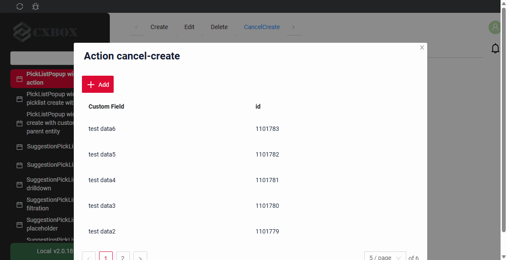
=== "С drilldown"
    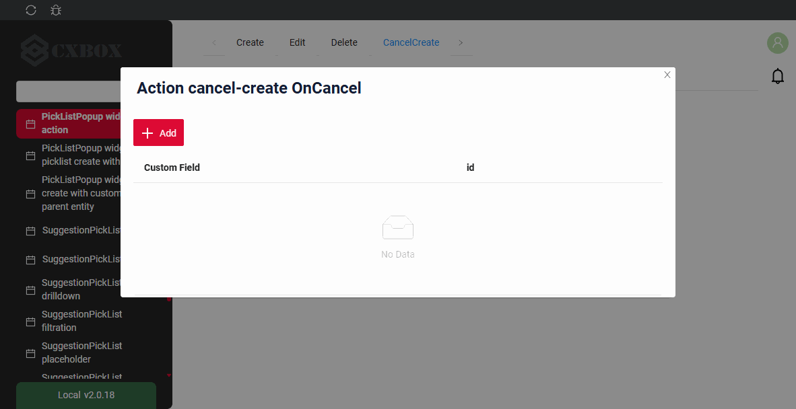

###### Как добавить? { #how-to-add_8 }
??? Example "Пример"
    === "Базовый"

        **Шаг 1** Добавьте стандартное действие *cancelCreate* в соответствующий **VersionAwareResponseService**.
        По умолчанию интерфейс отображает "cancelCreate".

        ```java
        --8<--
        {{ external_links.github_raw_doc }}/widgets/picklist/actions/cancelcreate/basic/MyEntity3198PickPickService.java:getActions
        --8<--
        ```
         **Шаг 2** Добавьте действие *cancel-create* в соответствующий **PickListPopup**.
 
        ```json
        --8<--
        {{ external_links.github_raw_doc }}/widgets/picklist/actions/cancelcreate/basic/myEntity3198PickPickPickListPopup.widget.json
        --8<--
        ```
 
        [:material-play-circle: Живой пример]({{ external_links.code_samples }}/ui/#/screen/myexample3092/view/myexample3198form){:target="_blank"} ·
        [:fontawesome-brands-github: GitHub]({{ external_links.github_ui }}/{{ external_links.github_branch }}/src/main/java/org/demo/documentation/widgets/picklist/actions/cancelcreate/basic){:target="_blank"}

    === "С postAction"
        **Шаг 1** Добавьте действие *cancel* с postAction в соответствующий **VersionAwareResponseService**.
    
        ```java
        --8<--
        {{ external_links.github_raw_doc }}/widgets/picklist/actions/cancelcreate/postaction/MyEntity3198PickPostActionPickService.java:getActions
        --8<--
        ``` 
 
        **Шаг 2** Добавьте кнопку или группу кнопок в соответствующий **.widget.json**.
       
        ```json
        --8<--
        {{ external_links.github_raw_doc }}/widgets/picklist/actions/cancelcreate/postaction/myEntity3198PickPostActionPickPickListPopup.widget.json
        --8<--
        ```
 
        [:material-play-circle: Живой пример]({{ external_links.code_samples }}/ui/#/screen/myexample3092/view/myexample3198formpostaction){:target="_blank"} ·
        [:fontawesome-brands-github: GitHub]({{ external_links.github_ui }}/{{ external_links.github_branch }}/src/main/java/org/demo/documentation/widgets/picklist/actions/cancelcreate/postaction){:target="_blank"}

    === "Метод onCancel"
        !!! info
            Только для **Inner** бизнес-компонента, подробнее см. [Бизнес-компонент](/ru/environment/businesscomponent/businesscomponent/)

        **Шаг 1** Добавьте стандартное действие *cancelCreate* в соответствующий **VersionAwareResponseService**.
    
        ```java
        --8<--
        {{ external_links.github_raw_doc }}/widgets/picklist/actions/cancelcreate/oncancel/MyEntity3198PickOnCancelPickService.java:getActions
        --8<--
        ```
        **Шаг 2** Добавьте метод *onCancel* в соответствующий **VersionAwareResponseService**.
        ```java
        --8<--
        {{ external_links.github_raw_doc }}/widgets/picklist/actions/cancelcreate/oncancel/MyEntity3198PickOnCancelPickService.java:onCancel
        --8<--
        ```
        **Шаг 3** Добавьте кнопку или группу кнопок в соответствующий **.widget.json**.
       
        ```json
        --8<--
        {{ external_links.github_raw_doc }}/widgets/picklist/actions/cancelcreate/oncancel/myEntity3198PickOnCancelPickPickListPopup.widget.json
        --8<--
        ```

        [:material-play-circle: Живой пример]({{ external_links.code_samples }}/ui/#/screen/myexample3092/view/myexample3198formoncancel){:target="_blank"} ·
        [:fontawesome-brands-github: GitHub]({{ external_links.github_ui }}/{{ external_links.github_branch }}/src/main/java/org/demo/documentation/widgets/picklist/actions/cancelcreate/oncancel){:target="_blank"}


### Дополнительные свойства { #additional-properties }
#### Настройка отображаемых колонок { #customization-of-displayed-columns }
неприменимо
#### Фильтрация { #filtration }
##### Основы { #basic }
подробнее см. [Поля](/ru/widget/type/property/filtration/filtration/)

###### Как это выглядит? { #how-does-it-look_9 }
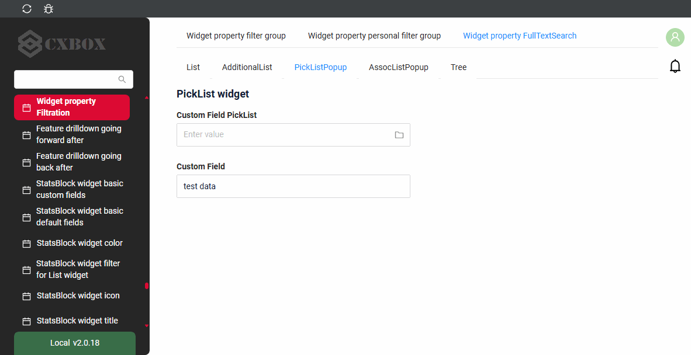

###### Как добавить? { #how-to-add_9 }
??? Example "Пример"
    Шаги выполняются для бизнес-компонента всплывающего окна.

    `Шаг 1` Добавьте **@SearchParameter** в соответствующий **DataResponseDTO**.
    ```java
    --8<--
    {{ external_links.github_raw_doc }}/widgets/property/filtration/filtergroup/MyExample3616DTO.java
    --8<--
    ```

    `Шаг 2` Добавьте **fields.enableFilter** в соответствующий **FieldMetaBuilder**.
    ```java
    --8<--
    {{ external_links.github_raw_doc }}/widgets/property/filtration/filtergroup/MyExample3616Meta.java:buildIndependentMeta
    --8<--
    ```

    [:material-play-circle: Живой пример]({{ external_links.code_samples }}/ui/#/screen/myexample3616/view/myexample3614picklistpopup){:target="_blank"} ·
    [:fontawesome-brands-github: GitHub]({{ external_links.github_ui }}/{{ external_links.github_branch }}/src/main/java/org/demo/documentation/widgets/property/filtration/fulltextsearch/forpicklist){:target="_blank"}

##### FullTextSearch
`FullTextSearch` — когда пользователь вводит текст в поле полнотекстового поиска, виджет фильтрует строки, соответствующие запросу.
см. [FullTextSearch](/ru/widget/type/property/filtration/filtration/#by-fulltextsearch)

###### Как это выглядит? { #how-does-it-look_10 }


###### Как добавить? { #how-to-add_10 }
??? Example "Пример"
    `Шаг 1` Добавьте файл расширения FullTextSearchExt.java
    ```java
    import java.util.Optional;
    import jakarta.persistence.criteria.CriteriaBuilder;
    import jakarta.persistence.criteria.Path;
    import jakarta.persistence.criteria.Predicate;
    import lombok.NonNull;
    import lombok.experimental.UtilityClass;
    import org.apache.commons.lang3.StringUtils;
    import org.cxbox.core.crudma.bc.BusinessComponent;

    @UtilityClass
    public class FullTextSearchExt {

        @NonNull
        public static Optional<String> getFullTextSearchFilterParam(BusinessComponent bc) {
            return Optional.ofNullable(bc.getParameters().getParameter("_fullTextSearch"));
        }

        public static Predicate likeIgnoreCase(String value, CriteriaBuilder cb, Path<String> path) {
            return cb.like(cb.lower(path), StringUtils.lowerCase("%" + value + "%"));
        }

    }
    ```

    `Шаг 2` Добавьте **specifications** для полей полнотекстового поиска в соответствующий **JpaRepository**.
    ```java
    --8<--
    {{ external_links.github_raw_doc }}/widgets/property/filtration/fulltextsearch/forpicklist/MyEntity3614PickRepository.java
    --8<--
    ```

    `Шаг 3` Добавьте **getSpecification** в соответствующий **VersionAwareResponseService**.
    ```java
    --8<--
    {{ external_links.github_raw_doc }}/widgets/property/filtration/fulltextsearch/forpicklist/MyEntity3614PickPickService.java:getSpecification
    --8<--
    ```

    `Шаг 4` Добавьте **fullTextSearch** в соответствующий **.widget.json**.

    `enabled` true/false

    `placeholder` — описание для fullTextSearch

    ```json
    --8<--
    {{ external_links.github_raw_doc }}/widgets/property/filtration/fulltextsearch/forpicklist/myEntity3614PickPickPickListPopup.widget.json
    --8<--
    ```

    [:material-play-circle: Живой пример]({{ external_links.code_samples }}/ui/#/screen/myexample3616/view/myexample3614picklistpopup){:target="_blank"} ·
    [:fontawesome-brands-github: GitHub]({{ external_links.github_ui }}/{{ external_links.github_branch }}/src/main/java/org/demo/documentation/widgets/property/filtration/fulltextsearch/forpicklist){:target="_blank"}

##### Персональная группа фильтров { #personal-filter-group }
неприменимо
##### Группа фильтров { #filter-group }
неприменимо
#### Пагинация { #pagination }
`Pagination` — разбиение содержимого на отдельные страницы, упрощающее навигацию и работу с большими объёмами информации.
см. [Пагинация](/ru/widget/type/property/pagination/pagination)

#### Экспорт в Excel { #export-to-excel }
неприменимо
