# PickTreePopup

Доступно начиная с [v3.0.1](/ru/new/version3001/)

`PickTreePopup` — компонент, позволяющий пользователю выбрать значение из всплывающего списка сущностей.

!!! info
    В этом релизе для виджета `PickTreePopup` **недоступны** следующие возможности:

    * полностью или частично раскрытая начальная загрузка (дерево всегда открывается свёрнутым)


## Основы { #basics }
[:material-play-circle: Живой пример]({{ external_links.code_samples }}/ui/#/screen/myexample3343){:target="_blank"} ·
[:fontawesome-brands-github: GitHub]({{ external_links.github_ui }}/{{ external_links.github_branch }}/src/main/java/org/demo/documentation/widgets/picktree/base){:target="_blank"}

Всплывающее окно показывает записи в виде дерева: к бизнес-компоненту всплывающего окна применяются требования [виджета Tree](/ru/widget/type/tree/tree/#basics).

Минимальный набор данных записи всплывающего окна:

* `id` — идентификатор записи.
* `parentId` — идентификатор родительской записи. Для корневой записи значение `null`.
  Бэкенд должен **всегда** возвращать это поле, и поле должно быть **фильтруемым**, так как дерево строится запросами `parentId.specified=false` (корневые записи) и `parentId.equals=<id>` (дочерние записи). Подробнее см. [Ленивая загрузка](#lazyload)
* поле названия (title) — значение, отображаемое в колонке дерева и подставляемое в поле.
* `isLeaf` — вычисляемый логический флаг. Значение по умолчанию `false`. Значение `true` означает, что у записи нет дочерних записей, поэтому стрелка раскрытия для неё не отображается.

!!! info
    **Первое** поле массива `fields` отображается как колонка дерева: стрелка раскрытия. Все остальные поля отображаются как обычные колонки.

    `parentId` и `isLeaf` — служебные поля: они объявляются в виджете всплывающего окна с типом **hidden**.

**<a id="optionstree">options.tree</a>**

Все настройки, специфичные для дерева, размещаются в **options**.**tree** файла **_.widget.json_**.

??? Example "Пример"

    | Свойство                 | Тип                                             | По умолчанию             | Описание                                                                                                          |
    |--------------------------|-------------------------------------------------|--------------------------|-------------------------------------------------------------------------------------------------------------------|
    | `parentIdFieldKey`       | String                                          | `parentId`               | Имя поля с идентификатором родительской записи.                                                                     |
    | `isLeafFieldKey`         | String                                          | `isLeaf`                 | Имя поля с флагом «у записи нет дочерних записей».                                                                   |
    | `searchModes`            | Массив из `collapse`, `hide`                    | `["collapse", "hide"]`   | Режимы отображения результата фильтрации. Первый элемент массива — активный. см. [Режимы поиска](#searchmodes) |
    | `onFilterApplyNestLevel` | Number                                          | `0`                      | Сколько уровней пути навигации показывается над найденной записью в режиме `collapse`. см. [Режимы поиска](#searchmodes) |
    | `insertPosition`         | `start`, `end`                                  | —                        | Куда внутри узла вставляется новая строка. см. [Создание](#createinline)                                            |
    | `selection`              | `node`, `nodeAndLeaf`, `leaf`                   | —                        | Что пользователю разрешено выбирать. см. [Режимы выбора](#selection) |

**<a id="lazyload">Ленивая загрузка</a>**

Дерево всегда загружается **лениво** и всегда открывается **свёрнутым**: при открытии всплывающего окна запрашиваются только корневые записи, а дочерние записи узла — когда пользователь его раскрывает.

!!! info
    Операция `specified` используется **только** для выбора записей с пустым родителем. Для всех остальных запросов используется операция `equals`.
    Поэтому поле с идентификатором родителя должно быть фильтруемым на бэкенде.

Каждый узел хранит **собственное состояние пагинации**, поэтому записи одного узла загружаются постранично независимо от соседних узлов. Подробнее см. [Пагинация](#pagination)

??? Example "Пример"
    * **Корневые записи** запрашиваются с фильтром по пустому родителю:

    ```
    ?parentId.specified=false&_page=1&_limit=5
    ```

    * **Дочерние записи** узла запрашиваются при раскрытии узла:

    ```
    ?parentId.equals=<id>&_page=1&_limit=5
    ```

### Как это выглядит? { #how-does-it-look }


??? Example "Пример"
 
    **Шаг 1** Добавьте поле с типом **pickTree**, подробнее см. [Поля](#fields)

    ```json
    --8<--
    {{ external_links.github_raw_doc }}/widgets/picktree/base/onefield/MyExample3351List.widget.json
    --8<--
    ```
 
    **Шаг 2** Создайте виджет всплывающего окна **_.widget.json_** с type = **"PickTreePopup"**.

    Для корректной работы дерева виджет всплывающего окна должен содержать поля `parentId` и `isLeaf`. Эти поля нужно настроить как **hidden**.

    ```json
    --8<--
    {{ external_links.github_raw_doc }}/widgets/picktree/base/onefield/picktreepopup/picktree/myEntity3351PickPickPickTreePopup.widget.json
    --8<--
    ```

    **Шаг 3** Добавьте виджет и всплывающий виджет в соответствующий **_.view.json_**.

    ```json
    --8<--
    {{ external_links.github_raw_doc }}/widgets/picktree/base/onefield/myexample3351list.view.json
    --8<--
    ```
 
    [:material-play-circle: Живой пример]({{ external_links.code_samples }}/ui/#/screen/myexample3343){:target="_blank"} ·
    [:fontawesome-brands-github: GitHub]({{ external_links.github_ui }}/{{ external_links.github_branch }}/src/main/java/org/demo/documentation/widgets/picktree/base){:target="_blank"}

 
## Заголовок (Title) { #title }
[:material-play-circle: Живой пример]({{ external_links.code_samples }}/ui/#/screen/myexample3344){:target="_blank"} ·
[:fontawesome-brands-github: GitHub]({{ external_links.github_ui }}/{{ external_links.github_branch }}/src/main/java/org/demo/documentation/widgets/picktree/title){:target="_blank"}

### Базовый заголовок { #title-basic }
Для Picktree Popup есть 3 типа заголовков:

* `постоянный заголовок`: отображает фиксированный текст, который нельзя изменить.
* `пустой постоянный заголовок`: не отображает текст.
* `вычисляемый заголовок`: отображает динамический текст, то есть он может меняться в зависимости от бизнес-логики или данных приложения.
 
#### Как это выглядит? { #how-does-it-look_1 }
=== "Постоянный заголовок"
    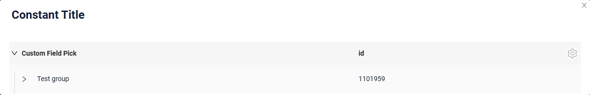
=== "Пустой постоянный заголовок"
    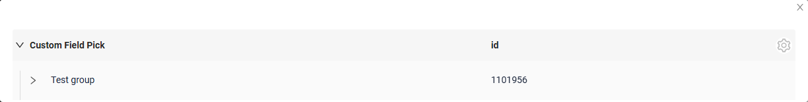
=== "Вычисляемый заголовок"
    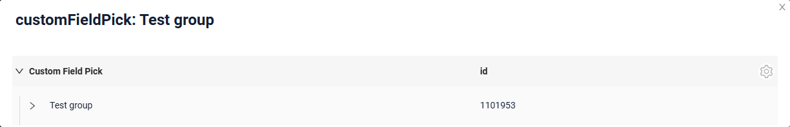


#### Как добавить? { #how-to-add }
??? Example "Пример"
    === "Постоянный заголовок"
        **Шаг 1** Добавьте название в **title** в **_.widget.json_**.
        ```json
        --8<--
        {{ external_links.github_raw_doc }}/widgets/picktree/title/withtitle/myEntity3344PickPickTreePopup.widget.json
        --8<--
        ```
 
    === "Пустой постоянный заголовок"
        **Шаг 1** Удалите параметр **title** из **_.widget.json_**.
        ```json
        --8<--
        {{ external_links.github_raw_doc }}/widgets/picktree/title/withouttitle/myEntity3345PickPickTreePopup.widget.json
        --8<--
        ```
 
    === "Вычисляемый заголовок"
        <!--родитель??-->
        **Шаг 1** Добавьте ${customField} в **title** в **_.widget.json_**.
        ```json
        --8<--
        {{ external_links.github_raw_doc }}/widgets/picktree/title/calculatedtitle/myEntity3347PickPickTreePopup.widget.json
        --8<--
        ```
 
### Цвет заголовка { #title-color }
`Title Color` позволяет задать цвет заголовка. Он может быть постоянным или вычисляемым.

**Постоянный цвет**

[:material-play-circle: Живой пример]({{ external_links.code_samples }}/ui/#/screen/myexample3341/view/myexample3341formcolorconst){:target="_blank"} ·
[:fontawesome-brands-github: GitHub]({{ external_links.github_ui }}/{{ external_links.github_branch }}/src/main/java/org/demo/documentation/widgets/picktree/colortitle){:target="_blank"}

*Постоянный цвет* — фиксированный цвет, который не меняется. Он остаётся одинаковым независимо от каких-либо факторов в приложении.
**Вычисляемый цвет**

[:material-play-circle: Живой пример]({{ external_links.code_samples }}/ui/#/screen/myexample3341/view/myexample3341form){:target="_blank"} ·
[:fontawesome-brands-github: GitHub]({{ external_links.github_ui }}/{{ external_links.github_branch }}/src/main/java/org/demo/documentation/widgets/picktree/colortitle){:target="_blank"}

*Вычисляемый цвет* можно использовать для динамического изменения цвета заголовка. Он меняется в зависимости от бизнес-логики или данных приложения.

!!! info
    Цветовое выделение заголовка **применимо** к следующим [полям](/ru/widget/fields/fieldtypes/): date, dateTime, dateTimeWithSeconds, number, money, percent, time, input, text, dictionary, radio, checkbox, pickList, inlinePickList, multivalue, multivalueHover.

#### Как это выглядит? { #how-does-it-look_2 }
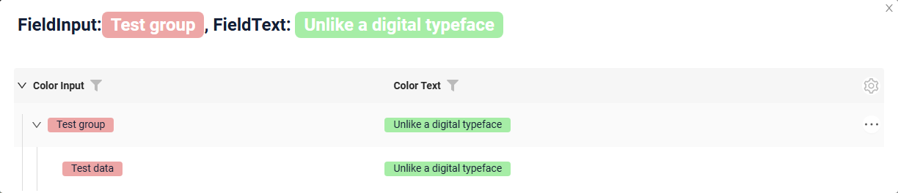

#### Как добавить? { #how-to-add_1 }
??? Example "Пример"
    === "Вычисляемый цвет"

        **Шаг 1**   Добавьте `собственное поле для цвета` в соответствующий **DataResponseDTO**. Поле может содержать цвет в формате HEX или быть null.
        ```java
        --8<--
        {{ external_links.github_raw_doc }}/widgets/picktree/colortitle/MyEntity3342PickDTO.java:colorDTO
        --8<--
        ```  
 
        **Шаг 2** Добавьте **"bgColorKey"** :  `собственное поле для цвета` в .widget.json.

        Добавьте в `title` поле с `${customField}`

        ```json
        --8<--
        {{ external_links.github_raw_doc }}/widgets/picktree/colortitle/myEntity3342PickTreePopup.widget.json
        --8<--
        ```       
 
    === "Постоянный цвет"
 
        Добавьте **"bgColor"** :  `цвет HEX` в .widget.json.

        Добавьте в `title` поле с `${customField}`

        ```json
        --8<--
        {{ external_links.github_raw_doc }}/widgets/picktree/colortitle/myEntity3342PickTreePopupColorConst.widget.json
        --8<--
        ```
 
## <a id="bc">Бизнес-компонент</a>
Указывает бизнес-компонент (BC), к которому относится эта форма.
Бизнес-компонент представляет определённую часть системы, отвечающую за конкретную бизнес-логику или данные.

подробнее см. [Бизнес-компонент](/ru/environment/businesscomponent/businesscomponent/)

## <a id="Showcondition">Условие отображения</a>


## <a id="fields">Поля</a>
Настройка полей. Массив fields определяет отдельные поля формы.

```json
{
    "title": "Custom Field",
    "key": "customField",
    "type": "input"
}
```

* **"title"**

  Описание: заголовок поля.

  Тип: String (необязательно).

* **"key"**

  Описание: имя поля в соответствующем DataResponseDTO.

  Тип: String (обязательно).

* **"type"**

  Описание: [Типы полей](/ru/widget/fields/fieldtypes/)

  Тип: String (обязательно).


### Как добавить? { #how-to-add_2 }
??? Example "Пример"

    === "С плагином (рекомендуется)"
        **Шаг 1** Скачайте плагин
            [скачать плагин для IntelliJ](https://doc.cxbox.org/ru/plugin/plugininstalling)
    
        **Шаг 2** Добавьте существующее поле в существующий виджет формы
            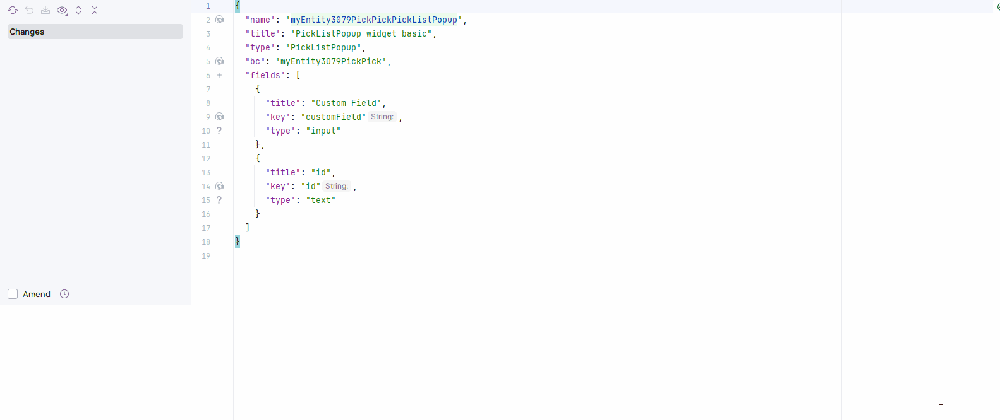
    === "Пример написания кода"
        Добавьте поле в **_.widget.json_**.

          ```json
             --8<--
             {{ external_links.github_raw_doc }}/widgets/picktree/base/onefield/picktreepopup/picktree/myEntity3351PickPickPickTreePopup.widget.json
             --8<--
          ```
 
## <a id="Fieldslayout">Компоновка (options layout)</a>
**options.layout** — в этом типе не используется.

## Стандартные действия { #standard-actions }
`Actions` отображают доступные действия в виде отдельных кнопок, подробнее см. [Действия](/ru/features/element/actions/actions).

**Стандартные действия**:

* [`Create`](#standart_create): действие, запускающее создание новой записи
* [`Edit`](#standart_edit): действие для изменения записи всплывающего окна (inline-form)
* [`Delete`](#standart_delete): действие для удаления записи всплывающего окна
* [`Save`](#standart_save): сохранение введённых или изменённых данных
* [`Cancel-create`](#standart_cancel_create): отмена создания новой записи без сохранения введённых данных
 

####  <a id="standart_create">Создание</a>
Кнопка `Create` позволяет создать новое значение нажатием кнопки `Add`. Это действие можно выполнить тремя разными способами — выбирайте любой в зависимости от логики приложения:

Есть три способа создать запись:

* [Inline](#createinline): строку можно добавить напрямую.

!!! info
    Пагинация не сработает, пока страница не будет обновлена после добавления записей.

* [Inline-form](#withwidget): данные можно добавить с помощью виджета формы, не покидая текущий view.

* [With view](#withview): неприменимо.

##### <a id="createinline">Inline</a>
[:material-play-circle: Живой пример]({{ external_links.code_samples }}/ui/#/screen/myexample3353){:target="_blank"} ·
[:fontawesome-brands-github: GitHub]({{ external_links.github_ui }}/{{ external_links.github_branch }}/src/main/java/org/demo/documentation/widgets/picktree/actions/create){:target="_blank"}

При `Line Addition` по нажатию кнопки "Add" во всплывающее окно сразу добавляется новая пустая строка. Это быстрый способ добавлять строки без предварительного ввода данных.

Позиция новой строки внутри узла задаётся **options**.**tree**.**insertPosition**: `start` помещает её перед уже загруженными строками узла, `end` — после них. см. [options.tree](#optionstree)

###### Как это выглядит? { #how-does-it-look_3 }
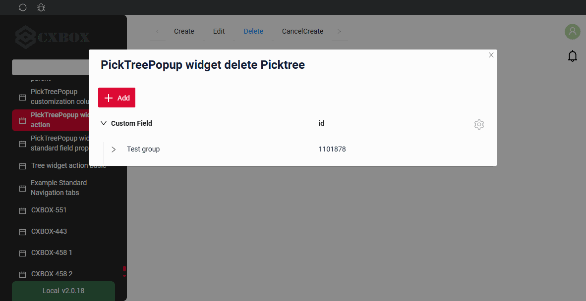

###### Как добавить? { #how-to-add_3 }
??? Example "Пример"

    **Шаг 1** Добавьте кнопку `create` в соответствующий **VersionAwareResponseService**.
    ```java
    --8<--
    {{ external_links.github_raw_doc }}/widgets/picktree/actions/create/picktree/MyEntity3348PickPickService.java:getActions
    --8<--
    ```

    **Шаг 2** Добавьте кнопку `create` в соответствующий **.widget.json**.

    Позиция новой строки внутри узла задаётся `options`.`tree`.`insertPosition`: `start` помещает её перед уже загруженными строками узла, `end` — после них.

    ```json
    --8<--
    {{ external_links.github_raw_doc }}/widgets/picktree/actions/create/picktree/myEntity3348PickPickTreeCreateInlinePopup.widget.json
    --8<--
    ```
 
    **Шаг 3** Добавьте **fields.setEnabled** в соответствующий **FieldMetaBuilder**.
    ```java
    --8<--
    {{ external_links.github_raw_doc }}/widgets/picktree/actions/create/picktree/MyEntity3348PickPickMeta.java:buildRowDependentMeta
    --8<--
    ```
 
    [:material-play-circle: Живой пример]({{ external_links.code_samples }}/ui/#/screen/myexample3353){:target="_blank"} ·
    [:fontawesome-brands-github: GitHub]({{ external_links.github_ui }}/{{ external_links.github_branch }}/src/main/java/org/demo/documentation/widgets/picktree/actions/create){:target="_blank"}

##### <a id="withwidget">Inline-form</a>
[:material-play-circle: Живой пример]({{ external_links.code_samples }}/ui/#/screen/myexample3353/view/myexample3348listinlineform){:target="_blank"} ·
[:fontawesome-brands-github: GitHub]({{ external_links.github_ui }}/{{ external_links.github_branch }}/src/main/java/org/demo/documentation/widgets/picktree/actions/create){:target="_blank"}

`Create with widget` открывает дополнительный виджет при нажатии кнопки "Add". Форма появляется во всплывающем окне, поэтому видны и дерево сущностей, и форма добавления новой строки.
После заполнения информации и нажатия "Save" новая строка добавляется в дерево.

Позиция новой строки внутри узла задаётся **options**.**tree**.**insertPosition**: `start` помещает её перед уже загруженными строками узла, `end` — после них. см. [options.tree](#optionstree)

###### Как это выглядит? { #how-does-it-look_4 }
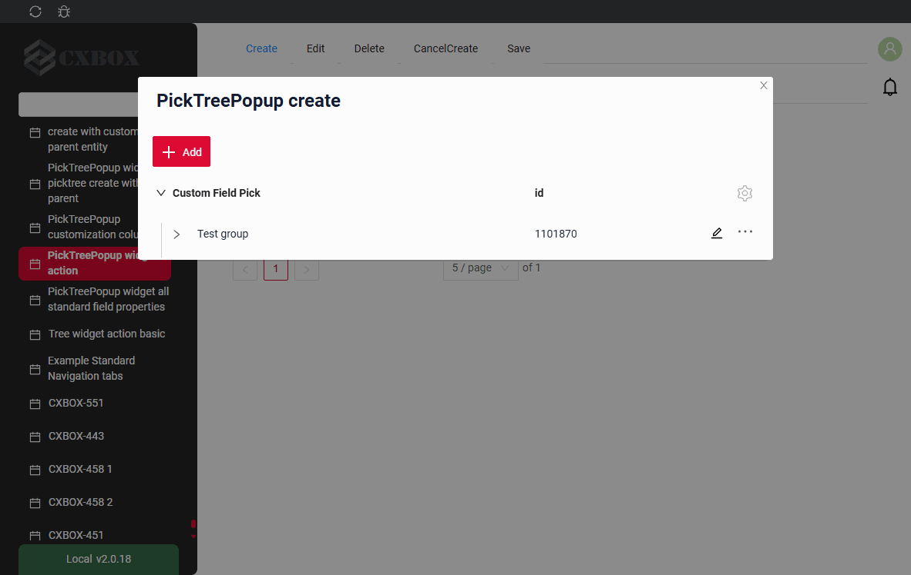

###### Как добавить? { #how-to-add_4 }
??? Example "Пример"

    **Шаг 1** Добавьте кнопку `create` в соответствующий **VersionAwareResponseService**.
    ```java
    --8<--
    {{ external_links.github_raw_doc }}/widgets/picktree/actions/create/picktree/MyEntity3348PickPickService.java:getActions
    --8<--
    ```
    **Шаг 2** Добавьте **fields.setEnabled** в соответствующий **FieldMetaBuilder**.
    ```java
    --8<--
    {{ external_links.github_raw_doc }}/widgets/picktree/actions/create/picktree/MyEntity3348PickPickMeta.java:buildRowDependentMeta
    --8<--
    ```
    **Шаг 3** Создайте widget.json с типом `Form`, который появляется при нажатии кнопки
    ```json
    --8<--
    {{ external_links.github_raw_doc }}/widgets/picktree/actions/create/picktree/myEntity3348PickPickTreePopupForm.widget.json
    --8<--
    ```
 
     **Шаг 4** Добавьте widget.json с типом `Form` в соответствующий **.view.json**.
    ```json
    --8<--
    {{ external_links.github_raw_doc }}/widgets/picktree/actions/create/picktree/myexample3348listinlineform.view.json
    --8<--
    ```
 
     **Шаг 5** Добавьте кнопку `create` и виджет с типом `Form` в соответствующий **.widget.json**.
       
    `options`.`create`: имя виджета, который появляется при нажатии кнопки

    Позиция новой строки внутри узла задаётся `options`.`tree`.`insertPosition`: `start` помещает её перед уже загруженными строками узла, `end` — после них.

        
    ```json
    --8<--
    {{ external_links.github_raw_doc }}/widgets/picktree/actions/create/picktree/myEntity3348PickPickTreePopup.widget.json
    --8<--
    ``` 
 
    [:material-play-circle: Живой пример]({{ external_links.code_samples }}/ui/#/screen/myexample3353/view/myexample3348listinlineform){:target="_blank"} ·
    [:fontawesome-brands-github: GitHub]({{ external_links.github_ui }}/{{ external_links.github_branch }}/src/main/java/org/demo/documentation/widgets/picktree/actions/create){:target="_blank"}

##### <a id="withview">With view</a>
_неприменимо_

#### <a id="standart_edit">Редактирование</a>
`Edit` позволяет изменить значение поля. Как и для кнопки `Create`, это действие можно реализовать тремя способами.

Есть три способа отредактировать запись:

* [Inline](#editline): неприменимо

* [Inline-form](#editwithwidger): данные можно редактировать с помощью виджета формы, не покидая текущий view.

* With view: неприменимо

##### <a id="editline">Inline</a>
_неприменимо_: клик по строке всплывающего окна выбирает значение. Строка редактируется через [inline-form](#editwithwidger) или сразу после создания.

##### <a id="editwithwidger">Inline-form</a>
[:material-play-circle: Живой пример]({{ external_links.code_samples }}/ui/#/screen/myexample3353/view/myexample3353listinlineform){:target="_blank"} ·
[:fontawesome-brands-github: GitHub]({{ external_links.github_ui }}/{{ external_links.github_branch }}/src/main/java/org/demo/documentation/widgets/picktree/actions/edit){:target="_blank"}

`Edit with widget` открывает дополнительный виджет при выборе пункта Edit в меню с тремя точками.

###### Как это выглядит? { #how-does-it-look_5 }
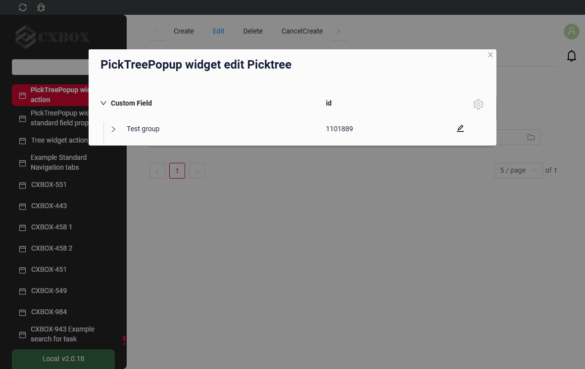

###### Как добавить? { #how-to-add_5 }
??? Example "Пример"

    **Шаг 1** Создайте widget.json с типом `Form`, который появляется при нажатии кнопки
    ```json
    --8<--
    {{ external_links.github_raw_doc }}/widgets/picktree/actions/edit/picktreepopup/picktree/inlineform/myEntity3353FormForEditPickTreeInlineForm.widget.json
    --8<--
    ```

    **Шаг 2** Добавьте widget.json с типом `Form` в соответствующий **.view.json**.
    ```json
    --8<--
    {{ external_links.github_raw_doc }}/widgets/picktree/actions/edit/myexample3353listinlineform.view.json
    --8<--
    ```

    **Шаг 3** Добавьте кнопку `edit` и виджет с типом `Form` в соответствующий **.widget.json**.

    `options`.`edit`: имя виджета, который появляется при нажатии кнопки

    ```json
    --8<--
    {{ external_links.github_raw_doc }}/widgets/picktree/actions/edit/picktreepopup/picktree/inlineform/myEntity3353PickTreeInlineForm.widget.json
    --8<--
    ```

    [:material-play-circle: Живой пример]({{ external_links.code_samples }}/ui/#/screen/myexample3353/view/myexample3353listinlineform){:target="_blank"} ·
    [:fontawesome-brands-github: GitHub]({{ external_links.github_ui }}/{{ external_links.github_branch }}/src/main/java/org/demo/documentation/widgets/picktree/actions/edit){:target="_blank"}

##### With view
_неприменимо_

#### **<a id="standart_delete">Delete</a>**
[:material-play-circle: Живой пример]({{ external_links.code_samples }}/ui/#/screen/myexample3353/view/myexample3354form){:target="_blank"} ·
[:fontawesome-brands-github: GitHub]({{ external_links.github_ui }}/{{ external_links.github_branch }}/src/main/java/org/demo/documentation/widgets/picktree/actions/delete){:target="_blank"}

`Delete` удаляет существующую запись.

!!! tips "Совет"
    Учтите, что на удаляемую строку может ссылаться другая часть системы или родительская сущность. Для ясности обработайте это исключение и покажите пользователю объяснение.

###### Как это выглядит? { #how-does-it-look_6 }
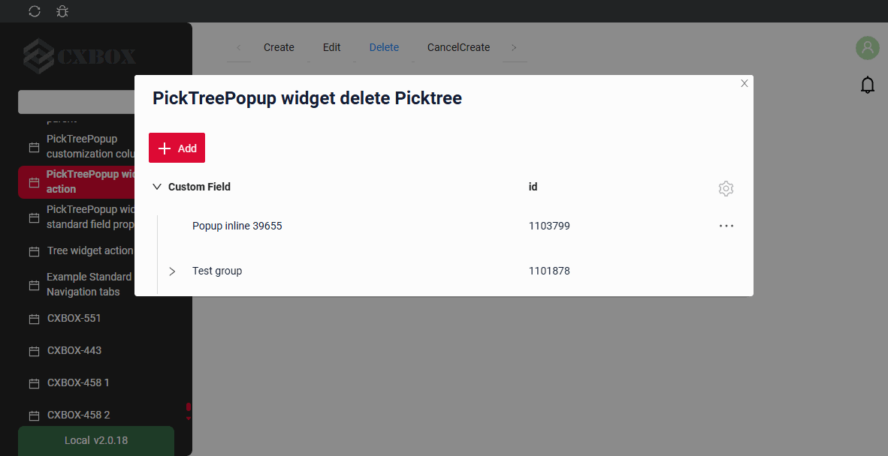

###### Как добавить? { #how-to-add_6 }
??? Example "Пример"

    **Шаг 1** Добавьте действие *delete* в соответствующий **VersionAwareResponseService**.

    По умолчанию кнопка доступна, когда запись существует.

    ```java
    --8<--
    {{ external_links.github_raw_doc }}/widgets/picktree/actions/delete/forpicktreepopup/MyEntity3354PickPickService.java:getActions
    --8<--
    ```
    **Шаг 2** Необязательно. Добавьте *deleteEntity* в соответствующий **VersionAwareResponseService**.

    ```java
    --8<--
    {{ external_links.github_raw_doc }}/widgets/picktree/actions/delete/forpicktreepopup/MyEntity3354PickPickService.java:deleteEntity
    --8<--
    ```
    **Шаг 3** Добавьте кнопку или группу кнопок в соответствующий **.widget.json**.

    ```json
    --8<--
    {{ external_links.github_raw_doc }}/widgets/picktree/actions/delete/forpicktreepopup/myEntity3354PickPickPickTreePopup.widget.json
    --8<--
    ```
    [:material-play-circle: Живой пример]({{ external_links.code_samples }}/ui/#/screen/myexample3353/view/myexample3354form){:target="_blank"} ·
    [:fontawesome-brands-github: GitHub]({{ external_links.github_ui }}/{{ external_links.github_branch }}/src/main/java/org/demo/documentation/widgets/picktree/actions/delete){:target="_blank"}

###  **<a id="standart_save">Сохранение</a>**
[:material-play-circle: Живой пример]({{ external_links.code_samples }}/ui/#/screen/myexample3353/view/myexample3355form){:target="_blank"} ·
[:fontawesome-brands-github: GitHub]({{ external_links.github_ui }}/{{ external_links.github_branch }}/src/main/java/org/demo/documentation/widgets/picktree/actions/save){:target="_blank"}

`Save` сохраняет введённые или изменённые данные. см. [информацию об автосохранении](/ru/features/element/autosave/autosave)
 
###### Как это выглядит? { #how-does-it-look_7 }


###### Как добавить? { #how-to-add_7 }
??? Example "Пример"

    **Шаг 1** Добавьте действие *save* в соответствующий **VersionAwareResponseService**.

    ```java
    --8<--
    {{ external_links.github_raw_doc }}/widgets/picktree/actions/save/MyExample3355Service.java:getActions
    --8<--
    ```  
    **Шаг 2** Добавьте кнопку или группу кнопок в соответствующий **.widget.json**.
   
    ```json
    --8<--
    {{ external_links.github_raw_doc }}/widgets/picktree/actions/save/MyExample3355Form.widget.json
    --8<--
    ```

    [:material-play-circle: Живой пример]({{ external_links.code_samples }}/ui/#/screen/myexample3353/view/myexample3355form){:target="_blank"} ·
    [:fontawesome-brands-github: GitHub]({{ external_links.github_ui }}/{{ external_links.github_branch }}/src/main/java/org/demo/documentation/widgets/picktree/actions/save){:target="_blank"}


### **<a id="standart_cancel_create">Отмена создания (Cancel-create)</a>**
[:material-play-circle: Живой пример]({{ external_links.code_samples }}/ui/#/screen/myexample3353/view/myexample3356form){:target="_blank"} ·
[:fontawesome-brands-github: GitHub]({{ external_links.github_ui }}/{{ external_links.github_branch }}/src/main/java/org/demo/documentation/widgets/picktree/actions/cancelcreate/basic){:target="_blank"}

`Cancel-create` отменяет создание новой записи без сохранения введённых данных
 
###### Как это выглядит? { #how-does-it-look_8 }
=== "Базовый"
    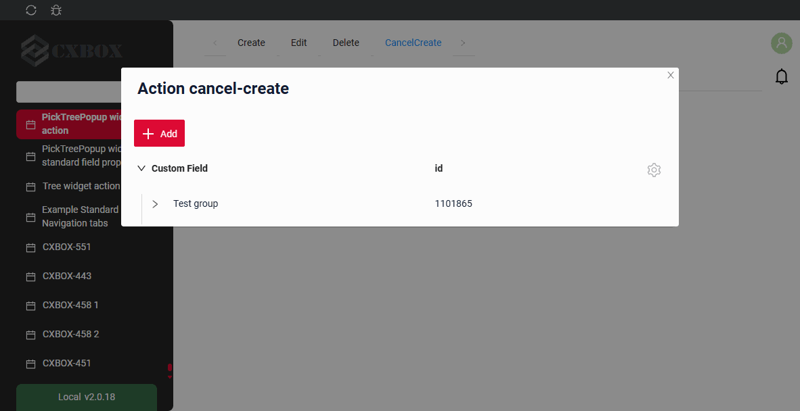
=== "С drilldown"
    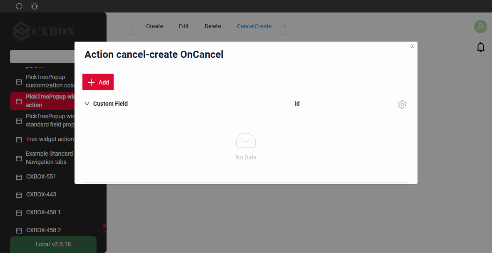

###### Как добавить? { #how-to-add_8 }
??? Example "Пример"
    === "Базовый"

        **Шаг 1** Добавьте стандартное действие *cancelCreate* в соответствующий **VersionAwareResponseService**.
        По умолчанию интерфейс отображает "cancelCreate".

        ```java
        --8<--
        {{ external_links.github_raw_doc }}/widgets/picktree/actions/cancelcreate/basic/MyEntity3356PickPickService.java:getActions
        --8<--
        ```
         **Шаг 2** Добавьте действие *cancel-create* в соответствующий **PickTreePopup**.
 
        ```json
        --8<--
        {{ external_links.github_raw_doc }}/widgets/picktree/actions/cancelcreate/basic/myEntity3356PickPickPickTreePopup.widget.json
        --8<--
        ```
 
        [:material-play-circle: Живой пример]({{ external_links.code_samples }}/ui/#/screen/myexample3353/view/myexample3356form){:target="_blank"} ·
        [:fontawesome-brands-github: GitHub]({{ external_links.github_ui }}/{{ external_links.github_branch }}/src/main/java/org/demo/documentation/widgets/picktree/actions/cancelcreate/basic){:target="_blank"}

    === "С postAction"
        **Шаг 1** Добавьте действие *cancel* с postAction в соответствующий **VersionAwareResponseService**.
    
        ```java
        --8<--
        {{ external_links.github_raw_doc }}/widgets/picktree/actions/cancelcreate/postaction/MyEntity3356PickPostActionPickService.java:getActions
        --8<--
        ``` 
 
        **Шаг 2** Добавьте кнопку или группу кнопок в соответствующий **.widget.json**.
       
        ```json
        --8<--
        {{ external_links.github_raw_doc }}/widgets/picktree/actions/cancelcreate/postaction/myEntity3356PickPostActionPickPickTreePopup.widget.json
        --8<--
        ```
 
        [:material-play-circle: Живой пример]({{ external_links.code_samples }}/ui/#/screen/myexample3353/view/myexample3356formpostaction){:target="_blank"} ·
        [:fontawesome-brands-github: GitHub]({{ external_links.github_ui }}/{{ external_links.github_branch }}/src/main/java/org/demo/documentation/widgets/picktree/actions/cancelcreate/postaction){:target="_blank"}

    === "Метод onCancel"
        !!! info
            Только для **Inner** бизнес-компонента, подробнее см. [Бизнес-компонент](/ru/environment/businesscomponent/businesscomponent/)

        **Шаг 1** Добавьте стандартное действие *cancelCreate* в соответствующий **VersionAwareResponseService**.
    
        ```java
        --8<--
        {{ external_links.github_raw_doc }}/widgets/picktree/actions/cancelcreate/oncancel/MyEntity3356PickOnCancelPickService.java:getActions
        --8<--
        ```
        **Шаг 2** Добавьте метод *onCancel* в соответствующий **VersionAwareResponseService**.
        ```java
        --8<--
        {{ external_links.github_raw_doc }}/widgets/picktree/actions/cancelcreate/oncancel/MyEntity3356PickOnCancelPickService.java:onCancel
        --8<--
        ```
        **Шаг 3** Добавьте кнопку или группу кнопок в соответствующий **.widget.json**.
       
        ```json
        --8<--
        {{ external_links.github_raw_doc }}/widgets/picktree/actions/cancelcreate/oncancel/myEntity3356PickOnCancelPickPickTreePopup.widget.json
        --8<--
        ```

        [:material-play-circle: Живой пример]({{ external_links.code_samples }}/ui/#/screen/myexample3353/view/myexample3356formoncancel){:target="_blank"} ·
        [:fontawesome-brands-github: GitHub]({{ external_links.github_ui }}/{{ external_links.github_branch }}/src/main/java/org/demo/documentation/widgets/picktree/actions/cancelcreate/oncancel){:target="_blank"}


### Дополнительные свойства { #additional-properties }
#### <a id="noderefresh">Обновление узла</a>
После действия (save, delete, cancel-create) всплывающее окно обновляет только **узел**, к которому относится запись, так же как [виджет Tree](/ru/widget/type/tree/tree/#noderefresh):

* строка обновляется из ответа действия или, если ответ её не содержит, перечитывается запросом `?id.equals=<id>`;
* row-meta строки запрашивается повторно;
* если запись больше не возвращается, строка удаляется из дерева;
* узел сворачивается, а его уже загруженные дочерние записи забываются, поэтому при следующем раскрытии они загружаются заново.

!!! info
    Соседние и родительские записи автоматически **не** обновляются. `PostAction.refreshBC` в этом релизе не поддерживается для дерева: корневая страница загружается заново, но раскрытые узлы и их уже загруженные дочерние записи остаются как есть.

#### Настройка отображаемых колонок { #customization-of-displayed-columns }
неприменимо
#### Фильтрация { #filtration }
##### Основы { #basic }
подробнее см. [Поля](/ru/widget/type/property/filtration/filtration/)

Фильтрация всплывающего окна — стандартный запрос. Строки, соответствующие фильтру, возвращаются бэкендом без иерархии, а всплывающее окно решает, как их отображать, см. [Режимы поиска](#searchmodes).

Панель над деревом показывает:

* `Clear N filter(s)` — количество применённых фильтров и возможность их сбросить;
* `Shown N` — сколько найденных записей сейчас отображается;
* `More M` — сколько найденных записей ещё не отображено, где `M` — количество найденных записей минус количество показанных.

!!! info
    В режиме пагинации `nextAndPreviousWithCount` запрос `/count` после фильтрации **не** выполняется. Вместо количества найденных записей отображается иконка `i` с подсказкой **"Load more and show count"**.

###### Как это выглядит? { #how-does-it-look_9 }
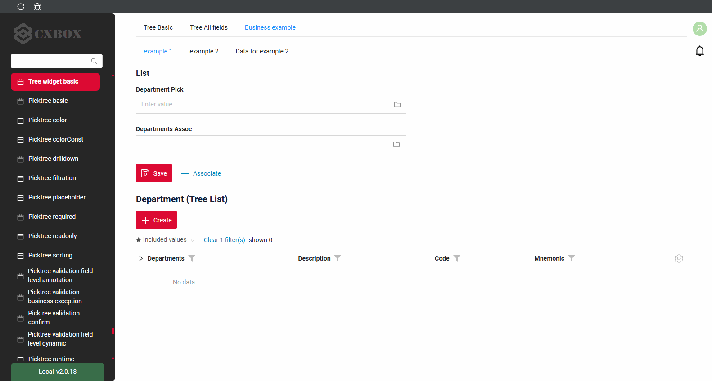

###### Как добавить? { #how-to-add_9 }
??? Example "Пример"
    Шаги выполняются для бизнес-компонента всплывающего окна.
    Найденные записи отображаются согласно [режимам поиска](#searchmodes).

    `Шаг 1` Добавьте **@SearchParameter** в соответствующий **DataResponseDTO**.
    ```java
    --8<--
    {{ external_links.github_raw_doc }}/widgets/property/filtration/filtergroup/MyExample3616DTO.java
    --8<--
    ```

    `Шаг 2` Добавьте **fields.enableFilter** в соответствующий **FieldMetaBuilder**.
    ```java
    --8<--
    {{ external_links.github_raw_doc }}/widgets/property/filtration/filtergroup/MyExample3616Meta.java:buildIndependentMeta
    --8<--
    ```

    [:material-play-circle: Живой пример]({{ external_links.code_samples }}/ui/#/screen/myexample3261/view/myexample3261list){:target="_blank"} ·
    [:fontawesome-brands-github: GitHub]({{ external_links.github_ui }}/{{ external_links.github_branch }}/src/main/java/org/demo/documentation/widgets/tree/base/inner){:target="_blank"}

##### FullTextSearch
`FullTextSearch` — когда пользователь вводит текст в поле полнотекстового поиска, виджет фильтрует строки, соответствующие запросу.
см. [FullTextSearch](/ru/widget/type/property/filtration/filtration/#by-fulltextsearch)

Результат полнотекстового поиска отображается так же, как результат фильтрации, см. [Режимы поиска](#searchmodes).

###### Как это выглядит? { #how-does-it-look_10 }


###### Как добавить? { #how-to-add_10 }
??? Example "Пример"
    `Шаг 1` Добавьте файл расширения FullTextSearchExt.java
    ```java
    import java.util.Optional;
    import jakarta.persistence.criteria.CriteriaBuilder;
    import jakarta.persistence.criteria.Path;
    import jakarta.persistence.criteria.Predicate;
    import lombok.NonNull;
    import lombok.experimental.UtilityClass;
    import org.apache.commons.lang3.StringUtils;
    import org.cxbox.core.crudma.bc.BusinessComponent;

    @UtilityClass
    public class FullTextSearchExt {

        @NonNull
        public static Optional<String> getFullTextSearchFilterParam(BusinessComponent bc) {
            return Optional.ofNullable(bc.getParameters().getParameter("_fullTextSearch"));
        }

        public static Predicate likeIgnoreCase(String value, CriteriaBuilder cb, Path<String> path) {
            return cb.like(cb.lower(path), StringUtils.lowerCase("%" + value + "%"));
        }

    }
    ```

    `Шаг 2` Добавьте **specifications** для полей полнотекстового поиска в соответствующий **JpaRepository**.
    ```java
    --8<--
    {{ external_links.github_raw_doc }}/widgets/tree/data/inner/MyEntity3261Repository.java
    --8<--
    ```

    `Шаг 3` Добавьте **getSpecification** в соответствующий **VersionAwareResponseService** всплывающего окна.
    ```java
    --8<--
    {{ external_links.github_raw_doc }}/widgets/tree/base/inner/Myexample3261PickService.java:getSpecification
    --8<--
    ```

    `Шаг 4` Добавьте **fullTextSearch** в соответствующий **.widget.json**.

    `enabled` true/false

    `placeholder` — описание для fullTextSearch

    ```json
    --8<--
    {{ external_links.github_raw_doc }}/widgets/tree/base/inner/myexample3261TreePickListPopup.widget.json
    --8<--
    ```

    [:material-play-circle: Живой пример]({{ external_links.code_samples }}/ui/#/screen/myexample3261/view/myexample3261list){:target="_blank"} ·
    [:fontawesome-brands-github: GitHub]({{ external_links.github_ui }}/{{ external_links.github_branch }}/src/main/java/org/demo/documentation/widgets/tree/base/inner){:target="_blank"}

##### Персональная группа фильтров { #personal-filter-group }
неприменимо
##### Группа фильтров { #filter-group }
неприменимо

#### <a id="searchmodes">Режимы поиска</a>
[:material-play-circle: Живой пример]({{ external_links.code_samples }}/ui/#/screen/myexample3261/view/myexample3261list){:target="_blank"} ·
[:fontawesome-brands-github: GitHub]({{ external_links.github_ui }}/{{ external_links.github_branch }}/src/main/java/org/demo/documentation/widgets/tree/base/inner){:target="_blank"}

Способ отображения результата фильтрации и полнотекстового поиска задаётся **options**.**tree**.**searchModes**.

Есть два режима:

* `collapse` — **результаты поиска и дерево**. Дерево показывает найденные записи вместе с записями, необходимыми для навигации: путь навигации над каждой найденной записью восстанавливается на `onFilterApplyNestLevel` уровней вверх. Пользователь может перемещаться по дереву, раскрывать и сворачивать ветви, видеть соседние записи и подгружать дополнительные записи.
* `hide` — **только результаты поиска**. Дерево показывает только найденные записи, всё остальное скрыто. Пользователь работает только с результатом поиска и не может перемещаться по другим записям дерева.

Оба режима могут быть доступны одновременно. **Первый** элемент массива `searchModes` — режим, активный при применении фильтра; пользователь переключается между доступными режимами в меню шестерёнки всплывающего окна.

**Восстановление пути вверх**

В режиме `collapse` записи, родители которых ещё не загружены, помещаются под псевдоузел. Кнопка `>...` загружает недостающих родителей запросом `?id.equals=<parentId>` и перемещает записи в иерархию. Один клик восстанавливает до **2** уровней вложенности, поэтому для глубокой иерархии кнопку нужно нажать несколько раз.

###### Как это выглядит? { #how-does-it-look_11 }
=== "Результаты поиска и дерево (collapse)"
    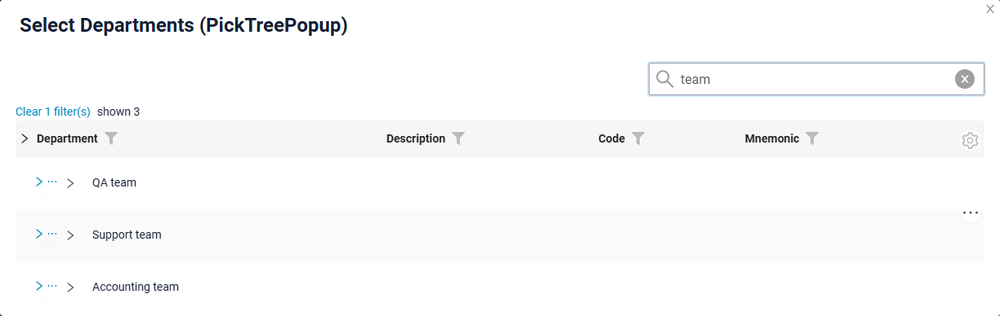
=== "Только результаты поиска (hide)"
    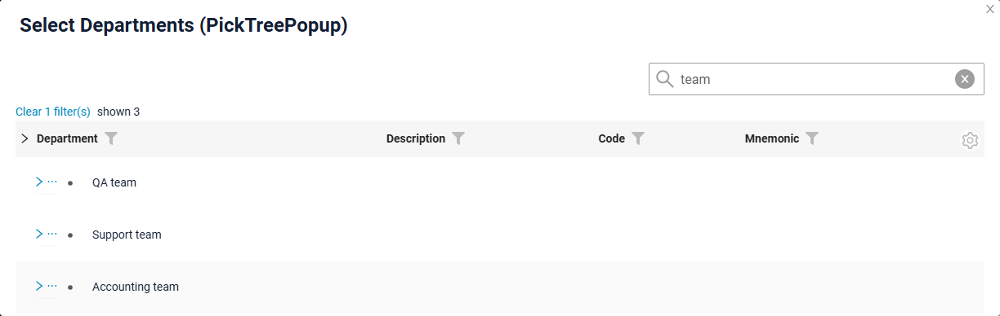
=== "Переключение между режимами"
    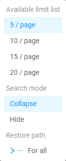

###### Как добавить? { #how-to-add_11 }
??? Example "Пример"
    **Шаг 1** Добавьте **options**.**tree**.**searchModes** в соответствующий **_.widget.json_**.

    Первый элемент массива — режим, активный при применении фильтра.

    ```
    "tree": {
      "searchModes": ["collapse", "hide"],
      "onFilterApplyNestLevel": 0
    }
    ```

    ```json
    --8<--
    {{ external_links.github_raw_doc }}/widgets/tree/base/inner/myexample3261TreePickListPopup.widget.json
    --8<--
    ```

    [:material-play-circle: Живой пример]({{ external_links.code_samples }}/ui/#/screen/myexample3261/view/myexample3261list){:target="_blank"} ·
    [:fontawesome-brands-github: GitHub]({{ external_links.github_ui }}/{{ external_links.github_branch }}/src/main/java/org/demo/documentation/widgets/tree/base/inner){:target="_blank"}

#### <a id="pagination">Пагинация</a>
`Pagination` — разбиение содержимого на отдельные страницы, упрощающее навигацию и работу с большими объёмами информации.
см. [Пагинация](/ru/widget/type/property/pagination/pagination)

У всплывающего окна нет стрелок навигации. Вместо стрелки «вперёд» последняя строка узла — кнопка **`More`**, которая загружает следующую страницу узла и добавляет её к уже загруженным записям. Выбор лимита (`availableLimitsList`) перенесён в меню шестерёнки всплывающего окна.

Кнопка `More` работает по тому же алгоритму, что и стрелка «вперёд» в трёх режимах пагинации:

| Режим пагинации              | Когда отображается `More`                                                                     | Счётчик                                     |
|------------------------------|-----------------------------------------------------------------------------------------------|---------------------------------------------|
| `nextAndPreviousWithHasNext` | `hasNext`, возвращённый бэкендом, равен `true`                                                  | не отображается                             |
| `nextAndPreviousWithCount`   | `count` больше количества уже загруженных записей                                               | сколько записей осталось загрузить          |
| `nextAndPreviousSmart`       | бэкенд вернул больше записей, чем лимит узла                                                    | не отображается                             |

подробнее см. [Режимы пагинации](/ru/widget/type/property/pagination/pagination)

###### Как это выглядит? { #how-does-it-look_12 }


###### Как добавить? { #how-to-add_12 }
??? Example "Пример"
    === "availableLimitsList"
        Список доступных лимитов отображается в меню шестерёнки всплывающего окна.

        ```
        "pagination": {
          "availableLimitsList": [1, 2, 3]
        }
        ```

        ```json
        --8<--
        {{ external_links.github_raw_doc }}/widgets/property/pagination/availablelimitselist/myEntity3867PickPickPickTreePopup.widget.json
        --8<--
        ```

        [:fontawesome-brands-github: GitHub]({{ external_links.github_ui }}/{{ external_links.github_branch }}/src/main/java/org/demo/documentation/widgets/property/pagination/availablelimitselist){:target="_blank"}

    === "Лимит страницы"
        Количество записей, запрашиваемых для узла по умолчанию, определяется лимитом страницы, см. [Лимит записей на странице](/ru/widget/type/property/defaultlimitpage/defaultlimitpage).

        ```json
        --8<--
        {{ external_links.github_raw_doc }}/widgets/property/defaultlimitpage/myEntity359PickPickPickTreePopup.widget.json
        --8<--
        ```

        [:material-play-circle: Живой пример]({{ external_links.code_samples }}/ui/#/screen/myexample359/view/myexample359picktree){:target="_blank"} ·
        [:fontawesome-brands-github: GitHub]({{ external_links.github_ui }}/{{ external_links.github_branch }}/src/main/java/org/demo/documentation/widgets/property/defaultlimitpage){:target="_blank"}

#### Экспорт в Excel { #export-to-excel }
неприменимо

#### Множественная загрузка файлов { #multi-upload-files }
неприменимо

##### Сортировка { #sorting }
`Sorting` позволяет пользователю сортировать записи по колонке.
см. [Сортировка](/ru/widget/type/property/sorting/sorting)

Сортировка во всплывающем окне работает **внутри узла**: записи сортируются среди дочерних элементов одного родителя, сама иерархия не меняется. В остальном сортировка стандартная.

#### <a id="selection">Режимы выбора</a>
Значение выбирается кликом по строке. Что именно пользователю разрешено выбирать, задаётся **options**.**tree**.**selection**:

* `node` — можно выбирать только узлы.
* `leaf` — можно выбирать только листья.
* `nodeAndLeaf` — можно выбирать и узлы, и листья.

Строки, которые нельзя выбрать, всё равно отображаются и могут быть раскрыты, поэтому пользователь перемещается по ним к нужной записи.

!!! info
    Строка `More` — элемент управления пагинацией, а не запись, поэтому её нельзя выбрать.

##### Как это выглядит? { #how-does-it-look_13 }
=== "node"
    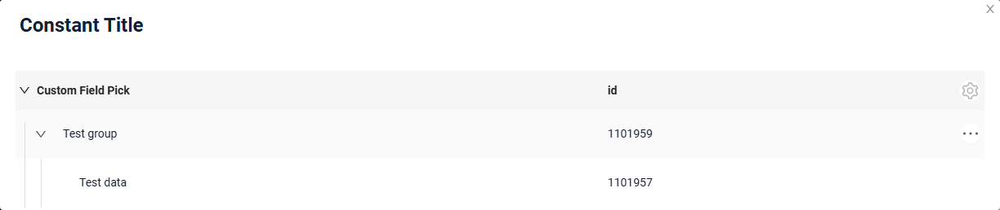
=== "leaf"
    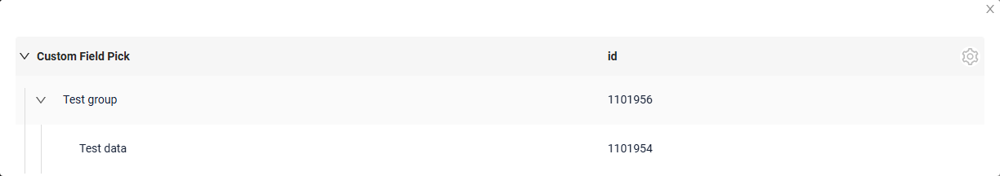
=== "nodeAndLeaf"
    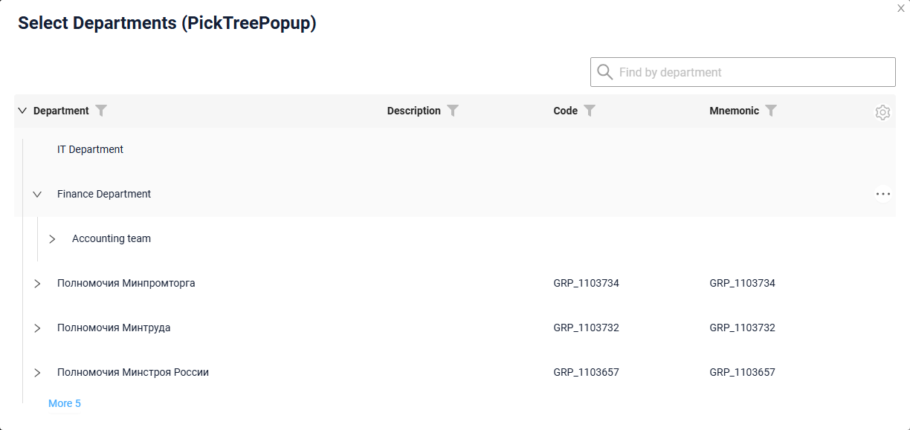

##### Как добавить? { #how-to-add_13 }
??? Example "Пример"
    Добавьте в **options** параметр **tree** в соответствующий **.widget.json**.

    ```
    "tree": {
      "selection": "leaf"
    }
    ```

    ```json
    --8<--
    {{ external_links.github_raw_doc }}/widgets/tree/base/inner/myexample3261TreePickListPopup.widget.json
    --8<--
    ```

    [:material-play-circle: Живой пример]({{ external_links.code_samples }}/ui/#/screen/myexample3261/view/myexample3261list){:target="_blank"} ·
    [:fontawesome-brands-github: GitHub]({{ external_links.github_ui }}/{{ external_links.github_branch }}/src/main/java/org/demo/documentation/widgets/tree/base/inner){:target="_blank"}
