# Pie1D

Виджет `Pie1D` показывает, как целое делится на части: каждая запись — сегмент кольца, его размер — значение записи.
Сумма всех значений может отображаться в центре. Обычно данные агрегированы, например продажи по каждому клиенту.
Данные могут поступать как из базы данных, так и из внешних источников.

## Основы { #basics }
[:material-play-circle: Живой пример]({{ external_links.code_samples }}/ui/#/screen/myexample4207){:target="_blank"} ·
[:fontawesome-brands-github: GitHub]({{ external_links.github_ui }}/{{ external_links.github_branch }}/src/main/java/org/demo/documentation/widgets/pie1d/base/defaultfields){:target="_blank"}

### Как это выглядит? { #how-does-it-look }


Виджет показывает:

* сегмент для каждой записи. Размер сегмента — значение записи, подпись внутри показывает значение.
* легенду с названиями записей. Клик по названию в легенде скрывает сегмент или снова показывает его, сумма в центре пересчитывается.
* сумму в центре, см. [Итог](#total).
* подсказку с названием и значением при наведении мыши на сегмент, см. [Подсказка](#tooltip).

Меню шестерёнки в правом верхнем углу переключает виджет между диаграммой и таблицей, см. [Табличный режим](#tablemode).

Правила для данных:

* одна запись — один сегмент. Агрегируйте данные: например, одна запись на клиента с суммой его продаж.
* сегменты идут по часовой стрелке сверху в порядке записей, возвращённых бэкендом.
* у каждой записи уникальный `id`. Он необходим для корректной работы виджета и для drilldown.

Параметры:

| Параметр | Описание |
|---|---|
| `valueFieldKey` | Обязательный. Поле со значением сегмента. Поле должно быть числом. |
| `titleFieldKey` | Поле с названием сегмента: легенда, подсказка и цвета сегментов. Без него сегменты окрашиваются по значению, а легенда не отображается. |
| `descriptionFieldKey` | Список полей для подсказки, см. [Подсказка](#tooltip). |
| `valuePosition` | Где отображаются значения: `inner` (по умолчанию) или `outer`, см. [Положение подписей](#labelposition). |
| `total` | Текст в центре, см. [Итог](#total). |

###  <a id="Howtoaddbacis">Как добавить?</a>
??? Example "Пример"
    **Шаг 1** Создайте **DataResponseDTO** с полями сегмента: названием и значением.
    ```java
    --8<--
    {{ external_links.github_raw_doc }}/widgets/pie1d/base/defaultfields/MyExample4207DTO.java
    --8<--
    ```

    **Шаг 2** Создайте **DAO**, наследующий AbstractAnySourceBaseDAO<> и реализующий AnySourceBaseDAO. Он возвращает запись для каждого сегмента, каждую с уникальным id.
    ```java
    --8<--
    {{ external_links.github_raw_doc }}/widgets/pie1d/base/defaultfields/MyExample4207Dao.java:getStats
    --8<--
    ```

    **Шаг 3** Создайте **Meta**, наследующий AnySourceFieldMetaBuilder.
    ```java
    --8<--
    {{ external_links.github_raw_doc }}/widgets/pie1d/base/defaultfields/MyExample4207Meta.java
    --8<--
    ```

    **Шаг 4** Создайте **Service**, наследующий AnySourceVersionAwareResponseService.
    ```java
    --8<--
    {{ external_links.github_raw_doc }}/widgets/pie1d/base/defaultfields/MyExample4207Service.java
    --8<--
    ```

    **Шаг 5** Создайте **.widget.json** с типом **Pie1D**. Добавьте поля диаграммы в **fields** и сопоставьте их в **options.chart1D**.

    `options.chart1D` задаёт, какие поля виджета использует диаграмма:
    
    | Параметр | Описание |
    |---|---|
    | `valueFieldKey` | Обязательный. Поле со значением сегмента. Поле должно быть числом. |
    | `titleFieldKey` | Поле с названием сегмента: легенда, подсказка и цвета сегментов. Без него сегменты окрашиваются по значению, а легенда не отображается. |
    | `descriptionFieldKey` | Список полей для подсказки, см. [Подсказка](#tooltip). |
    | `valuePosition` | Где отображаются значения: `inner` (по умолчанию) или `outer`, см. [Положение подписей](#labelposition). |
    | `total` | Текст в центре, см. [Итог](#total). |
    

    ```json
    --8<--
    {{ external_links.github_raw_doc }}/widgets/pie1d/base/defaultfields/MyExample4207Pie.widget.json
    --8<--
    ```

    **Шаг 6** Добавьте виджет в соответствующий **.view.json**.
    ```json
    --8<--
    {{ external_links.github_raw_doc }}/widgets/pie1d/base/defaultfields/myexample4207pie.view.json
    --8<--
    ```

    **Шаг 7** Задайте **PAGE_LIMIT** бизнес-компонента в **BC_PROPERTIES** больше количества сегментов: диаграмма показывает одну страницу, см. [Лимит страницы](#pagelimit).
    ```
    myExampleBc4207;1000;NULL;NULL;'""';
    ```

    [:material-play-circle: Живой пример]({{ external_links.code_samples }}/ui/#/screen/myexample4207){:target="_blank"} ·
    [:fontawesome-brands-github: GitHub]({{ external_links.github_ui }}/{{ external_links.github_branch }}/src/main/java/org/demo/documentation/widgets/pie1d/base/defaultfields){:target="_blank"}

## <a id="Title">Заголовок</a>
### Базовый заголовок { #title-basic }
[:material-play-circle: Живой пример]({{ external_links.code_samples }}/ui/#/screen/myexample4220){:target="_blank"} ·
[:fontawesome-brands-github: GitHub]({{ external_links.github_ui }}/{{ external_links.github_branch }}/src/main/java/org/demo/documentation/widgets/pie1d/title){:target="_blank"}

`Title` для виджета (необязательно)

Типы:

* `постоянный заголовок`: показывает постоянный текст.
* `пустой постоянный заголовок`: если нужно визуально связать виджеты, расположив их один под другим

#### Как это выглядит? { #how-does-it-look_1 }
=== "Постоянный заголовок"
    
=== "Пустой постоянный заголовок"
    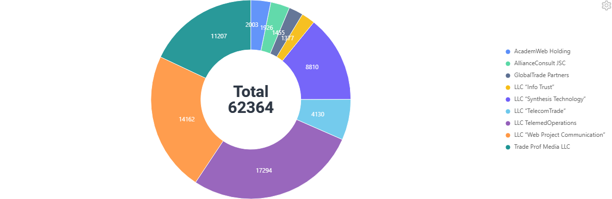

#### Как добавить? { #how-to-add }
??? Example "Пример"
    === "Постоянный заголовок"
        **Шаг 1** Добавьте название в **title** в **_.widget.json_**.
        ```json
        --8<--
        {{ external_links.github_raw_doc }}/widgets/pie1d/title/withtitle/MyExample4220Pie.widget.json
        --8<--
        ```

        [:material-play-circle: Живой пример]({{ external_links.code_samples }}/ui/#/screen/myexample4220/view/myexample4220pie){:target="_blank"} ·
        [:fontawesome-brands-github: GitHub]({{ external_links.github_ui }}/{{ external_links.github_branch }}/src/main/java/org/demo/documentation/widgets/pie1d/title/withtitle){:target="_blank"}

    === "Пустой постоянный заголовок"
        **Шаг 1** Удалите параметр **title** из **_.widget.json_**.
        ```json
        --8<--
        {{ external_links.github_raw_doc }}/widgets/pie1d/title/withouttitle/MyExample4217Pie.widget.json
        --8<--
        ```

        [:material-play-circle: Живой пример]({{ external_links.code_samples }}/ui/#/screen/myexample4220/view/myexample4217pie){:target="_blank"} ·
        [:fontawesome-brands-github: GitHub]({{ external_links.github_ui }}/{{ external_links.github_branch }}/src/main/java/org/demo/documentation/widgets/pie1d/title/withouttitle){:target="_blank"}

### Цвет заголовка { #title-color }
_неприменимо_

## <a id="bc">Бизнес-компонент</a>
Указывает бизнес-компонент (BC), к которому относится этот виджет.
Бизнес-компонент представляет определённую часть системы, отвечающую за конкретную бизнес-логику или данные.

подробнее см. [Бизнес-компонент](/ru/environment/businesscomponent/businesscomponent/)

Данные диаграммы обычно вычисляются, поэтому в примерах используется бизнес-компонент AnySource: DAO строит запись для каждого сегмента.
Задайте каждой записи уникальный `id`, см. [Основы](#basics).

## <a id="Showcondition">Условие отображения</a>

* `без условия отображения — рекомендуется`: виджет виден всегда

  [:material-play-circle: Живой пример]({{ external_links.code_samples }}/ui/#/screen/myexample4207){:target="_blank"} ·
  [:fontawesome-brands-github: GitHub]({{ external_links.github_ui }}/{{ external_links.github_branch }}/src/main/java/org/demo/documentation/widgets/pie1d/base/defaultfields){:target="_blank"}

* `условие отображения по текущей сущности`: **не рекомендуется** для диаграммы.

* `условие отображения по родительской сущности`: условие может содержать логическое выражение, зависящее от родительской сущности. Обновление полей родителя вызывает пересчёт условия только при сохранении или если поле force active и отображается на том же view

  [:material-play-circle: Живой пример]({{ external_links.code_samples }}/ui/#/screen/myexample4215){:target="_blank"} ·
  [:fontawesome-brands-github: GitHub]({{ external_links.github_ui }}/{{ external_links.github_branch }}/src/main/java/org/demo/documentation/widgets/pie1d/showcondition){:target="_blank"}

!!! tips "Совет"
    По возможности рекомендуется не использовать `Show condition`, так как широкое применение этой возможности усложняет поддержку приложения.

#### <a id="howdoesitlook">Как это выглядит?</a>
=== "без условия отображения"
    
=== "условие отображения по текущей сущности"
    **Не рекомендуется** для диаграммы.
=== "условие отображения по родительской сущности"
    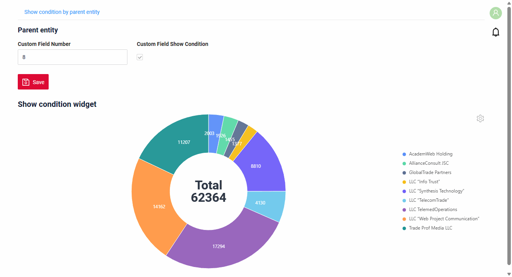

#### <a id="howtoadd">Как добавить?</a>
??? Example "Пример"

    === "без условия отображения"
        см. [Основы](#basics)

    === "условие отображения по текущей сущности"
        **Не рекомендуется** для диаграммы.

    === "условие отображения по родительской сущности"
        **Шаг 1** Добавьте **showCondition** в **_.widget.json_**. Подробнее см. [showCondition](/ru/widget/type/property/showcondition/showcondition)
        ```json
        --8<--
        {{ external_links.github_raw_doc }}/widgets/pie1d/showcondition/MyExample4215Pie.widget.json
        --8<--
        ```
        [:material-play-circle: Живой пример]({{ external_links.code_samples }}/ui/#/screen/myexample4215){:target="_blank"} ·
        [:fontawesome-brands-github: GitHub]({{ external_links.github_ui }}/{{ external_links.github_branch }}/src/main/java/org/demo/documentation/widgets/pie1d/showcondition){:target="_blank"}

## <a id="fields">Поля</a>
Настройка полей. Массив fields определяет поля сегмента. Остальные поля отображаются в [табличном режиме](#tablemode).

```json
{
    "title": "Sales",
    "key": "value",
    "type": "number"
}
```

* **"title"**

  Описание: заголовок поля. Это заголовок колонки в табличном режиме.

  Тип: String (необязательно).

* **"key"**

  Описание: имя поля в соответствующем DataResponseDTO.

  Тип: String (обязательно).

* **"type"**

  Описание: [Типы полей](/ru/widget/fields/fieldtypes/). Поле `valueFieldKey` должно быть числовым.

  Тип: String (обязательно).

Поле с типом `hidden` не отображается в табличном режиме. Используйте его для значений, нужных только фильтру drilldown.

### Как добавить? { #how-to-add_1 }
??? Example "Пример"
    Добавьте поле в **_.widget.json_**.

      ```json
         --8<--
         {{ external_links.github_raw_doc }}/widgets/pie1d/base/defaultfields/MyExample4207Pie.widget.json
         --8<--
      ```

## <a id="Fieldslayout">Компоновка (options layout)</a>
**options.layout** — в этом типе не используется.

## Действия { #actions }
_неприменимо_

### Дополнительные свойства { #additional-properties }

#### <a id="tooltip">Подсказка</a>
[:material-play-circle: Живой пример]({{ external_links.code_samples }}/ui/#/screen/myexample4211){:target="_blank"} ·
[:fontawesome-brands-github: GitHub]({{ external_links.github_ui }}/{{ external_links.github_branch }}/src/main/java/org/demo/documentation/widgets/pie1d/tooltip){:target="_blank"}

При наведении мыши на сегмент подсказка показывает название и значение сегмента.
Можно настроить, чтобы подсказка не отображалась.

###### Как это выглядит? { #how-does-it-look_2 }
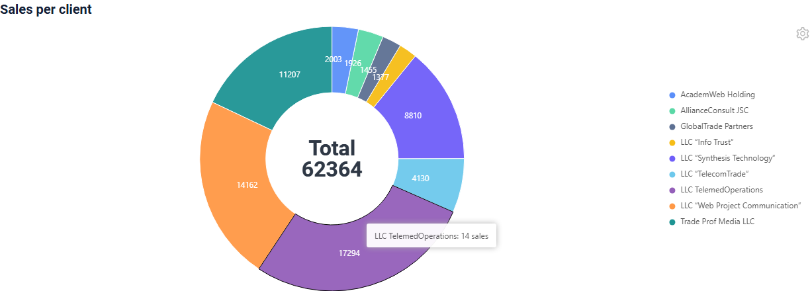

###### Как добавить? { #how-to-add_2 }
??? Example "Пример"
    **Шаг 1** Добавьте поле с текстом в **DataResponseDTO** и заполните его в **DAO**.
    ```java
    --8<--
    {{ external_links.github_raw_doc }}/widgets/pie1d/tooltip/MyExample4211Dao.java:getStats
    --8<--
    ```
    **Шаг 2** Добавьте поле в **fields** и в **descriptionFieldKey** в **_.widget.json_**.

    При наведении мыши на сегмент подсказка показывает название и значение сегмента. options.chart1D.descriptionFieldKey заменяет их текстом перечисленных полей через запятую. Без titleFieldKey и descriptionFieldKey подсказка не отображается.

    ```json
    --8<--
    {{ external_links.github_raw_doc }}/widgets/pie1d/tooltip/MyExample4211Pie.widget.json
    --8<--
    ```
    [:material-play-circle: Живой пример]({{ external_links.code_samples }}/ui/#/screen/myexample4211){:target="_blank"} ·
    [:fontawesome-brands-github: GitHub]({{ external_links.github_ui }}/{{ external_links.github_branch }}/src/main/java/org/demo/documentation/widgets/pie1d/tooltip){:target="_blank"}

#### <a id="color">Цвет</a>
`Color` задаёт цвета сегментов. По умолчанию каждое название получает свой цвет из палитры диаграммы.

**Вычисляемый цвет**

[:material-play-circle: Живой пример]({{ external_links.code_samples }}/ui/#/screen/myexample4218){:target="_blank"} ·
[:fontawesome-brands-github: GitHub]({{ external_links.github_ui }}/{{ external_links.github_branch }}/src/main/java/org/demo/documentation/widgets/pie1d/color){:target="_blank"}

*Вычисляемый цвет* можно использовать для динамического изменения цвета сегмента. Он меняется в зависимости от бизнес-логики или данных приложения.
В примере ключевые клиенты синие, остальные серые.

**Постоянный цвет**

**не рекомендуется**: задаёт всем сегментам один цвет, и сегменты невозможно различить.

###### Как это выглядит? { #how-does-it-look_3 }
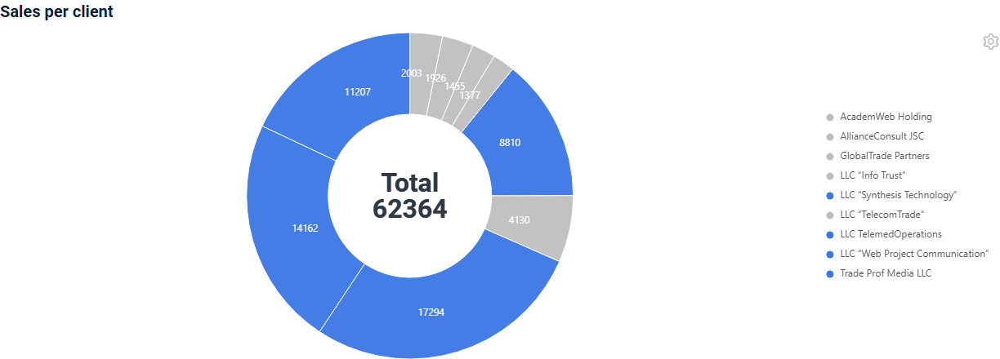

###### Как добавить? { #how-to-add_3 }
??? Example "Пример"
    === "Вычисляемый цвет"
        **Шаг 1** Добавьте `собственное поле для цвета` в соответствующий **DataResponseDTO**. Поле может содержать цвет в формате HEX или быть null.
        ```java
        --8<--
        {{ external_links.github_raw_doc }}/widgets/pie1d/color/MyExample4218Dao.java:getStats
        --8<--
        ```

        **Шаг 2** Добавьте **"bgColorKey"** : `собственное поле для цвета` к полю `valueFieldKey` в .widget.json.
        ```json
        --8<--
        {{ external_links.github_raw_doc }}/widgets/pie1d/color/MyExample4218Pie.widget.json
        --8<--
        ```
        [:material-play-circle: Живой пример]({{ external_links.code_samples }}/ui/#/screen/myexample4218){:target="_blank"} ·
        [:fontawesome-brands-github: GitHub]({{ external_links.github_ui }}/{{ external_links.github_branch }}/src/main/java/org/demo/documentation/widgets/pie1d/color){:target="_blank"}

    === "Постоянный цвет"
        **не рекомендуется**

#### <a id="drilldown">Drilldown</a>
[:material-play-circle: Живой пример]({{ external_links.code_samples }}/ui/#/screen/myexample4219/view/myexample4219pie){:target="_blank"} ·
[:fontawesome-brands-github: GitHub]({{ external_links.github_ui }}/{{ external_links.github_branch }}/src/main/java/org/demo/documentation/widgets/pie1d/drilldown/drilldown){:target="_blank"}

`DrillDown` позволяет перейти в другое представление кликом по сегменту. Целевое представление и другие части drill-down можно вычислять на основе бизнес-логики приложения.
В примере клик по сегменту открывает список продаж, отфильтрованный по клиенту сегмента.

Также при необходимости можно отфильтровать данные целевого представления до его открытия, `подробнее см.` [DrillDown](/ru/features/element/drilldown/drilldown)

###### Как это выглядит? { #how-does-it-look_4 }
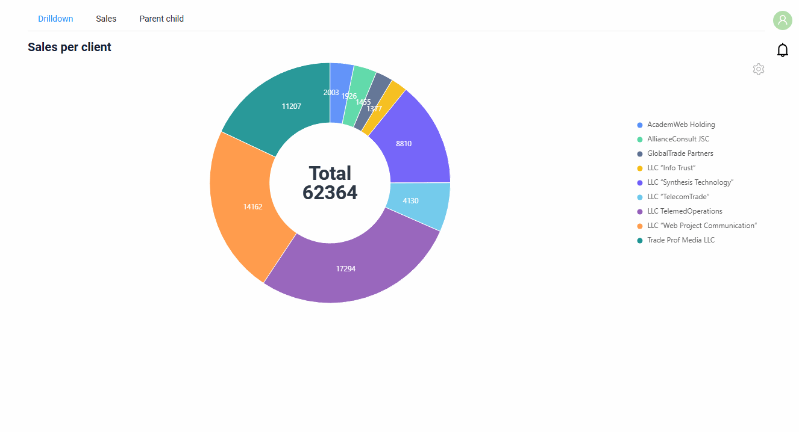

###### Как добавить? { #how-to-add_4 }
??? Example "Пример"
    **Шаг 1** Добавьте **"drillDown": true** к полю `valueFieldKey` в **_.widget.json_**.
    ```json
    --8<--
    {{ external_links.github_raw_doc }}/widgets/pie1d/drilldown/drilldown/MyExample4219Pie.widget.json
    --8<--
    ```

    **Шаг 2** Добавьте [fields.setDrilldown](/ru/features/element/drilldown/drilldown) или **fields.setDrilldownWithFilter** для поля `valueFieldKey` в соответствующий **FieldMetaBuilder**.
    ```java
    --8<--
    {{ external_links.github_raw_doc }}/widgets/pie1d/drilldown/drilldown/MyExample4219Meta.java:buildRowDependentMeta
    --8<--
    ```
    [:material-play-circle: Живой пример]({{ external_links.code_samples }}/ui/#/screen/myexample4219/view/myexample4219pie){:target="_blank"} ·
    [:fontawesome-brands-github: GitHub]({{ external_links.github_ui }}/{{ external_links.github_branch }}/src/main/java/org/demo/documentation/widgets/pie1d/drilldown/drilldown){:target="_blank"}

#### <a id="tablemode">Табличный режим</a>
[:material-play-circle: Живой пример]({{ external_links.code_samples }}/ui/#/screen/myexample4207){:target="_blank"} ·
[:fontawesome-brands-github: GitHub]({{ external_links.github_ui }}/{{ external_links.github_branch }}/src/main/java/org/demo/documentation/widgets/pie1d/base/defaultfields){:target="_blank"}

Меню шестерёнки в правом верхнем углу содержит два режима:

* `Chart` (по умолчанию): круговая диаграмма.
* `Table`: те же записи в виде таблицы, колонка для каждого поля виджета.

Режим не сохраняется: виджет открывается в режиме диаграммы.

###### Как это выглядит? { #how-does-it-look_5 }
=== "Chart"
    
=== "Table"
    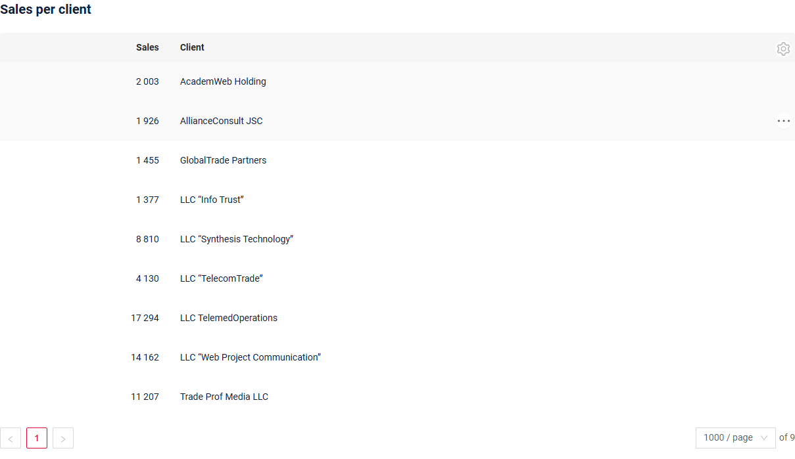

###### Как добавить? { #how-to-add_5 }
Переключатель режима доступен для каждой диаграммы, настройка не нужна.

#### <a id="Icon">Иконка</a>
**недоступно**.

[:material-play-circle: Живой пример]({{ external_links.code_samples }}/ui/#/screen/myexample4214){:target="_blank"} ·
[:fontawesome-brands-github: GitHub]({{ external_links.github_ui }}/{{ external_links.github_branch }}/src/main/java/org/demo/documentation/widgets/pie1d/icon){:target="_blank"}

#### <a id="total">Итог</a>
[:material-play-circle: Живой пример]({{ external_links.code_samples }}/ui/#/screen/myexample4261){:target="_blank"} ·
[:fontawesome-brands-github: GitHub]({{ external_links.github_ui }}/{{ external_links.github_branch }}/src/main/java/org/demo/documentation/widgets/pie1d/total){:target="_blank"}

`Total` — текст в центре круговой диаграммы.

| Параметр | Описание |
|---|---|
| `func` | Агрегирующая функция по значениям отображаемых сегментов: `sum`, `avg`, `min`, `max`. `avg` округляется до двух знаков после запятой. |
| `argFieldKeys` | Поля для `func` вместо `valueFieldKey`, например количество продаж, когда сегменты показывают суммы. |
| `description` | Текст над результатом `func`. |
| `value` | Постоянный текст вместо `func` и `description`. Задайте либо `value`, либо `func`, но не оба. |

Клик по названию в легенде скрывает сегмент, `func` пересчитывается по отображаемым сегментам.

###### Как это выглядит? { #how-does-it-look_6 }
=== "Агрегирующая функция"
    
=== "Агрегация другого поля"
    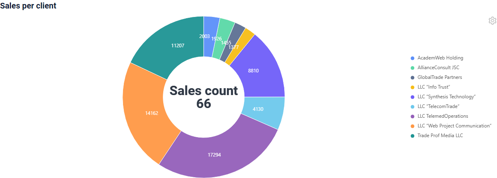
=== "Постоянный текст"
    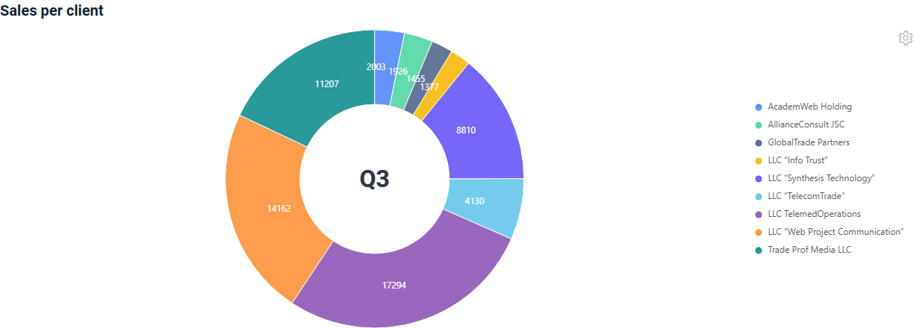

###### Как добавить? { #how-to-add_6 }
??? Example "Пример"
    === "Агрегирующая функция"
        Добавьте **total** с **func** и **description** в **options.chart1D** в **_.widget.json_**.

         `options.chart1D.total`

        ```json
        --8<--
        {{ external_links.github_raw_doc }}/widgets/pie1d/total/MyExample4261Sum.widget.json
        --8<--
        ```
        [:material-play-circle: Живой пример]({{ external_links.code_samples }}/ui/#/screen/myexample4261/view/myexample4261sum){:target="_blank"} ·
        [:fontawesome-brands-github: GitHub]({{ external_links.github_ui }}/{{ external_links.github_branch }}/src/main/java/org/demo/documentation/widgets/pie1d/total){:target="_blank"}

    === "Агрегация другого поля"
        **Шаг 1** Добавьте поле в **DataResponseDTO** и заполните его в **DAO**.
        ```java
        --8<--
        {{ external_links.github_raw_doc }}/widgets/pie1d/total/MyExample4261Dao.java:getStats
        --8<--
        ```
        **Шаг 2** Добавьте поле в **fields** и в **total.argFieldKeys** в **_.widget.json_**.
        ```json
        --8<--
        {{ external_links.github_raw_doc }}/widgets/pie1d/total/MyExample4261ArgFields.widget.json
        --8<--
        ```
        [:material-play-circle: Живой пример]({{ external_links.code_samples }}/ui/#/screen/myexample4261/view/myexample4261argfields){:target="_blank"} ·
        [:fontawesome-brands-github: GitHub]({{ external_links.github_ui }}/{{ external_links.github_branch }}/src/main/java/org/demo/documentation/widgets/pie1d/total){:target="_blank"}

    === "Постоянный текст"
        Добавьте **total.value** в **options.chart1D** в **_.widget.json_**.
        ```json
        --8<--
        {{ external_links.github_raw_doc }}/widgets/pie1d/total/MyExample4261Value.widget.json
        --8<--
        ```
        [:material-play-circle: Живой пример]({{ external_links.code_samples }}/ui/#/screen/myexample4261/view/myexample4261value){:target="_blank"} ·
        [:fontawesome-brands-github: GitHub]({{ external_links.github_ui }}/{{ external_links.github_branch }}/src/main/java/org/demo/documentation/widgets/pie1d/total){:target="_blank"}

#### <a id="innerspace">Отверстие в центре</a>
[:material-play-circle: Живой пример]({{ external_links.code_samples }}/ui/#/screen/myexample4261/view/myexample4261innerspace){:target="_blank"} ·
[:fontawesome-brands-github: GitHub]({{ external_links.github_ui }}/{{ external_links.github_branch }}/src/main/java/org/demo/documentation/widgets/pie1d/total){:target="_blank"}

Можно задать размер отверстия в центре круговой диаграммы, от `0` до `1`, по умолчанию `0.5`.
`0` рисует полный круг без отверстия, [итог](#total) отображается поверх сегментов.

###### Как это выглядит? { #how-does-it-look_7 }
=== "Отверстие по умолчанию"
    
=== "Без отверстия"
    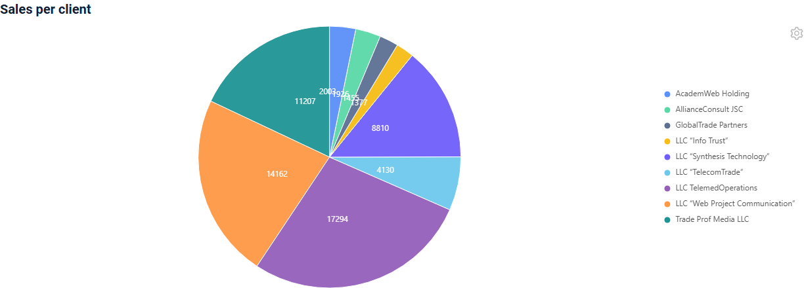

###### Как добавить? { #how-to-add_7 }
??? Example "Пример"
    Добавьте **total.innerSpace** в **options.chart1D** в **_.widget.json_**.

    `options.chart1D.total.innerSpace`
    
    ```json
    --8<--
    {{ external_links.github_raw_doc }}/widgets/pie1d/total/MyExample4261InnerSpace.widget.json
    --8<--
    ```
    [:material-play-circle: Живой пример]({{ external_links.code_samples }}/ui/#/screen/myexample4261/view/myexample4261innerspace){:target="_blank"} ·
    [:fontawesome-brands-github: GitHub]({{ external_links.github_ui }}/{{ external_links.github_branch }}/src/main/java/org/demo/documentation/widgets/pie1d/total){:target="_blank"}

#### <a id="labelposition">Положение подписей</a>
[:material-play-circle: Живой пример]({{ external_links.code_samples }}/ui/#/screen/myexample4262){:target="_blank"} ·
[:fontawesome-brands-github: GitHub]({{ external_links.github_ui }}/{{ external_links.github_branch }}/src/main/java/org/demo/documentation/widgets/pie1d/labelposition){:target="_blank"}

Можно задать, где отображаются значения сегментов:

* `inner` (по умолчанию): внутри сегментов.
* `outer`: снаружи диаграммы, рядом с сегментами.

###### Как это выглядит? { #how-does-it-look_8 }
=== "inner"
    
=== "outer"
    

###### Как добавить? { #how-to-add_8 }
??? Example "Пример"
    Добавьте **valuePosition** в **options.chart1D** в **_.widget.json_**.

    `options.chart1D.valuePosition`

    ```json
    --8<--
    {{ external_links.github_raw_doc }}/widgets/pie1d/labelposition/MyExample4262Outer.widget.json
    --8<--
    ```
    [:material-play-circle: Живой пример]({{ external_links.code_samples }}/ui/#/screen/myexample4262/view/myexample4262outer){:target="_blank"} ·
    [:fontawesome-brands-github: GitHub]({{ external_links.github_ui }}/{{ external_links.github_branch }}/src/main/java/org/demo/documentation/widgets/pie1d/labelposition){:target="_blank"}

#### Настройка отображаемых колонок { #customization-of-displayed-columns }
**недоступно**.

#### Фильтрация { #filtration }
##### Основы { #basic }
[:material-play-circle: Живой пример]({{ external_links.code_samples }}/ui/#/screen/myexample4264){:target="_blank"} ·
[:fontawesome-brands-github: GitHub]({{ external_links.github_ui }}/{{ external_links.github_branch }}/src/main/java/org/demo/documentation/widgets/pie1d/filtration){:target="_blank"}

Работает только в [табличном режиме](#tablemode). В режиме диаграммы фильтров нет. После возврата в режим диаграммы она строится только по отфильтрованным записям. Режим диаграммы не показывает, что фильтр применён: фильтр сбрасывается в табличном режиме.
подробнее см. [Фильтрация](/ru/widget/type/property/filtration/filtration/)

###### Как это выглядит? { #how-does-it-look_9 }
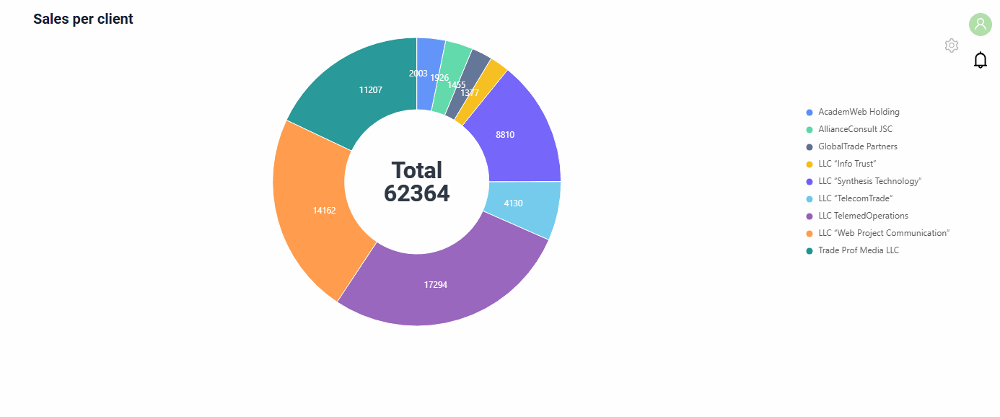

###### Как добавить? { #how-to-add_9 }
??? Example "Пример"
    Когда данные диаграммы поступают из AnySource DAO, DAO применяет фильтр сам.

    `Шаг 1` Добавьте **@SearchParameter** в соответствующий **DataResponseDTO**.
    ```java
    --8<--
    {{ external_links.github_raw_doc }}/widgets/property/filtration/filtergroup/MyExample3616DTO.java
    --8<--
    ```

    `Шаг 2` Добавьте **fields.enableFilter** в соответствующий **FieldMetaBuilder**.
    ```java
    --8<--
    {{ external_links.github_raw_doc }}/widgets/property/filtration/filtergroup/MyExample3616Meta.java:buildIndependentMeta
    --8<--
    ```

    `Шаг 3` Примените фильтр в **getList** AnySource DAO.
    ```java
    --8<--
    {{ external_links.github_raw_doc }}/widgets/pie1d/filtration/MyExample4264Dao.java:getList
    --8<--
    ```

    [:material-play-circle: Живой пример]({{ external_links.code_samples }}/ui/#/screen/myexample4264){:target="_blank"} ·
    [:fontawesome-brands-github: GitHub]({{ external_links.github_ui }}/{{ external_links.github_branch }}/src/main/java/org/demo/documentation/widgets/pie1d/filtration){:target="_blank"}

##### FullTextSearch
[:material-play-circle: Живой пример]({{ external_links.code_samples }}/ui/#/screen/myexample4265){:target="_blank"} ·
[:fontawesome-brands-github: GitHub]({{ external_links.github_ui }}/{{ external_links.github_branch }}/src/main/java/org/demo/documentation/widgets/pie1d/fulltextsearch){:target="_blank"}

Работает только в [табличном режиме](#tablemode) при наличии `options.fullTextSearch` в **_.widget.json_**: поле поиска отображается над таблицей. Виджет отправляет текст поиска на бэкенд, и AnySource DAO диаграммы применяет его сам. После возврата в режим диаграммы она строится только по отфильтрованным записям. Режим диаграммы не показывает, что фильтр применён: фильтр сбрасывается в табличном режиме.
см. [FullTextSearch](/ru/widget/type/property/filtration/filtration/#by-fulltextsearch)

###### Как это выглядит? { #how-does-it-look_10 }


###### Как добавить? { #how-to-add_10 }
??? Example "Пример"
    Когда данные диаграммы поступают из AnySource DAO, DAO применяет поиск сам.

    `Шаг 1` Добавьте файл расширения FullTextSearchExt.java
    ```java
    import java.util.Optional;
    import jakarta.persistence.criteria.CriteriaBuilder;
    import jakarta.persistence.criteria.Path;
    import jakarta.persistence.criteria.Predicate;
    import lombok.NonNull;
    import lombok.experimental.UtilityClass;
    import org.apache.commons.lang3.StringUtils;
    import org.cxbox.core.crudma.bc.BusinessComponent;

    @UtilityClass
    public class FullTextSearchExt {

        @NonNull
        public static Optional<String> getFullTextSearchFilterParam(BusinessComponent bc) {
            return Optional.ofNullable(bc.getParameters().getParameter("_fullTextSearch"));
        }

        public static Predicate likeIgnoreCase(String value, CriteriaBuilder cb, Path<String> path) {
            return cb.like(cb.lower(path), StringUtils.lowerCase("%" + value + "%"));
        }

    }
    ```

    `Шаг 2` Примените текст поиска в **getList** AnySource DAO.
    ```java
    --8<--
    {{ external_links.github_raw_doc }}/widgets/pie1d/fulltextsearch/MyExample4265Dao.java:getList
    --8<--
    ```

    `Шаг 3` Добавьте **fullTextSearch** в соответствующий **.widget.json**.

    `enabled` true/false

    `placeholder` — описание для fullTextSearch

    ```json
    --8<--
    {{ external_links.github_raw_doc }}/widgets/pie1d/fulltextsearch/MyExample4265Pie.widget.json
    --8<--
    ```

    [:material-play-circle: Живой пример]({{ external_links.code_samples }}/ui/#/screen/myexample4265){:target="_blank"} ·
    [:fontawesome-brands-github: GitHub]({{ external_links.github_ui }}/{{ external_links.github_branch }}/src/main/java/org/demo/documentation/widgets/pie1d/fulltextsearch){:target="_blank"}
##### Персональная группа фильтров { #personal-filter-group }
**недоступно**: в меню настроек диаграммы есть только пункты `Mode`, поэтому пункта `Save filters` нет.
##### Группа фильтров { #filter-group }
[:material-play-circle: Живой пример]({{ external_links.code_samples }}/ui/#/screen/myexample4266){:target="_blank"} ·
[:fontawesome-brands-github: GitHub]({{ external_links.github_ui }}/{{ external_links.github_branch }}/src/main/java/org/demo/documentation/widgets/pie1d/filtergroup){:target="_blank"}

Работает только в [табличном режиме](#tablemode): группы фильтров бизнес-компонента отображаются над таблицей, как в виджете List. Виджет отправляет фильтр выбранной группы на бэкенд, и AnySource DAO диаграммы применяет его сам. После возврата в режим диаграммы она строится только по отфильтрованным записям. Режим диаграммы не показывает, что фильтр применён: фильтр сбрасывается в табличном режиме.
см. [Группа фильтров](/ru/widget/type/property/filtration/filtration/#by-filter-group)

###### Как это выглядит? { #how-does-it-look_11 }


###### Как добавить? { #how-to-add_11 }
??? Example "Пример"
    Когда данные диаграммы поступают из AnySource DAO, DAO сам применяет фильтр группы.

    !!! tips "Совет"
        Чтобы получить условия для колонки `filters`, выполните следующие шаги:

        * Добавьте функцию фильтрации для полей
        * Заполните нужные фильтры в интерфейсе.
        * Откройте панель разработчика.
        * Найдите нужный запрос.
        * Используйте часть этого запроса с фильтром как значение `filters`

        

    **Шаг 1** Добавьте бизнес-компонент в таблицу **BC_FILTER_GROUPS**

    ```csv
    name;bc;filters;ID
    Sum from 5000;myExampleBc4266;value.greaterOrEqualThan=5000;
    Sum under 5000;myExampleBc4266;value.lessThan=5000;
    ```

    **Шаг 2** Примените фильтр в **getList** AnySource DAO.
    ```java
    --8<--
    {{ external_links.github_raw_doc }}/widgets/pie1d/filtergroup/MyExample4266Dao.java:getList
    --8<--
    ```

    [:material-play-circle: Живой пример]({{ external_links.code_samples }}/ui/#/screen/myexample4266){:target="_blank"} ·
    [:fontawesome-brands-github: GitHub]({{ external_links.github_ui }}/{{ external_links.github_branch }}/src/main/java/org/demo/documentation/widgets/pie1d/filtergroup){:target="_blank"}

#### Пагинация { #pagination }
_неприменимо_: диаграмма показывает одну страницу, см. [Лимит страницы](#pagelimit).

#### Экспорт в Excel { #export-to-excel }
**недоступно**.

#### Множественная загрузка файлов { #multi-upload-files }
_неприменимо_

#### Сортировка { #sorting }
[:material-play-circle: Живой пример]({{ external_links.code_samples }}/ui/#/screen/myexample4267){:target="_blank"} ·
[:fontawesome-brands-github: GitHub]({{ external_links.github_ui }}/{{ external_links.github_branch }}/src/main/java/org/demo/documentation/widgets/pie1d/sorting){:target="_blank"}

Работает только в [табличном режиме](#tablemode) для полей с `enableSort` в Meta. Виджет отправляет сортировку на бэкенд, и AnySource DAO диаграммы применяет её сам. После возврата в режим диаграммы записи отображаются в отсортированном порядке.
подробнее см. [Сортировка](/ru/widget/type/property/sorting/sorting)

#### <a id="pagelimit">Лимит страницы</a>
[:material-play-circle: Живой пример]({{ external_links.code_samples }}/ui/#/screen/myexample4263){:target="_blank"} ·
[:fontawesome-brands-github: GitHub]({{ external_links.github_ui }}/{{ external_links.github_branch }}/src/main/java/org/demo/documentation/widgets/pie1d/pagelimit){:target="_blank"}

Диаграмма строится только по первой странице бизнес-компонента. Если у бизнес-компонента больше записей, чем лимит страницы,
диаграмма не строится: виджет открывается в табличном режиме, режим `Chart` недоступен, а иконка предупреждения объясняет причину.

Задайте лимит страницы бизнес-компонента равным количеству сегментов, см. [Лимит записей на странице](/ru/widget/type/property/defaultlimitpage/defaultlimitpage).

###### Как это выглядит? { #how-does-it-look_12 }
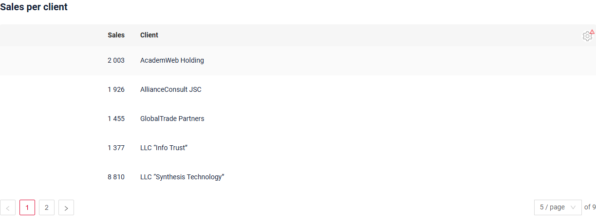

###### Как добавить? { #how-to-add_12 }
??? Example "Пример"
    **Шаг 1** Задайте лимит страницы в таблице **BC_PROPERTIES**. В примере он равен 5 для 9 сегментов.
    ```csv
    BC;PAGE_LIMIT;MASS_PAGE_LIMIT;SORT;FILTER;ID
    myExampleBc4263;5;NULL;NULL;'""';
    ```
    **Шаг 2** DAO возвращает страницу, запрошенную виджетом.
    ```java
    --8<--
    {{ external_links.github_raw_doc }}/widgets/pie1d/pagelimit/MyExample4263Dao.java:getList
    --8<--
    ```

#### <a id="nodata">Нет данных</a>
Когда бэкенд не возвращает записей, виджет показывает заглушку "No data" вместо диаграммы.

#### <a id="parentchild">Родитель-потомок</a>
В режиме диаграммы **недоступно**: клик по сегменту не выбирает запись, дочерние виджеты не меняются.
В [табличном режиме](#tablemode) клик по строке выбирает запись, и дочерние виджеты показывают данные этой записи.

[:material-play-circle: Живой пример]({{ external_links.code_samples }}/ui/#/screen/myexample4219/view/myexample4212pie){:target="_blank"} ·
[:fontawesome-brands-github: GitHub]({{ external_links.github_ui }}/{{ external_links.github_branch }}/src/main/java/org/demo/documentation/widgets/pie1d/drilldown/parentchild){:target="_blank"}
