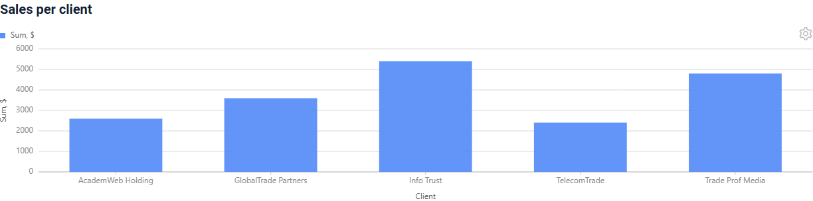
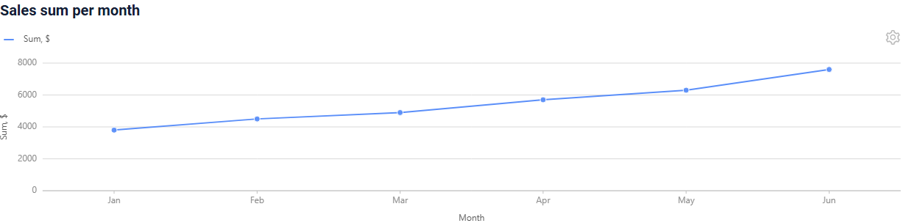
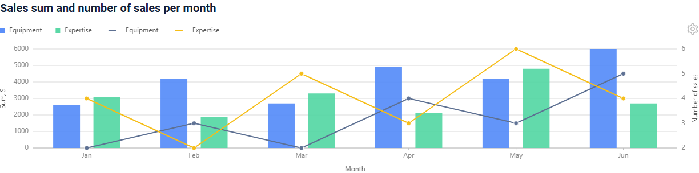
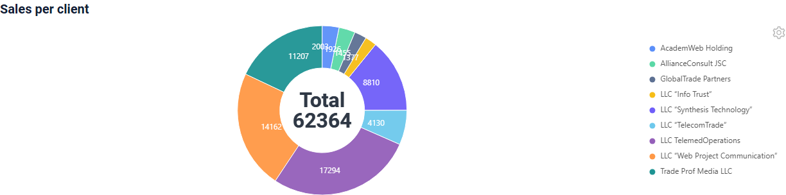
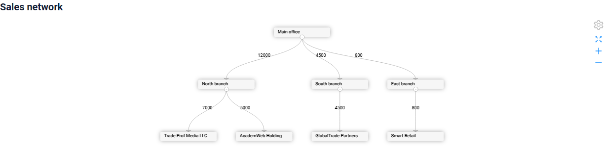

# Chart height
Available since [v3.0.2](/new/version3002/)

[:material-play-circle: Live Sample]({{ external_links.code_samples }}/ui/#/screen/myexample4279){:target="_blank"} ·
[:fontawesome-brands-github: GitHub]({{ external_links.github_ui }}/{{ external_links.github_branch }}/src/main/java/org/demo/documentation/widgets/property/chartheight){:target="_blank"}

`maxRows` sets the height of a chart in rows of a standard form. A row is 88 px: the label, the field and the gaps
of one form field. A chart with `maxRows` stands level with a form of the same number of rows next to it.

Without `maxRows` the chart keeps its own height, as before. A value that is not a positive whole number is ignored,
and the widget writes a message to the browser console.

This function is available for:

* [Column2D widget](/widget/type/column2d/column2d/#chartheight)
* [Line2D widget](/widget/type/line2d/line2d/#chartheight)
* [DualAxes2D widget](/widget/type/dualaxes2d/dualaxes2d/#chartheight)
* [Pie1D widget](/widget/type/pie1d/pie1d/#chartheight)
* [RelationGraph widget](/widget/type/relationgraph/relationgraph/#chartheight)
* Funnel widget
* RingProgress widget: the ring is a square of this height, no wider than the widget.

### How does it look?
=== "Column2D"
    
=== "Line2D"
    
=== "DualAxes2D"
    
=== "Pie1D"
    
=== "RelationGraph"
    

### How to add?
??? Example
    Add **maxRows** to the options of the chart in **_.widget.json_**. The options have their own key in each type of the widget:

    | Widget | Option |
    |---|---|
    | Column2D | `options.chart2D.maxRows` |
    | Line2D | `options.chart2D.maxRows` |
    | DualAxes2D | `options.dual2D.maxRows` |
    | Pie1D | `options.chart1D.maxRows` |
    | RelationGraph | `options.relationGraph.maxRows` |
    | Funnel | `options.funnelOptions.maxRows` |
    | RingProgress | `options.ringProgressOptions.maxRows` |

    === "Column2D"
        ```json
        --8<--
        {{ external_links.github_raw_doc }}/widgets/property/chartheight/myexample4279column2d.widget.json
        --8<--
        ```
        [:material-play-circle: Live Sample]({{ external_links.code_samples }}/ui/#/screen/myexample4279/view/myexample4279column2d){:target="_blank"} ·
        [:fontawesome-brands-github: GitHub]({{ external_links.github_ui }}/{{ external_links.github_branch }}/src/main/java/org/demo/documentation/widgets/property/chartheight){:target="_blank"}

    === "Line2D"
        ```json
        --8<--
        {{ external_links.github_raw_doc }}/widgets/property/chartheight/myexample4279line2d.widget.json
        --8<--
        ```
        [:material-play-circle: Live Sample]({{ external_links.code_samples }}/ui/#/screen/myexample4279/view/myexample4279line2d){:target="_blank"} ·
        [:fontawesome-brands-github: GitHub]({{ external_links.github_ui }}/{{ external_links.github_branch }}/src/main/java/org/demo/documentation/widgets/property/chartheight){:target="_blank"}

    === "DualAxes2D"
        ```json
        --8<--
        {{ external_links.github_raw_doc }}/widgets/property/chartheight/myexample4279dualaxes2d.widget.json
        --8<--
        ```
        [:material-play-circle: Live Sample]({{ external_links.code_samples }}/ui/#/screen/myexample4279/view/myexample4279dualaxes2d){:target="_blank"} ·
        [:fontawesome-brands-github: GitHub]({{ external_links.github_ui }}/{{ external_links.github_branch }}/src/main/java/org/demo/documentation/widgets/property/chartheight){:target="_blank"}

    === "Pie1D"
        ```json
        --8<--
        {{ external_links.github_raw_doc }}/widgets/property/chartheight/myexample4279pie1d.widget.json
        --8<--
        ```
        [:material-play-circle: Live Sample]({{ external_links.code_samples }}/ui/#/screen/myexample4279/view/myexample4279pie1d){:target="_blank"} ·
        [:fontawesome-brands-github: GitHub]({{ external_links.github_ui }}/{{ external_links.github_branch }}/src/main/java/org/demo/documentation/widgets/property/chartheight){:target="_blank"}

    === "RelationGraph"
        ```json
        --8<--
        {{ external_links.github_raw_doc }}/widgets/property/chartheight/myexample4279relationgraph.widget.json
        --8<--
        ```
        [:material-play-circle: Live Sample]({{ external_links.code_samples }}/ui/#/screen/myexample4279/view/myexample4279relationgraph){:target="_blank"} ·
        [:fontawesome-brands-github: GitHub]({{ external_links.github_ui }}/{{ external_links.github_branch }}/src/main/java/org/demo/documentation/widgets/property/chartheight){:target="_blank"}

    === "Funnel"
        ```json
        --8<--
        {{ external_links.github_raw_doc }}/widgets/property/chartheight/myexample4279funnel.widget.json
        --8<--
        ```
        [:material-play-circle: Live Sample]({{ external_links.code_samples }}/ui/#/screen/myexample4279/view/myexample4279funnel){:target="_blank"} ·
        [:fontawesome-brands-github: GitHub]({{ external_links.github_ui }}/{{ external_links.github_branch }}/src/main/java/org/demo/documentation/widgets/property/chartheight){:target="_blank"}

    === "RingProgress"
        ```json
        --8<--
        {{ external_links.github_raw_doc }}/widgets/property/chartheight/myexample4279ringprogress.widget.json
        --8<--
        ```
        [:material-play-circle: Live Sample]({{ external_links.code_samples }}/ui/#/screen/myexample4279/view/myexample4279ringprogress){:target="_blank"} ·
        [:fontawesome-brands-github: GitHub]({{ external_links.github_ui }}/{{ external_links.github_branch }}/src/main/java/org/demo/documentation/widgets/property/chartheight){:target="_blank"}
