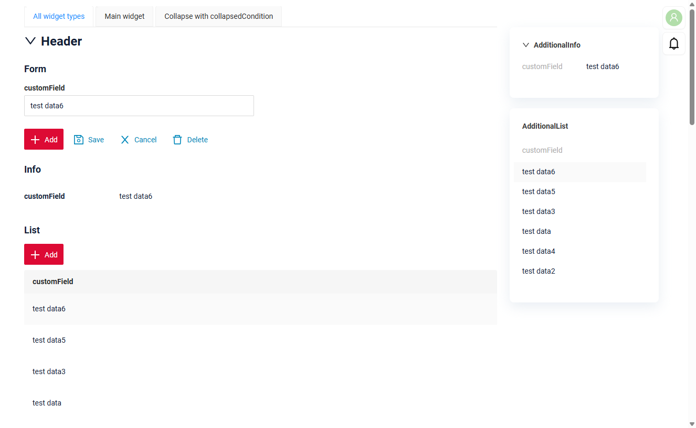
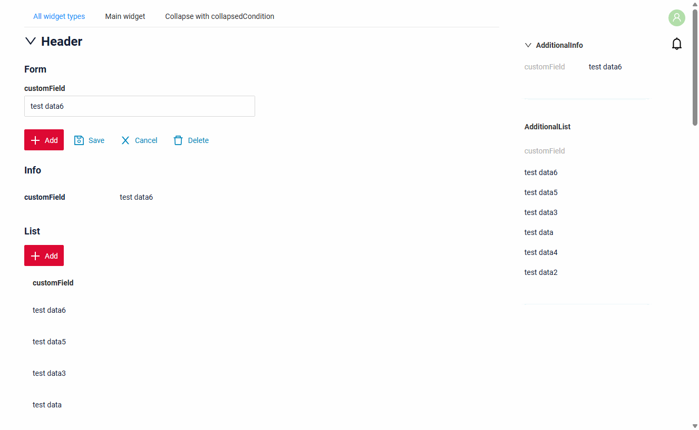
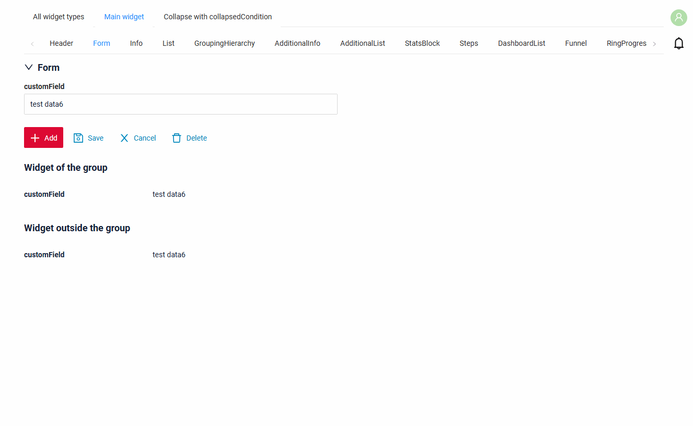
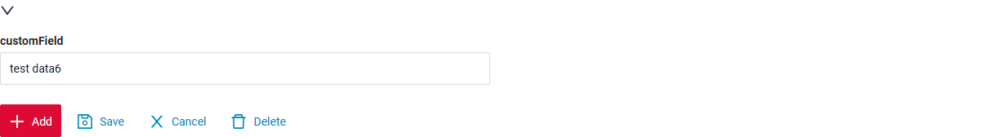
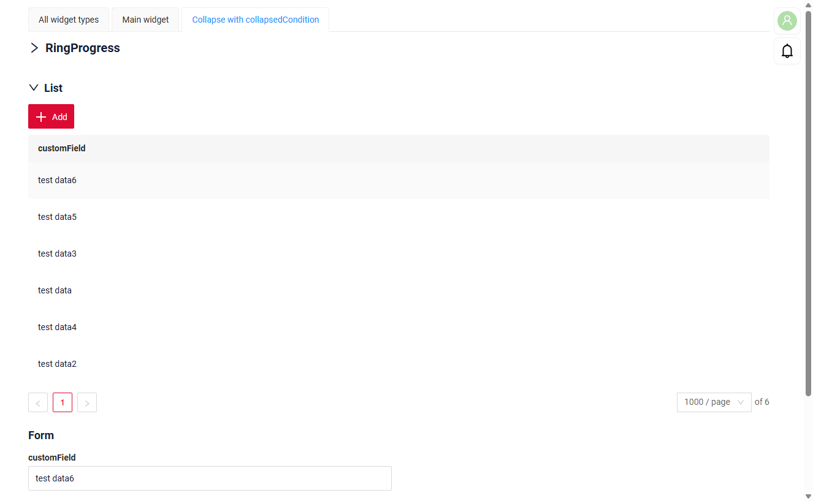

# Widget groups: collapse and expand
Widgets of a view can be combined into groups. The user collapses and expands the whole group with the toggle in the title of the first widget of the group: the **main widget**.

* the group is **expanded** by default (see [collapsedCondition](#collapsedcondition) to open the view with a collapsed group)
* when the group is collapsed, all widgets of the group except the main widget are hidden. The main widget keeps only its title, its content is hidden
* the toggle (an arrow) is shown before the title of the main widget: `down` while the group is expanded, `right` while it is collapsed
* the main widget is not set explicitly: it is always the first widget in `widgetNames`
* the state of the groups is kept while the user stays on the screen and is reset when another screen is opened

### How does it look?
=== "Expanded"
    
=== "Collapse and expand"
    

This function is available for the following widget types as the main widget:

* [HeaderWidget](/widget/type/headerwidget/headerwidget) (recommended, see [Recommendations](#recommendations))
* [Form](/widget/type/form/form)
* [Info](/widget/type/info/info)
* [List](/widget/type/list/list)
* [GroupingHierarchy](/widget/type/groupinghierarchy/groupinghierarchy)
* [AdditionalInfo](/widget/type/additionalinfo/additionalinfo)
* [AdditionalList](/widget/type/additionallist/additionallist)
* [StatsBlock](/widget/type/statblocks/statblocks)
* [Steps](/widget/type/steps/steps)
* DashboardList
* Funnel
* RingProgress
* [Tree](/widget/type/tree/tree)

Any of these widgets can also be a widget of the group (not the main one).

Popup widgets can not be the main widget of a group:

* [AssocListPopup](/widget/type/assoclistpopup/assoclistpopup)
* [FormPopup](/widget/type/formpopup/formpopup)
* [PickListPopup](/widget/type/picklistpopup/picklistpopup)

## Basics
[:material-play-circle: Live Sample]({{ external_links.code_samples }}/ui/#/screen/myexample3022/view/myexample3022list){:target="_blank"} ·
[:fontawesome-brands-github: GitHub]({{ external_links.github_ui }}/{{ external_links.github_branch }}/src/main/java/org/demo/documentation/widgets/property/collapse){:target="_blank"}

### How to add?
??? Example
    **Step 1** Add the widgets to the **_.view.json_** one after another: the main widget first, then the other widgets of the group.

    **Step 2** Add **"groups"** to the **_.view.json_**. Every group is a list of the names of its widgets in **"widgetNames"**: the first widget is the main widget.

    ```json
    --8<--
    {{ external_links.github_raw_doc }}/widgets/property/collapse/myexample3022list.view.json
    --8<--
    ```

    | Parameter            | Description                                                                                            |
    |----------------------|--------------------------------------------------------------------------------------------------------|
    | `widgetNames`        | names of the widgets of the group. **Required**. The first widget is the main widget: it has the toggle |
    | `collapsedCondition` | state of the group when the view is opened, see [collapsedCondition](#collapsedcondition). Optional   |

## <a id="mainwidget">Main widget</a>
The main widget is the first widget in `widgetNames`. It can be a widget of any type from the [list](#widget-groups-collapse-and-expand) above.

### How does it look?
=== "Form"
    The title of the main widget stays, the content of the main widget and the other widgets of the group are hidden. The widget outside the group stays as it is.

    
=== "HeaderWidget"
    The HeaderWidget has only the title: when the group is collapsed, the HeaderWidget stays as it is and the other widgets of the group are hidden.

    

[:material-play-circle: Live Sample]({{ external_links.code_samples }}/ui/#/screen/myexample3022/view/myexample3022mainheader){:target="_blank"} ·
[:fontawesome-brands-github: GitHub]({{ external_links.github_ui }}/{{ external_links.github_branch }}/src/main/java/org/demo/documentation/widgets/property/collapse){:target="_blank"}

The Live Sample has a tab for every widget type as the main widget.

### How to add?
??? Example
    Put the main widget first in `widgetNames`.

    ```json
    --8<--
    {{ external_links.github_raw_doc }}/widgets/property/collapse/myexample3022mainform.view.json
    --8<--
    ```

### <a id="notitle">Main widget without title</a>
If the main widget has no title, the toggle is shown before the empty title: the group can be collapsed and expanded as usual.



[:material-play-circle: Live Sample]({{ external_links.code_samples }}/ui/#/screen/myexample3022/view/myexample3022notitle){:target="_blank"} ·
[:fontawesome-brands-github: GitHub]({{ external_links.github_ui }}/{{ external_links.github_branch }}/src/main/java/org/demo/documentation/widgets/property/collapse/MyExample3022NoTitle.widget.json){:target="_blank"}

Give the main widget a title, or use a [HeaderWidget](/widget/type/headerwidget/headerwidget) as the main widget, so the user sees what the group is about.

## <a id="collapsedcondition">collapsedCondition</a>
`collapsedCondition` sets the state of the group when the view is opened.

* `"default": false` (or no `collapsedCondition`) - the group is expanded
* `"default": true` - the group is collapsed: only the title of the main widget is shown

### How does it look?


[:material-play-circle: Live Sample]({{ external_links.code_samples }}/ui/#/screen/myexample3022/view/myexample3022listwithcondition){:target="_blank"} ·
[:fontawesome-brands-github: GitHub]({{ external_links.github_ui }}/{{ external_links.github_branch }}/src/main/java/org/demo/documentation/widgets/property/collapse/myexample3022listwithcondition.view.json){:target="_blank"}

### How to add?
??? Example
    Add **"collapsedCondition"** to the group in the **_.view.json_**.

    ```json
    --8<--
    {{ external_links.github_raw_doc }}/widgets/property/collapse/myexample3022listwithcondition.view.json
    --8<--
    ```

## <a id="recommendations">Recommendations</a>
The platform does not check these rules, but the view looks right only when they are followed.

* **Place the widgets of a group strictly one under another.** Do not put the widgets of a group in one row with other widgets (`gridWidth` less than 24), do not put widgets of other groups or widgets without a group between the widgets of a group.
* **The main widget is the top widget of its group.** The order of the widgets on the view (`position`) and the order in `widgetNames` must be the same: the main widget must be above the other widgets of its group.
* **One widget is in one group.** If a widget is in several groups, only the first of these groups uses it.
* **Use a HeaderWidget as the main widget** when the group is a section of the view: the HeaderWidget has only the title, so the collapsed group does not hide any data of its own. The title of the HeaderWidget can be highlighted with a color ([Title Color](/widget/type/headerwidget/headerwidget/#TitleColor)), and the title can be calculated from the data ([Title](/widget/type/headerwidget/headerwidget/#Title)), e.g. to show the state of the section.
* **AdditionalInfo and AdditionalList** are shown in the right column of the view. Group them with each other, not with the widgets of the main part of the view.
