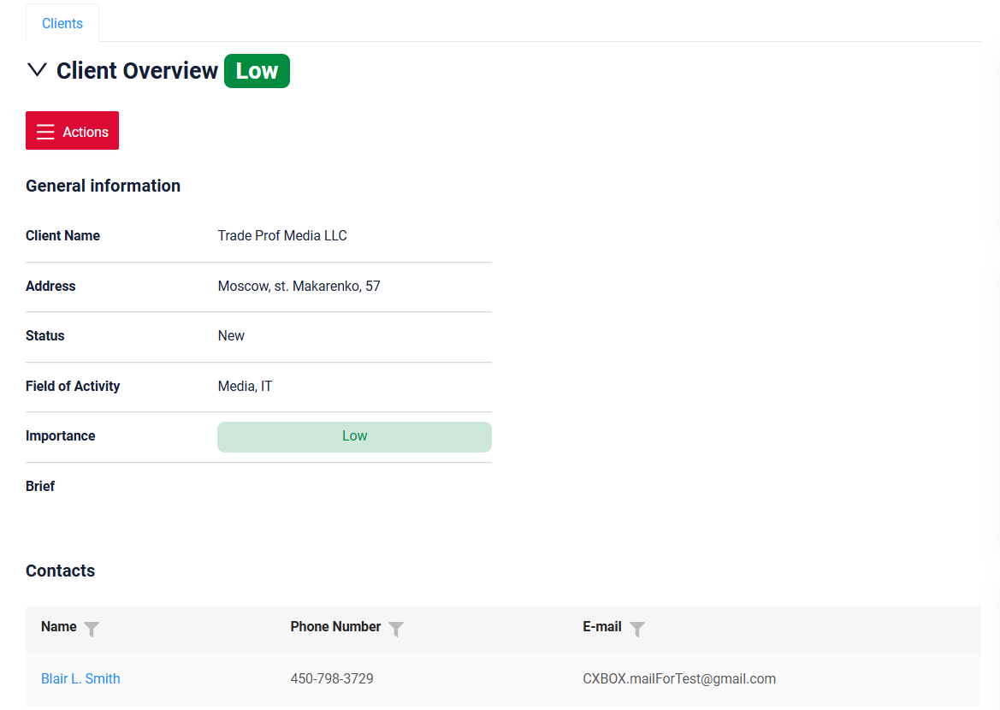
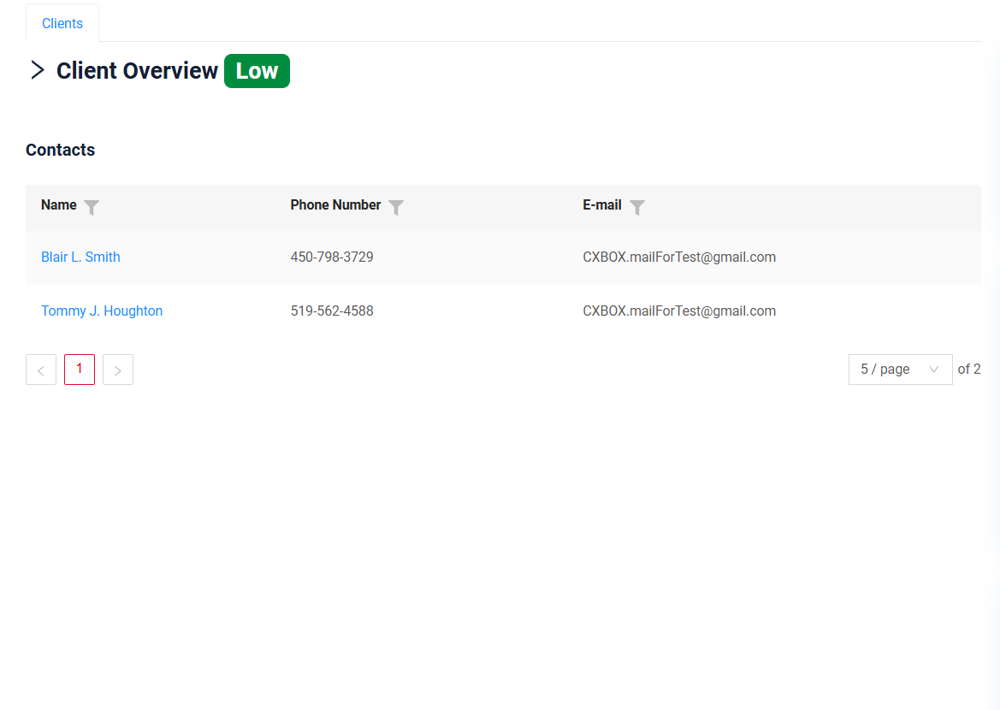

# Collapse widget group
Widgets on a view can be combined into groups that can be collapsed and expanded.
The first widget of the group (main widget) gets an icon to control collapsing.
When the group is collapsed, all widgets of the group are hidden except for the header of the main widget.

This function is available for:

* [List](/widget/type/list/list)
* [Form](/widget/type/form/form)
* [Info](/widget/type/info/info)
* [GroupingHierarchy widget](/widget/type/groupinghierarchy/groupinghierarchy)
* [Tree widget](/widget/type/tree/tree)
* [CardList widget](/widget/type/cardlist/cardlist)
* [CardCarouselList widget](/widget/type/cardcarousellist/cardcarousellist)
* [HeaderWidget](/widget/type/headerwidget/headerwidget)
* [AdditionalInfo widget](/widget/type/additionalinfo/additionalinfo)
* [AdditionalList widget](/widget/type/additionallist/additionallist)
* [StatsBlock widget](/widget/type/statblocks/statblocks)
* [Steps widget](/widget/type/steps/steps)
* [DashboardList widget](/widget/type/dashboardlist/dashboardlist)
* [FilePreview widget](/widget/type/filepreview/filepreview)
* [Column2D widget](/widget/type/column2d/column2d)
* [Line2D widget](/widget/type/line2d/line2d)
* [Pie1D widget](/widget/type/pie1d/pie1d)
* Funnel widget
* RingProgress widget

_Note!_ Popup widgets ([FormPopup](/widget/type/formpopup/formpopup), [PickListPopup](/widget/type/picklistpopup/picklistpopup), [AssocListPopup](/widget/type/assoclistpopup/assoclistpopup), [PickTreePopup](/widget/type/picktreepopup/picktreepopup), [AssocTreePopup](/widget/type/assoctreepopup/assoctreepopup)) are not supported.

The collapse state that the group has right after the page is loaded can be configured with the `collapsedCondition` tag:

* [Widget group](#widget-group) - expanded by default
* [Collapsed by default](#collapsed-condition) - `collapsedCondition` with `default: true`

### How does it look?
=== "Expanded (default)"
     
=== "Collapsed (collapsedCondition default: true)"
     

## <a id="widget-group">Widget group</a>
[:material-play-circle: Live Sample]({{ external_links.code_samples }}/ui/#/screen/myexample3022/view/myexample3022list){:target="_blank"} ·
[:fontawesome-brands-github: GitHub]({{ external_links.github_ui }}/{{ external_links.github_branch }}/src/main/java/org/demo/documentation/widgets/property/collapse){:target="_blank"}

### How to add?
??? Example

     Add `groups` in **_.view.json_**. Each group contains `widgetNames` - names of the widgets included in the group.
     The first widget of the group becomes the main widget: its header with the collapse icon stays visible when the group is collapsed.

     If `collapsedCondition` is not specified, the group is expanded after the page is loaded.

     ```json
     {
       "name": "myexample3022list",
       "title": "MyExample3022 List",
       "template": "DashboardView",
       "url": "/screen/myexample3022/view/myexample3022list",
       "widgets": [
         ...
       ],
       "groups": [
         {
           "widgetNames": [
             "MyExample3022RingProcessl",
             "MyExample3022Funnel",
             "MyExample3022DashboardList"
           ]
         },
         {
           "widgetNames": [
             "MyExample3022List",
             "MyExample3022Form",
             "MyExample3022Info",
             "MyExample3022Header"
           ]
         }
       ]
     }
     ```

## <a id="collapsed-condition">Collapsed by default</a>
[:material-play-circle: Live Sample]({{ external_links.code_samples }}/ui/#/screen/myexample3022/view/myexample3022listwithcondition){:target="_blank"} ·
[:fontawesome-brands-github: GitHub]({{ external_links.github_ui }}/{{ external_links.github_branch }}/src/main/java/org/demo/documentation/widgets/property/collapse/myexample3022listwithcondition.view.json){:target="_blank"}

`collapsedCondition` sets the state of the widget group after the page is loaded:

* `default: true` - the group is collapsed. Only the header of the main widget is visible, the other widgets of the group are hidden.
* `default: false` (default) - the group is expanded.

If `collapsedCondition` is not specified, the group is expanded (same as `default: false`).

The user can still expand or collapse the group with the icon of the main widget.

### How to add?
??? Example

     Add `collapsedCondition` with `default` to the group in **_.view.json_**.

     ```json
     {
       "name": "myexample3022listwithcondition",
       "title": "MyExample3022 List",
       "template": "DashboardView",
       "url": "/screen/myexample3022/view/myexample3022listwithcondition",
       "widgets": [
         ...
       ],
       "groups": [
         {
           "widgetNames": [
             "MyExample3022RingProcessl",
             "MyExample3022Funnel",
             "MyExample3022DashboardList"
           ],
           "collapsedCondition": {
             "default": true
           }
         },
         {
           "widgetNames": [
             "MyExample3022List",
             "MyExample3022Form",
             "MyExample3022Info",
             "MyExample3022Header"
           ],
           "collapsedCondition": {
             "default": false
           }
         }
       ]
     }
     ```
