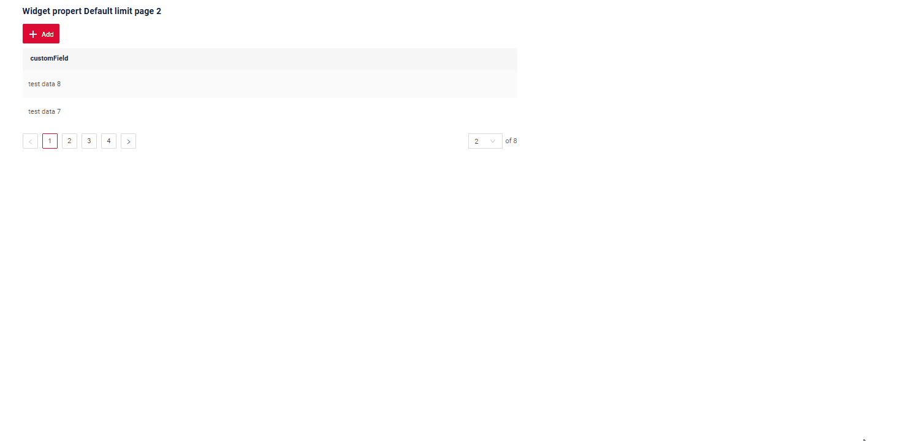
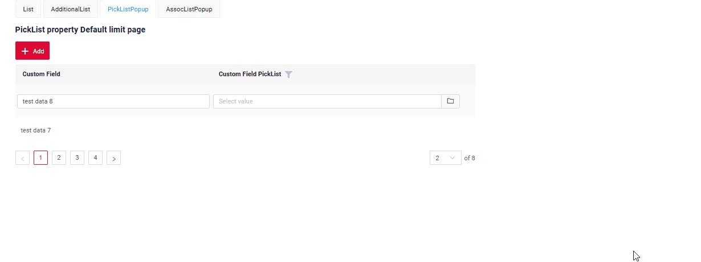
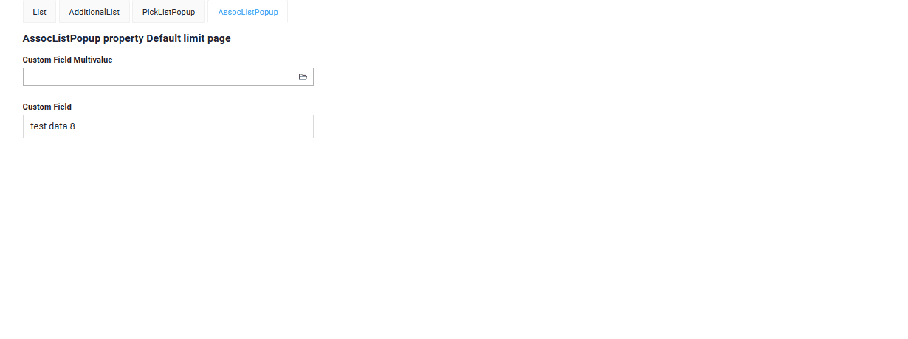
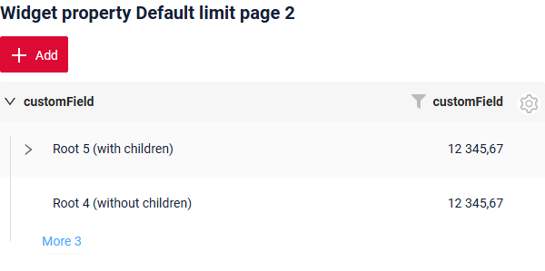
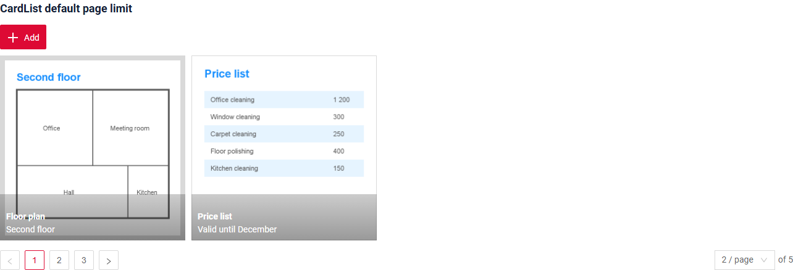

# Лимит записей на странице по умолчанию { #default-page-limit }
Эта функция доступна для:

* [List](/widget/type/list/list),
* [Виджет PickListPopup](/ru/widget/type/picklistpopup/picklistpopup)
* [Виджет AssocListPopup](/ru/widget/type/assoclistpopup/assoclistpopup)
* [виджета Tree](/ru/widget/type/tree/tree)
* [виджета AssocTreePopup](/ru/widget/type/assoctreepopup/assoctreepopup)
* [виджета PickTreePopup](/ru/widget/type/picktreepopup/picktreepopup)
* [виджета CardList](/ru/widget/type/cardlist/cardlist)

Лимит страницы можно настроить двумя способами:

* [Только для текущего бизнес-компонента](#bc-default-page-limit)
* [На уровне приложения](#app-default-page-limit)


### Как это выглядит? { #how-does-it-look }
=== "List"
     
=== "PickListPopup"
     
=== "AssocListPopup"
     
=== "Tree"
     
=== "PickTreePopup"
     <!-- TODO screenshot -->
=== "AssocTreePopup"
     <!-- TODO screenshot -->
=== "CardList"
     

## <a id="bc-default-page-limit">Только для текущего бизнес-компонента</a>
[:material-play-circle: Живой пример]({{ external_links.code_samples }}/ui/#/screen/myexample359){:target="_blank"} ·
[:fontawesome-brands-github: GitHub]({{ external_links.github_ui }}/{{ external_links.github_branch }}/src/main/java/org/demo/documentation/widgets/property/defaultlimitpage){:target="_blank"}
 
### Как добавить? { #how-to-add }
??? Example "Пример"

     Добавьте бизнес-компонент в таблицу **BC_PROPERTIES**

      BC — имя бизнес-компонента
      PAGE_LIMIT — лимит страницы по умолчанию

      ```csv
      ID;BC;PAGE_LIMIT;SORT;FILTER
      27;'myexample359';2;NULL;'""'
      ```

## <a id="app-default-page-limit">На уровне приложения</a>

### Как добавить? { #how-to-add_1 }
[:material-play-circle: Живой пример]({{ external_links.code_samples }}/ui/#/screen/myexample3002){:target="_blank"} ·
[:fontawesome-brands-github: GitHub]({{ external_links.github_ui }}/{{ external_links.github_branch }}/src/main/resources/application.yml){:target="_blank"}

??? Example "Пример"
     Добавьте `bc-default-page-limit` в application.yml

      ```
        cxbox:
           meta:
               bc-default-page-limit: 5
      ```