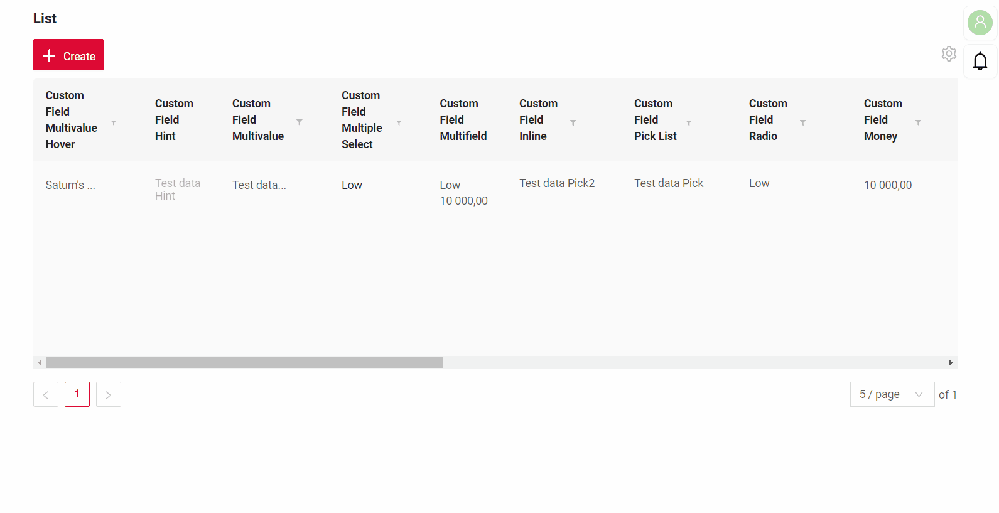
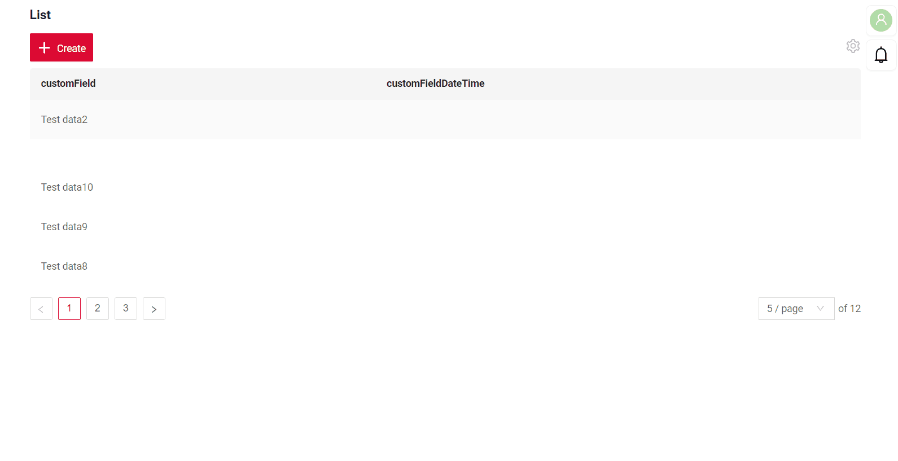
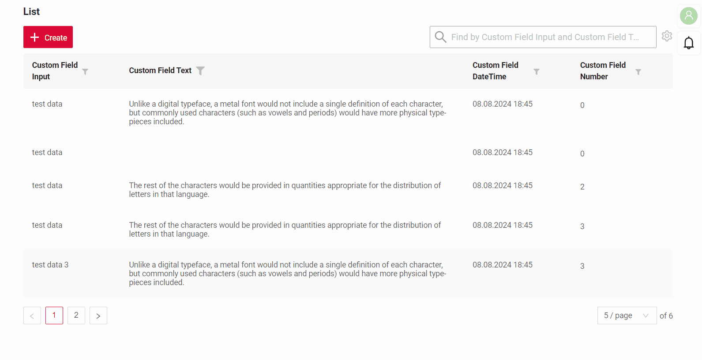

# Export to Excel
`Export to Excel` enables users to download a .xlsx file containing the table's data.

This function is available:
 
* for widgets: [List](/widget/type/list/list),only mode **basic** [AdditionalList](/widget/type/additionallist/additionallist),[GroupingHierarchy](/widget/type/groupinghierarchy/groupinghierarchy).

!!! info
    Export to Excel is **not available** for [Tree](/widget/type/tree/tree), [AssocTreePopup](/widget/type/assoctreepopup/assoctreepopup) and [PickTreePopup](/widget/type/picktreepopup/picktreepopup) in this release, see `CXBOX-1369`.
* for fields: Hint, Multivalue, Inline, Pick List,Radio, Money, Percent, Number, Dictionary, Date Time With Seconds, Date, Checkbox, Date Time, Text, Input.
See more [field types](/widget/fields/fieldtypes/)

The export functionality is accessible via the gear icon and supports the following types:

[:material-play-circle: Live Sample]({{ external_links.code_samples }}/ui/#/screen/myexample3134){:target="_blank"} ·
[:fontawesome-brands-github: GitHub]({{ external_links.github_ui }}/{{ external_links.github_branch }}/src/main/java/org/demo/documentation/widgets/property/excel/inner){:target="_blank"}

* Inner source. Exports data retrieved directly from the database.

[:material-play-circle: Live Sample]({{ external_links.code_samples }}/ui/#/screen/myexample3136){:target="_blank"} ·
[:fontawesome-brands-github: GitHub]({{ external_links.github_ui }}/{{ external_links.github_branch }}/src/main/java/org/demo/documentation/widgets/property/excel/any){:target="_blank"}
 
* Any source. Exports data obtained from microservices or other external sources.

[:material-play-circle: Live Sample]({{ external_links.code_samples }}/ui/#/screen/myexample3138){:target="_blank"} ·
[:fontawesome-brands-github: GitHub]({{ external_links.github_ui }}/{{ external_links.github_branch }}/src/main/java/org/demo/documentation/widgets/property/excel/filtration){:target="_blank"}

* Filtration. Exports only the filtered data based on the user's applied filters.
 
## Basic
The Export function includes two parameters:

* Enabled -  true/false
* Title: None/Custom Name 
If the parameter is not specified, a default title is generated with the format: `List + current date`.

Example: `List 05-12-2024.xlsx`
A custom title can be provided if needed.

### How does it look?
=== "Inner source"
    
=== "Any source"
    
=== "Filtration"
    

### How to add?
??? Example
      Add `export` to corresponding **widget.json**.
    
      ```  
      "export": {
        "enabled": true,
        "title": "Custom Name"
      }
      ```
      ```json
      --8<--
      {{ external_links.github_raw_doc }}/widgets/property/excel/inner/myexample3134list.widget.json
      --8<--
      ``` 

      * "Inner source"
        [:material-play-circle: Live Sample]({{ external_links.code_samples }}/ui/#/screen/myexample3134){:target="_blank"} ·
        [:fontawesome-brands-github: GitHub]({{ external_links.github_ui }}/{{ external_links.github_branch }}/src/main/java/org/demo/documentation/widgets/property/excel/inner){:target="_blank"}
      
      * "Any source"
        [:material-play-circle: Live Sample]({{ external_links.code_samples }}/ui/#/screen/myexample3136){:target="_blank"} ·
        [:fontawesome-brands-github: GitHub]({{ external_links.github_ui }}/{{ external_links.github_branch }}/src/main/java/org/demo/documentation/widgets/property/excel/any){:target="_blank"}

      * "Filtration"
        [:material-play-circle: Live Sample]({{ external_links.code_samples }}/ui/#/screen/myexample3138){:target="_blank"} ·
        [:fontawesome-brands-github: GitHub]({{ external_links.github_ui }}/{{ external_links.github_branch }}/src/main/java/org/demo/documentation/widgets/property/excel/filtration){:target="_blank"}

## <a id="exportlimit">Export limit</a>
Available since [v2.0.13](/new/version2013/) (core 4.0.0-M17)

The number of rows in the exported file is limited. The limit is set for the whole application
with the `cxbox.ui.app-export-excel-limit` parameter and is applied to all widgets with export.

| `app-export-excel-limit` value | Limit used                                                                   |
|--------------------------------|------------------------------------------------------------------------------|
| *not set*                      | Default. `500`                                                               |
| `1` – `10000`                  | The value from the parameter                                                 |
| more than `10000`              | `10000`. An error is written to the browser console: *"appExportExcelLimit: 20000 exceeds the maximum limit of 10000, the limit is set to 10000"* |

The maximum `10000` cannot be changed by the parameter: it protects the browser and the backend from too large exports.

### Which rows are exported
Export is a single request to the backend `GET ../api/v1/data/..` with the current filters and sorting of the widget
and the parameters `_export=Excel`, `_limit`, `_page`:

* `_limit` = export limit + page size of the widget (`limit` of the BC)
* `_page` = the "export page" that contains the first record of the page currently opened in the widget

Example. Export limit `500`, page size `10`:

* the user is on page 1 → `_limit=510&_page=1` → records 1 – 510 are exported
* the user is on page 60 (records 591 – 600) → `_limit=510&_page=2` → records 511 – 1020 are exported

So the records of the currently opened page are always in the file.

### Warning about not all rows exported
If the file contains fewer rows than the table has (the total count of records of the BC with the applied filters),
a warning notification is shown:

*"The table contains a large amount of data - only the first **N** rows are presented in the report"*,
where **N** is the number of exported rows.

If all rows of the table are exported, no notification is shown.

### How to add?
??? Example
    **Step 1** Add the `app-export-excel-limit` parameter to `application.yml`

    ```yml
    cxbox:
      ui:
        app-export-excel-limit: 500
    ```

    **Step 2** Pass the parameter to the frontend in `featureSettings` (`LoginServiceImpl`).
    The frontend receives it in the `featureSettings` of the `/api/v1/login` response with the key `appExportExcelLimit`.

    ```java
    public Collection<SimpleDictionary> getFeatureSettings() {
        return Stream.of(
                feature(
                        UIProperties.APP_EXPORT_EXCEL_LIMIT,
                        uiProperties.getAppExportExcelLimit()
                )
                // other feature settings
        )...
    }
    ```

    **Step 3** Export must be enabled for the widget (`"export": {"enabled": true}` in **widget.json**), see [Basic](#basic).

!!! info
    The limit is applied on the frontend: it is the frontend that sends `_limit` in the export request.
    Cxbox core does not apply `app-export-excel-limit` to `_export=Excel` requests by itself.
