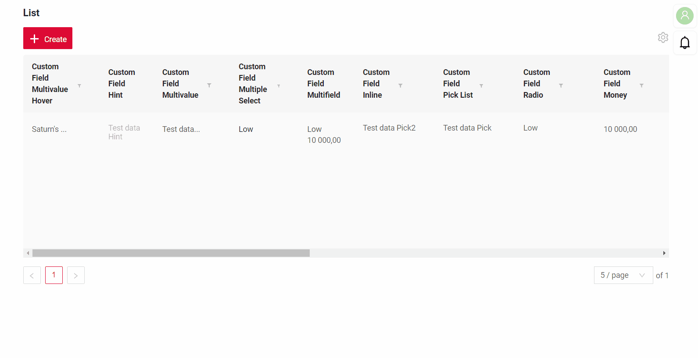
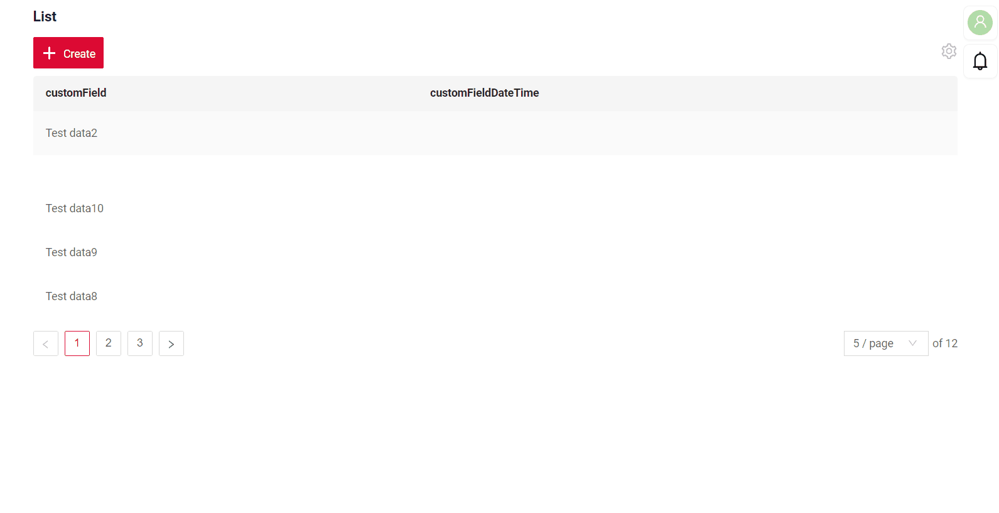
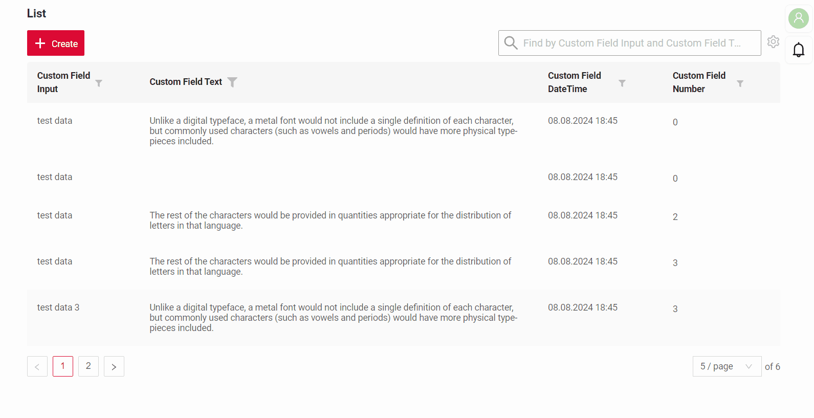

# Экспорт в Excel { #export-to-excel }
`Export to Excel` позволяет пользователям скачать файл .xlsx с данными таблицы.

Эта функция доступна:
 
* для виджетов: [List](/ru/widget/type/list/list), только режим **basic** [AdditionalList](/ru/widget/type/additionallist/additionallist), [GroupingHierarchy](/ru/widget/type/groupinghierarchy/groupinghierarchy).

!!! info
    Экспорт в Excel в этом релизе **недоступен** для [Tree](/ru/widget/type/tree/tree), [AssocTreePopup](/ru/widget/type/assoctreepopup/assoctreepopup) и [PickTreePopup](/ru/widget/type/picktreepopup/picktreepopup), см. `CXBOX-1369`.
* для полей: Hint, Multivalue, Inline, Pick List, Radio, Money, Percent, Number, Dictionary, Date Time With Seconds, Date, Checkbox, Date Time, Text, Input.
Подробнее см. [типы полей](/ru/widget/fields/fieldtypes/)

Экспорт доступен через иконку шестерёнки и поддерживает следующие типы:

[:material-play-circle: Живой пример]({{ external_links.code_samples }}/ui/#/screen/myexample3134){:target="_blank"} ·
[:fontawesome-brands-github: GitHub]({{ external_links.github_ui }}/{{ external_links.github_branch }}/src/main/java/org/demo/documentation/widgets/property/excel/inner){:target="_blank"}

* Inner source. Экспортирует данные, полученные непосредственно из базы данных.

[:material-play-circle: Живой пример]({{ external_links.code_samples }}/ui/#/screen/myexample3136){:target="_blank"} ·
[:fontawesome-brands-github: GitHub]({{ external_links.github_ui }}/{{ external_links.github_branch }}/src/main/java/org/demo/documentation/widgets/property/excel/any){:target="_blank"}
 
* Any source. Экспортирует данные, полученные из микросервисов или других внешних источников.

[:material-play-circle: Живой пример]({{ external_links.code_samples }}/ui/#/screen/myexample3138){:target="_blank"} ·
[:fontawesome-brands-github: GitHub]({{ external_links.github_ui }}/{{ external_links.github_branch }}/src/main/java/org/demo/documentation/widgets/property/excel/filtration){:target="_blank"}

* Фильтрация. Экспортирует только данные, отфильтрованные пользователем.
 
## Основы { #basic }
Функция экспорта имеет два параметра:

* Enabled — true/false
* Title: нет/собственное имя
Если параметр не задан, формируется заголовок по умолчанию в формате: `List + текущая дата`.

Пример: `List 05-12-2024.xlsx`
При необходимости можно задать собственный заголовок.

### Как это выглядит? { #how-does-it-look }
=== "Inner source"
    
=== "Any source"
    
=== "Фильтрация"
    

### Как добавить? { #how-to-add }
??? Example "Пример"
      Добавьте `export` в соответствующий **widget.json**.
    
      ```  
      "export": {
        "enabled": true,
        "title": "Custom Name"
      }
      ```
      ```json
      --8<--
      {{ external_links.github_raw_doc }}/widgets/property/excel/inner/MyExample3134List.widget.json
      --8<--
      ``` 

      * "Inner source"
        [:material-play-circle: Живой пример]({{ external_links.code_samples }}/ui/#/screen/myexample3134){:target="_blank"} ·
        [:fontawesome-brands-github: GitHub]({{ external_links.github_ui }}/{{ external_links.github_branch }}/src/main/java/org/demo/documentation/widgets/property/excel/inner){:target="_blank"}
      
      * "Any source"
        [:material-play-circle: Живой пример]({{ external_links.code_samples }}/ui/#/screen/myexample3136){:target="_blank"} ·
        [:fontawesome-brands-github: GitHub]({{ external_links.github_ui }}/{{ external_links.github_branch }}/src/main/java/org/demo/documentation/widgets/property/excel/any){:target="_blank"}

      * "Фильтрация"
        [:material-play-circle: Живой пример]({{ external_links.code_samples }}/ui/#/screen/myexample3138){:target="_blank"} ·
        [:fontawesome-brands-github: GitHub]({{ external_links.github_ui }}/{{ external_links.github_branch }}/src/main/java/org/demo/documentation/widgets/property/excel/filtration){:target="_blank"}
