# Filtration
 
* [by fields](#by_fields)
* [by fulltextsearch](#by_fulltextsearch) 
* [by personal filter group](#by_personal_filter_group)
* [by filter group](#by_filter_group)
    * [default filter group](#default_filter_group)
* [Additional properties](#additional_properties)
    * [Clear filters](#clear_filters)
    * [Reset filters](#reset_filters)
    * [Delete personal filter group](#delete_personal_filter_group)
<!-- default filtration  -->

## <a id="by_fields">by fields</a>
The availability or unavailability of filtering operations for each field type see [Fields](/widget/fields/fieldtypes/).

Each field type requires a distinct filtering operation sent by the frontend.
Here are the standard field types with their respective filtering methods see [SearchOperation for filtering](/widget/fields/filtersearchoperation).

This function is available:

* [List widget](/widget/type/list/list)
([:material-play-circle: Live Sample]({{ external_links.code_samples }}/ui/#/screen/myexample3616/view/myexample3616list){:target="_blank"}
[:fontawesome-brands-github: GitHub]({{ external_links.github_ui }}/{{ external_links.github_branch }}/src/main/java/org/demo/documentation/widgets/property/filtration/filtergroup){:target="_blank"}
)
* [AdditionalList widget](/widget/type/additionallist/additionallist)
([:material-play-circle: Live Sample]({{ external_links.code_samples }}/ui/#/screen/myexample3616/view/myexample3616additionallist){:target="_blank"}
[:fontawesome-brands-github: GitHub]({{ external_links.github_ui }}/{{ external_links.github_branch }}/src/main/java/org/demo/documentation/widgets/property/filtration/filtergroup){:target="_blank"}
)
* [GroupingHierarchy widget](/widget/type/groupinghierarchy/groupinghierarchy)
([:material-play-circle: Live Sample]({{ external_links.code_samples }}/ui/#/screen/myexample3121/view/myexample3121gh){:target="_blank"}
[:fontawesome-brands-github: GitHub]({{ external_links.github_ui }}/{{ external_links.github_branch }}/src/main/java/org/demo/documentation/widgets/groupinghierarhy/base){:target="_blank"}
)
* [AssocListPopup widget](/widget/type/assoclistpopup/assoclistpopup)
([:material-play-circle: Live Sample]({{ external_links.code_samples }}/ui/#/screen/myexample3616/view/myexample3616assoc){:target="_blank"}
[:fontawesome-brands-github: GitHub]({{ external_links.github_ui }}/{{ external_links.github_branch }}/src/main/java/org/demo/documentation/widgets/property/filtration/filtergroup/forassoc){:target="_blank"}
)
* [PickListPopup widget](/widget/type/picklistpopup/picklistpopup)
([:material-play-circle: Live Sample]({{ external_links.code_samples }}/ui/#/screen/myexample3616/view/myexample3614picklistpopup){:target="_blank"}
[:fontawesome-brands-github: GitHub]({{ external_links.github_ui }}/{{ external_links.github_branch }}/src/main/java/org/demo/documentation/widgets/property/filtration/fulltextsearch/forpicklist){:target="_blank"}
)
* [Tree widget](/widget/type/tree/tree)
([:material-play-circle: Live Sample]({{ external_links.code_samples }}/ui/#/screen/myexample3616/view/myexample3616tree){:target="_blank"}
[:fontawesome-brands-github: GitHub]({{ external_links.github_ui }}/{{ external_links.github_branch }}/src/main/java/org/demo/documentation/widgets/property/filtration/filtergroup){:target="_blank"}
)
* [AssocTreePopup widget](/widget/type/assoctreepopup/assoctreepopup)
([:material-play-circle: Live Sample]({{ external_links.code_samples }}/ui/#/screen/myexample3261/view/myexample3261list){:target="_blank"}
[:fontawesome-brands-github: GitHub]({{ external_links.github_ui }}/{{ external_links.github_branch }}/src/main/java/org/demo/documentation/widgets/tree/base/inner){:target="_blank"}
)
* [PickTreePopup widget](/widget/type/picktreepopup/picktreepopup)
([:material-play-circle: Live Sample]({{ external_links.code_samples }}/ui/#/screen/myexample3261/view/myexample3261list){:target="_blank"}
[:fontawesome-brands-github: GitHub]({{ external_links.github_ui }}/{{ external_links.github_branch }}/src/main/java/org/demo/documentation/widgets/tree/base/inner){:target="_blank"}
)
* [Pie1D widget](/widget/type/pie1d/pie1d): works only in the [table mode](/widget/type/pie1d/pie1d/#tablemode)
([:material-play-circle: Live Sample]({{ external_links.code_samples }}/ui/#/screen/myexample4264){:target="_blank"}
[:fontawesome-brands-github: GitHub]({{ external_links.github_ui }}/{{ external_links.github_branch }}/src/main/java/org/demo/documentation/widgets/pie1d/filtration){:target="_blank"}
)
* [Column2D widget](/widget/type/column2d/column2d): works only in the [table mode](/widget/type/column2d/column2d/#tablemode)
([:material-play-circle: Live Sample]({{ external_links.code_samples }}/ui/#/screen/myexample4268){:target="_blank"}
[:fontawesome-brands-github: GitHub]({{ external_links.github_ui }}/{{ external_links.github_branch }}/src/main/java/org/demo/documentation/widgets/column2d/filtration){:target="_blank"}
)
* [Line2D widget](/widget/type/line2d/line2d): works only in the [table mode](/widget/type/line2d/line2d/#tablemode)
([:material-play-circle: Live Sample]({{ external_links.code_samples }}/ui/#/screen/myexample4272){:target="_blank"}
[:fontawesome-brands-github: GitHub]({{ external_links.github_ui }}/{{ external_links.github_branch }}/src/main/java/org/demo/documentation/widgets/line2d/filtration){:target="_blank"}
)

### How does it look?
=== "List widget"
    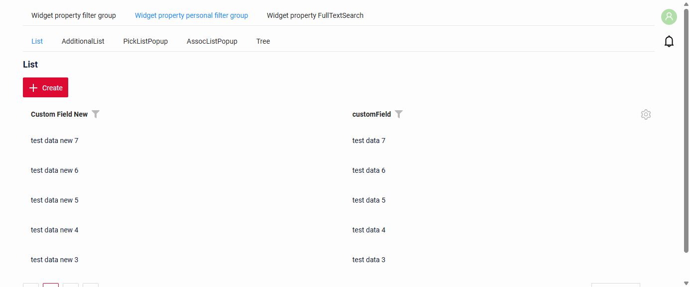
=== "AdditionalList widget"
    
=== "GroupingHierarchy widget"
    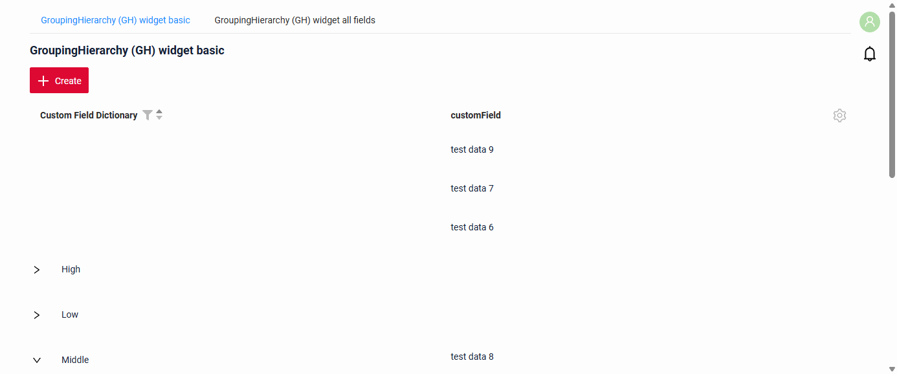
=== "AssocListPopup widget"
    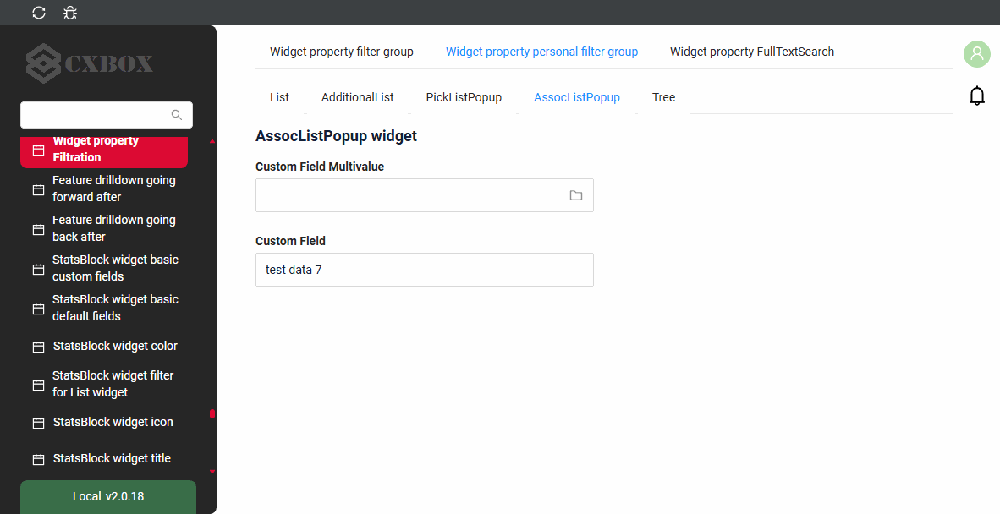
=== "PickListPopup widget"
    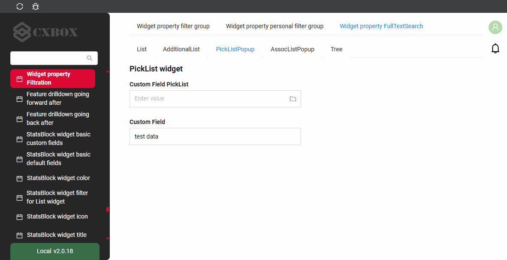
=== "Tree widget"
    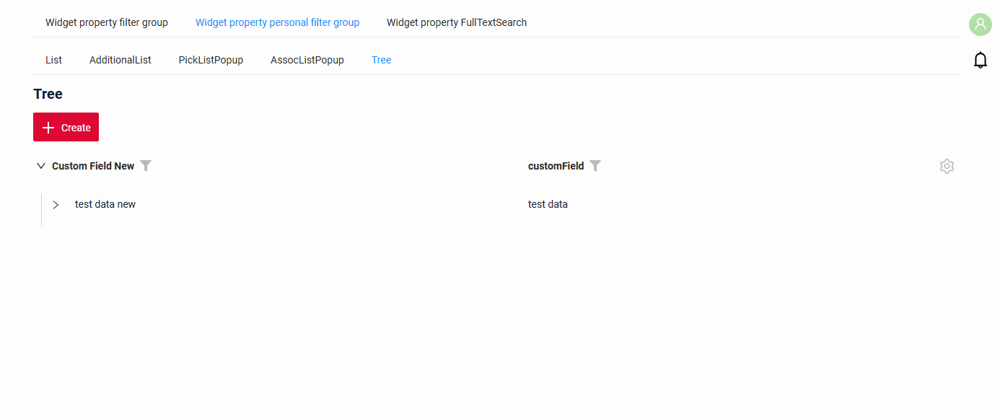
=== "AssocTreePopup widget"
    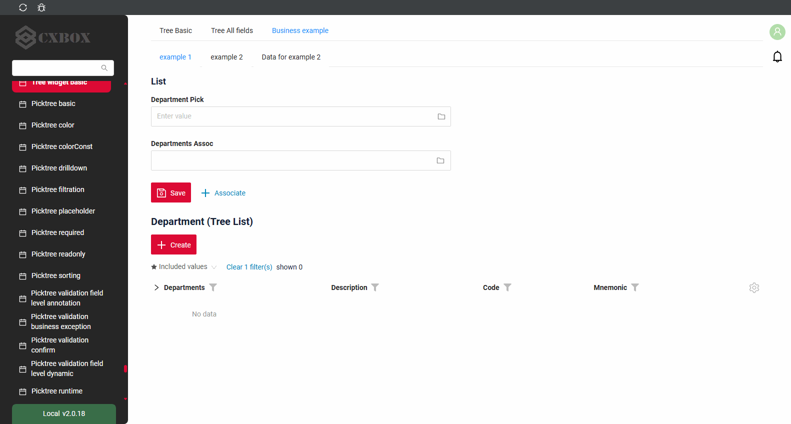
=== "PickTreePopup widget"
    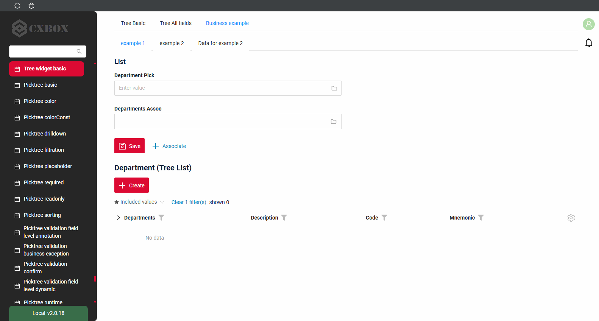
=== "Pie1D widget"
    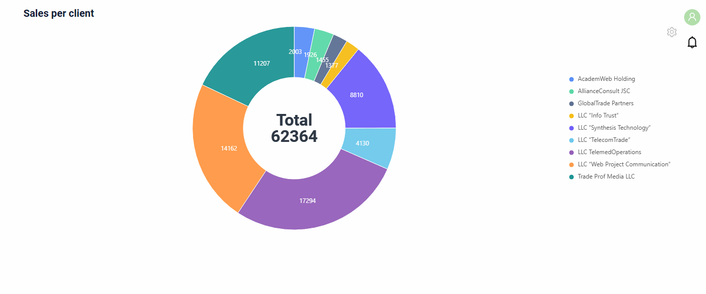
=== "Column2D widget"
    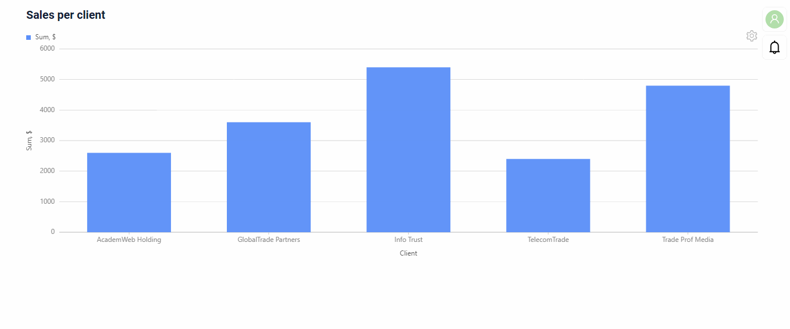

## <a id="by_fulltextsearch">by fulltextsearch</a>
`FullTextSearch` - when the user types in the full text search input area, then widget filters the rows that match the search query
(search criteria is configurable and will usually check if at least one column has corresponding value).
This feature makes it easier for users to quickly find the information they are looking for within a List widget.


This function is available:

* [List widget](/widget/type/list/list)
(  [:material-play-circle: Live Sample]({{ external_links.code_samples }}/ui/#/screen/myexample3616/view/myexample3614list){:target="_blank"}
  [:fontawesome-brands-github: GitHub]({{ external_links.github_ui }}/{{ external_links.github_branch }}/src/main/java/org/demo/documentation/widgets/property/filtration/fulltextsearch){:target="_blank"}
)
* [AssocListPopup widget](/widget/type/assoclistpopup/assoclistpopup)
(  [:material-play-circle: Live Sample]({{ external_links.code_samples }}/ui/#/screen/myexample3616/view/myexample3614assoclistpopup){:target="_blank"}
  [:fontawesome-brands-github: GitHub]({{ external_links.github_ui }}/{{ external_links.github_branch }}/src/main/java/org/demo/documentation/widgets/property/filtration/fulltextsearch/forassoc){:target="_blank"}
)
* [PickListPopup widget](/widget/type/picklistpopup/picklistpopup)
([:material-play-circle: Live Sample]({{ external_links.code_samples }}/ui/#/screen/myexample3616/view/myexample3614picklistpopup){:target="_blank"}
[:fontawesome-brands-github: GitHub]({{ external_links.github_ui }}/{{ external_links.github_branch }}/src/main/java/org/demo/documentation/widgets/property/filtration/fulltextsearch/forpicklist){:target="_blank"}
) 
* [Tree widget](/widget/type/tree/tree)
(  [:material-play-circle: Live Sample]({{ external_links.code_samples }}/ui/#/screen/myexample3616/view/myexample3614tree){:target="_blank"}
  [:fontawesome-brands-github: GitHub]({{ external_links.github_ui }}/{{ external_links.github_branch }}/src/main/java/org/demo/documentation/widgets/property/filtration/fulltextsearch){:target="_blank"}
)
* [AssocTreePopup widget](/widget/type/assoctreepopup/assoctreepopup)
([:material-play-circle: Live Sample]({{ external_links.code_samples }}/ui/#/screen/myexample3261/view/myexample3261list){:target="_blank"}
[:fontawesome-brands-github: GitHub]({{ external_links.github_ui }}/{{ external_links.github_branch }}/src/main/java/org/demo/documentation/widgets/tree/base/inner){:target="_blank"}
)
* [PickTreePopup widget](/widget/type/picktreepopup/picktreepopup)
([:material-play-circle: Live Sample]({{ external_links.code_samples }}/ui/#/screen/myexample3261/view/myexample3261list){:target="_blank"}
[:fontawesome-brands-github: GitHub]({{ external_links.github_ui }}/{{ external_links.github_branch }}/src/main/java/org/demo/documentation/widgets/tree/base/inner){:target="_blank"}
)
* [Pie1D widget](/widget/type/pie1d/pie1d): works only in the [table mode](/widget/type/pie1d/pie1d/#tablemode)
([:material-play-circle: Live Sample]({{ external_links.code_samples }}/ui/#/screen/myexample4265){:target="_blank"}
[:fontawesome-brands-github: GitHub]({{ external_links.github_ui }}/{{ external_links.github_branch }}/src/main/java/org/demo/documentation/widgets/pie1d/fulltextsearch){:target="_blank"}
)
* [Column2D widget](/widget/type/column2d/column2d): works only in the [table mode](/widget/type/column2d/column2d/#tablemode)
([:material-play-circle: Live Sample]({{ external_links.code_samples }}/ui/#/screen/myexample4269){:target="_blank"}
[:fontawesome-brands-github: GitHub]({{ external_links.github_ui }}/{{ external_links.github_branch }}/src/main/java/org/demo/documentation/widgets/column2d/fulltextsearch){:target="_blank"}
)
* [CardList widget](/widget/type/cardlist/cardlist)
  (  [:material-play-circle: Live Sample]({{ external_links.code_samples }}/ui/#/screen/myexample3616/view/myexample3614cardlist){:target="_blank"}
  [:fontawesome-brands-github: GitHub]({{ external_links.github_ui }}/{{ external_links.github_branch }}/src/main/java/org/demo/documentation/widgets/property/filtration/fulltextsearch/forcardlist){:target="_blank"}
  )
* [Line2D widget](/widget/type/line2d/line2d): works only in the [table mode](/widget/type/line2d/line2d/#tablemode)
([:material-play-circle: Live Sample]({{ external_links.code_samples }}/ui/#/screen/myexample4273){:target="_blank"}
[:fontawesome-brands-github: GitHub]({{ external_links.github_ui }}/{{ external_links.github_branch }}/src/main/java/org/demo/documentation/widgets/line2d/fulltextsearch){:target="_blank"}
)

### How does it look?
=== "List widget"
    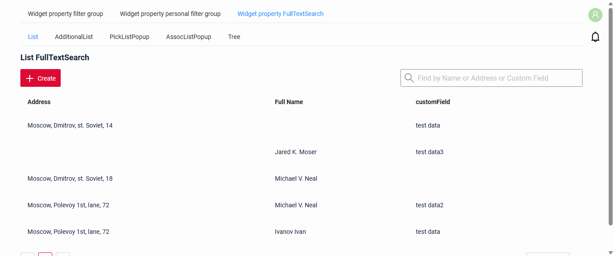
=== "AssocListPopup widget"
    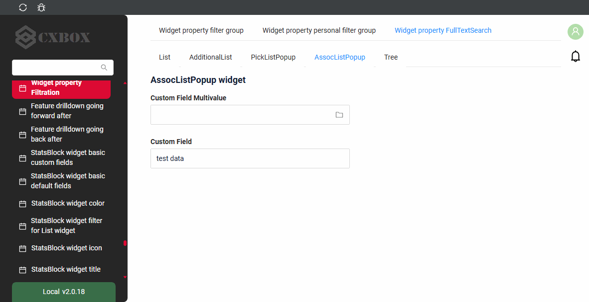
=== "PickListPopup widget"
    
=== "Tree widget"
    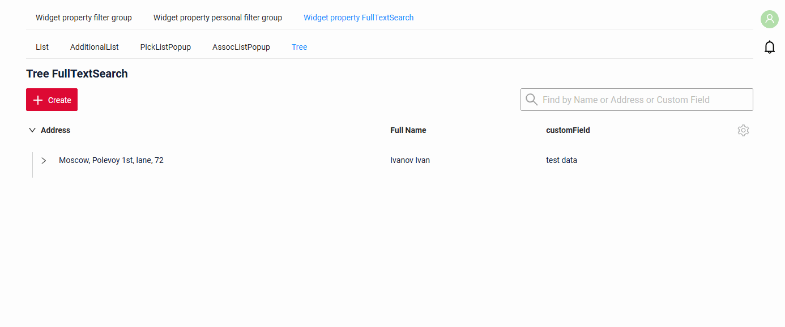
=== "AssocTreePopup widget"
    
=== "PickTreePopup widget"
    
=== "Pie1D widget"
    
=== "Column2D widget"
    
=== "CardList widget"
    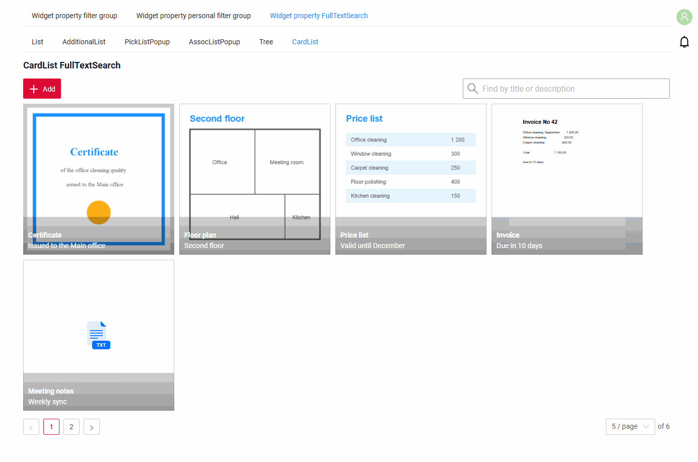

## <a id="by_personal_filter_group">by personal filter group</a>

`Personal filter group` - a user-filled filter can be saved for each individual user.

A user-filled filter can be saved for each individual user.

This function is available:

* [List](/widget/type/list/list) (
[:material-play-circle: Live Sample]({{ external_links.code_samples }}/ui/#/screen/myexample3616/view/myexample3616list){:target="_blank"}
[:fontawesome-brands-github: GitHub]({{ external_links.github_ui }}/{{ external_links.github_branch }}/src/main/java/org/demo/documentation/widgets/property/filtration/filtergroup){:target="_blank"}
)

* [Tree](/widget/type/tree/tree) (
[:material-play-circle: Live Sample]({{ external_links.code_samples }}/ui/#/screen/myexample3616/view/myexample3616tree){:target="_blank"}
[:fontawesome-brands-github: GitHub]({{ external_links.github_ui }}/{{ external_links.github_branch }}/src/main/java/org/demo/documentation/widgets/property/filtration/filtergroup){:target="_blank"}
)

* [AdditionalList](/widget/type/additionallist/additionallist) (
[:material-play-circle: Live Sample]({{ external_links.code_samples }}/ui/#/screen/myexample3616/view/myexample3616additionallist){:target="_blank"}
[:fontawesome-brands-github: GitHub]({{ external_links.github_ui }}/{{ external_links.github_branch }}/src/main/java/org/demo/documentation/widgets/property/filtration/filtergroup){:target="_blank"}
)

The "Save Filters" button is located within the gear icon.
When the "Save Filters" button is clicked, a modal window appears displaying all custom filters, which can be deleted if desired
(see [Delete personal filter group](#delete_personal_filter_group)).

### How does it look?
=== "List"
    
=== "AdditionalList"
    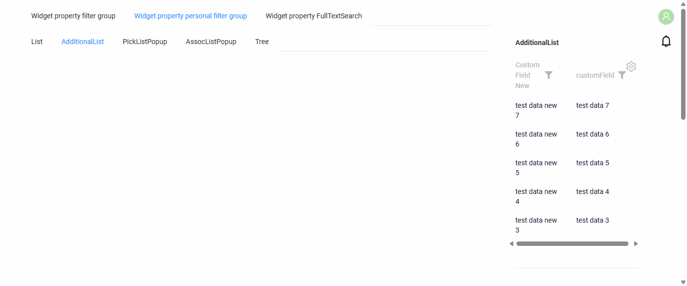
=== "Tree"
    

### <a id="personal_filter_group_with_fulltextsearch">with fulltextsearch</a>
When the widget has both the [full text search](#by_fulltextsearch) and the personal filter group,
the text of the full text search is saved in the group together with the filters of the columns.
When the group is applied, the search field is filled with the saved text and the widget searches by it again.

For example, the user searches "Soviet" and filters the column "customField" by "data".
The request `POST /api/v1/personalFilterGroups` sends the group with the parameter `_fullTextSearch` among the filters:

```json
{
  "bc": "myexample3614",
  "filters": "_fullTextSearch=Soviet&customField.contains=data",
  "name": "My filter"
}
```

This function is available:

* [List](/widget/type/list/list) (
[:material-play-circle: Live Sample]({{ external_links.code_samples }}/ui/#/screen/myexample3616/view/myexample3614filtergroup){:target="_blank"}
[:fontawesome-brands-github: GitHub]({{ external_links.github_ui }}/{{ external_links.github_branch }}/src/main/java/org/demo/documentation/widgets/property/filtration/fulltextsearch){:target="_blank"}
)

#### How does it look?
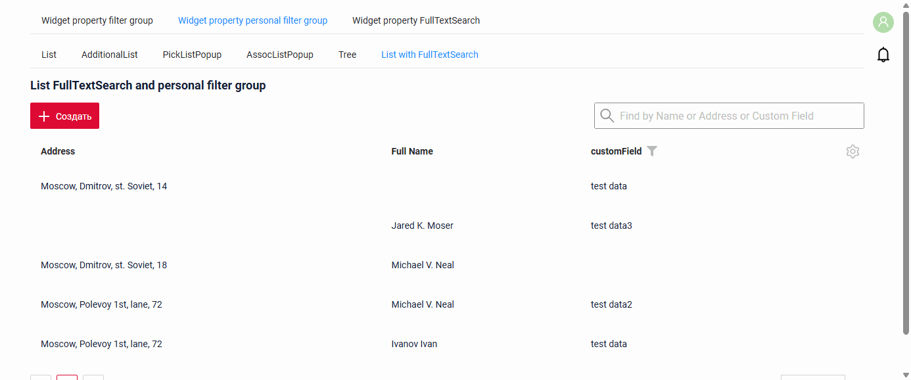

#### How to add?
Add the [full text search](/widget/type/list/list/#fulltextsearch) and the [personal filter group](/widget/type/list/list/#personal-filter-group) to the widget:
enable both options `fullTextSearch` and `filterSetting` in the **.widget.json**. Nothing else is needed: the frontend saves `_fullTextSearch` as one of the filters of the group.

```json
"options": {
  "fullTextSearch": {
    "enabled": true,
    "placeholder": "Find by Name or Address or Custom Field"
  },
  "filterSetting": {
    "enabled": true
  }
}
```

## <a id="by_filter_group">by filter group</a>

`Filter group` - predefined filters settings that users can use in an application. They allow users to quickly apply specific filtering criteria without having to manually input.
 
This function is available:

* [List](/widget/type/list/list)
  ([:material-play-circle: Live Sample]({{ external_links.code_samples }}/ui/#/screen/myexample3616/view/myexample3618list){:target="_blank"}
  [:fontawesome-brands-github: GitHub]({{ external_links.github_ui }}/{{ external_links.github_branch }}/src/main/java/org/demo/documentation/widgets/property/filtration/filtergroupsave){:target="_blank"}
  )
* [Tree](/widget/type/tree/tree)
  ([:material-play-circle: Live Sample]({{ external_links.code_samples }}/ui/#/screen/myexample3616/view/myexample3618tree){:target="_blank"}
  [:fontawesome-brands-github: GitHub]({{ external_links.github_ui }}/{{ external_links.github_branch }}/src/main/java/org/demo/documentation/widgets/property/filtration/filtergroupsave){:target="_blank"}
  )
* [AdditionalList](/widget/type/additionallist/additionallist)
([:material-play-circle: Live Sample]({{ external_links.code_samples }}/ui/#/screen/myexample3616/view/myexample3618additionallist){:target="_blank"}
[:fontawesome-brands-github: GitHub]({{ external_links.github_ui }}/{{ external_links.github_branch }}/src/main/java/org/demo/documentation/widgets/property/filtration/filtergroupsave){:target="_blank"}
)
* [Pie1D](/widget/type/pie1d/pie1d): works only in the [table mode](/widget/type/pie1d/pie1d/#tablemode)
([:material-play-circle: Live Sample]({{ external_links.code_samples }}/ui/#/screen/myexample4266){:target="_blank"}
[:fontawesome-brands-github: GitHub]({{ external_links.github_ui }}/{{ external_links.github_branch }}/src/main/java/org/demo/documentation/widgets/pie1d/filtergroup){:target="_blank"}
)
* [Column2D](/widget/type/column2d/column2d): works only in the [table mode](/widget/type/column2d/column2d/#tablemode)
([:material-play-circle: Live Sample]({{ external_links.code_samples }}/ui/#/screen/myexample4270){:target="_blank"}
[:fontawesome-brands-github: GitHub]({{ external_links.github_ui }}/{{ external_links.github_branch }}/src/main/java/org/demo/documentation/widgets/column2d/filtergroup){:target="_blank"}
)
* [Line2D](/widget/type/line2d/line2d): works only in the [table mode](/widget/type/line2d/line2d/#tablemode)
([:material-play-circle: Live Sample]({{ external_links.code_samples }}/ui/#/screen/myexample4274){:target="_blank"}
[:fontawesome-brands-github: GitHub]({{ external_links.github_ui }}/{{ external_links.github_branch }}/src/main/java/org/demo/documentation/widgets/line2d/filtergroup){:target="_blank"}
)

A filter group can be applied when the widget is opened, see [default filter group](#default_filter_group).
 
### How does it look?
=== "List"
    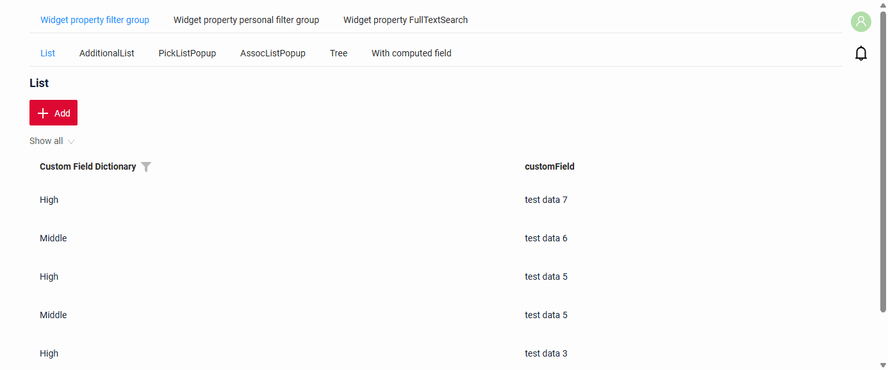
=== "AdditionalList"
    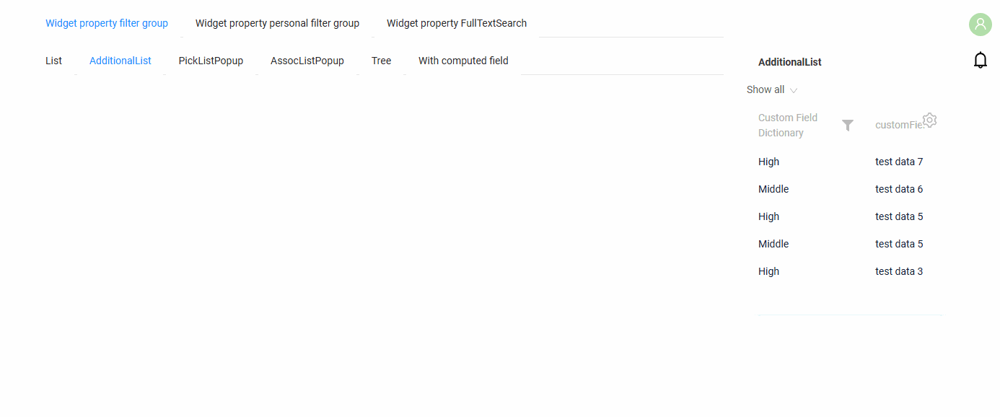
=== "Tree"
    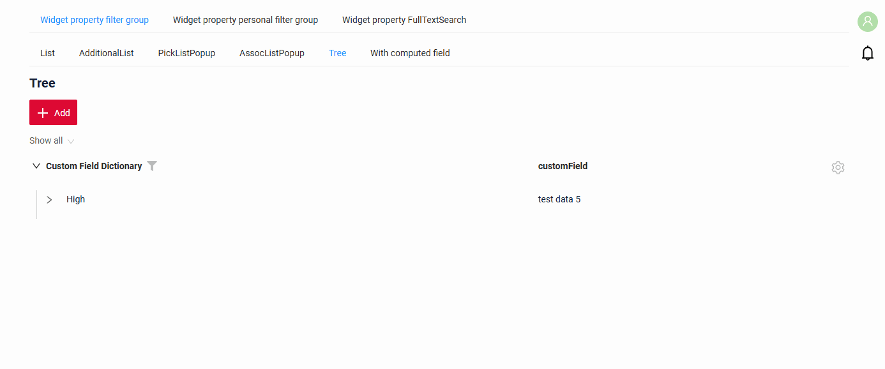
=== "Pie1D"
    
=== "Column2D"
    

!!! info

    There is a limitation when using predefined filters of the following types:
    `multivalue`, `pickList`, and `multivalueHover`.
    
     * When such filters are **predefined**, the filter tags display **`id` values**.
     * When the filter is **manually edited** (for example, by adding values via a picklist), the tags are displayed **according to the standard rules**.
    
    This behavior is caused by a frontend limitation:  
    the frontend cannot resolve display names for filter tags if the records specified in the predefined filter are located on **different pages of the picklist popup** and are not loaded in the current UI context.

    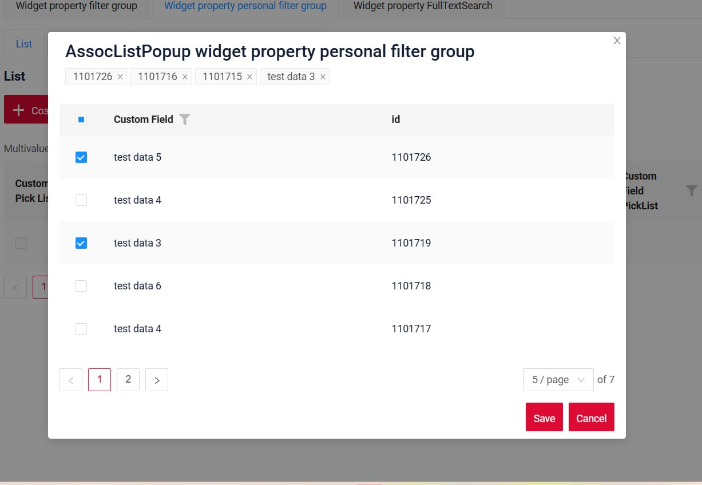   

### <a id="default_filter_group">default filter group</a>
`Default filter group` - the filter group that is applied when the widget is opened and when the page is refreshed.
The user sees the records of the group at once, without choosing it in the select above the table.

The default filter group:

* is applied to the widget like a group chosen by the user: its name is shown in the select above the table,
  the filters of the group are shown in the headers of the columns, the "Clear N filter(s)" link is shown;
* is marked by the star :material-star: in the list of the filter groups;
* can be changed by the user: the user can choose another group, change the filters or clear them.
  To return to the default filter group, the user clicks the [reset link](#reset_filters).

Only one group of a business component can be the default one: if `default_filter` is `true` for several groups, the first one is applied.

This function is available:

* [List](/widget/type/list/list)
  ([:material-play-circle: Live Sample]({{ external_links.code_samples }}/ui/#/screen/myexample3616/view/myexample3629list){:target="_blank"}
  [:fontawesome-brands-github: GitHub]({{ external_links.github_ui }}/{{ external_links.github_branch }}/src/main/java/org/demo/documentation/widgets/property/filtration/defaultfiltergroup){:target="_blank"}
  )
* [Tree](/widget/type/tree/tree)
  ([:material-play-circle: Live Sample]({{ external_links.code_samples }}/ui/#/screen/myexample3616/view/myexample3629tree){:target="_blank"}
  [:fontawesome-brands-github: GitHub]({{ external_links.github_ui }}/{{ external_links.github_branch }}/src/main/java/org/demo/documentation/widgets/property/filtration/defaultfiltergroup){:target="_blank"}
  )
* [AssocTreePopup](/widget/type/assoctreepopup/assoctreepopup): the filter of the group is applied together with the filter by `id` of the selected records
  ([:material-play-circle: Live Sample]({{ external_links.code_samples }}/ui/#/screen/myexample3261/view/myexample3261list){:target="_blank"}
  [:fontawesome-brands-github: GitHub]({{ external_links.github_ui }}/{{ external_links.github_branch }}/src/main/java/org/demo/documentation/widgets/tree/base/inner){:target="_blank"}
  )

!!! info
    The default filter group is a property of the business component, not of the widget:
    it is applied to every widget of the business component that shows the filter groups.

#### Priority of the filters
When the widget is opened, the first of the following filters is applied:

1. **The filters of the user.** If the user has changed the filters (chose a group, filtered a column, clicked "Clear N filter(s)" or "Show all records"),
   left the view and came back (closed the popup and opened it again), the filters of the user are kept.
   For example, the default filter group was applied, the user cleared the filters, left the view and came back: the filters are still cleared.
   The filters of the user are not kept after the refresh of the page.
   [PickListPopup](/widget/type/picklistpopup/picklistpopup) and [PickTreePopup](/widget/type/picktreepopup/picktreepopup) do not keep the filters of the user.
2. **The filter of the business component** - `FILTER` in the **BC_PROPERTIES** table.
   The default filter group is not applied then, it is only marked by the star.
3. **The default filter group** - `default_filter` = `true` in the **BC_FILTER_GROUPS** table.

For [AssocTreePopup](/widget/type/assoctreepopup/assoctreepopup) the filter by `id` of the selected records is added to the filters of the item 2 and 3.

#### How does it look?
=== "List"
    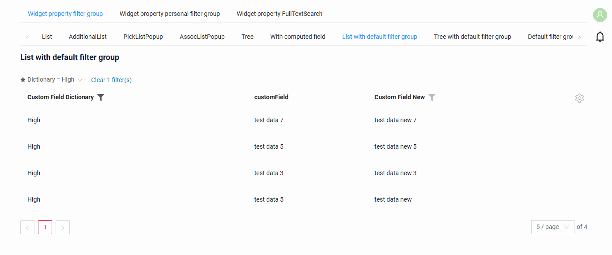
=== "Tree"
    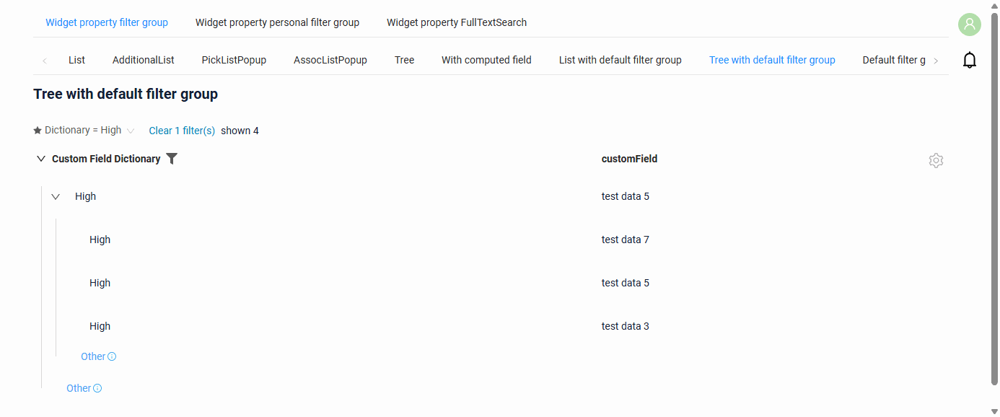

#### How to add?
??? Example
    **Step 1** Add the filtration to the fields of the group, see [by filter group](#by_filter_group).

    **Step 2** Add the group to the **BC_FILTER_GROUPS** table and set `default_filter` = `true`.

    `default_filter` - `true` - the group is applied when the widget is opened; empty or `false` - an ordinary filter group.

    ```csv
    name;bc;filters;default_filter
    Dictionary = High;myexample3629;customFieldDictionary.equalsOneOf=%5B%22High%22%5D;true
    Dictionary = Middle;myexample3629;customFieldDictionary.equalsOneOf=%5B%22Middle%22%5D;
    ```

    The column `default_filter` is added to **BC_FILTER_GROUPS** by the changeset of the project:

    ```xml
    <changeSet id="BC_FILTER_GROUPS_DEFAULT_FILTER" author="cxbox">
      <addColumn tableName="BC_FILTER_GROUPS">
        <column name="default_filter" type="BOOLEAN" remarks="The filter is default" defaultValueNumeric="0">
        </column>
      </addColumn>
    </changeSet>
    ```

    and is loaded from the csv file:

    ```xml
    <column header="default_filter" name="default_filter" type="boolean"/>
    ```

    The backend sends the flag in the meta of the screen, `defaultFilter` of the group:

    ```json
    "filterGroups": [
      {
        "name": "Dictionary = High",
        "filters": "customFieldDictionary.equalsOneOf=%5B%22High%22%5D",
        "bc": "myexample3629",
        "defaultFilter": true
      }
    ]
    ```

    === "List"
        [:material-play-circle: Live Sample]({{ external_links.code_samples }}/ui/#/screen/myexample3616/view/myexample3629list){:target="_blank"} ·
        [:fontawesome-brands-github: GitHub]({{ external_links.github_ui }}/{{ external_links.github_branch }}/src/main/java/org/demo/documentation/widgets/property/filtration/defaultfiltergroup){:target="_blank"}
    === "Tree"
        [:material-play-circle: Live Sample]({{ external_links.code_samples }}/ui/#/screen/myexample3616/view/myexample3629tree){:target="_blank"} ·
        [:fontawesome-brands-github: GitHub]({{ external_links.github_ui }}/{{ external_links.github_branch }}/src/main/java/org/demo/documentation/widgets/property/filtration/defaultfiltergroup){:target="_blank"}
    === "With BC_PROPERTIES filter"
        `FILTER` of **BC_PROPERTIES** has a higher priority: the list shows the records of `Middle`, the group `Dictionary = High` is only marked by the star.

        ```csv
        BC;PAGE_LIMIT;MASS_PAGE_LIMIT;SORT;FILTER;ID
        myexample3629bcfilter;1000;NULL;NULL;'"customFieldDictionary.equalsOneOf=%5B%22Middle%22%5D"';
        ```

        !!! warning
            `FILTER` is sent to the frontend as is (raw JSON): write the filter in double quotes, `"..."`.
            Without the quotes the answer of `/api/v1/login` is not valid JSON and the application is not loaded.

        [:material-play-circle: Live Sample]({{ external_links.code_samples }}/ui/#/screen/myexample3616/view/myexample3629bcfilter){:target="_blank"} ·
        [:fontawesome-brands-github: GitHub]({{ external_links.github_ui }}/{{ external_links.github_branch }}/src/main/java/org/demo/documentation/widgets/property/filtration/defaultfiltergroup){:target="_blank"}

## <a id="additional_properties">Additional properties</a>
### <a id="clear_filters">Clear filters</a>
If you have filtered by table, the "Clear all filters" button will appear.
It is suggested to indicate the number of applied filters by displaying "Clear n filters" (where n represents the number of columns being filtered).
 
#### How does it look?
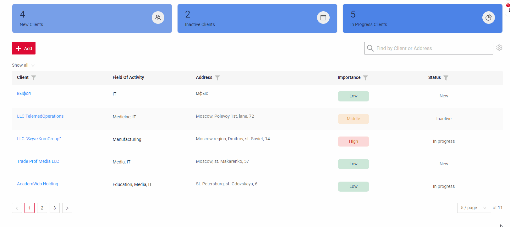
 
#### How to add?
on default

### <a id="reset_filters">Reset filters</a>
`Reset filter(s)` - the link above the table that returns the default filters of the widget, as the developer planned them:
the table looks as right after the login or after the refresh of the page.
"Clear N filter(s)" clears all the filters, "Reset filter(s)" applies the default filters again.

The default filters by priority (see [Priority of the filters](#priority-of-the-filters)):

1. `FILTER` of the business component in the **BC_PROPERTIES** table;
2. the [default filter group](#default_filter_group).

For [AssocTreePopup](/widget/type/assoctreepopup/assoctreepopup) the filter by `id` of the selected records is added to them.

The link is shown only when the widget has default filters **and** the applied filters differ from them.

The title of the link shows what the filters return to:

| Default filters                                                      | Title                                   | ru.json                             |
|----------------------------------------------------------------------|-----------------------------------------|-------------------------------------|
| default filter group or `FILTER` of **BC_PROPERTIES**                | `To default filter(s)`                  | К фильтру по умолчанию              |
| the selected records of AssocTreePopup                               | `To selected rows filter(s)`            | К фильтру по выбранному             |
| default filter group or `FILTER` of **BC_PROPERTIES** and the selected records of AssocTreePopup | `To default and selected rows filter(s)` | К фильтру по умолчанию и выбранному |
| otherwise                                                            | `Reset filter(s)`                       | Восстановить фильтр(ы)              |

For example:

1. The user opens the table for the first time. The default filters are applied. Only "Clear N filter(s)" is shown.
2. The user adds filters or changes the applied ones. "Clear N filter(s)" and "To default filter(s)" are shown.
3. The user clicks "Clear N filter(s)". All the filters are cleared. Only "To default filter(s)" is shown.
4. The user clicks "To default filter(s)". The default filters are applied. Only "Clear N filter(s)" is shown.

This function is available in the widgets with the [default filter group](#default_filter_group) or `FILTER` of **BC_PROPERTIES**:

* [List](/widget/type/list/list)
  ([:material-play-circle: Live Sample]({{ external_links.code_samples }}/ui/#/screen/myexample3616/view/myexample3629list){:target="_blank"}
  [:fontawesome-brands-github: GitHub]({{ external_links.github_ui }}/{{ external_links.github_branch }}/src/main/java/org/demo/documentation/widgets/property/filtration/defaultfiltergroup){:target="_blank"}
  )
* [Tree](/widget/type/tree/tree)
  ([:material-play-circle: Live Sample]({{ external_links.code_samples }}/ui/#/screen/myexample3616/view/myexample3629tree){:target="_blank"}
  [:fontawesome-brands-github: GitHub]({{ external_links.github_ui }}/{{ external_links.github_branch }}/src/main/java/org/demo/documentation/widgets/property/filtration/defaultfiltergroup){:target="_blank"}
  )
* [AssocTreePopup](/widget/type/assoctreepopup/assoctreepopup)
  ([:material-play-circle: Live Sample]({{ external_links.code_samples }}/ui/#/screen/myexample3261/view/myexample3261list){:target="_blank"}
  [:fontawesome-brands-github: GitHub]({{ external_links.github_ui }}/{{ external_links.github_branch }}/src/main/java/org/demo/documentation/widgets/tree/base/inner){:target="_blank"}
  )

#### How does it look?


#### How to add?
on default: add the [default filter group](#default_filter_group) or `FILTER` to the **BC_PROPERTIES** table.

### <a id="delete_personal_filter_group">Delete personal filter group</a>
`Delete personal filter group` - the user deletes the [personal filter group](#by_personal_filter_group) saved by them.

1. Click the gear icon above the table and choose "Save filters".
2. The modal window "Filter group setting" lists the personal filter groups of the user. Click the cross next to the name of the group.

The group is deleted at once: it disappears from the modal window and from the select of the filter groups above the table.
The frontend sends the request `DELETE /api/v1/personalFilterGroups` with the `id` of the group, so the group is not shown after the refresh of the page and on other devices of the user.

Only the personal groups of the user are listed in the modal window: the [filter groups](#by_filter_group) of the **BC_FILTER_GROUPS** table,
including the [default filter group](#default_filter_group), can not be deleted by the user.

This function is available:

* [List](/widget/type/list/list) (
[:material-play-circle: Live Sample]({{ external_links.code_samples }}/ui/#/screen/myexample3616/view/myexample3616list){:target="_blank"}
[:fontawesome-brands-github: GitHub]({{ external_links.github_ui }}/{{ external_links.github_branch }}/src/main/java/org/demo/documentation/widgets/property/filtration/filtergroup){:target="_blank"}
)
* [AdditionalList](/widget/type/additionallist/additionallist) (
[:material-play-circle: Live Sample]({{ external_links.code_samples }}/ui/#/screen/myexample3616/view/myexample3616additionallist){:target="_blank"}
[:fontawesome-brands-github: GitHub]({{ external_links.github_ui }}/{{ external_links.github_branch }}/src/main/java/org/demo/documentation/widgets/property/filtration/filtergroup){:target="_blank"}
)
* [Tree](/widget/type/tree/tree) (
[:material-play-circle: Live Sample]({{ external_links.code_samples }}/ui/#/screen/myexample3616/view/myexample3616tree){:target="_blank"}
[:fontawesome-brands-github: GitHub]({{ external_links.github_ui }}/{{ external_links.github_branch }}/src/main/java/org/demo/documentation/widgets/property/filtration/filtergroup){:target="_blank"}
)

#### How does it look?
=== "List"
    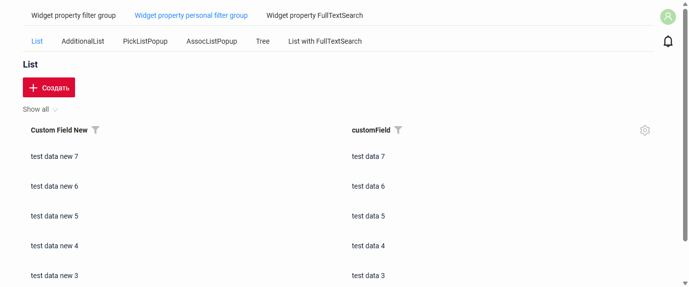
=== "AdditionalList"
    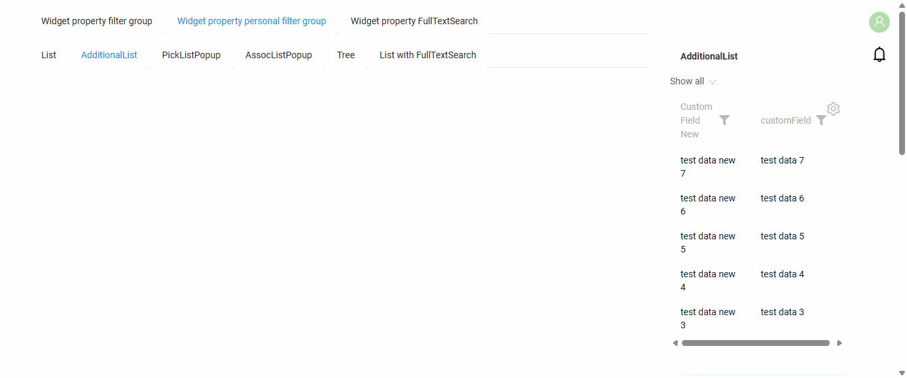
=== "Tree"
    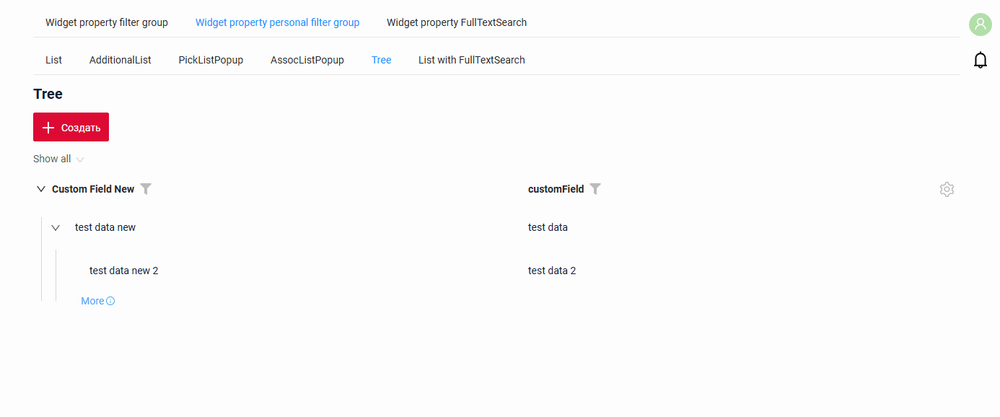

#### How to add?
on default: the widget has the [personal filter group](#by_personal_filter_group), `filterSetting` is enabled in the **.widget.json**.

```json
"options": {
  "filterSetting": {
    "enabled": true
  }
}
```